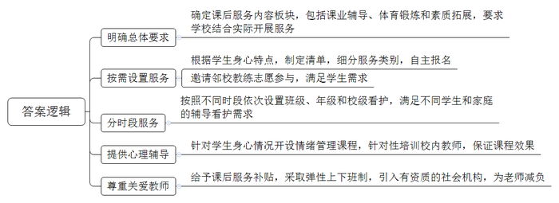
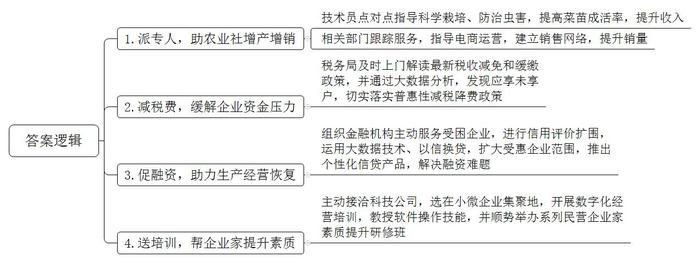
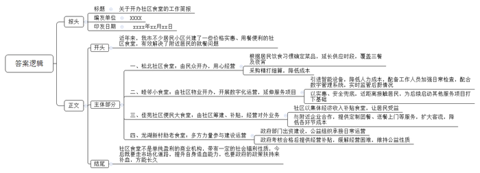

# 2022年公务员多省联考《申论》题（安徽A、普通选调卷）

> 候选采集稿。参考答案及解析来自粉笔页面，不代表官方答案或真实高分答卷；来源使用许可与原卷对应关系仍需人工核实。

## 给定材料

### 材料 material-5a59ae177b5dd50e

“下班后我就顺路来学校带孩子回家，她在学校把作业都做完了，还跟着教练学了一节篮球课。”张大姐高兴地说，“以前一到三点半，厂房的机器还在响，我的耳边也响起了学校的放学铃，心里可着急了。现在有了课后服务，真是解了我们双职工家庭的燃眉之急。”

“随着我国城市化进程加快，双职工家庭越来越多，父母下班时间与子女放学时间不同步的问题越来越突出。课后服务是我们努力解决群众实际困难的一个举措。”H市教育局李局长说，“我们要求课后服务包括课业辅导、体育锻炼和素质拓展三个板块，然后各个学校根据自身实际开展课后服务。”

“这是我每天最期待的时间！”今年读小学四年级的小薇开心地说。她和小伙伴们在等待市体校张教练的到来。每天课后服务时间，张教练都会准时来给孩子们上花样跳绳课。“我们根据小学生的身体和心理发育特点，制定出课后服务清单，让孩子们自主报名。比如体育锻炼就细分为篮球、足球、羽毛球、越野跑等很多类别。这样就能充分满足孩子们的不同需求。”班主任季老师说，“我们学校没有那么多体育师资，怎么办呢？正好市体校就在我们隔壁，就请体校的教练来开展志愿活动。张教练的花样跳绳给了孩子们很大的新鲜感和乐趣，非常受孩子们欢迎。”

“放学后在学校写作业，有不会的问题直接问老师，很方便。”小磊今年读初二，以前放学回家后遇到数学难题，爸爸妈妈都不会辅导，为此他很苦恼。现在，学校的课后服务提供作业辅导，这让他很开心。小磊的学校把课后服务分为三段。15：30到16：30是班级看护，学生在教室写作业，轮值教师在教室辅导；16：30到17：30是年级看护，学校设置了丰富多彩的社团活动，同年级的同学可以跨班级组团；17：30到18：00是校级看护，有少数同学还没回家，学校集中安排教室，让大家阅读、下棋，轮值教师在教室进行看护。“我家离学校很近，爸爸妈妈下班又迟，以前回家后只有一个人，就觉得很无聊。有了校级看护，我就可以和同学交换课外书看。”小磊说，“这样安排太棒了。”

“闭上眼睛，有些疲倦的你，最先想到的是怎样的画面？”“我想到前年和爸爸妈妈去海边，看到蓝色的海，黄色的落日。”“你听到了什么？”“我听到海浪拍击沙滩的声音……”这是一所中学为初三学生开设的情绪管理辅导课。“我们考虑到初三的学生正值青春期，又加上学业压力大，情绪容易不稳定，就开了这门课程。”这所中学的宋校长说，“希望我们提供的课后服务能对学生有长远的帮助，让他们今后回忆起母校都能满怀温情。”给同学们上情绪管理课的是学校的欧老师，欧老师原本就是学校的心理辅导老师，平时主要是针对个别学生进行心理辅导，举办一些心理学的普及性讲座，要面对初三学生开设一个学期的情绪管理课，欧老师还是觉得压力很大。“学校一再强调课后服务要追求质量，不能玩花架子。”欧老师说，“课后服务的部分课程由我们这些校内教师承担，学校利用暑假对我们进行了针对性的培训，让我们站在讲堂上更有底气。”

“我们学校几乎所有老师都参与了课后服务，没有一个老师推辞。”宋校长说，根据教育局制定的课后服务收费和补助标准，课后服务一节课补助58元，“这是对老师劳动的尊重。老师们平时教学任务比较重，课后服务大大增加了老师负担，学校也想办法关爱教师，采取教师弹性上下班制，部分课程聘请有资质的社会机构，尽量减轻老师的负担。我们还在考虑怎样突破学校场地限制，让课后服务走出校园，让学生在更广阔的天地里收获更丰富的经历。”

李局长说：“我市的课后服务已经基本实现了义务教育学校全覆盖。日前，我们正在对寒暑假校内托管服务开展试点工作，今后学生可以按照就近原则跨校参加托管服务，着力破解中小学生假期‘看护难’这一群众急难愁盼问题。”

### 材料 material-8f1496456fcc03f1

走进F县现代农业示范园区，农民专业合作社负责人老杨正在大棚内侍弄自己培育的瓜果蔬菜苗，一盆盆幼苗在阳光的照射下茁壮生长。“县农村农业局派了技术员点对点指导我们科学栽培、防治虫害，我们的菜苗成活率比以前高多了。去年一年，光种苗我们合作社就卖了500多万株，刨去各种成本，一年下来能有40多万元的纯利润。”说起去年的收入，老杨掩不住内心的喜悦，“以前我们只知道种自家的田，后来随着市场发展，几户人家成立起合作社。”老杨说，种植规模不断扩大，但种植的作物怎么卖出去却让我们觉得力不从心，幸好县里有关部门一路跟着服务，“商务局派了工作人员指导我们怎么做电商，建立销售网络，让我们不愁卖不出去。”

老杨说的是F县帮扶小微企业行动中的一部分。小微企业是国民经济和社会发展的重要基础，在扩大就业、增加收入、改善民生、促进稳定等方面具有举足轻重的作用。“近年来，国家和省里都出台了一系列的政策，扶持小微企业发展，我们县也结合自身实际情况制定了相关的文件，把帮扶小微企业当作‘为群众办实事’活动的重要内容来抓。”F县王县长说。

“作为小企业，我们市场竞争力弱，而对突如其来的新冠肺炎疫情，企业发展资金压力很大。税务局及时上门解读最新的税收减免和缓缴政策，帮助我们减免了40多万元税款，解了燃眉之急。”未来食品公司范经理感激地说。未来食品公司主要经营糕点糖果批发。去年，该企业实现利润总额274万元，按原本税率应缴纳企业所得税61.87万元，由于该企业是小微企业，享受小微企业普惠性减税降费政策，实际应缴纳企业所得税19.75万元，减免税额达42.12万元。“有些我们这样的小微企业并不了解国家税务政策的变化，是县税务局通过大数据分析，发现了我们这些应享未享户，切实给我们带来了国家减税降费政策的温暖。”

“小微贷情系小微”，在当地一家银行，有这样一面锦旗，7个字饱含了一个企业经营者对银行有力支持小微企业发展的衷心感谢。送锦旗的纳税人老魏是县一家五金模具厂的老板。受新冠肺炎疫情影响，该企业连续停业2个月，生产经营面临巨大困难。县政府组织多家金融机构主动服务受困企业，提供个性化融资支持服务。银行刘行长说：“我们积极配合县政府的行动，通过信用评价扩围、运用大数据分析技术和‘以信换贷’方式，将受惠企业范围由纳税信用A级和B级扩大至M级，推出多种个性化的信贷产品，最大限度赋能企业渡过难关。”2021年，全县共有183家小微企业获得信用贷款，融资难、融资贵问题得到极大缓解。老魏的模具厂获得了银行线上发放的47.9万元低息信用贷款。“这笔贷款是旱日的甘露，我们立即用这笔贷款购买开工原材料、支付人员工资等，给我们复工复产带来莫大的信心。”老魏说。

县综合市场石材批发店的老板老黄，凭着不怕吃苦的劲儿，生意越来越好，他一笔笔手工记账，很快就赶不上生意的节奏了。可石材批发店人手不多，专门雇人记帐成本太高。“近年来，随着国家跨入数字时代，数字化运营成为企业的必由之路。”王县长说，“但我们县小微企业离真正的数字化运营还很远，这成为制约企业发展的一个瓶颈。”县政府主动接洽一家科技公司，对全县小微企业开展数字化经营进行专门培训。“目的是帮助小微企业尽快跟上数字化经营的时代步伐，不断做优做强。这是我们为群众办实事的具体实践。”首场培训选在小微企业集中的县综合市场，大家热情高涨，包括老黄在内的近百名企业经营者参加了数字化运营培训班。老黄很快学会使用数字记账软件，每日、每周、每月的顾客人数、收款笔数、单笔款项等一目了然。看到这些企业如此踊跃参加培训班，县政府又顺势而为举办一系列民营企业家素质提升研修班，也受到众多小微企业的热捧。

### 材料 material-6f83fa5f140c43cb

早上，在松北社区食堂，滋啦滋啦的油煎声中，黄澄澄的油条出锅了！看着酥脆，闻着喷香，看下价格，只要1元一根。中午，在附近写字楼上班的赵先生买了份套餐，鸡肉配空心菜，一荤一素，只要8元。虽然不住在这个社区，但赵先生每天中午都在这儿用餐，因为又便宜又方便。价格实惠是社区食堂的重要特征。松北社区食堂是老邱开办的，在老邱看来，虽然价格便宜，但只要用心经营，社区食堂一样可以赚钱。社区除了当地居民，还有很多湖南、四川的外来人口，因此食堂推出了湘菜和川菜。一开始食堂只做午餐，随着固定的顾客越来越多，现在延长供应时段，覆盖早中晚餐和夜宵，销量增加也意味着收益增加。每天一大早，老邱就要扎进菜市场采购食材，“卖相好的食材更贵，但对于社区食堂来说没有必要，你看，这个南瓜形状不太好看，但很新鲜，不妨碍质量和味道。”老邱说，“我们就是在这样的精打细算中降低成本。细水长流地赚钱，也是一种重要的商业模式。”

近年来，s市不少居民小区渐渐兴起了这种服务居民的社区食堂。面积不大，但价格实惠、用餐便利，有效解决了附近居民的就餐问题。在一家名为“睦邻小食堂”的社区食堂里，一个全自动的煮面机械臂正熟练地取面、投面、翻转汤篓、加上浇头，一碗热气腾腾的本帮汤面就新鲜出炉。“我们可以自己在电子面板上选择味道，有荤有素，挺符合我们胃口的，也比较有营养。”前来取餐的李先生笑着说道，他把餐品放到AI摄像头下，每道菜品价格自动显示，刷脸或出示餐卡，就能轻松完成支付。这家社区食堂是社区物业开办的，通过数字化运营，有效降低人力成本。“数字化运营还能保证食品安全。”食堂负责人颜女士表示，按照市政府的统一要求，为加强日常检查，社区为每个开业运营的社区食堂配备了一名工作人员。同时食堂还安装了一套数字管理系统，将后厨操作规范、环境监管整合为一体，能实时查看食堂后厨情况，让顾客吃着放心。“我们做社区食堂特别注重声誉，要既实惠又安全。”颜女士说，“其实社区食堂赚钱不多，但通过社区食堂，我们可以近距离地接触居民，为以后启动理疗，康健、看护、家政等服务项目打下基础。”

酸辣土豆丝3元、青椒炒肉6元、花卷0.5元……S市佳苑社区便民大食堂食品价格实惠，老年人就餐还能打折，如此物美价廉，食堂运营会不会亏本？事实上，不少社区食堂在初期单凭自身运营很难做到盈亏平衡。实现价廉物美，需要政府部门、社区及社会力量的支持。“建这个食堂的初衷就是解决老年人吃饭问题，不以营利为目的。”社区康主任说，“社区居民一共1200多人，其中60岁以上老年人就有360多人，年轻人上班后照顾家庭的时间少了，老年人吃饭问题就凸显出来。”为了更好照顾老人，减少年轻人后顾之忧，社区决定筹建食堂。在这里，60岁以上老年人每个月伙食费300元，其中由社区出210元，个人只需交90元，相当于打了三折。“建设社区食堂是民生工程，社区集体经济发展了，自然要改善民生，让每一个居民受益。”康主任介绍，去年佳苑社区集体经济收入超过7800万元，用在社区居民身上的民生支出有5500多万元，其中就包括对社区食堂的补贴。“我们也经营对外业务，附近有工业园，他们对我们的食堂比较放心，我们就与园内一些企业合作，定制团餐，送餐上门。”康主任说，客流扩大后，采购、运营、管理等环节的成本也有效降低了。

“我市人口六百多万，三成居民是60岁以上老人，自己做饭不仅麻烦，也不安全；还有很多年轻人，平时工作压力大、生活节奏快，往往没空进厨房，这是我市在发展中出现的新问题。社区食堂是解决群众实际问题的一个重要途径。”S市民政局陈局长说，“市政府安排财政资金，对考核合格的社区食堂进行补贴，不过还是有些食堂难以支撑。”龙湖新村的助老食堂由政府部门出资建设，日常运营则由一家公益组织负责。“我们长期从事帮扶老人等群体的公益工作，共有1000多名志愿者，食堂建好后，政府部门第一时间想到由我们来承接。”负责运营的社会公益组织负责人董先生说。在助老食堂，60岁以上老人每人每餐只需5元，而每顿饭成本就要10元左右，“成立初期，食堂每月亏损1万元左右。这让我们压力很大。”董先生说，后来食堂从政府那里领到了经营补贴，暂时缓解了食堂的经营困难，但董先生还是对未来有些担忧，“社区食堂不是一个单纯盈利的商业机构，还带有一定的社会福利性质，要走市场化道路，提升自身造血能力，也要政府的政策扶持，对它进行补血。”

## 题目

### 第 1 题

**根据给定资料**1**，归纳****H市的中小学校在开展课后服务方面的主要举措。（15分）**

关联材料：材料 material-5a59ae177b5dd50e

作答要求：

要求：

（1）准确全面；

（2）分条列出；

（3）不超过250字。

### 第 2 题

**给定资料**2**介绍了****F县帮扶小微企业的具体做法，请概括其主要经验，供F县在市政府召开的帮扶小微企业经验交流会上介绍。（20分）**

关联材料：材料 material-8f1496456fcc03f1

作答要求：

要求：

（1）准确全面，普适性强；

（2）分条列出，简洁明了；

（3）不超过350字。

### 第 3 题

**根据给定资料**3**，就****S市开办社区食堂的情况拟写一份工作简报。（25分）**

关联材料：材料 material-6f83fa5f140c43cb

作答要求：

要求：

（1）紧扣资料，内容完整；

（2）条理清晰，语言准确；

（3）不少于500字。

### 第 4 题

**给定资料**5**中画线句子写道：****“成长的烦恼总是在成长中化解的”，请结合你对这句话的思考，联系实际，自选角度，自拟题目，写一篇议论文。（40分）**

关联材料：材料 material-5a59ae177b5dd50e

作答要求：

要求：

（1）立意明确，观点正确；

（2）思路清晰，语言流畅；

（3）参考给定资料，但不拘泥于给定资料；

（4）1000\-1200字。

## 答案与解析

第 1 题

**参考答案（粉笔题库参考内容）**

1.明确总体要求。确定课后服务内容板块，包括课业辅导、体育锻炼和素质拓展，要求学校结合实际开展服务。

2.按需设置服务。根据学生身心特点，制定清单，细分服务类别，自主报名；邀请邻校教练志愿参与，满足学生需求。

3.分时段服务。按照不同时段依次设置班级、年级和校级看护，满足不同学生和家庭的辅导看护需求。

4.提供心理辅导。针对学生身心情况开设情绪管理课程，针对性培训校内教师，保证课程效果。

5.尊重关爱教师。给予课后服务补贴，采取弹性上下班制，引入有资质的社会机构，为老师减负。

**解析**

**参考答案说明：**本参考答案从“明确总体要求”“按需设置服务”“分时段服务”“提供心理辅导”和“尊重关爱教师”五个方面展开，各条答案要点之间在内容上相互并列，没有交叉。

  

**考点**：考点概括措施类

**来源**：来源2022年公务员多省联考《申论》题（安徽A、普通选调卷）

粉笔申论页面对本题只提供「解析视频」入口，该入口是会员推广位，页面无视频地址与文字解析。

第 2 题

**参考答案（粉笔题库参考内容）**

1.派专人，助农业社增产增销。技术员点对点指导科学栽培、防治虫害，提高菜苗成活率，提升收入；相关部门跟踪服务，指导电商运营，建立销售网络，提升销量。

2.减税费，缓解企业资金压力。税务局及时上门解读最新税收减免和缓缴政策，并通过大数据分析，发现应享未享户，切实落实普惠性减税降费政策。

3.促融资，助力生产经营恢复。组织金融机构主动服务受困企业，进行信用评价扩围，运用大数据技术、以信换贷，扩大受惠企业范围，推出个性化信贷产品，解决融资难题。

4.送培训，帮企业家提升素质。主动接洽科技公司，选在小微企业集聚地，开展数字化经营培训，教授软件操作技能，并顺势举办系列民营企业家素质提升研修班。

**解析**

**参考答案说明：**答案分别按照“派专人，助农业社增产增销”“减税费，缓解企业资金压力”“促融资，助力生产经营恢复”“送培训，帮企业家提升素质”这四个方面的经验进行了分条撰写。且对每条要点提炼出了总括词并前置。

**考点**：考点经验启示类

**来源**：来源2022年公务员多省联考《申论》题（安徽A、普通选调卷）

粉笔申论页面对本题只提供「解析视频」入口，该入口是会员推广位，页面无视频地址与文字解析。

第 3 题

**参考答案（粉笔题库参考内容）**

关于开办社区食堂的工作简报

XXXX xxxx年xx月xx日

近年来，我市不少居民小区兴建了一些价格实惠、用餐便利的社区食堂，有效解决了附近居民的就餐问题。

一、松北社区食堂：由民众开办，用心经营。根据居民饮食习惯确定菜品，延长供应时段，覆盖三餐及夜宵；采购精打细算，降低成本。二、睦邻小食堂：由社区物业开办，开展数字化运营，延伸服务项目。引进智能设备，降低人力成本，配备工作人员加强日常检查，配合数字管理系统，实时监管后厨情况；以实惠、安全兜底，近距离接触居民，为后续启动其他服务项目打下基础。三、佳苑社区便民大食堂：由社区筹建、补贴，经营对外业务。社区以集体经济收入补贴食堂，让居民受益；与附近企业合作，提供定制团餐、送餐上门等服务，扩大客流，降低各环节成本。四、龙湖新村助老食堂：多方力量参与建设运营。政府部门出资建设，公益组织承接日常运营；政府考核合格后提供经营补贴，缓解经营困难，维持公益性质。

社区食堂不是单纯盈利的商业机构，带有一定的社会福利性质，今后既要走市场化道路，提升自身造血能力，也要政府的政策扶持来补血，方能长久。

**解析**

**参考答案说明：**（1）格式方面，本参考答案写到了“报头”“正文”两部分，“报头”包括标题、编发单位、印发日期。（2）正文部分，一方面从内容上来看，围绕“S市开办社区食堂”这一主题，本参考答案的开头先写到了S市开办社区食堂的背景；主体部分从“松北社区食堂”“睦邻小食堂”“佳苑社区便民大食堂”“龙湖新村助老食堂”四所社区食堂介绍了其开办情况；结尾部分用社区食堂的定位及发展方向进行总结。另一方面，形式上，本参考答案做到了分段、分条撰写，整体上条理较为清晰

**考点**：考点总结类

**来源**：来源2022年公务员多省联考《申论》题（安徽A、普通选调卷）

粉笔申论页面对本题只提供「解析视频」入口，该入口是会员推广位，页面无视频地址与文字解析。

第 4 题

**参考答案（粉笔题库参考内容）**

**推动新兴民生产业高质量发展**

经济社会的高速发展催生了越来越多的新兴民生产业：智慧医疗、在线教育、新零售……，它们不仅满足了人民日益增长的需求，还为经济发展带来了新机遇。但这些新兴民生产业在发展的过程中，却渐渐暴露出了规划滞后、制度缺失、服务品质低等系列问题。民生产业关乎民生，问题待解决，前路需笃行，要推动新兴民生产业高质量发展，不仅需要具备前瞻性思维和应对解决纠纷的能力，更要不断提升服务水平，始终将人民放在心中。

**更好地应对新兴民生产业，需要着眼未来，做好前瞻性设计。政府不仅要通过研判未来的发展趋势，制定产业规划，避免因为规划的短视造成长远建设的被动；还要做好及时填补相应的制度空白，健全体制机制。**“凡事预则立，不预则废”。从养老服务机构摇号进入，到直播行业虚假宣传、价格误导……这些问题都是由于产业发展初期，政府只从当下需求和利益出发而做出相应的规划设计，但是随着产业不断发展，起初的规划设计逐渐远远落后于现实，导致问题频发。因此，在面对新兴民生产业时，政府部门必须通过研究产业的过去与现在，根据产业发展规模和速度的趋势，制定出具有可预见性的计划与部署，并且提前出台支撑产业发展的政策体系，为新事物打造良好的发展环境。

**更好地应对新兴民生产业，需要坚持以人为本，提升服务质量。既要推进服务便利化，让群众轻松容易地获取服务；也要推进服务精细化，力争做好每个细节，加强各环节的衔接；还要加大投入，促进服务持续升级，让群众享受到更优质的服务。**民生产业为人民，必须坚持以人民为中心，将群众需求放到首位，不断推动服务向便利化、精细化、优质化转型，加快新兴民生产业高质量发展。正如新材料产业通过特殊技术，为人们提供衣食住行新体验；新零售产业打通线上线下，给消费者带来更加贴心的服务。我们既要转变思维，想人民之所想，创新服务内容，还要查缺补漏，不断精进，强化资金支持，持续优化服务水平，让人民群众充分享受新兴民生产业发展红利。

**我们更应该认识到，作为与人直接发生联系的民生产业，必然少不了摩擦纠纷的发生，这就需要做好应对工作。当纠纷发生时，要快速反应，第一时间处理；同时，针对频发、易发的纠纷，要在工作中总结出明确的处理方法、流程，提升处置效果。**“前途是光明的，道路是曲折的”。从共享行业泄露个人信息，到人工智能冲击传统产业，再到新能源汽车充电难……不可否认，我国在新兴民生产业发展过程中存在问题，引起了人们的质疑和批判，制约了产业的进一步发展。如何快速解决并避免类似情况发生呢？一方面，我们要全面了解并根据实际情况，快速给出合理处置，做好解释工作，避免事态扩大；另一方面，要认真分析问题产生的深层次原因，通过完善制度、规范管理等方式堵塞漏洞，构建长效处理机制。

春天的道路依然充满泥泞。回顾过去，我们曾经面对很多看似难以克服的问题，但发展本身正是一个不断解决问题的过程。相信通过不断提高治理能力，新兴民生产业的发展必将蹄疾步稳、充满活力。

**解析**

**文章分析：**

**推动新兴民生产业高质量发展**

【**标题的优点：**标题中含有主题词，使文章主题更突出、清晰。】

（1）经济社会的高速发展催生了越来越多的新兴民生产业：智慧医疗、在线教育、新零售……，它们不仅满足了人民日益增长的需求，还为经济发展带来了新机遇。（2）但这些新兴民生产业在发展的过程中，却渐渐暴露出了规划滞后、制度缺失、服务品质低等系列问题。（3）民生产业关乎民生，问题待解决，前路需笃行，要推动新兴民生产业高质量发展，不仅需要具备前瞻性思维和应对解决纠纷的能力，更要不断提升服务水平，始终将人民放在心中。

【**开头的优点：**★内容方面。范文的开头是紧扣题目给定的“提升治理能力，促进新兴民生产业发展”这一主题展开的。（1）介绍了新兴民生产业发展的良好态势及影响；（2）指出了当前新兴民生产业发展中存在的问题；（3）从整体上指出了推动新兴民生产业发展的措施。★文字表达方面。使用了“不仅……还”“但……”“不仅……更”等连接词，使语言表达具有严谨的逻辑性。】

**更好地应对新兴民生产业，需要着眼未来，做好前瞻性设计。政府不仅要通过研判未来的发展趋势，制定产业规划，避免因为规划的短视造成长远建设的被动；还要做好及时填补相应的制度空白，健全体制机制。**（1）“凡事预则立，不预则废”。从养老服务机构摇号进入，到直播行业虚假宣传、价格误导……这些问题都是由于产业发展初期，政府只从当下需求和利益出发而做出相应的规划设计，但是随着产业不断发展，起初的规划设计逐渐远远落后于现实，导致问题频发。（2）因此，在面对新兴民生产业时，政府部门必须通过研究产业的过去与现在，根据产业发展规模和速度的趋势，制定出具有可预见性的计划与部署，并且提前出台支撑产业发展的政策体系，为新事物打造良好的发展环境。

【**论述段****1的优点：**★观点句：范文的观点句是紧扣“提升治理能力，促进新兴民生产业发展”这一文章主题提出的。形式上，它在段首处直接写出，位置突出，容易发现。内容上，关键词突出，内容要点明确，可以明显看出是从“前瞻规划”角度，对“促进新兴民生产业发展”展开了论述。★论述内容：（1）以养老服务业、直播行业为例，指出了当前民生产业存在的问题及原因；（2）指出了政府部门应当立足过去与现在，对新兴民生产业做出科学合理的规划。注意：以上两个方面的内容都是紧扣“更好地应对新兴民生产业，需要着眼未来，做好前瞻性设计。政府不仅要通过研判未来的发展趋势，制定产业规划，避免因为规划的短视造成长远建设的被动；还要做好及时填补相应的制度空白，健全体制机制”这个观点句进行分析论述的，论述的针对性强，内容层次丰富。在论述方法上采用了摆事实、讲道理相结合的方式，论述清晰透彻。】

**更好地应对新兴民生产业，需要坚持以人为本，提升服务质量。既要推进服务便利化，让群众轻松容易地获取服务；也要推进服务精细化，力争做好每个细节，加强各环节的衔接；还要加大投入，促进服务持续升级，让群众享受到更优质的服务。**（1）民生产业为人民，必须坚持以人民为中心，将群众需求放到首位，不断推动服务向便利化、精细化、优质化转型，加快新兴民生产业高质量发展。正如新材料产业通过特殊技术，为人们提供衣食住行新体验；新零售产业打通线上线下，给消费者带来更加贴心的服务。（2）我们既要转变思维，想人民之所想，创新服务内容，还要查缺补漏，不断精进，强化资金支持，持续优化服务水平，让人民群众充分享受新兴民生产业发展红利。

【**论述段****2的优点：**★观点句：范文的观点句是紧扣“提升治理能力，促进新兴民生产业发展”这一文章主题提出的。形式上，它在段首处直接写出，位置突出，容易发现。内容上，关键词突出，内容要点明确，可以明显看出从“提升服务质量”角度，对“促进新兴民生产业发展”展开了论述。★论述内容：（1）指出了要重视群众需求，推进民生服务向高质量水平跃进；（2）指出了要转变思维，创新民生服务，让群众享受发展红利。注意：以上两个方面的内容都是紧扣“更好地应对新兴民生产业，需要坚持以人为本，提升服务质量。既要推进服务便利化，让群众轻松容易地获取服务；也要推进服务精细化，力争做好每个细节，加强各环节的衔接；还要加大投入，促进服务持续升级，让群众享受到更优质的服务”这个观点句进行分析论述的，论述的针对性强，内容层次丰富。在论述方法上采用了摆事实、讲道理相结合的方式，论述清晰透彻。】

**我们更应该认识到，作为与人直接发生联系的民生产业，必然少不了摩擦纠纷的发生，这就需要做好应对工作。当纠纷发生时，要快速反应，第一时间处理；同时，针对频发、易发的纠纷，要在工作中总结出明确的处理方法、流程，提升处置效果。**（1）“前途是光明的，道路是曲折的”。从共享行业泄露个人信息，到人工智能冲击传统产业，再到新能源汽车充电难……不可否认，我国在新兴民生产业发展过程中存在问题，引起了人们的质疑和批判，制约了产业的进一步发展。（2）如何快速解决并避免类似情况发生呢？一方面，我们要全面了解并根据实际情况，快速给出合理处置，做好解释工作，避免事态扩大；另一方面，要认真分析问题产生的深层次原因，通过完善制度、规范管理等方式堵塞漏洞，构建长效处理机制。

【**论述段****3的优点：**★观点句：范文的观点句是紧扣“提升治理能力，促进新兴民生产业发展”这一文章主题提出的。形式上，它在段首处直接写出，位置突出，容易发现。内容上，关键词突出，内容要点明确，可以明显看出从“应对摩擦纠纷”角度，对“促进新兴民生产业发展”展开了论述。★论述内容：（1）以共享行业、人工智能产业为例，指出了我国新兴民生产业的问题及影响；（2）从避免事态扩大、完善制度与管理方式的角度，提出了解决问题的措施。注意：以上两个方面的内容都是紧扣“我们更应该认识到，作为与人直接发生联系的民生产业，必然少不了摩擦纠纷的发生，这就需要做好应对工作。当纠纷发生时，要快速反应，第一时间处理；同时，针对频发、易发的纠纷，要在工作中总结出明确的处理方法、流程，提升处置效果”这个观点句进行分析论述的，论述的针对性强，内容层次丰富。在论述方法上采用了摆事实、讲道理相结合的方式，论述清晰透彻。】

【**论述段之间的关系：**三个论述段分别从“前瞻规划”“提升服务质量”“应对摩擦纠纷”等三个角度，对文章主题“提升治理能力，促进新兴民生产业发展”展开了论述，在内容上，彼此之间呈现出并列的逻辑。】

春天的道路依然充满泥泞。回顾过去，我们曾经面对很多看似难以克服的问题，但发展本身正是一个不断解决问题的过程。相信通过不断提高治理能力，新兴民生产业的发展必将蹄疾步稳、充满活力。

【**结尾的优点：**范文的结尾回扣了为社会发展“提升治理能力，促进新兴民生产业发展”这个主题，并且进行了总结升华。】

  
  

**考点**：考点文章写作题

**来源**：来源2022年公务员多省联考《申论》题（安徽A、普通选调卷）

粉笔申论页面对本题只提供「解析视频」入口，该入口是会员推广位，页面无视频地址与文字解析。

