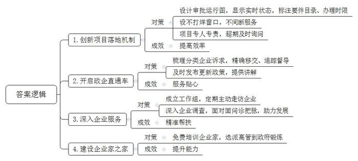
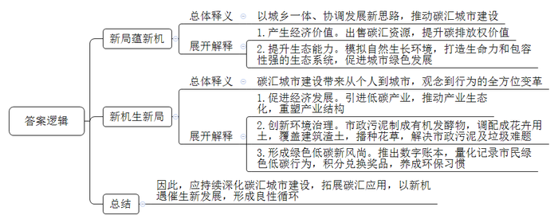
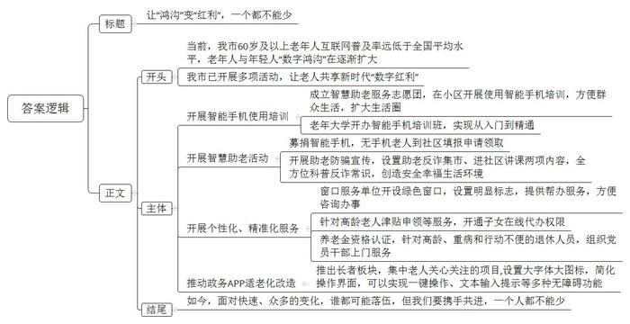
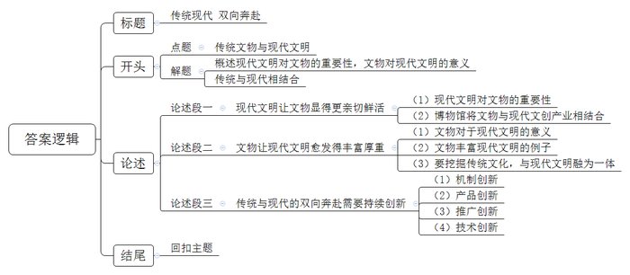

# 2023年公务员多省联考《申论》题（安徽A、普通选调卷）

<!-- gwy:overview:start -->
> **安徽 · 2023 · 申论 · A类** ｜ 4 题 · 图片 4 处 · 答案随题折叠

导航：[题目](#题目)
<!-- gwy:overview:end -->

> 候选采集稿。参考答案及解析来自粉笔页面，不代表官方答案或真实高分答卷；来源使用许可与原卷对应关系仍需人工核实。

## 给定材料

### 材料 material-3a4f7a41ce3e4d81

走进A市政务服务中心一楼大厅，首先映入眼帘的便是一块大屏幕。屏幕上有一张类似地铁运行图的线路表，各个站点闪烁着指示灯，“行驶”其间的，并非列车，而是市招商引资项目。A市创新项目落地服务保障机制，把项目建设的各环节细化设计成14个站点的“地铁运行图”，每个站点代表一个审批事项，蓝、黄、绿、红4色指示灯分别代表该环节未办、在办、办结及超期4种状态。为了实现企业项目早落地、快落地、落好地，政务服务中心还设立“周末不打烊”窗口。“我们对公安、不动产、税务、社保等24个单位实行轮岗制，随时为企业提供不间断的服务。”市政务服务中心林主任说，“我们采取专人负责制，每个项目都安排一位对接的人员，所有环节只要联系他一个人就好了。如果出现超期，信息会迅速传递到市优化营商环境工作督导组，督导组会及时询问。”服务窗口前，一家节水设备有限公司正在准备要件进行注册登记，新项目即将从“始发站”上车。“每站都标注了所需的要件目录、办理时限，一目了然。”在公司总经理高先生看来，这种机制带来的最明显变化就是效率高，“审批时间较以前减了一半。”

建新厂投资大，市羊毛衫产业园的流动资金一时短缺，发工资都成了问题。总经理李先生的眉头拧成疙瘩。“有一笔钱能应急，可看得见，拿得慢。”李先生说，公司外贸订单多，每月出口退税，按流程要办两周。有人提醒他，可以到A市年初开启的“政企直通车”智慧平台提出诉求。点开“政企直通车”智慧平台的“企业诉求”板块，每一条诉求的主办部门、办理进度、完结日期清晰可见。A市安排专人对企业留言诉求梳理分类，根据属地和部门职责推送移交，全过程留痕，并对办理结果、时限进行追踪督导。“这个平台不只是处理企业提出的诉求，还主动为企业提供政策解读。”李先生使用这个平台后发现，在平台的“惠企政策”板块，所有相关政策是集中发布，滚动更新的。只要输入查询关键词，相关政策就全部出现了，还配有工作人员的讲解视频。“平台最近上线了推送功能，根据搜索记录，及时推送最新的政策。从人找政策到政策找人，服务变得真是越来越贴心了。”

线上服务快速高效，线下帮扶周到细致。在一家纺织有限公司的厂房里，一条条细如发丝的化纤从卷轴拉出，经过上浆、并轴，织成连绵不断的布匹。“别看现在生产线满负荷运转，几个月前，订单少，三天两头停产。”公司负责人徐女士说，“幸亏有‘点对点工作组’，他们看到我们的困难后主动组织企业间对接，逐渐打开了销路。”徐女士所说的“点对点工作组”，是市党政干部常态化联系民营企业的制度，一家重点企业安排一名科级干部为“首席服务官”、一名后备干部为“首席服务员”、一名银行负责人为“首席金融官”，“点对点工作组”要定期、主动走访企业。“我最初没把这个工作组当回事，以为只是走走过场。”徐女士说。看到工作组为公司开拓销路不断奔波，甚至节假日还在忙碌，市督导组也经常过来查询工作组的服务成效，徐女士发现政府对这个帮扶制度是非常认真的，“现在，政府对企业更加了解了，帮扶也更加精准到位了。”

“我们公司生产的汽车安全气囊丝，质量过硬。我们就想着谋求产品全、产量大，但很快就发现摊子铺得太大，分支业务没有发展起来，还影响主营业务下滑。”市化纤股份有限公司副总经理王先生说，市里得知后及时组织相关部门的工作人员和专家来到公司，深入调查，召开座谈会，面对面问诊把脉，帮助寻找准确的市场定位，指导企业专攻色纱、安全气囊丝、阻燃纤维等细分领域，形成新的产品结构。“错位发展，让我们获得了明显的比较优势。”企业健康发展，离不开企业家的成长。每次走进A市的“企业家之家”，王先生都感觉自己“找到了家”。这里开设了“商务大讲堂”、民营企业家学院，免费举办针对企业家的培训，提升企业家的思想、业务水平。除了在这里接受培训之外，王先生还有一番独特的经历——去A市商务局学习锻炼。市委、市政府出台文件，每年选派15名优秀的年轻企业高管，用两到三个月时间，到市政府经济管理部门学习锻炼，王先生成为其中之一。两个月下来，王先生对外贸政策、海外市场更了解了，为公司开拓海外市场做了充分准备。“在政府部门锻炼，可以开阔眼界、熟悉政策。”王先生总结道。

“我们就是因为看中这里营商环境的变化，才将两期总计176亿元的高纯多晶硅项目选择在这里。”新晶材料公司总经理夏先生说。2022年A市市场主体数量同比增长47%，居民收入也明显提高。“营商环境是一个地方的重要软实力，优化营商环境就是解放生产力，提高综合竞争力。”市委张书记说，“我们所有的变化都是聚焦于人民对美好生活的向往，出于我们对全市人民不变的承诺。优化营商环境没有终点，今后我们将继续完善探索，提升政务服务水平。”

### 材料 material-7bde899a9454d3dc

位于B市高新区的环境交易所大厅内，当天的碳汇交易信息正在超大屏幕上实时滚动。交易员小冯神情专注，认真地为企业办理碳汇交易账户。“朋友都觉得我的工作很‘洋气’。”谈及自己的工作，小冯露出了笑容。碳汇是指通过植树造林、植被恢复等措施，吸收大气中的二氧化碳，从而降低大气中温室气体浓度的过程、活动或机制。碳汇交易则是一方通过减少排放或者吸收二氧化碳，将多余的碳排放指标转卖给有需要的另一方，以抵消他们的减排任务，也就是平常所说的“卖空气”。“目前碳汇交易活跃度和金融化程度还比较低，相关的制度规则还有待完善。”小冯说，“但是环境交易所的成立标志着碳汇交易开启了正规化的新局面，这个新局面将促使企业更能意识到碳排放权的价值，相信未来的碳汇交易市场会有更多的新机遇。”

成立环境交易所只是B市打造“碳汇城市”品牌的一个侧影，B市正在全面探索提升碳汇能力的新路径。B市近年引进的10个亿元项目中，大多为低碳产业。其中，新引进的生物质发电有限公司年发电量约2.1亿千瓦时、分布式光伏发电项目年发电量约140万千瓦时，年均节省标煤耗量9.5万吨，年均减少二氧化碳排放量24万吨。“我们将着力重塑产业结构，推动产业生态化，借助建设‘碳汇城市’的新机遇，打开城市经济发展的新局面。”B市龙市长说。

在市区的一座公园里，工人们正忙着植树。树与树之间不讲究“整齐”，没有确定的株行距，相邻的几棵树也不在一条直线上，而是自然随机布点、“无序”种植。与一般造林不同，B市造林践行的是“近自然造林理念”。何谓“近自然”？“这是目前比较先进的造林理念，就是遵循‘尊重自然、顺应自然、保护自然’的原则，最大限度地模拟自然界中森林生长的环境，让树木实现个性生长、自然演替，从而形成一个生命力和包容性都极强的生态系统。”市城建局张局长说，经过多年的不懈努力，B市森林覆盖率达40.2%，生态碳汇能力大大提高了，“青山绿道碧水”的城市空间新局面不断成型，“步步见绿”正成为B市的美丽名片。

不知不觉中，“碳汇”的理念浸润到了B市治理的方方面面，形成城市治理的新局面，为破解多年未解的难题提供了新机遇。以前，B市的一座高架桥下，经常有大量的砖石、渣土等建筑废料，高高低低绵延上百米，犹如一块灰色的“城市疮疤”。现在再经过这里，上有蓝天白云，中有高架桥穿过，下有花海绿廊。这个变化是怎么发生的？“我们给这里覆盖了一层营养土，这层营养土与低品质建筑渣土混合后，能有效改善土壤营养成分，为植物的生长提供优质条件。”张局长说，让很多人意想不到的是，覆盖在这些建筑渣土上的营养土，竟是用市政污泥等有机固废制成的。市政污泥是污水处理过程中产生的固体沉淀物质，过去一般采用填埋和焚烧的方法处理，但这两种方式会污染环境，增加碳排放量。B市引入一家高新技术团队，把市政污泥制成有机发酵物，调配成花卉用土，覆盖在建筑渣土上，再播种花草，这片“城市疮疤”很快就变成了新的城市风景线。“这种‘碳汇’模式一举两得，既治理建筑垃圾，也解决市政污泥。”张局长说，“我市已有47万平方米城市裸土完成土壤改良及花草种植，一年可实现固碳近3000吨。”

在B市，随着碳汇理念的普及，绿色低碳正成为全民新风尚。点开“碳汇积分”小程序，苗小姐骄傲地展示自己的4位数积分。“我在绿色商城兑换了好多奖励，现在又在攒积分。”她笑道。“碳汇积分”小程序是B市推出的碳减排数字账本，市民衣食住行游的每次减排行为，在小程序上进行量化和记录，形成个人“碳账本”。乘坐公共交通、围着社区绿道骑行、旧物回收……在B市，这些“举手之劳”的绿色低碳行为都可以收获碳汇积分，这些碳汇积分可以兑换奖品，推动从“环保意识”到“环保行为”的转化。如今碳汇积分成为了苗小姐和朋友天天“比拼”的项目。“与其说是我们为‘碳汇城市’建设贡献力量，不如说是碳汇理念改变了我们的生活习惯。”苗小姐说。

“空气卖出近4万元！”岭东村村支书老林兴奋地说，岭东村是B市郊区的一个山村，今年以每吨100元的价格向一家企业出售了375吨碳汇资源。像一股春风，碳汇交易给这个本来有些偏僻的山村带来了新机遇，让这个山村的农民当上了“卖碳翁”。老林算了一笔账：按照现在的碳汇价格计算，村里有1.3万亩毛竹林，碳汇收入能有20多万元。这几年毛竹价格连年走低，而且人工成本高，有时候卖一季毛竹成本都收不回来，村民都不愿意照管。B市的碳汇城市建设带来了新机遇，有了碳汇，只要把毛竹林养好，“竹叶子”就能变成“钱票子”。“这片林子荒得比较厉害，要赶紧梳理，加强养护。”……老林带着村民爬山头、定规划，大家重新背上砍刀修起了竹梢，村民细致养护、培育毛竹林这样多年未见的场景又回来了。

“新局蕴新机，新机生新局。我们正以城乡一体、协调发展的新思路推动碳汇城市建设，点‘碳’成金，把‘碳汇城市’打造成我们的金字招牌。”龙市长说，“以变促变，以新求新，‘碳汇城市’建设将给我们带来一场从个人到城市，从观念到行为的全方位变革。”

### 材料 material-439841ed6019f14e

“奶奶，点开微信右上方的小加号，找到扫一扫，点一下，就可以识别二维码了。”小李是C市政府组织的“智慧助老”服务志愿团的成员，正在小区对老年人进行智能手机使用的培训。小李说：“当老人们学会了手机支付、网上叫车等后，生活一下子方便了很多。一位独居奶奶告诉我，她学会了看微信群，以后社区里的大事小事自己也能随时知道，感觉生活圈子都变大了。”除了深入社区，小李还是一家老年大学智能手机培训班的公益培训师。市老龄办在全市各级老年大学开办智能手机培训班，已经有五千多老人先后报名，其中80%以上的老年人实现了从入门到精通。“其实老爷爷、老奶奶学得挺快的。”小李笑着说。

据统计，C市60岁及以上老年人的互联网普及率远低于全国平均水平。一边是变化日新的科技，另一边是被抛在身后的老年人群，老年群体与年轻一代的“数字鸿沟”在逐渐扩大。“数字化时代，还有好多老人不会用智能手机，感觉跟社会脱节了。”C市老龄办王主任说，“为此，我们按照市委、市政府的部署在全市开展‘智慧助老’活动，让全市老人都共享新时代的‘数字红利’。”活动部署后，就如火如荼地开展起来，引发了热烈反响。前不久，市老龄办举办了一次智能手机募捐活动，共募捐到三千多部手机，一家公司特地购买了五百部送到老龄办，还有小朋友把压岁钱捐了出来。“现在我们可以公开承诺，没有手机的老人只要到社区填报申请，每个人都可以领到一部。”王主任有些自豪，“这说明我们是一个温情的城市。”

“这样的活动好，应该多开展！”65岁的田阿姨说，她平时独居，偶尔会被邀请去免费领“奖品”，听“课程”。由于警惕性高，田阿姨对“天上掉馅饼”的事情一律拒绝，从未上当，但身边有些老姐妹就上过当。听说社区有助老防骗宣传，她叫上了好几位老姐妹，一起来参加活动，增长知识。“广大老年朋友一定要注意，天上不会掉馅饼，只会掉陷阱。”助老防骗宣传的工作人员小谢正在采用丢沙包、套圈等轻松的游戏形式，配合反诈宣传短片、反诈宣传展板等，向老年人科普反诈常识。助老防骗宣传是市委政法委和市文明办根据市委市政府“智慧助老”活动的安排而联合发起的，主要包括“助老反诈集市”和“进社区讲课”两项内容。“助老反诈集市”是通过志愿者点对点服务，帮助老年人识别诈骗“圈套”，让老人现场“体验骗局”，从而对诈骗套路有更深刻的记忆。“进社区讲课”则是走进社区，搭建“手机功能实操+反诈案例解读+老年金融知识科普”的课程内容体系，通过讲师授课，帮助老年人适应智能化生活场景。“据我们了解，目前针对老年人的常见诈骗手段包括小额贷款骗局、虚假转账骗取‘手续费’、‘黄昏恋’骗局等。”小谢说，“广大市民要多关心家中和身边的老年人，多普及反诈常识，共同为老年人创造安全、幸福的生活环境。”

在C市政务中心的大厅里，看到一位老人进来后左右张望满脸焦急的样子，工作人员就赶紧迎了上去，热情地帮助老人办理业务。“遇到不会使用智能手机、电脑的老年人，只要提供身份信息，我们的工作人员都会帮助他们办理业务。”市政大厅郑主任说。为方便老年人咨询办事，市委市政府要求医院、银行、车站、政务中心等窗口服务单位开设绿色窗口，并设置明显标志。“我们通过开展个性化、精准化服务来填平‘数字鸿沟’。”郑主任说，“针对高龄老人津贴申领、养老保险待遇资格认证、老年人优待卡申领等服务，我们开通了子女在线代办权限。为确保养老金资格认证领取工作全覆盖，针对高龄、重病和行动不便的退休人员，政务中心组织党员干部上门服务，确保一个也不会少。”

“我们也能在手机上挂号、缴费了，真的太开心了！”王奶奶兴奋地说，“以前不会用手机，去医院都要孩子带着去。现在这个App，我们自己就会操作了。”为了帮助老人共享数字生活，市政务App进行适老化升级，推出长者板块，把老年人关心关注的生活缴费、家政服务、就医挂号等集中在一起，大字体、大图标、界面简单、操作方便，可以实现一键操作、文本输入提示等多种无障碍功能。“政务App的适老化升级给老人带来了极大的便利，看到老人们很高兴的样子，我们也很欣慰。”市工信局王局长说，市委市政府正在推动企业对开发的手机应用进行适老化升级，目前获得了广泛响应。“现在是迅速变化的时代，前辈们在获取新知识和新技能方面需要晚辈的帮助。面对快速的、众多的变化，谁都可能落伍，但我们要携手共进，一个人都不能少。”

## 题目

### 第 1 题

**根据****“给定资料**1**”，请概括A市为优化营商环境采取了哪些措施、取得了哪些成效。（15分）**

关联材料：材料 material-3a4f7a41ce3e4d81

作答要求：

要求：

（1）准确全面；

（2）分条列出；

（3）成效与措施相对应；

（4）不超过200字。

第 1 题 · 答案与解析

**参考答案（粉笔题库参考内容）**

1.创新项目落地机制。设计审批运行图，显示实时状态，标注要件目录、办理时限；设不打烊窗口，不间断服务；项目专人专责，超期及时询问，提高效率。

2.开启政企直通车。梳理分类企业诉求，精确移交、追踪督导；及时发布更新政策，提供讲解，服务贴心。

3.深入企业服务。成立工作组，定期主动走访企业，精准帮扶；深入企业调查，面对面问诊把脉，助力发展。

4.建设企业家之家。免费培训企业家，选派高管到政府锻炼，提升能力。

**解析**

**参考答案说明**：本参考答案从“创新项目落地机制”“开启政企直通车”“深入企业服务”“建设企业家之家”这四个方面，介绍了其做法和成效。做法和成效是一一对应的关系。各条答案要点之间在内容上相互并列，没有交叉。

**考点**：考点多要素组合类

**来源**：来源2023年公务员多省联考《申论》题（安徽A、普通选调卷）

粉笔申论页面对本题只提供「解析视频」入口，该入口是会员推广位，页面无视频地址与文字解析。

### 第 2 题

**请结合****“给定资料**2**”，谈谈你对“新局蕴新机，新机生新局”这句话的理解。（20分）**

关联材料：材料 material-7bde899a9454d3dc

作答要求：

要求：

（1）理解准确；

（2）分析透彻；

（3）简明扼要；

（4）不超过300字。

第 2 题 · 答案与解析

**参考答案（粉笔题库参考内容）**

“新局蕴新机”指：以城乡一体、协调发展新思路，推动碳汇城市建设。1.产生经济价值。出售碳汇资源，提升碳排放权价值。2.提升生态能力。模拟自然生长环境，打造生命力和包容性强的生态系统，促进城市绿色发展。

“新机生新局”指：碳汇城市建设带来从个人到城市，观念到行为的全方位变革。1.促进经济发展。引进低碳产业，推动产业生态化，重塑产业结构。2.创新环境治理。市政污泥制成有机发酵物，调配成花卉用土，覆盖建筑渣土，播种花草，解决市政污泥及垃圾难题。3.形成绿色低碳新风尚。推出数字账本，量化记录市民绿色低碳行为，积分兑换奖品，养成环保习惯。

因此，应持续深化碳汇城市建设，拓展碳汇应用，以新机遇催生新发展，形成良性循环。

**解析**

**参考答案说明：**思路方面，本参考答案按照“‘新局蕴新机’的总体释义和展开解释+‘新机生新局’的总体释义和展开解释+总结”的答题思路展开。内容方面，本参考答案先总体解释了“新局蕴新机”的含义和“产生经济价值”“提升生态能力”两方面的具体表现，再总体解释了“新机生新局”的含义和“促进经济发展”“创新环境治理”“形成绿色低碳新风尚”三方面的具体表现，最后进行总结。词句表达方面，本参考答案加上了“因此”等连接词来承接上下文。

**考点**：考点词句解释类

**来源**：来源2023年公务员多省联考《申论》题（安徽A、普通选调卷）

粉笔申论页面对本题只提供「解析视频」入口，该入口是会员推广位，页面无视频地址与文字解析。

### 第 3 题

**假设你是****C市老龄办工作人员，请根据“给定资料**3**”，以“让****‘鸿****沟****’****变****‘****红利****’，一个都不能少”为题，为本市《老龄报》写一篇****宣****传报道稿。****（****25分****）**

关联材料：材料 material-439841ed6019f14e

作答要求：

要求：

（1）紧扣资料，内容全面；

（2）条理清晰，语言流畅；

（3）不超过500字。

第 3 题 · 答案与解析

**参考答案（粉笔题库参考内容）**

让“鸿沟”变“红利”，一个都不能少

当前，我市60岁及以上老年人互联网普及率远低于全国平均水平，老年人与年轻人“数字鸿沟”在逐渐扩大。我市已开展多项活动，让老人共享新时代“数字红利”。

首先，开展智能手机使用培训。成立智慧助老服务志愿团，在小区开展使用智能手机培训，方便群众生活，扩大生活圈；老年大学开办智能手机培训班，实现从入门到精通。其次，开展智慧助老活动。募捐智能手机，无手机老人到社区填报申请领取；开展助老防骗宣传，设置助老反诈集市、进社区讲课两项内容，全方位科普反诈常识，创造安全幸福生活环境。同时，开展个性化、精准化服务。窗口服务单位开设绿色窗口，设置明显标志，提供帮办服务，方便咨询办事；针对高龄老人津贴申领等服务，开通子女在线代办权限；养老金资格认证，针对高龄、重病和行动不便的退休人员，组织党员干部上门服务。最后，推动政务APP适老化改造。推出长者板块，集中老人关心关注的项目，设置大字体大图标，简化操作界面，可以实现一键操作、文本输入提示等多种无障碍功能。

如今，面对快速、众多的变化，谁都可能落伍，但我们要携手共进，一个人都不能少。

**解析**

**参考答案说明：**（1）格式方面，本参考答案写到了“标题”“正文”两个部分。（2）正文部分，一方面从内容上来看，答案的开头先介绍了C市老年人存在“数字鸿沟”以及要让老年人享受“数字红利”的背景；主体从“开展智能手机使用培训”“开展智慧助老活动”“开展个性化、精准化服务”和“推动政务APP适老化改造”四个方面介绍了C市让“鸿沟”变成“红利”的做法；结尾进行了总结、呼吁。另一方面，形式上，本参考答案做到了分段、分层撰写，整体上条理较为清晰。

**考点**：考点宣传类

**来源**：来源2023年公务员多省联考《申论》题（安徽A、普通选调卷）

粉笔申论页面对本题只提供「解析视频」入口，该入口是会员推广位，页面无视频地址与文字解析。

### 第 4 题

**“给定资料**4**”中提到“现代让传统更亲切鲜活，传统让现代更丰富厚重”，请结合你对这句话的理解，参考给定资料，联系实际，自选角度，自拟题目，写一篇议论文。（40分）**

关联材料：材料 material-3a4f7a41ce3e4d81

作答要求：

要求：

（1）立意鲜明，观点正确；

（2）思路清晰，语言流畅；

（3）参考“给定资料”，但不拘泥于“给定资料”；

（4）1000-1200字。

第 4 题 · 答案与解析

**参考答案（粉笔题库参考内容）**

**传统现代 双向奔赴**

文物，来自于遥远的过去，它看似与现代社会文明格格不入，但实则不然。文物储存了大量时代信息，凝结了历史，是传统文化的物质载体，是一个国家文明的延续，它所蕴含的文化记忆和精华，可以为现代文明带来深远滋润和影响。同时，现代文明中的新理念、新方式、新技术，也能让文物在获得更好保护的同时，焕发出新的生命力。二者相得益彰，双向奔赴。

**现代文明让文物显得更亲切鲜活。**文物躺在那里，是冰冷的，陌生的，有距离的，而通过现代化的加工，用当代人能接受、能理解的方式表现、传承，能让文物走近、走进日常生活，让普通人近距离与传统对话，感受传统文化的博大精深。如今，越来越多的博物馆将文物与现代文化创意产业相结合：甘肃省博物馆以铜奔马为原型的“马踏飞燕”系列产品，以其“丑萌”风格被竞相收藏；敦煌研究院的琵琶镜梳礼盒精巧玲珑，将飞天壁画变成了女生的随身好物；河南博物院打造的“考古盲盒”，将文物微缩，变得可随时观摩把玩……越来越多的人，都经由现代商业真实地感受到了文物的魅力。

**文物让现代文明愈发得丰富厚重。**现代文明因注入来自于文物的传统文化基因，丰富了现代文化的内涵和底蕴，我们既能从中看到中华文明的丰富多彩，又能深刻地汲取民族智慧，从而牢固树立我们的文化自信。殷墟中甲骨文的发现，实证了商王朝的存在，把中国信史向前推进了约1000年；西安大唐不夜城的建设，就是仿照了唐朝的建筑遗存，融入了大量传统元素，气势恢宏，让其满足现代人娱乐需求的同时，也让人梦回盛唐，感受千年前长安的繁华景象。因此，我们要不断深挖和传承文物中蕴含的文化，将其与现代文明融为一体，让现代文明有“根”。

**传统与现代的双向奔赴需要持续创新。**在这一过程中，机制创新、产品创新、推广创新、技术创新缺一不可。机制创新，让高校、企业乃至更多的现代的专业力量加入文物的保护开发，形成合力，产生更好的效果；产品创新，让文物文创融入更多现代创意、工艺，让产品不断迭代，实现社会效益与经济效益双丰收，才能形成良性循环；推广创新，以系统化、系列化、趣味化的活动，让全年龄段的群体感受文物魅力，更牢固地树立文化自信；技术创新，用数字技术重新演绎的文物资源，能让观众真正“身临其境”，沉浸式体验，实现优秀传统文化在当代的传播。

“求木之长者，必固其根本；欲流之远者，必浚其泉源。”只有立足传统，现代文明才有底气；只有用现代化的方式传承，传统文化才能接地气。让我们荡起创新之桨，让中国文化继往开来。

**解析**

**文章分析：**

**传统现代 双向奔赴**

【**标题的优点：**标题中含有主题词，使文章主题更突出、清晰。】

（1）文物，来自于遥远的过去，它看似与现代社会文明格格不入，但实则不然。文物储存了大量时代信息，凝结了历史，是传统文化的物质载体，是一个国家文明的延续，它所蕴含的文化记忆和精华，可以为现代文明带来深远滋润和影响。（2）同时，现代文明中的新理念、新方式、新技术，也能让文物在获得更好保护的同时，焕发出新的生命力。（3）二者相得益彰，双向奔赴。

【**开头的优点：**★内容方面。范文的开头是紧扣题目给定的“传统与现代结合”这一主题展开的。（1）指出了文物对于现代文明的意义；（2）指出了现代文明对于文物的重要性；（3）指明二者之间的关系。★文字表达方面。使用了“同时”等连接词，使语言表达具有严谨的逻辑性。】

**现代文明让文物显得更亲切鲜活。**（1）文物躺在那里，是冰冷的，陌生的，有距离的，而通过现代化的加工，用当代人能接受、能理解的方式表现、传承，能让文物走近、走进日常生活，让普通人近距离与传统对话，感受传统文化的博大精深。（2）如今，越来越多的博物馆将文物与现代文化创意产业相结合：甘肃省博物馆以铜奔马为原型的“马踏飞燕”系列产品，以其“丑萌”风格被竞相收藏；敦煌研究院的琵琶镜梳礼盒精巧玲珑，将飞天壁画变成了女生的随身好物；河南博物院打造的“考古盲盒”，将文物微缩，变得可随时观摩把玩……越来越多的人，都经由现代商业真实地感受到了文物的魅力。

【**论述段****1****的优点：**★观点句：范文的观点句是紧扣“传统与现代结合”这一文章主题提出的。形式上，它在段首处直接写出，位置突出，容易发现。内容上，关键词突出，内容要点明确，可以明显看出主要论述从“现代文明对文物的重要性”入手。★论述内容：（1）指出了现代文明对文物的重要性；（2）介绍了博物馆将文物与现代文创产业相结合的例子。注意：以上两个方面的内容都是紧扣“现代文明让文物显得更亲切鲜活”这个观点句进行分析论述的，论述的针对性强，内容层次丰富。在论述方法上采用了摆事实、讲道理相结合的方式，论述清晰透彻。】

**文物让现代文明愈发得丰富厚重。**（1）现代文明因注入来自于文物的传统文化基因，丰富了现代文化的内涵和底蕴，我们既能从中看到中华文明的丰富多彩，又能深刻地汲取民族智慧，从而牢固树立我们的文化自信。（2）殷墟中甲骨文的发现，实证了商王朝的存在，把中国信史向前推进了约1000年；西安大唐不夜城的建设，就是仿照了唐朝的建筑遗存，融入了大量传统元素，气势恢宏，让其满足现代人娱乐需求的同时，也让人梦回盛唐，感受千年前长安的繁华景象。（3）因此，我们要不断深挖和传承文物中蕴含的文化，将其与现代文明融为一体，让现代文明有“根”。

【**论述段****2****的优点：**★观点句：范文的观点句是紧扣“传统与现代结合”这一文章主题提出的。形式上，它在段首处直接写出，位置突出，容易发现。内容上，关键词突出，内容要点明确，可以明显看出主要论述从“文物对于现代文明的意义”入手。★论述内容：（1）指出了文物对于现代文明的意义；（2）介绍了文物丰富现代文明的例子；（3）指出要挖掘传统文化，与现代文明融为一体。注意：以上三个方面的内容都是紧扣“文物让现代文明愈发得丰富厚重”这个观点句进行分析论述的，论述的针对性强，内容层次丰富。在论述方法上采用了摆事实、讲道理相结合的方式，论述清晰透彻。】

**传统与现代的双向奔赴需要持续创新。**在这一过程中，机制创新、产品创新、推广创新、技术创新缺一不可。（1）机制创新，让高校、企业乃至更多的现代的专业力量加入文物的保护开发，形成合力，产生更好的效果；（2）产品创新，让文物文创融入更多现代创意、工艺，让产品不断迭代，实现社会效益与经济效益双丰收，才能形成良性循环；（3）推广创新，以系统化、系列化、趣味化的活动，让全年龄段的群体感受文物魅力，更牢固地树立文化自信；（4）技术创新，用数字技术重新演绎的文物资源，能让观众真正“身临其境”，沉浸式体验，实现优秀传统文化在当代的传播。

【**论述段****3****的优点：**★观点句：范文的观点句是紧扣“传统与现代结合”这一文章主题提出的。形式上，它在段首处直接写出，位置突出，容易发现。内容上，关键词突出，内容要点明确，可以明显看出主要论述从“传统与现代结合的对策”入手。★论述内容：（1）机制创新；（2）产品创新；（3）推广创新；（4）技术创新。注意：以上两个方面的内容都是紧扣“传统与现代的双向奔赴需要持续创新”这个观点句进行分析论述的，论述的针对性强，内容层次丰富。在论述方法上采用了摆事实、讲道理相结合的方式，论述清晰透彻。】

“求木之长者，必固其根本；欲流之远者，必浚其泉源。”只有立足传统，现代文明才有底气；只有用现代化的方式传承，传统文化才能接地气。让我们荡起创新之桨，让中国文化继往开来。

【**结尾的优点：**范文的结尾回扣了“传统与现代结合”这个主题，并且进行了总结升华。】

**考点**：考点文章写作题

**来源**：来源2023年公务员多省联考《申论》题（安徽A、普通选调卷）

粉笔申论页面对本题只提供「解析视频」入口，该入口是会员推广位，页面无视频地址与文字解析。

