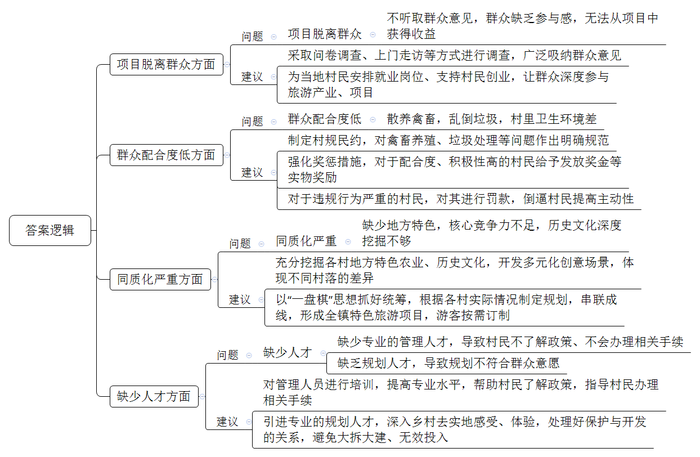
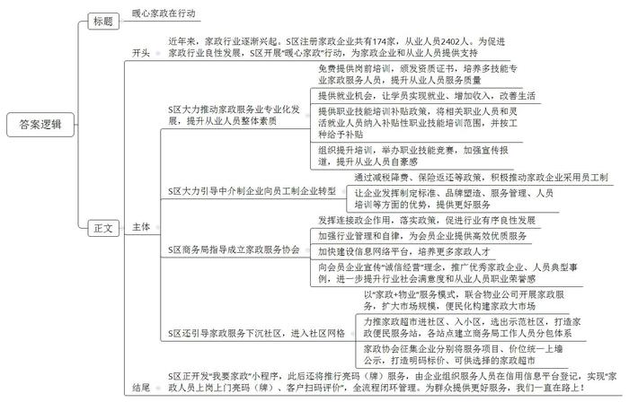

# 2023年公务员多省联考《申论》题（安徽B卷）

<!-- gwy:overview:start -->
> **安徽 · 2023 · 申论 · B类** ｜ 4 题 · 图片 4 处 · 答案随题折叠

导航：[题目](#题目) · [材料 1](#材料-1)
<!-- gwy:overview:end -->

> 候选采集稿。参考答案及解析来自粉笔页面，不代表官方答案或真实高分答卷；来源使用许可与原卷对应关系仍需人工核实。

## 给定材料

### 材料 1

十月的一天，“村务e点通”的二维码贴到了E县李家村每户村民的门口。“严会计，我上个月来村里两趟都没找到你，想请你帮我查查今年做了多少次杂工，能摊多少钱。”村民老李着急地说。“不好意思，李老爹，让你白跑了。之前我到镇里报账，镇长在县里开会，也是跑了三趟才签上字。不过，今后不用跑了，在手机‘村务e点通’App上就能请镇长审批报账了。”严会计教老李下载了“村务e点通”，并告诉他如何查询，“看，你今年做杂工8次，共计1560元。这个‘村务e点通’能查看全村的杂工情况，还有村里的‘一事一议’、脱贫户等情况，方便得很。如果发现问题，还可以实名或者匿名留言、投诉。”

“好侄子，你权力大得很，给我个低保，还不是一句话的事儿？”这天，患有脑溢血后遗症的村民周大爷和老伴一起来到村部，找到小他们一辈的李家村党支部书记李明。“叔，您看，村务公开栏上贴着村干部小微权力28项规范，每一项都很清楚，不是我一个人说了算。不论评低保，还是发放困难救济、危房改造补助，村里大小事都要讨论，结果要投票，过程要公示。”李书记指着村务公开栏耐心解释。以往，乡村工作在亲缘关系面前总是容易撞墙，现在，李书记说这些话底气越来越足，他的底气源于县里规范村级小微权力运行所建立的权力清单。针对村党支部、村委会职责权限和服务事项，县里对涉及村级事务的小微权力进行了全面梳理，形成涉及重大村务、基层党务、“三资”管理、便民服务等6大类28项的小微权力正面清单，绘制了流程图，明确了村干部在行使权力过程中的具体责任。“有了这个清单，挡住了人情，保护了干部。村干部能干什么，不能干什么，该怎么干，都是按照图表来，谁也不敢藏着掖着。现在，群众心里明白，也换来村干部自身清白。”李书记说，“小微权力清单，看似工作流程多了，但事实上工作变简单了，流程更顺畅，群众心里更敞亮。”

李小妹打算办理子女落户手续时，村干部正挨家挨户给村民派发小微权力清单宣传小册子，她在小册子上看到了办理子女落户的流程图，于是，李小妹按要求准备好材料交到了村部，“村干部代办相关事项，两天就办好了。”她高兴地说。

“我承诺，严格按照小微权力清单制度规范履职，严格遵守各项制度规定，做到廉洁自律、公私分明、干净干事、清白做人……”这天，李家村新一届村“两委”通过“村务直播间”集中亮相，向村民宣读廉洁履职承诺，接受村民的监督。此后，村委会将村务公开的程序、过程和结果从线下运行转为线上公开“晒”，定期通过村务直播平台向村民汇报村里重点工作并与村民互动交流。“为什么我们第一组的村民分红这么少？”“因为第一组村民在田园综合体项目中未被征地，只能享受第二部分公共土地投股收益分成。”李书记在“村务直播间”回答村民的提问，这已是他第八次直播互动了。“村级事务定期进行直播公开，无论在村里居住，还是在外居住的村民，都能参与村务监督，既可以保障群众知情权、参与权和监督权，也能促进群众参与村务管理的积极性、主动性和能动性。只有清清楚楚‘亮家底’，明明白白‘晒账本’，群众才会感到心里敞亮。”李书记说。

“以前开大会，我们村民即使有一些自己的想法或意见，但碍于面子或担心邻里关系，也不好意思说出来。”村民刘老伯说道，“如今在‘村务直播间’，我们可以匿名发言，顾虑也就不存在了，对村里决策、村庄建设、村干部作风等有什么想法，大家都可以畅所欲言。这个‘村务直播间’真正让我们的监督变得毫无后顾之忧，非常赞。”如今，刘老伯已是“村务直播间”的忠实粉丝。

“互联网在农村的普及为村务公开提供了良好的土壤。推行互联网村务公开需要与之配套的、擅长与网络打交道的干部班底。为此，县里还分批次组织村干部参加培训，提高他们的文化水平、用网能力。”县纪委陈书记表示，“村级事务与群众生活息息相关，群众最关心的就是村干部做事是否公平公正、村级资金如何使用，通过‘村务e点通’等途径，把村里每个月的工作、开支等向群众公开，彻底打消群众疑虑，更好维护干群关系，村务工作才能更有效开展。我们将继续借助各种平台发挥群众监督作用，完善村级监督管理制度，为推进乡村振兴提供‘廉动力’。”

### 材料 2

近日，为优化文旅产业布局，促进乡村旅游升级发展，合江县宽石镇召开了一场关于乡村旅游规划调整升级的座谈会，听取各方的意见建议。以下是座谈会的主要发言记录：

合江县发展和改革局陈副局长：乡村旅游的落脚点应该是乡村，游客去农村主要还是想体验乡村特色和风情。开展乡村旅游规划，千万不能摒弃乡村的质朴与自然，不能按照城市规划的思路去规划设计，把农村建得跟城市一样。规划还是要着眼于“游客为什么来、什么游客来、游客怎么来、游客来了干什么、怎样让游客介绍人来”这几个问题。解决好这些问题，乡村旅游才可能发展起来。

村民老赵：镇里要在我们村搞旅游项目，都不听听我们的想法，我感觉跟我们也没有太大关系，虽然这几年村里是整洁了一些，生活也便利了一些，但外面的人来旅游，我们也做不了什么，没有实际的收益。我觉得让村民们能赚到钱才实在，否则我还是愿意去城里打工。我们那儿的好多人跟我的想法一样。

石茂村村委会刘主任：我们规划得再好，可有些村民就是不太配合，还是喜欢把鸡鸭养得到处都是，卫生也不好好处理，垃圾随处乱倒，有的村民养的狗还追着人家到处跑，外面的人来了自然不会高兴，不告你就算不错了。

灰石村驻村第一书记老张：我感觉，我们镇乡村旅游的主题内容同质化比较严重，比如花海，除了规模不一样，其他大抵相同；农家乐，就是简单的餐饮，加上棋牌、钓鱼，就没有其他内容了；采摘、观光活动的体验感也是千篇一律，体现不了我们这个地方的特色农业和文化。旅游产业的核心竞争力不足，历史文化深度挖掘不够，乡村核心的魂、自身的特色、差异化竞争等方面鲜有挖掘。

江流村村委会李主任：我们村经过调研了解、征求意见，筹划建设“造田公社”景观，计划以农业种植为基础，将农田开发成可观、可玩、可学的各类创意场景，这个还是比较有特色的。另外，最好有懂行的人来帮我们做一些旅游开发管理的事情。

市规划设计院潘工程师：乡村旅游规划设计要融入当地县镇、服务于村庄，处理好传统村落、基本农田保护与开发的关系，避免大拆大建、无效投入，所以规划就非常重要。如果规划和周遭环境格格不入，不能很好地尊重村民意愿，这样的规划哪怕自身再优秀，也不是好作品，这都需要专业的规划人才深入乡村实地去感受、体验，寻找最佳的解决方案。

村民老牛：村里说我家的老宅比较有特色，要修缮保护起来，政府会出一部分钱，但我们对这一块的政策不太了解，手续怎么办都不知道，村里也没什么人说得清楚，都是传来传去，走了不少弯路，也没有彻底解决问题，能不能有专门的人来指导我们怎么做？

合江县文化体育和旅游局钱副局长：这几年，乡村旅游遍地开花、如火如荼，大家都想分一杯羹，但规划要对建设以后的事情有个统筹考虑。有的地方注重硬环境建设，却忽视软环境治理，管理跟不上，配套服务也不行，个别还发生过安全事故，谁敢再去啊；有的地方基础设施和配套服务都完善了，但游客量却没有增加，收益也不可观，主要是没有对受众人群、出游目的、消费能力等进行系统分析，宣传推介就更加无从说起了。

宽石镇李镇长：乡村旅游规划不能各自为政，要以“一盘棋”思想抓好统筹，根据各村的实际情况制定规划，再把散落的珍珠串成项链，形成我们镇的特色旅游项目。这样，游客到了我们镇，就可以根据实际需要订制项目，比如红色旅游、文化旅游、生态旅游等，既可以一揽子游下来，也可以分类订制游。

### 材料 3

“原来我们跑长途，途中和到企业装卸货时只能在车上休息，空间狭窄，冬冷夏热，常常休息不好，吃饭也只能到外面找小饭馆解决，或者吃点面包、方便面对付一下。现在有了‘货车司机之家’，我们这些‘卡友’可以在这里吃口热饭、喝口热水、洗个热水澡、停个放心车，调整好状态再出发，实在太方便、太人性化了。”货车司机赵师傅对“货车司机之家”的环境、配套和服务赞不绝口。

赵师傅口中的“货车司机之家”，位于Q县经济开发区内。Q县经济实力排名全省县域前三甲，又处于重要交通枢纽位置，仅县经济开发区内就有物流公司数十家，日均往来货车司机数百人，服务开发区内数百家企业。以往Q县没有“货车司机之家”的时候，货车司机“吃住都在车上”，十分不便。为有效解决货车司机运输途中饮食、休息、洗衣、淋浴、停车等基本需求，2022年，开发区党工委成立“货车司机之家”工作专班，通过专员路访、线上征集、现场问需等方式深入了解货车司机和物流企业的实际需求：“开车累了，最好有个地方可以吃口热饭、喝口热水。”“希望能够洗个澡解解乏，再稍微躺一躺，路上安全也有了保障。”“长途出行路上难免会出现一些小问题，想着你们能不能提供一些应急的机油和工具箱。”……

说干就干，在调研工作完成后，专班又迅速组织力量投入到“货车司机之家”的规划和建设工作中。他们在物流企业集中区域选址，建成的“货车司机之家”有3000余平方米停车场和260平方米服务功能区，可同时容纳50辆货车停放，让货车司机冷可取暖、热可纳凉、累可歇脚。

2022年7月，“货车司机之家”投入使用，四大服务平台功能完备，温暖每一位“赶路人”。在安心停泊点，有24小时视频监控和保安值守。在舒心休闲湾，干净整洁的“卡友”休息室全天免费对外开放，沙发、空调、自助厨房、洗浴房等配套设施一应俱全。在爱心服务岗，爱心伞、手机充电、安全宣传等服务温暖“卡友”的心田，意见征集箱和咨询投诉区便于货车司机反映诉求。在暖心救助站，应急机油、维修工具箱、医药急救箱等应急物资配置齐全，并预留有附近医院的值班医生电话。

投入使用后的“货车司机之家”成为了Q县宣传当地营商环境的一个窗口，吸引了许多货车司机在此休整。Q县交通运输局顺势加强对“货车司机之家”的日常管理，要求管理方公开各类经营性项目内容、标准和价格，并不定期开展检查，确保各类设施齐全、功能完好、正常运行。

同时，工作专班把加强“货车司机之家”建设作为加强道路货运领域党建工作的重要内容，通过成立临时党支部、设立党员先锋岗、派驻党员志愿者等方式，确保每天至少有3名党员在岗，为货车司机提供政策咨询、安全教育、应急处置、诉求收集反馈等志愿服务。2022年国庆期间，司机王师傅驾车途经Q县时忽然爆胎，附近一时又找不到开业的维修点，抱着试试看的态度，他把车开到了“货车司机之家”，说明情况后，一位党员志愿者帮忙联系上修车师傅，很快修好了车。王师傅十分感动，回程路过Q县时，还专门送上一面锦旗。据统计，仅2022年国庆期间，党员志愿者就为270多名货车司机提供了服务，进一步改善了当地营商环境和货车司机从业环境。

除此之外，“货车司机之家”免费提供部分场所，在餐饮、安保、维修等方面及时引入质优价廉的社会化服务。“真食客”是“货车司机之家”引入的首家特色餐饮企业，以饭菜分量大、味道好吸引了一批货车司机光临。“两大一小：一个凉菜、一个热菜、一份烙饼，愣是没吃完，盘子大得像个盆！”司机刘师傅说道。饭店负责人陈先生笑着说：“‘卡友’们长途路上辛苦，所以我们特意改进了菜品，推出了价廉物美的‘卡友霸王餐’，这么两大一小只要20元，管饱又营养。能做到这么实惠的价格，还得感谢园区管理方，他们减免了我们的场地租金和水电费用。”

### 材料 4

说起育儿，T市S区职业培训学校的老师有一套科学的方法。“当孩子哭闹时，可以带孩子玩游戏，分散他的注意力，并在游戏过程中引导孩子，做到寓教于乐。”来到这所学校，授课老师正在给学员讲授专业知识，讲台上摆放着仿真娃娃、被单和小孩衣服等。只见老师一边讲解，一边用仿真娃娃进行操作，学员们听得津津有味。

如今已经走上工作岗位的刘大姐就是在这里学习的，她说：“我是2022年第一期结业的学员，以前因为要照顾家庭，一直没有找到合适的工作。”近年来，家政行业逐渐兴起，为促进家政行业良性发展，S区开展“暖心家政”行动，为家政企业和从业人员提供支持。刘大姐报名参加了S区禾熙家政服务公司的岗前培训，现在已成长为一名拥有多项技能的专业家政服务人员。

“在外面学需要花不少钱，这里不仅可以免费学，而且公司还提供就业机会。在学校培训后，我取得了月嫂证、育婴员证，现在我掌握了技能，不仅可以为雇主带去更好的服务，而且实现了就业。有了收入，我的生活也更好了。”刘大姐笑着说。

刘大姐口中的“免费学”受惠于S区提供的职业技能培训补贴政策。为推动家政服务业专业化发展，S区将家政服务相关职业人员和灵活就业人员纳入补贴性职业技能培训范围，并按职业工种给予相应培训补贴，推动从业人员的职业道德、服务技能、从业安全、沟通技巧等整体素质提升。

禾熙公司是S区“暖心家政”行动的参与企业之一。公司田总经理介绍，今年以来，禾熙公司得到区里的政策支持，已经组织300多名家政服务人员参加了培训，家政人员的服务标准进一步规范。

“我从事家政行业快7年了，当初是因为生活所迫。回老家谈起自己的工作都有点不好意思，总感觉低人一等。这两年，区里创造机会让我们参加提升培训，还举办职业技能竞赛。只要技术过硬、服务好，拿到好的名次一点问题没有，区里还会宣传报道，很有面子。”禾熙公司金牌月嫂张姐说。

前不久，张姐成为了禾熙公司的一名正式员工，这得益于S区大力引导本地中介制企业向员工制企业转型发展。“以往的家政服务以中介模式为主，容易导致服务马虎、‘跑路’等现象发生。因此，我们通过减税降费、保险返还等政策，积极推动家政企业采取员工制。员工制企业在制定企业服务标准、品牌塑造、服务管理、人员培训等方面更有优势，能提供更好的服务，今年全区共新增员工制家政企业10家。”S区商务局葛局长说。

为了做细做实“暖心家政”，2022年初，S区商务局指导成立了S区家政服务协会。协会成立当天，葛局长到场致辞，希望协会发挥连接政企的纽带作用，认真落实政策，促进行业有序良性发展。“成立协会对于加强行业管理、提升规范服务有好处。协会将加强行业管理和行业自律，为会员企业提供高效优质服务；我们还要加快建设信息网络平台，培养更多的家政人才。”S区家政服务协会曹会长说。协会自成立以来，在区商务局的指导下，积极向会员企业宣传“诚信经营”理念，选取并推广优秀家政企业、家政人员的典型事例，进一步提升了行业的社会满意度和从业人员的职业荣誉感。

“我生大宝时，快到预产期了，还没找到专业的本地月嫂。最后没办法，从隔壁市请来一个月嫂，但是沟通起来不方便。今年生二宝，社区就早早帮助我们联系了家政公司，视频面试了几回，最终选择了现在这位月嫂。她很不错，我们都很满意。”二胎宝妈何女士说。

“我们联合家政企业积极探索‘家政+’服务模式，引导家政服务下沉社区，进入社区网格，以‘家政+物业’的模式，联合物业公司开展家政服务，扩大市场规模，构建便民化暖心家政大市场。”葛局长介绍道。

据了解，S区注册家政企业共有174家，从业人员2402人。为了扩大家政服务覆盖面，S区商务局创新试点，力推家政超市进社区、入小区。在3个街道选出6个示范社区，打造家政便民服务站。各站点则建立了商务局工作人员分包体系。所有服务由家政协会征集，家政企业将服务项目、服务价格统一上墙公示，精心打造明码标价可供居民选择的家政超市。

“目前，我们正在组织开发‘我要家政’小程序，让人们可以通过小程序及时找到满意的家政服务。下一步，我们还将推行亮码（牌）上岗，由企业组织家政服务人员在信用信息平台登记基本信息，实现‘家政人员上岗上门亮码（牌）、客户扫码评价’全流程闭环管理。”葛局长进一步介绍道。

## 题目

### 第 1 题

**根据“给定资料1”，请谈谈E县在规范小微权力运行方面都有哪些做法。（15分）**

关联材料：材料 1、材料 2、材料 3、材料 4

作答要求：

（1）准确全面；

（2）分条列出；

（3）不超过200字。

第 1 题 · 答案与解析

**参考答案（粉笔题库参考内容）**

1.建立权力清单，约束干部权力。对村两委职责权限和服务事项全面梳理，划分类别项目，绘制权力正面清单流程图，明确干部具体责任。

2.实行村务公开，推动群众监督。通过“村务e点通”App，群众随时查看村情村务，对问题进行留言投诉；定期直播汇报村务，与村民互动交流，推动村民参与村务管理。

3.优化干部队伍，提升工作素养。打造与村务公开配套的、擅长与网络打交道的干部班底，分批培训村干部，提升文化水平、用网能力。

**解析**

**参考答案说明**：本参考答案从“建立权力清单，约束干部权力”“实行村务公开，推动群众监督”和“优化干部队伍，提升工作素养”这三个方面展开。各条答案要点在内容上相互并列，没有交叉。

**考点**：概括措施类

**来源**：2023年公务员多省联考《申论》题（安徽B卷）

粉笔申论页面对本题只提供「解析视频」入口，该入口是会员推广位，页面无视频地址与文字解析。

### 第 2 题

**请根据“给定资料2”，梳理当前宽石镇乡村旅游规划中存在的问题，并提出相应的改进建议。（25分）**

关联材料：材料 1、材料 2、材料 3、材料 4

作答要求：

（1）问题梳理全面、准确、有条理；

（2）所提建议与问题相对应，具体明确、切实可行；

（3）不超过500字。

第 2 题 · 答案与解析

**参考答案（粉笔题库参考内容）**

1.问题：项目脱离群众。不听取群众意见，群众缺乏参与感，无法从项目中获得收益。建议：采取问卷调查、上门走访等方式进行调查，广泛吸纳群众意见；为当地村民安排就业岗位、支持村民创业，让群众深度参与旅游产业、项目。

2.问题：群众配合度低。散养禽畜，乱倒垃圾，村里卫生环境差。建议：制定村规民约，对禽畜养殖、垃圾处理等问题作出明确规范；强化奖惩措施，对于配合度、积极性高的村民给予发放奖金等实物奖励；对于违规行为严重的村民，对其进行罚款，倒逼村民提高主动性。

3.问题：同质化严重。缺少地方特色，核心竞争力不足，历史文化挖掘深度不够。建议：充分挖掘各村地方特色农业、历史文化，开发多元化创意场景，体现不同村落的差异；以“一盘棋”思想抓好统筹，根据各村实际情况制定规划，串联成线，形成全镇特色旅游项目，游客按需订制。

4.问题：缺少人才。缺少专业的管理人才，导致村民不了解政策、不会办理相关手续；缺乏规划人才，导致规划不符合群众意愿。建议：对管理人员进行培训，提高专业水平，帮助村民了解政策，指导村民办理相关手续；引进专业的规划人才，深入乡村去实地感受、体验，处理好保护与开发的关系，避免大拆大建、无效投入。

**解析**

**参考答案说明：**本参考答案分别围绕“项目脱离群众”“群众配合度低”“同质化严重”“缺少人才”四个方面的问题及对应的建议展开，进行了分条撰写；各条具体要点之间在内容上相互并列，没有交叉。

**考点**：提出对策类

**来源**：2023年公务员多省联考《申论》题（安徽B卷）

粉笔申论页面对本题只提供「解析视频」入口，该入口是会员推广位，页面无视频地址与文字解析。

### 第 3 题

**Q县开发区党工委拟召开专题会议，听取“货车司机之家”建设工作汇报。假设你是“货车司机之家”工作专班负责人，请根据“给定资料3”，起草一份汇报材料提纲。（25分）**

关联材料：材料 1、材料 2、材料 3、材料 4

作答要求：

（1）紧扣资料，内容准确；

（2）条理清晰，语言流畅；

（3）不少于600字。

第 3 题 · 答案与解析

**参考答案（粉笔题库参考内容）**

关于“货车司机之家”建设工作的汇报

背景介绍：在我县开发区党工委的指导下，工作专班通过专员路访等方式，调研了解货车司机及物流企业的实际需求，在物流企业集中区域选址，经过半年多的规划建设，“货车司机之家”已于2022年7月正式投入使用。建成的“货车司机之家”有3000余平方米停车场和260平方米服务功能区，可同时容纳50辆货车停放，让货车司机冷可取暖、热可纳凉、累可歇脚。

建设情况：一、完善四大服务平台功能。在安心停泊点，设置24小时视频监控和保安值守，保障货车的安全；在舒心休闲湾，提供“卡友”休息室，完善配套设施，全天免费对外开放；在爱心服务岗，提供爱心伞等多元化服务，设置意见收集箱及咨询投诉区，便于司机反映诉求；在暖心救助站，配置应急物资，预留附近医院的值班医生电话。

二、加强日常管理。要求管理方公开各类经营性项目内容、标准和价格，并不定期开展检查，确保各类设施齐全、功能完好、正常运行。

三、做好党建工作建设。成立临时党支部，设立党员先锋岗和派驻党员志愿者，确保每天至少有3名党员在岗，为货车司机提供政策咨询等志愿服务。2022年国庆期间，党员志愿者共为270多名货车司机提供了服务。

四、引入社会化服务。免费提供部分场所，减免水电费用，在餐饮、安保、维修等方面引入质优价廉的服务，满足司机饮食等基本需求，降低司机生活成本。

成果及规划：“货车司机之家”建设，不仅改善了货车司机的休息和生活条件，也优化了我县的营商环境。未来，我们将会继续努力，为广大货车司机提供更好的服务和支持。

**解析**

**参考答案说明**：（1）格式方面，“提纲”保险起见，可加上标题，本参考答案写到了“标题”“正文”两部分。（2）正文部分，一方面从内容上来看，围绕“货车司机之家”这一主题，本参考答案的开头先写到了“货车司机之家”的筹备工作与基本规模；主体部分从“完善四大服务平台功能”“加强日常管理”“做好党建工作建设”“引入社会化服务”这四个方面介绍了建设情况；结尾部分总结出成果并展望未来。另一方面，形式上，本参考答案做到了分段、分条撰写，整体上条理较为清晰。

**考点**：总结类

**来源**：2023年公务员多省联考《申论》题（安徽B卷）

粉笔申论页面对本题只提供「解析视频」入口，该入口是会员推广位，页面无视频地址与文字解析。

### 第 4 题

**假设你是S区商务局工作人员，请根据“给定资料4”，以“暖心家政在行动”为题，为T市《质量服务报》写一篇宣传报道稿。（35分)**

关联材料：材料 1、材料 2、材料 3、材料 4

作答要求：

（1）紧扣资料，内容全面；

（2）条理清晰，语言流畅；

（3）不少于800字。

第 4 题 · 答案与解析

**参考答案（粉笔题库参考内容）**

暖心家政在行动

近年来，家政行业逐渐兴起。S区注册家政企业共有174家，从业人员2402人。为促进家政行业良性发展，S区开展“暖心家政”行动，为家政企业和从业人员提供支持。

S区大力推动家政服务业专业化发展，提升从业人员整体素质。免费提供岗前培训，颁发资质证书，培养多技能专业家政服务人员，提升从业人员服务质量；提供就业机会，让学员实现就业、增加收入，改善生活；提供职业技能培训补贴政策，将相关职业人员和灵活就业人员纳入补贴性职业技能培训范围，并按工种给予补贴；组织提升培训，举办职业技能竞赛，加强宣传报道，提升从业人员自豪感。

S区大力引导中介制企业向员工制企业转型。通过减税降费、保险返还等政策，积极推动家政企业采用员工制；让企业发挥制定标准、品牌塑造、服务管理、人员培训等方面的优势，提供更好服务。

S区商务局指导成立家政服务协会。发挥连接政企作用，落实政策，促进行业有序良性发展；加强行业管理和自律，为会员企业提供高效优质服务；加快建设信息网络平台，培养更多家政人才；向会员企业宣传“诚信经营”理念，推广优秀家政企业、人员典型事例，进一步提升行业社会满意度和从业人员职业荣誉感。

S区还引导家政服务下沉社区，进入社区网格。以“家政+物业”服务模式，联合物业公司开展家政服务，扩大市场规模，便民化构建家政大市场；力推家政超市进社区、入小区，选出示范社区，打造家政便民服务站，各站点建立商务局工作人员分包体系；家政协会征集企业分别将服务项目、价位统一上墙公示，打造明码标价、可供选择的家政超市。

S区正开发“我要家政”小程序，此后还将推行亮码（牌）服务，由企业组织服务人员在信用信息平台登记，实现“家政人员上岗上门亮码（牌）、客户扫码评价”，全流程闭环管理。为群众提供更好服务，我们一直在路上！

**解析**

**参考答案说明：**（1）本题主要写到了格式和正文两部分。其中正文分别按照开头（主要写到了家政行业发展背景、发展现状）、主体（主要写到了“S区大力推动家政服务业专业化发展，提升从业人员整体素质”“引导中介制企业向员工制企业转型”“指导成立家政服务协会”“引导家政服务下沉社区”这些方面的做法）、结尾（主要写到了S区后续工作方向“开发‘我要家政’小程序”）的结构展开。（2）为了体现公文题的逻辑性，还加上了“还”“进一步”等连接词承接上下文。

**考点**：宣传类

**来源**：2023年公务员多省联考《申论》题（安徽B卷）

粉笔申论页面对本题只提供「解析视频」入口，该入口是会员推广位，页面无视频地址与文字解析。

