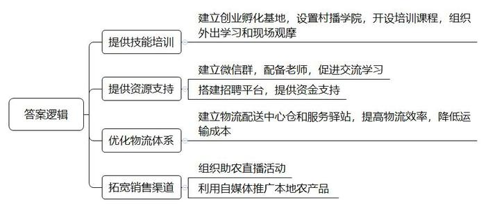
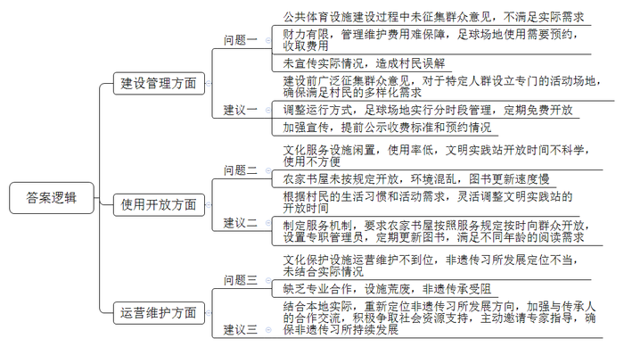
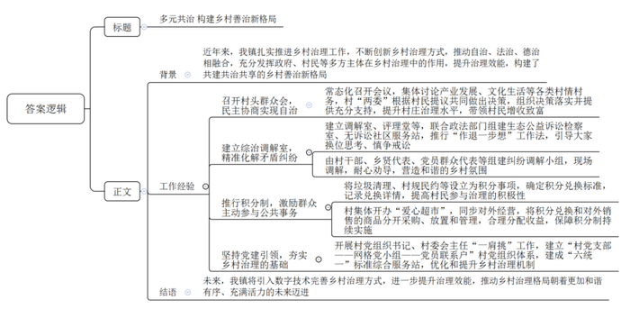
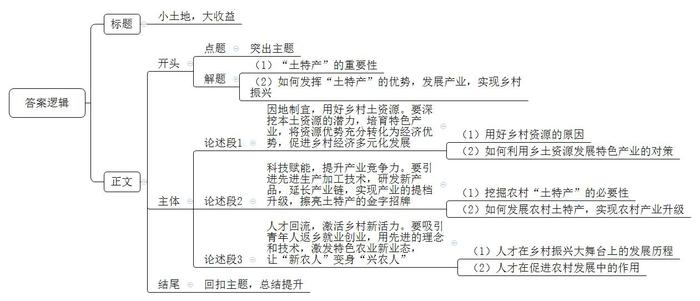

# 2023年安徽省乡镇机关专项考试《申论》题

> 候选采集稿。参考答案及解析来自粉笔页面，不代表官方答案或真实高分答卷；来源使用许可与原卷对应关系仍需人工核实。

## 给定材料

### 材料 material-6286907c9d3b87ea

“接天莲叶无穷碧，映日荷花别样红。我面前的荷塘有近千亩，荷花有近20个品种、9种花色。这些荷花是分片、分类接茬种植的，所以花期长，从盛夏到仲秋大家都可以来游玩……”直播间里身穿汉服的林月悠闲漫步，带领大家穿越一碧万顷的荷塘美景。

近日，A镇政府组织的一场以荷为主题的助农直播推介活动，正在举行。

走过几字形亲水平台，林月来到荷塘深处的听风亭，这里的直播间布置得别具一格。“刚采摘下来的莲子可以生吃，晒干的莲子可以用来煲汤煮粥……”她边给大家展示荷叶茶、莲子心等产品，边讲解荷叶茶的制作及功效、莲子心的药效及用法等。

“新鲜的食材只需简单的烹饪，接下来向大家介绍的有椒盐荷花、糖醋藕夹、滑炒藕带、嫩藕叶炒土鸡蛋……”她又走到桃花村的“农家乐”餐厅，还未报完村里正在推介的“全藕宴”菜名，即引来直播间里众多粉丝尖叫欢呼。林月边品尝美味边生动解说，直播间里粉丝们晒表情、刷火箭、询价钱、问地址……她下线时粉丝们仍意犹未尽！林月说：“作为一名志愿者，我很愿意参加这样的活动。我为家乡代言，我自豪，我光荣！”

“我们‘海哥’直播间的粉丝已经超40万啦！我们这个团队大都是年轻人，每天大家身上都有一股劲，想把更多的农产品卖到全国各地！”姚海的一名员工骄傲地说。姚海原本是上海写字楼里的白领，两年前一次回乡过节，了解到A镇建了个电商创业孵化基地，一直想自己创业又想陪伴父母的他，毅然决然辞职返乡。

“我了解到A镇电商创业孵化基地设有‘村播学院’，定期开设电子商务相关课程，我就直接在网上报了名，参加了主播培训。”两年多的时间，姚海已经参加了好几次培训。“我感觉培训内容与实战结合挺紧密的，老师通过讲解经典视频案例，教我们怎么从零开始打造三农账号、进行内容升级、直播变现等。每年还有外出学习的机会，有时也会组织大伙儿到杭州等地现场观摩。”

给姚海团队供货的春满园合作社负责人回忆说：“‘海哥’一方面通过记录乡村生活吸引粉丝，另一方面制作以本地农产品为原料的烹饪短视频，就这样开启了为家乡带货之路。”在做直播的过程中，难免会遇到一些问题和困惑。镇里建了个微信群，群里有专业的电商老师可以请教，还有志同道合的小伙伴可以相互交流、学习。“随着粉丝量的增加，我们做菜用到的农产品卖得越来越好，目前收入也不错，父母对我辞职返乡创业的担心总算解除了。”姚海笑着说。

“蕨菜、刺嫩芽这些野菜，我最远都卖到了东北。”孙纲是A镇高合村百草方源农民合作社的负责人，他自己种植野菜，也在周边乡镇收购野菜。通过抖音、淘宝等平台把野菜卖火了后，不少人跟着他学习，有些人还加入了他的团队。人多了，担子自然就重了，孙纲便想着更加系统地学习电商。2021年，他和姚海一样开始参加镇里的电商培训。

在孙纲看来，A镇电商发展氛围特别好。有一次，他直播的单品卖爆了，打包邮寄等工作跟不上，镇政府组织绿农等电商企业第一时间赶来帮忙，他感到很暖心。“为了帮我们卖农产品，镇里还建了电商物流配送中心仓，我们每个村都有电商物流服务驿站。”孙纲说，“这都是与县里的快递、物流、商贸企业合作的，快递物流每天到村里上门收件，帮助我们这些电商压缩了运输时间、降低了物流成本，解决了农产品外销‘最初一公里’问题。”

这两天，孙纲正忙着招兵买马。“每换一个品类，就要重新孵化一个账号，就需要增加人手。我们在镇政府网站上的劳务供需对接平台发布招聘信息，效果还不错。”他说，“后期也想上一些其他品类，镇政府对发展电商有资金支持政策，目前发展前景比较好，我们想扩大规模。”

“我们镇农业资源丰富，农产品种类众多，但农民辛苦劳作大半年，最怕产品卖不出去、竹篮打水一场空，所以我们要想办法帮农民打开销路、提高收入。”A镇党委副书记、镇长秦业勤说，“近年来，农村电子商务快速发展，‘互联网+’已成为乡村振兴的新动力之一。我们需要进一步提升数字化能力，推动微信、抖音、直播等自媒体渠道营销，让乡村振兴乘上数字化快车。”

### 材料 material-3f2df7effdf635ab

近年来，随着美好乡村建设的推进，各地在大力实施村容村貌整治工程、改善村民生活环境的同时，不断加大农村文化服务设施建设力度，新建、改建、扩建了一批文化广场、文化活动中心等公共文化服务基础设施。这些设施在丰富群众文化生活，提升乡村文明等方面正发挥着积极作用。但针对部分乡村公共文化基础设施的建设和使用情况，一些居民也有不同的声音。为此，记者选择B镇进行了走访调查。

“截至2022年，全镇20个村，村级活动室共有212间，村均10.6间，覆盖有便民服务大厅、会议室、新时代文明实践站等38种已挂牌的功能室，村均15种。有的村还新建了特色非遗传习所、村史馆和文化礼堂。”B镇党委书记自豪之情洋溢在脸上，“为满足群众体育健身需要，2021年我镇还在省体育局的帮扶下建设了全市唯一、省内领先的镇级足球场，非常气派！”

“如今各村的文化功能室都成了乡风文明的播种机、移风易俗的宣传员。村民们的精神面貌正在悄然改变，打牌、喝酒、闲玩的人明显少了。但我们毕竟是偏远乡镇，底子薄，工作中还有诸多不足。”B镇镇长深有感触地说。

记者来到B镇中心体育文化广场，看到广场设施颇为丰富，有个3000多平米的足球场，还有篮球场、羽毛球场、乒兵球场以及休闲健身场地、儿童游乐场，并配有公共厕所、绿地景观等。广场上挤满了参加各种活动的村民，略显拥挤。但令记者感到疑惑的是，偌大的足球场却被一把“铁将军”把守，门口贴着“足球场管理规定”，详细规定了预约规则、预约电话、收费标准等内容，而旁边篮球场、乒乓球场等却都是免费开放使用。

村民老冯向记者吐槽：“足球场花很多钱才修好，前期总是宣传为了方便我们健身。既然是公共体育设施，就应该免费开放，咋能全是镇里说了算，锁起来‘圈钱’？”为此，记者联系到镇综合行政执法办公室负责人。该负责人向记者介绍：“国家规定，此类场地可以适当收取费用。B镇刚刚摆脱贫困镇的帽子，跟城区不一样，我们没有专门拨款，财力有限，足球场管理维护需要一定费用，聘请兼职管理员、保洁员加起来一年近5万元。但我们也有工作失误，没有广泛宣传，造成了村民的误解。”

“俺们镇里太极拳是传统，有五六支队伍，两百多个老人参加，还获得过国家奖励呢！”广场上一大群正在练习太极拳的大爷大妈们也围了过来，“但俺们练习的时候只能在广场上与广场舞队伍争夺场地，拥挤不说，有时候还抢不到。镇里踢球的小青年才有几个？建足球场也没征求大家意见。”他们盼望，要是能够给爱好太极拳的老人专门建个场地就好了！

在远离B镇中心20多公里的桦树村，记者看到了另一番景象：村里十分冷清，村部服务中心只有个别村民在办理业务。偌大的新时代文明实践站门口墙上密密麻麻挂了老年活动中心、青年之家、村民调解室等六块牌子，大门敞开，里面却空无一人。旁边的农家书屋大门紧锁，稍显破败。透过窗子可以看到，书屋里的图书被随意打包堆置在书架旁，布满了灰尘。

在村口，一位老人告诉记者：“老人活动室在新时代文明实践站里，只在下午开门三四个小时，到点村干部就要锁门下班，我们感到不自由，更愿意在村口廊桥里聊天、打牌。”

“农家书屋的书好久没有更新了，只有几本能看，我都翻过几遍了，后来就不去了，还是在家刷抖音更有趣。”一群中学生唧唧喳喳地向记者反映，他们希望书屋里能多更新一些学校老师推荐的新书。

柳树村是B镇一个有着百年柳编产业历史的传统非遗村，村里为保护该项非物质文化遗产，2018年筹资把一个300平米的“破院子”改造成了集展示、生产、研学和专家工作站为一体的柳编非遗传习所。

“传习所刚开办的时候，村里老手艺人、省内外几个专家都义务过来传经送宝，红过一段时间，但后续维持没搞好，渐渐就荒废了。没有人来，我就改做临时办公室。”柳树村村支书无奈地说。

柳编手工作坊主李先生抱怨：“当初建传习所时的想法很好，也得到了村民的拥护，后来村委只想专做柳编研学游，但我们这里交通不是很方便，吃住也没特色，来过两三波中小学生之后，项目就做不下去了，加之村委会后来没能把柳编从业者和手工艺人组织起来合作，也没有用心去外面找专家，渐渐地年轻人也不来了。”李先生还是期盼，村委会能够有所作为，通过传习所把柳编产品的宣传销售和非遗传承搞好。

### 材料 material-4d8276806b3d7ef5

“老少爷们，咱们村有些老人无人照料，大家都出出主意，看看怎么办？”C镇南主村村头群众会上，村支书陈新平开门见山。

“我隔壁邻居王大娘76岁了，因前些年脑中风导致行动不便，孩子们又都在外地务工，家里连买袋面粉都没人手，确实是个事儿。”“张大叔爷俩怪可怜的，身体都有残疾，洗个衣服都困难，没人照顾，确实让人心疼。”……大伙儿七嘴八舌地议论着。“都是本村人，谁家有事儿都需要帮一把，也不是啥难事儿。”有人提议，“要不，咱们姐几个动动手，帮一把。”

像这样的村头群众会在全镇各村已是常态化。诸如产业发展、文化生活、田地征用、高额彩礼之类的事情，都放在群众会上说道说道，大家的事大家说了算。

2022年年初，东山村召开村头群众会，让大家说说发展产业的路子怎么走，大部分人想种大棚蔬菜。经过集体讨论，村“两委”决定：村里拿出一部分资金先建大棚，以租赁的方式交给村民使用，赚了钱再还给村里。没有技术，村里聘请种植大户负责手把手教；没有销售渠道，村里主动与附近的盛丰市场联系。一年下来，租棚种植辣椒的陈秀英脸上乐开了花，“没想到，扣除种子、化肥、人工和租金，这两个棚净赚了两万多。”

日子过好了，环境变美了，但乡里乡邻难免会发生些小矛盾小纠纷。为此，C镇建起了综治调解室、乡风评理堂，联合政法部门组建生态公益诉讼检察室、无诉讼社区服务站，推行“作退一步想”工作法，引导大家换位思考、慎争戒讼。

长明村的张某元、张某亮两兄弟，因老宅分配问题积怨多年，时常吵闹，互不相让。村“两委”在镇调解室的帮助下，成立了由村干部、乡贤代表、党员群众代表等组成的纠纷调解小组，多次到现场沟通、调查后，提出了让兄弟俩“互换角色、为对方解难题”的思路。经过大半年时间苦口婆心地说教劝导，兄弟俩从一开始的拒绝对话到进行协商，最后终于达成一致意见：守老宅建新房的张某元支付给张某亮5.6万元，作为另选新宅建房的补偿。两兄弟又走动起来，家里老人笑开了颜。

当然，这些只是镇里推进乡村自治、法治、德治，发挥政府、村民等多方主体在乡村治理中作用的部分体现。

走近西溪村，村外一望无际的麦田抽穗扬花，村内院落道路整洁美观……村党支部书记王文联说：“我们村能有现在的变化，靠的就是治理方式创新的探索。”2019年4月，有企业向村里捐赠了一批毛巾、洗衣粉等物品。村“两委”一合计：鼓励村民们收集垃圾，分类上交，按可回收垃圾数量录入积分，达到一定积分可兑换相应物品。这一试，试出了效果，多数村民积极参与垃圾分类回收，仅半年时间，村容村貌焕然一新。这一方法经过总结后：2021年起在全镇推广，积分事项从垃圾清理扩展到村规民约、移风易俗、产业振兴等。

“我的积分有50多分，能兑换一瓶洗衣液吗？”“40分就可以兑换一瓶洗衣液，我这就拿给您。”村爱心超市负责人转身从货架上取下物品，然后在兑换记录本上做好记录。截至2023年8月中旬，西溪村已有300多名村民来兑换了4000多份的物品，包括口罩、牙刷、烧水壶等。

在C镇，为了保障积分制持续实施，不少乡村都在探索“爱心超市”的经营方式。“我们既兑换积分，也对外经营，我们把用于积分兑换和对外销售的商品分开采购、分开放置、分开管理。”秀水村爱心超市负责人张兰梅说，爱心超市由村集体开办，每年能有2万多元利润，除上交村集体部分外，剩下的用于保障积分兑换的物资采购。

随着多村治理工作的扎实推进，C镇着力构建共建共治共享的乡村善治格局，正朝着更加和谐有序、充满活力的未来迈进。

在C镇党委书记张兵看来，党建是乡村治理工作的基础，必须明确抓什么、知道怎么抓。目前，全镇31个村均已实现村党组织书记、村委会主任“一肩挑”，均已建立“村党支部——网格党小组——党员联系户”村党组织体系，均已建成“六统一”标准综合服务站，以此为基柱，全镇乡村治理机制得到显著优化和提升。

“下一步，我们打算引入数字技术完善乡村治理方式，进一步提升乡村治理效能。”谈起未来工作，张书记思路十分清晰。

## 题目

### 第 1 题

**请根据****“给定资料**1**”，谈谈A镇在推进电商发展方面有哪些具体举措。（15分）**

关联材料：材料 material-6286907c9d3b87ea

作答要求：

要求：

（1）全面准确；

（2）分条列出；

（3）简明扼要；

（4）不超过150字。

### 第 2 题

**请根据****“给定资料**2**”，梳理B镇在乡村文化基础设施建设和使用过程中存在的问题，并提出相应的改进建议。（20分）**

关联材料：材料 material-3f2df7effdf635ab

作答要求：

要求：

（1）问题全面准确，建议切实可行；

（2）按照示例“问题一：……；建议一：……”的形式作答；

（3）不超过450字。

### 第 3 题

**县里拟召开乡村治理专题座谈会，****C镇将在会上以“创新治理方式，提升治理效能”为主题介绍工作经验，请根据“给定资料**3**”，拟写一份会议发言提纲。（30分）**

关联材料：材料 material-4d8276806b3d7ef5

作答要求：

要求：

（1）紧扣资料，内容全面；

（2）条理清晰，语言流畅；

（3）不少于600字。

### 第 4 题

**“给定资料**4**”中提到：“做好‘土特’文章，在‘小’土地上种出‘大’收益，让特色产业成为乡村振兴的新动能。”请深入理解这句话，联系实际，自选角度，自拟题目，写一篇文章。（35分）**

关联材料：材料 material-6286907c9d3b87ea

作答要求：

要求：

（1）观点明确，见解深刻；

（2）思路清晰，语言流畅；

（3）参考“给定资料”，但不拘泥于“给定资料”；

（4）1000字左右。

## 答案与解析

第 1 题

**参考答案（粉笔题库参考内容）**

1.提供技能培训。建立创业孵化基地，设置村播学院，开设培训课程，组织外出学习和现场观摩。

2.提供资源支持。建立微信群，配备老师，促进交流学习；搭建招聘平台，提供资金支持。

3.优化物流体系。建立物流配送中心仓和服务驿站，提高物流效率，降低运输成本。

4.拓宽销售渠道。组织助农直播活动，利用自媒体推广本地农产品。

**解析**

**参考答案说明**：本参考答案从“提供技能培训”“提供资源支持”“优化物流体系”“拓宽销售渠道”四个方面展开，各条答案要点之间在内容上相互并列，没有交叉。

**考点**：考点提出对策类

**来源**：来源2023年安徽省乡镇机关专项考试《申论》题

粉笔申论页面对本题只提供「解析视频」入口，该入口是会员推广位，页面无视频地址与文字解析。

第 2 题

**参考答案（粉笔题库参考内容）**

问题一：公共体育设施建设过程中未征集群众意见，不满足实际需求；财力有限，管理维护费用难保障，足球场地使用需要预约，收取费用；未宣传实际情况，造成村民误解。建议一：建设前广泛征集群众意见，对于特定人群设立专门的活动场地，确保满足村民的多样化需求；调整运行方式，足球场地实行分时段管理，定期免费开放；加强宣传，提前公示收费标准和预约情况。

问题二：文化服务设施闲置，使用率低，文明实践站开放时间不科学，使用不方便；农家书屋未按规定开放，环境混乱，图书更新速度慢。建议二：根据村民的生活习惯和活动需求，灵活调整文明实践站的开放时间；制定服务机制，要求农家书屋按照服务规定按时向群众开放，设置专职管理员，定期更新图书，满足不同年龄的阅读需求。

问题三：文化保护设施运营维护不到位，非遗传习所发展定位不当，未结合实际情况；缺乏专业合作，设施荒废，非遗传承受阻。建议三：结合本地实际，重新定位非遗传习所发展方向，加强与传承人的合作交流，积极争取社会资源支持，主动邀请专家指导，确保非遗传习所持续发展。

**解析**

**参考答案说明：**本参考答案从“建设管理”“使用开放”“运营维护”这三个方面展开，每个方面内部先阐释问题，再给出相应的解决建议，做到了所提建议与问题相对应。各条答案要点之间在内容上相互并列，没有交叉。

**考点**：考点提出对策类

**来源**：来源2023年安徽省乡镇机关专项考试《申论》题

粉笔申论页面对本题只提供「解析视频」入口，该入口是会员推广位，页面无视频地址与文字解析。

第 3 题

**参考答案（粉笔题库参考内容）**

多元共治 构建乡村善治新格局

背景：近年来，我镇扎实推进乡村治理工作，不断创新乡村治理方式，推动自治、法治、德治相融合，充分发挥政府、村民等多方主体在乡村治理中的作用，提升治理效能，构建了共建共治共享的乡村善治新格局。

工作经验：一、召开村头群众会，民主协商实现自治。常态化召开会议，集体讨论产业发展、文化生活等各类村情村务，村“两委”根据村民提议共同做出决策，组织决策落实并提供充分支持，提升村庄治理水平，带领村民增收致富。二、建立综治调解室，精准化解矛盾纠纷。建立调解室、评理堂等，联合政法部门组建生态公益诉讼检察室、无诉讼社区服务站，推行“作退一步想”工作法，引导大家换位思考、慎争戒讼；由村干部、乡贤代表、党员群众代表等组建纠纷调解小组，现场调解，耐心劝导，营造和谐的乡村氛围。三、推行积分制，激励群众主动参与公共事务。将垃圾清理、村规民约等设立为积分事项，确定积分兑换标准，记录兑换详情，提高村民参与治理的积极性；村集体开办“爱心超市”，同步对外经营，将积分兑换和对外销售的商品分开采购、放置和管理，合理分配收益，保障积分制持续实施。四、坚持党建引领，夯实乡村治理的基础。开展村党组织书记、村委会主任“一肩挑”工作，建立“村党支部——网格党小组——党员联系户”村党组织体系，建成“六统一”标准综合服务站，优化和提升乡村治理机制。

结语：未来，我镇将引入数字技术完善乡村治理方式，进一步提升治理效能，推动乡村治理格局朝着更加和谐有序、充满活力的未来迈进。

**解析**

**参考答案说明：**（1）格式方面，本参考答案写到了“标题”“正文”两个部分。（2）正文部分，一方面从内容上来看，围绕“创新治理方式，提升治理效能”这一主题，本参考答案的开头先写到了C镇创新基层治理方式的背景；接着主体从“召开村头群众会，民主协商实现自治”“建立综治调解室，精准化解矛盾纠纷”“推行积分制，激励群众主动参与公共事务”“坚持党建引领，夯实乡村治理的基础”四个方面介绍了具体的工作经验；最后结尾部分进行了总结展望。另一方面，形式上，本参考答案做到了分段、分条撰写，整体上条理较为清晰。

**考点**：考点总结类

**来源**：来源2023年安徽省乡镇机关专项考试《申论》题

粉笔申论页面对本题只提供「解析视频」入口，该入口是会员推广位，页面无视频地址与文字解析。

第 4 题

**参考答案（粉笔题库参考内容）**

**小土地，大收益**

来自乡野田间的“土特产”，蕴藏着无限的发展前景。无论是巩固脱贫攻坚成果，还是推进乡村振兴战略，产业发展都是“根与魂”。为此，要牢牢抓住土特产这个“牛鼻子”，充分发挥土特产独有的优势和特点，在“小”土地上种出“大”收益，让越来越多的土特产走出村寨、跨越山海、融入市场，绘就乡村振兴新图景。

**因地制宜，用好乡村土资源。要深挖本土资源的潜力，培育特色产业，将资源优势充分转化为经济优势，促进乡村经济多元化发展**。一方水土孕育一方特色，我国幅员辽阔、地大物博，从东北平原到黄土高原，从水田、旱田到山地、丘陵，不同的气候、土壤、水源孕育了独特的自然资源和农业资源，乡土资源可开发利用的潜力巨大。而土特产的生命力正是在于独特的资源禀赋，所以充分挖掘和释放乡土资源的潜力和效用，通过“一村一策”打造“一村一品”，培育具有地域优势的特色产业，保护好土特产的“土味”，方能让“土特产”叫得更响、走得更远，使其成为乡村经济发展的助推器、致富增收的新动能。

**科技赋能，提升产业竞争力。要引进先进生产加工技术，研发新产品，延长产业链，实现产业的提档升级，擦亮土特产的金字招牌。**习近平总书记强调，做好“土特产”文章，要强龙头、补链条、兴业态、树品牌，推动乡村产业全链条升级。土特产要从激烈的乡村产业竞争中脱颖而出，一方面要不断克服技术难题，自主创新，致力于精深加工，开发多种产品，实现产品环环增值；另一方面要从产品逐渐向产业转变，利用先进技术，加强农产品产后分级、包装、仓储、物流、营销，进而实现从产业向形成完整的产业链条升级转变，增强市场竞争力和可持续发展能力。

**人才回流，激活乡村新活力。要吸引青年人返乡就业创业，用先进的理念和技术，激发特色农业新业态，让****“新农人”变身“兴农人”。**乡村振兴，人才先行。从毕业就扎根农村的90后、95后大学生村干部，到立志把论文写在田间地头的科研工作者，再到看中家乡发展前景的新型企业家，越来越多的新农人回归乡土，在乡村振兴的大舞台上建功立业，贡献青春力量。他们有知识、有技能、有追求、有情怀，不仅促进了当地产业的融合发展，推动更多资金、技术、人才向乡村汇聚，再次激活了乡村活力，也架起了家乡与外界的桥梁，把先进的思想带回来，把优质的土特产带出去，他们成了农村高质量发展的“领跑人”。

产业兴则农村兴，农村兴则国家旺。“土特产”三字大文章是产业振兴的重头戏，写就这篇文章就要下足“土”功夫，依靠科技与人才，让小小“土特产”种出“大收益”，结出“金果果”，带动农民致富增收，助力乡村振兴。

**解析**

**文章分析**

**小土地，大收益**

【**标题的优点：**标题简洁明了、通俗易懂，采用对称式结构，使标题更加完整、饱满。】

（1）来自乡野田间的“土特产”，蕴藏着无限的发展前景。无论是巩固脱贫攻坚成果，还是推进乡村振兴战略，产业发展都是“根与魂”。为此，（2）要牢牢抓住土特产这个“牛鼻子”，充分发挥土特产独有的优势和特点，在“小”土地上种出“大”收益，让越来越多的土特产走出村寨、跨越山海、融入市场，绘就乡村振兴新图景。

【**开头的优点：**★内容方面。范文的开头是紧扣“挖掘‘土特’，实现乡村振兴”这一主题展开的。首先，开头点出主题，做到了主题明确。其次，对“挖掘‘土特’，实现乡村振兴”这一主题进行了分析阐述，指出了：（1）“土特产”的重要性；（2）如何发挥“土特产”的优势，发展产业，实现乡村振兴。★文字表达方面。使用了“无论是……还是……”“为此……”等关联词，使语言表达有逻辑性；长短句配合使用，使语言表达有节奏感。】

**因地制宜，用好乡村土资源。要深挖本土资源的潜力，培育特色产业，将资源优势充分转化为经济优势，促进乡村经济多元化发展**。（1）一方水土孕育一方特色，我国幅员辽阔、地大物博，从东北平原到黄土高原，从水田、旱田到山地、丘陵，不同的气候、土壤、水源孕育了独特的自然资源和农业资源，乡土资源可开发利用的潜力巨大。（2）而土特产的生命力正是在于独特的资源禀赋，所以充分挖掘和释放乡土资源的潜力和效用，通过“一村一策”打造“一村一品”，培育具有地域优势的特色产业，保护好土特产的“土味”，方能让“土特产”叫得更响、走得更远，使其成为乡村经济发展的助推器、致富增收的新动能。

【**论述段****1的优点：**★观点句：范文的观点句是紧扣“挖掘‘土特’，实现乡村振兴”这一文章主题提出的。形式上，它在段首处直接写出，位置突出，容易发现。内容上，关键词突出，内容要点明确，可以明显看出主要围绕“因地制宜，用好乡村土资源”的角度展开论述。★论述内容：（1）用好乡村资源的原因；（2）如何利用乡土资源发展特色产业的对策。注意：以上几个方面的内容都是紧扣“因地制宜，用好乡村土资源。要深挖本土资源的潜力，培育特色产业，将资源优势充分转化为经济优势，促进乡村经济多元化发展”这个观点句进行分析论述的，论述的针对性强，内容层次丰富。在论述方法上采用了讲道理与举例子相结合的方式，论述充实深刻。】

**科技赋能，提升产业竞争力。要引进先进生产加工技术，研发新产品，延长产业链，实现产业的提档升级，擦亮土特产的金字招牌**。（1）习近平总书记强调，做好“土特产”文章，要强龙头、补链条、兴业态、树品牌，推动乡村产业全链条升级。（2）土特产要从激烈的乡村产业竞争中脱颖而出，一方面要不断克服技术难题，自主创新，致力于精深加工，开发多种产品，实现产品环环增值；另一方面要从产品逐渐向产业转变，利用先进技术，加强农产品产后分级、包装、仓储、物流、营销，进而实现从产业向形成完整的产业链条升级转变，增强市场竞争力和可持续发展能力。

【**论述段****2的优点：**★观点句：范文的观点句是紧扣“挖掘‘土特’，实现乡村振兴”这一文章主题提出的。形式上，它在段首处直接写出，位置突出，容易发现。内容上，关键词突出，内容要点明确，可以明显看出主要围绕“科技赋能，提升产业竞争力”的角度展开论述。★论述内容：（1）挖掘农村“土特产”的必要性；（2）如何发展农村土特产，实现农村产业升级。注意：以上几个方面的内容都是紧扣“科技赋能，提升产业竞争力。要引进先进生产加工技术，研发新产品，延长产业链，实现产业的提档升级，擦亮土特产的金字招牌”这个观点句进行分析论述的，论述的针对性强，内容层次丰富。在论述方法上采用了讲道理与举例子相结合的方式，论述充实深刻。】

**人才回流，激活乡村新活力。要吸引青年人返乡就业创业，用先进的理念和技术，激发特色农业新业态，让****“新农人”变身“兴农人”**。（1）乡村振兴，人才先行。从毕业就扎根农村的90后、95后大学生村干部，到立志把论文写在田间地头的科研工作者，再到看中家乡发展前景的新型企业家，越来越多的新农人回归乡土，在乡村振兴的大舞台上建功立业，贡献青春力量。（2）他们有知识、有技能、有追求、有情怀，不仅促进了当地产业的融合发展，推动更多资金、技术、人才向乡村汇聚，再次激活了乡村活力，也架起了家乡与外界的桥梁，把先进的思想带回来，把优质的土特产带出去，他们成了农村高质量发展的“领跑人”。

【**论述段****3的优点：**★观点句：范文的观点句是紧扣“挖掘‘土特’，实现乡村振兴”这一文章主题提出的。形式上，它在段首处直接写出，位置突出，容易发现。内容上，关键词突出，内容要点明确，可以明显看出主要围绕“人才回流，激活乡村新活力”的角度展开论述。★论述内容：（1）人才在乡村振兴大舞台上的发展历程；（2）人才在促进农村发展中的作用。注意：以上几个方面的内容都是紧扣“人才回流，激活乡村新活力。要吸引青年人返乡就业创业，用先进的理念和技术，激发特色农业新业态，让‘新农人’变身‘兴农人’”这个观点句进行分析论述的，论述的针对性强，内容层次丰富。在论述方法上采用了讲道理与举例子相结合的方式，论述充实深刻。】

【**论述段之间的关系：**★内容的内在逻辑：范文的论述段之间是依照“并列”的逻辑展开的。论述段1先写了“因地制宜，用好乡村土资源”，论述段2再写了“科技赋能，提升产业竞争力”，论述段3最后写了“人才回流，激活乡村新活力”。文章整体思路清晰。】

产业兴则农村兴，农村兴则国家旺。“土特产”三字大文章是产业振兴的重头戏，写就这篇文章就要下足“土”功夫，依靠科技与人才，让小小“土特产”种出“大收益”，结出“金果果”，带动农民致富增收，助力乡村振兴。

【**结尾的优点：**范文的结尾回扣了“挖掘‘土特’，实现乡村振兴”这个主题，并且进行了总结提升。】

**考点**：考点文章写作题

**来源**：来源2023年安徽省乡镇机关专项考试《申论》题

粉笔申论页面对本题只提供「解析视频」入口，该入口是会员推广位，页面无视频地址与文字解析。

