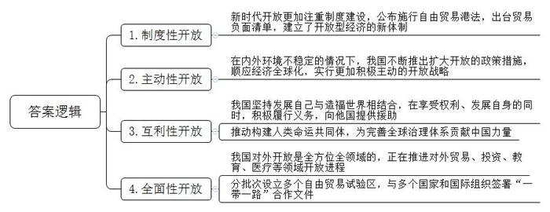
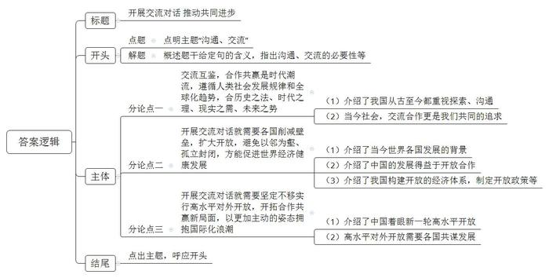

# 2023年安徽省定向选调生考试《申论》题

<!-- gwy:overview:start -->
> **安徽 · 2023 · 申论 · 选调生** ｜ 2 题 · 图片 2 处 · 答案随题折叠

导航：[题目](#题目) · [材料 1](#材料-1)
<!-- gwy:overview:end -->

> 候选采集稿。参考答案及解析来自粉笔页面，不代表官方答案或真实高分答卷；来源使用许可与原卷对应关系仍需人工核实。

## 给定材料

### 材料 1

人类命运共同体，顾名思义，就是每个民族、每个国家的前途命运都紧紧联系在一起，应该风雨同舟，荣辱与共，努力把我们生于斯、长于斯的这个星球建成一个和睦的大家庭，把世界各国人民对美好生活的向往变成现实。构建人类命运共同体这一倡议已被多次写入联合国文件，正在从理念转化为行动，产生日益广泛而深远的国际影响，成为中国引领时代潮流和人类文明进步方向的鲜明旗帜。

马克思、恩格斯说：“各民族的原始封闭状态由于日益完善的生产方式、交往以及因交往而自然形成的不同民族之间的分工消灭得越是彻底，历史也就越是成为世界历史。”历史和现实日益证明这个预言的科学价值。今天，经济全球化大潮滚滚向前，新科技革命和产业变革深入发展，全球治理体系深刻重塑，国际格局加速演变，和平发展大势不可逆转。人类交往的世界性比过去任何时候都更深入、更广泛，各国相互联系和彼此依存比过去任何时候都更频繁、更紧密，和平、发展、合作、共赢已成为时代潮流。一体化的世界就在那儿，谁拒绝这个世界，这个世界也会拒绝他。人类只有一个地球，各国共处一个世界。地球是人类的共同家园，也是人类到目前为止唯一的家园。当前，全球发展深层次矛盾突出，霸权主义、强权政治依然存在，保护主义、单边主义不断抬头，战乱恐袭、饥荒疫情此伏彼现，传统安全和非传统安全问题复杂交织。治理赤字、信任赤字、和平赤字、发展赤字，成为摆在全人类面前的严峻挑战。

当今世界的变局百年未有，变革会催生新的机遇，但变革过程往往充满着风险挑战，人类又一次站在了十字路口。合作还是对抗？开放还是封闭？互利共赢还是零和博弈？如何回答这些问题，关乎各国利益，关乎人类前途命运。

习近平总书记强调，我们要与世界各国人民同心协力，构建人类命运共同体，建设持久和平、普遍安全、共同繁荣、开放包容、清洁美丽的世界。这反映了人类社会共同价值追求，符合中国人民和世界人民的根本利益。

### 材料 2

浦江畔，开放画卷渐次铺展——设立中国（上海）自由贸易试验区，增设临港新片区，支持浦东高水平改革开放，社会主义现代化建设引领区扬帆起航；南海之滨，开放大潮奔涌而来——公布施行《中华人民共和国海南自由贸易港法》，出台首张跨境服务贸易负面清单，建设高水平中国特色自贸港，制度型开放按下快进键。

从推动共建“一带一路”高质量发展，到建设自由贸易试验区和海南自由贸易港，从缩减外资准入负面清单，到连续4年举办中国国际进口博览会……党的十八大以来，在以习近平同志为核心的党中央坚强领导下，中国坚定不移实行高水平对外开放，开拓了广阔发展空间，实现了与世界各国互利共赢。

今年是中国加入世界贸易组织20周年。习近平主席在第四届进博会开幕式上的主旨演讲中指出：“加入世界贸易组织以来，中国不断扩大开放，激活了中国发展的澎湃春潮，也激活了世界经济的一池春水。”这是对不断迈向高水平开放的中国与世界关系最生动、最贴切、最凝练的概括。

开放带来进步，封闭必然落后。我国发展要赢得优势、赢得主动、赢得未来，必须顺应经济全球化，依托我国超大规模市场优势，实行更加积极主动的开放战略。实行高水平对外开放，开拓合作共赢新局面，是以习近平同志为核心的党中央统筹中华民族伟大复兴战略全局和世界百年未有之大变局作出的重大战略部署，是推动形成新发展格局的客观要求。

党的十八大以来，我国坚持对内对外开放相互促进、“引进来”和“走出去”更好结合，构建互利共赢、多元平衡、安全高效的开放型经济体系，不断增强我国国际经济合作和竞争新优势。进一步降低关税激发进口潜力，进一步放宽市场准入提升投资自由化水平，进一步扩大金融业开放，推进服务业开放，加快电信、教育、医疗、文化等领域开放进程……新时代的中国坚定不移以开放促改革、促发展、促创新，推动建设开放型世界经济。法国红酒、比利时巧克力、俄罗斯面粉、泰国天然乳胶枕……如今，位于A省的进出口商品展示交易中心成为市民采购进口商品的“窗口”。“特别是在双休日，前来购物的市民更多，单日平均客流量可达3000人。”某交易中心相关负责人说。

当前，百年变局和世纪疫情交织叠加，面对单边主义逆流和经济全球化遇到的一些回头浪，中国始终站在历史正确的一边，站在人类进步的一边，坚定不移维护真正的多边主义，维护全球产业链、供应链稳定，推动经济全球化朝着更加开放、包容、普惠、平衡、共赢方向发展。“全面实施外商投资法及其实施条例、进一步缩减外商投资准入负面清单……中国不断推出扩大开放的政策措施，进一步坚定了我们的投资信心。”跨国医药企业拜耳公司相关负责人说。

中国坚持发展自己与造福世界相结合，在享受权利、发展自身的同时，积极履行义务。中国积极参与联合国、世界贸易组织、二十国集团、亚太经济合作组织、上海合作组织等机制合作，积极参与应对气候变化、维护全球粮食安全和能源安全，在南南合作框架内继续向其他发展中国家提供更多援助。

### 材料 3

“中国对外开放是全方位、全领域的，正在加快推动形成全面开放新格局。”习近平主席的铿锵话语，是掷地有声的承诺，更是矢志不渝的行动。

党的十八大以来，中国对外开放铺展出气势恢宏的画卷，对外贸易、吸引外资、对外投资等领域千帆竞发，全方位、全领域的开放格局愈加明显。从无到有、从东到西，2013年以来，我国已分批次设立21个自由贸易试验区，建设海南自由贸易港，形成了东西南北中协调、陆海统筹的开放新态势。作为对外开放新高地，自由贸易试验区、自贸港成为我国全方位扩大开放的“排头兵”和“领头雁”。“目前，我们正积极扩大‘一线放开、二线管住’进出口管理制度试点。”海口海关关长施宗伟表示，海南自由贸易港正在加快做好高水平开放压力测试，为企业提供更好的服务。

目前，中国已与145个国家、32个国际组织签署200多份共建“一带一路”合作文件，与沿线国家货物贸易额累计达到10.4万亿美元，对沿线国家非金融类直接投资超过1300亿美元。

——平等互利深化多双边合作。推进中非“十大合作计划”、落实“八大行动”、制订《中非合作2035年愿景》、宣布共同实施“九项工程”……今年前10个月，中非贸易额和对非直接投资额双双逆势上扬，分别达到2071亿美元和超过26亿美元，同比增长37.5%和10%。中国已连续12年成为非洲最大贸易伙伴国。在相互尊重、平等互利基础上，中国积极发展同各国友好合作关系。《区域全面经济伙伴关系协定》即将于2022年1月1日正式生效。中国还积极申请加入《全面与进步跨太平洋伙伴关系协定》和《数字经济伙伴关系协定》，加快构建面向全球的高标准自贸区网络。

——积极参与全球经济治理体系改革。中国坚定维护多边贸易体制，始终是全球共同开放的重要推动者、世界经济增长的稳定动力源、各国拓展商机的活力大市场、全球治理改革的积极贡献者。

迄今，中国参加了几乎所有普遍性政府间国际组织，认真履行相关条约义务。在应对世界经济衰退、气候变化、重大传染性疾病、恐怖主义等全球性挑战中，中国坚定维护和践行多边主义，积极推动构建人类命运共同体，为完善全球治理体系贡献中国力量。

开放是发展进步的必由之路。面向未来，中国开放的大门只会越开越大，永远不会关上。在以习近平同志为核心的党中央坚强领导下，一个更加开放的中国与世界各国携起手来，在开放中创造机遇、在合作中破解难题，一定能实现世界永续和平发展，推动人类走向更加美好的未来。

### 材料 4

“相通则共进，相闭则各退”，是对严复《〈国闻汇编〉叙》中“相通则治进，相闭则治退”的化用。严复，近代启蒙思想家、翻译家、教育家，其创办的《国闻报》《国闻汇编》宣传维新变法思想，在维新运动中起到思想启蒙作用。

1840年鸦片战争后，西方列强用坚船利炮打开了古老中国的大门，中国逐渐沦为半殖民地半封建社会。严复把“闭”看作是造成中国所有问题的根源，认为只有“通”才能起到振衰起敝的作用。他提出“通上下之情”“通中外之故”，而尤以“通下情为要义”“通外情为要务”。在《〈国闻汇编〉叙》中，严复又提出“相通则治进，相闭则治退”，认为相互沟通交流治理能力就进步，相互封闭隔绝治理能力就后退，强调了“通”在时代变迁中的重要性。

“相通则共进，相闭则各退”，习近平主席改字以立新意，赋予原典以新的时代内涵，指出国家与国家之间相互沟通交流就能共同进步，相互封闭隔绝就会各自退步。他还借中医“通闭解结”理论进一步加以阐述：各国削减壁垒、扩大开放，国际经贸就能打通血脉；如果以邻为壑、孤立封闭，国际经贸就会气滞血瘀，世界经济也难以健康发展。

## 题目

### 第 1 题

**请结合给定材****料**2**\-**4**，分析我国对外开放的主要特征。（****2****0分）**

关联材料：材料 1、材料 2、材料 3、材料 4

作答要求：

要求：全面、准确、有条理。字数不超过300字。

第 1 题 · 答案与解析

**参考答案（粉笔题库参考内容）**

1.制度性开放。新时代开放更加注重制度建设，公布施行自由贸易港法，出台贸易负面清单，建立了开放型经济的新体制。

2.主动性开放。在内外环境不稳定的情况下，我国不断推出扩大开放的政策措施，顺应经济全球化，实行更加积极主动的开放战略。

3.互利性开放。我国坚持发展自己与造福世界相结合，在享受权利、发展自身的同时，积极履行义务，向他国提供援助；推动构建人类命运共同体，为完善全球治理体系贡献中国力量。

4.全面性开放。我国对外开放是全方位全领域的，正在推进对外贸易、投资、教育、医疗等领域开放进程；分批次设立多个自由贸易试验区，与多个国家和国际组织签署“一带一路”合作文件。

**解析**

**参考答案说明：**本参考答案从“制度性开放”“主动性开放”“互利性开放”“全面性开放”四个方面展开，各条答案要点之间在内容上相互并列，没有交叉。

### 第 2 题

**结合给定材料，以****“相通则共进，相闭则各退”为话题，写一篇议论性文章。（****4****5分）**

关联材料：材料 1、材料 2、材料 3、材料 4

作答要求：

要求：自拟标题，自选角度，结合材料但不拘泥于给定材料。字数800-1000字。

第 2 题 · 答案与解析

**参考答案（粉笔题库参考内容）**

**开展交流对话** **推动共同****进步**

正所谓“相通则共进，相闭则各退”，国家与国家之间相互沟通交流就能共同进步，相互封闭隔绝就会各自退步。经济全球化大潮滚滚向前，人类交往的世界性比过去任何时候都更深入、更广泛，唯有加强沟通对话，相互交流才是共同发展的必由之路。

**交流互鉴****，****合作共赢****是****时代潮流****，****遵循人类社会发展规律和全球化****趋势****，合历史之法、时代之理、现实之需、未来之势**。我国自古就有文明交融互鉴的真诚实践与历史智慧，玄奘西行、鉴真东渡、郑和下西洋已成世界文明交融的佳话。如今，历史悠久的丝绸之路更演化为“一带一路”的文明合作诗篇，在古今文明交融的探索实践中，我们用尊重与包容赢得认可。而在保护主义、单边主义不断抬头，战乱恐袭、饥荒疫情此伏彼现的现实背景下，只有加强交流合作才是我们共同的价值追求，才是符合中国人民和世界人民的根本利益。

**开展交流对话就需要****各国削减壁垒，扩大开放，****避免****以邻为壑、孤立封闭****，****方能促进世界经济健康发展。**当今世界，各国利益相互交织，不能画地为牢、自我孤立，应该相互借力、相互成就。中国的快速发展得益于同世界各国的开放合作，同时也为世界提供持续发展的动力和巨大市场空间。从降低关税激发进口潜力，到缩减外商投资准入负面清单，我国一直坚持对内对外开放相互促进，构建互利共赢、多元平衡、安全高效的开放型经济体系。在百年变局和世纪疫情交织叠加的时代背景下，中国一系列的开放政策，为世界经济的稳定发展做出了巨大贡献。

**开展交流对话就需要坚定不移实行高水平对外开放，开拓合作共赢新局面，以更加主动的姿态拥抱国际化浪潮。**在世纪疫情的阴霾下，我们连续4年举办中国国际进口博览会，这是中国着眼于推动新一轮高水平对外开放作出的重大决策，是中国主动向世界开放市场的重大举措。目的就是要扩大开放，让中国大市场成为世界大机遇。世界之变、时代之变、历史之变正以前所未有的方式展开，世界经济复苏动力不足，需要各国同舟共济、共谋发展。只有以开放的姿态，与世界同呼吸、共命运，共发展、同分享，我们才能一起迈向更加美好的明天。

和羹之美，在于合异，全球化趋势不可逆，中国必将以更加开放的姿态拥抱世界，本着开放合作、平等对话的理念和原则，与各国一道，应对一切挑战，共促发展、共谋繁荣，构建人类命运共同体。

**文章分析**

**开展交流对话 推动共同进步**

【**标题的优点：**首先，范文的标题“开展交流对话 推动共同进步”突出了“沟通、交流”这一主题词。其次，形式上，文字简洁明快有力，不拖沓。】

（1）正所谓“相通则共进，相闭则各退”，<u>国家与国家之间相互沟通交流就能共同进步</u>，<u>相互封闭隔绝就会各自退步</u>。（2）经济全球化大潮滚滚向前，<u>人类交往的世界性</u>比过去任何时候都<u>更深入、更广泛</u>，唯有加强<u>沟通</u>对话，<u>相互交流才是共同发展的必由之路</u>。

【**开头的优点：****★内容方面。**范文的开头是紧扣“沟通、交流”这一主题词展开的。首先，开头在段首处点出主题，做到了主题明确。其次，对“沟通、交流”这一主题词进行了分析阐述，指出了（1）题干给定句“相通则共进，相闭则各退”的含义；（2）沟通、交流是发展的必由之路。**★文字表达方面：**使用了“唯有……才是……”“正所谓”等连接词，使语言表达有逻辑性。】

**交流互鉴，合作共赢是时代潮流，遵循人类社会发展规律和全球化趋势，合历史之法、时代之理、现实之需、未来之势。**（1）我国<u>自古</u>就有<u>文明交融互鉴的真诚实践与历史智慧</u>，玄奘西行、鉴真东渡、郑和下西洋已成世界文明交融的佳话。<u>如今</u>，历史悠久的丝绸之路更演化为“一带一路”的文明合作诗篇，在<u>古今文明</u>交融的探索实践中，我们用<u>尊重与包容赢得认可</u>。（2）而在保护主义、单边主义不断抬头，战乱恐袭、饥荒疫情此伏彼现的现实背景下，只有<u>加强交流合作才是我们共同的价值追求</u>，才是<u>符合中国人民和世界人民的根本利益</u>。

【**论述段****1的优点：★观点句：**范文的观点句是紧扣“沟通、交流”这一主题词展开的。形式上，它在段首处直接写出，位置突出，容易发现。内容上，关键词突出，内容要点明确，可以明显看出它论述了“交流沟通的必要性”。**★论述内容：**（1）介绍了我国从古至今都重视探索、沟通；（2）当今社会，交流合作更是我们共同的追求。以上两个方面的内容都是紧扣“交流互鉴，合作共赢是时代潮流，遵循人类社会发展规律和全球化趋势，合历史之法、时代之理、现实之需、未来之势”这个观点进行分析论述的，论述的针对性强，内容层次丰富。最后，在论述方法上主要采取了讲道理和举例子相结合，做到了丰富多样。】

**开展交流对话就需要各国削减壁垒，扩大开放，避免以邻为壑、孤立封闭，方能促进世界经济健康发展。（****1****）**当今<u>世界</u>，<u>各国利益相互交织</u>，不能画地为牢、自我孤立，应该相互借力、相互成就。（2）<u>中国的快速发展</u>得益于同<u>世界各国的开放合作</u>，同时也<u>为世界提供持续发展的动力和巨大市场空间</u>。（3）从降低关税激发进口潜力，到缩减外商投资准入负面清单，我国一直坚持对内对外开放相互促进，构建互利共赢、多元平衡、安全高效的<u>开放型经济体系</u>。在百年变局和世纪疫情交织叠加的时代背景下，中国一系列的<u>开放政策</u>，为世界经济的稳定发展做出了巨大贡献。

【**论述段****2****的优点：****★观点句：**范文的观点句是紧扣“沟通、交流”这一主题词展开的。形式上，它在段首处直接写出，位置突出，容易发现。内容上，关键词突出，内容要点明确，可以明显看出它论述了“如何开展交流对话”。**★论述内容：**（1）介绍了当今世界各国发展的背景；（2）介绍了中国的发展得益于开放合作；（3）介绍了我国构建开放的经济体系，制定开放政策等。以上三个方面的内容都是紧扣“开展交流对话就需要各国削减壁垒，扩大开放，避免以邻为壑、孤立封闭，方能促进世界经济健康发展”这个观点进行分析论述的，论述的针对性强，内容层次丰富。最后，在论述方法上主要采取了讲道理和举例子相结合，做到了丰富多样。】

**开展交流对话就需要坚定不移实行高水平对外开放，开拓合作共赢新局面，以更加主动的姿态拥抱国际化浪潮。**（1）在世纪疫情的阴霾下，我们连续4年举办中国国际进口博览会，这是<u>中国着眼于推动新一轮高水平对外开放作出的重大决策</u>，是<u>中国主动向世界开放市场的重大举措</u>。目的就是要扩大开放，让中国大市场成为世界大机遇。（2）世界之变、时代之变、历史之变正以前所未有的方式展开，世界经济复苏动力不足，<u>需要各国同舟共济、共谋发展</u>。只有以开放的姿态，<u>与世界同呼吸、共命运，共发展、同分享</u>，我们才能一起迈向更加美好的明天。

【**论述段****3****的优点：****★观点句：**范文的观点句是紧扣“沟通、交流”这一主题词展开的。形式上，它在段首处直接写出，位置突出，容易发现。内容上，关键词突出，内容要点明确，可以明显看出它论述了“如何开展交流对话”。**★论述内容：**（1）介绍了中国着眼新一轮高水平开放；（2）高水平对外开放需要各国共谋发展。以上两个方面的内容都是紧扣“开展交流对话就需要坚定不移实行高水平对外开放，开拓合作共赢新局面，以更加主动的姿态拥抱国际化浪潮”这个观点进行分析论述的，论述的针对性强，内容层次丰富。最后，在论述方法上主要采取了讲道理和举例子相结合，做到了丰富多样。】

和羹之美，在于合异，全球化趋势不可逆，中国必将以更加开放的姿态拥抱世界，本着<u>开放合作、平等对话</u>的理念和原则，与各国一道，应对一切挑战，共促发展、共谋繁荣，构建人类命运共同体。

【**结尾的优点：**范文的结尾回扣了“沟通、交流”这一主题词，并发出了展望。】

**解析状态：unknown（来源未提供）**

