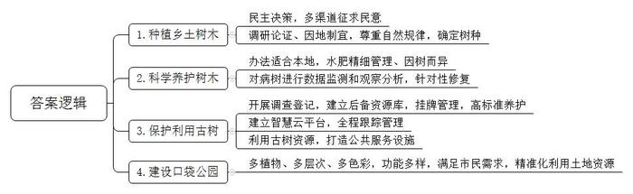
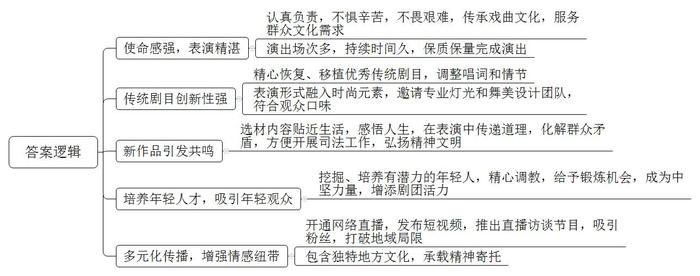
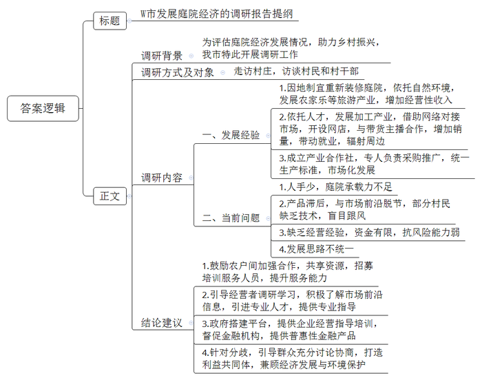
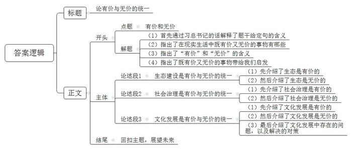

# 2024年公务员多省联考《申论》题（安徽A、普通选调卷）

<!-- gwy:overview:start -->
> **安徽 · 2024 · 申论 · A类** ｜ 4 题 · 图片 4 处 · 答案随题折叠

导航：[题目](#题目) · [材料 1](#材料-1)
<!-- gwy:overview:end -->

> 候选采集稿。参考答案及解析来自粉笔页面，不代表官方答案或真实高分答卷；来源使用许可与原卷对应关系仍需人工核实。

## 给定材料

### 材料 1

街道两侧、楼前屋后、庭院里，一朵朵、一簇簇，千树海棠开得明艳、热烈，恍若一片片缤纷的云锦，汇聚成流动的花海，点亮了明媚春光……日前，F市广宁旅游区的千树海棠如期绽放，繁花似锦，甚是美丽。“这里的植物层次丰富，颜色各异，基本达到三季有花、四季有绿，大大提升了城市的颜值，让城市更加养眼。”F市城市管理局刘局长说。F市近年大力开展城市绿化，充满魅力的广宁旅游区就是F市城市绿化工作结出的一颗硕果。

走在F市的大路上，如同穿行在露天的树木博物馆中，绿树成荫，不同的树木不断变换。当初在选择绿化树时，有人提议效仿某些地方，跨区域引进一些时髦的花木。“绿化是大家的事，要听取大家的意见，实行民主决策。”刘局长说，城市管理局通过多种渠道广泛征求民意，发现大部分人都主张种植乡土树木。“毕竟本乡本土的树木适应本地环境，容易成活，大家也有种植经验。”有网友留言说。城市管理局经过调研论证，因地制宜，在不同的街区种植不同的乡土树木。如今，F市的大道上银杏、海棠、白蜡等交错成林，庭院、公园及绿地内杨树、泡桐等茁壮成长。“有些地方盲目跟风，不尊重自然规律，跨区域种植一些时髦的花木，结果成活率很低，后续的管护费用也居高不下。”刘局长说，“而我们种植的这些乡土树木虽然很常见，但它们成活率高，能更有效地净化空气、减少噪音，为群众营造健康的生活环境。”

白昼的喧嚣褪去，明月高悬，一簇簇花木摇曳在月色通透的天幕中，静谧的街道上氤氲着花木的芳香，花木掩映的城市显得如此美丽动人。“我们的工作就是要让美丽永远伴随着这座城市。”市容园林服务中心工程师小张说。园林技术人员经过长期钻研已经形成一套适合本地的科学养护办法，可以做到通过修剪、保温等措施来调节开花时间，对树木的水肥管理也非常精细。小张说：“壮年树采取刺激生长的方式，高龄树采取治病加养生的模式，管护要因树而异。”F市栽植了很多丝木棉树，这些丝木棉美若彤云，照亮了城市。但随着时间的推移，一些丝木棉出现了树势衰弱、针叶发黄等现象。对此，市容园林服务中心进行数据监测和观察分析，通过树体杀菌、树洞填补、浇灌根系复壮液等一系列针对性的修复措施对丝木棉开展复壮，目前95%以上的丝木棉长势明显好转。“时代在发展，科技在进步，绿化工作也要与时俱进。”小张信心满满地说。

为更好地保护树木，F市开展树木调查登记工作，建立古树后备资源库，树龄50年以上的树木全部纳入古树后备资源库，实行挂牌管理，以古树的标准进行养护。F市还建立古树名木智慧云平台，融合大数据、区块链等技术进行全程跟踪管理，不但可以随时调阅古树名木的档案资料、地理位置等信息，还可以对重点保护对象实时监测土壤养分、倾斜角度等，提升保护的科学性和精准性。“树木是一个城市的印记，特别是一些大树老树更是历史的见证者、讲述者，是不可再生的自然文化遗产。城市绿化是一项系统工程，不仅要把树木保护好，还要留住城市的文化记忆，彰显城市的文化个性。”刘局长说。F市正充分利用古树资源禀赋，打造一批“古树绿地”“古树公园”和森林康养示范基地，把城市的绿化工作和经济、文化融为一体，相得益彰。

F市护城河公园是一座口袋公园，自今年初开放就吸引了众多市民游园。“河边凉爽，空气好，在这遛弯儿心情愉悦，每天傍晚到公园散步已经成了一种生活习惯。”一位按时到护城河公园赏景“打卡”的市民说。公园以中式古典风格为主，构建多植物、多层次、多色彩的滨河绿色廊道。F市已经建设完成40多个这样的口袋公园，提升绿化面积80万平方米。这些公园集观赏、休闲、娱乐、科普等功能于一体，既是市民的会客厅，也是市民的运动场。这些公园串点成线、连线成片，有效改善了城市生态环境，提升了城市宜居品质。口袋公园的建设破解了城市绿化用地不足、城市边角空地改造难触及、大规模建设资金不足等问题，实现了土地资源的精准化利用。“建设口袋公园是一种节俭高效的绿化措施。这些公园建设成本不高，功能全面，能满足人们的多样需求。”刘局长说。

天蓝水碧，四季红绿，漫步在F市大街小巷，满眼生机与活力，清新靓丽的城市景观为人们增添了幸福和惬意。“绿化，给城市带来美，这种美应该是一种大美。它不仅是表面的绿意盎然，还应该是实实在在的、丰富多样的、深沉久远的、亲切熟悉的、充满希望的……让人们因此爱上这座城市，乐于生活其中。”刘局长说。

### 材料 2

H市以南山工业园区为试点，推出了工业社区的治理模式，将居民社区治理理念嵌入产业园区，延伸政务服务内容和触角，为企业和员工提供社区化服务。

“作为工业社区，我们的工作跟着经济形势走。”南山工业社区党委书记老柯说。平日里，他带领社区工作人员学习经济知识，了解经济形势，个个都成了“市场通”。“原来一听到社区，总觉得跟企业无关，现在发现小社区有大本领。”某电子材料有限公司的张经理说，张经理的公司曾遇到如何加快上市的难题，没想到社区专门组织了一场园区内科技企业和金融机构的对接会，帮助其入选上市企业后备库。“工业社区已经从简单为职工衣食住行提供服务的配角，变成盘活园区资源、推动园区发展的主角之一。”张经理说，“有他们的暖心帮助，我们这些做企业的感到放心。”去年，南山工业社区还牵头建设电子平台“供应链超市”，承担起了供需信息播报、物流信息共享、降成本方案共通等功能。老柯最近就在忙两件事：一是与银行加强协调，建立一个5亿元规模的贷款资金池，用于缓解园区内企业资金压力；二是联系园区的售电公司，把百余家中小企业组织起来，共商如何降低用电成本。“‘供应链超市’以数字化赋能企业发展，搭建了园区内企业的信息共享平台，推动园区内成百上千家企业建立起‘内循环最小单元’。”老柯说。

南山工业社区的职工文化活动中心不久前正式投入使用，宽敞的室外健身休闲区和多功能的室内教育休闲活动区解决了众多企业职工活动空间少的问题。每天晚上，篮球场、健身房、图书馆、咖啡吧里，都有职工前来享受丰富的夜间生活。“在这里，不管是职工子女入学入园，还是年轻人交友婚恋、技能培训，都有了充足的条件。”某公司的人事专员万女士感慨道，“社区化的生产生活环境，成了企业招聘、留人的一大亮点，职工们都安心在这里发展。”自从成为试点以来，南山工业社区的职工收入年均增速高于全市4.2个百分点。

H市计划总结推广南山工业社区试点经验，拟将全市的产业园区都升级为配套完善、绿色智慧的工业社区，成为融产业园区、邻里中心、创意中心为一体的城市新形态。“不能因为是产业园区就只关注当前的生产效益，而忽视影响深远的精神文明建设，我们的发展就是要满足人民日益增长的美好生活需要。”老柯说。

### 材料 3

晚上7点，太阳的余热还没散去，晚霞将天空染成橘红色。一天劳作结束，村民们摇着蒲扇、拎着马扎，三步并作两步往东山文化广场涌去，想抢占个好位置。Y市地方戏剧团要来唱戏了，5天6场戏，比过年都热闹。

虽然今晚的剧目，大家已经表演过很多次，轻车熟路了，但剧团团长老项还是和大家一大早就开始排练。他对每部戏的演出都非常认真，“要对得起观众，也要对得起自己”。这会儿，他正在后台换装，一层层戏服穿下来，还没登台，额头上已经沁出一层汗。“三伏天唱戏就像蒸桑拿。不过每次演出，一看到台下满满的戏迷，哪怕再累也浑身是劲。”他笑着说。晚上8点，好戏开场，慷慨激昂的唱腔让人听得过瘾。两个半小时的演出，台下不时爆发出热烈掌声。

Y市是有名的“戏窝子”，这里的百姓爱看戏，不少村子都有古戏台。送戏下乡加上商演，市地方戏剧团一年要演出500多场，其中95%在农村。“我们要把最好的剧目、最精彩的演出送到乡间去，让百姓在家门口就能看到好戏。”老项说。地方戏剧团是基层群众文化活动的轻骑兵，传承戏曲文化、服务群众的文化需求是基层剧团的使命。不管酷暑三夏还是数九寒冬，不管是在剧院舞台还是山间僻壤，剧团演出都不惜力气，不打折扣。一年冬天，剧团演出当日突遇下大雪，演员们穿着单衣，台下只有十几个观众，大家一样认真唱到最后。多年下乡演出，剧团与广大戏迷结下深厚情谊。<u>“每次下乡，乡亲们总是高接远送，不是亲人胜似亲人。”</u>老项说。

曾有一段时间，戏曲市场受到冲击，Y市地方戏剧团一场戏报价三五百元都没人看。主要演员有的调走，有的停薪留职，戏都没法排。后来，老项临危受命，成为戏剧团团长。在Y市政府的支持下，剧团招聘优秀演员，重新组建队伍。在老项看来，好剧目是剧团生存发展的命根子，必须排好戏、出精品。剧团精心恢复、移植优秀传统剧目，“继承传统戏，不能照葫芦画瓢，必须要让观众看到新东西。”老项说，“剧团对部分传统戏的唱词和情节进行了调整，让观众觉得更有意思，表演形式也融入了更多时尚元素，更符合年轻观众的口味了。”在改编《赵氏孤儿》时，剧团邀请了专业的灯光和舞美设计团队，这在当时的市级团里还是独一份。

今年55岁的刘大姐是一名资深戏迷，每逢地方戏剧团来村里演出，她就带着小板凳找个最靠前的位置坐下来，一直看到散场才依依不舍地离开，Y市地方戏剧团这几年推出的一系列新作品让她耳目一新，不仅唱腔动人、表演唯美，而且大都演的是身边人、讲的是身边事，贴近生活，让她觉得自己既是看戏人，也是戏中人。“我们把许多生活中的道理搬上舞台，让老百姓看的是戏、悟的是理，为新时代的精神文明建设添砖加瓦。”老项说，在新戏《鸡毛蒜皮》中，两户人家因为一点点小事闹矛盾，朴实机智的村民组长巧妙劝解，最终让两家人握手言和。戏演到哪里，就在哪里引起一连串会心的笑声。有一次演出结束后，当地的司法助理跑到后台对老项说：“这部戏编得太好了！这部戏演完，以后我们再去做工作，就会容易多了。”

凭借这些戏，剧团的市场逐渐打开，演出收入大幅增加，实现了以戏养戏，剧团的处境得到极大改善，吸引力日益提高，很多年轻演员也在不断地表演过程中得到成长。“文化的传承与人才的培养息息相关。”老项说，“只有多推新人，剧团才能永葆活力。”小周现在是剧团的中坚力量。初中毕业后，小周考进艺校，他天生嗓子好，是唱戏的料，老项到艺校挑人，一下就选中了他。老项和剧团的老人精心调教小周，这些年，小周一路成长，获得了不少荣誉。现在，Y市地方戏剧团成员平均年龄不到40岁，年轻人逐渐挑起了大梁。“年轻人与年轻人更容易互相吸引。”老项发现，随着剧团里年轻人增多，舞台下年轻的观众多起来了，还有不少中小学生。每次演出，看着台上台下那么多年轻的面孔，老项就笑逐颜开，“地方戏要发展，不仅需要年轻演员，也需要年轻的观众啊。”

为了顺应数字化潮流，实现戏曲传播的多元化，市地方戏剧团开通了网络直播，还定期发布短视频、推出直播访谈节目。这让一些演员得到了锻炼，学会了如何在网上表演，吸引了越来越多的粉丝。53岁的老孟便是一名忠实粉丝。老孟年轻时离家闯荡，如今在网络直播间看家乡的地方戏成了他的精神依托，地方戏就是他和家乡的纽带，包含着家乡独特的地方文化，承载着人们的乡愁。

### 材料 4

2020年，W市开始试点推进庭院经济，经过几年努力，庭院经济初显蓬勃之势。2023年中央一号文件提出，鼓励脱贫地区有条件的农户发展庭院经济。为评估庭院经济发展情况，进一步助力乡村振兴，W市农业农村局在学习贯彻习近平新时代中国特色社会主义思想主题教育期间，深入W市乡村开展调研工作。以下是调研组成员小江的部分调研笔记内容。

·陈村村民老陈因地制宜，把自家庭院重新装修，在家里开起农家乐。老陈：“我们这里是山区，风景好，而且山里的菜新鲜、地道、有特色，隔三岔五就有游客来山上游玩，顺便品尝我们的农家菜，都夸我们家的菜好。经常有客人提前打电话来，点名要吃我们家的炖鸡，现在政府鼓励发展庭院经济，我这房前屋后都种了菜，加工出来就能变现钱，庭院经济有赚头！有点可惜的是，家里的地方还是太小了，客人一多就没地方坐，种的菜也不够招待，有时候单凭家里的几口人也忙不过来。”

·郭家村党支部书记老郭：“我们村算是找准了庭院经济的发展方向，就是在自家庭院加工软体沙发。现在我们村的软体沙发加工业已初具规模，村民们逐渐走上了一条致富的道路。这都是因为我们村有小章啊！他懂技术，也懂市场。”

村民小章：“我以前在沿海一家沙发公司上班，回家过年时，正遇上郭书记在宣传庭院经济，我在外很多年，也想回家发展，就抱着试一试的想法，利用自家庭院干起软体沙发的加工。现在，我们通过网络把小庭院和大市场联系起来，在多家电商平台开设网店，也和直播带货的主播合作，每天订单有一百多单。”

老郭：“我们村在自家庭院加工软体沙发的农户超过20家，不仅收益可观，还带动了近200名村民就业。周边村子的很多人纷纷前来取经，也准备从事沙发加工。”

小章：“其实我们的市场是受限的，因为沙发的工艺技术、设计理念和款式风格一直在变化，而我们与市场前沿有些脱节，产品始终稍微滞后。很多人没有技术，也不懂市场，一窝蜂来学做沙发，这未必是件好事。”

·赵村是一个有着300多年铁编加工历史的村庄，村里80%的人都有铁编手艺，但一直以来，铁编生产都是家庭作坊，自产自销，这导致村子的铁编产业一直走不出“庭院”。村党支部书记老赵带着铁编加工户代表到沿海发达地区考察学习。回来后，赵村成立了金属制品产业合作社。合作社有人专门负责采购原材料和推广产品，铁编加工户只需要按统一标准在自家庭院加工制作。

老赵：“我们之前太局限于传统小农经济的思想。要面向市场！市场需要什么，我们就生产什么。小作坊创造大产业，去年一年，我们村铁编销售额突破了2亿元。现在随着规模不断扩大，合作社的事情越来越多，资金往来也越来越复杂，我们没有经营大企业的经验，觉得还是很有压力。”

·方沟村村民小方通过网络直播销售花卉。这些花卉都是她在自家庭院里种的，品种虽然比较少，但都是市面上比较少见的。小方：“我最喜欢的工作就是每天在自家小院直播推销花卉。我的客户主要是一些对新奇植物抱有好奇心的城市白领，她们一般不太在乎价格，主要看颜值。我还想扩大一些规模，但这些花卉成本很高，我的资金有限，经不起风险，后面再找机会吧。”

·张店村党支部夏书记联系5户不在村里居住的村民召开协商会，与他们协商将院子流转给村里发展民宿。

夏书记：“院子流转给村里发展民宿，我们把‘小’而‘散’的庭院打造出各自的特色，通过设计形成一个大旅馆。这样大家不仅获得租金和分红，还可以在民宿就业。”

村民老韩：“之前隔壁石条村老江家办过民宿，开始红火过一阵子，后来因为激烈的同质化竞争，老江只能通过压低报价来吸引客户，可是报价降低了，服务品质也跟着降低了，无法吸引客户，最终陷入了恶性循环。”

村民老张：“我觉得我们村现在这样子就很好，干干净净，又安静，顺其自然就行了。有的地方办民宿，一下子迎来很多客人，吵吵嚷嚷，还带来很多垃圾。”

由于大家意见不一，协商会最后没有达成结果。“庭院经济有奔头，我们周围很多村都搞得红红火火，我们村没有搞不好的道理。”夏书记会后说，“浪头会不断起伏，但浪潮永远向前，只要我们沿着党指引的方向不懈努力，就一定能把村里的庭院经济搞起来。”

### 材料 5

一大早，59岁的范大伯就把自家果园的梨运回家。家里，他的妻子正在分拣包装，屋里包装用的纸盒足有几百个。在M县焦洋镇范家塘村，梨农家多是如此繁忙。范大伯家距离远峰山不到200米。蓝天白云下，湖阔山美、碧树叠翠，村里的梨树就在这样的环境下茁壮生长。

上世纪九十年代，范家塘村开始对远峰山的矿石进行挖掘开采。曾在矿山做机修工的范大伯记得，每次大风过后，庄稼都裹着一层灰，河里的鱼虾也不见了。2007年，矿山停止开采，留下裸露的山体。第二年，焦洋镇开始引进蜜梨，推广种植，果实品质却不尽如人意。山体裸露、水土流失影响水源质量；在3月、4月授粉关键期，风裹挟着粉尘袭来，蜜梨坐果率大受影响；有时，果园还会遭受山体滑坡带来的意外损失……多重因素下，产出的梨子颜色偏黄、色泽暗淡，平均每个重六七两，口感一般，鲜有人问津。

2014年，M县统筹推进地质灾害治理与生态修复、美丽乡村建设。远峰山修复工程启动，通过锚索格构梁加固、植生袋覆绿、坡脚栽植树木、播撒草种等方式，被损毁的5万多平方米山体得以恢复，绿化植被面积增加近8万平方米。生活污水接管等一系列水环境综合整治举措相继落实，村里不规范畜禽养殖和散乱污企业被陆续关停。经过五年的整治，范家塘村水质达到Ⅱ类水标准，全村绿化面积达85%以上。

生态好了，梨子变漂亮了，但口感的进一步提升还得依赖于种植技术的改良。村里这几年坚持有机种植，以菜饼、豆粕等为肥料改良土壤，用生物方式灭虫。范大伯在果树下养殖的7只鸡、4只鸭、2只鹅，可以吃草吃虫、提供新鲜禽蛋，粪肥还能增加土壤有机质。他算了一笔账：两亩梨树今年产梨共8000多斤，按每斤6元的售价，年销售5万余元、纯利润4万元左右。

现在，这里的梨子颜色翠绿、色泽鲜亮，每个1斤左右，水分充足，平均甜度12度以上。“生态变好了，梨子从喝脏水到喝清水、从吹灰尘风到晒阳光浴，自然一年比一年漂亮、好吃。”范大伯说。据统计，截至目前，范家塘村蜜梨种植面积已经增加到600多亩，村里直接从事梨果产供销的人超过70%，从事与之相关产业的人超过90%，仅梨果经纪人就有35名。村里的产业规模上来了，村民们得到实惠，沟通起来也更方便。“以往，我们跟村民讲生态优先、绿色发展，<u>青山绿水是无价之宝</u>，村民们不理解，说生态好有什么用，又不能当饭吃。现在，我们一跟村民说要使用有机肥，改善生态环境、建设美丽乡村，大家就都积极响应起来。关系融洽了，对乡村治理、乡风文明也有好处，村里要做点什么事情方便多了。”范家塘村党总支范书记说。

“我们从蜜梨品种中打磨出了‘焦洋翠梨’生态品牌，主打好山好水出好梨的概念，现在连原产地的蜜梨也用上了这个品牌。”M县市场监督管理局知识产权保护科周科长说。2021年8月，这个品牌获批地理标志证明商标。2022年9月，为扩大品牌效应，M县举办了首届翠梨评比大赛，范大伯家的梨子一举夺冠。获奖的梨子中，有的超过2斤，有的甜度达到13.8度。

2002年，范家塘村人均年收入不到8000元，村集体收入仅几万元；2021年，村民人均年收入超过3.8万元，村集体收入达到600万元；2022年全村出梨200余万斤、产值1200多万元。在范家塘村的带动下，全镇梨果产业年产值已超过1亿元，梨果业已发展为镇里乃至县里的重要特色产业之一。

2022年4月，全省首宗附带“生态管养”土地在范家塘村出让，拍下该宗土地的九农文旅公司冯经理表示，这片生态管养地块将保留当前的田园水系和生态植被，能为后期打造主题田野乐园节约上百万元费用。“这次交易的最大亮点，就是把生态管养纳入资源配置环节，赋予地块生态产品价值，实现<u>‘生态有价’</u>。”范书记介绍，“很多公司来投资，就是看中了这里优越的生态环境，以及梨子的品牌影响力和市场潜力。”

梨子成为范家塘村招商引资的招牌，每年也吸引着数万游客前来。2023年4月梨花盛开的时候，焦洋镇在范家塘村举办了为期3天的梨花节，前来欣赏梨花的游客如潮水般涌动。大家一边徜徉在花海中，一边品尝着村里的特色美食，喜笑颜开，用手机留下了一个个美好的瞬间。

范书记说：“这两年，随着游客的到来，村里还进一步细分产品类型，加工制作了梨子酒、梨膏糖等伴手礼，以满足游客的不同需求。”在他看来，范家塘村从“卖石头”，到“卖梨子”，再到“卖生态”，真正把弯路走直、窄路走宽了。

## 题目

### 第 1 题

**请根据****“给定资料**1**”，概括F市开展城市绿化工作的主要做法。（15分）**

关联材料：材料 1

作答要求：

要求：

（1）准确全面；

（2）分条列出；

（3）不超过200字。

第 1 题 · 答案与解析

**参考答案（粉笔题库参考内容）**

1.种植乡土树木。民主决策，多渠道征求民意；调研论证、因地制宜，尊重自然规律，确定树种。

2.科学养护树木。办法适合本地，水肥精细管理、因树而异；对病树进行数据监测和观察分析，针对性修复。

3.保护利用古树。开展调查登记，建立后备资源库，挂牌管理，高标准养护；建立智慧云平台，全程跟踪管理；利用古树资源，打造公共服务设施。

4.建设口袋公园。多植物、多层次、多色彩，功能多样，满足市民需求，精准化利用土地资源。

**解析**

**参考答案说明：**本参考答案从“种植乡土树木”“科学养护树木”“保护利用古树”“建设口袋公园”四个方面展开，各条答案要点之间在内容上相互并列，没有交叉。

**考点**：概括措施类

**来源**：2024年公务员多省联考《申论》题（安徽A、普通选调卷）

### 第 2 题

**“给定资料**3**”中提到“每次下乡，乡亲们总是高接远送，不是亲人胜似亲人”。是什么让乡亲们对戏剧团产生如此深厚的感情？对此，请谈谈你的理解。（20分）**

关联材料：材料 3

作答要求：

要求：

（1）分析全面；

（2）条理清晰；

（3）不超过350字。

第 2 题 · 答案与解析

**参考答案（粉笔题库参考内容）**

1.使命感强，表演精湛。认真负责，不惧辛苦，不畏艰难，传承戏曲文化，服务群众文化需求；演出场次多，持续时间久，保质保量完成演出。

2.传统剧目创新性强。精心恢复、移植优秀传统剧目，调整唱词和情节；表演形式融入时尚元素，邀请专业灯光和舞美设计团队，符合观众口味。

3.新作品引发共鸣。选材内容贴近生活，感悟人生，在表演中传递道理，化解群众矛盾，方便开展司法工作，弘扬精神文明。

4.培养年轻人才，吸引年轻观众。挖掘、培养有潜力的年轻人，精心调教，给予锻炼机会，成为中坚力量，增添剧团活力。

5.多元化传播，增强情感纽带。开通网络直播，发布短视频，推出直播访谈节目，吸引粉丝，打破地域局限；包含独特地方文化，承载精神寄托。

**解析**

**参考答案说明**：参考答案从“使命感强，表演精湛”“传统剧目创新性强”“新作品引发共鸣”“培养年轻人才，吸引年轻观众”“多元化传播，增强情感纽带”这五个方面展开，各条答案要点之间在内容上相互并列，没有交叉。

**考点**：原因类

**来源**：2024年公务员多省联考《申论》题（安徽A、普通选调卷）

### 第 3 题

**假设你是****W市农业农村局的工作人员，请根据“给定资料**4**”，拟写一篇W市发展庭院经济的调研报告提纲。（25分）**

关联材料：材料 4

作答要求：

要求：

（1）紧扣资料，内容全面；

（2）条理清晰，结构完整；

（3）500字左右。

第 3 题 · 答案与解析

**参考答案（粉笔题库参考内容）**

W市发展庭院经济的调研报告提纲

调研背景：为评估庭院经济发展情况，助力乡村振兴，我市特此开展调研工作。

调研方式及对象：走访村庄，访谈村民和村干部。

调研内容：

一、发展经验：1.因地制宜重新装修庭院，依托自然环境，发展农家乐等旅游产业，增加经营性收入。2.依托人才，发展加工产业，借助网络对接市场，开设网店，与带货主播合作，增加销量，带动就业，辐射周边。3.成立产业合作社，专人负责采购推广，统一生产标准，市场化发展。

二、当前问题：1.人手少，庭院承载力不足。2.产品滞后，与市场前沿脱节，部分村民缺乏技术，盲目跟风。3.缺乏经营经验，资金有限，抗风险能力弱。4.发展思路不统一。

结论建议：1.鼓励农户间加强合作，共享资源，招募培训服务人员，提升服务能力。2.引导经营者调研学习，积极了解市场前沿信息，引进专业人才，提供专业指导。3.政府搭建平台，提供企业经营指导培训，督促金融机构，提供普惠性金融产品。4.针对分歧，引导群众充分讨论协商，打造利益共同体，兼顾经济发展与环境保护。

**解析**

**参考答案说明**：（1）本题是公文题，要求写一份调研报告提纲，不必考虑格式，只写正文即可，但为了保险起见，建议加上标题。（2）本参考答案的内容方面，围绕着“庭院经济”这一主题，先介绍了调研背景、调研方式及对象；接着调研内容又从“发展经验”“当前问题”两个方面展开；最后给出了结论建议。形式方面，本参考答案做到了分段、分条撰写，整体上条理较为清晰。

**考点**：总结类

**来源**：2024年公务员多省联考《申论》题（安徽A、普通选调卷）

### 第 4 题

**“给定资料**5**”中提到“青山绿水是无价之宝”，又提到“生态有价”。生活中也有许多既有价又无价的事物，请对此进行深入思考，参考给定资料，联系实际，自选角度，自拟题目，写一篇文章。（40分****）**

关联材料：材料 1、材料 2、材料 3、材料 4、材料 5

作答要求：

要求：

（1）观点明确，见解深刻；

（2）思路清晰，语言流畅；

（3）参考给定资料，但不拘泥于给定资料；

（4）1000-1200字。

第 4 题 · 答案与解析

**参考答案（粉笔题库参考内容）**

**论有价与无价的统一**

习总书记提出，绿水青山就是金山银山。“金山银山”，既有字面含义上的经济之义，也深层次体现出深刻、长远的思想。从这个角度上说，生态环境是有价的，有经济价值，又是无价的，利于长远发展，是二者的有机统一。生活中也有许多既有价又无价的事物，社会治理、文化建设、经济发展新思路等，都是有价又无价的生动体现。

有价，指的是有直接的价值，强调实用性，主要体现在经济、市场等层面；无价，指的是无法计算价值，比喻极为珍贵的事物，这种价值往往是丰富多元、深刻、长远的。既有价又无价的事物还有很多，这给我们的启发是：既要重视现在，还要看到未来；既要看到表层价值，还要挖掘深层价值。兼顾有价与无价，我们应树立系统思维，坚持两点论和重点论的统一。

**生态建设是有价与无价的统一。**生态有价，主要体现在生态资源可以通过确权、入股经营等市场化方式产生经济价值。如有的地方自然环境优美，发展了旅游业，促进经济发展；有的地方森林覆盖率高，利用碳汇交易，带动了增收。生态有价，也无价。生态好了，经济发展了，生产要素流向改变了，民众建设家乡的积极性也提高了，社会治理更顺畅了，也为子孙后代发展攒下了“家底”。生态的无价，是丰富、深刻、长远的。

**社会治理是有价与无价的统一。**治理有价，它能给人以安定有序的环境、高效便捷的服务，也能为经济发展提供保障。如厦门市开启平安小区建设，为民众带去安宁；宁波市开展“无柜台”服务模式，为民众、企业提供贴心、优质服务；丽江市黎光村动员村民，群策群力，发展了旅游经济。治理有价，也无价。好的治理，能给人归属感，促进人的长远发展，满足人民日益增长的美好生活需要。如有的工业园区将居民社区治理理念嵌入产业园区，延伸政务服务内容和触角，为企业和员工提供社区化服务。好的治理，是有价与无价的统一。

**文化发展是有价与无价的统一。**当下，文化市场热闹非凡，一出好戏，引得台下观众高声叫好；一个个文化IP被改编成电影，引得人们竞相观看。文化产业繁荣展现了文化的有价。比起有价，文化更能滋润人心，承载人们的精神依托。一首诗，可以寄托忧思；一本好书，可以涤荡心灵；一部好剧，可以引人深省。文化的无价，在于它能触达灵魂，抵达心灵。但当下，我国文化建设出现“有高原无高峰”的现象，既有“繁花”，也有“野稗”。因此，文化建设应怀使命意识，进行创造性转化，创新性发展，推动文化建设更上一层楼。

老子说：“凿户牖以为室，有之以为利，无之以为用。”有价与无价，统一在一起，才能彰显事物的全部价值。这也为我们在做人生选择时提供了一些启示：心怀梦想，脚踏实地。

**文章分析**

**论有价与无价的统一**

【**标题的优点：**标题中含有主题词，使文章主题更突出、清晰。】

（1）习总书记提出，<u>绿水青山就是金山银山</u>。“金山银山”，既有<u>字面含义上的经济之义</u>，<u>也深层次体现出深刻、长远的思想</u>。从这个角度上说，<u>生态环境是有价的</u>，<u>有经济价值</u>，<u>又是无价的</u>，<u>利于长远发展</u>，是二者的有机统一。（2）<u>生活中也有许多既有价又无价的事物</u>，<u>社会治理</u>、<u>文化建设</u>、<u>经济发展新思路</u>等，都是有价又无价的生动体现。

（3）<u>有价</u>，指的是有<u>直接的价值</u>，强调<u>实用性</u>，主要体现在经济、市场等层面；<u>无价</u>，指的是<u>无法计算价值</u>，比喻极为珍贵的事物，这种价值往往是<u>丰富多元、深刻、长远的</u>。既有价又无价的事物还有很多，（4）这给我们的启发是：<u>既要重视现在</u>，<u>还要看到未来</u>；<u>既要看到表层价值</u>，<u>还要挖掘深层价值</u>。<u>兼顾有价与无价</u>，<u>我们应树立系统思维</u>，<u>坚持两点论和重点论的统一</u>。

【**开头的优点：**★内容方面。范文的开头是紧扣“有价和无价”这一主题展开的。（1）首先通过习总书记的话解释了题干给定句的含义；（2）指出了在现实生活中既有价又无价的事物有哪些；（3）指出了“有价”和“无价”的含义；（4）指出了既有价又无价的事物带给我们启发。★文字表达方面。使用了“从这个角度上说”“这给我们的启发是”等过渡句，使语言表达有逻辑性；长短句配合使用，使得语言表达有节奏感。】

**生态建设是有价与无价的统一**。（1）生态有价，主要体现在<u>生态资源可以通过确权、入股经营等市场化方式产生经济价值</u>。如有的地方<u>自然环境优美</u>，<u>发展了旅游业</u>，<u>促进经济发展</u>；有的地方<u>森林覆盖率高</u>，<u>利用碳汇交易</u>，<u>带动了增收</u>。（2）<u>生态有价</u>，<u>也无价</u>。生态好了，<u>经济发展了</u>，生产要素流向改变了，<u>民众建设家乡的积极性也提高了</u>，<u>社会治理更顺畅了</u>，也为子孙后代发展攒下了“家底”。<u>生态的无价</u>，<u>是丰富、深刻、长远的</u>。

【**论述段****1的优点：**★观点句：范文的观点句是紧扣“有价和无价”这一文章主题提出的。形式上，它在段首处直接写出，位置突出，容易发现。内容上，关键词突出，内容要点明确，可以明显看出主要论述“生态建设是有价与无价的统一”。★论述内容：（1）先介绍了生态是有价的；（2）然后介绍了生态是无价的。注意：以上两个方面的内容都是紧扣“生态建设是有价与无价的统一”这个观点句进行分析论述的，论述的针对性强，内容层次丰富。在论述方法上主要采用了讲道理、举例子相结合的方式，论述充实深刻。】

**社会治理是有价与无价的统一**。（1）<u>治理有价</u>，它<u>能给人以安定有序的环境、高效便捷的服务</u>，也能<u>为经济发展提供保障</u>。如<u>厦门市</u>开启平安小区建设，为民众带去安宁；<u>宁波市</u>开展“无柜台”服务模式，为民众、企业提供贴心、优质服务；<u>丽江市</u>黎光村动员村民，群策群力，发展了旅游经济。（2）<u>治理有价</u>，<u>也无价</u>。好的治理，<u>能给人归属感，促进人的长远发展</u>，<u>满足人民日益增长的美好生活需要</u>。如有的工业园区将居民社区治理理念嵌入产业园区，延伸政务服务内容和触角，为企业和员工提供社区化服务。好的治理，<u>是有价与无价的统一</u>。

【**论述段****2****的优点：**★观点句：范文的观点句是紧扣“有价和无价”这一文章主题提出的。形式上，它在段首处直接写出，位置突出，容易发现。内容上，关键词突出，内容要点明确，可以明显看出主要论述“社会治理是有价与无价的统一”。★论述内容：（1）先介绍了社会治理是有价的；（2）然后介绍了社会治理是无价的。注意：以上两个方面的内容都是紧扣“社会治理是有价与无价的统一”这个观点句进行分析论述的，论述的针对性强，内容层次丰富。在论述方法上主要采用了讲道理、举例子相结合的方式，论述充实深刻。】

**文化发展是有价与无价的统一**。（1）当下，<u>文化市场热闹非凡</u>，一出好戏，引得台下观众高声叫好；一个个文化IP被改编成电影，引得人们竞相观看。<u>文化产业繁荣展现了文化的有价</u>。（2）<u>比起有价</u>，<u>文化更能滋润人心</u>，<u>承载人们的精神依托</u>。一首诗，可以寄托忧思；一本好书，可以涤荡心灵；一部好剧，可以引人深省。<u>文化的无价</u>，<u>在于它能触达灵魂</u>，抵达心灵。（3）但当下，<u>我国文化建设出现“有高原无高峰”的现象</u>，<u>既有“繁花”</u>，<u>也有“野稗”</u>。因此，<u>文化建设应怀使命意识</u>，<u>进行创造性转化</u>，<u>创新性发展</u>，推动文化建设更上一层楼。

【**论述段****3****的优点：**★观点句：范文的观点句是紧扣“有价和无价”这一文章主题提出的。形式上，它在段首处直接写出，位置突出，容易发现。内容上，关键词突出，内容要点明确，可以明显看出主要论述“文化发展是有价与无价的统一”。★论述内容：（1）先介绍了文化发展是有价的；（2）然后介绍了文化发展是无价的；（3）最后介绍了文化发展中存在的问题，以及解决的对策。注意：以上两个方面的内容都是紧扣“生态建设是有价与无价的统一”这个观点句进行分析论述的，论述的针对性强，内容层次丰富。在论述方法上主要采用了讲道理、举例子相结合的方式，论述充实深刻。】

【**论述段之间的关系**：★内在逻辑上：文章先论述“生态建设是有价与无价的统一”，再论述“社会治理是有价与无价的统一”，最后论述“文化发展是有价与无价的统一”，并列逻辑清晰严谨。】

老子说：“凿户牖以为室，有之以为利，无之以为用。”<u>有价与无价</u>，<u>统一在一起</u>，才能彰显事物的全部价值。这也为我们在做人生选择时提供了一些启示：心怀梦想，脚踏实地。

【**结尾的优点：**范文的结尾回扣了“有价和无价”这个主题，并且进行了展望，发出了号召。】

**解析状态：unknown（来源未提供）**

**考点**：文章写作题

**来源**：2024年公务员多省联考《申论》题（安徽A、普通选调卷）

