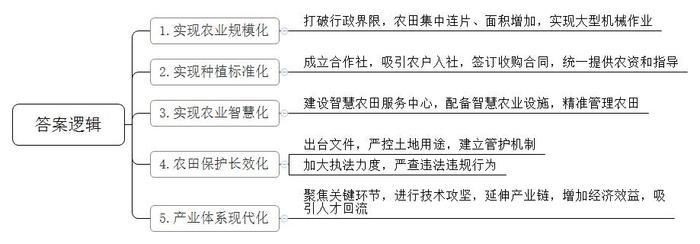
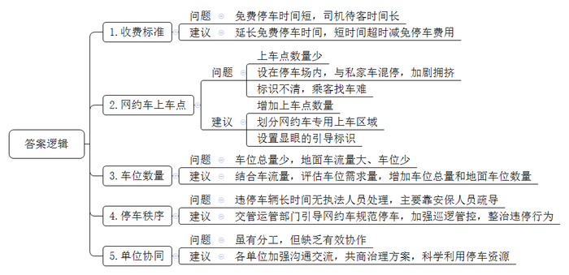
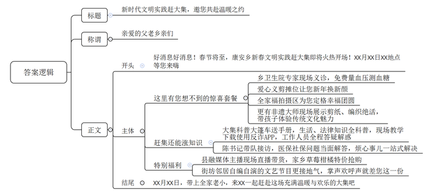
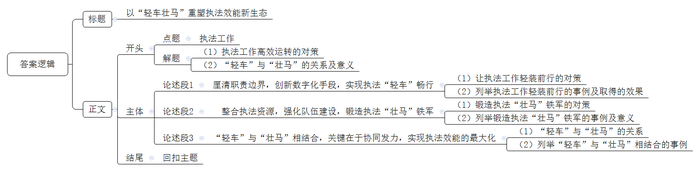

# 2025年公务员多省联考《申论》题（安徽C卷）

<!-- gwy:overview:start -->
> **安徽 · 2025 · 申论 · C类** ｜ 4 题 · 图片 4 处 · 答案随题折叠

导航：[题目](#题目) · [材料 1](#材料-1)
<!-- gwy:overview:end -->

> 候选采集稿。参考答案及解析来自粉笔页面，不代表官方答案或真实高分答卷；来源使用许可与原卷对应关系仍需人工核实。

## 给定材料

### 材料 1

“你看，这梯田一圈一圈，像池塘里的涟漪，层层荡开，非常漂亮。”站在定川村的山头，A市农业农村局马局长指着已经建成的高标准农田说。举目四望，山横黛，田绕山，碧绿轻盈的马铃薯苗正在田中茁壮成长，随高标准农田配套修建的“田间生产路”起伏于山间，延展向远方。在高标准农田建设上，A市立足当地实际，组织设计单位扎实摸底勘察，打破行政界限，整山系、整流域推进实施。“高标准农田消除了界埂沟渠，不仅增加了种植面积，而且集中连片，为新的农田经营方式创造了便利。”马局长说。

马铃薯种植是当地传统的主导产业。“我们以前人工点种，一天下来一人也只能点一亩。”定川村村民老秦说，“现在田间路宽了，大型机械也能开进田了，一天能种40多亩，而且每亩可以种4200株左右。”A市市政府引导种植大户牵头成立马铃薯种植合作社，在自愿的前提下，吸引农户以土地经营权入社，合作社与农户签订收购合同，给农户提供种子和机械，指导农户按照标准进行种植。

在定川村智慧农田服务中心，几位年龄较大的村民正在学习如何用手机浇地。打开手机应用软件，简单几步操作后，通过中心墙上的大屏幕，可以直观地看到伸缩式喷灌连接杆缓缓地伸出来，喷头旋转喷洒。这种喷灌设施不仅可以喷洒水，还可以喷洒调配好的肥料和药物。中心旁边有一块儿被栏杆围起的场地，分布着土壤墒情监测仪、物联网虫情信息采集设备等智慧农业设施。“这些设备收集到的信息都会汇集到软件上，农业技术员分析研判后在手机上发布灌溉、施肥、除虫等指导意见，农民只要点点手机，就能精准管理上千亩农田。”马局长说，“智慧农田服务中心让高标准农田有了‘大脑’，我们正在全市逐步推广。”

为确保高标准农田发挥长久效应，A市严格执行国家关于坚决遏制耕地“非农化”“非粮化”政策，出台了高标准农田建设项目管理办法等文件，要求任何单位和个人不得毁损、擅自占用高标准农田或改变高标准农田用途。“市里统筹‘建、用、管’一体，建立县、乡、村、组四级网格长的建后管护新机制。”市农业农村局农田建设与耕地质量保护科罗科长说。目前，A市已经划定各个网格管理区域，为每个网格都聘请了管护员，逐级落实管护责任主体。同时，A市农业农村、自然资源等部门加大执法力度，随机开展抽查检查，畅通举报渠道，公开监督投诉电话，对发现的各类违法违规问题，依法依规严肃查处。

近年来，A市加大科研投入力度，建成了一批集研发、教学和生产为一体的马铃薯种薯培育基地。“随着高标准农田建设的迅速推进，打造现代化的马铃薯产业发展体系成为我市迫在眉睫的任务。”马局长说，“市里围绕马铃薯种植，上溯下延，聚焦繁育、种植、储存、加工等关键环节，不断进行技术攻坚。”现在，A市每年生产的五百多万吨鲜薯，一部分作为良种向外销售推广出去，其余作为原料进入当地淀粉生产线进行深加工，一个个马铃薯正在串起金色的产业链。“我们公司年加工鲜薯9万多吨，生产薯产品1.4万吨，销售总额达1.08亿元。近年来，我们持续延伸产业链条，开发了流汁宽粉、马铃薯纤维等多种产品，进一步增加了企业的经济效益。”某淀粉加工有限公司柳经理说。

产业兴带来人气旺。以前定川村的年轻人都去外面发展，村子冷清得很。“现在我们合作社年轻人越来越多，仅去年就有十来名年轻人从城镇回来工作。这些人大部分受过高等教育，他们带回了新技术、新观念。”定川村马铃薯专业合作社杜经理说。这些年轻人经常随手拍一些定川马铃薯种植的短视频发到网上，自豪地宣传家乡的特色农业，吸引不少商家前来合作。“高标准农田建设一头连着国家的粮食安全，是实现高质量发展的重要保障，一头连着百姓的增产增收，是实现美好生活的坚实基础。”马局长说，“通过建设高标准农田，我们激活了农村的‘一池春水’。”山，还是那座山；地，依旧是那片地。从粮田到良田，如今的A市“鲜活”了起来，溢满勃勃生机。

### 材料 2

火车站是城市交通的重要枢纽，更是城市的形象窗口，但Z市火车站却各种问题层出不穷，“本来几分钟就可以上车，在这里竟然要等上几十分钟。”一位乘客无奈地对记者说。

周日上午，火车站地面停车场入口与外部高架桥相连接的道路上停靠了十余辆车。走近一看，车上都坐着候客的网约车驾驶员。这些司机为何不停靠在上车点内，而在道路上违停呢？“上车点在停车场内，超过15分钟就要收费。”网约车司机李师傅说，“既是上车点又是停车场，私家车跟网约车混在一起停车，车位本来就不够，这样就更挤啦。”

“我们地面的车流量要远远高于地下，但是地下停车场有192个车位，地面停车场只有170个，地面车位本来就规划不足。”物业刘经理坦言，Z市火车站总共加起来不足400个车位，目前的地面停车场车位也确实有限，暂时只能是安排工作人员多在现场引导。

由于车流量大，地面的上车点内不断有网约车进入，车位很快就几近饱和，后来的司机就只能“见缝插针”。一辆网约车因没有车位违停在通道上，二十多分钟过去了，都没有执法人员前来处理。直到停车场的安保人员发现通道上的车辆排起长队，上前疏导，通道才得以畅通。“停车场里就这一个上车点，画线的位置都被停了，我要是到偏一点的地方，乘客就不好找，说不定还得被投诉。”网约车司机封师傅说。蔡女士下了动车后，找了许久才找到上车点。“从车站出来后，一路上的标识牌都不显眼。”好不容易到了上车点，也没看到她的网约车。她说，“现在上下车的需求这么大，应该多设置几个上车点，这样乘客好找车，司机也好等客。”

在记者走访过程中，不少驾车及候车的市民表示，网约车上车点应当做得大些、规范些，让车辆好通行，市民好上车。部分市民认为，导致堵车的原因还在于停车场内网约车上车点的位置不清晰，应当划分出一块专门的上车区，而不是只有一个“微缩”的上车点。

谈到停车场收费标准时，网约车司机陆师傅表示，时常会遇到一些乘客高铁还没停稳就开始约车，乘客到网约车上车点的时间难以确定，“有时候乘客快到了，但停车场的15分钟免费停车时间就要用完，我们只能开出去再进来，否则接一单赚的钱可能还不够停车费。”

针对网约车上车点的停车乱象，“我们已经与交管部门和运管部门沟通，引导网约车尽量进入车位，不要停在通道上。”刘经理说，“如果确实存在比较严重的违停现象，还是需要交管部门加强巡逻处理。”

交警中队薛队长说，“我们将采取定点执勤与流动巡逻相结合的方式，加大巡逻管控力度，对违停挡道、有场不进的车辆进行重点整治。”

“火车站停车管理的分工其实是很明确的，各单位都作出了一定的努力，但‘头痛医头’‘各自为战’是不够的，分工的表象在分，但其实质是分背后的合，真正考察的是合的能力。”火车站管委会程主任说，“彻底破解火车站网约车停车乱象，还需要标本兼治，更科学地利用火车站停车资源，为群众提供一个良好的停车环境。”

### 材料 3

春节前夕，一场新时代文明实践赶大集活动在H县康安乡举行。当天的活动在精彩纷呈的文艺演出中拉开帷幕，现场的掌声、欢呼声此起彼伏。“今天上台的都是街坊邻居，但表演效果一点不输专业演员，相比之下，更亲切、更接地气。”现场观众纷纷表示。

文明实践搭台，各方都来唱戏。乡党委宣传委员介绍，早在半个多月前，乡里就发动党员干部开展线上线下“大走访”，了解“微心愿”，梳理各村报来的最集中、最急需的“心愿”，形成“需求清单”，报送给县文明实践中心。县里整合多家文明委成员单位的资源，组建志愿服务队伍，根据集市地点、规模、群众需求等调配资源，把群众最需要的民生服务直接送达群众手中。在他们的带动下，青年志愿者协会、义工协会等团体和很多爱心企业、热心群众也广泛参与进来，将一个个为民、便民、利民、惠民的“大礼包”送到老百姓的心坎上。

活动现场，大家一边看演出，一边逛集市，各志愿服务摊位前群众络绎不绝。爱心义诊摊位前，量血压、测血糖、健康咨询等医疗志愿服务很受欢迎。乡卫生院的医生耐心解答现场群众的咨询，进行保健、用药指导，并细心嘱咐老年人注意冬季健康防护。爱心服务摊位上，志愿者手中的推子、梳子上下翻飞，一会儿就理出一个干净利落的发型。“大爷，头稍微往上抬一点；大妈，放松，保持微笑，看镜头，3、2、1……”在全家福免费拍摄场地，志愿者们用镜头记录美好瞬间，让照片定格幸福时光。

在非遗展示区，一系列民俗文化项目吸引了众多群众前来参观体验。“我带孩子们体验了剪纸、编织技艺，让他们感受到传统文化的魅力，也收获了新知识、新技能。”一名现场群众说道。

大集现场，科普大篷车上摆放着各类宣传手册，工作人员向现场群众宣传卫生健康、生态环保、食品安全、法律等知识，指导群众下载使用反诈App，并耐心细致解答他们的问题。“我前年在县城买了套房，后来房屋归属发生争议，也不知该咋弄。刚才在法律咨询摊位，律师告诉我，他可以帮忙看看协议。我赶紧回家去拿！”张大哥说。

“支持我们的家人们，在公屏上把‘草莓’二字扣起来，把粉丝灯牌亮起来，我再给大家来一波更大的福利……”大集上热闹非凡，平台上同样火爆。县融媒体中心的主持人在集市上开展直播带货，助力推介当地的草莓、柑橘等优质特色农产品。

康安乡党委陈书记时而坐在接访摊位，时而走到群众之中，和大家寒暄一二，分享近期遇到的开心事、烦心事。赶集的崔姨笑着说：“不管啥事儿，都想和陈书记说说。从她嘴里讲出来的道理听起来格外实在！我们村之前和隔壁大槐村因为垃圾处理站谁负责的问题吵得不可开交，是陈书记来做我们的工作，一点点掰碎了和我们说道理，大家听得进去，也愿意去做，现在我们两个村可是周围村子里最干净的！”以陈书记为代表的乡镇干部现场接访，解答医保社保等群众关心的问题，切实做到听民意、释民惑、解民忧。

为提高活动热度，县融媒体中心对活动进行全程跟踪报道，在本地新闻频道、官方网站、有关社交平台同步开设专栏，分阶段、持续性发布报道，有效扩大了活动知晓度和影响力。

### 材料 4

原先，F市安信街道成潭社区党群服务中心的门口处、走廊里、墙壁上全是牌子和制度。“我们现在是大变样了。牌子只留三块，上墙制度更简洁，流程更清晰，服务得到了全面整合升级。”社区党委钟书记说。

发生变化的不仅是成潭社区一家。去年3月以来，为了破解基层治理“小马拉大车”的难题，市委市政府统一部署，相关部门牵头治理，推动了基层减负。短短半年，当地已出现不少新转变。如今在F市的村社一级，上墙事项已从59家单位的40项内容，缩减到9家12项。

“一直以来，由于种种原因，在条线部门向下分配工作的过程中，村社这一基层终端经常面临的是被层层‘转嫁’的任务。”市委社会工作部姜部长坦言。对此，F市探索推行“准入基层事、基层准确办”的基层事务改革，着力破解职责边界不清、准入不严、监管不力等难题。

要落实改革，第一步就是厘清界限。按照相关法律法规和上级要求，F市对村社的职责进行梳理，便于基层干部迅速、清晰地对照自身职责。与此同时，哪些制度能上墙，哪些证明可盖章，F市也对此进行了全面细致的梳理与明确。

职责任务明晰后，如何放得下、管得住，关键还看怎么抓全程管控。F市的办法是依靠数字化，在基层智治综合应用小程序中设置“事务准入”模块，要求准入事项必须通过该系统布置到村社。对职责之外需新增的事项，则必须层层过审，方可以临时任务的形式交办。对于过去一些不属于基层职能事项或需要群众来回跑腿的问题，现在扫一扫“减负码”就能立即反馈，及时得到解决。基层负担轻，群众奔波少，干部们纷纷拍手叫好，形象地称之为“车子变轻，续航更久”。

要“轻车”更要“壮马”，基层减负才能“减”出成效、“减”出发展。通过协同发力、共建共治，实现基层治理力量从“单兵种”到“集团军”的转变，是破解基层“小马拉大车”问题的根本方法。

“我们按照‘多网合一、一网多能’的原则，整合民政、城管、市场监管、卫生健康等各类网格，让各类业务运行在同一张网格上，有效增强了基层工作效能。”F市成副市长说，通过织密织牢6750个微网格，F市形成了专职、兼职和助理网格员的工作架构。“沟通是所有入户探访工作的基础。”在江尚街道社会服务工作站内，党工委姚书记正在给新聘的街道网格员培训，内容包括网格工作职责、服务意识与沟通技巧、情绪与压力管理等。“现在我感觉工作内容更清晰了，完成任务更有信心了！”参加培训的网格员小柳说。

“单靠现有力量是不够的，还得融合多方共同发力。”姜部长说。从去年3月起，F市健全完善驻地单位党组织和在职党员“双报到、双服务、双包联、双评价”机制，推动各级包联干部、联建单位等治理力量向网格汇集，同时统筹“两代表一委员”阵地、社会组织、志愿者队伍等，让各类社会力量成为基层治理的盟友，实现“一网统筹、多元集聚”，为基层治理添加动力。

打开电脑，花滨社区党委万书记点击智慧社区平台上的居民服务菜单，各类居民业务办理事项清晰呈现。依托“一键报表”“一键证明”等模块，社区已基本实现了报表自动生成。“以往巡查走访、社区信息归集是个麻烦事儿，不同类别数据需要反复收集。”万书记介绍。目前，F市通过智慧社区平台已实现各社区网格数据实时共享，真正做到“一次输入、定期维护、实时调阅”。数据打通了，基层干部有更多的时间走近老百姓，服务群众的道路更顺畅了。

<u>“我们将继续按照‘轻车’与‘壮马’相结合的原则，持续改进和创新工作模式，努力绘就基层治理新画卷。”</u>成副市长说。

## 题目

### 第 1 题

**A市通过建设高标准农田激活了农村的“一池春水”，根据“给定资料**1**”，请概括当地农村出现的新变化。（15分）**

关联材料：材料 1

作答要求：

要求：

（1）准确全面；

（2）分条列出；

（3）不超过200字。

第 1 题 · 答案与解析

**参考答案（粉笔题库参考内容）**

1.实现农业规模化。打破行政界限，农田集中连片、面积增加，实现大型机械作业。

2.实现种植标准化。成立合作社，吸引农户入社，签订收购合同，统一提供农资和指导。

3.实现农业智慧化。建设智慧农田服务中心，配备智慧农业设施，精准管理农田。

4.农田保护长效化。出台文件，严控土地用途，建立管护机制；加大执法力度，严查违法违规行为。

5.产业体系现代化。聚焦关键环节，进行技术攻坚，延伸产业链，增加经济效益，吸引人才回流。

**参考答案说明：**本参考答案从“实现农业规模化”“实现种植标准化”“实现农业智慧化”“农田保护长效化”“产业体系现代化”这五个方面展开，各条答案要点之间在内容上相互并列，没有交叉。

**解析状态：unknown（来源未提供）**

### 第 2 题

**请根据****“给定资料**2**”，梳理Z市火车站停车场存在的问题，并提出解决建议。（20分）**

关联材料：材料 2

作答要求：

要求：

（1）问题梳理全面、准确、有条理；

（2）所提建议与问题相对应，具体明确、切实可行；

（3）不超过300字。

第 2 题 · 答案与解析

**参考答案（粉笔题库参考内容）**

1.收费标准问题：免费停车时间短，司机待客时间长。建议：延长免费停车时间，短时间超时减免停车费用。

2.网约车上车点问题：上车点数量少；设在停车场内，与私家车混停，加剧拥挤；标识不清，乘客找车难。建议：增加上车点数量；划分网约车专用上车区域；设置显眼的引导标识。

3.车位数量问题：车位总量少，地面车流量大、车位少。建议：结合车流量，评估车位需求量，增加车位总量和地面车位数量。

4.停车秩序问题：违停车辆长时间无执法人员处理，主要靠安保人员疏导。建议：交管运管部门引导网约车规范停车，加强巡逻管控，整治违停行为。

5.单位协同问题：虽有分工，但缺乏有效协作。建议：各单位加强沟通交流，共商治理方案，科学利用停车资源。

**参考答案说明：**本参考答案整体上分为“问题”和“建议”两个要素，其中，“问题”部分从“收费标准”“网约车上车点”“车位数量”“停车秩序”“单位协同”五个方面展开，“建议”部分与“问题”相对应。各条答案要点之间在内容上相互并列，没有交叉。

**解析状态：unknown（来源未提供）**

### 第 3 题

**在此次新时代文明实践赶大集活动之前，县融媒体中心拟通过平台和乡广播站开展宣传，吸引广大群众参与。请根据****“给定资料**3**”，写一份广播稿。（25分）**

关联材料：材料 3

作答要求：

要求：

（1）紧扣资料，有针对性；

（2）条理清晰，语言生动；

（3）400字左右。

第 3 题 · 答案与解析

**参考答案（粉笔题库参考内容）**

新时代文明实践赶大集，邀您共赴温暖之约

亲爱的父老乡亲们：

好消息好消息！春节将至，康安乡新春文明实践赶大集即将火热开场！XX月XX日XX地点等您来嗨！

这里有您想不到的惊喜套餐。乡卫生院专家现场义诊，免费量血压测血糖；爱心义剪摊位让您新年换新颜；全家福拍摄区为您定格幸福团圆；更有非遗大师现场展示剪纸、编织绝活，带孩子体验传统文化魅力！

赶集还能涨知识！大集科普大篷车送手册，生活、法律知识全科普，现场教学下载使用反诈APP，工作人员全程答疑解惑！陈书记带队接访，医保社保问题当面解答，烦心事儿一站式解决！

特别福利！县融媒体主播现场直播带货，家乡草莓柑橘特价抢购！街坊邻居自编自演的文艺节目更接地气，掌声欢呼声就差您这一份！

XX月XX日，带上全家老小，来XX一起赶赴这场充满温暖与欢乐的大集吧！

**参考答案说明：**（1）格式方面，本参考答案写到了“标题”“称谓”“正文”三个部分。（2）正文部分，一方面从内容上来看，围绕“新时代文明实践赶大集”这一主题，本参考答案的开头先简要通知本次活动的时间、地点等背景信息；主体部分从“这里有您想不到的惊喜套餐”“赶集还能涨知识”“特别福利”三个方面介绍了本次活动的具体内容；最后，结尾进行了呼吁号召。另一方面，形式上，本参考答案做到了分段、分条撰写，整体上条理较为清晰。

**解析状态：unknown（来源未提供）**

### 第 4 题

**“给定资料**4**”提到“我们将继续按照‘轻车’与‘壮马’相结合的原则，持续改进和创新工作模式，努力绘就基层治理新画卷”，请深入思考这句话对执法工作的借鉴意义，联系实际，自选角度，自拟题目，写一篇文章。（40分）**

关联材料：材料 1、材料 2、材料 3、材料 4

作答要求：

要求：

（1）观点明确，见解深刻；

（2）思路清晰，语言流畅；

（3）参考给定资料，但不拘泥于给定资料；

（4）800-1000字。

第 4 题 · 答案与解析

**参考答案（粉笔题库参考内容）**

**以****“轻车壮马”重塑执法效能新生态**

执法工作的高效运转，既需要为执法队伍“减负松绑”，让其轻装上阵，也需要夯实基础力量，提升执法能力。唯有“轻车”与“壮马”相辅相成，才能破解执法领域的诸多难题，构建更具活力的治理格局。

**厘清职责边界，创新数字化手段，实现执法****“轻车”畅行。**这需要划定执法权力清单和责任清单，剥离不必要的附加任务，再用数字技术简化流程、打通梗阻，让执法工作轻装前行。浙江省公安机关推行“执法事项负面清单”制度，明确各类不得转嫁给基层派出所的非警务事项，同时开发“警务协同平台”，将各类警情任务纳入系统智能分配，一线民警通过“浙政钉”扫码即可反馈重复指令、多头报表等问题。实施一年后，基层派出所非警务出警量大幅下降，平均出警时间有效缩短，执法资源得以集中投向刑事案件侦办、治安防控等核心领域。

**整合执法资源，强化队伍建设，锻造执法****“壮马”铁军。**这意味着既要打破部门壁垒，将分散的执法力量攥指成拳，加强专业培训以提升队伍履职能力，也要吸纳社会各界力量参与，形成多元共治的执法格局。常州市武进区雪堰镇，组建综合行政执法和安全生产监督管理办公室，融合区级城管、应急等部门派驻人员，打造了一支110人的基层执法队伍，形成“1+2+4”的组织框架，构建起权责分明的综合执法新格局。同时，积极联合应急、消防等职能部门，建立工作衔接机制，实现信息快速共享。可见，整合执法资源，强化队伍建设，能够提升执法效能，为基层社会治理赋能增效。

**“轻车”与“壮马”相结合，关键在于协同发力，实现执法效能的最大化。**“轻车”为执法减负松绑，“壮马”为执法蓄能增力，二者深度融合才能释放1+1>2的治理效能。黑龙江省牡丹江市公安局便是生动范例。以往办案，民警需辗转多流程，精力分散在繁杂手续中。如今，其打造的执法办案管理中心，集多项功能于一体，实现“人、案、物、场”全要素管控一体化，效率大幅提升。同时，通过智能化管理与信息共享机制，规范执法行为，保障嫌疑人权益。这正是“轻车”与“壮马”协同发力，实现执法效能飞跃的有力见证。

当执法工作既能轻装上阵、精准发力，又能凝聚合力、专业高效，便能在维护社会秩序、服务群众需求的过程中，走出一条更具韧性与活力的发展之路。

**文章分析**

**以****“轻车壮马”重塑执法效能新生态**

【**标题的优点：**首先，范文的标题突出了“提升执法工作效能”这一主题。其次，形式上，文字简洁明快，不拖沓。】

（1）<u>执法工作的高效运转</u>，<u>既需要为执法队伍</u>“<u>减负松绑</u>”，让其轻装上阵，<u>也需要夯实基础力量</u>，提升执法能力。（2）唯有“<u>轻车</u>”与“<u>壮马</u>”<u>相辅相成</u>，<u>才能破解执法领域的诸多难题</u>，<u>构建更具活力的治理格局</u>。

【**开头的优点：**★内容方面：范文的开头是紧扣“提升执法工作效能”这一主题展开的。首先，开头点出主题，做到了主题明确。其次，对“提升执法工作效能”这一主题进行了分析阐述：（1）指出执法工作高效运转的对策；（2）阐述“轻车”与“壮马”的关系及意义。★文字表达方面：使用了“既……也……”“唯有……才能……”等关联词，使语言表达有逻辑性。】

**厘清职责边界，创新数字化手段，实现执法****“轻车”畅行。**（1）这<u>需要划定执法权力清单和责任清单</u>，<u>剥离不必要的附加任务</u>，<u>再用数字技术简化流程</u>、<u>打通梗阻</u>，让执法工作轻装前行。（2）<u>浙江省公安机关推行</u>“<u>执法事项负面清单</u>”<u>制度</u>，明确各类不得转嫁给基层派出所的非警务事项，同时<u>开发</u>“<u>警务协同平台</u>”，将各类警情任务纳入系统智能分配，一线民警通过“<u>浙政钉</u>”扫码即可反馈重复指令、多头报表等问题。<u>实施一年后</u>，<u>基层派出所非警务出警量大幅下降</u>，<u>平均</u><u>出</u><u>警时间有效缩短</u>，<u>执法资源得以集中投向</u>刑事案件侦办、治安防控等<u>核心领域</u>。

【**论述段****1的优点：**★观点句：范文的观点句是紧扣“提升执法工作效能”这一文章主题提出的。形式上，它在段首处直接写出，位置突出，容易发现。内容上，关键词突出，内容要点明确，可以明显看出它是从“轻车”这个角度入手，指出了实现“轻车”的对策。★论述内容：（1）指出让执法工作轻装前行的对策；（2）列举执法工作轻装前行的事例及取得的效果。注意：以上两个方面的内容都是紧扣“厘清职责边界，创新数字化手段，实现执法‘轻车’畅行”这个观点句进行分析论述的，论述的针对性强，内容层次丰富。最后，在论述方法上主要采用了讲道理与举例子结合，做到了丰富多样。】

**整合执法资源，强化队伍建设，锻造执法****“壮马”铁军。**（1）这意味着<u>既要打破部门壁垒</u>，<u>将分散的执法力量攥指成拳</u>，<u>加强专业培训以提升队伍履职能力</u>，<u>也要吸纳社会各界力量参与</u>，形成多元共治的执法格局。（2）<u>常州市武进区雪堰镇</u>，组建综合行政执法和安全生产监督管理办公室，融合区级城管、应急等部门派驻人员，打造了一支110人的基层执法队伍，形成“1+2+4”的组织框架，构建起权责分明的综合执法新格局。同时，积极联合应急、消防等职能部门，建立工作衔接机制，实现信息快速共享。可见，整合执法资源，强化队伍建设，<u>能够提升执法效能</u>，<u>为基层社会治理赋能增效</u>。

【**论述段****2****的优点：**★观点句：范文的观点句是紧扣“提升执法工作效能”这一文章主题提出的。形式上，它在段首处直接写出，位置突出，容易发现。内容上，关键词突出，内容要点明确，可以明显看出它是从“壮马”这个角度入手，指出了实现“壮马”的对策。★论述内容：（1）指出锻造执法“壮马”铁军的对策；（2）列举锻造执法“壮马”铁军的事例及意义。注意：以上两个方面的内容都是紧扣“整合执法资源，强化队伍建设，锻造执法‘壮马’铁军”这个观点句进行分析论述的，论述的针对性强，内容层次丰富。最后，在论述方法上主要采用了讲道理与举例子结合，做到了丰富多样。】

**“轻车”与“壮马”相结合，关键在于协同发力，实现执法效能的最大化。**（1）“轻车”为执法减负松绑，“壮马”为执法蓄能增力，<u>二者深度融合才能释放1+1&gt;2的治理效能</u>。（2）<u>黑龙江省牡丹江市公安局便是生动范例</u>。以往办案，民警需辗转多流程，精力分散在繁杂手续中。如今，其打造的执法办案管理中心，集多项功能于一体，实现“人、案、物、场”全要素管控一体化，效率大幅提升。同时，通过智能化管理与信息共享机制，规范执法行为，保障嫌疑人权益。这正是“轻车”与“壮马”协同发力，实现执法效能飞跃的有力见证。

【**论述段****3****的优点：**★观点句：范文的观点句是紧扣“提升执法工作效能”这一文章主题提出的。形式上，它在段首处直接写出，位置突出，容易发现。内容上，关键词突出，内容要点明确，可以明显看出它是从“轻车”与“壮马”的关系入手，指出了实现执法效能的最大化的对策。★论述内容：（1）指出“轻车”与“壮马”的关系；（2）列举“轻车”与“壮马”相结合的事例。注意：以上两个方面的内容都是紧扣“‘轻车’与‘壮马’相结合，关键在于协同发力，实现执法效能的最大化”这个观点句进行分析论述的，论述的针对性强，内容层次丰富。最后，在论述方法上主要采用了讲道理与举例子结合，做到了丰富多样。】

【**论述段之间的关系：**★内容的内在逻辑：范文的论述段之间是依照并列的逻辑展开的。论述段1先写了“厘清职责边界，创新数字化手段，实现执法‘轻车’畅行”，论述段2接着写了“整合执法资源，强化队伍建设，锻造执法‘壮马’铁军”，论述段3最后写了“‘轻车’与‘壮马’相结合，关键在于协同发力，实现执法效能的最大化”。这三个论述段按照“轻车”“壮马”“‘轻车’与‘壮马’的关系”展开，相互并列，逻辑清晰。】

当执法工作既能轻装上阵、精准发力，又能凝聚合力、专业高效，便能在维护社会秩序、服务群众需求的过程中，走出一条更具韧性与活力的发展之路。

【**结尾的优点：**范文的结尾回扣了“提升执法工作效能”这个主题，并且进行了总结展望。】

**解析状态：unknown（来源未提供）**

