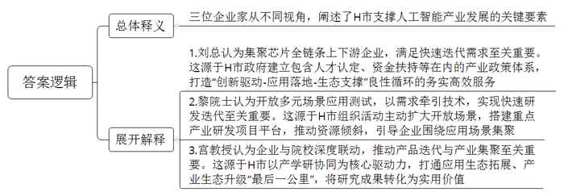
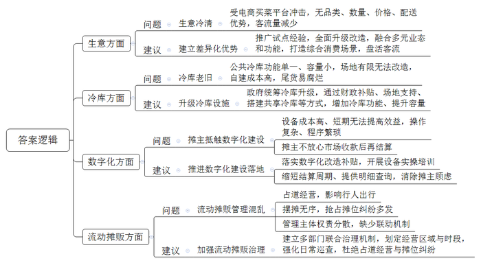
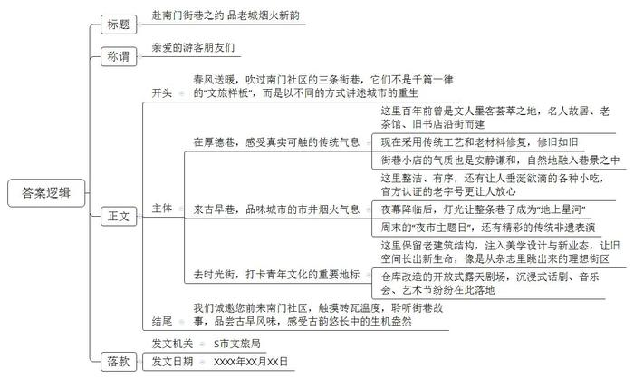
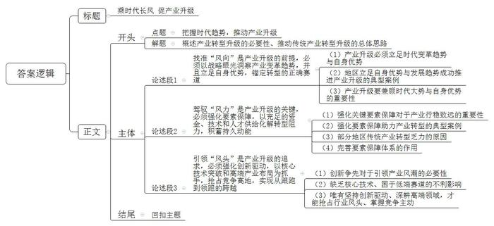

# 2026年公务员多省联考《申论》题（安徽A、普通选调卷）

<!-- gwy:overview:start -->
> **安徽 · 2026 · 申论 · A类** ｜ 4 题 · 图片 4 处 · 答案随题折叠

导航：[题目](#题目) · [材料 1](#材料-1)
<!-- gwy:overview:end -->

> 候选采集稿。参考答案及解析来自粉笔页面，不代表官方答案或真实高分答卷；来源使用许可与原卷对应关系仍需人工核实。

## 给定材料

### 材料 1

近期，某省城市足球联赛火爆全网。在H市主队比赛前的暖场环节，13个足球机器人惊艳亮相，以精准的传球、射门动作点燃了全场。这些机器人由人工智能领域著名学者、H市疆宇公司创始人黎院士团队研发，它们的精彩表现，正是该市人工智能产业“踢”出高质量发展新高度的一个缩影。在人工智能产业的不断赋能下，H市的新身份标识愈加清晰——一座未来科技之城正从容地奔向更加光辉灿烂的明天。

“从公司出发，大概一个小时车程，就能凑齐我们芯片生产供应链上的所有上下游企业，从晶圆制造到封装测试，从设计到生产，H市全都有！”H大学微电子学院研究员、圣庐科技有限公司刘总说，“这对迭代速度日新月异的人工智能企业来说<u><u>至关重要</u></u>。”

两年前，已是高校研究员的刘总在职博士后出站，恰好赶上H市推出“AI产业人才8条”和“种子基金赋能创新创业”活动。“我心里一直有个‘创业梦’，就抱着试一试的心态在网上提交了人才认定申请，没想到一个月内就获得C类人才认定，自动匹配政府种子基金连续三年、每年100万元的资金支持。”刘总后来才知道，为扶持人工智能产业发展，H市在AI产业人才和种子基金评审时专设了“绿色通道”，简化认定流程、放宽资格条件、不限申报名额。

从提供种子基金解决创业资金难题，到两年免租政策降低企业综合成本，再到推动重点产业研发项目落地，良好的产业政策体系，折射出的是H市政府打造“创新驱动-应用落地-生态支撑”良性循环的务实高效服务。

在H市国际机场繁忙的货物分拣区，一只集成在自动化设备上的“灵巧手”正在快速、安全地工作，其分拣效率较人工提升42%——这是疆宇公司研发的仿人“灵巧手”在真实场景中的应用测试。“只有不断开放不同场景进行应用测试，才能让技术被需求牵引着前进。”黎院士说，“这对人工智能产品的研发、迭代<u><u>至关重要</u></u>。”这只集成了多模态传感、信号处理与反馈机制的“手”，正经历从成品测试线走向更广阔应用现场的蝶变。

多场景应用是新技术落地的“试验场”和产业链升级的“催化剂”。H市主动开放多元应用场景，为疆宇这样的人工智能创新企业提供了丰沃的试验田。“市政府是场景‘策划师’和‘撮合官’，不仅通过‘我为企业搭场景’等活动主动扩大开放场景，还以重点产业研发项目为平台牵线搭桥，让资源向人工智能板块倾斜，引导上下游企业围绕应用场景集聚。”市工业和信息化局孙副局长介绍。

让人工智能赋能千行百业，离不开强大算力支撑。走近市“数谷”1号数据中心，一座上下4层、占地200多平方米的巨大蓝色立方体映入眼帘，这是一台名为“谛听”的超级计算机。“它每秒的运算能力达到1亿亿次，光服务器就有1200多台。”市大数据公司算力服务中心钱主任介绍，“有了这台计算机的支持，我们的人工智能企业就像有了‘最强大脑’。”而在“数谷”产业园，这是每一个数据中心的标配。

为改变算力建设小而散的局面，H市集中建设以“数谷”产业园为代表的一批智算单体集群，并通过高效的网络解决方案和调度算法，将千亿参数大模型训练的算力效率提升至80%，有力提升了算力供给。

“数谷”产业园内，圣庐公司的B2芯片吞吐海量数据，支撑着智能算力池的运转；讯飞公司的“九悟”大模型理解解析着上千亿条文本图像数据，为街角安防摄像头赋予“火眼金睛”；疆宇公司的手术机器人刚完成一例远程手术，机械腕关节误差在0.1毫米内……场景应用不断拓展的背后，是H市以产学研协同为核心驱动力，打通应用生态拓展、产业生态升级“最后一公里”的系统性实践。

“‘九悟’大模型之所以能够落地投入使用，离不开产、学、研的高效联动。”H市引进人才、讯飞公司创始人宫教授说。这家走在大模型本地化前列的芯片企业，最初来源于H大学微电子学院申报的创新创业项目，依托高校资源平台和政府支持孵化实现创业。高校提供实验设备、政府开放关键场景，从本科生到博士生围绕应用直接参与技术、产品的研发测试。“科研团队持续产出优秀文章与技术成果的同时，又通过上下游产业链不断将其转化为实用价值。只有企业与院校双方力量深度联动起来了，才能更快推动产品迭代与产业集聚。这对整个产业而言<u><u>至关重要</u></u>。”宫教授感慨。

### 材料 2

菜市场本该是一座城市里最具烟火气的地方，可在F市，如今一些菜市场从热闹走向了安静，很多摊贩都在苦恼生意难做。为深入了解情况，近期F市政协成立调研组，对市内一些菜市场进行了实地调研。

皖江菜市场是一家老牌菜市场。上午10时左右，偌大的菜市场里冷冷清清。“这带鱼多少钱？”一位小伙子问。摊主老李立即热情地介绍起来：“这带鱼非常新鲜，个头也大，35元一斤，你随意挑。”小伙子犹豫了一会儿，最终没有选择购买。老李叹了口气：“自从电商买菜平台上线后，瓜果蔬菜、家禽肉类，什么都能在手机上买，东西比我们多、比我们便宜，还很快就送到，来买菜的人也是越来越少喽。”

另一位摊主老王看着积压的一堆水果，愁得吃不下饭。“以前水果卖得快，就算是夏天也用不上冷库。现在菜市场的人少，水果卖不动时我们只能租用公共冷库。但是这个菜市场已经开门运营二十多年了，公共冷库功能单一又很小，场地有限也没法改造，自建冷库成本又太高，有些尾货只能任其腐烂。听说其他地方有统一安排做改造升级，也不知道我们这里有没有。”

2024年，F市出台文件明确支持菜市场数字化建设，通过政府补贴的模式，为菜市场配备智慧电子大屏、智能电子秤等设备，但申报的不多。“我也知道配个电子大屏、装个系统好。顾客看菜价一清二楚，也不用担心缺斤少两。”北辰菜市场负责人老张说，“但是这些都配上的话，成本很高，短期内又无法提高运营效益，我自己一个个去和摊主说配上电子秤接入系统，人家也不乐意，还是再看看吧。”一些摊主认为智慧电子秤等产品操作复杂，新增农产品信息、扫码入库等程序繁琐。“我们习惯了直接收费，如果是市场收款、后面再和我们结算，心里不踏实。”摊主田姐坦言。

走出北辰菜市场，外面竟还有个“露天菜市场”。不少贩卖家禽、果蔬的流动摊贩在道路两旁摆着摊位，挤占了该路段近三分之一的空间。由于大部分的人行道被商贩占据，一些行人只能在机动车道上穿行。无论是家住附近的居民，还是菜市场摊主，都对流动摊贩有些意见。“我早上着急送孩子上学，一到这儿就寸步难行，能不能来管管，早高峰就不要摆摊了！”居民周大姐情绪激动地说。居民郑大爷则有不同想法：“多些摊位也是方便我们买菜，但是路本来就窄，摆得乱七八糟也没有人管，还经常有摊贩为了位置吵架。我看，要不就修修路，让我们好走些、摊位更多点；要不就统一管理起来，大家也比较和谐。”

对北辰菜市场的种种问题，有关部门也想过解决，但效果不是太理想。市场管理责任分工不同，商务部门负责指导建设和改造提升，市场监管部门负责对经营行为综合监督，城市管理部门负责整治环境卫生、治理占道经营等……“我们想着如果摊位统一了，收拾干净了，管得好些，客流量是不是也能跟着大点。但是城管局也找了，市监局也找了，几家单位跑来跑去反复沟通就是没有彻底解决。”摊主老赵感慨，“要是能跑一次就把这些单位都联系上、说清楚就好了。”

作为F市菜市场转型升级的代表，下午三点钟，花园街菜市场的多家小吃摊前已是人头攒动。鱼圆、油墩儿、葱包烩、红皮卤鸭、赤豆酒酿……比起单纯卖菜，这里更为出名的是老字号小吃。“菜市场干饭”挑战100元能买到多少种东西？因食材丰富、价格实惠，在2025年改造后，花园街菜市场便时常冲上热搜，频频“出圈”。

为做好菜市场这一家门口民生工程，F市对部分菜市场进行了试点升级改造，探索推动菜市场“老牌”打出“新意”：有的尝试融合餐饮，顾客买完菜，可以现场加工为成品，实现“去趟菜市场，端回一桌菜”；有的套嵌花店、烘焙店、火锅店等商业，有效扩大了消费群体；有的融入文化活动室、老人活动中心等公共空间……“我在这里出生、长大、工作，以前出门娱乐休闲基本上都是要去大型的商超或者综合体，现在在菜市场就能逛很久，还比商超有烟火气多了！”说到改造后的菜市场，居民小金不停称赞。

“三分靠改造、七分靠管理，改造只是阶段性任务，而管理则是长期的。建议政府进一步加强对菜市场的管理，争取打造越来越多的标杆。”调研组凌组长表示，“菜市场既要‘好买、买好’，又要‘好卖、卖好’。”

### 材料 3

近日，S市举办了“街巷里的中国——城市微旅行游记征集大赛”，鼓励市民与游客用脚步丈量街巷、以文字记录温度。以下是获奖作品《在老街巷中，触摸一座城的重生》：

五月的风裹着暖意，吹过南门社区灰墙黛瓦的街巷。我终于站在这条被朋友反复“种草”的厚德巷——它不到500米，青石板路蜿蜒向前，两侧是错落的屋檐与探出墙头的绿意。游客络绎不绝，几乎每个人都举着手机，对准一扇花窗、一道砖纹、一面爬满藤蔓的老墙，留下珍贵的记忆……

朋友告诉我，这儿不仅是网红打卡地，更藏着一座城市更新的秘密。

三年前，南门社区还只是城区核心地带中一片被忽略的角落。尽管周边商场林立、写字楼群起，这里却仍散落着不少老旧院落与文保建筑，像被时光遗忘的拼图碎片。后来，社区启动了“微更新、轻活化”项目——他们称之为“街巷经济”的培育。于是，三年的时间里，几条曾经边缘的小巷在精心培育中一步步“活”了起来。

我慢慢向前走，指尖划过粗粝的砖墙。百年前，厚德巷曾是文人墨客荟萃之地，众多名人故居、老茶馆、旧书店沿街而建，后来，这里逐渐没落，老建筑也日渐斑驳。现在，整条巷子改造秉持的是“整旧如故”的理念。路上，恰好碰见一位正在修复砖雕的老师傅，“我们都是采用传统工艺修复这条街的门窗砖瓦，你看，我们特意从周边搜集相同年代的老材料，为的就是让这老街啊，修旧如旧。”往前走，一些老建筑的门前还挂着木牌，用中英双语静静讲述这座院落的往昔，传统的气息在这一刻真实可触。

转角处，一家名为“九九拾遗”的文创小店自然地融入巷景之中。老板娘九九是土生土长的本地人，她一边整理以老巷风貌为灵感制作的纸灯，一边感叹道：“改造后的厚德巷，不仅样子没变，连气氛也还是从前那样。”她的小店，就像巷中其他铺子一样，并不时髦喧闹，而是以安静谦和的气质，与巷子的基调相得益彰。

走出厚德巷，穿过一条马路，空气突然变得热闹起来——香味、人声、炊烟扑面而来。这里是古早巷，南门社区最有烟火气的地方。

南门社区唐主任正好也在烟火气里。她介绍，这里原本聚集了上百家小吃摊，臭豆腐、烤猪蹄、瘦肉丸……虽然人气旺，却油烟弥漫、摊点杂乱，“很多人来了又走，留不住。”

但现在，古早巷并没有被清理一空，也没有赶走一家商户，反而整洁、有序了。正在炸酥肉的大姐开心地说：“你看，社区不仅帮我们统一设计餐车，还装了油烟净化器，现在我们做生意更体面、更安心啦。”一路上，各式各样的小吃让人垂涎欲滴，我点了一份老伯卖的烤年糕。“我在这做了三十年。以前这里是脏乱差，现在成了名片！”老伯指着餐车上“古早巷老字号”的标识说，“这是社区给我们认证的，有了这个，老客更认，新客也更放心。”

晚上七点，巷子限制了机动车通行，变成了步行美食街，灯光渐渐亮起，暖黄色的光束从檐角洒下，整条古早巷成了一条“地上的星河”。

“我们要做的，是让市井烟火留得住人，也留得住心。”唐主任说，“周末我们还经常举办‘夜市主题日’，很多家长都带着孩子来体验。”正说着，巷口突然响起锣鼓声——原来是一场非遗舞狮表演正在开场，人群欢呼涌动。运气真好，赶上他们的夜市主题活动！

而最让我惊艳的，是离古早巷不远的时光街：青绿的主色调、简洁的设计线条、潮流的店铺招牌，年轻人三三两两坐在户外咖啡座上聊天。这像是从杂志里跳出来的一片理想街区，谁能想到，改造的时候，它的前身竟是一个设施陈旧、货车扰民、居民抱怨连连的旧粮油市场？唐主任告诉我，改造的时候，社区并没有抹掉它的过去，而是在保留老建筑结构的基础上，注入美学设计与新业态。“那时候我们提出一个理念，叫‘以旧育新’。”她说道，“不是仿古，也不是复旧，而是要让旧空间自己长出新的生命。”

在这里开设独立书店的主理人小陈坦言：“最初我们想在这儿做文创，很多人都不看好。但社区推出了实实在在的扶持政策，不仅引入社会资本设立‘创新孵化基金’，还提供租金减免和品牌推广支持，让我们这样的小店也有了走下去的底气。”如今，时光街已成为本地青年文化的一个重要地标。曾经的仓库屋顶被改造成了开放式的露天剧场，沉浸式话剧、音乐会、艺术节纷纷在此落地。

夜幕缓缓落下，我坐在时光街一角，写下最后一页游记：如果你问我，为什么一条老街值得专门来看？我想我找到了答案。厚德巷、古早巷、时光街——它们并没有变成千篇一律的“文旅样板”，而是以三种不同的方式，讲述同一件事：一座城市如何温柔地对待自己的过去，又如何勇敢地走向未来。

你若来，不要只记得拍照——你要触摸它的砖瓦，聆听它的故事，品尝它的小吃，感受它古韵悠长中的生机盎然。

### 材料 4

G市以电气产业为经济支柱，形成了强大的电气产业集群。“近年来，面临国际运费上涨、市场订单减少等诸多挑战，我市始终坚持产业兴城，推动电气产业迭代发展，为经济的不断壮大激活潜力、注入动能。去年，全市生产总值增长6.2%，全省排名第一。”市委徐书记说。

志光电气公司是一家输配电成套设备研发生产商。走进这家公司，智能化、数字化和绿色化场景随处可见：在柔性加工中心，智能化装置具备冲、剪、折、激光切一体的钣金加工能力，能够自动堆料、分拣，节省20%-30%的能源消耗；智慧能源管理平台的运用，确保了能源的高效清洁利用，综合能耗节约30%左右。“市里对我们传统电气企业技术改造的补助力度很大，最高达25%。”公司王董事长说，在政策激励下，G市传统电气企业纷纷进行提质升级，焕发出蓬勃生机，“智能化、数字化和绿色化有力地推动了我们在行业低潮期逆风而上，强势突围。”

“新能源充电桩业务正在高速增长，它将成为我们的未来。”有成电气科技公司涂总很庆幸做了转型的决定。如今公司一半业务来自传统开关电器，一半业务来自新能源充电桩。G市电气集群的主导产品是低压电气，但近年来，随着外部市场环境的变化，低压电气需求滑坡，市场不断变小，转型升级成为很多企业的共识。

“切入新赛道要顺风而行，我们经过仔细研究论证，立足自身优势，选择最适合自己的发力方向。”徐书记说，G市认真筹划产业迭代发展，推动电气产业向新能源、智能物联、低空经济等新蓝海转型。在市政府的全力支持下，有成电气三年时间，成功研发了新能源汽车充电桩产品。“因为是以现有的产业优势为基础开辟新赛道，企业更容易获得行业信息、专业人才和配套技术，相比闭门造车，时间、精力成本都大大下降。”涂总说。

“我们有底气和志气参与国际竞争，在国际舞台追风而行。”徐书记说。在谋划全市电气产业新发展时，G市对比国际知名的电气产业集群寻找关键差距，发现国外知名的电气产业集群除了有龙头电气企业，还有一批新材料、高端装备等领域的全球顶尖企业。“我们立即重点扶持新材料和高端装备产业，外部引进和本土培育双管齐下。”今年刚落地的欣盛新材料公司就是市政府大力引进的，公司以碳纤维复合材料制成的耐压舱等核心产品填补了国内空白。企业一落地，就开始为市电气产业研发性能更优的复合材料产品。同时，G市涌现出一批高端装备企业，设计开发的高精度设备，让越来越多更具竞争力的新产品从车间走向市场。一家电器公司在传统断路器中植入通信模块专用芯片及传感器，生产出了智能断路器产品，单台售价提升10余倍，并一举打入欧洲市场。

过去，很多企业都遇到过相似的麻烦，经常被客户要求出具电气产品极限寿命测试报告。“完成第三方测试，要跑到外地，成本高，速度慢。”从事汽车电子电气分配保护系统研发生产的兴领电气公司费经理说。今年，市政府与有关科研机构共建的电气测试实验室正式启用。现在上午送产品到实验室，下午就可以拿到检测报告，以最快的速度完成产品从研发转量产前的测试验证。G市正与多家科研机构合作，共同建设这类精准服务本地产业发展的高能级平台，未来将覆盖电气全产业链。“这些科技平台的落地让我们本土企业拥有了强大的技术后援团，为产业发展提供了有力支撑。”市科技局孔局长说。

“人是社会发展的重要动力。”徐书记说，“我市不仅以产业吸引人，还以软环境吸引人。”完善外来随迁子女就学政策保障体系，全市公办学校实行“零门槛入学、无条件转学”；首创企业实用型人才自主认定机制，将无职称、无高学历而实操技术出众的企业“关键人才”纳入人才政策体系……G市对人才敞开大门。“这里开放包容，是创业者最好的学校，既有成熟的产业链为创业者托底，更有倡导边学边干、不怕失败的风气。”彭先生早年从外地来G市打工，后来辞职创业，经历多次试错后创立了自己的电气公司，目前公司已成长为国家级专精特新“小巨人”。像彭先生这样来这里打拼的有36.4万人，他们的到来为产业发展注入了新的生机。

“电气产业很大程度上成就了我市的高质量发展。”徐书记说，G市正充分把握新质生产力的时代机遇，努力推动经济发展，<u><u>“时代的风总是在吹，关键在找准‘风向’，驾驭‘风力’，引领‘风头’。”</u></u>

## 题目

### 第 1 题

**请根据****“给定资料**1**”，谈谈你对三位企业家所说的“至关重要”的理解。（15分）**

关联材料：材料 1

作答要求：

要求：

（1）全面准确；

（2）条理清晰；

（3）不超过300字。

第 1 题 · 答案与解析

**参考答案（粉笔题库参考内容）**

三位企业家从不同视角，阐述了H市支撑人工智能产业发展的关键要素。

1.刘总认为集聚芯片全链条上下游企业，满足快速迭代需求至关重要。这源于H市政府建立包含人才认定、资金扶持等在内的产业政策体系，打造“创新驱动-应用落地-生态支撑”良性循环的务实高效服务。

2.黎院士认为开放多元场景应用测试，以需求牵引技术，实现快速研发迭代至关重要。这源于H市组织活动主动扩大开放场景，搭建重点产业研发项目平台，推动资源倾斜，引导企业围绕应用场景集聚。

3.宫教授认为企业与院校深度联动，推动产品迭代与产业集聚至关重要。这源于H市以产学研协同为核心驱动力，打通应用生态拓展、产业生态升级“最后一公里”，将研究成果转化为实用价值。

**解析**

**参考答案说明****：**（1）思路方面，本参考答案按照词句解释题“总体释义+展开解释”的答题思路展开。（2）内容方面，本参考答案先对题干句子进行总体释义，再分从“集聚芯片全链条上下游企业”“开放多元场景应用测试”“企业与院校深度联动”三个方面进行展开解释。

### 第 2 题

**请根据****“给定资料**2**”，梳理调研组在F市菜市场调研中发现的问题，并提出解决建议。（20分）**

关联材料：材料 2

作答要求：

要求：

（1）问题梳理全面、准确、有条理；

（2）所提建议与问题相对应，具体明确、切实可行；

（3）不超过400字。

第 2 题 · 答案与解析

**参考答案（粉笔题库参考内容）**

1.问题：生意冷清。受电商买菜平台冲击，无品类、数量、价格、配送优势，客流量减少。建议：建立差异化优势。推广试点经验，全面升级改造，融合多元业态和功能，打造综合消费场景，盘活客流。2.问题：冷库老旧。公共冷库功能单一、容量小，场地有限无法改造，自建成本高，尾货易腐烂。建议：升级冷库设施。政府统筹冷库升级，通过财政补贴、场地支持、搭建共享冷库等方式，增加冷库功能、提升容量。3.问题：摊主抵触数字化建设。设备成本高、短期无法提高效益，操作复杂、程序繁琐；摊主不放心市场收款后再结算。建议：推进数字化建设落地。落实数字化改造补贴，开展设备实操培训；缩短结算周期、提供明细查询，消除摊主顾虑。4.问题：流动摊贩管理混乱。占道经营，影响行人出行；摆摊无序，抢占摊位纠纷多发；管理主体权责分散，缺少联动机制。建议：加强流动摊贩治理。建立多部门联合治理机制，划定经营区域与时段，强化日常巡查，杜绝占道经营与摊位纠纷。

**解析**

**参考答案说明：**本参考答案从“生意冷清”“冷库老旧”“摊主抵触数字化建设”“流动摊贩管理混乱”四个方面梳理了F市菜市场存在的问题，并针对问题提出解决建议。且答案呈现为“问题1+建议1；问题2+建议2……”的形式，符合题干中“所提建议与问题相对应”这一要求。各条答案要点之间在内容上相互并列，没有交叉。

### 第 3 题

**S市文旅局将在公众号上发布一封公开信，邀请游客前来南门社区旅行。假设你是市文旅局的工作人员，请根据“给定资料**3**”，拟写这封公开信。（25分）**

关联材料：材料 3

作答要求：

要求：

（1）紧扣资料，亮点突出；

（2）逻辑清晰，语言生动；

（3）不超过500字。

第 3 题 · 答案与解析

**参考答案（粉笔题库参考内容）**

赴南门街巷之约 品老城烟火新韵

亲爱的游客朋友们：

春风送暖，吹过南门社区的三条街巷，它们不是千篇一律的“文旅样板”，而是以不同的方式讲述城市的重生。

在厚德巷，感受真实可触的传统气息。这里百年前曾是文人墨客荟萃之地，名人故居、老茶馆、旧书店沿街而建；现在采用传统工艺和老材料修复，修旧如旧；街巷小店的气质也是安静谦和，自然地融入巷景之中。

来古早巷，品味城市的市井烟火气息。这里整洁、有序，还有让人垂涎欲滴的各种小吃，官方认证的老字号更让人放心；夜幕降临后，灯光让整条巷子成为“地上星河”；周末的“夜市主题日”，还有精彩的传统非遗表演。

去时光街，打卡青年文化的重要地标。这里保留老建筑结构，注入美学设计与新业态，让旧空间长出新生命，像是从杂志里跳出来的理想街区；仓库改造的开放式露天剧场，沉浸式话剧、音乐会、艺术节纷纷在此落地。

我们诚邀您前来南门社区，触摸砖瓦温度，聆听街巷故事，品尝古早风味，感受古韵悠长中的生机盎然。

S市文旅局

XXXX年XX月XX日

**解析**

**参考答案说明**：（1）格式方面，本参考答案写到了“标题”“称谓”“正文”“落款”四个部分。（2）正文部分，一方面从内容上来看，围绕“邀请游客前来南门社区旅行”这一主题，本参考答案的开头写到了南门社区的基本情况；主体部分介绍了“厚德巷”“古早巷”“时光街”这三个街巷的旅游亮点；结尾部分向广大游客发出邀请。另一方面，形式上，本参考答案进行了分段撰写，整体上较为清晰。

### 第 4 题

**“给定资料**4**”中提到“时代的风总是在吹，关键在找准‘风向’，驾驭‘风力****’****，引领****‘风头****’****。****”请深入思考这句话，联系实际，自选角度，自拟题目，写一篇文章。（40分）**

关联材料：材料 1、材料 2、材料 3、材料 4

作答要求：

要求：

（1）观点明确，见解深刻；

（2）思路清晰，语言流畅；

（3）参考给定资料，但不拘泥于给定资料；

（4）1000-1200字。

第 4 题 · 答案与解析

**参考答案（粉笔题库参考内容）**

**乘时代长风** **促产业升级**

当前，市场竞争深刻变革、产业迭代加速，部分传统产业面临模式固化、需求收缩等发展困境，转型升级成为高质量发展的必由之路。产业发展顺势则兴、逆势必衰，面对时代浩荡长风，传统产业唯有精准辨识发展风向、充分借力时代风力、主动领跑行业风头，方能突破发展瓶颈、激活内生动力，实现迭代提质、焕发全新生机。

**找准****“风向”是产业升级的前提，必须以战略眼光洞察产业变革趋势，并且立足自身优势，锚定转型的正确赛道。**转型绝非盲目跟风跨界，既要精准研判时代变革风向，更要立足自身产业禀赋量力而行、借势突围。究其根本，成功的产业升级，皆是趋势与优势的双向契合。浙江电气产业立足完备的产业链配套优势，洞察新能源、智能物联发展趋势，有序推进赛道切换；广东家电产业依托成熟制造基底，紧跟绿色智能消费风口迭代升级。实践充分证明，唯有兼顾时代大势与自身优势，跳出路径依赖、精准锚定适配赛道，方能在行业逆风中稳住基本盘，筑牢升级根基。

**驾驭****“风力”是产业升级的关键，必须强化要素保障，以充足的资金、技术和人才供给化解转型阻力，积蓄持久动能。**找准赛道只是破局起点，在关键要素上充分赋能才是支撑产业行稳致远的核心动能。湖南嘉禾聚焦传统铸锻造产业转型，通过专项政策扶持、整合产业链资源、搭建精密加工技术平台、培育本土技能人才，推动传统粗放铸锻造产业向精细化、绿色化、智能化升级，实现产业能级整体跃升。与之相反，部分地区传统产业转型乏力，根源正是要素保障缺位、配套支撑不足。这样的对照充分证明，完善的要素保障体系，能够有效破解转型堵点，为产业迭代升级积蓄持久发展势能。

**引领****“风头”是产业升级的追求，必须强化创新驱动，以核心技术突破和高端产业布局为抓手，抢占竞争高地，实现从跟跑到领跑的跨越。**顺势转型可脱困自保，创新争先方能引领风潮。即便转型，如若缺乏核心技术、困于低端赛道，始终只能处于产业链跟跑地位。唯有坚持创新驱动、深耕高端领域，才能抢占行业风头、掌握竞争主动。比如山东济钢破除传统钢铁产能桎梏，以技术创新布局新材料、高端装备赛道，实现跨界蝶变；我国盾构机产业持续攻坚核心技术，突破多项“卡脖子”难题，完成从技术追赶到全球领跑的历史性跨越。核心技术是抵御风浪的“定海针”，高端布局是领航发展的“风向标”，唯有以创新突破蓄势扬帆，方能实现从“跟跑”到“领跑”的精彩蝶变。

产业革新不息，转型未有穷期。找准风向、驾驭风力、引领风头，是传统产业升级的完整逻辑。立足新阶段，唯有识势谋变、聚力赋能、创新争先，方能激活传统产业活力，以产业转型实效赋能经济高质量发展。

**文章分析**

**乘时代长风** **促产业升级**

【**标题的优点：**标题中含有主题词，使文章主题更突出、清晰。其次，在形式上采用了对称式标题，使主题更清晰、操作更简单。】

（1）当前，<u><u>市场竞争深刻变革</u></u>、<u><u>产业迭代加速</u></u>，<u><u>部分传统产业面临模式固化</u></u>、<u><u>需求收缩等发展困境</u></u>，<u><u>转型升级成为高质量发展的必由之路</u></u>。（2）<u><u>产业发展顺势则兴</u></u>、<u><u>逆势必衰</u></u>，面对时代浩荡长风，<u><u>传统产业唯有精准辨识发展风向</u></u>、<u><u>充分借力时代风力</u></u>、<u><u>主动领跑行业风头</u></u>，<u><u>方能突破发展瓶颈</u></u>、<u><u>激活内生动力</u></u>，<u><u>实现迭代提质</u></u>、<u><u>焕发全新生机</u></u>。

【**开头的优点：**★内容方面。范文的开头是紧扣“把握时代趋势，推动产业升级”这一主题展开的。首先，开头点出主题，做到了主题明确。其次，对“把握时代趋势，推动产业升级”这一主题进行了分析阐述：（1）由传统产业的发展困境引出产业转型升级的必要性；（2）强调“找准‘风向’”“驾驭‘风力’”“引领‘风头’”对于传统产业迭代提质的重要性。★文字表达方面。使用了“唯有……方能……”等连接词，使语言表达更有气势。】

**找准****“风向”是产业升级的前提，必须以战略眼光洞察产业变革趋势，并且立足自身优势，锚定转型的正确赛道。**（1）<u><u>转型绝非盲目跟风跨界</u></u>，既<u><u>要精准研判时代变革风向</u></u>，更<u><u>要立足自身产业禀赋量力而行</u></u>、<u><u>借势突围</u></u>。究其根本，成功的产业升级，<u><u>皆是趋势与优势的双向契合</u></u>。（2）<u><u>浙江电气产业立足完备的产业链配套优势</u></u>，<u><u>洞察新能源</u></u>、<u><u>智能物联发展趋势</u></u>，有序推进赛道切换；<u><u>广东家电产业依托成熟制造基底</u></u>，<u><u>紧跟绿色智能消费风口迭代升级</u></u>。（3）实践充分证明，唯有<u><u>兼顾时代大势与自身优势</u></u>，<u><u>跳出路径依赖</u></u>、<u><u>精准锚定适配赛道</u></u>，<u><u>方能在行业逆风中稳住基本盘</u></u>，<u><u>筑牢升级根基</u></u>。

【**论述段****1的优点：**★观点句：范文的观点句是紧扣“把握时代趋势，推动产业升级”这一文章主题提出的。形式上，它在段首处直接写出，位置突出，容易发现。内容上，关键词突出，内容要点明确，可以明显看出是从“找准‘风向’是产业升级的前提”的角度展开论述。★论述内容：（1）先阐明产业升级必须立足时代变革趋势与自身优势；（2）接着列举地区立足自身优势与发展趋势成功推进产业升级的典型案例；（3）再次强调产业升级要兼顾时代大势与自身优势的重要性。注意：以上三个方面的内容都是紧扣“找准‘风向’是产业升级的前提，必须以战略眼光洞察产业变革趋势，并且立足自身优势，锚定转型的正确赛道”这个观点句进行分析论述的，论述的针对性强，内容层次丰富。在论述方法上主要采用了讲道理、举例子相结合的方式，论述清晰充分。】

**驾驭****“风力”是产业升级的关键，必须强化要素保障，以充足的资金、技术和人才供给化解转型阻力，积蓄持久动能。**（1）找准赛道只是破局起点，<u><u>在关键要素上充分赋能才是支撑产业行稳致远的核心动能</u></u>。（2）<u><u>湖南嘉禾聚焦传统铸锻造产业转型</u></u>，通过<u><u>专项政策扶持</u></u>、<u><u>整合产业链资源</u></u>、<u><u>搭建精密加工技术平台</u></u>、<u><u>培育本土技能人才</u></u>，推动传统粗放铸锻造产业向精细化、绿色化、智能化升级，实现产业能级整体跃升。（3）与之相反，<u><u>部分地区传统产业转型乏力</u></u>，<u><u>根源正是要素保障缺位</u></u>、<u><u>配套支撑不足</u></u>。（4）这样的对照充分证明，<u><u>完善的要素保障体系</u></u>，<u><u>能够有效破解转型堵点</u></u>，<u><u>为产业迭代升级积蓄持久发展势能</u></u>。

【**论述段****2的优点：**★观点句：范文的观点句是紧扣“把握时代趋势，推动产业升级”这一文章主题提出的。形式上，它在段首处直接写出，位置突出，容易发现。内容上，关键词突出，内容要点明确，可以明显看出是从“驾驭‘风力’是产业升级的关键”的角度展开论述。★论述内容：（1）先指出强化关键要素保障对于产业行稳致远的重要性；（2）接着介绍了强化要素保障助力产业转型的典型案例；（3）指出部分地区传统产业转型乏力的原因；（4）最后强调完善要素保障体系的作用。注意：以上四个方面的内容都是紧扣“驾驭‘风力’是产业升级的关键，必须强化要素保障，以充足的资金、技术和人才供给化解转型阻力，积蓄持久动能”这个观点句进行分析论述的，论述的针对性强，内容层次丰富。在论述方法上主要采用了讲道理、举例子相结合的方式，论述清晰透彻。】

**引领****“风头”是产业升级的追求，必须强化创新驱动，以核心技术突破和高端产业布局为抓手，抢占竞争高地，实现从跟跑到领跑的跨越。**（1）<u><u>顺势转型可脱困自保</u></u>，<u><u>创新争先方能引领风潮</u></u>。（2）即便转型，<u><u>如若缺乏核心技术</u></u>、<u><u>困于低端赛道</u></u>，<u><u>始终只能处于产业链跟跑地位</u></u>。（3）<u><u>唯有坚持创新驱动</u></u>、<u><u>深耕高端领域</u></u>，<u><u>才能抢占行业风头</u></u>、<u><u>掌握竞争主动</u></u>。比如山东济钢破除传统钢铁产能桎梏，以技术创新布局新材料、高端装备赛道，实现跨界蝶变；我国盾构机产业持续攻坚核心技术，突破多项“卡脖子”难题，完成从技术追赶到全球领跑的历史性跨越。核心技术是抵御风浪的“定海针”，高端布局是领航发展的“风向标”，<u><u>唯有以创新突破蓄势扬帆</u></u>，<u><u><u>方能实现从</u></u></u><u><u><u>“跟跑”到“领跑”的精彩蝶变</u></u></u>。

【**论述段****3的优点：**★观点句：范文的观点句是紧扣“把握时代趋势，推动产业升级”这一文章主题提出的。形式上，它在段首处直接写出，位置突出，容易发现。内容上，关键词突出，内容要点明确，可以明显看出是从“引领‘风头’是产业升级的追求”的角度展开论述。★论述内容：（1）点明创新争先对于引领产业风潮的必要性；（2）指出缺乏核心技术、困于低端赛道的不利影响；（3）强调唯有坚持创新驱动、深耕高端领域，才能抢占行业风头、掌握竞争主动。注意：以上三个方面的内容都是紧扣“引领‘风头’是产业升级的追求，必须强化创新驱动，以核心技术突破和高端产业布局为抓手，抢占竞争高地，实现从跟跑到领跑的跨越”这个观点句进行分析论述的，论述的针对性强，内容层次丰富。在论述方法上主要采用了举例子和讲道理的方式，论述清晰有力。】

【**论述段之间的关系：**三个论述段分别从“找准‘风向’是产业升级的前提”“驾驭‘风力’是产业升级的关键”“引领‘风头’是产业升级的追求”的角度，对文章主题“把握时代趋势，推动产业升级”展开了论述，彼此之间呈现出并列的逻辑。】

产业革新不息，转型未有穷期。找准风向、驾驭风力、引领风头，是传统产业升级的完整逻辑。立足新阶段，唯有识势谋变、聚力赋能、创新争先，方能激活传统产业活力，以产业转型实效赋能经济高质量发展。

【**结尾的优点：**范文的结尾回扣了“把握时代趋势，推动产业升级”这个主题，并且进行了总结升华。】

**解析状态：unknown（来源未提供）**

