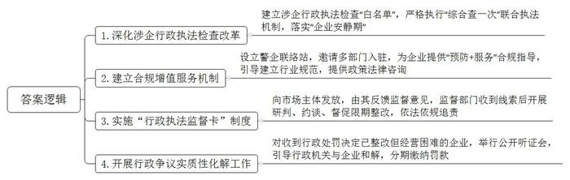
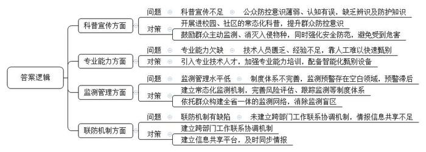
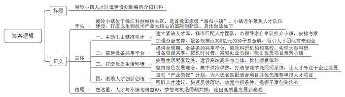
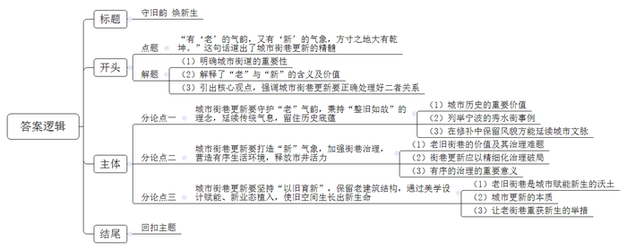

# 2026年公务员多省联考《申论》题（安徽C卷）

> 候选采集稿。参考答案及解析来自粉笔页面，不代表官方答案或真实高分答卷；来源使用许可与原卷对应关系仍需人工核实。

## 给定材料

### 材料 material-5523065ddec2461d

一天上午，E市应急管理、市场监管等部门的检查人员走进腾龙股份有限公司进行执法检查。“这是一次跨领域、跨部门统筹完成的‘特殊’检查，进一次门、查多项事。”E市司法局赵局长说，“我们向企业承诺：若各项检查结果均符合标准，3个月内，除重大专项检查和投诉举报核查外，各行政执法部门将不再入企开展例行检查。”市综合行政执法队孙队长是检查现场负责人，他介绍：“我们在省‘大综合一体化’执法监管数字应用平台发起监管预约后，市场监管、生态环境等部门响应联合检查。按照规定，未响应联合检查的部门，在一定期限内，原则上将不能对同一家企业进行重复检查。”

2023年起，E市探索涉企行政执法检查改革，通过进一步深化改革，充分释放市场活力。“核心就是要贯彻中央‘放得活，管得住’精神，以此保护企业的积极性和创造性，激发市场的活力。”刘副市长表示。E市通过建立涉企行政执法检查“白名单”，严格执行“综合查一次”联合执法机制，有效落实“企业安静期”。“过去每个月都要多次迎检，牵扯精力实在不少。”腾龙公司顾总经理说，“现在多部门联合检查，大大减轻了我们企业的迎检负担，让我们有更多时间抓生产、提高经济效益。”

“韦警官，真是太谢谢你了！”下湖区东方国际珠宝城商户老韩握着珍珠小镇警企联络站韦警官的手不住地感谢。几天前，韦警官在走访时，发现老韩与某公司签订的《珍珠蚌购销合同》条款存在漏洞，老韩听了他的建议，马上与对方签了补充协议，避免了重大损失。“近年来，珍珠直播带货火爆，但商户在经营中常常面临因虚假合同、售卖假货、劳务争议等引发的法律风险。为及时就地给商户提供法律服务，市公安局在珠宝城内成立了珍珠小镇警企联络站。”市公安局经侦支队余队长介绍，“去年年初，市里特别强调全市各行政执法主体要积极探索建立本领域合规增值服务机制，为企业提供‘预防+服务’的合规指导。我们按照有关部署要求，邀请市场监管、金融等部门入驻警企联络站，指导直播电商建立行业规范，为商户提供政策法律咨询。”

“在执法时，执法队会向市场主体发放‘行政执法监督卡’。卡上列出了被监督单位、行政执法人员姓名、监督事项、举报联系方式、意见或建议等内容，市场主体可以通过拨打电话、邮寄等方式反馈监督意见。”市纪委监委叶主任介绍，监督部门收集到执法不规范、“一刀切”等线索后及时研判，约谈相关部门督促限期整改，对涉嫌违法违规的执法行为依法依规追责。“‘行政执法监督卡’不仅是市场主体的监督卡，也是执法人员的自律卡，让单向监督变成了双向监督，被动监督变为主动监督，有效织密了监督之网。”叶主任说。

“20万元罚款现在真拿不出来。厂子的银行账户被冻结，开不了工，再这样下去，厂子怕是开不下去了。”E市美滋食品公司沈经理向市检察院检察官诉说自己的难处。去年12月，市检察院针对涉企行政非诉执行重点案件开展行政争议实质性化解工作。办案检察官经调查走访了解到，美滋公司收到生态环境部门作出的行政处罚决定后，已在期限内完成整改。但由于资金回流慢，公司未能如期缴纳罚款。今年1月，市检察院针对此案举行公开听证会。“行政处罚有事实和法律依据，但企业也确实存在经营困难，建议行政机关同意企业采取分期方式缴纳罚款，帮助企业渡过难关。”会上，生态环境部门与美滋公司当场达成执行和解协议，约定分期缴纳罚款。“法不容情，但E市的行政执法人有温情。”沈经理说。

“政府要为市场机制发挥作用保驾护航，为市场主体提供高质量的服务，让行政监管与企业发展实现双赢。”刘副市长表示，“接下来，我市将进一步优化安商惠企的法治化营商环境，努力做到‘有求必应，无事不扰’，让企业更加安心、舒心。”

### 材料 material-0bb2463bff9a5ac2

一场新雨后，M省K市市民古先生发现，小区的草地上有几只巨型蜗牛正在爬行，大小从鸡蛋到拳头不等。“这是非洲大蜗牛，一到下雨天，小区的空地上和草丛里常常就会出现。”古先生在观察了蜗牛的外形后笃定地说，“非洲大蜗牛身上全是细菌和寄生虫，学校没有进行关于入侵物种方面的知识宣传，孩子们不懂，看到就抓起来玩。小区物业倒是清理过好几次，就是杀不完。”

小赵是M省G县的一位上班族，平时会分享一些和外来入侵物种有关的视频。“外来入侵物种就在身边。”他说，比如庄稼地有红火蚁出没，偶尔还有农民被咬到；村里的小溪旁甚至县护城河边，都能发现福寿螺的身影。“这些入侵物种往往食性很杂且食量巨大，田里的水稻还没长好就被糟蹋了。像福寿螺身上还充满寄生虫，对人体健康也是很大的威胁。”小赵介绍道，很多人缺乏生物入侵防控的意识，甚至有意从国外购买危害性强的物种作为宠物。“网上有人说入侵物种主要侵害的是农村、森林等偏远地区，对城市影响不大，这是非常严重的误解。”小赵说。

天刚蒙蒙亮，K市农业综合行政执法支队骆队长就带着队员赶到东翠湖阻止了一起违规放生鱼类的行为。“这种齐氏罗非鱼是国家明令禁止放生的入侵物种，对生态系统有着极大的危害。”骆队长介绍道。现场执法人员及时制止了此次放生活动，并向放生活动组织者宣传了规范开展水生生物放生的相关法律。“面对巨大的防控区域，光靠抓是抓不完的，还是要加强宣传和科普，从源头上化解风险。”骆队长说。去年8月，执法支队从某水族店查获数十条被作为观赏鱼售卖的外来入侵物种鳄雀鳝，其渠道来源是跨境电商网上交易，由境外人员通过伪装打包等各种藏匿手段非法寄递入境。骆队长坦言：“我们队伍现在只有几个懂技术的，经验也缺乏，很多情况下光靠人工难以快速甄别外来入侵物种，非法入侵渠道五花八门而且越来越隐蔽，我们有些力不从心。”

小黄是M省T市吉达快递的一名快递员。“我们网点有一套别家没有的关键词智能筛查系统，对‘活体’‘动物’等敏感词能够实施自动标记并触发人工核查流程。此类包裹在送达时，我们都会要求客户线下开箱验视确认为合规物品。”小黄说。据了解，T市为快递员队伍定制了数字化举报平台“邮警官”，对于发现非法寄递入侵物种的，鼓励快递员及时上报，并对查实的给予奖励。“不过我们不是专业人员，对一些新出现的入侵物种，我们也不认得，只能先报上去再说。”

长期以来，针对外来入侵物种的监测预警主要依靠政府部门，市民对生物安全的认识不够，缺乏对其危害程度的评估，导致一些外来物种在入侵后得以迅速扩散。M农林大学周教授认为，目前对外来物种的监测管理水平与面临的生物安全形势不相称，风险评估、跟踪监测、生态预警等制度体系尚不完善。“除了各防控部门要建立常态化监测机制外，更要依托群众构建全省一体的监测网络。特别是城市公园、街边绿化带和小区内部，目前属于外来入侵物种监测预警的空白领域，往往要等到入侵物种对生态安全和人民群众生活构成严重威胁后，才会触发预警，增加了防治难度和投入。”

去年9月，T市政府发布了在市内各小区全面开展福寿螺防控工作的通告，规定凡在本市辖区内发现福寿螺出没、非法交易或放生线索的，只要主动上报属地政府或街道办事处，经核实后将给予资金补助奖励。周教授认为，这是比较好的办法，“但在鼓励老百姓主动监测、消灭外来入侵物种的同时，也应当加强安全防范，避免公众因此受到伤害。”

M省政协徐委员认为：“防控外来入侵物种，绝不是一个部门、一个地方的事。M省在这方面做了大量具体工作，比如建立了检查和预防外来入侵物种的相关制度，为海关配备了智能化包裹查验设备，组织快递公司建立可疑件溯源台账系统等，加强了对交易环节的规范和约束。但目前应对入侵物种的跨部门工作联系和协调机制还没有建立起来，情报信息还不能很好地共享。”

### 材料 material-98b3333b7ce1b56f

引育生物技术核心企业150余家，生物技术产业集聚度高达50%，入住人群超3万人，科创人才8000余人……这样一组亮眼的数据来自闻岭，一座占地面积不足6平方公里的小镇。

闻岭小镇位于D市锦江科技城核心区，是首批国家级“海归小镇”。近年来，小镇聚焦人才队伍建设，全力打造以生物技术产业为核心的国际创新区。

金翅生物创始人兼首席技术官孟院士就是闻岭小镇“引进来”的人才之一。“之所以到这里发展，最为关键的，是小镇管委会‘主动出击’的诚意。”孟院士表示。对此，闻岭小镇管委会尹副主任记忆犹新：“先前我们建立了紧缺人才库，经过数据比对发现，孟院士团队的研究方向同小镇产业发展方向高度契合。市领导亲自带队，先后3次到孟院士的研究所介绍我们的创业优势，利用人才见面会、政策宣讲会等多个机会推介小镇，并安排考察，三顾茅庐，终于让这只‘金凤凰’飞来闻岭！”金翅生物团队的人员平均年龄不到35岁，且都具有博士学位。如今，像金翅生物一样选择来小镇创业的人才团队越来越多，小镇为人才创业提供真金白银的支持，配备的种子基金群规模近300亿元。

“在生物技术领域，动辄百万的高端研发设备投入是创业起步阶段的‘限速器’。”尹副主任说，闻岭小镇给出的解决方案是提供一个覆盖蛋白纯化、基因分析、显微成像等全周期、全链条的共享平台，通过联动锦江国家实验室、D大学医学科学院，实现了大型科研设备的资源共享。“传统模式需要投入大量高价值的设备，现在只需支付机时费。”尹副主任说。

在多要素协同作用下，一大批由海内外高层次人才主导的优质项目纷纷集聚小镇，快速成长。去年，小镇新增独角兽企业6家、博士后工作站6家、国家级科技型中小企业26家，“上下楼就是上下游，左右邻就是产业链”在这里变成了现实。

在推进产业服务的同时，闻岭小镇不忘提升居住品质，致力于为人才打造舒适、便捷的生活家园。在小镇管委会的努力下，学校、医院、酒店、邻里中心一应俱全。正在建设的光环梦中心以生物科技公园为特色，将作为高端商业综合体为小镇居民带来全新的消费体验。此外，小镇坚持绿色发展理念，利用锦江污水厂再生水实现区域集中供冷供热，地下车库物联网智能照明系统节能率达67%。“优质的生活环境，让人才更专注于企业发展、产业升级。”尹副主任说，“只有为人才提供好服务，小镇才能抓住高质量发展的机遇。”

闻岭小镇将人才的发展放在更加突出的位置，尊重人才的智慧与创造力，让人才“引进来”还要“留下来”。为了让更多企业人才能扎根当地，激励人才创新创造，小镇启动了“产业教授”计划，吸引全国优秀的科技企业家到研究生工作站担任教授导师。小镇为每位入选的教授“量体裁衣”，匹配适合的项目并优先推荐申报国家、省级人才项目。

“这个举措很实在，如果申报条件再放宽点就更好了。”在一次人才座谈会上，香神生物创始人兼首席科学家钟教授提出建议。很快，最新发布的“产业教授”选聘办法里，潜在独角兽企业等新指标就被纳入，包括钟教授在内的45人完成申报，数量大幅提升。“没想到建议这么快就得到了反馈，新办法这么快就落了地，更加坚定了我留在这里干事创业的信心，为小镇点赞！”钟教授兴奋地说。

得益于厚植的人才沃土，奔涌的创新活力浇灌出了闻岭小镇产业的硕果。在这里，物的投入服务于人的发展，人的进步反哺物的升级，人才与小镇相得益彰，梦想与机遇同频共振，一幅高质量发展的画卷正徐徐展开……

## 题目

### 第 1 题

**请根据给定资料**1**，概括E市在优化法治化营商环境方面的举措。（15分）**

关联材料：material-5523065ddec2461d

作答要求：

要求：

（1）全面准确；

（2）分条列出；

（3）不超过250字。

### 第 2 题

**请根据给定资料**2**，梳理M省外来入侵物种防控工作面临的问题，并提出解决建议。（20分）**

关联材料：material-0bb2463bff9a5ac2

作答要求：

要求：

（1）问题梳理全面、准确、有条理；

（2）所提建议与问题相对应，具体明确、切实可行；

（3）不超过350字。

### 第 3 题

**D市准备在全市范围内征集人才队伍建设创新案例，请根据给定资料**3**，为闻岭小镇管委会拟写一份案例介绍材料。（25分）**

关联材料：material-98b3333b7ce1b56f

作答要求：

要求：

（1）紧扣资料，重点突出；

（2）条理清晰，语言简洁；

（3）450字左右。

### 第 4 题

**给定资料**4**中提到“有‘老’的气韵，又有‘新’的气象，方寸之地大有乾坤。”请你结合对这句话的理解，联系实际，自选角度，自拟题目，写一篇文章。（40分）**

关联材料：material-5523065ddec2461d

作答要求：

要求：

（1）观点明确，见解深刻；

（2）思路清晰，语言流畅；

（3）参考给定资料，但不拘泥于给定资料；

（4）800-1000字。

## 答案与解析

第 1 题

**参考答案（粉笔题库参考内容）**

1.深化涉企行政执法检查改革。建立涉企行政执法检查“白名单”，严格执行“综合查一次”联合执法机制，落实“企业安静期”。

2.建立合规增值服务机制。设立警企联络站，邀请多部门入驻，为企业提供“预防+服务”合规指导，引导建立行业规范，提供政策法律咨询。

3.实施“行政执法监督卡”制度。向市场主体发放，由其反馈监督意见，监督部门收到线索后开展研判、约谈、督促限期整改，依法依规追责。

4.开展行政争议实质性化解工作。对收到行政处罚决定已整改但经营困难的企业，举行公开听证会，引导行政机关与企业和解，分期缴纳罚款。

**解析**

**参考答案说明：**本参考答案从“深化涉企行政执法检查改革”“建立合规增值服务机制”“实施‘行政执法监督卡’制度”“开展行政争议实质性化解工作”四个方面展开，各条答案要点之间在内容上相互并列，没有交叉。

**考点**：考点概括措施类

**来源**：来源2026年公务员多省联考《申论》题（安徽C卷）

粉笔申论页面对本题只提供「解析视频」入口，该入口是会员推广位，页面无视频地址与文字解析。

第 2 题

**参考答案（粉笔题库参考内容）**

1.问题：科普宣传不足。公众防控意识薄弱、认知有误，缺乏辨识及防护知识。对策：开展进校园、社区的常态化科普，提升群众防控意识；鼓励群众主动监测、消灭入侵物种，同时强化安全防范，避免受到危害。

2.问题：专业能力欠缺。技术人员匮乏、经验不足，靠人工难以快速甄别。对策：引入专业技术人才，加强专业能力培训，配备智能化甄别设备。

3.问题：监测管理水平低。制度体系不完善，监测预警存在空白领域，预警滞后。对策：建立常态化监测机制，完善风险评估、跟踪监测等制度体系；依托群众构建全省一体的监测网络，消除监测盲区。

4.问题：联防机制有缺陷。未建立跨部门工作联系协调机制，情报信息共享不足。对策：建立跨部门工作联系协调机制；建立信息共享平台，及时同步情报。

**解析**

**参考答案说明****：**本参考答案从“科普宣传”“专业能力”“监测管理”“联防机制”四个方面展开，每个方面先给出问题，再针对问题给出对策建议。各条答案要点之间在内容上相互并列，没有交叉。

**考点**：考点提出对策类

**来源**：来源2026年公务员多省联考《申论》题（安徽C卷）

粉笔申论页面对本题只提供「解析视频」入口，该入口是会员推广位，页面无视频地址与文字解析。

第 3 题

**参考答案（粉笔题库参考内容）**

闻岭小镇人才队伍建设创新案例介绍材料

闻岭小镇位于锦江科技城核心区，是首批国家级“海归小镇”。小镇近年聚焦人才队伍建设，打造以生物技术产业为核心的国际创新区。具体做法如下：

一、主动出击精准引才。建立紧缺人才库，精准匹配人才团队，市领导亲自带队推介小镇，安排考察；加强资金支持，配备规模近300亿元的种子基金群，吸引人才团队前来创业。二、搭建设备共享平台。提供全周期、全链条的共享平台，联动科研机构和高校，实现大型科研设备资源共享，按机时付费，减轻创业负担，吸引优质项目集聚小镇。三、打造优质生活环境。完善生活配套设施，建设高端商业综合体，优化消费体验；坚持绿色发展理念，集中供冷供热，打造智能节能照明系统，让人才专注于企业发展。四、激励人才创新创造。启动“产业教授”计划，为入选者匹配适合项目并优先推荐申报人才项目；听取人才建议，快速反馈落地，放宽申报条件，提振干事创业信心。

在这里，人才与小镇相得益彰，梦想与机遇同频共振，绘出高质量发展新画卷。

**解析**

**参考答案说明**：（1）本题要求撰写“一份案例介绍材料”，需注意格式，介绍材料的一般格式为：标题+正文。（2）正文部分，一方面从内容上来看，围绕着“闻岭小镇人才队伍建设”这一主题，本参考答案的开头先写到了闻岭小镇人才队伍建设的背景；主体从“主动出击精准引才”“搭建设备共享平台”“打造优质生活环境”“激励人才创新创造”这四个方面介绍了具体做法；结尾总结指出闻岭小镇和人才共同推动高质量发展。另一方面，形式上，本参考答案做到了分段、分条撰写，整体上条理较为清晰。

**考点**：考点总结类

**来源**：来源2026年公务员多省联考《申论》题（安徽C卷）

粉笔申论页面对本题只提供「解析视频」入口，该入口是会员推广位，页面无视频地址与文字解析。

第 4 题

**参考答案（粉笔题库参考内容）**

**守旧韵** **焕新生**

城市街巷，承载着记忆与乡愁，也映射着一座城市的气质与灵魂。“有‘老’的气韵，又有‘新’的气象，方寸之地大有乾坤。”这句话道出了城市街巷更新的精髓。所谓“老”的气韵，是历经岁月沉淀的历史底蕴、建筑肌理与人间烟火；所谓“新”的气象，是与时俱进的空间品质、治理效能与市井活力。城市街巷更新，既要守护“老”的气韵，也要打造“新”的气象，更需“以旧育新”，让历史底蕴与时代活力在方寸之间交融共生。

**城市街巷更新要守护****“老”气韵，秉持“整旧如故”的理念，延续传统气息，留住历史底蕴。**城市的历史记忆，往往藏在不起眼的老砖旧瓦之中，它们是城市不可复制的精神标识，更是维系文化认同的核心载体。在修缮宁波秀水街时，团队跑遍周边村落寻觅老砖老瓦，一块块甄别、回收，采用原生石材与传统木作工艺，精细复原古建。物质空间是城市记忆的容器，唯有让修补的每一处细节都延续着传统风貌，城市的历史记忆才能在这些老砖旧瓦中继续生长，传统气韵方能在日常空间中得以真实传承。

**城市街巷更新要打造****“新”气象，加强街巷治理，营造有序生活环境，释放市井活力。**老旧街巷承载着浓郁的烟火气，但经营无序、环境杂乱等治理难题也制约街区发展。街巷更新应以精细化治理破局，让烟火气有序生长。福州达明路曾是知名美食聚集地，却因油烟呛人、摊点杂乱而令人却步。改造时，当地没有驱离老商户，而是统一规划餐车区域、强化油烟净化等，打造更美、更环保的美食街区。有序的治理既保留了市井烟火，又破解了治理顽疾，让老街巷在整洁环境中持续聚拢人气、焕发活力。

**城市街巷更新要坚持****“以旧育新”，保留****老建筑结构****，通过美学设计赋能、新业态植入，使旧空间生长出新生命。**老旧街巷从不是发展的阻碍，而是城市赋能新生、提质进阶的丰厚沃土。无论是河南郑州磨街文创园保留老厂房肌理，围绕青年夜生活打造网红地标，还是沈阳红梅文创园将废弃味精厂的老车间活化，打造为集艺术展览与体育赛事于一体的夜间文旅消费集聚区，都生动诠释了“旧中出新”的辩证智慧。城市更新的本质，在于将“闲置存量”转化为“发展增量”。只有用新场景、新体验激活沉睡的空间资源，才能真正实现历史底蕴与时代活力的有机统一。

守住根脉，焕发生机，方寸之地，自有乾坤。当青石板路遇见霓虹灯火，当老砖旧瓦拥抱新潮业态，城市街巷便在这方寸之间，写下了属于自己的诗与远方。

**解析**

**文章分析**

**守旧韵 焕新生**

【**标题的优点：**体现文章的主题，并且对仗工整。】

（1）城市街巷，承载着记忆与乡愁，也映射着一座城市的气质与灵魂。（2）“有‘老’的气韵，又有‘新’的气象，方寸之地大有乾坤。”这句话道出了城市街巷更新的精髓。所谓“老”的气韵，是历经岁月沉淀的历史底蕴、建筑肌理与人间烟火；所谓“新”的气象，是与时俱进的空间品质、治理效能与市井活力。（3）城市街巷更新，既要守护“老”的气韵，也要打造“新”的气象，更需“以旧育新”，让历史底蕴与时代活力在方寸之间交融共生。

【**开头的优点：**★内容方面。范文的开头是紧扣题目给定的“城市街道的守旧与新生”这一主题展开的。先明确城市街道的重要性；接着解释了“老”与“新”的含义及价值；最后引出核心观点，强调城市街巷更新要正确处理好二者关系。★文字表达方面。使用了“既”“也”“更”等连接词，使语言表达有逻辑性。】

**城市街巷更新要守护****“老”气韵，秉持“整旧如故”的理念，延续传统气息，留住历史底蕴。**（1）城市的历史记忆，往往藏在不起眼的老砖旧瓦之中，它们是城市不可复制的精神标识，更是维系文化认同的核心载体。（2）在修缮宁波秀水街时，团队跑遍周边村落寻觅老砖老瓦，一块块甄别、回收，采用原生石材与传统木作工艺，精细复原古建。（3）物质空间是城市记忆的容器，唯有让修补的每一处细节都延续着传统风貌，城市的历史记忆才能在这些老砖旧瓦中继续生长，传统气韵方能在日常空间中得以真实传承。

【**论述段****1的优点：**★观点句：范文的观点句是紧扣“城市街道的守旧与新生”这一文章主题提出的。形式上，它在段首处直接写出，位置突出，容易发现。内容上，关键词突出，内容要点明确，可以明显看出主要论述“守护‘老’气韵”。★论述内容：（1）城市历史的重要价值；（2）列举宁波的秀水街事例；（3）在修补中保留风貌方能延续城市文脉。注意：以上几个方面的内容都是紧扣“城市街巷更新要守护‘老’气韵，秉持‘整旧如故’的理念，延续传统气息，留住历史底蕴”这个观点句进行分析论述的，论述的针对性强，内容层次丰富。在论述方法上主要采用了讲道理和摆事实结合的方式，论述清晰透彻。】

**城市街巷更新要打造****“新”气象，加强街巷治理，营造有序生活环境，释放市井活力。**（1）老旧街巷承载着浓郁的烟火气，但经营无序、环境杂乱等治理难题也制约街区发展。（2）街巷更新应以精细化治理破局，让烟火气有序生长。福州达明路曾是知名美食聚集地，却因油烟呛人、摊点杂乱而令人却步。改造时，当地没有驱离老商户，而是统一规划餐车区域、强化油烟净化等，打造更美、更环保的美食街区。（3）有序的治理既保留了市井烟火，又破解了治理顽疾，让老街巷在整洁环境中持续聚拢人气、焕发活力。

【**论述段****2的优点：**★观点句：范文的观点句是紧扣“城市街道的守旧与新生”这一文章主题提出的。形式上，它在段首处直接写出，位置突出，容易发现。内容上，关键词突出，内容要点明确，可以明显看出主要论述“打造‘新’气象”。★论述内容：（1）老旧街巷的价值及其治理难题；（2）街巷更新应以精细化治理破局；（3）有序的治理的重要意义。注意：以上几个方面的内容都是紧扣“城市街巷更新要打造‘新’气象，加强街巷治理，营造有序生活环境，释放市井活力”这个观点句进行分析论述的，论述的针对性强，内容层次丰富。在论述方法上主要采用了讲道理和摆事实结合的方式，论述清晰透彻。】

**城市街巷更新要坚持****“以旧育新”，保留老建筑结构，通过美学设计赋能、新业态植入，使旧空间生长出新生命。**（1）老旧街巷从不是发展的阻碍，而是城市赋能新生、提质进阶的丰厚沃土。无论是河南郑州磨街文创园保留老厂房肌理，围绕青年夜生活打造网红地标，还是沈阳红梅文创园将废弃味精厂的老车间活化，打造为集艺术展览与体育赛事于一体的夜间文旅消费集聚区，都生动诠释了“旧中出新”的辩证智慧。（2）城市更新的本质，在于将“闲置存量”转化为“发展增量”。（3）只有用新场景、新体验激活沉睡的空间资源，才能真正实现历史底蕴与时代活力的有机统一。

【**论述段****3的优点：**★观点句：范文的观点句是紧扣“城市街道的守旧与新生”这一文章主题提出的。形式上，它在段首处直接写出，位置突出，容易发现。内容上，关键词突出，内容要点明确，可以明显看出主要论述“‘以旧育新’，正确处理二者关系”。★论述内容：（1）老旧街巷是城市赋能新生的沃土；（2）城市更新的本质；（3）让老街巷重获新生的举措。注意：以上几个方面的内容都是紧扣“城市街巷更新要坚持‘以旧育新’，保留老建筑结构，通过美学设计赋能、新业态植入，使旧空间生长出新生命”这个观点句进行分析论述的，论述的针对性强，内容层次丰富。在论述方法上主要采用了讲道理和摆事实结合的方式，论述清晰透彻。】

【**论述段之间的关系：**★内容的内在逻辑：范文的论述段之间是依照“守护‘老’气韵”—“打造‘新’气象”—“‘以旧育新’，正确处理二者关系”的逻辑展开的。论述内容层层递进、逻辑紧密、论述清晰。】

守住根脉，焕发生机，方寸之地，自有乾坤。当青石板路遇见霓虹灯火，当老砖旧瓦拥抱新潮业态，城市街巷便在这方寸之间，写下了属于自己的诗与远方。

【**结尾的优点：**范文的结尾回扣了“城市街道的守旧与新生”这个主题，并且进行了总结提升。】

**考点**：考点文章写作题

**来源**：来源2026年公务员多省联考《申论》题（安徽C卷）

粉笔申论页面对本题只提供「解析视频」入口，该入口是会员推广位，页面无视频地址与文字解析。

