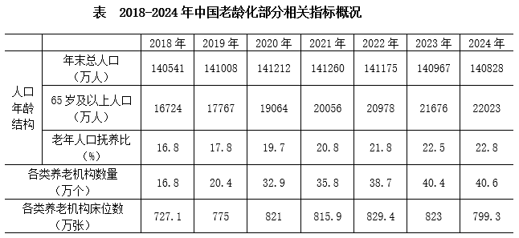
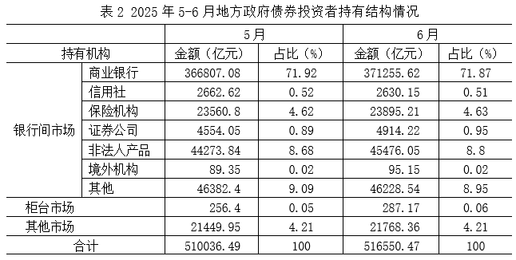
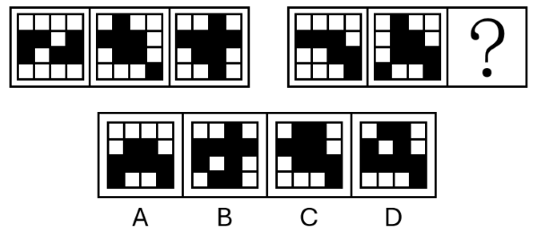
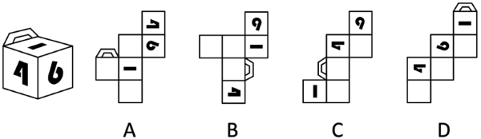

# 2026年安徽省公务员录用考试《行测》题（网友回忆版）

> 候选采集稿。参考答案及解析来自粉笔页面，不代表官方答案或真实高分答卷；来源使用许可与原卷对应关系仍需人工核实。

## 题型与作答说明

政治理论

（15题）

根据题目要求，在四个选项中选出一个最恰当的答案。

常识判断

（15题）

根据题目要求，在四个选项中选出一个最恰当的答案。

数量关系

（15题）

在这部分试题中，每道题呈现一段表述数字关系的文字，要求你迅速、准确地计算出答案。

言语理解与表达

（25题）

本部分包括表达与理解两方面的内容。请根据题目要求，在四个选项中选出一个最恰当的答案。

判断推理

（35题）

本部分包括图形推理、定义判断、类比推理与逻辑判断四种类型的试题，在四个选项中选出一个最恰当的答案。

资料分析

（20题）

所给出的图、表、文字或综合性资料均有若干个问题要你回答。你应根据资料提供的信息进行分析、比较、计算和判断处理。

## 给定材料

### 材料 dom-material-cf79aba5af6ba26e

近年来，我国低空经济发展表现出巨大潜力，2023年底全国低空经济规模超5000亿元，2030年底有望达到2万亿元。截至2024年底，全国在册通用机场达475个，较2023年增加26个。截至2023年底，全国通用航空企业达689家，在册通用航空器数量3303架，通用航空完成飞行时长137.1万小时，同比增长12.4%。其中，载客类完成2.8万小时，同比增长55.1%，载人类完成14.5万小时，同比增长34.7%，其他类完成69.6万小时，同比增长8.3%；非经营性作业时长完成50.2万小时，同比增长11.2%。

截至2024年底，全国无人机生产企业近700家，截至2023年底，全国获得通用航空经营许可证且使用民用无人机的通用航空企业19825家，同比净增4695家；全行业无人机拥有者注册用户92.9万个，其中，个人用户84.9万个，企业、事业、机关法人单位用户8万个；全行业注册无人机共126.7万架，同比增长32.2%；全行业有效无人机操控员执照共19.44万本，同比增长27.2%。2023年，全年无人机累计飞行2311万小时，同比增长11.8%。

### 材料 dom-material-7f6dbedae54236e0

2025年上半年，Q市12348公共法律服务热线有效接听解答咨询量（以下简称法律热线咨询量）为102428人次。按咨询事项分类统计，前十事项的咨询量合计占法律热线咨询量的85.85%，同比提升0.65个百分点。法律热线咨询量超过1万人次的共四项：咨询量最多的事项是民事诉讼程序，数量为20846人次，同比增长38.3%；其次为经济合同，数量为16819人次；第三名劳动合同与第四名劳动报酬相差无几，分别为10708人次、10682人次。

### 材料 dom-material-67b11764de800566

截至2024年末，我国60岁及以上人口突破3亿，达到31031万人。养老服务相关企业约16万家，比2023年底增长24.36%。全国共有各类养老机构和设施40.6万个，养老床位合计799.3万张。其中，注册登记的养老机构4.0万个，比上年下降1.2%，床位507.7万张（护理型床位占比为65.7%），社区养老服务机构和设施36.6万个，床位291.5万张。

2024年，中央预算内投资75.9亿元支持202个养老设施建设项目，其中11.4亿元用于支持27项公立医疗卫生机构医养结合项目。全国医疗卫生机构与养老服务机构签约合作超过8.5万对；医养结合机构超过8400家，床位总数超过210万张。

其中，老年人口抚养比。

### 材料 dom-material-e06667618aeb850e

## 题目

### 第 1 题

习近平总书记指出，政绩观问题是一个根本性问题，关乎立党为公、执政为民。关于树立和践行正确政绩观，下列说法正确的有几项？

①坚持为人民出政绩、以实干出政绩

②坚持为官一任、造福一方

③坚持功成不必在我、功成必定有我

④坚持既为一域增光、又为全局添彩

⑤坚持一张蓝图绘到底、一茬接着一茬干

A. 2 项

B. 3 项

C. 4 项

D. 5 项

### 第 2 题

习近平总书记强调，要坚持以铸牢中华民族共同体意识为主线，不断推进民族团结进步事业，推动党的民族工作高质量发展。关于铸牢中华民族共同体意识，下列说法正确的有几项?

①广泛交往交流交融是推进中华民族共同体建设的重要途径

②加强对青少年的历史文化教育，全面推广普及国家通用语言文字，全面推行使用国家统编教材

③要坚持和完善民族区域自治制度，逐步完善相关法律法规和差别化区域支持政策，依法保障各族群众合法权益

④要引导各族群众不断增强对伟大祖国、中华民族、中华文化、中国共产党、中国特色社会主义的认同

A. 1项

B. 2项

C. 3项

D. 4项

### 第 3 题

习近平总书记指出，要推动公共文化服务标准化、均等化，坚持政府主导、社会参与、重心下移、共建共享，完善公共文化服务体系，提高基本公共文化服务的覆盖面和适用性。关于完善公共文化服务体系，下列举措正确的有几项？

①做好文化馆、乡镇（街道）综合文化站、村（社区）综合性文化服务中心等的规划建设

②推动优质文化资源向沿海发达地区集中，促进公共文化服务差异化发展

③实施全国智慧图书馆体系建设、公共文化云建设等项目

④实施广播电视惠民工程，完善农村文化基础设施网络

⑤推动各民族文化的传承保护和创新交融，提升民族地区公共文化服务水平

A. 2项

B. 3项

C. 4项

D. 5项

### 第 4 题

习近平总书记强调，要牢固树立和践行绿水青山就是金山银山的理念，坚定不移走生态优先、绿色发展之路。关于绿色发展，下列表述正确的有几项?

①坚持绿色发展是发展观的一场深刻革命

②要坚持经济优先、技术优先、人工恢复为主的方针，像保护眼睛一样保护自然和生态环境

③应暂缓绿色发展领域的多边合作平台建设，以应对现有国际环境治理合作存在的诸多风险与挑战

④不仅要从政策上加强管理和保护，而且要从全球变化、碳循环机理等方面加深认识，依靠科技创新破解绿色发展难题

A. 1项

B. 2项

C. 3项

D. 4项

### 第 5 题

习近平总书记指出，中国愿同世界各国一道，把握信息革命发展的历史主动，携手构建网络空间命运共同体，让互联网更好造福人民、造福世界。关于构建网络空间命运共同体，下列表述正确的是：

①尊重网络主权，维护网络安全，共同构建和平、安全、开放、合作的网络空间

②全球网络主要由跨国公司提供，网络空间未来应由跨国公司携手经营

③倡导发展优先，构建更加普惠繁荣的网络空间

④保障数据安全，建立单边、保密的国际互联网治理体系

⑤深化网络安全务实合作，有力打击网络违法犯罪行为

A. ①③⑤

B. ①④⑤

C. ①②③⑤

D. ①②③④⑤

### 第 6 题

制定“十五五”规划建议，系统谋划“十五五”时期经济社会发展，是实现党的二十大描绘的宏伟蓝图、分阶段有步骤推进中国式现代化的需要，意义重大。关于“十五五”规划建议，下列表述正确的有几项？

①适度超前建设新型基础设施，推进信息通信网络、全国一体化算力网、重大科技基础设施等建设和集约高效利用

②推动量子科技、生物制造、第六代移动通信等成为新的经济增长点

③建设法治经济、信用经济，打造市场化法治化国际化一流营商环境

④健全与常住人口相匹配的公共资源配置机制，加强县域基本公共服务供给统筹

A. 1项

B. 2项

C. 3项

D. 4项

### 第 7 题

党的十八大以来，以习近平同志为核心的党中央坚定不移推进全面从严治党，取得一系列理论创新、实践创新、制度创新成果，构建起全面从严治党体系，开辟了百年大党自我革命新境界。下列关于全面从严治党的表述准确的是（ ）。

①严密党的组织体系，关键是坚持党中央权威和集中统一领导，根本在做到“两个维护”

②制度建设要与管党治党需要相适应、与党的各项建设相配套，全方位织密制度的笼子

③新时代党的建设是以党的组织建设为统领、党的各项建设同向发力综合发力的系统工程

④着力抓好政治监督、领导班子特别是“一把手”监督、“三重一大”事项监督以及权力集中、资金密集、资源富集等重点领域的监督

A. ①②③

B. ①②④

C. ②③④

D. ①②③④

### 第 8 题

党的十八大以来，以习近平同志为核心的党中央高度重视海洋工作和海洋事业发展，将海洋强国建设作为实现中华民族伟大复兴的重大战略任务，通盘谋划、整体推进海洋强国建设。关于建设海洋强国，下列表述准确的是：

①统筹处理人与自然的关系、发展和保护的关系是推进海洋强国建设的重大原则

②建设海洋强国必须进一步关心海洋、认识海洋、经略海洋，加快海洋科技创新步伐

③建设强大的现代化海军是建设世界一流军队的重要标志，是建设海洋强国的战略支撑

④建设海洋强国所需的关键技术主要靠对外开放引进，靠充分发挥国外关键技术经验优势

A. ①②③

B. ①②④

C. ①③④

D. ②③④

### 第 9 题

党的二十大报告指出，坚持把发展经济的着力点放在实体经济上，推进新型工业化，加快建设制造强国、质量强国、航天强国、交通强国、网络强国、数字中国。关于发展实体经济，下列说法正确的是：

①金融是实体经济的血脉，为实体经济服务是金融的天职

②要增强资本市场服务实体经济功能，积极有序发展股权融资

③要实现实体经济、科技创新、现代金融、人力资源协同发展

④要促进实体经济和数字经济深度融合，有序推动实体经济脱实向虚

⑤要推动资源要素向实体经济集聚、政策措施向实体经济倾斜、工作力量向实体经济加强

A. ①②③⑤

B. ②③④

C. ①②④⑤

D. ③④⑤

### 第 10 题

推进中国式现代化是一个系统工程，需要统筹兼顾、系统谋划、整体推进，正确处理好一系列重大关系。下列与之相关的表述正确的有（ ）。

①活力与秩序：中国式现代化应当而且能够实现活而不乱、活跃有序的动态平衡

②守正与创新：守正才能不迷失方向、不犯颠覆性错误，创新才能把握时代、引领时代

③战略与策略：要增强策略的前瞻性，准确把握事物发展的必然趋势，以科学的战略预见未来、引领未来

④效率与公平：中国式现代化既要创造比资本主义更高的效率，又要更有效地维护社会公平，更好实现效率与公平相兼顾、相促进、相统一

A. 1项

B. 2项

C. 3项

D. 4项

### 第 11 题

城乡融合发展是中国式现代化的必然要求。关于城乡融合发展，下列说法正确的有几项？

①要把乡村振兴战略这篇大文章做好，必须走城乡融合发展之路

②在现代化进程中，如何处理好工农关系、城乡关系，在一定程度上决定着现代化的成败

③要顺应城乡融合发展大趋势，破除妨碍城乡要素平等交换、双向流动的制度壁垒

④振兴乡村，不能就乡村论乡村，还是要强化以工补农、以城带乡，加快形成工农互促、城乡互补、协调发展、共同繁荣的新型工农城乡关系

A. 1项

B. 2项

C. 3项

D. 4项

### 第 12 题

就业是最基本的民生，事关人民群众切身利益，事关经济社会健康发展，事关国家长治久安。关于促进高质量充分就业，下列举措恰当的有几项？

①引导退役军人围绕国家重点扶持领域创业

②推动农村低收入人口就业帮扶常态化，防止因失业导致规模性返贫

③鼓励支持企业吸纳就业、自主创业，统筹用好公益性岗位，确保不出现零就业家庭

④对各种类型的就业困难高校毕业生均按照规定给予一定的社会保险补贴

⑤提升青年就业服务效能，强化针对性职业指导、职业介绍、技能培训、见习实习，形成衔接校内校外、助力成长成才的服务支撑

A. 5项

B. 4项

C. 3项

D. 2项

### 第 13 题

优化政务服务、提升行政效能是优化营商环境、建设全国统一大市场的必然要求，对加快构建新发展格局、推动高质量发展具有重要意义。关于优化政务服务、提升行政效能，下列举措恰当的是：

①推进关联事项集成办，为企业和群众提供“一件事一次办”“一类事一站办”服务

②推进线下办事“只进一门”，要求所有的银行网点、邮政网点、园区等都要设置便民服务点

③推进企业和群众诉求“一线应答”，根据需要设置重点领域专席，不断提升12345热线接办效率

④推进线上办事“一网通办”，推动各类政务服务事项和应用“应接尽接、应上尽上”，政府服务事项全面纳入同级政务服务平台管理和办理

A. ①②

B. ①③

C. ②④

D. ③④

### 第 14 题

习近平总书记曾说：“我们要有钉钉子的精神，钉钉子往往不是一锤子就能钉好的，而是要一锤一锤接着敲，直到把钉子钉实钉牢，钉牢一颗再钉下一颗，不断钉下去，必然大有成效。如果东一榔头西一棒子，结果很可能是一颗钉子都钉不上、钉不牢。”这句话最能体现的哲学原理是：

①量变与质变辩证统一

②肯定与否定辩证统一

③主要矛盾与次要矛盾辩证统一

④尊重客观规律与发挥主观能动性辩证统一

A. ①②

B. ②③

C. ③④

D. ①④

### 第 15 题

“五年来，我们党以巨大的政治勇气和强烈的责任担当，提出一系列新理念新思想新战略，出台一系列重大方针政策，推出一系列重大举措，推进一系列重大工作，解决了许多长期想解决而没有解决的难题，办成了许多过去想办而没有办成的大事，推动党和国家事业发生历史性变革。”这段话最直接体现了马克思主义哲学的哪一观点？

A. 一切从实际出发

B. 人的意识具有能动性

C. 人民群众是历史的创造者

D. 生产关系反作用于生产力

### 第 16 题

“二十四史”是中国历代史学家精心编撰的纪传体史书，是中华民族珍贵的文化遗产。下列说法正确的是：

A. 《后汉书》记载了侯景之乱

B. 《南史》是南朝范晔编撰的史书

C. 《汉书》中《艺文志》是记述经济制度的专篇

D. 《史记》卷次中《五帝本纪》排序在《殷本纪》之前

### 第 17 题

关于我国考古发现，下列说法错误的是:

A. 良渚文化主要分布于太湖地区，其文化遗址最大特色是所出土的玉器

B. 仰韶文化主要分布在黄河支流汇集的中原地区，其中较著名的是元谋人遗址

C. 大汶口文化主要分布在泰山周围地区，氏族墓地中晚期出现了男女合葬现象

D. 龙山文化是新石器时代晚期的文化，其陶器已开始使用轮制技术，器型规整

### 第 18 题

下列诗文与人物对应错误的是（ ）。

A. 服牛乘马，衣裳是制—轩辕氏

B. 尝谷教民，爰制农事—神农氏

C. 木德风姓，八卦创焉—老聃

D. 始作书契，以代结绳—仓颉

### 第 19 题

中国共产党党报党刊的发展历程，与中国共产党的奋斗历程密不可分。下列说法错误的是：

A. 《布尔塞维克》是解放战争时期中国共产党创办的中央机关刊物

B. 《人民日报》由《晋察冀日报》和晋冀鲁豫《人民日报》合并而来

C. 《红色中华》创刊于江西瑞金，初期为中华苏维埃共和国临时中央政府机关报

D. 《求是》杂志是党中央指导全党全国工作的重要思想理论阵地，前身是中共中央主办的《红旗》杂志

### 第 20 题

下列关于我国行政处罚制度的说法，错误的是（ ）。

A. 乡镇人民政府、街道办事处有权行使部分行政处罚权

B. 限制人身自由的行政处罚，只能由法律和行政法规设定

C. 对行政处罚不服的，受处罚者均有权依法提起行政复议或者行政诉讼

D. 不满十四周岁的未成年人有违法行为的，不予行政处罚，责令监护人加以管教

### 第 21 题

《民营经济促进法》规定平等对待民营经济组织，保障公平竞争。下列做法符合该规定的是：

A. 某市规范性文件规定，限制信用等级B级以下的民营企业参加政府采购交易活动

B. 某市严格把控数据安全，限缩民营企业使用公共交通数据的授权范围

C. 某银行风控规范要求，民营企业信贷审批需要公司法人提供连带保证

D. 某银行合理设置小型民营企业不良贷款容忍度、健全尽职免责机制

### 第 22 题

关于金融知识，下列说法错误的是：

A. 外汇结构性理财产品可以挂钩大宗商品、对冲基金、黄金石油等标的

B. 股票净值，又称股票的票面价值，是指每股股票所包含的实际资产的价值

C. 开放式基金是指基金份额总额不固定，基金份额可以在基金合同约定的时间和场所申购或赎回的基金

D. 债券的票面利率取决于债券发行时的市场利率、债券期限、发行者信用水平、债券的流动性水平等因素

### 第 23 题

下列语句与其所蕴含的经济学原理对应正确的是：

A. 物以多为贱——沉没成本

B. 酒香不怕巷子深——买方市场

C. 众人拾柴火焰高——规模经济

D. 物至而反，冬夏是也。致至而危，累棋是也——边际效用递增

### 第 24 题

我国幅员辽阔，各地风土人情迥异，天南地北皆有壮美景色。下列有关说法错误的是（ ）。

A. 新疆天山天池和长白山天池同属火山湖

B. 海南是个多民族聚居的省份，其少数民族中黎族人口最多

C. 福建武夷山、四川青城山、江西龙虎山都属于典型的丹霞地貌

D. 山东泰山地形高峻，河流短小流急，多瀑布，形成潭瀑交替的景观

### 第 25 题

肥胖会严重影响人体健康，饮食控制是治疗肥胖症的一种有效手段。在摄入量相同且不考虑烹饪方式的情况下，下列四份食谱中热量值最低的是（ ）。

A. 鸭肉、馒头、马铃薯、葡萄

B. 鲈鱼、大米饭、黄瓜、橙子

C. 鸡蛋、花卷、胡萝卜、榴莲

D. 五花肉、烧饼、鲜香菇、西瓜

### 第 26 题

炎炎夏日，花露水是人们常备的避暑物品。花露水以乙醇、香精、蒸馏水为主要原料混合配制，颜色多为淡湖蓝、绿、黄。下列有关说法正确的是（ ）。

A. 花露水具有消毒杀菌作用

B. 花露水可以消除蚊子叮咬的肿包

C. 花露水放在暴晒的车内没有安全隐患

D. 在患处擦拭花露水能有效改善过敏性皮炎症状

### 第 27 题

咖啡因是一种中枢神经兴奋剂，能够暂时驱走睡意并恢复精力，咖啡、茶和能量饮料中都含有咖啡因成分。下列有关说法正确的是（ ）。

A. 过量饮用能量饮料可能引发心脏不适

B. 茶叶颜色的深浅能反映咖啡因的含量多少

C. 未经发酵的绿茶，咖啡因含量比完全发酵的红茶高

D. 相比常压下煮出的咖啡，蒸汽加压煮的咖啡所含咖啡因含量更低

### 第 28 题

下列选项体现的物理原理与其他选项不同的是（ ）。

A. 三角形的泡泡棒吹出的泡泡总是趋于球状

B. 植物根部的毛细管从土壤中吸收水分

C. 眼镜镜片的表面镀膜可以防蓝光

D. 雨后荷叶上的水珠呈球形

### 第 29 题

极光是一种绚丽多彩的大气发光现象，一般只在南北两极的高纬度地区出现，它的形成与太阳活动、地球磁场和高层大气的相互作用有关。由此判断观测极光需要的条件是（ ）。

A. 太阳活动强烈，月圆的夜晚

B. 太阳活动强烈，晴朗的夜晚

C. 太阳活动微弱，多云的夜晚

D. 太阳活动微弱，下雨的夜晚

### 第 30 题

若将一个弹簧拉力器的一端固定在天花板上，握住另一端用力缓慢竖直下拉，假设弹簧具有一定的质量且均匀分布，则弹簧拉力器最可能断裂的位置是（ ）。

A. 弹簧拉力器的上部

B. 弹簧拉力器的中部

C. 弹簧拉力器的下部

D. 上、下部同时断裂

### 第 31 题

运动心率即人体在运动时保持的心率状态，保持最佳的运动心率对于运动安全及运动效果来说都十分重要。一般来说，正常人最佳运动心率的范围是：最大运动心率=（220-年龄）×0.8次/分；最小运动心率=（220-年龄）×0.6次/分。那么正常人40岁时，最佳运动心率的范围为：

A. 108~132次/分

B. 132~144次/分

C. 108~144次/分

D. 144~176次/分

### 第 32 题

木星冲日，即木星、地球和太阳三者处于一条直线上，且地球位于太阳和木星之间。已知2024年12月8日发生了木星冲日，若木星绕太阳公转的周期约为12个地球年，则下一次木星冲日发生于下列哪个时间段？

A. 2025年7月~9月

B. 2026年1月~3月

C. 2026年4月~6月

D. 2026年7月~9月

### 第 33 题

某数字展馆沿入口两侧各设有3个展位。现需安排数字产品展位和人工智能展位各3个，且数字产品展位不能都安排在同一侧，那么共有多少种安排方式？

A. 244

B. 648

C. 684

D. 720

### 第 34 题

某县拟对某段运河开展河道治理。甲公司治理1米需要用时1.5天，投入5万元；乙公司治理1米需要用时2天，投入4万元。甲、乙两公司不能同时作业，若要求在365天内完成不少于200米的治理工作，则至少需要治理费用：

A. 832万元

B. 845万元

C. 860万元

D. 870万元

### 第 35 题

城区某中学安排2位数学老师、4位英语老师到A、B两所乡村中学任教，要求两所乡村中学各安排3位老师，其中A中学至少需要安排1位数学老师。那么有多少种不同的安排方式？

A. 9

B. 12

C. 16

D. 20

### 第 36 题

杜甫在《绝句》中写道：“两个黄鹂鸣翠柳，一行白鹭上青天。”从这十四个字中任取两个字，则声母相同的概率是多少？

A. 

B. 

C. 

D. 

### 第 37 题

体操世锦赛男团预赛一共有单杠、双杠、自由体操、鞍马、吊环、跳马六个项目，每个国家的比赛项目顺序由抽签决定。那么某个国家第一个比赛项目不是单杠，且自由体操不在双杠之后的概率是多少?

A. 

B. 

C. 

D. 

### 第 38 题

为了节约资源，保护环境，某企业需要购买A、B两种型号的污水处理设备共8台。A型设备月污水处理能力为240吨，价格为每台12万元，B型设备月污水处理能力为160吨，价格为每台10万元，企业最多支出90万元购买设备，且要求月污水处理能力不低于1600吨。那么A型污水处理设备最多可购买：

A. 3台

B. 4台

C. 5台

D. 6台

### 第 39 题

随着新型清洁能源、现代生态农牧的发展，昔日戈壁荒滩不仅成为光伏“蓝海”，还变成了养殖数万只“光伏羊”的繁茂草原。牧民甲、乙家中都有若干只“光伏羊”，乙若给甲20只羊，甲的羊数将是乙的K倍；甲若给乙K只羊，乙的羊数将是甲的一半；若K为正整数，那么K的值可能有多少个？

A. 5

B. 6

C. 7

D. 8

### 第 40 题

一家三口去旅游，拍摄单人照、合照一共68张。合照的数量比单人照的两倍少一张；合照中，全家福占了三分之二，且孩子出现的次数为爸爸妈妈出现次数之和的一半；孩子的单人照比爸爸、妈妈单人照数量之和多1张。那么孩子出现的照片一共有：

A. 52张

B. 48张

C. 45张

D. 37张

### 第 41 题

某小区内有一块直角扇形的草坪如下图所示，两条互相垂直的小路AC与BC分别长4米和3米。物业公司准备在四边形OACB围成的区域种植丁香花。如果小路面积忽略不计，则丁香花种植面积为多少平方米？

A. 11

B. 12

C. 13

D. 14

### 第 42 题

某风力发电机的三片风叶之间两两所成的角度为，当其中一片风叶OB与塔杆叠合时，一位身高1.8米的技术人员站在另一片风叶OA端头的正下方，测得塔杆顶部仰角为（如左下图所示）；若该技术人员站在离塔杆60米处，则测得塔杆顶部仰角为（如右下图所示）。那么风叶转动时叶片顶端最高离地面：

A. 81.8米

B. 89.8米

C. 95.8米

D. 101.8米

### 第 43 题

小刚新做了一个鞋柜，鞋柜的纵截面如左下图所示。鞋柜水平深度28.8厘米，隔板与水平面夹角为，这个格子刚好放得下一个15厘米高的鞋盒，则这双鞋的鞋码最大是：（参考数据：，，）

A. 40

B. 41

C. 42

D. 43

### 第 44 题

某林场计划扩大荒原造林面积。下图中区域的荒原造林工作已由两人花费一天的时间完成。若将的AB边延长一倍到点D，BC边延长两倍到点E，CA边延长三倍到点F。假设每人的工作效率一致，则至少需要增加几人才能在接下来的5天内完成剩余区域的荒原造林工作？

A. 3

B. 5

C. 6

D. 12

### 第 45 题

为庆祝春节，某村计划在村口的两根圆柱体石柱上缠绕灯带。每根石柱需绕上3圈灯带，起始点为A，终点为B，如下图所示。若每根石柱高为5米，横截面圆的周长为4米，那么两根石柱所需的灯带总长度最短为多少米？

A. 13

B. 25

C. 26

D. 50

### 第 46 题

中国有着悠久灿烂的文明，同时开创了人类历史上最为            的现代化进程，中国故事精彩非凡、激动人心，也需要精彩讲述、更好传播。

填入画横线部分最恰当的一项是：

A. 五彩斑斓

B. 流光溢彩

C. 波澜壮阔

D. 汹涌澎湃

### 第 47 题

《永乐大典》成书于明永乐六年，是中国古代最大的类书，《不列颠百科全书》称其为“世界有史以来最大的百科全书”，共计22937卷，11095册，约3.7亿字，收先秦至明初的各类典籍七八千种，被称为典籍        、佚书宝库。

A. 本源

B. 渊薮

C. 桂冠

D. 文荟

### 第 48 题

未来，数字科技将会持续深度赋能文化产业，数字文化产业新模式、新业态更加丰富，文化产业的产业链、生态链、价值链更为        。我们应着重培养市场主体，探索建构文化全产业链，        文化供给与文化需求的错位，引导文化企业坚持社会效益与经济效益的高度统一，不断提升文化产品和服务的供给质量。

依次填入画横线部分最恰当的一项是：

A. 完备 消解

B. 完善 拉开

C. 完好 弥补

D. 完美 避开

### 第 49 题

现有研究认为，虚拟孵化之所以能培育创业企业，是基于网络聚集了人力和资本资源，帮助创业企业实现了资源        。事实上，无论是传统孵化还是虚拟孵化，提供资源是孵化平台帮助创业企业克服新生        、获取竞争优势的重要方式。

依次填入画横线部分最恰当的一项是：

A. 汇聚 颓势

B. 聚积 弱势

C. 聚拢 态势

D. 聚合 劣势

### 第 50 题

高山草甸四周海拔较高的陡峭山地往往是不同生态系统的交界处，生存环境和食物资源更为多样，这使得赤狐可以大展拳脚，        在不同景观的边缘，将捕食效率最大化，同时也将风险降至最低，可谓            。即使在内蒙古达赉湖、宁夏贺兰山等地，赤狐的洞穴也经常出现。

依次填入画横线部分最恰当的一项是：

A. 逡巡 从容不迫

B. 盘桓 张弛有度

C. 游走 进退自如

D. 驻留 攻守兼备

### 第 51 题

史诗类电视剧可以被视为一种文化记忆的        ，其目的不仅是呈现特定时期的历史社会文本，而且也是向观众传递镌刻在历史中的社会价值和思想观念。经由历史重现，向观众传递正确的社会价值和思想观念，是史诗类电视剧创制的            。

依次填入画横线部分最恰当的一项是：

A. 表现 金科玉律

B. 投影 玉圭金臬

C. 展示 不二之选

D. 再现 应有之义

### 第 52 题

一种能监测心脏术后并发症的新设备可以完成比传统的起搏器更复杂的监测。起搏器只能提供心脏的整体图像，但新设备可以提供更        的图像，具体显示出心脏哪些区域功能不正常。其上分布的微电极阵列可从心房的多个位置绘制电信号活动，并按需传递电刺激，以便在        的时候解除房颤，恢复正常心律。

依次填入画横线部分最恰当的一项是：

A. 清晰 需要

B. 细致 关键

C. 直观 适当

D. 完整 凶险

### 第 53 题

托育服务是由3岁以下婴幼儿的法定监护人之外的人或机构，在特定时间内进行的一种组织化、系统化的照顾服务活动。在现代社会中，妇女外出就业造成的亲职抚育困境愈发        。家庭结构的小型化也造成婴幼儿照顾的代际支持        ，加之年轻父母对婴幼儿照护要求的精细化，托育服务作为一种          儿童福利，越来越成为城市工薪家庭的重要选择。

依次填入画横线部分最恰当的一项是：

A. 突出 薄弱 辅助性

B. 明显 短缺 基础性

C. 普遍 不足 补充性

D. 典型 欠缺 支持性

### 第 54 题

人工智能技术飞速发展，逐渐向人类智能水平逼近。科学家们在研究过程中愈发清晰地意识到，许多棘手的问题并非单凭一家公司之力就能成功解决。除了至今            的“电车难题”外，还有日益重要的价值观        问题——当AI拥有了自主设定目标的能力时，又该如何确保这些由AI自行确定的目标符合人类利益、与人类价值观相        ？

依次填入画横线部分最恰当的一项是：

A. 争论不休 构建 吻合

B. 流口常谈 践行 出入

C. 悬而未决 对齐 契合

D. 束手无策 匹配 切合

### 第 55 题

近年来，随着“中华文明探源研究”“考古中国”等重大项目的深入实施，中国考古学界积极推动多学科交叉融合，不断利用新手段、新工具提升田野考古发掘水平与研究阐释能力，        了历史轴线，        了历史信度，丰富了历史内涵，        了历史场景。

依次填入画横线部分最恰当的一项是：

A. 廓张 平添 加强

B. 延伸 增强 活化

C. 接续 提高 恢复

D. 拓长 充实 还原

### 第 56 题

目前，以京津冀、长三角、粤港澳大湾区、成渝、中部地区城市群为核心的快递枢纽集群建设已基本成形，全球性国际寄递中心、境外地面网络和海外仓加快建设，农村寄递服务网络实现下乡进村，宅递、箱递、站递等多元化末端服务体系初步形成。我国快递业拥有专业物流园区400多个，营业网点41.3万处，快递运输汽车27万多辆，全货机近200架。重点城市群内快件1日达、国内重点城市间次日达已成为常态。

这段文字意在说明：

A. 我国快递业通过完善基础设施推动了城乡寄送服务均衡发展

B. 我国快递业将聚焦全球寄递网络建设以提升国际运输时效

C. 我国快递业依托“枢纽+网络”建设实现了物流及寄递能力全面发展

D. 我国快递业在农村寄递网络建设及寄递时效提升上成效显著

### 第 57 题

美，向来不是强造出来的，落在城市绿化上更是如此。一座美丽城市的内核，在于人们对大自然的珍爱与敬畏、人与自然的和谐共生。近年来，我国的城市绿化得到快速发展，遍布公园广场的观赏草坪、街道两旁齐整的行道树、绿草如茵的足球场都为园林城市建设增色不少，极大地提升了观赏性与舒适度。但一些城市绿化中也出现了相互跟风、贪美求贵、追求“四季有花”等现象，不仅成为城市建设的不能承受之重，也与生态文明建设的初衷背道而驰。

接下来作者最有可能讲述的是：

A. 如何实事求是地进行城市绿化

B. 城市绿化要综合考虑多种可能

C. 城市绿化绝不能贪美求贵

D. 让城市绿化更好地造福人民

### 第 58 题

在我国，对农业生产造成重大危害的多数昆虫都具有迁飞性。草地贪夜蛾、黏虫等具有“春夏北迁，秋冬南迁”的习性。由于昆虫个体小、重量轻，飞行能力有限，远距离迁飞主要借助气流运载。季风、台风、西太平洋副热带高压的位置与强度变化等因素都会对害虫的迁飞扩散产生重要影响。每年春夏，害虫大军从中南半岛等地随西南季风迁飞入我国，之后又随西南季风或东南季风暖湿气流继续北上。到了秋冬，草地贪夜蛾、黏虫等为逃避低温环境，只好迁回温暖的南方。这是昆虫逃避不良环境条件的一种生存对策。

这段文字重在说明害虫大军迁飞的：

A. 地域密码

B. 季节规律

C. 环境影响

D. 生存策略

### 第 59 题

20世纪中叶，分子生物学诞生，开启了在分子水平上研究生命及其活动的现代生命科学时代。这个时期的研究者采用“碎片化”的模式来研究生命及其生理或病理活动。但是，研究者逐渐认识到，生命活动并非是由一个个基因或蛋白质“零件”独立完成的，而是建立在生命体内众多基因、蛋白质和其他化学小分子形成的复杂相互作用之上；对于高等生物而言，除了分子层面复杂的相互作用网络外，还有着细胞、组织和器官等不同介观层面各种组分之间的相互作用。

根据这段文字，可以推出：

A. 生命活动是一种复杂系统的整体行为

B. 低等生物的生命活动由基因独立完成

C. 分子层面的研究是理解高等生物的关键

D. 现代科学主要采用“碎片化”模式研究生命活动

### 第 60 题

晚安牛奶的最大卖点在于“高褪黑素含量”。有品牌标明“褪黑素含量：12500pg/盒”，1pg等于万亿分之一克。而褪黑素的有效剂量在0.1~0.3毫克，这意味着需要喝约8000盒这种牛奶才能达到治疗剂量，因此晚安牛奶助眠更依赖于其安慰剂效应。如果某人有轻微的失眠困扰，还达不到临床上失眠的诊断标准，又能够排除器质性或精神疾病因素导致的失眠，个体比较相信晚安牛奶，或者喝后有效，在这种有益无害的前提下，不妨食用。

这段文字意在强调：

A. 晚安牛奶的助眠效果主要源自心理作用

B. 晚安牛奶能助眠是商家的虚假宣传

C. 多喝晚安牛奶才能起到助眠作用

D. 晚安牛奶有较好的助眠效果

### 第 61 题

①如今，有些文字砖在未被发现前就已经消匿了，尽量多地发现并解读文字砖，成为了钩沉历史的重要途径

②我国古代的很多国家工程都实行“物勒工名”制

③砖上的文字记录了长城修建者的信息，甚至还有远隔百里千里之外的地名

④在今天河北、北京、山西等地的明长城上有一些带有文字的砖，它们被称为长城文字砖

⑤长城文字砖上的每个文字都是史书之外的鲜活符号，为我们解锁那段历史提供了秘钥

⑥透过文字砖，我们可以辨识出某段长城是由谁修造的，还可通过上面的地名探察明朝国防的客兵制度

将以上6个句子重新排列，语序正确的是：

A. ②③④⑥⑤①

B. ④⑤②⑥③①

C. ②④⑥⑤③①

D. ④③②⑥⑤①

### 第 62 题

智能社会的演进模糊了社会心态与社会行为的边界，呈现出线上线下虚实共生、心态风险与行动风险交织缠绕的特征，这对社会心态的治理策略与治理工具提出了新的挑战。社交软件的分享机制与算法推荐规律，都以对人类心理特征的精准利用为前提。此类技术往往把复杂的人类互动过程简化为点赞、转发等二元化的态度立场或简单行为，虽然便利了个体表达观点，却可能导致网络行为高度两极化，让许多事实错误但情绪饱满的虚假信息快速传播，成为网络空间治理的一大顽疾。

这段文字意在强调：

A. 智能社会对社会心态治理提出了新的挑战

B. 智能化加速了从社会心态到社会行为的转化

C. 社交软件的算法可能导致网络行为高度两极化

D. 智能社会当务之急是要加强网络空间治理

### 第 63 题

普惠金融体系面临的重要挑战之一是服务对象存在标准化数据少、个体风险高、抵押品少、个性化需求多等特征，因此发展普惠金融需要不同类型的金融机构和企业共同分担风险和损失，比如融资担保等风险共担机制即为解决上述问题的一种手段，不过费用设计、合作模式等都有待于进一步创新。

这段文字意在说明：

A. 普惠金融体系费用设计和合作模式亟待创新

B. 普惠金融体系建设要逐步拓宽金融服务领域

C. 普惠金融体系建设有必要完善风险共担机制

D. 普惠金融体系面临来自服务对象的多重挑战

### 第 64 题

人形机器人的传感器像是人类的眼睛、耳朵和皮肤，扮演着感知器官的角色。视觉传感器通过摄像头捕捉环境图像；声音传感器接收并解析语音指令；力觉传感器仿效人体的力觉感受，精确感知与外界的接触力；触觉传感器模仿人类触觉，精准感知物体的形状和硬度。控制系统是人形机器人的大脑，借助计算单元和智能算法处理数据并作出决策。多种智能算法的应用让机器人越来越接近人类，比如利用深度神经网络，处理视觉、语音识别等任务。

根据这段文字，对“人形机器人的设计原理”概括最准确的是：

A. 借助多功能传感器实现智能化处理

B. 仿生学与机械工程的有机融合

C. 赋予精准触觉，提升感知能力

D. 传感技术与控制理论的集成突破

### 第 65 题

通过将城市物联网系统与互联网系统进行充分融合，借助大数据、云计算等数字信息处理技术，管理者可以将城市运行过程中所产生的海量数据资源进行充分整合，在提取有效信息后进行优化决策，形成科学可行的城市治理方案。利用物联网技术改造城市传统基础设施，将其接入城市物联网系统并使其智能化，由此可以增进城市各子系统同使用者、管理者之间的高效协作关系，                    。

填入画横线处最恰当的是：

A. 进而提高城市系统的整体运行效率

B. 从而更好发挥物联网的价值创造功能

C. 有效提升互联网和物联网的可靠性和安全性

D. 从多个维度改善城市环境和人们的生活质量

### 第 66 题

“低空风怪”也叫下击暴流，是一股从雷暴云中快速下沉的强烈气流。如同瀑布一泻千里直击山石，“风怪”在触及地面后向四周爆发出强大的冲击力。当“风怪”呼啸而下时，速度最高可达每秒100米，比高铁还快。不仅如此，它还会在低空形成猛然四散的强风，击中地面时爆发出的水平风力最大可达17级，足以掀翻火车、轮船。“风怪”造成的大风会在几百米内风向突变，对飞机起降危害很大。

接下来作者最有可能讲述的是：

A. “低空风怪”的定义及其特征

B. “低空风怪”威力强、危害大

C. 能否对“低空风怪”作出预警

D. “低空风怪”与龙卷风的差异

### 第 67 题

一年中的大部分时间，成年棕熊都是离群索居的动物。但当大量鲑鱼洄游到湖中繁殖时，常常会有几十头棕熊同时聚集在湖边。过高的种群密度和相对有限的理想捕鱼位置，决定了它们必须竞争进食序列。在这个巨大的“餐桌”周围，进食的座次是由实力来决定的，成年公熊之间常常为了争夺捕鱼位置在湖畔发生激烈打斗，胜者赢得一切。在这个时期，湖畔通常是被雄性棕熊所占据的，当雌性带着幼年棕熊靠近时，狂暴的公熊会驱赶它们，幼熊易遭到撕咬而死亡。

由这段文字无法推出：

A. 成年棕熊在争夺食物时竞争非常激烈

B. 成年棕熊的进食序列主要由实力决定

C. 鲑鱼繁殖期的湖畔对幼熊会更加危险

D. 雌熊带幼熊靠近湖畔是为了捕食鲑鱼

### 第 68 题

有人认为海山是孤立的水下岛屿。事实真是这样吗？因为海洋的分割，岛屿上确实会形成相对孤立的岛屿生物群，生物群落比较独特，特有种比例高，但总体多样性低。在海山上，除鱼虾等游泳动物外，大型生物主要是一些固着生活或移动能力差的动物，它们主要通过海流转移和扩散幼体。海山是否“孤立”，取决于栖息其上的生物幼体扩散是否受到限制。地形和海流的相互作用可在海山顶部形成封闭环流，从而留住幼虫。但这些现象出现的频率很低，即便出现也不持久，因此难以将海山长期隔离成水下孤岛。

最适合做这段文字标题的是：

A. 人类最不了解的生物栖息地

B. 海山：特有种的乐园

C. 海山是孤立的水下岛屿吗？

D. 海山：深海中的生命孤岛

### 第 69 题

在深度学习的过程中，实际确定误差并非易事。为解决这一问题，当前深度学习领域应用“损失函数”实现误差最小化，即在人工智能的学习过程中，找到能够最小化损失函数值的参数。但损失函数的形式会随具体情况而有所不同，难以全面掌握其特性，因此需要引入微分。微分主要用于分析某个变量的变化如何影响函数的值。通过对损失函数进行微分，可以明了参数变化时损失函数值的变化，进而调整参数值，让损失函数的值尽可能小。在针对性地进行编程后，人工智能能够自动完成上述任务。

对这段文字概括最恰当的是：

A. 通过对损失函数进行微分，深度学习能实现误差最小化

B. 引入微分后，损失函数能帮助人工智能实现自主深度学习

C. 损失函数在深度学习中主要用于确定误差

D. 损失函数对深度学习的参数优化具有重要意义

### 第 70 题

绿色供应链是一种在整个供应链中综合考虑环境影响和资源效率的现代管理模式。它以绿色制造理论和供应链管理技术为基础，涉及供应商、生产商、销售商、消费者和回收商，目的是使产品从物料获取、加工、包装、仓储、运输、使用到报废处理的整个过程，对环境影响最小，资源利用率最高。资源材料是绿色供应链的基础，其可持续性供给是实现绿色供应链的根本条件。

根据这段文字，可以推出的是：

A. 传统供应链对环境影响的关注度较低

B. 应用绿色供应链，生产商和供应商最为关键

C. 绿色供应链的核心目标是增强可持续发展

D. 若资源材料供给不可持续，绿色供应链则难以实现

### 第 71 题

回归效应，是指极端样本在后续观测中更接近总体均值的趋势，表现为个体极端特征随时间推移逐渐减弱。

根据上述定义，下列体现了回归效应的是：

A. 龙生龙，凤生凤，老鼠的儿子会打洞

B. 尺寸小的豌豆子代会变大，尺寸大的豌豆子代会变小

C. 一对父母身高近两米，他们的孩子成年后身高也近两米

D. 某篮球运动员平均每场得分为20分，但在某场比赛中得了40分

### 第 72 题

可编程物质是指一种可以根据用户输入或自主感应而以编程方式来改变自身物理性质的物质。

根据上述定义，下列不涉及可编程物质的是：

A. 某智能水泥通过内嵌的传感器，自主控制水泥应力的释放以保持建筑物结构稳定

B. 某智能布料由高分子复合纤维织成，输入不同电压会改变其电场，从而根据预设编码显现不同图案

C. 通过添加纳米颗粒和化学反应物，某新型水泥可以实现自动修复裂缝和损坏，从而延长建筑的寿命

D. 某智能玻璃使用Socket网络编程技术，可根据外部光照强度和内部信号来改变透明度，调节室内光线以节省能源

### 第 73 题

心理学中的自我关怀，也被称作自我怜悯、自我同情，指能够保护个体远离自我批评、反刍思维的一种积极的自我认知态度。当个体处在困难、挫折、痛苦、失望等情景中时，对自己消极的状态能够保持开放和友善的态度，能够安抚和关心自己。

根据上述定义，下列未体现自我关怀的是：

A. 此情可待成追忆，只是当时已惘然

B. 僵卧孤村不自哀，尚思为国戍轮台

C. 丈夫生世会几时，安能蹀躞垂羽翼

D. 莫因诗卷愁成谶，春鸟秋虫自作声

### 第 74 题

凯伊效应是指当一束高粘度的假塑性流体倾倒至固体表面时，固体表面会把液束向上反弹出去。其原理为快速下落的液束冲击下方堆积的黏性流体，流体表面因为受到冲击粘度变小，受到撞击后形成一个酒窝状的凹坑，同时粘度降低的表面充当了润滑剂的作用，最终使得下落的液束被反弹出去。

根据上述定义，下列属于凯伊效应的是：

A. 用肥皂水冲洗勺子，肥皂水碰到勺子后会沿着勺子曲面流下去

B. 在喷水池喷出的水柱上放乒乓球，水柱会托举乒乓球向上跳跃

C. 水流冲过土壤中的孔隙或裂缝时，形成了类似管道的水流通道

D. 将洗发水从高处快速倒向桌面，堆积的洗发水会突然跳起一束

### 第 75 题

复冰现象是指当冰的表面受压，压力令其熔点降低，使得冰化成水，一旦压力消失，熔点提高至原来的水平，水又变为冰的现象。

根据上述定义，下列不属于复冰现象的是：

A. 将两块水平放置的冰砖面对面压实，松手后两块冰砖粘在了一起

B. 在一块很大的冰上放一条金属线，金属线两端分别连着两个重物，金属线缓慢穿越冰块而且不会将其切开

C. 在滑冰场上滑冰时，冰刀留下道道痕迹，但很快刀痕会全部消失，留下完好如初的冰面

D. 水结冰时，所释放的热量在其内部形成压力、产生气泡，这使得结成的冰看上去不透明

### 第 76 题

印随效应是一种特殊的学习方式，与一般的条件反射或习惯形成不同，它只在动物幼雏智力发展的一个特定阶段内发生，这个阶段被称为敏感期或关键期。如果错过了这个短暂时期，动物就很难或者无法学习到相应的行为。印随效应的发生有两个必要条件：一是刺激物必须是活动的，二是刺激物必须与动物幼雏有一定的亲缘关系或相似性。印随效应不仅存在于动物幼雏中，也存在于人类婴儿中。

根据上述定义，下列体现了印随效应的是：

A. 小婷读小学时被寄养在二姨家，她对二姨有深深的依恋和信任感

B. 退役的搜救犬在被陈大爷收养后，每天都忠诚地跟在陈大爷身边

C. 小花从小睡觉都要抱一个布娃娃，如果离了布娃娃她就哭闹不止

D. 刚孵出的雏鹅先看到一只鸭子，随后鸭子去哪里它就会跟到哪里

### 第 77 题

偏序集是一个集合与其上元素之间的一种关系组成的整体，该关系需满足三个条件：

①自反性：集合中每个元素与自身有此关系

②反对称性：若元素A与B，B与A互有此关系，则A与B必为同一元素

③传递性：若A与B，B与C有此关系，则A与C有此关系

根据上述定义，下列属于偏序集的是：

A. 设集合为一天中所有的时间点，定义集合上的关系为某时间点不晚于另一时间点

B. 设集合为书架上所有的书，定义集合上的关系为某本书与另一本书摆在同一层

C. 设集合为某班级的所有同学，定义集合上的关系为朋友关系

D. 设集合为所有整数，定义集合上的关系为不等于

### 第 78 题

疤痕效应是指人在遭受创伤后，伤口经过一段时间的恢复会愈合，但留下的疤痕会时刻提醒人们过去的伤痛，并对人的心理造成持续的影响。在社会学中，疤痕效应泛指重大事件会使人们的行为模式趋于保守，更加厌恶风险，进而导致人们对于事物的看法和决策产生偏差。

根据上述定义，下列未体现疤痕效应的是：

A. 一朝被蛇咬，十年怕井绳

B. 经历台风袭击后，老刘会经常囤积一些非必要生活用品，以备不时之需

C. 五年前老陈投资失败后，将所有积蓄存入银行，不再选择其他理财方式

D. 杨教授儿时经历过饥荒，深刻理解粮食的重要性，矢志培育优质高产的小麦种子

### 第 79 题

新污染物筛查主要有两类：非靶向筛查是不针对特定的目标污染物，基于全扫描分析获取对样品成分的表达；疑似筛查是根据先验的化学结构信息和质谱采集的特征发现样品中可能存在的化学物质。

根据上述定义，下列最能体现疑似筛查的是：

A. 小肖利用全二维气相色谱—质谱法分析废水样品，发现污水处理过程中产生了苯并三唑类化合物

B. 课题组筛查化工园区土壤中的污染物，对识别到的化合物的检测频率和相对含量进行打分，最终选出了36种优先污染物

C. 研究小组筛查了潜在内分泌干扰物列表中的化学物，发现一半以上的个人护理产品中含有与发育损害或内分泌干扰有关的成分

D. 吴教授采用效应导向分析方法筛查出石油和香烟浸出液中导致芳基烃受体（AhR）反应的组分，并鉴定出这些组分中导致AhR反应的化合物

### 第 80 题

敏化电极法指的是在指示电极上覆盖一层物质，使电极能提高或改变其选择性，进而检测物质的方法，包括气敏电极法、酶电极法等。其中，气敏电极法在指示电极上覆盖的是特殊的透气膜或空隙间隔，使待测气体可以通过。酶电极法在电极敏感膜上覆盖的是含酶凝胶或悬浮液，待测物可以向酶膜扩散。

根据上述定义，下列属于气敏电极法的是：

A. 在pH电极上覆盖乙烯材料，气体穿过覆盖物进入中介溶液，引起化学平衡移动，进而计算出浓度

B. 某种能将乙醇转化为电流的微生物经培养后可形成微生物膜，当电极放置在膜上时可检测出乙醇的浓度

C. 给pH电极装上葡萄糖氧化酶膜，当电极插入待测溶液时，酶催化产生化学反应，进而测定葡萄糖含量

D. 在植株鲜样中加偏磷酸溶液，打碎成浆后，取样品滤液加活性炭及硼酸钠溶液，进而测定抗坏血酸含量

### 第 81 题

端粒是染色体末端的一段重复的核苷酸序列。当端粒长度变得非常短时，就更容易导致细胞的衰老和凋亡。有研究发现，每天每增加一杯速溶咖啡摄入量，端粒长度对应的等效年龄减少0.38年，因而速溶咖啡摄入量与端粒长度呈负相关。不过，研究结果也显示，研磨咖啡摄入量与端粒长度的相关性没有统计学意义，不能证实研磨咖啡也会减少端粒长度对应的等效年龄。该研究认为，饮用速溶咖啡会导致衰老，饮用研磨咖啡则不会，因而后者更健康。

以下哪项如果为真，不能支持上述结论？

A. 速溶咖啡中往往会添加白砂糖、乳粉等，这些成分容易导致衰老

B. 实验中使用的部分速溶咖啡样本，其实是现场研磨咖啡豆制作的

C. 与相同量的研磨咖啡相比较，速溶咖啡中导致衰老的铅含量更高

D. 制作研磨咖啡时，会使用滤纸吸附咖啡白醇等对人体有害的物质

### 第 82 题

鱼通过鳃的呼吸作用，从水中吸收钙离子，进入耳石囊内与碳酸根离子结合形成碳酸钙、随后沉积形成耳石，它具有维持鱼身平衡及辅助听觉的作用。鱼耳石的日周轮、年轮和产卵轮等时间记号，记录了鱼类生长过程中的环境信息。通过分析鱼耳石形态和化学组成等方式，我们可以了解鱼类生活史特征及其栖息环境的变化。

以下哪项如果为真，最能加强上述论证？

A. 许多鱼类的寿命可长达数十年之久

B. 环境污染可能导致鱼停止生长甚至死亡

C. 不同鱼类的耳石大小不同，难以据此判断鱼类的生长环境情况

D. 相对于鳞片、鳍条，鱼耳石的形态结构和化学组成更稳定，保存时间更长

### 第 83 题

近日，考古学家发现了一块展示约1.25亿年前肉食性哺乳动物爬兽袭击较大植食性恐龙鹦鹉嘴龙的化石。化石中，鹦鹉嘴龙呈俯卧姿态，后肢折叠在身体两侧；爬兽的身体向右盘绕，俯坐在鹦鹉嘴龙背侧，抓扒着猎物的下巴并撕咬肋骨，其小腿则被鹦鹉嘴龙的后腿夹住。研究者认为，这一发现首次挑战了“恐龙在白垩纪期间几乎没有受到同时代哺乳动物威胁”的观点。

以下哪项如果为真，最不能支持上述研究者的结论？

A. 已能够确认爬兽与鹦鹉嘴龙纠缠在一起并同时葬身于火山喷发

B. 在发现该标本前就有其他观点认为爬兽会捕食鹦鹉嘴龙等恐龙

C. 通过恐龙骨架上的牙印证明了爬兽当时正啃食鹦鹉嘴龙的尸体

D. 在一块爬兽标本的胃中曾发现有鹦鹉嘴龙幼年个体的骨骼残留

### 第 84 题

紫杉醇是治疗癌症的明星药物。紫杉醇通过作用于细胞内的微管蛋白，保持微管的稳定性来抑制细胞的有丝分裂，控制癌细胞发展，从而达到治疗目的。香榧中含有紫杉醇，因此，有观点认为，多食用香榧可以治疗癌症。

以下哪项如果为真，最能削弱上述结论？

A. 紫杉醇对正常细胞产生的影响目前还未可知

B. 香榧中紫杉醇含量微乎其微，几乎可以忽略不计

C. 香榧含有丰富的蛋白质，可以增强癌症患者的免疫力

D. 对于分裂速度比正常细胞快的癌细胞，紫杉醇表现出更明显的抑制作用

### 第 85 题

小王把仙女座、猎户座、大熊座、人马座、狮子座五个星座在星空图上的位置用A、B、C、D、E随机标记。已知：如果仙女座或猎户座中有一个在位置C上，则大熊座在位置B上；如果狮子座在位置C上，则人马座在位置E上。

如果人马座在位置B上，那么下列哪项必然为真？

A. 大熊座在位置C上

B. 狮子座在位置C上

C. 仙女座在位置C上

D. 猎户座在位置C上

### 第 86 题

我国幅员辽阔，物产丰富。2022年海洋原油产量5800万吨，但是缺少高精度海洋勘测设备和技术，这严重制约了国家海洋油气勘探开发进程。2023年我国自主研发的海底地震勘探采集设备——“海脉”在渤海投入使用，这将极大提升我国海洋油气藏勘探精度。由此可以预期我国海洋原油产量将会提升。

以下哪项是上述论证成立的必要前提？

A. “海脉”可以“看”清埋藏几千米深的陆地油气储层

B. “海脉”能捕捉到海底相当于蚊子声大小的信号

C. 当前我国已经具有开采海洋原油的各项技术、设备和能力

D. 成千上万个“海脉”节点采集的数据信息可以处理成地震剖面

### 第 87 题

某研究团队发布了一项关于视觉感知对热舒适判断影响机制的研究，研究选取典型景观实景照片在实验室进行视觉刺激实验，从心理、行为、生理三个维度展开互证，发现人们通过快速扫视捕获热环境相关景观要素信息，视觉感知信息结合个体热联想经验会转换为热舒适判断，且视觉刺激引发的皮电变化率与阴影、植物总体占比率呈显著正相关，说明阴影和植物总体占比率可能是影响公园热舒适体验的关键因素。

要使上述结论成立，还需基于以下哪一前提?

A. 光照强度变化不会通过非视觉途径影响皮电反应及热舒适判断

B. 阴影和植物总体占比率高的区域，实际热环境温度通常更低

C. 个体热联想经验主要源于日常生活中的户外环境体验

D. 皮电变化率可作为衡量人体热舒适感受的指标

### 第 88 题

研究人员发现，与摄入盐水的对照组小鼠相比，摄入葡萄球菌肠毒素SEA的小鼠会出现明显干呕现象。人类癌症患者使用化疗药物也会有类似的恶心和呕吐反应。研究显示，小鼠肠道内的SEA毒素激活了肠内壁的肠嗜铬细胞，释放出血清素，血清素又与肠道的感觉神经元受体结合，将信号传递到脑干中的特定神经元从而引发干呕，当特定神经元被灭活后，小鼠干呕显著减少。研究还发现，特定神经元被灭活后，其他动物的干呕也会显著减少。

由此可以推出：

A. 如果不摄入葡萄球菌肠毒素，那么小鼠就不会出现干呕现象

B. 开发出灭活特定神经元的药物或能帮助化疗病人减少呕吐

C. SEA毒素与肠道的感觉神经元受体结合会引发动物的干呕

D. 切断小鼠脑干中特定神经元的信号传递或能引发干呕

### 第 89 题

甲、乙、丙、丁、戊、己、庚7人分别去P、Q、R、S四个不同的值班点，根据工作安排，每个值班点至少有1人，至多有3人；每个人只能去1个值班点；要求Q值班点有3人值班。同时，还需满足下列条件：

（1）去R值班点的人数与去P值班点的人数一样

（2）如果甲、乙、丙中至多2人去Q值班点，那么只有丁去S值班点

（3）只有乙和庚去S值班点，丁或戊才不去S值班点

根据上述信息，下列哪项必然为真？

A. 乙去Q值班点，戊去S值班点

B. 甲去Q值班点，丁去P值班点

C. 己去P值班点，庚去R值班点

D. 丙去P值班点，戊去S值班点

### 第 90 题

青藏高原被誉为“亚洲水塔”，是全球气候变化敏感区和指示区。这里分布着地球海拔最高数量最多的高原湖泊群，面积约占全国的百分之五十，对区域水循环、生态环境和气候调节具有重要意义。如果青藏高原降水增加或者冰川加速消融，那么青藏高原的湖泊将会持续扩张，并且导致潜在的流域合并或重组，威胁到该地区的基础设施和生态安全。由此可以推出：

A. 如果青藏高原的湖泊没有持续扩张，那么青藏高原的降水没有增加且冰川并没有加速消融

B. 如果青藏高原降水增加或者冰川加速消融，将会导致其潜在的流域合并

C. 如果青藏高原降水没有增加，那么其潜在的流域没有合并和重组

D. 如果青藏高原的流域合并或重组，那么青藏高原降水增加

### 第 91 题

从所给的四个选项中，选择最合适的一个填入问号处，使之呈现一定的规律性。

A. A

B. B

C. C

D. D

### 第 92 题

从所给的四个选项中，选择最合适的一个填入问号处，使之呈现一定的规律性：

A. A

B. B

C. C

D. D

### 第 93 题

从所给的四个选项中，选择最合适的一个填入问号处，使之呈现一定的规律：

A. A

B. B

C. C

D. D

### 第 94 题

左图是一个带把手的立方体纸盒，右边哪项可能是其外表面展开图？

A. A

B. B

C. C

D. D

### 第 95 题

从所给的四个选项中，选择最合适的一个填入问号处，使之呈现一定的规律性：

A. A

B. B

C. C

D. D

### 第 96 题

寓意：寓言

A. 序言：正文

B. 情节：童话

C. 报告文学：新闻

D. 著作：诗集

### 第 97 题

星期：星期一

A. 年：正月

B. 细胞：培养基

C. 牙齿：牙龈

D. 节能灯：电源

### 第 98 题

蛋白质：有机物

A. 故宫：北京

B. 5G基站：通讯设施

C. 显示屏：折叠屏

D. 固态硬盘：台式机硬盘

### 第 99 题

随波逐流：盲从

A. 杯水车薪：坚持

B. 心不在焉：专注

C. 临渊羡鱼：空想

D. 据理力争：反驳

### 第 100 题

鸡犬不宁：安居乐业

A. 羊质虎皮：色厉内荏

B. 莺歌燕舞：鸟语花香

C. 海底捞针：探囊取物

D. 蝇营狗苟：寡廉鲜耻

### 第 101 题

树枝：秸秆：柴火

A. 石斛：沉香：中药

B. 尘土：烟雾：污染

C. 蚕蛾：蚊子：成虫

D. 火车：汽车：车厢

### 第 102 题

照相机：凸透镜：照相

A. 火炕：煤炭：取暖

B. 潜水艇：鱼鳔：潜水

C. 飞机：起落架：飞行

D. 微波炉：磁控管：加热

### 第 103 题

杏仁：腰果：坚果

A. 餐具：饭碗：饭勺

B. 门框：门楣：门扇

C. 礼单：礼帖：礼仪

D. 火枪：火炮：火器

### 第 104 题

（ ）对于 景点 相当于 车水马龙 对于（ ）

A. 游人如织 街市

B. 惊鸿一瞥 人群

C. 天然画卷 剧场

D. 鬼斧神工 陋巷

### 第 105 题

龙葵碱 对于 （ ） 相当于 （ ） 对于 面团发酵

A. 芝麻开花；无氧呼吸

B. 土豆发芽；二氧化碳

C. 冬瓜落霜；线粒体

D. 香蕉成熟；葡萄糖

### 第 106 题

在2023年底的基础上，要确保2030年底全国低空经济规模达到2万亿元，那么从2024年开始，全国低空经济规模平均每年增量约为：

关联材料：dom-material-cf79aba5af6ba26e

A. 1468亿元

B. 1643亿元

C. 1875亿元

D. 2143亿元

### 第 107 题

2024年，全国在册通用机场数量比2023年约增加了：

关联材料：dom-material-cf79aba5af6ba26e

A. 2%

B. 4%

C. 6%

D. 8%

### 第 108 题

2023年我国通用航空完成飞行时长比2022年约多：

关联材料：dom-material-cf79aba5af6ba26e

A. 13万小时

B. 15万小时

C. 17万小时

D. 19万小时

### 第 109 题

2023年底，全行业无人机拥有者注册用户中，个人用户占比与企业、事业、机关法人单位用户占比约相差：

关联材料：dom-material-cf79aba5af6ba26e

A. 8.6个百分点

B. 82.8个百分点

C. 83.8个百分点

D. 91.4个百分点

### 第 110 题

不能从上述资料中推出的是：

关联材料：dom-material-cf79aba5af6ba26e

A. 2022年，载客类通用航空完成飞行时长约1.8万小时

B. 2023年，通用航空完成飞行时长小于无人机累计飞行时长

C. 若保持2023年同比增速不变，那么2026年全行业有效无人机操控员执照将超过35万本

D. 2023年，全国获得通用航空经营许可证且使用民用无人机的通用航空企业数量的同比增速不超过30%

### 第 111 题

2025年第二季度Q市法律热线咨询量约为：

关联材料：dom-material-7f6dbedae54236e0

A. 4.83万人次

B. 4.96万人次

C. 5.12万人次

D. 5.23万人次

### 第 112 题

2024年上半年Q市法律热线咨询量同比增速约为：

关联材料：dom-material-7f6dbedae54236e0

A. \-4.6%

B. \-4.0%

C. \-3.5%

D. \-3.1%

### 第 113 题

以下折线图中，最能准确反映2022-2025年间Q市法律热线咨询量第二季度环比增量变化趋势的是：

关联材料：dom-material-7f6dbedae54236e0

A. 

B. 

C. 

D. 

### 第 114 题

2024年上半年Q市法律热线咨询量中前十事项的咨询量约为：

关联材料：dom-material-7f6dbedae54236e0

A. 9.19万人次

B. 8.27万人次

C. 7.89万人次

D. 6.38万人次

### 第 115 题

能够从上述资料中推出的是：

关联材料：dom-material-7f6dbedae54236e0

A. 2024年上半年民事诉讼程序咨询量不超过1.4万人次

B. 2022-2024年，下半年法律热线咨询量均高于上半年

C. 2023-2024年，法律热线咨询量出现同比增长的季度有7个

D. 2025年上半年，前十事项咨询量中劳动合同的占比超过11%

### 第 116 题

2024年末，我国60岁及以上人口中，65岁及以上的人口占比约为：

关联材料：dom-material-67b11764de800566

A. 51%

B. 61%

C. 71%

D. 81%

### 第 117 题

2024年末，我国注册登记的养老机构平均拥有护理型床位约：

关联材料：dom-material-67b11764de800566

A. 68张

B. 83张

C. 103张

D. 127张

### 第 118 题

2019年，我国养老机构数量的增长速度约为65岁及以上老年人口增长速度的：

关联材料：dom-material-67b11764de800566

A. 2.4倍

B. 3.1倍

C. 3.4倍

D. 4.2倍

### 第 119 题

根据老年人口抚养比的计算公式，2022年我国0-14岁的人口数约为：

关联材料：dom-material-67b11764de800566

A. 23968万人

B. 24522万人

C. 34795万人

D. 96592万人

### 第 120 题

不能从上述资料中推出的是：

关联材料：dom-material-67b11764de800566

A. 2024年底，医养结合机构的平均床位数高于注册登记养老机构的平均床位数

B. 2021~2024年，我国各类养老机构的数量持续增长，但床位数并未同步增长

C. 2024年，平均用于支持每项公立医疗卫生机构医养结合项目的中央预算内投资资金超过4000万元

D. 2018~2024年，我国15~64岁人口数始终保持下降的趋势

### 第 121 题

2025年6月，地方政府债券投资者总持有额的环比增量约为：

关联材料：dom-material-e06667618aeb850e

A. 5514亿元

B. 6124亿元

C. 6514亿元

D. 7124亿元

### 第 122 题

2025年1-4月，再融资债券发行额占地方政府债券累计发行额的比重在下列哪个范围内？

关联材料：dom-material-e06667618aeb850e

A. 35%~45%

B. 45%~55%

C. 55%~65%

D. 65%~75%

### 第 123 题

关于2025年6月各类地方政府债券发行额的环比增速，下列排序正确的是：

关联材料：dom-material-e06667618aeb850e

A. 再融资专项债券>新增一般债券>再融资一般债券>新增专项债券

B. 新增一般债券>新增专项债券>再融资一般债券>再融资专项债券

C. 再融资专项债券>再融资一般债券>新增一般债券>新增专项债券

D. 再融资专项债券>新增一般债券>新增专项债券>再融资一般债券

### 第 124 题

下列选项和如下饼图相符的是：

关联材料：dom-material-e06667618aeb850e

A. 2025年5月各发行场所发行额：1-中央结算公司、2-上海证券交易所、3-深圳证券交易所、4-北京证券交易所

B. 2025年6月各发行场所发行额：1-中央结算公司、2-上海证券交易所、3-深圳证券交易所、4-北京证券交易所

C. 2025年5月地方政府债券发行额：1-新增一般债券、2-新增专项债券、3-再融资一般债券、4-再融资专项债券

D. 2025年6月地方政府债券发行额：1-新增一般债券、2-新增专项债券、3-再融资一般债券、4-再融资专项债券

### 第 125 题

能够从上述资料中推出的是：

关联材料：dom-material-e06667618aeb850e

A. 与2025年5月相比，所有机构在6月均增持了地方政府债券

B. 2025年1-4月地方政府债券平均发行额低于6月地方政府债券发行额

C. 2025年5月与6月上海证券交易所发行额占1-6月总发行额的比重差异超过7个百分点

D. 对比2025年5月与6月的机构投资者持有情况，不存在持有金额上升、占比却下降的机构

## 答案与解析

第 1 题

**答案状态：unknown（来源未提供）**

**解析状态：unknown（来源未提供）**

第 2 题

**答案状态：unknown（来源未提供）**

**解析状态：unknown（来源未提供）**

第 3 题

**答案状态：unknown（来源未提供）**

**解析状态：unknown（来源未提供）**

第 4 题

**答案状态：unknown（来源未提供）**

**解析状态：unknown（来源未提供）**

第 5 题

**答案状态：unknown（来源未提供）**

**解析状态：unknown（来源未提供）**

第 6 题

**答案状态：unknown（来源未提供）**

**解析状态：unknown（来源未提供）**

第 7 题

**答案状态：unknown（来源未提供）**

**解析状态：unknown（来源未提供）**

第 8 题

**答案状态：unknown（来源未提供）**

**解析状态：unknown（来源未提供）**

第 9 题

**答案状态：unknown（来源未提供）**

**解析状态：unknown（来源未提供）**

第 10 题

**答案状态：unknown（来源未提供）**

**解析状态：unknown（来源未提供）**

第 11 题

**答案状态：unknown（来源未提供）**

**解析状态：unknown（来源未提供）**

第 12 题

**答案状态：unknown（来源未提供）**

**解析状态：unknown（来源未提供）**

第 13 题

**答案状态：unknown（来源未提供）**

**解析状态：unknown（来源未提供）**

第 14 题

**答案状态：unknown（来源未提供）**

**解析状态：unknown（来源未提供）**

第 15 题

**答案状态：unknown（来源未提供）**

**解析状态：unknown（来源未提供）**

第 16 题

**答案状态：unknown（来源未提供）**

**解析状态：unknown（来源未提供）**

第 17 题

**答案状态：unknown（来源未提供）**

**解析状态：unknown（来源未提供）**

第 18 题

**答案状态：unknown（来源未提供）**

**解析状态：unknown（来源未提供）**

第 19 题

**答案状态：unknown（来源未提供）**

**解析状态：unknown（来源未提供）**

第 20 题

**答案状态：unknown（来源未提供）**

**解析状态：unknown（来源未提供）**

第 21 题

**答案状态：unknown（来源未提供）**

**解析状态：unknown（来源未提供）**

第 22 题

**答案状态：unknown（来源未提供）**

**解析状态：unknown（来源未提供）**

第 23 题

**答案状态：unknown（来源未提供）**

**解析状态：unknown（来源未提供）**

第 24 题

**答案状态：unknown（来源未提供）**

**解析状态：unknown（来源未提供）**

第 25 题

**答案状态：unknown（来源未提供）**

**解析状态：unknown（来源未提供）**

第 26 题

**答案状态：unknown（来源未提供）**

**解析状态：unknown（来源未提供）**

第 27 题

**答案状态：unknown（来源未提供）**

**解析状态：unknown（来源未提供）**

第 28 题

**答案状态：unknown（来源未提供）**

**解析状态：unknown（来源未提供）**

第 29 题

**答案状态：unknown（来源未提供）**

**解析状态：unknown（来源未提供）**

第 30 题

**答案状态：unknown（来源未提供）**

**解析状态：unknown（来源未提供）**

第 31 题

**答案状态：unknown（来源未提供）**

**解析状态：unknown（来源未提供）**

第 32 题

**答案状态：unknown（来源未提供）**

**解析状态：unknown（来源未提供）**

第 33 题

**答案状态：unknown（来源未提供）**

**解析状态：unknown（来源未提供）**

第 34 题

**答案状态：unknown（来源未提供）**

**解析状态：unknown（来源未提供）**

第 35 题

**答案状态：unknown（来源未提供）**

**解析状态：unknown（来源未提供）**

第 36 题

**答案状态：unknown（来源未提供）**

**解析状态：unknown（来源未提供）**

第 37 题

**答案状态：unknown（来源未提供）**

**解析状态：unknown（来源未提供）**

第 38 题

**答案状态：unknown（来源未提供）**

**解析状态：unknown（来源未提供）**

第 39 题

**答案状态：unknown（来源未提供）**

**解析状态：unknown（来源未提供）**

第 40 题

**答案状态：unknown（来源未提供）**

**解析状态：unknown（来源未提供）**

第 41 题

**答案状态：unknown（来源未提供）**

**解析状态：unknown（来源未提供）**

第 42 题

**答案状态：unknown（来源未提供）**

**解析状态：unknown（来源未提供）**

第 43 题

**答案状态：unknown（来源未提供）**

**解析状态：unknown（来源未提供）**

第 44 题

**答案状态：unknown（来源未提供）**

**解析状态：unknown（来源未提供）**

第 45 题

**答案状态：unknown（来源未提供）**

**解析状态：unknown（来源未提供）**

第 46 题

**答案状态：unknown（来源未提供）**

**解析状态：unknown（来源未提供）**

第 47 题

**答案状态：unknown（来源未提供）**

**解析状态：unknown（来源未提供）**

第 48 题

**答案状态：unknown（来源未提供）**

**解析状态：unknown（来源未提供）**

第 49 题

**答案状态：unknown（来源未提供）**

**解析状态：unknown（来源未提供）**

第 50 题

**答案状态：unknown（来源未提供）**

**解析状态：unknown（来源未提供）**

第 51 题

**答案状态：unknown（来源未提供）**

**解析状态：unknown（来源未提供）**

第 52 题

**答案状态：unknown（来源未提供）**

**解析状态：unknown（来源未提供）**

第 53 题

**答案状态：unknown（来源未提供）**

**解析状态：unknown（来源未提供）**

第 54 题

**答案状态：unknown（来源未提供）**

**解析状态：unknown（来源未提供）**

第 55 题

**答案状态：unknown（来源未提供）**

**解析状态：unknown（来源未提供）**

第 56 题

**答案状态：unknown（来源未提供）**

**解析状态：unknown（来源未提供）**

第 57 题

**答案状态：unknown（来源未提供）**

**解析状态：unknown（来源未提供）**

第 58 题

**答案状态：unknown（来源未提供）**

**解析状态：unknown（来源未提供）**

第 59 题

**答案状态：unknown（来源未提供）**

**解析状态：unknown（来源未提供）**

第 60 题

**答案状态：unknown（来源未提供）**

**解析状态：unknown（来源未提供）**

第 61 题

**答案状态：unknown（来源未提供）**

**解析状态：unknown（来源未提供）**

第 62 题

**答案状态：unknown（来源未提供）**

**解析状态：unknown（来源未提供）**

第 63 题

**答案状态：unknown（来源未提供）**

**解析状态：unknown（来源未提供）**

第 64 题

**答案状态：unknown（来源未提供）**

**解析状态：unknown（来源未提供）**

第 65 题

**答案状态：unknown（来源未提供）**

**解析状态：unknown（来源未提供）**

第 66 题

**答案状态：unknown（来源未提供）**

**解析状态：unknown（来源未提供）**

第 67 题

**答案状态：unknown（来源未提供）**

**解析状态：unknown（来源未提供）**

第 68 题

**答案状态：unknown（来源未提供）**

**解析状态：unknown（来源未提供）**

第 69 题

**答案状态：unknown（来源未提供）**

**解析状态：unknown（来源未提供）**

第 70 题

**答案状态：unknown（来源未提供）**

**解析状态：unknown（来源未提供）**

第 71 题

**答案状态：unknown（来源未提供）**

**解析状态：unknown（来源未提供）**

第 72 题

**答案状态：unknown（来源未提供）**

**解析状态：unknown（来源未提供）**

第 73 题

**答案状态：unknown（来源未提供）**

**解析状态：unknown（来源未提供）**

第 74 题

**答案状态：unknown（来源未提供）**

**解析状态：unknown（来源未提供）**

第 75 题

**答案状态：unknown（来源未提供）**

**解析状态：unknown（来源未提供）**

第 76 题

**答案状态：unknown（来源未提供）**

**解析状态：unknown（来源未提供）**

第 77 题

**答案状态：unknown（来源未提供）**

**解析状态：unknown（来源未提供）**

第 78 题

**答案状态：unknown（来源未提供）**

**解析状态：unknown（来源未提供）**

第 79 题

**答案状态：unknown（来源未提供）**

**解析状态：unknown（来源未提供）**

第 80 题

**答案状态：unknown（来源未提供）**

**解析状态：unknown（来源未提供）**

第 81 题

**答案状态：unknown（来源未提供）**

**解析状态：unknown（来源未提供）**

第 82 题

**答案状态：unknown（来源未提供）**

**解析状态：unknown（来源未提供）**

第 83 题

**答案状态：unknown（来源未提供）**

**解析状态：unknown（来源未提供）**

第 84 题

**答案状态：unknown（来源未提供）**

**解析状态：unknown（来源未提供）**

第 85 题

**答案状态：unknown（来源未提供）**

**解析状态：unknown（来源未提供）**

第 86 题

**答案状态：unknown（来源未提供）**

**解析状态：unknown（来源未提供）**

第 87 题

**答案状态：unknown（来源未提供）**

**解析状态：unknown（来源未提供）**

第 88 题

**答案状态：unknown（来源未提供）**

**解析状态：unknown（来源未提供）**

第 89 题

**答案状态：unknown（来源未提供）**

**解析状态：unknown（来源未提供）**

第 90 题

**答案状态：unknown（来源未提供）**

**解析状态：unknown（来源未提供）**

第 91 题

**答案状态：unknown（来源未提供）**

**解析状态：unknown（来源未提供）**

第 92 题

**答案状态：unknown（来源未提供）**

**解析状态：unknown（来源未提供）**

第 93 题

**答案状态：unknown（来源未提供）**

**解析状态：unknown（来源未提供）**

第 94 题

**答案状态：unknown（来源未提供）**

**解析状态：unknown（来源未提供）**

第 95 题

**答案状态：unknown（来源未提供）**

**解析状态：unknown（来源未提供）**

第 96 题

**答案状态：unknown（来源未提供）**

**解析状态：unknown（来源未提供）**

第 97 题

**答案状态：unknown（来源未提供）**

**解析状态：unknown（来源未提供）**

第 98 题

**答案状态：unknown（来源未提供）**

**解析状态：unknown（来源未提供）**

第 99 题

**答案状态：unknown（来源未提供）**

**解析状态：unknown（来源未提供）**

第 100 题

**答案状态：unknown（来源未提供）**

**解析状态：unknown（来源未提供）**

第 101 题

**答案状态：unknown（来源未提供）**

**解析状态：unknown（来源未提供）**

第 102 题

**答案状态：unknown（来源未提供）**

**解析状态：unknown（来源未提供）**

第 103 题

**答案状态：unknown（来源未提供）**

**解析状态：unknown（来源未提供）**

第 104 题

**答案状态：unknown（来源未提供）**

**解析状态：unknown（来源未提供）**

第 105 题

**答案状态：unknown（来源未提供）**

**解析状态：unknown（来源未提供）**

第 106 题

**答案状态：unknown（来源未提供）**

**解析状态：unknown（来源未提供）**

第 107 题

**答案状态：unknown（来源未提供）**

**解析状态：unknown（来源未提供）**

第 108 题

**答案状态：unknown（来源未提供）**

**解析状态：unknown（来源未提供）**

第 109 题

**答案状态：unknown（来源未提供）**

**解析状态：unknown（来源未提供）**

第 110 题

**答案状态：unknown（来源未提供）**

**解析状态：unknown（来源未提供）**

第 111 题

**答案状态：unknown（来源未提供）**

**解析状态：unknown（来源未提供）**

第 112 题

**答案状态：unknown（来源未提供）**

**解析状态：unknown（来源未提供）**

第 113 题

**答案状态：unknown（来源未提供）**

**解析状态：unknown（来源未提供）**

第 114 题

**答案状态：unknown（来源未提供）**

**解析状态：unknown（来源未提供）**

第 115 题

**答案状态：unknown（来源未提供）**

**解析状态：unknown（来源未提供）**

第 116 题

**答案状态：unknown（来源未提供）**

**解析状态：unknown（来源未提供）**

第 117 题

**答案状态：unknown（来源未提供）**

**解析状态：unknown（来源未提供）**

第 118 题

**答案状态：unknown（来源未提供）**

**解析状态：unknown（来源未提供）**

第 119 题

**答案状态：unknown（来源未提供）**

**解析状态：unknown（来源未提供）**

第 120 题

**答案状态：unknown（来源未提供）**

**解析状态：unknown（来源未提供）**

第 121 题

**答案状态：unknown（来源未提供）**

**解析状态：unknown（来源未提供）**

第 122 题

**答案状态：unknown（来源未提供）**

**解析状态：unknown（来源未提供）**

第 123 题

**答案状态：unknown（来源未提供）**

**解析状态：unknown（来源未提供）**

第 124 题

**答案状态：unknown（来源未提供）**

**解析状态：unknown（来源未提供）**

第 125 题

**答案状态：unknown（来源未提供）**

**解析状态：unknown（来源未提供）**

