# 2008年山东省公务员录用考试《行测》题

<!-- gwy:overview:start -->
> **山东 · 2008 · 行测 · 统考** ｜ 140 题 · 图片 54 处 · 答案随题折叠

| 题型模块 | 题量 | 题号 |
| --- | ---: | ---: |
| 言语理解与表达 | 30 | 1–30 |
| 数量关系 | 20 | 31–50 |
| 判断推理 | 40 | 51–90 |
| 常识判断 | 35 | 91–125 |
| 资料分析 | 15 | 126–140 |
| **合计** | **140** | |

导航：[题型与作答说明](#题型与作答说明) · [题目](#题目) · [材料 1](#材料-1)
<!-- gwy:overview:end -->

> 候选采集稿。参考答案及解析来自粉笔页面，不代表官方答案或真实高分答卷；来源使用许可与原卷对应关系仍需人工核实。

## 题型与作答说明

言语理解与表达

（30题）

每道题包含一段文字(或一个句子)，后面是一个不完整的陈述。要求你从四个选项中选出一个来完成陈述。注意：问题可能是选择一个词语或一个句子使表达最为准确，也可能是考察对文字内容的理解。你的选择应与题目要求最相符合。

数量关系

（20题）

本部分包括数字推理与数学运算两种题型。

判断推理

（40题）

本部分包含图形推理、定义判断、类比推理与演绎推理四种题型。

常识判断

（35题）

根据题目要求，在每个选项中选出一个正确答案。

资料分析

（15题）

所给出的图、表或一段文字均有5个问题要你回答。你应根据资料所提供的信息进行分析、比较、计算和判断处理。

## 题目

### 第 1 题

“运动”这个词，两个字都含有一个“云”，而且，“云”开始“走”了就是“运”，“云”跟“力”挨在一起就“动”了。“动”是云朵的自然状态，所以歌唱“天边飘过一朵故乡的云”；云一直在“动”，到了一定的程度，它们就爆发出“力量”，即使这一秒是晴天，下一秒也要普降大雨。这样的解释肯定贻笑大方，但“运动”确实能积蓄力量。“每天锻炼一小时，健康工作五十年，幸福生活一辈子”，这三者之间是递进关系，更是因果关系。

这段文字主要表达的是：

A. 运动名词解释

B. 运动的意义和作用

C. 运动就是这样充满了魅力

D. 运动、健康、幸福之间的关系

第 1 题 · 答案与解析

**参考答案（粉笔题库参考内容）**

B

**解析**

据提问知此题是中心理解题。

文段先给出了“运动”的一种解释，而后通过“但”字表明“运动确实能积蓄力量”，说明运动、健康、幸福生活之间的因果关系。所以文段的主旨是运动的含义和作用。

因此，结合选项应该选择B。

A、D选项分别只说明含义和作用，不够全面；C选项中“魅力”一词没有点明运动的意思，空洞。

故正确答案为B。

**考点**：关联词-转折

**来源**：2008年山东省公务员录用考试《行测》题第1题

### 第 2 题

“情趣”的“趣”字初一看，说的是兴趣爱好。然而，《列子·汤问》云：“曲每奏，钟子期辄穷其趣。”说的是古人奏乐，每奏一个曲子，都要将内心志趣体现出来。古人又说：“但识琴中曲趣，何劳弦上声。”显然，这“趣”字就是志趣、情志。“志”与“趣”本可以互联一起。有什么样的情志，就有什么样的情趣。《辞海》里说，趣者取也，即有取舍的意思包含其中。还有“趋向和舍弃，进取和退止”的意思。人原本生活在两个世界之中，一个是物欲世界，一个是意义的世界。情趣，也就是怀一个以人为本的心“情”，“趣”（取）一个和谐世界吧？

这段文字意在说明：

A. 人的健康情趣从哪里来

B. 低落的意志当然也就养成低浊的情趣

C. 人的健康情趣，也是一种价值的取舍

D. 志当存高远，高远的意志培植高洁的情趣

第 2 题 · 答案与解析

**参考答案（粉笔题库参考内容）**

C

**解析**

据提问知此题为中心理解题。

通过分析可知材料为分总关系，主旨句为最后一句“情趣，也就是怀一个以人为本的心‘情’，‘趣’（取）一个和谐世界吧”。材料先通过引用古人的话得出“有什么样的情志，就有什么样的情趣”，说明情趣是可以由自己的“情志”决定的；又根据《辞海》对“趣”的解释表明，情趣是可以根据自己的追求和志向做“取舍”的；再由主旨句可以看出材料重点讲的是对情趣的“取”，所以引申可以得知人的健康情趣是一种价值的取舍。

因此，结合选项应该选择C。

A选项不是材料主要意思；B、D选项是对C选项的支持，均不选。

故正确答案为C。

**考点**：分述句特征-引入铺垫

**来源**：2008年山东省公务员录用考试《行测》题第2题

### 第 3 题

古人种植的时候需要雨水，行船的时候需要有风，水和风能够按照季节准时而至，古人便把这种自然现象和秩序叫做“信”。有了“信”，人们才能进行生产劳动，才能正常生活。所以他们总是诚心诚意地祈求上天或神仙来保佑，以便得到准确、实在的“信”。后来人们认识到人类自身也需要这种信，而人之信需要由“诚”来保证，来实现。“诚”指人内心的一种态度，信是诚的外在表现；“诚”与“信”是一体两面。

这段文字的主旨是：

A. 诚信的由来

B. 中国古代特别重视诚信

C. 对“诚”与“信”的继承

D. 一体两面的“诚”与“信”

第 3 题 · 答案与解析

**参考答案（粉笔题库参考内容）**

D

**解析**

根据提问可知本题是中心理解题。

根据“古人”“所以”“后来”等词可知，文段在层层深入谈对诚信的理解，因此材料的主旨句为最后一句：“诚”指人内心的一种态度，信是诚的外在表现；“诚”与“信”是一体两面。

因此，结合选项应该选择D，因为材料强调的是“诚”与“信”的不可分割。

A选项“由来”空泛，没谈到对文段理解；B选项只对材料前半部分进行说明而忽略了“后来”之后的内容；C选项中的“继承”材料中并未体现。

故正确答案为D。

**考点**：分述句特征-引入铺垫

**来源**：2008年山东省公务员录用考试《行测》题第3题

### 第 4 题

喝茶，喝的是一种心境，感觉身心被净化，滤去浮躁，沉淀下来的是深思。茶是一种情调，一种欲语还休的沉默；一种欲笑还颦的忧伤；一种“千红一杯，万艳同窑”热闹后的落寞。茶是对春天记忆的收藏，在任何一季里饮茶，都可以感受到春日那慵懒的阳光。坐在一个人的房间，倒上一杯茶，看着茶叶的翻卷也常会生出好多感慨：茶要沸水以后才有浓香，人生也要历经磨练后才能坦然。

这段文字主要说的是：

A. 喝茶时的心情

B. 人生淡，茶水清

C. 喝茶，喝的不光是心境

D. 喝出茶苦，才“嗅出”茶香

第 4 题 · 答案与解析

**参考答案（粉笔题库参考内容）**

A

**解析**

据提问知此题为中心理解题。

本题的主旨句是第一句：喝茶，喝的是一种心境，感觉身心被净化，滤去浮躁，沉淀下来的是深思。因为心境不同，对茶就能品出不一样的“味道”，而这些“味道”（沉默、忧伤、落寞、春日的阳光、感慨）其实就是自己当时喝茶的心情。

因此，结合选项应该选择A。

B选项中“人生淡”显然并不符合文段最后一句的含义；C选项与主旨句相反，材料说的就是喝茶的“心境”；D选项中“茶苦”并未提及。

故正确答案为A。

**考点**：分述句特征-多角度论述

**来源**：2008年山东省公务员录用考试《行测》题第4题

### 第 5 题

泰坦尼克号沉入冰海，这次海难死亡者多达1503名，仅704人获救。幸存者约定，每隔10年到瑞士洛桑城举行一次集会，以纪念这次事件。聚会时，里德帕恩满怀深情回忆起她的丈夫，当时他送她上救生艇，她不愿一人独活，紧紧地抱着丈夫不放，万分无奈中，丈夫一拳把她打昏，等到醒来，她已坐在小艇中。为报答亡夫的深情，她一直没有再婚。史密斯夫人这样回忆：当时我的两个孩子已被抱上救生艇，因为超载，我不能上了，出于母爱，我喊了一声“让我上船吧，孩子不能没有妈妈！”闻听此言，一位已经坐上此艇的女士离开了座位，回到了泰坦尼克号，并把我推上了小艇。刹那工夫，船便沉没了，那位女士连自己的姓名都没留下。

这段话所要告诉我们的不是：

A. 洛桑集会

B. 为他人舍却生命

C. 最壮美的人性光辉

D. 为陌生人献身，令人肃然起敬

第 5 题 · 答案与解析

**参考答案（粉笔题库参考内容）**

A

**解析**

据提问知此题是中心理解题，需要考生根据故事推断道理。

洛桑集会只是用于引出后面的故事，通过德帕恩的丈夫打昏德帕恩、史密斯夫人恳求上船、不留姓名的女士救人三件事，说明B、C、D选项中的道理。

本题为选非题，故正确答案为A。

**来源**：2008年山东省公务员录用考试《行测》题第5题

### 第 6 题

禅宗注重“异”，人们都用过去的经验在生活，他们最无法开悟的一点就是“同”。不能开悟，许多痛苦就此产生。若能了解自己的每一分每一秒都是不同的，不需要拿任何一秒钟做标准，你就会生活的很好。无论你是独自处于非洲沙漠的烈日之下，或者和朋友一起待在舒适的冷气房里，每一个点都是生命的一部分，加起来才等于你整个的生命。

有一年蔡志忠获得了“台湾十大杰出青年”，香港《东方日报》的总编希望我写一篇文章。“写什么呢？”我问。“写崎岖的道路。”“那是什么？”“你的成功史。写你如何达到今日的成功之境。”“我不能写。因为我人生中没有崎岖的道路，对我而言，无论什么情况都是很好的。”如果我走在崎岖的小径上，我就用崎岖小径的心去欣赏它；如果走在林荫大道上，我就从林荫大道的角度去品尝。我不认为林荫大道就优于崎岖小径，一旦真正了解生命的意义，事物就没有好坏之别。

这段文字的主要观点是：

A. 宽窄都是路

B. 路是由自己走出来的

C. 走自己的路，不论崎岖与否

D. 一旦真正了解生命的意义，事物就没有好坏区别

第 6 题 · 答案与解析

**参考答案（粉笔题库参考内容）**

D

**解析**

据提问可知此题是中心理解题。

材料第一自然段提出观点：我们不能拿过去的经验生活，需要“开悟”，不拿过去任何一秒做标准，就会生活的很好。然后第二自然段用蔡志忠的例子证明此观点，说明人生的道路没有崎岖或坦途，走在崎岖的小径上，就用崎岖小径的心去欣赏，走在林荫大道上，就从林荫大道的角度去品尝。做到了“开悟”，用不同的心态走不同的路，那么“路”就不存在好坏之分。所以材料主要意思是：一旦真正了解生命的意义，事物就没有好坏之别。

因此，结合选项应该选择D。

B、C选项都不是材料的主要意思；A选项是对D选项的支持。

故正确答案为D。

**考点**：分述句特征-举例子

**来源**：2008年山东省公务员录用考试《行测》题第6题

### 第 7 题

春秋时期，鲁国有一个规定：如果有人在国外看见鲁国人沦为奴隶，可以垫钱将其赎回，然后回国报销。孔子的一位弟子就在国外垫钱解救了一个沦为奴隶的鲁国人，并且坚持不报销，以示“义”的决心与真诚。孔子知道后非但没有表扬这个弟子，反而批评了他，认为这样的行为将阻碍更多的奴隶被解救。因为以后鲁国人如垫钱救人，报销吧不好意思，不报销则蒙受经济损失，两难之下最终可能放弃救人。而孔子的另一位弟子，下水救人，被人赏赐了一头牛，他高兴地接受了。孔子大加赞赏。

这两则故事生动的表明：

A. 道德践行者应得到回报和关爱

B. “善有善报”、“好人有好报”

C. 对道德模范的奖励，有助于道德的弘扬

D. 朴实的民间俗语，包含了人们朴素的道德观

第 7 题 · 答案与解析

**参考答案（粉笔题库参考内容）**

C

**解析**

根据故事型的材料，可知该题为中心理解题。

文段通过孔子对待两件事情的态度表明一个观点：做善事应该接受奖励，这样才能鼓励更多的人去做善事。

因此，结合选项应该选择C。

A选项中“应该得到”说法不对，应该是“应该接受”更准确；B选项并不是文段的核心含义；D选项说法太空泛，也不符合文段核心思想。

故正确答案为C。

**来源**：2008年山东省公务员录用考试《行测》题第7题

### 第 8 题

一首歌从1988年唱到2008年，一首歌的磁带和唱片销售了900万张，这是汉城奥运会会歌《手拉手》创造的奇迹。当时，朴世直主张启用世界知名唱片公司创作奥运歌曲，这一提议遭到了强烈的反对，但他很坚持。多轮的讨论一直没有结果。这时，世界各大唱片公司纷纷前来敲门，其中世界最大的音像跨国公司宝丽金开出的条件十分诱人。在内外因素的共同作用下，奥组委最终选择了宝丽金。作为一种妥协，组委会同时选择了本土的高丽亚那组合来演唱这首歌曲并把“阿里郎”放进歌词。终于，两个版本的《手拉手》正式出炉。开幕式上令人激动的演唱，恰恰源于一次成功的“手拉手”——意大利人作曲，美国人作词和韩国组合的演唱。

这段文字意在表明：

A. 汉城效应

B. 手拉手制造经典

C. 世界走向汉城，汉城走向世界

D. 汉城奥运：一个国家现代文明的拐点

第 8 题 · 答案与解析

**参考答案（粉笔题库参考内容）**

B

**解析**

根据提问可知本题为中心理解题。

文段主要说明《手拉手》这首歌成功的过程，最后一句为中心句：开幕式上令人激动的演唱，恰恰源于一次成功的“手拉手”——意大利人作曲，美国人作词和韩国组合的演唱。“手拉手”为主题词，是成功的关键。

因此，结合选项应该选择B。

A、C、D选项太强调汉城，而忽略“手拉手”的作用。

故正确答案为B。

**考点**：主题词

**来源**：2008年山东省公务员录用考试《行测》题第8题

### 第 9 题

一位大师想选择衣钵传人，便吩咐徒弟外出捡拾一片最完美的树叶。不久，大徒弟回来了，递给师父一片不是很漂亮的树叶，说：“这片树叶虽然并不完美，但却是我看到的最完整的。”二徒弟在外面转了半天，最终空手而回，对师父说：“我见到了很多树叶，但怎么也挑不出完美的。”最后，大师把衣钵传给了大徒弟。世上没有完美的人，只有完整的人。一个完整的人，一定有优点也有缺点。既然如此，就得学会接纳自己的长处，也接纳自己的短处；接纳他人的优点，也接纳他人的缺点。在接纳与欣赏的过程中，我们会得到最大的释放与自由，以更宽阔的心胸，包容身边的每一个人。

对以上文字准确的概括是：

A. 衣钵传人

B. 完美与完整

C. 要以宽阔的心胸，包容每一个人

D. 世上没有完美的人，只有完整的人

第 9 题 · 答案与解析

**参考答案（粉笔题库参考内容）**

C

**解析**

根据提问可知本题为中心理解题。

文段先描述了一个故事，然后对故事说明的道理进行了总结，最后一句为文段的主旨句：在接纳与欣赏的过程中，我们会得到最大的释放与自由，以更宽阔的心胸，包容身边的每一个人。关键词为“包容”。

因此，结合选项应该选择C。

A选项只是作为故事引出哲理；B、D选项中的完整和完美是让我们学会包容的原因。

故正确答案为C。

**来源**：2008年山东省公务员录用考试《行测》题第9题

### 第 10 题

“十点半，桥南百货大楼上，那闪烁的霓虹灯，准时灭。他还在河堤上站着。他算过卦。卦人说，酉戌相害。他属鸡她属狗。他不信。他只信一个字：缘。”这是不久前作家李佩甫为一个短信小说接力大赛创作的“龙头”。有数以千计的短信文学创作者从他开的这个头接力下去，衍生出了形态各异的短信小说。在李佩甫看来，短信小说具有传统小说无法比拟的特性。苏童、赵本夫、范小青、毕飞宇、黄蓓佳等作家都把自己的作品授权改编成彩信或短信小说，但也有人认为短信文学对文学的实质毫无意义。

这段文字主要是说：

A. 短信小说之争

B. 短信小说是文学吗

C. 由“龙头”衍生出的短信小说

D. 短信小说具有传统小说无法比拟的特性

第 10 题 · 答案与解析

**参考答案（粉笔题库参考内容）**

B

**解析**

据提问知此题是中心理解题。

文段通过一段文字引出 “短信小说”这个关键词，而后指出针对 “短信小说”是否属于文学存在的两种态度。

因此，结合选项应该选择B。

文段并没表现出“争”，所以A选项错误；C选项只说了 “短信小说”的出现，没说明对“短信小说”的态度；D选项只是李佩甫的个人观点。

故正确答案为B。

**考点**：主题词

**来源**：2008年山东省公务员录用考试《行测》题第10题

### 第 11 题

悲观的人抱怨风，乐观的人期盼风的转向，现实的人调整帆。爱就是要冒没有回报的风险，希望就要冒失望的风险，但之所以要冒险就是因为生命中最大的危险就是一点风险不冒。乐观主义者和悲观主义者的区别非常好笑，前者看到的是面包圈，后者看到的是那个窟窿。

对这段文字概括最恰当的是：

A. 乐观与悲观

B. 乐观主义者与悲观主义者

C. 面包圈与那个窟窿

D. 生活中的哲理

第 11 题 · 答案与解析

**参考答案（粉笔题库参考内容）**

B

**解析**

根据提问可知本题为中心理解题。

文段主要说明乐观主义者和悲观主义者的区别。

因此，结合选项应该选择B。

A选项乐观与悲观过于笼统；C选项太狭隘，面包圈和窟窿只是文段举的一个例子；D选项太空泛，生活中的哲理有很多。

故正确答案为B。

**考点**：主题词

**来源**：2008年山东省公务员录用考试《行测》题第11题

### 第 12 题

一位长者对一个青年说：“批评和侮辱，就跟泥巴没什么两样。你看，我大衣上的泥点，是刚过马路溅上的。当时擦一定会很糟，所以就等到泥巴干了再去处理。”但是，任何比喻都是蹩脚的，假如泥点变成了油漆，大衣变成了玻璃，再依据上面比喻中的逻辑，就适得其反。生活给我们准备了各种各样的逻辑，他们互不相同，也许还会打架。而我们奉行什么样的逻辑，全取决于自己。

最适合本段文字标题的是：

A. 异杂逻辑

B. 批评与侮辱

C. 事物具有辩证性

D. 生活中的逻辑不是单一的

第 12 题 · 答案与解析

**参考答案（粉笔题库参考内容）**

A

**解析**

“异杂逻辑”：前后观点不相同的逻辑。文段的主旨句为最后一句：生活给我们准备了各种各样的逻辑，他们互不相同，也许还会打架。而我们奉行什么样的逻辑，全取决于自己。

因此关键字为“逻辑”，应在A、D两项中寻找答案。D选项过于冗长，文字标题需要语言简洁。

故正确答案为A。

**考点**：标题填入题

**来源**：2008年山东省公务员录用考试《行测》题第12题

### 第 13 题

由于“鸟巢”和别的建筑不同，“东倒西歪”的柱子结构，交线非常复杂，对焊接技术的要求和难度都非常高。那些经过培训、优中选优的焊工们，不但优质高效地如期完成了任务，而且在“鸟巢”每条焊缝边上，都镌刻了自己的名字。用管理人员的话说，让无数普通焊工在这项世人瞩目的奥运工程中留下自己的微小痕迹——也许公众没有机会看到，却永不会磨灭。

对这段话理解最恰当的是：

A. 让建设者留下自己的名字，是一个温暖人心的举动

B. 对于建设者来说，就是要抬头挺胸签下自己的名字

C. 建设者签名，是对历史的负责，也是对自己人生的负责

D. 普通焊工在奥运工程中留下自己的痕迹

第 13 题 · 答案与解析

**参考答案（粉笔题库参考内容）**

C

**解析**

“鸟巢”这样伟大的建筑，离不开劳动者的智慧和血汗，因此他们镌刻下的名字，既能留下永久的纪念，又是对普通劳动者的尊重。C项当中的“对历史的负责”就是“优质高效地如期完成了任务”。焊工们在奥运工程中留下自己的名字一事，“也许公众没有机会看到，却永不会磨灭”这句话表明签名是对工程和个人作业的负责。

因此，C项当选。

A、B、D三项描述太过表象，未能体现出材料真正含义。

故正确答案为C。

**考点**：特殊问法

**来源**：2008年山东省公务员录用考试《行测》题第13题

### 第 14 题

从清朝初期至新中国成立之前，由于自然灾害、战乱等原因，迫于生计2000万山东人相继踏上了地域辽阔、资源丰富的关东大地。电视连续剧《闯关东》是一部表现了山东百姓迫于生存闯荡东北的历史传奇故事。通过朱开山一家闯关东的经历，浓缩了从1904年至1931年“九·一八”爆发的历史，通过对一个普通人家闯荡历程的追踪，完成一个小业到大业、小人物到大英雄的塑造，讴歌自强不息、艰苦奋斗、勤劳勇敢、百折不挠的民族精神。这部剧深深写透了民族的魂魄，抓住了民族的品格。

这段文字主要说明：

A. 朱开山一家跌宕起伏的命运抓住了观众

B. 作品把“家族史”和“社会史”很好的融合在一起

C. 以百年传奇故事映照中华民族精神

D. 闯关东人身上所体现出来的山东精神

第 14 题 · 答案与解析

**参考答案（粉笔题库参考内容）**

C

**解析**

根据提问知本题为中心理解题。

文段先说闯关东的背景，然后介绍了《闯关东》的故事，最后一句为文段的主旨句：这部剧深深写透了民族的魂魄，抓住了民族的品格。关键词为“民族精神”。

因此，结合选项应该选择C。

A、B选项均未体现出“民族精神”的含义；D选项中“山东精神”概念文段未提及。

故正确答案为C。

**考点**：分述句特征-引入铺垫

**来源**：2008年山东省公务员录用考试《行测》题第14题

### 第 15 题

一位农夫请了工程师、物理学家和数学家来，想用最少的篱笆围出最大的面积。工程师用篱笆围出一个圆，宣称这是最优设计。物理学家将篱笆拉开成一条长长的直线，假设篱笆有无限长，认为围起半个地球总够大了。数学家好好嘲笑了他们一番。他用很少的篱笆把自己围起来，然后说：“我现在是在外面。”

这则故事所说明的道理不包括：

A. 农夫与科学家

B. 要善于从多角度思考问题

C. 质疑、异想是人类进步的阶梯

D. 一个人要有所创新，就要不断的调整思维方法

第 15 题 · 答案与解析

**参考答案（粉笔题库参考内容）**

A

**解析**

根据提问知此题属于中心理解题。

文段通过三个科学家解决问题的不同方法，告诉我们思考问题的方式。

A选项说的不是道理；

B、C、D三项说法均正确。

本题为选非题，故正确答案为A。

**来源**：2008年山东省公务员录用考试《行测》题第15题

### 第 16 题

先进的文化往往具有灯与火的功能。灯可照亮前进的路，火可温暖渴望的心。歌德在《莎士比亚命名日》中曾这样表达他对文化感染力的感悟：“他的著作我读了第一页，就被他终身折服；读完他的第一个剧本，我仿佛一个天生的盲人，瞬息间，有一只神奇的手给我送来了光明。”文化就是送“光明”、鼓舞士气、提高修养的。

这段文字主要说明：

A. 理靠感染，感染靠文化

B. 理靠文化是理靠感染的有效途径

C. 理是软约束，就要靠感染

D. 感染是通过语言文字或其他形式激起他人相同的思想感情

第 16 题 · 答案与解析

**参考答案（粉笔题库参考内容）**

A

**解析**

据提问可知此题是中心理解题。

文段的关键词为“文化”，通过“文化”的灯与火的功能，强调“文化”的“感染力”。

因此，结合选项应该选择A。

B选项中“有效途径”说法不准确；C、D选项未提到“文化”，均不正确。

故正确答案为A。

**考点**：主题词

**来源**：2008年山东省公务员录用考试《行测》题第16题

### 第 17 题

1924年第8届奥运会在巴黎举行，主办者第一次将参加者集中安置在特意建造的木制房屋中，这就是最早的奥运村。从1932年洛杉矶奥运会开始，为各国参赛人员提供奥运村成了一个传统。从首届现代奥运会到20世纪末，美国是举办现代奥运会次数最多的国家，其中包括4届夏季奥运会和3届冬季奥运会。20世纪的两次世界大战，使原拟在1916年、1940年、1944年举行的第6届、第12届和第13届奥运会被迫取消。按照古代奥运会旧制，凡因故未能举行的奥运会也要在运动史上排下序列。

对这段话的准确概括是：

A. 奥运村

B. 奥运点滴

C. 被迫取消奥运会

D. 举办现代奥运会次数最多的国家

第 17 题 · 答案与解析

**参考答案（粉笔题库参考内容）**

B

**解析**

根据提问知此题是中心理解题。

文段先描述首届奥运会和最早的奥运村，然后描述美国是举办奥运会最多的国家，最后说明了世界大战期间被迫取消的奥运会，所以整个文段是讲奥运会的各种常识。

因此，结合选项应该选择B。

A、C、D选项都是文段的一部分，比较片面。

故正确答案为B。

**考点**：关联词-并列

**来源**：2008年山东省公务员录用考试《行测》题第17题

### 第 18 题

一个偷针者和偷牛者一起被游街，偷针者感到委屈，说：“我只偷了一根针，为什么和盗牛贼一起游街，太不公平了！”盗牛者对偷针者说：“不要嚷了，我走到这一步也是从偷针开始的。”

这个寓言故事所告诉我们的道理不包括：

A. 小事小节是可大可小的问题

B. “堤溃蚁穴，气泄针茫”

C. 质变是由量变生成的

D. “小节不慎，大节难保”

第 18 题 · 答案与解析

**参考答案（粉笔题库参考内容）**

A

**解析**

据材料和提问知此题是中心理解题。

最后一句为文段的主旨句：我走到这一步也是从偷针开始的。因此文段主要说明从小错到大错是一个变化过程。

A项中“可大可小”使用不恰当。

B、C、D项均符合文意。

本题为选非题，故正确答案为A。

**来源**：2008年山东省公务员录用考试《行测》题第18题

### 第 19 题

微软中国分公司在招聘员工时，出了一道这样的考题：有12个小球，其中只有一个质量与其他11个不同，如果只给你三次测试机会，在30分钟内，你怎样才能挑出这个球？绝大多数应聘者费尽了周折，在30分钟内也没琢磨出什么结果，只能遗憾地离开。30分钟之后，有一个青年依旧在考场里苦思冥想，久久不肯离开。几个钟头后，青年依旧坐在那儿做着实验。考官发现后问，有结果了吗？青年摇头。最终，这个青年被公司录用。理由是：他的智力和能力肯定都不够出色，但有毅力；一个成功的企业想可持续地发展，除了创新意识和聪明才智外，更需要持之以恒，而这个青年身上体现的正是这种精神。

最适合做本段文字标题的是：

A. 招聘难题

B. 智商测试

C. 微软招“笨人”

D. 企业需要有恒心的青年

第 19 题 · 答案与解析

**参考答案（粉笔题库参考内容）**

C

**解析**

文段的核心词是“持之以恒”。

C选项使用“笨人”能很好地揭示出片段的内容，而且“笨人”并不真笨。

A、B选项说法过于表面，未能体现文段中微软招人的核心理念；D选项太过平淡，作为题目也太空洞。

故正确答案为C。

**考点**：标题填入题

**来源**：2008年山东省公务员录用考试《行测》题第19题

### 第 20 题

张三问李四：“你常看《新华文摘》吗？”李四回答：“谁说我不常看《新华文摘》？”张三又问李四：“这么说你常看《新华文摘》了？”李四回答：“我并不是说我常看《新华文摘》。”

从逻辑规律角度判定，李四的回答：

A. 违反了矛盾律

B. 违反了排中律

C. 既违反了矛盾律，又违反了排中律

D. 既没有违反矛盾律，又没有违反排中律

第 20 题 · 答案与解析

**参考答案（粉笔题库参考内容）**

C

**解析**

解答本题的关键是要了解矛盾律和排中律的含义，并能区分二者。

矛盾律的基本内容是：在同一个思维过程中，互相否定的思想不能同时是真的，必有一假。排中律的基本内容是：在同一个思维过程中，两个互相否定的思想不能同时是假的，必有一真。

本题李四先回答“谁说我不常看《新华文摘》”，是说自己常看《新华文摘》，从而否定自己不常看《新华文摘》；而他接着回答“我并不是说我常看《新华文摘》”，是说自己不常看《新华文摘》，从而否定自己常看《新华文摘》。由此可知，李四互相否定的内容不能同时为真也不能同时为假。

故正确答案为C。

**考点**：细节判断题

**来源**：2008年山东省公务员录用考试《行测》题第20题

### 第 21 题

清初，戏剧家李渔病重。他不同意找开处方个个能医好病的医生看病，而专找开处方治死过人的先生来看病。这使妻母不解。事后，李渔说：“个个能医好病的先生，肯定见危重病人就推。不会有救治危重病人的本事，而治死过人的先生，不惧重死症，虽然死过人，可也有了经验。”

这个故事所说明的道理不包括：

A. 死和活是对立统一的。医生要在危重之中救活人，就会面临死和活两种可能

B. 只有敢于并善于在“死”里救活人的医生才是好医生，尽管他有救不活的时候

C. 对人不能求全责备，不允许别人失败

D. 个个能医好病的先生恰恰是庸医

第 21 题 · 答案与解析

**参考答案（粉笔题库参考内容）**

D

**解析**

根据提问知此题属于中心理解题。

材料中只说“个个能医好病的先生遇见危重病人就推”，并没有说他们是庸医。

因此，结合选项应该选择D。

A项是从对材料的理解而引申的对矛盾的理解，是正确的；分析李渔的话，可以总结他的观点是对敢于救治重症者的先生的肯定和对个个能医好病的先生的否定，由此可直接推出B、C两项。

本题为选非题，故正确答案为D。

**来源**：2008年山东省公务员录用考试《行测》题第21题

### 第 22 题

二战时期，一位在野战医院协助医院做救死扶伤工作的名叫多克的志愿者，为了驱走伤员心中的阴云，给伤员战胜伤痛的力量，在墙上写了一句话：没有人会在这里死去。这句话给无数伤员带来了战胜伤痛的力量，二战结束后，多克当上了一名邮差，他坚信自己除了给人们带来邮件之外，还能向人们传递快乐。因此，他总是带着很多纸条，上面写着鼓励人的话：“别烦恼，今天是个不错的日子”、“要笑口常开”等，他所到之处，人们都感受到了快乐。多克不是表演艺术家，也不是作家，但他却做了表演艺术家、作家也不一定做到的事。

这段文字所要表达的主要是：

A. 志愿者与艺术家、作家

B. 送人玫瑰，手有余香

C. 传递快乐

D. 帮助别人，是一种爱心的奉献

第 22 题 · 答案与解析

**参考答案（粉笔题库参考内容）**

C

**解析**

根据材料和提问可知此题是中心理解题，考查故事的道理推断。

文段通过多克“在医院帮助伤员战胜伤痛”和“做邮差写纸条鼓励别人”两件事，说明“他所到之处，人们都感受到了快乐”。

因此，结合选项应该选择C。

A选项太表象；B选项“手有余香”并未体现；D选项说法太空泛，“奉献”也不是文段的核心观点，“快乐”才是文段的关键词。

故正确答案为C。

**考点**：关联词-并列

**来源**：2008年山东省公务员录用考试《行测》题第22题

### 第 23 题

孟子在《告子上》中曾说过这样一句话：“理义之悦我心，犹刍豢之悦我口。”这话讲得实在、精妙，颇启人心智。生活的实践也一再告诉我们，凡“悦心”的“理义”，总是深入浅出、如“刍豢”即牛羊肉之类的美食“悦口”那样，否则，很可能是言者谆谆，听者藐藐，或者是言者声嘶力竭，听者昏昏欲睡。毕竟，感染力不是靠高腔大嗓，更不是靠麦克风的威力，而应像孔雀开屏那样光彩夺目、抢人眼球，给人以美的享受、智的启迪。

这段文字强调的是：

A. 理靠感染，感染要悦心

B. 理的第一要义是真

C. 只有真的理，才能让人真信

D. 要讲艺术，使讲出的理让人容易接受

第 23 题 · 答案与解析

**参考答案（粉笔题库参考内容）**

D

**解析**

根据提问可知此题是中心理解题。

最后一句中通过“毕竟”“不是”“更不是”“而”层层递进，说明理应靠给人美的享受、智的启迪来增加感染力，正如“理义”的传达一样，“悦心”的“理义”更容易为人所接受。

D选项完整表达了此意思。

因此，结合选项应该选择D。

A选项为强干扰项，文段的后半部分主要是悦心的形式，A选项中没能体现出来；B、C选项强调的是理的“真”。

故正确答案为D。

**考点**：分述句特征-引入铺垫

**来源**：2008年山东省公务员录用考试《行测》题第23题

### 第 24 题

国家机关工作人员使用国家通用语言文字履行公务，有利于表现其庄重性、严肃性以及守法、执法、为公众服务的职业特性，同时，也体现出现代的、开放的气息和要求。国家机关工作人员说好普通话，使用规范字不仅是工作的需要，而且还是自身素质、品位和形象的一种体现。

这段文字主要强调的是：

A. 正确、规范的使用通用语言文字，是准确、高效履行公务的需要

B. 正确、规范的使用通用语言文字，是确保政令畅通的需要

C. 正确、规范的使用通用语言文字，是为社会做出表率的需要

D. 正确、规范的使用通用语言文字，是工作人员国家意识、法制意识的需要

第 24 题 · 答案与解析

**参考答案（粉笔题库参考内容）**

D

**解析**

根据提问可知本题为中心理解题。

材料借助“同时，也……”“不仅”“而且”等表示递进的关联词，谈的是“机关工作人员正确、规范使用通用语言文字”的重要性。

“开放的气息和要求”“素质、品位和形象”等可以用D项“国家意识”“法制意识”概括替换。

因此，结合选项应该选择D。

A、C选项描述的都是诸多必要性的一种；B选项材料中并没有提到。

故正确答案为D。

**考点**：关联词-并列

**来源**：2008年山东省公务员录用考试《行测》题第24题

### 第 25 题

近两年来，随着国际市场能源资源性产品价格的持续大幅上涨，制造业的生产成本不断抬高，使得国际市场竞争激烈的各类制成品价格也开始逐步上升，价格上涨开始从上游向下游传递。与此同时，国际商品市场价格上涨也开始向各国国内传递，特别是能源和农产品价格大幅上涨对各国消费价格指数逐步产生明显的上升推动作用。

这段文字的强调是：

A. 国际商品市场价格上涨开始向各国国内传递

B. 价格上涨开始从制造业上游向下游传递

C. 制造业的生产成本对各国消费价格指数的影响

D. 国际市场能源资源性产品价格对国内消费价格的影响

第 25 题 · 答案与解析

**参考答案（粉笔题库参考内容）**

D

**解析**

根据提问可知本题为中心理解题。

材料的主要结构为：国际市场能源资源性产品价格的持续大幅上涨···使得······与此同时······特别是······，“与此同时”虽表明并列关系，但之后的“特别是”属于程度词，说明主旨应该为程度词“特别是”后面的内容。结合选项，D项能与之对应。

A、B、C三项都是程度词之前的内容，非重点，排除。

故正确答案为D。

**来源**：2008年山东省公务员录用考试《行测》题第25题

### 第 26 题

生态文明是在生态危机日益严重的背景下，在对人的活动意义进行深刻反思之后提出的文化变革目标。早在19世纪，恩格斯在《自然辩证法》一书中就作出了警惕自然界报复的预言，并且说：“只有一个在其中有计划地进行生产和分配的自觉的社会生产组织，才能在社会关系方面把人从其余的动物中提升出来，正像一般生产曾经在物种关系方面把人从其余的动物中提升出来一样。”

这段文字的要义是：

A. 生态问题其实就是人与自然的关系问题，生态问题与社会问题紧密相关

B. 生态破坏的社会根源是社会生产组织并未自觉、有计划地进行生产和分配

C. 生态文明建设，其实就是加强环境保护，促进人与自然和谐

D. 要解决生态文明的建构问题，必须以《自然辩证法》的基本立场作为理论基础

第 26 题 · 答案与解析

**参考答案（粉笔题库参考内容）**

A

**解析**

据提问可知此题是中心理解题。

文段的主旨句为第一句：生态文明是在生态危机日益严重的背景下，在对人的活动意义进行深刻反思之后提出的文化变革目标。接下来引用恩格斯的《自然辩证法》来印证生态问题就是人与自然的关系问题，生态问题与社会问题紧密相关。

因此，结合选项应该选择A。

B、D选项属于主观臆断；C选项没有提到生态问题和社会问题的关系，表达不完整。

故正确答案为A。

**考点**：分述句特征-其他

**来源**：2008年山东省公务员录用考试《行测》题第26题

### 第 27 题

在动物世界，每种动物都是其他种动物潜在的食物。当一种动物观察到另外一种动物进入它的视野的时候，它要“决定”是“进攻”、“原地不动”还是“逃跑”。选择进攻可以使对方成为自己的食物。选择“原地不动”，可以静观时变，但也可能坐失进攻或逃跑的良机。选择“逃跑”是最为保险的策略，但如果对方不具有危险性，“逃跑”是没有必要的。如果对方是弱小的，选择“逃跑”，则会使自己失去获取食物的机会。

这段文字主要表明的是：

A. 动物的行为选择

B. 动物的每个行为“决定”关系到它的生存

C. 如果是食肉动物的话，它可能成为对方的食物

D. 动物的行为选择是本能的，它是进化的结果

第 27 题 · 答案与解析

**参考答案（粉笔题库参考内容）**

B

**解析**

据提问知此题是中心理解题。

文段描写了一种动物面对另一种动物时的不同“决定”，进而说明了每种选择的结果。

因此，结合选项应该选择B。

A选项只描述了前半部分，而没有说明“决定”的影响；C选项过于表象化；D选项中“进化”文段并未提及。

故正确答案为B。

**考点**：关联词-并列

**来源**：2008年山东省公务员录用考试《行测》题第27题

### 第 28 题

城市标语，应以最言简意赅、最精当准确、最具感染力和理解力的语言表述，挖掘出该城市独有的精神内涵和风土特色。换言之，简洁、精辟、概括、深刻，这应是拟定一则城市标语在语言表述上最基本的特质和要求。而反观我国部分城市拟定的城市标语，却失之于冗赘、牵强，它们或在语言表达上过于藻饰，或在特色定位上过于罗致，或在品质挖掘上过于牵强，从而给人以刻意、盲目甚或浮躁不实之感。

这段文字的要义是：

A. 城市标语应凸现城市特色

B. 含糊空洞，难以体现城市风貌

C. 攀移附会，自我淡化城市个性

D. 牵强冗赘，盲目罗致城市特色

第 28 题 · 答案与解析

**参考答案（粉笔题库参考内容）**

A

**解析**

根据提问中的“要义”可知本题为中心理解题。

根据“换言之”可知材料构成“提出观点-解释论证”型的总分结构，主旨在“总”，即“城市标语，应以最言简意赅、最精当准确、最具感染力和理解力的语言表述，挖掘出该城市独有的精神内涵和风土特色”。

因此，结合选项应该选择A。

选项B、C、D都太片面，属于总分结构中分部分，所以均不选。

故正确答案为A。

**考点**：分述句特征-多角度论述

**来源**：2008年山东省公务员录用考试《行测》题第28题

### 第 29 题

我国目前甲醛的年产量、使用量很大，出现的甲醛职业危害很广泛，如用于树脂的生产、塑料和涂料的制造、织物整理和工业化学品的生产。甲醛不但能导致鼻腔癌和鼻窦癌，并有可能引起白血病。因为目前白血病方面的证据还仅限于流行病学方面的发现，尚不能分析白血病的癌变机理。世界卫生组织发布的“甲醛致癌分析”是由26位专家对被污染的10个国家评议的结果。

这段文字表述的是：

A. 甲醛被确认为致癌物质

B. 莫把“甲醛污染”当耳边风

C. 对甲醛污染应引起高度重视

D. 专家支招防甲醛污染

第 29 题 · 答案与解析

**参考答案（粉笔题库参考内容）**

A

**解析**

据提问知此题是中心理解题。

文段首先说明我国甲醛产量、使用量都很大，然后说明了甲醛的危害，“甲醛不但能导致鼻腔癌和鼻窦癌，并有可能引起白血病”。

因此，结合选项应该选择A。

C选项属于主观臆断，可能是该文段后文的意思，但并不是文段的主要含义；B选项中的“耳边风”与D选项中的“支招”文段并没有体现。

故正确答案为A。

**考点**：关联词-并列

**来源**：2008年山东省公务员录用考试《行测》题第29题

### 第 30 题

代价，是指为达到某种目的所付出的物质或精力，或作出的某种取舍、付出、投入和消耗。如用最小的代价办更多的事情。

下列符合这一代价含义的是：

A. 日常生活中所见的代价

B. 人们在经济生活中以最小代价谋求最大的利润

C. 代价是一种理性的尺度

D. 代价是人类基于历史发展的内在必然性，社会实践主体为换取主导性发展目标的实现和整个社会进一步合理的发展

第 30 题 · 答案与解析

**参考答案（粉笔题库参考内容）**

B

**解析**

根据题干中的定义和例中“最小的代价办更多的事情”可知，选项B最合题意。

选项A的说法太过笼统，并没有揭示代价的含义；选项C不符合代价的内涵，因为根据定义可知，代价在很多时候都需要做出取舍、付出和投入，所以会超出理性的尺度；选项D为无关项。

故正确答案为B。

**考点**：细节判断题

**来源**：2008年山东省公务员录用考试《行测》题第30题

### 第 31 题

5，7，4，6，4，6，。

A. 4

B. 5

C. 6

D. 7

第 31 题 · 答案与解析

**参考答案（粉笔题库参考内容）**

B

**解析**

数列起伏较小，首先考虑作差。原数列两两作差后得到新数列为：2、-3、2、-2、2、(    )，奇数项为常数为2的常数列，偶数项为公差为1的等差数列，则下一项应为：-2+1=-1，所求项应为：6-1=5。

故正确答案为B。

**来源**：2008年山东省公务员录用考试《行测》题第31题

### 第 32 题

2，5，13，38，。

A. 121

B. 116

C. 106

D. 91

第 32 题 · 答案与解析

**参考答案（粉笔题库参考内容）**

B

**解析**

原数列为递推数列。

相邻两项经过倍乘相加运算得到下一项。具体规律如下：，，，即所求项为116。

故正确答案为B。

**来源**：2008年山东省公务员录用考试《行测》题第32题

### 第 33 题

3，10，21，35，51，。

A. 59

B. 66

C. 68

D. 72

第 33 题 · 答案与解析

**参考答案（粉笔题库参考内容）**

C

**解析**

题干数列单调递增，且无明显特征，优先考虑作差。后项减前项得到新数列①：7、11、14、16、（    ），依然无明显特征，再次后项减前项得到新数列②：4、3、2、（1），是公差为-1的等差数列。因此所求项为1+16+51=68。

故正确答案为C。

**来源**：2008年山东省公务员录用考试《行测》题第33题

### 第 34 题

1/4，2/5，5/7，1，17/14，。

A. 25/17

B. 26/17

C. 25/19

D. 26/19

第 34 题 · 答案与解析

**参考答案（粉笔题库参考内容）**

D

**解析**

本题是典型的分数数列。将原数列写成1/4、2/5、5/7、10/10、17/14、。

只看分子时，分子为二级等差数列：

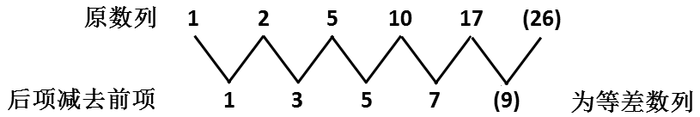

只看分母时，分母为二级等差数列：

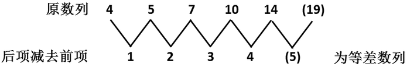

因此原数列的下一项为26/19。

故正确答案为D。

**来源**：2008年山东省公务员录用考试《行测》题第34题

### 第 35 题

1.01，1.02，2.03，3.05，5.08，。

A. 8.13

B. 8.013

C. 7.12

D. 7.012

第 35 题 · 答案与解析

**参考答案（粉笔题库参考内容）**

A

**解析**

数列变化幅度平缓，观察可知，1.01＋1.02＝2.03，1.02＋2.03＝3.05，2.03＋3.05＝5.08，即第一项+第二项=第三项，故所求项=3.05＋5.08＝8.13。

故正确答案为A。

**来源**：2008年山东省公务员录用考试《行测》题第35题

### 第 36 题

完成某项工程，甲单独工作需要18小时，乙需要24小时，丙需要30小时。现按甲、乙、丙的顺序轮班工作，每人工作一小时换班。当工程完工时，乙总共干了多少小时：

A. 8小时

B. 7小时44分

C. 7小时

D. 6小时48分

第 36 题 · 答案与解析

**参考答案（粉笔题库参考内容）**

B

**解析**

解析1：

设工程总量为360，则甲、乙、丙的工作效率分别为20、15、12，三人每小时工作总量为47。由题意可知三人轮班即为循环周期问题，用360除以47商7余数为31，甲、乙、丙轮班每人7小时后，乙继续工作的工作量为31-20=11。所以最终乙总共干了：。

解析2：

设工程总量为360，则甲、乙、丙的工作效率分别为20、15、12，甲每小时比乙多干5，乙每小时比丙多干3，因此乙工作时间必定小于24/3=8小时。观察选项有6小时、7小时和8小时，可选7小时为参考点，甲、乙、丙轮班每人工作7小时共完成：，因此乙工作时间在7小时和8小时之间。

故正确答案为B。

**考点**：周期余数问题、给完工时间型

**来源**：2008年山东省公务员录用考试《行测》题第36题

### 第 37 题

甲、乙、丙、丁四人为地震灾区捐款，甲捐款数是另外三人捐款总数的一半，乙捐款数是另外三人捐款总数的1/3，丙捐款数是另外三人捐款总数的1/4，丁捐款169元。问四人一共捐了多少钱：

A. 780元

B. 890元

C. 1183元

D. 2083元

第 37 题 · 答案与解析

**参考答案（粉笔题库参考内容）**

A

**解析**

设捐款总数为60x元，则由“甲捐款数是另外三人捐款总数的一半”得到甲捐款20x元；由“乙捐款数是另外三人捐款总数的1/3”得到乙捐款15x元；由“丙捐款数是另外三人捐款总数的1/4”得到丙捐款12x元。

由题意得方程：20x+15x+12x+169=60x，解得x =13。因此60x=780。

故正确答案为A。

**考点**：和差倍比问题

**来源**：2008年山东省公务员录用考试《行测》题第37题

### 第 38 题

甲从某地出发均速前进，一段时间后，乙从同一地点以同样的速度同向前进，在K时刻乙距起点30米；他们继续前进，当乙走到甲在K时刻的位置时，甲离起点108米。问：此时乙离起点多少米？

A. 39米

B. 69米

C. 78米

D. 138米

第 38 题 · 答案与解析

**参考答案（粉笔题库参考内容）**

B

**解析**

设乙出发时甲与起点的距离为x米，因二人速度相同，可知在行驶过程中二人距离始终为x米。根据题意，K时刻甲距离起点(x+30)米，当乙再走x米到达甲在K时刻的位置时，甲此时共走了(2x+30)米，可列式为2x+30=108，解得x=39，此时乙离起点30+39=69米。

故正确答案为B。

**考点**：普通行程

**来源**：2008年山东省公务员录用考试《行测》题第38题

### 第 39 题

有a，b，c，d四条直线，依次在a线上写1，在b线上写2，在c线上写3，在d线上写4，然后在a线上写5，在b线，c线和d线上写数字6，7，8···按这样的周期循环下去，问数2008在哪条线上：

A. a线

B. b线

C. c线

D. d线

第 39 题 · 答案与解析

**参考答案（粉笔题库参考内容）**

D

**解析**

本题为周期问题。

因为有四条线故周期为4，2008除以4商502余数为0，因此2008在d线上。

故正确答案为D。

**考点**：周期余数问题

**来源**：2008年山东省公务员录用考试《行测》题第39题

### 第 40 题

甲、乙、丙、丁四人做纸花，已知甲、乙、丙三人平均每人做了37朵，乙、丙、丁三人平均每人做了39朵，已知丁做了41朵，问甲做了多少朵：

A. 35朵

B. 36朵

C. 37朵

D. 38朵

第 40 题 · 答案与解析

**参考答案（粉笔题库参考内容）**

A

**解析**

方法一：根据题意可得，甲、乙、丙三人做的纸花的平均数比乙、丙、丁三人做的纸花的平均数小2，则甲比丁做的纸花少朵，因此甲做了41-6=35朵。

方法二：乙、丙、丁三人共做了朵，乙、丙两人共做了117-41=76朵，甲、乙、丙三人共做了朵，则甲做了111-76=35朵。

故正确答案为A。

**来源**：2008年山东省公务员录用考试《行测》题第40题

### 第 41 题

把一根钢管锯成5段需要8分钟，如果把同样的钢管锯成20段需要多少分钟：

A. 32分钟

B. 38分钟

C. 40分钟

D. 152分钟

第 41 题 · 答案与解析

**参考答案（粉笔题库参考内容）**

B

**解析**

锯5段需要5－1＝4个切口，故锯1个切口需要8÷4=2分钟；

锯20段需要20－1＝19个切口，故所需时间为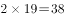分钟。

故正确答案为B。

**来源**：2008年山东省公务员录用考试《行测》题第41题

### 第 42 题

一件商品按定价的八折出售，可以获得相当于进价20%的利润，如果以原价出售，可以获得相当于进价百分之几的利润：

A. 20%

B. 30%

C. 40%

D. 50%

第 42 题 · 答案与解析

**参考答案（粉笔题库参考内容）**

D

**解析**

设商品定价为100元，当按照定价的八折出售即卖80元，则商品进价为：；当按照原价即卖100元，则获得利润相当于进价的比重为：，因此如果以原价出售，可以获得相当于进价50%的利润。

故正确答案为D。

**考点**：经济利润问题

**来源**：2008年山东省公务员录用考试《行测》题第42题

### 第 43 题

两个相同的瓶子装满酒精溶液，一个瓶子中酒精与水的体积比是3:1，另一个瓶子中酒精与水的体积比是4:1，若把两瓶酒精溶液混合，则混合后的酒精和水的体积之比是多少：

A. 31:9

B. 7:2

C. 31:40

D. 20:11

第 43 题 · 答案与解析

**参考答案（粉笔题库参考内容）**

A

**解析**

设两个瓶子每个容量为20，第一个瓶子中酒精和水分别为15和5；另一个瓶子中酒精和水分别为16和4，混合后酒精和水体积比为(15+16):(5+4)=31:9。

故正确答案为A。

**来源**：2008年山东省公务员录用考试《行测》题第43题

### 第 44 题

四年级一班选班长，每人投票从甲、乙、丙三个候选人中选一人，已知全班共有52人，并且在计票过程中的某一时刻，甲得到17票，乙得到16票，丙得到11票。如果得票最多的候选人将成为班长，甲最少再得多少张票就能够保证当选：

A. 1张

B. 2张

C. 4张

D. 8张

第 44 题 · 答案与解析

**参考答案（粉笔题库参考内容）**

C

**解析**

剩余的票数为：52-17-16-11=8，假设甲是4张，乙得4张，那甲仅以一票的优势当选，此时再少一票甲就不能保证当选，因此甲最少再得4张票就能保证当选。

故正确答案为C。

**考点**：最不利构造

**来源**：2008年山东省公务员录用考试《行测》题第44题

### 第 45 题

某班共有60名学生，在第一次测验中有32人得满分，在第二次测验中有27人得满分。如果两次测验中都没有得满分的学生有17人，那么两次测验中都获得满分的人数是多少？

A. 13人

B. 14人

C. 15人

D. 16人

第 45 题 · 答案与解析

**参考答案（粉笔题库参考内容）**

D

**解析**

根据两集合容斥原理公式：，可列式：32+27-两次测验中都获得满分的人数=60-17，解得：两次测验中都获得满分的人数是16人。

故正确答案为D。

**考点**：两集合

**来源**：2008年山东省公务员录用考试《行测》题第45题

### 第 46 题

甲、乙两个厂生产同一种玩具，甲厂生产的玩具数量每天保持不变，乙厂生产的玩具数量每天增加一倍，已知第一天甲、乙两个厂生产的玩具总数是98件，第二天甲、乙两个厂生产的玩具总数是106件。那么乙厂生产的玩具数量第一次超过甲厂生产的玩具数量是在第几天：

A. 3

B. 4

C. 5

D. 7

第 46 题 · 答案与解析

**参考答案（粉笔题库参考内容）**

C

**解析**

设第一天甲、乙两厂分别生产玩具数量为x件、y件，总和为：x+y=98；且已知乙厂生产玩具的数量每天翻一倍，即乙厂各天生产玩具数量组成公比为2的等比数列，n天时，乙厂生产玩具数量为2^(n-1)y件，则第二天乙厂生产玩具数量为2y，第二天甲、乙两厂生产玩具数量总和为：x+2y=106。联立两式，解得x=90，y=8。当n=5时，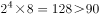，即第5天乙厂生产玩具数量第一次超过甲厂。

故正确答案为C。

**考点**：数列问题

**来源**：2008年山东省公务员录用考试《行测》题第46题

### 第 47 题

1992是24个连续偶数的和，问这24个连续偶数中最大的一个是几：

A. 84

B. 106

C. 108

D. 130

第 47 题 · 答案与解析

**参考答案（粉笔题库参考内容）**

B

**解析**

方法一：24个连续偶数，构成公差为2的等差数列，设24个连续偶数中最大的数为x，根据等差数列通项公式，可推出，利用等差数列求和公式，解得x=106，因此这24个连续偶数中最大的一个是106。

方法二：根据等差数列的性质，24项中间两项第12项、第13项的平均数即为数列的中位数，因此数列中位数为：，因此数列第12项为82，第13项为84，根据等差数列定义式即可求出最大的第24项为：。

故正确答案为B。

**考点**：数列问题

**来源**：2008年山东省公务员录用考试《行测》题第47题

### 第 48 题

一只船沿河顺水而行的航速为30千米/小时，已知按同样的航速在该河上顺水航行3小时和逆水航行5小时的航程相等，则此船在该河上顺水漂流半小时的航程为：

A. 1千米

B. 2千米

C. 3千米

D. 6千米

第 48 题 · 答案与解析

**参考答案（粉笔题库参考内容）**

C

**解析**

设水速为x千米/小时，则船速为顺水速度-水速=(30-x)千米/小时，逆水速度为船速-水速=(30-2x)千米/小时。由题意可列式为：，解得x=6，则顺水漂流半小时的航程为千米。

故正确答案为C。

**考点**：流水行船

**来源**：2008年山东省公务员录用考试《行测》题第48题

### 第 49 题

三筐苹果共重120斤，如果从第一筐中取出15斤放入第二筐，从第二筐中取出8斤放入第三筐，从第三筐中取出2斤放入第一筐，这时三筐苹果的重量相等，问原来第二筐中有苹果多少斤：

A. 33

B. 34

C. 40

D. 53

第 49 题 · 答案与解析

**参考答案（粉笔题库参考内容）**

A

**解析**

当三筐苹果重量相等时，第二筐中有苹果斤。已知第二筐先有15斤苹果放进来，再有8斤苹果拿出去，最后得到40斤，因此第二筐中原有苹果重量为：40+8-15=33斤。

故正确答案为A。

**考点**：和差倍比问题

**来源**：2008年山东省公务员录用考试《行测》题第49题

### 第 50 题

某商品按定价的80%（八折）出售，仍能获得20%的利润，问定价时期望的利润率是多少：

A. 50%

B. 40%

C. 30%

D. 20%

第 50 题 · 答案与解析

**参考答案（粉笔题库参考内容）**

A

**解析**

赋值定价为100元，按照定价的80%出售，仍能获得20%的利润，则实际售价为元，进价为；若按照定价出售，利润率。

故正确答案为A。

**考点**：经济利润问题

**来源**：2008年山东省公务员录用考试《行测》题第50题

### 第 51 题

从所给四个选项中，选择最合适的一个填入问号处，使之呈现一定规律性：

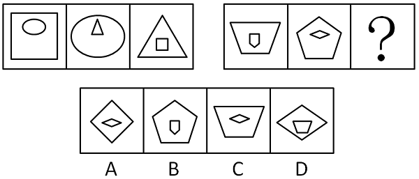

A. A

B. B

C. C

D. D

第 51 题 · 答案与解析

**参考答案（粉笔题库参考内容）**

D

**解析**

元素组成相似，元素叠加。

每一幅图都由内外两个图形组成。每一组中第一幅图的内图形变成第二幅图的外图形，第二幅图的内图形变成第三幅图的外图形，第三幅图的内图形变成第一幅图的外图形。由此推出第二组中第三幅图的外图形应是第二幅图的内图形（平行四边形），内图形应该是第一幅图的外图形（梯形）。

故正确答案为D。

**考点**：样式规律-遍历

**来源**：2008年山东省公务员录用考试《行测》题第51题

### 第 52 题

从所给四个选项中，选择最合适的一个填入问号处，使之呈现一定规律性：

A. A

B. B

C. C

D. D

第 52 题 · 答案与解析

**参考答案（粉笔题库参考内容）**

C

**解析**

元素组成相同，考查位置规律。

第一组图中，左下角元素每次逆时针平移一格，其余元素每次顺时针平移两格。第二组图应用此规律，只有C项符合。

故正确答案为C。

**考点**：位置规律-平移

**来源**：2008年山东省公务员录用考试《行测》题第52题

### 第 53 题

从所给四个选项中，选择最合适的一个填入问号处，使之呈现一定规律性：

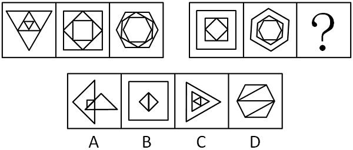

A. A

B. B

C. C

D. D

第 53 题 · 答案与解析

**参考答案（粉笔题库参考内容）**

C

**解析**

元素叠加。

第一组图中的每幅图均由三个大小不同的相同图形由外向内叠加构成。第二组图应用此规律，只有C项符合。

故正确答案为C。

**考点**：特殊规律-图形间关系

**来源**：2008年山东省公务员录用考试《行测》题第53题

### 第 54 题

从所给四个选项中，选择最合适的一个填入问号处，使之呈现一定规律性：

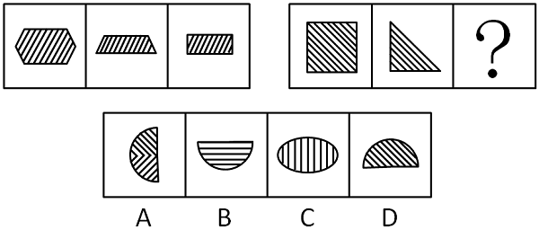

A. A

B. B

C. C

D. D

第 54 题 · 答案与解析

**参考答案（粉笔题库参考内容）**

D

**解析**

观察图形内部的阴影线，第一组中三幅图内部的阴影线都向左倾斜，第二组中三幅图内部的阴影线都向右倾斜。

故正确答案为D。

**考点**：样式规律-遍历

**来源**：2008年山东省公务员录用考试《行测》题第54题

### 第 55 题

从所给四个选项中，选择最合适的一个填入问号处，使之呈现一定规律性：

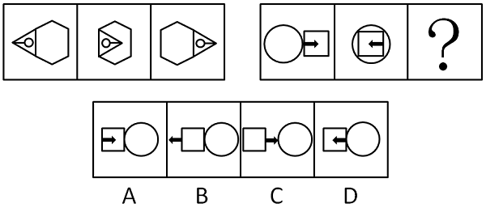

A. A

B. B

C. C

D. D

第 55 题 · 答案与解析

**参考答案（粉笔题库参考内容）**

D

**解析**

元素组成相同，考查位置规律。

第一组图中，三角形那块向六边形一侧整体翻转（即右翻）得到第二幅图，之后再向右移动得到第三幅图；与此类似，第二组图中，正方形那块向圆一侧整体翻转（即左翻）后应向左移动。

故正确答案为D。

**考点**：位置规律-综合

**来源**：2008年山东省公务员录用考试《行测》题第55题

### 第 56 题

政府执政能力是政府执行的能力和效能，是政府贯彻执行党和国家路线方针政策以实现既定目标的实践能力。

根据以上定义，下列不属于政府执政能力的是：

A. 政府执行过程中的量化成分

B. 政府执行过程中的效果体

C. 实现组织经营战略目标的能力

D. 把行政决策所规定的具体任务化为工作实际

第 56 题 · 答案与解析

**参考答案（粉笔题库参考内容）**

C

**解析**

第一步：抓住定义中的关键词。

关键词是“执行”的“能力和效能”。

第二步：逐一判断选项。

A中的“量化成分”符合执行的“能力”；

B中的“效果体”符合执行的“效能”；

D中的“具体任务化为工作实际”符合题干后半句的定义；

题干中政府执行力只是“贯彻执行”，并非参与经营，C不符。

本题为选非题，故正确答案为C。

**考点**：方式目的

**来源**：2008年山东省公务员录用考试《行测》题第56题

### 第 57 题

错误记忆是指对从未经历的事件“回忆”，或者对经历事件的错误回忆。

下列属于错误记忆的是：

A. 无效信息解码、储存以及提取的精神过程

B. 这件事曾经做过，但他记不清楚细节了

C. 回忆不出这个词是否真的学过，只是猜测有可能学过

D. 人们对这一突发事件的记忆

第 57 题 · 答案与解析

**参考答案（粉笔题库参考内容）**

C

**解析**

第一步：抓住定义中的关键词。

关键词是“未经历”或“经历却错误”。

第二步：逐一判断选项。

A中“无效信息”说明“经历过”且记起的是没有用的内容，但并非记错；

B中“做过”说明“经历过”，但“记不清细节”并非“错误回忆”；

D中是人们对经历过的事件的正确记忆；

C中对经历过与否都不确定，要么是未学过，要么是学过但回忆不起来，C是“记忆错误”。

故正确答案为C。

**考点**：单定义-其他句式

**来源**：2008年山东省公务员录用考试《行测》题第57题

### 第 58 题

权职冲突是指各行政主体在行使行政职权过程中因职权界定而导致的争议或对抗。

根据以上定义，下列不属于权职冲突的是：

A. 两个或两个以上行政主体对同一行政管理事项都认为自己有管辖权，而他方无管辖权

B. 两个或两个以上行政主体对同一行政管理事项都认为自己无管辖权，而他方有管辖权

C. 两个或两个以上行政主体对同一行政管理事项都认为自己和他方有管辖权，但在管辖方面、程度或主导性上存在争议

D. 行政主体依法享有的对特定行政事项实施行政管理的资格、权能与义务

第 58 题 · 答案与解析

**参考答案（粉笔题库参考内容）**

D

**解析**

第一步：抓住定义中的关键词。

关键词是“职权界定”不明，并由此“导致争议或对抗”。

第二步：逐一判断选项。

“职权冲突”的原因是“职权界定”不明，其中涉及到管辖权的有无和管辖的程度，A、B、C选项分别从不同侧面指向了“职权界定”的不明；

D选项并非在阐述什么是“职权冲突”，而是解释了什么是“职权”。

本题为选非题，故正确答案为D。

**考点**：拆词

**来源**：2008年山东省公务员录用考试《行测》题第58题

### 第 59 题

和谐无论是从其词源意义来看，还是从其哲学本体论上看，都是多样性的统一和对立要素的有机结合。

根据以上定义，不属于和谐哲学意蕴的表述是：

A. 差异和对立是和谐形成的基础和前提

B. 由和谐创生新的事物

C. 六律只有其按规律“和调”才能形成悦耳的音乐

D. 五味不加以“和调”也能形成爽口的美味

第 59 题 · 答案与解析

**参考答案（粉笔题库参考内容）**

D

**解析**

第一步：抓住定义中的关键词。

题干的关键词是“多样性的统一”和“对立要素的有机结合”。

第二步：逐一判断选项。

A、C两项都强调了对立要素和统一性，符合定义；

和谐的中心是“统一和对立”，对立统一的事物有机结合后定能产生新的事物，B符合定义；

D中“不加以‘和调’，也能······”排除了统一性在“美味”中发挥的作用，把D改为“将五味按照一定的规律加以‘和调’才能形成爽口的美味”就符合“和谐”的定义。

本题为选非题，故正确答案为D。

**考点**：单定义-其他句式

**来源**：2008年山东省公务员录用考试《行测》题第59题

### 第 60 题

财产性收入是指家庭拥有的动产（如银行存款、有价证券等）、不动产（如房屋、车辆、土地、收藏品等）所获得的收入。

根据以上定义，下列不属于财产性收入的是：

A. 财产运营所获得的红利

B. 出让财产使用权所获得的专利收入

C. 非财产增值收益

D. 出让财产使用权所获得的利息、租金

第 60 题 · 答案与解析

**参考答案（粉笔题库参考内容）**

C

**解析**

第一步：抓住定义中的关键词。

关键词是基于“动产”、“不动产”这些财产的收入。

第二步：逐一判断选项。

A中“红利”是基于“动产或不动产的运营所得”；

B中“专利收入”是基于“出让动产所有权所得”；

D中“利息、租金”是基于“出让不动产所有权所得”。A、B、D属于财产性收入。

C中“非财产增值收益”不是基于“动产”或“不动产”这些财产所得，C不属于财产性收入。

本题为选非题，故正确答案为C。

**考点**：拆词

**来源**：2008年山东省公务员录用考试《行测》题第60题

### 第 61 题

产权是指主体对物的排他性权利，它的本质是人们在社会中发生的对劳动成果的权利。

根据以上定义，下列不属于产权的是：

A. 所有权、占有权

B. 收益权、转让权

C. 劳动选择权、劳动交换转让权

D. 支配权、使用权

第 61 题 · 答案与解析

**参考答案（粉笔题库参考内容）**

C

**解析**

第一步：抓住定义中的关键词。

题干强调相对“物”的“排他性”权利。产权的对象是“劳动成果”。

第二步：逐一判断选项。

C中的“劳动选择权、劳动交换转让权”并非对“劳动成果”的权利，“劳动”也不是“物”的范畴，所以C不属于产权；

产权包括财产的所有权、占有权、支配权、使用权、收益权和处置权，所以A、B、D属于产权。

本题为选非题，故正确答案为C。

**考点**：主客体

**来源**：2008年山东省公务员录用考试《行测》题第61题

### 第 62 题

公共政策是社会公共权威在特定的情景中，为达到一定目标而制定的行动方案或行动准则。

根据以上定义，下列不属于公共政策的是：

A. 政府机关和执政党的政策

B. 学校、社区的政策

C. 村委会的政策

D. 公共权力机关和非政府公共组织

第 62 题 · 答案与解析

**参考答案（粉笔题库参考内容）**

D

**解析**

第一步：抓住定义中的关键词。

题干的关键词是“公共权威”。

第二步：逐一判断选项。

A中“政府机关和执政党”是“公共权威”；

B、C中“学校、社区、村委会”等非政府公共组织在一定范围内也是“公共权威”；

D中“公共权力机关和非政府公共组织”范围太大，这些机关和组织不一定都是“社会公共权威”。

本题为选非题，故正确答案为D。

**考点**：拆词

**来源**：2008年山东省公务员录用考试《行测》题第62题

### 第 63 题

三段论是由两个包含着一个公共项的直言命题得出一个新的直言命题的推理。根据以上定义，下列推理属于有效三段论的是：

A. 他不是被告人，被告人有权获得辩护，所以他无权获得辩护

B. 菊花是花，所以野菊花是野花

C. 人都受制于自然法则，所以他受制于自然法则

D. 如果要马儿跑的好，就要叫马儿吃足草。你不叫马儿吃足草，就不能叫马儿跑的好

第 63 题 · 答案与解析

**参考答案（粉笔题库参考内容）**

C

**解析**

第一步：抓住定义中的关键词。

关键词是原有的两个直言命题含有一个“公共项”。

第二步：逐一判断选项。

根据“三段论”的定义，C可整理为“人都受制于自然法则，他是人，所以他受制于自然法则”，“共同项”是“人”，所以C属于有效三段论；

A中的“不是被告人”与“被告人”不是公共项；

B中直言命题不全且无公共项；

D前半部分是充分条件，后半部分是利用逆否规则而得到的推论，所以不是三段论。

故正确答案为C。

**考点**：单定义-其他句式

**来源**：2008年山东省公务员录用考试《行测》题第63题

### 第 64 题

博弈思维是指这样的思维方式，由于我们的目标取决于自己和他人的策略选择，要使用理性分析力，分析各种可能的备选策略及其组合下的各种可能后果和实现这些后果的可能性，从而选择使我们收益最大的策略。

根据以上定义，下列对博弈思维的理解不准确的是：

A. 博弈思维的出发点是“谋事在人”，尽管有些时候是“成事在天”

B. “塞翁失马，焉知非福”所反映的是博弈思维

C. 博弈思维正所谓“种瓜得瓜，种豆得豆”，这里的“种”，行动也，“瓜”“豆”结果也

D. 持博弈思维的人既不怨天尤人、不自暴自弃，同时也不忘乎所以

第 64 题 · 答案与解析

**参考答案（粉笔题库参考内容）**

B

**解析**

第一步：抓住定义中的关键词。

关键词是“分析”、“选择”和“后果”。

第二步：逐一判断选项。

A中出发点“谋事在人”是“分析”和“选择”的可控性，“成事在天”是“后果”的不可控性，A正确；

B中“塞翁失马”并不是当事人的主动“选择”，“焉知非福”是事后当事人对于“后果”的心态转化，这个后果不是由当事人的“选择”而得到的，B错误；

C中“种什么”是“选择”的过程，“瓜”、“豆”是种的“后果”，C正确；

由题干可知，“后果”是通过自己的“分析”和“选择”而产生的，好坏都在自己，D正确。

本题为选非题，故正确答案为B。

**考点**：单定义-其他句式

**来源**：2008年山东省公务员录用考试《行测》题第64题

### 第 65 题

划分是把一个属概念分为他的各个种概念，以明确概念外延的一种思维方法。正确的划分要求划分出的各项外延之和必须等于母项，而且要采用同一标准，子项的外延不相容，而且是同一层次的概念。

下列语句作为划分正确的是：

A. 直系亲属分为“双亲”“胞亲”“配偶”和“子女”

B. 战争分为常规战争和非常规战争

C. 地球分为南半球和北半球

D. 健康分为心理健康和生理健康

第 65 题 · 答案与解析

**参考答案（粉笔题库参考内容）**

B

**解析**

第一步：找出定义关键词。

划分：“分为种概念”、“明确概念外延”；

正确的划分：“同一标准”、“同一层次”、“子项外延不相容且外延之和必须等于母项”。

第二步：逐一分析选项。

A项：直系亲属指配偶、父母(公婆、岳父母)、子女、祖父母(外祖父母)、孙子女(外孙子女)及其配偶。该项中，“双亲”、“子女”、“配偶”属于“直系亲属”，但并不全面，且“胞亲”不属于“直系亲属”，不符合“子项外延之和必须等于母项”，不符合定义，排除；

B项：根据按使用的武器种类常规与否，分为“常规战争”和“非常规战争”，母项为“使用武器的战争”，符合“同一标准”、“同一层次”、“子项外延不相容且外延之和必须等于母项”，符合定义，当选；

C项：地球的外延只有1个，无法进行划分，不符合定义，排除；

D项：根据健康三要素，将健康分为 “心理健康”、“生理健康”、 “社会适应健康”，而该项未提到“社会适应健康”，不符合“子项外延之和必须等于母项”，不符合定义，排除。

故正确答案为B。

**考点**：常规问法

**来源**：2008年山东省公务员录用考试《行测》题第65题

### 第 66 题

社会保险是指国家通过立法，多渠道筹集资金，在劳动者暂时或永久丧失劳动力以及其他原因中断工作，没有经济收入或劳动收入减少时，给予经济补助，使他们能够享有基本生活条件的一项社会保障制度。

根据以上定义，下列属于社会保险的是：

A. 向老人、儿童、残疾人等人群提供的必要生活保障

B. 养老、失业、医疗、工伤、生育等保险

C. 对城市生活无着落的流浪乞讨人员救助

D. 最低生活保障、农村五保供养、特困户救助、灾民救助

第 66 题 · 答案与解析

**参考答案（粉笔题库参考内容）**

B

**解析**

第一步：抓住定义中的关键词。

社会保险的对象是“丧失劳动能力或中断工作”的“劳动者”，即它的保险对象范围限于职工，不包括其他社会成员。

第二步：逐一判断选项。

A、C、D中的对象范围不符合题干中“丧失劳动能力或中断工作”的“劳动者”这一要件。

A中“向老人、儿童、残疾人等人群提供的必要生活保障”属于社会保障；

C中“对城市生活无着落的流浪乞讨人员救助”和D中“最低生活保障、农村五保供养、特困户救助、灾民救助”属于社会救助；

B中，按照我国劳动法的规定，社会保险项目分为养老保险、失业保险、医疗保险、工伤保险和生育保险，B正确。

故正确答案为B。

**考点**：拆词

**来源**：2008年山东省公务员录用考试《行测》题第66题

### 第 67 题

政府绩效评估就是根据绩效目标，运用评估指标对政府部门履行行政职能所产生的结果及其影响进行评估、划分绩效等级、提出绩效改进计划和运用评估结果来改进绩效的活动过程。

根据以上定义，下列对政府绩效评估的理解，不准确的是：

A. 评估活动过程谋求信息沟通机制在政府部门之间、政府部门与公众之间的建立和完善

B. 评估结果的使用谋求政府责任实现机制的加强与完善

C. 评估目的是规范行政行为，提高效能，使政府部门在管理公共事物、提供公共服务和改善公众生活质量等方面具有竞争力

D. 政府绩效评估不是强调以结果为本

第 67 题 · 答案与解析

**参考答案（粉笔题库参考内容）**

D

**解析**

第一步：抓住定义中的关键词。

题干指出，政府绩效评估围绕着“结果”进行一系列的活动从而改进绩效。

第二步：逐一判断选项。

A、B、C三项都指出政府绩效评估是为了改善政府的执政效能，符合题干中改进绩效这一目标；

D选项与题干意思相反，政府绩效评估强调应以“结果”为本。

本题为选非题，故正确答案为D。

**考点**：单定义-其他句式

**来源**：2008年山东省公务员录用考试《行测》题第67题

### 第 68 题

概念的内涵是概念所反映的对象的本质属性，它是概念质的规定性，说明概念所反映的对象是什么样的。

下列不是从内涵方面说明概念的是：

A. 单身汉是未婚成年的男性

B. 社会关系包括经济、思想、政治、文化以及家庭等各方面的关系

C. 鱼是用鳃呼吸、鳍游水、有脊椎的水生动物

D. 商品是用来交换的劳动产品

第 68 题 · 答案与解析

**参考答案（粉笔题库参考内容）**

B

**解析**

第一步：抓住定义中的关键词。

题干中对“概念的内涵”的定义强调了“本质属性”，“说明反映的对象是什么样的”。

第二步：逐一判断选项。

A、C、D三项都是说明事物是什么，是怎么样的。

B项列举了“社会关系”包括哪些关系，提出了“社会”包含了哪些层面的内容，而没有说明“社会关系”是什么，B项属于概念的外延。

本题为选非题，故正确答案为B。

**考点**：单定义-其他句式

**来源**：2008年山东省公务员录用考试《行测》题第68题

### 第 69 题

假设就是根据已知的科学原理和一定的事实材料，对未知事物的普遍规律性和因果性所作出的假定性解释。

下列不属于假设的是：

A. 艾滋病是由支原菌和艾滋病毒引起的

B. 世界气候逐渐变暖是大气的因素，或是海洋的因素，或是地球内部的因素

C. 民法中的“宣告死亡”

D. 能溶解一切物质的“万能溶液”

第 69 题 · 答案与解析

**参考答案（粉笔题库参考内容）**

A

**解析**

第一步：抓住定义中的关键词。

关键词强调对“未知事物”做出假定性解释。

第二步：逐一判断选项。

A中的“艾滋病”已经确实存在，该病由支原菌和艾滋病毒引起也在医学上被证实，因此是对“已知事物”做出确定性解释，A项不符合；

目前“气候变暖”的真正原因还是“未知”的，“大气、海洋、地球内部”这些因素都只是猜测，B项符合；

失踪人是否真的死亡是“未知”的，他事实上也可能还活着，只是被假定死亡，C项符合；

根据科学原理推测可能存在一种“能溶解一切物质”的物质，但这种物质是什么还是“未知的”，只是目前假定存在这种物质并且它叫“万能溶液”，D项符合。

本题为选非题，故正确答案为A。

**考点**：主客体

**来源**：2008年山东省公务员录用考试《行测》题第69题

### 第 70 题

重大突发事件是在紧急状态下发生的严重危机事件。它包括重大突发性自然灾害、重大突发性工业事故及灾难性事故、重大突发性社会扰乱事故和重大突发性政治危机。

根据以上定义，下列情况不属于重大突发性社会扰乱事故的是：

A. 传染病和恶性中毒

B. 恐怖活动、民族冲突、公共场合突发性扰乱

C. 社会动乱、选举危机、政变

D. 球场暴力、春运火车站人员滞留、节假日旅游景区人员拥挤事故

第 70 题 · 答案与解析

**参考答案（粉笔题库参考内容）**

C

**解析**

第一步：抓住定义中的关键词。

由题干知“重大突发性社会扰乱事故”强调“社会扰乱性”，并且与“重大突发性自然灾害”、“重大突发性政治危机”等是全异关系。

第二步：逐一判断选项。

此题注意问的不是“重大突发事件”，而是“重大突发社会扰乱事故”，因此不能用题干的第一句话来验证。突发性公共卫生事件（传染和恶性中毒等）、恐怖活动、民族冲突、公共场合突发型扰乱（如球场暴力、春运火车站人员滞留、节假日旅游景区人员拥挤事故等）具有扰乱社会秩序的特征，因此A、B、D属于“重大突发性社会扰乱事故”；

C中“社会动乱、选举危机、政变”等具有鲜明政治性，因此C属于“重大突发性政治危机”。

本题为选非题，故正确答案为C。

**考点**：常规问法

**来源**：2008年山东省公务员录用考试《行测》题第70题

### 第 71 题

电子：商务

A. 技术：竞争

B. 经济：信息

C. 鉴定：事故

D. 董事长：股东

第 71 题 · 答案与解析

**参考答案（粉笔题库参考内容）**

B

**解析**

第一步：判断题干词语间第一重逻辑关系，并在选项中进行选择。

“电子”和“商务”都是名词，合在一起构成新名词“电子商务”。C中“鉴定”是动词，D中“董事长”和“股东”不能组成新名词，排除C、D。

第二步：再判断题干词语间第二重逻辑关系，并在选项中进行选择。

电子商务是商务的一种，二者是种属关系。本题易误选A，技术竞争是竞争的一种，但是竞争既可以是名词也可以是动词；B中两词都是名词并构成新名词，且经济信息是信息的一种，所以B符合。

故正确答案为B。

**考点**：语法关系

**来源**：2008年山东省公务员录用考试《行测》题第71题

### 第 72 题

超声波：机械波

A. 极限：常数

B. 轮船：船

C. 一次方程式：线性方程

D. 斡旋：调解

第 72 题 · 答案与解析

**参考答案（粉笔题库参考内容）**

B

**解析**

第一步：判断题干词语间逻辑关系。

超声波是指频率为20千赫—50兆赫左右的电磁波，它是一种机械波。题干两词是包容关系中的种属关系。

第二步：判断选项词语间逻辑关系。

A中的“极限”和“常数”都是数学中的名词，二者是对应关系；

B中轮船是船的一种，二者是种属关系；

线性方程也称一次方程式，因此C中两词为全同关系；

D中“斡旋”和“调解”是并列关系中的反对关系。二者都是外交上解决国际争端的方法，但除了“斡旋”和“调解”还可以调停等。

故正确答案为B。

**考点**：逻辑关系-包容关系

**来源**：2008年山东省公务员录用考试《行测》题第72题

### 第 73 题

得主：失主

A. 白灾：黑灾

B. 软武器：硬武器

C. 数据：非数据

D. 远程：近程

第 73 题 · 答案与解析

**参考答案（粉笔题库参考内容）**

C

**解析**

第一步：判断题干词语间逻辑关系。

题干两词是并列关系中的矛盾关系。在一对得失关系里，不是得主就是失主。

第二步：判断选项词语间逻辑关系。

A中“黑灾”和“白灾”只是众多草原灾难中的两种，两词是反对关系；

B中两词是反对关系；

C中两词是矛盾关系，不存在其他情况；

D中两词是反对关系，因为还存在中远程等情况。

故正确答案为C。

**考点**：逻辑关系-并列关系

**来源**：2008年山东省公务员录用考试《行测》题第73题

### 第 74 题

守望：期待

A. 智慧：语言

B. 咬文：嚼字

C. 智商：情商

D. 升腾：冲刺

第 74 题 · 答案与解析

**参考答案（粉笔题库参考内容）**

B

**解析**

第一步：判断题干词语间逻辑关系。

题干两词是近义词，属于近义关系。

第二步：判断选项词语间逻辑关系。

A中“智慧”和“语言”是对应关系；

B中“咬文”和“嚼字”是近义词；

C中“情商”和“智商”是反对关系，除了这二者之外还有“逆境商”；

D中“升腾”指向上升，“冲刺”指向前。

故正确答案为B。

**考点**：语义关系-近义关系

**来源**：2008年山东省公务员录用考试《行测》题第74题

### 第 75 题

车辆：车

A. 花：花卉

B. 山脉：山

C. 解放军：战士

D. 书籍：报纸

第 75 题 · 答案与解析

**参考答案（粉笔题库参考内容）**

B

**解析**

第一步：判断题干词语间逻辑关系。

题干中“车辆”是集合名词，“车”是非集合名词，“车辆”是“车”的集合，二者是对应关系。

第二步：判断选项词语间逻辑关系。

A中“花卉”是集合名词，“花”是非集合名词，但是A中词语间的顺序和题干相反，A错误；

B中“山脉”是集合名词，“山”是非集合名词，“山脉”是“山”的集合，二者是对应关系，B正确；

C中“解放军”和“战士”是包容关系，C错误；

D中“书籍”和“报纸”并列关系，D错误。

故正确答案为B。

**考点**：逻辑关系-对应关系

**来源**：2008年山东省公务员录用考试《行测》题第75题

### 第 76 题

生态：原生态

A. 金三角：珠三角

B. 海内：天涯

C. 公交：巴士

D. 缩水：布缩水

第 76 题 · 答案与解析

**参考答案（粉笔题库参考内容）**

D

**解析**

第一步：判断题干词语间逻辑关系。

题干中两词是包容关系中的属种关系，“原生态”是一种“生态”。

第二步：判断选项词语间逻辑关系。

D中“布缩水”是“缩水”的一种，与题干逻辑关系相同；

A中“金三角”和“珠三角”是两个不同的地方，是并列关系；

B中“海内”和“天涯”是对应关系，都表示空间、距离；

C中“公交”和“巴士”是本土词和英译词之间的同义词，是全同关系。

故正确答案为D。

**考点**：逻辑关系-包容关系

**来源**：2008年山东省公务员录用考试《行测》题第76题

### 第 77 题

未婚：无权

A. 国家：不丹

B. 非法：无理

C. 无锡：非党员

D. 不倒翁：不健康

第 77 题 · 答案与解析

**参考答案（粉笔题库参考内容）**

B

**解析**

第一步：判断题干词语间逻辑关系。

二者为并列关系，且“未婚”的“未”和“无权”的“无”都表示否定。

第二步：判断选项词语间逻辑关系。

A项，不丹是一个国家，二者为种属关系，与题干逻辑关系不一致，排除；

B项，二者为并列关系，且“非法”的“非”和“无理”的“无”均表示否定，与题干逻辑关系一致，当选；

C项，二者无明显逻辑关系，且“无锡”的“无”不是否定词，与题干逻辑关系不一致，排除；

D项，二者无明显逻辑关系，与题干逻辑关系不一致，排除。

故正确答案为B。

**考点**：逻辑关系-并列关系

**来源**：2008年山东省公务员录用考试《行测》题第77题

### 第 78 题

硬件：软件

A. 上弦：下弦

B. 淡入：淡出

C. 胜诉：败诉

D. 实概念：空概念

第 78 题 · 答案与解析

**参考答案（粉笔题库参考内容）**

D

**解析**

第一步：判断题干词语间逻辑关系。

题干中两词“硬件”与“软件”是并列关系中的矛盾关系。

第二步：判断选项词语间逻辑关系。

A、B、C项均为反对关系。

D中“实概念”与“空概念”的和等于“概念”，因此二者是矛盾关系。

故正确答案为D。

**考点**：逻辑关系-并列关系

**来源**：2008年山东省公务员录用考试《行测》题第78题

### 第 79 题

“西安事变”：“双十二事变”

A. 公共管理：大家管理

B. 教育：说教

C. 合同：契约

D. 值日：值夜

第 79 题 · 答案与解析

**参考答案（粉笔题库参考内容）**

C

**解析**

第一步：判断题干词语间逻辑关系。

“西安事变”就是“双十二事件”，二者是全同关系。

第二步：判断选项词语间逻辑关系。

与题干相同逻辑关系的是C，“合同”就是“契约”。

A、B、D项中各词语间并非是全同关系。

故正确答案为C。

**考点**：逻辑关系-全同关系

**来源**：2008年山东省公务员录用考试《行测》题第79题

### 第 80 题

经济规律：法则

A. 军事情报：新情报

B. 高校学生：研究生

C. 小麦：粮食作物

D. 文学作品：短篇小说

第 80 题 · 答案与解析

**参考答案（粉笔题库参考内容）**

C

**解析**

第一步：判断题干词语间逻辑关系。

题干中两词是包容关系中的种属关系，“经济规律”是一种“法则”。

第二步：判断选项词语间逻辑关系。

A中两词是交叉关系；

B中两词是属种关系；

C中两词是种属关系；

D中两词是属种关系。

故正确答案为C。

**考点**：逻辑关系-包容关系

**来源**：2008年山东省公务员录用考试《行测》题第80题

### 第 81 题

数字控制具有准确性，也具有高效性；不仅适用于简单的批量工作，而且适用于复杂的单间工作；不仅讲标准、讲程序，而且讲规范、讲信用，一旦操作违反了设计的路线，数控就会自动做出反应，“命令”正处于工作状态的各个环节嘎然而止。制度则是规范行为、统一方向、提高效率的。管理靠制度，制度如数控。

由此得出：

A. 管者，拘束之意也，具有刚性，是一种硬约束

B. 制度是管的要义所在

C. 没有制度，就导致各行其是，远离甚至背离预先设定的目标

D. 没有制度就失去了成员需要共同遵守的办事规程或行动准则

第 81 题 · 答案与解析

**参考答案（粉笔题库参考内容）**

C

**解析**

第一步：抓住题干中的对象及其关系。

题干前半部分指出数控的特点及重要性，后半部分把制度与数控作类比。

第二步：判断整体关系。

根据类比，题干总体阐述的是制度对于管理的重要性，可以推出C。

第三步：逐一判断选项。

A错误，“数控不仅讲标准和程序，而且讲规范和信用”说明数控有柔性，是软约束，类比制度也应如此；

B错误，“制度可以提高效率，是管理的倚靠”，但是这不表明制度就是要义；

D错误，题干中并没有相关内容来说明“没有制度会怎么样”。

故正确答案为C。

**考点**：日常结论

**来源**：2008年山东省公务员录用考试《行测》题第81题

### 第 82 题

2007年6月宣布，他们用小鼠皮肤细胞培养出诱导性多功能干细胞，这些诱导性多功能干细胞能产生身体内包括卵子和精子在内的所有细胞，具有与胚胎干细胞相同的功效。同年11月，两个小组再次报告说，他们成功地用人类皮肤细胞培养出了诱导性多功能干细胞，由于这项研究解决了胚胎干细胞研究所面临的伦理问题。

由此不能得出的是：

A. 用人类皮肤细胞仿制出胚胎干细胞

B. 今后将彻底改变干细胞研究的科学与政策

C. 今后将为生物医学研究开辟新的方向

D. 伦理问题与生物医学研究方向关系不大

第 82 题 · 答案与解析

**参考答案（粉笔题库参考内容）**

D

**解析**

第一步：抓住每句话中的对象及其关系。

第一句指出诱导性多功能干细胞具有与胚胎干细胞相同的功效。第二句指出用人类皮肤细胞能够培养出诱导性多功能干细胞。这两句话有公共项“诱导性多功能干细胞”。

第二步：逐一判断选项的作用。

用人类皮肤细胞培养出的诱导性多功能干细胞能具有与胚胎干细胞相同的功能，也就是说这个过程是仿制胚胎干细胞的过程，A正确；

“用人类皮肤仿制胚胎干细胞”这个研究影响着干细胞的科学和生物研究的未来发展趋向，B、C正确；

题干的最后提到了“这项研究解决了胚胎干细胞研究所面临的伦理问题”，这说明生物研究和伦理问题有较大关系，D错误。

故正确答案为D。

**考点**：日常结论

**来源**：2008年山东省公务员录用考试《行测》题第82题

### 第 83 题

9个人组成投票体，民主地决定各种议案，议案获得通过需要5票或5票以上。此时每个人的权利均等。一旦其中出现5个或5个以上的人结盟，那么其余的人实际上已被出局。若9个人形成4个联盟，人数分别为3、3、2、1，每个联盟的权利不再相等。

由此推出结论：

A. 人数分别为3、3、2的权利相等，人数为1的联盟权利为0

B. 若9人形成3个联盟，这3个联盟的人数分别为4、3、2

C. 若9人形成3个联盟，各联盟拥有的权利相等

D. 人数分别为3、3、2的权利相等，人数为1的联盟权利为1

第 83 题 · 答案与解析

**参考答案（粉笔题库参考内容）**

A

**解析**

第一步：翻译题干。利用充分必要条件。

第一、二句：每个人权利均等∧5票或5票以上→议案通过。

第三句：5人或5人以上结盟→其余人出局。

第四句：9人结成4个联盟∨人数为3、3、2、1→每个联盟的权利不相等。

第二步：翻译选项并判断各选项正确与否。

A：人数为1的联盟与其他任何一个联盟组合，得票都在5票以下。对应第一、二句的逻辑，权利均等∧5票以下无法推出议案通过。所以人数为1的联盟对选票的结果都没有实质的影响，因此其权力为0。A正确，D错误。

B：9个人结成3个联盟时，还可能出现人数为3、3、3的情况。B不周全，所以B错误。

C：结成3个联盟且联盟人数为1、1、7时，由第三句的逻辑可知，人数为1的2个联盟自动出局。此时三个联盟的权利不等。所以C错误。

故正确答案为A。

**考点**：日常结论

**来源**：2008年山东省公务员录用考试《行测》题第83题

### 第 84 题

已知：（1）如果甲和乙是肇事者，丙就不是肇事者；（2）如果丁是肇事者，那么乙就是肇事者；（3）甲和丙都是肇事者。

由此推出：

A. 乙和丁都是肇事者

B. 乙和丁都不是肇事者

C. 乙是肇事者，丁不是肇事者

D. 乙不是肇事者，丁是肇事者

第 84 题 · 答案与解析

**参考答案（粉笔题库参考内容）**

B

**解析**

第一步：翻译题干。利用充分必要条件。

（1）：甲是∧乙是→丙不是。

（2）：丁是→乙是。

（3）：甲是∧丙是。

第二步：从事实信息开始推导，并得到结论。

（3）是事实信息，所以丙是肇事者，且甲是肇事者。“丙是肇事者”否定了（1）的后件可以得到否定（1）的前件的结论，即甲和乙不能都是肇事者。又因为“甲是肇事者”，所以乙不是肇事者。“乙不是肇事者”否定了（2）的后件可以得到否定（2）的前件的结论，即丁不是肇事者。

故正确答案为B。

**考点**：常规翻译

**来源**：2008年山东省公务员录用考试《行测》题第84题

### 第 85 题

假定一个人群只有两个人A、B构成，A、B均知道一件命题P，P是A、B的知识，但此时P还不是他们的公共知识。当A、B双方均知道P，并且他们各自知道对方知道自己知道P······这是一个无穷的过程。

由此推出：

A. 与A、B之间是公共知识

B. 与A、B之间是基础知识

C. 与A、B之间是通用知识

D. 与A、B之间是同一知识

第 85 题 · 答案与解析

**参考答案（粉笔题库参考内容）**

A

**解析**

第一步：翻译题干。利用充分必要条件。

原题干的假设为：P不是公共知识→A知P∧B知P∧A、B互不知道对方情况。

第二步：利用题干中剩余语句进行判断。

题干中“当A、B双方均知道P”意味着“A知P∧B知P”，这属于肯定题干后件中的一部分。此外，题干中“他们各自知道对方知道自己知道P”意味着“A、B互相知道对方知道P”，这属于否定题干后件中的一部分。利用联言命题和逆否规则，肯定题干后件中的一部分并且否定题干后件中的一部分，可以得到否定题干前件的结论“P是公共知识”。

故正确答案为A。

**考点**：日常结论

**来源**：2008年山东省公务员录用考试《行测》题第85题

### 第 86 题

美国《科学》杂志公布了2007年度科学研究十大攻破之一是：通过对人和大鼠的研究，科学家提出，记忆力和想象力均植根于人类大脑的海马区，该区是大脑重要的记忆中心。

由此推断：

A. 大脑记忆也许能重新梳理过去的经历

B. 大脑记忆也许能产生关于未来的想象

C. 科学家发现人类大脑的重要记忆中心

D. 科学家发现挑战人类智力的记忆程序

第 86 题 · 答案与解析

**参考答案（粉笔题库参考内容）**

C

**解析**

日常结论题，根据题干信息逐一分析选项。

A项：题干并未提及大脑记忆能梳理过去的经历，无中生有，无法推出，排除；

B项：题干并未提及大脑记忆能否产生关于未来的想象，无中生有，无法推出，排除；

C项：题干指出科学家提出海马区是大脑重要的记忆中心，可以推出科学家发现人类大脑的重要记忆中心，可以推出，当选；

D项：题干并未提及挑战人类智力的记忆程序，无中生有，无法推出，排除。

故正确答案为C。

**考点**：日常结论

**来源**：2008年山东省公务员录用考试《行测》题第86题

### 第 87 题

人类基因组测序完成后，生物学家便一直在绘制碱基上的小差异，即单核苷酸多态性，这些小差异成为2007年10余个研究项目的关键内容。在这些被称为广泛关联基因组研究中，研究人员对数千名患病或无病个体的DNA进行了对比，以确定哪些小的基因差异会给人类带来疾病风险。

由此推断不出的是：

A. 今后更多的人将会拥有自己部分或全部的基因组

B. 今后更多的人将会准确地了解自己存在患何种疾病的风险

C. 发现人类基因组个体差异

D. 发现人类基因组集合体差异

第 87 题 · 答案与解析

**参考答案（粉笔题库参考内容）**

D

**解析**

第一步：抓住每句话中的对象及其关系。

第一句指出基因测序完成后，着重研究人类基因组上碱基上小差异。第二句指出通过病者与无病个体DNA对比来确定个体致病基因。

第二步：逐一判断选项的作用。

由第二句可知发现的是基因个体差异而非集合体差异，C能推出，D不能推出；

基因测序能够完成，说明人们拥有基因组是可以实现的，A能推出；

知道致病的基因后，人们就可以知道自己身上是否有潜在疾病，B能推出。

故正确答案为D。

**考点**：日常结论

**来源**：2008年山东省公务员录用考试《行测》题第87题

### 第 88 题

已知：

（1）甲要被录取，乙就不被录取；

（2）只要乙不被录取，甲就被录取；

（3）甲被录取。已知这三个判断只有一个真，两个假。

由此推出：

A. 甲乙都被录取

B. 甲乙都未被录取

C. 甲被录取，乙未被录取

D. 甲未被录取，乙被录取

第 88 题 · 答案与解析

**参考答案（粉笔题库参考内容）**

B

**解析**

第一步：分析题干条件。

（1）甲→—乙

（2）-乙→甲

（3）甲

第二步：根据题干条件进行推理。

由题干可知，三个人的话中有两句为假、一句为真。条件中没有明显的矛盾关系，考虑假设法，可以从三个条件中都提到的“甲”开始假设。

①假设“甲被录取”，此时条件（3）为真，那么条件（1）和条件（2）必为假，根据条件（1）为假可知，甲和乙都被录取，根据条件（2）为假可知，甲和乙都不被录取，此时出现矛盾，该假设不成立；

②假设“甲不被录取”，此时条件（3）为假，条件（1）为真，那么条件（2）必为假，可以推出甲和乙都不被录取，此时满足题干，该假设成立。

综上可知，甲和乙都不被录取。

故正确答案为B。

注：积累小技巧（“A”和“A→B”，两者必有一真）。在本题中条件（1）和条件（3）满足这种形式，两者必有一真，则条件（2）必为假，可以直接得出结论”-乙 且 -甲”。

**考点**：真假推理-其他

**来源**：2008年山东省公务员录用考试《行测》题第88题

### 第 89 题

科学家们运用有关原理，在其他情况保持不变的条件下，根据心肌梗塞病情发展越厉害，头发中的含钙量就相应的越加减少的事实，即头发的含钙量的减少状况与心肌梗塞病情的发展状况之间有定量的共变关系，得出了结论：通过对头发中含钙量的分析，是可以预断心肌梗塞病情的发展状况的。

这一结论的得出运用了：

A. 演绎推理

B. 归纳推理

C. 类比推理

D. 求因果联系的逻辑方法

第 89 题 · 答案与解析

**参考答案（粉笔题库参考内容）**

D

**解析**

第一步：抓住题干的对象并判断其关系。

题干先说“头发中钙含量变化，心肌梗塞发展也变化”，即“头发中钙含量”和“心肌梗塞发展”共变，而后推出“钙含量与心肌梗塞病情间有因果关系”。

第二步：判断题干的逻辑方法。

由共变关系推出二者具有因果关系，这符合共变法的逻辑推断形式。共变法是判明现象因果的一种方法，故选D。

注：

演绎推理：从一般性的前提出发，通过推导即“演绎”，得出具体陈述或个别结论的过程。

归纳推理：从个别性知识推出一般性结论的推理。

类比推理：根据两个或两类对象有部分属性相同，从而推出它们的其他属性也相同的推理。

共变法：探求现象因果联系的方法之一。在被研究的现象发生变化的若干场合中，如果只有一种发生变化的先行情况，那么这种情况就是该现象的原因。

故正确答案为D。

**考点**：日常结论

**来源**：2008年山东省公务员录用考试《行测》题第89题

### 第 90 题

在国际上，一般胰腺癌患者中位生存期4至6个月，美国国立卫生研究院报告，这种癌一年生存率为8%，五年为3%，中位生存期仅2至3个月，而我国经中医诊治的上海地区百余位胰腺癌患者中已有近20位躲过了3到5年，这些患者绝大多数是无法手术，未经过化放疗的，现在绝大多数活的有滋有味。

由此不能推出的是：

A. 中医是一种实用技术，它可以解决很多问题

B. 中医具有奇妙的科学内容

C. 中医是一种实实在在存在的，几十亿人用了多少年都很有价值的

D. 中医叫人糊糊涂涂地活，西医叫人明明白白的死

第 90 题 · 答案与解析

**参考答案（粉笔题库参考内容）**

C

**解析**

日常结论题，根据题干信息逐一分析选项。

A项：题干指出中医能让“无法手术”的胰腺癌患者不用化放疗，就能延长生存期，可以推出中医是一种实用技术，它可以解决很多问题，可以推出，排除；

B项：题干指出中医能让“无法手术”的胰腺癌患者不用化放疗，就能延长生存期，可以推出中医具有奇妙的科学内容，可以推出，排除；

C项：题干并未提及中医使用的人数，无中生有，无法推出，当选；

D项：题干指出西医明确了胰腺癌患者的生存期以及各个生存期的生存率，而中医延长了这些患者的生存期，且未提供具体的数据依据，可以推出中医叫人糊糊涂涂地活，西医叫人明明白白的死，可以推出，排除。

本题为选非题，故正确答案为C。

**考点**：日常结论

**来源**：2008年山东省公务员录用考试《行测》题第90题

### 第 91 题

《共产党宣言》是科学社会主义第一个纲领性的文献。它的发表标志着马克思主义的诞生。《共产党宣言》被译成一二百种文字，出版1000多次。在人类文明史上有过许多传世名著，但没有哪一部能像《共产党宣言》这样牵动全世界最广大人民的心魄。

2008年是纪念《共产党宣言》公开发表：

A. 130年

B. 150年

C. 160年

D. 180年

第 91 题 · 答案与解析

**参考答案（粉笔题库参考内容）**

C

**解析**

本题考查《共产党宣言》相关知识点。《共产党宣言》又译《共产主义宣言》，是卡尔·马克思和弗里德里希·恩格斯为共产主义者同盟起草的纲领，国际共产主义运动第一个纲领性文献，马克思主义诞生的重要标志。由马克思执笔写成。1848年2月在伦敦第一次以单行本问世。宣言第一次全面系统地阐述了科学社会主义理论，指出共产主义运动已成为不可抗拒的历史潮流。1848年至2008年经历了160年。

故正确答案为C。

**来源**：2008年山东省公务员录用考试《行测》题第91题

### 第 92 题

2007年，我国农业增产增效取得了重大成绩。粮食总产超过10000亿斤，达到10030亿斤，连续4年粮食面积、总产、单产“三增”。这在新中国农业发展史上是首次。农民增收渠道呈现多元化，工资性收入成为农民增收的重要来源。农民增收协调性明显增强，粮食主产区农民收入增速高于全国平均水平。农民持续增收取得重大成效。

去年全国农民人均纯收入突破：

A. 2000元，增幅超过100元

B. 3000元，增幅超过200元

C. 4000元，增幅超过300元

D. 5000元，增幅超过100元

第 92 题 · 答案与解析

**参考答案（粉笔题库参考内容）**

C

**解析**

2007年我国粮食总产量达到10032亿斤，农民人均纯收入提高到4140元，扣除物价因素，平均每年增长7.1%。农民收入结构呈现全新特点：一是以农业收入为代表的家庭经营收入比重下降；二是以外出务工收入为代表的工资性收入比重稳定上升，成为农民增收的主要来源；三是现金纯收入比重不断增长。

故正确答案为C。

**考点**：中国地理

**来源**：2008年山东省公务员录用考试《行测》题第92题

### 第 93 题

2008年3月5日，十一届全国人大会议开幕，温家宝总理在政府工作报告中提出，今年是全面贯彻落实党的十七大精神的第一年，国民经济和社会发展的预期目标是：在优化结构、提高利益、降低消耗、保护环境的基础上，国内生产总值增长8%左右；居民消费价格总水平涨幅控制在：

A. 3.8%左右

B. 4.8%左右

C. 5.8%左右

D. 6.8%左右

第 93 题 · 答案与解析

**参考答案（粉笔题库参考内容）**

B

**解析**

国务院总理温家宝3月5日在十一届全国人大四次会议上作政府工作报告时说，今年国民经济和社会发展的主要预期目标是：国内生产总值增长8%左右；经济结构进一步优化；居民消费价格总水平涨幅控制在8%左右；城镇新增就业900万人以上，城镇登记失业率控制在4.6%以内；国际收支状况继续改善。总的考虑是，为转变经济发展方式创造良好环境，引导各方面把工作着力点放在加快经济结构调整、提高发展质量和效益上，放在增加就业、改善民生、促进社会和谐上。

故正确答案为B。

本题相关知识点：

1、2012年11月8日，中共十八大在北京开幕。中共中央总书记胡锦涛做主题报告。十八大报告明确，到2020年，中国要全面建成小康社会。具体到经济目标，到2020年，国内生产总值和城乡居民人均收入都要比2010年翻一番。这意味着，未来八年，城乡居民人均收入的年增幅应该在7%—8%。事实上，近年来，中国城乡居民人均收入的增幅都在8%以上。如果未来八年中国经济能维持8%左右的增幅，城乡居民人均收入比2010年翻一番并非难事。

2、中共十八大报告一共分为十二大部分，与十七大报告相同。但较之十七大报告，十八大报告专列了第八部分——“大力推进生态文明建设”，对自然生态和环境保护加以重点论述。这凸显了中共推进“经济、政治、文化、社会、生态”建设等“五位一体”的战略部署。

**考点**：宏观经济与调控政策

**来源**：2008年山东省公务员录用考试《行测》题第93题

### 第 94 题

2008年是我国改革开放30年。改革开放以来，尤其是近几年以来，党和政府制定了一系列具有里程碑意义的强农惠农政策，采取了一系列具有划时代意义的重大举措，办成了一些多年想做而没有做得大事，结束了2600多年农民种地缴纳“皇粮国税”的历史。

这包括全面取消：

A. 农业税、牧业税、农业特产税、屠宰税

B. 粮食直补税、良种补贴税、农机具购置补贴

C. 农业税、农业特产税、良种补贴税

D. 农业税、农民义务教育“两免一补税”

第 94 题 · 答案与解析

**参考答案（粉笔题库参考内容）**

A

**解析**

党的十六大明确了统筹城乡经济社会发展的基本方略，制定了工业反哺农业、城市支持农村和“多予少取放活”的基本方针。党中央连续5年下发指导农业和农村工作的中央一号文件，出台了一系列具有里程碑和划时代意义的支农惠农政策：
1.全面取消农业税、牧业税、农业特产税和屠宰税，结束了2600多年农民种地纳税的历史，逐步建立了“以工补农、以城带乡”的稳定的反哺农业的投入机制；
2.开直补农民种粮之先河，逐步实行粮食直补、农资综合直补、良种补贴、农机具购置补贴等制度；
3.放开粮食购销市场和价格，农业市场化改革迈出关键步伐。

故正确答案为A。

**考点**：宏观经济与调控政策

**来源**：2008年山东省公务员录用考试《行测》题第94题

### 第 95 题

根据公务员工作职责和提高素质的需要，对公务员应当进行分级分类培训，机关对新录用公务员应当在：

A. 录用后三个月内进行初任培训

B. 录用后半年内进行初任培训

C. 录用后一个月内进行初任培训

D. 试用期内进行初任培训

第 95 题 · 答案与解析

**参考答案（粉笔题库参考内容）**

D

**解析**

国家公务员培训暂行规定公务员分级分类培训包括：

1、国家公务员培训分为：初任培训、任职培训、专门业务培训和更新知识培训。

2、初任培训是指对新录用人员，即经考试录用进入国家行政机关，担任主任科员以下非领导职务人员的培训。初任培训在试用期间进行，时间不少于十天。

3、任职培训是指对晋升领导职务人员，按照相应职位的要求所进行的培训。任职培训一般在到职前进行，培训时间不少于三十天。经任免机关批准，也可到职后培训，但必须在到职后一年内完成。

4、根据专项工作需要，对国家公务员进行专门业务培训。培训时间和方式视工作需要确定。未经专门业务培训或培训不合格者，不得参加专门业务工作。

5、更新知识培训是指对在职人员以增新、补充、拓宽相关知识为目的的培训进修。每人每年参加培训的时间累计不少于七天，也可以采取集中时间培训的办法。

6、调入国家行政机关任职和在行政机关内部晋升为助理调研员以上非领导职务的人员，参照上一条规定接受培训。

7、经任免机关和国家公务员培训综合管理机构批准，对组织人事部门在同一周期内组织的相同类型、相同科目的培训，可视实际情况在国家公务员培训中予以认可或免修。

故正确答案为D。

**考点**：行政法

**来源**：2008年山东省公务员录用考试《行测》题第95题

### 第 96 题

近年来，人们的物质生活大大丰富了，但不少人却感觉不如以前幸福了，以至于有人说：“生活压力越来越大，心理空间越来越小，人际关系处理不好，生活到处都是烦恼”。这是不少人讨论关于“幸福指数”的一个热门话题。这种现象产生的原因可能各有不同，但很重要的一点就是：

A. 缺少物质条件

B. 缺少对生活的自信

C. 缺少人际关系的和谐

D. 缺少精神的滋养和文化的浸润

第 96 题 · 答案与解析

**参考答案（粉笔题库参考内容）**

D

**解析**

题干中指出物质生活丰富，但是幸福感下降。

B、C选项与题干关系不大，从A、D中进行选择，A选项与题干相悖。

故正确答案为D。

本题相关知识点：物质生活与精神生活、文化生活相对应，需要两手抓。

**考点**：中国地理

**来源**：2008年山东省公务员录用考试《行测》题第96题

### 第 97 题

近期，我国南方地区持续出现的雨雪冰冻灾害致使电网发生主干输电线路倒塔、断线乃至大面积停电等事故，给人民生活、生产和社会活动带来巨大影响。对此，有舆论认为：尽管这次雨雪冰冻灾害实属罕见，但从中可以看出我国南方地区电网系统面对自然灾害所表现出的“脆弱”和“不堪一击”；“远距离输变电设备在设计和运行标准、质量上缺乏安全性和长远考虑”。对我国灾后电网重建的客观需要的理解，不正确的是：

A. 想尽一切办法提高输电线路的传输容量

B. 大面积推翻和修改原有设计和施工标准

C. 应把电网安全性的提高列入国家发展战略

D. 应把电网发展列入国家发展战略

第 97 题 · 答案与解析

**参考答案（粉笔题库参考内容）**

B

**解析**

根据本题题干针对灾后电网重建。

A、C、D选项正确，都是从客观可行的角度来进行建议；

B选项错误，大面积推翻和修改原有设计和施工标准需要投入巨大的人力财力，不具有实现的可能性。

本题为选非题，故正确答案为B。

**考点**：中国地理

**来源**：2008年山东省公务员录用考试《行测》题第97题

### 第 98 题

最近，一个钱包掉在有不少行人过往的地方，只因害怕是骗子设下的陷阱，许久没人去捡，后被路过的铁路民警捡起。钱包里的物件中，有一张第二天上午的火车票。铁路民警经过多方联系找到了失主。当然，这只是一个特例。如果一个特例就能击垮人们助人为乐的传统美德，说明我们的美德还需要加固。社会上这种人情冷漠的根源在于：

A. 麻木不仁之人

B. “做事成本”问题

C. “多一事不如少一事”的人生信条

D. 忘恩负义者的直接伤害与间接警示

第 98 题 · 答案与解析

**参考答案（粉笔题库参考内容）**

D

**解析**

本题考查毛中特。

结合近年国内市民见义勇为后被得到帮助的人诬告惹上牢狱之灾以及其他类似事件导致助人为乐的美德被挑战，人情变得冷漠。

A、B、C选项是片面的。

故正确答案为D。

**来源**：2008年山东省公务员录用考试《行测》题第98题

### 第 99 题

2007年，公众看到的是国家领导人关注民生、不忘民生的亲民之情。过去的一年被誉为中国的“民生年”。由于民生得到前所未有的关注，法规建设也加速前行。民生年促进了《劳动合同法》、《就业促进法》、《城乡规划法》、《职工带薪休假条例》等民生法规的制定，一批重要法律将在今年内实施。人们从这些法律的实施中更加清晰的看到中国经济发展的轨迹，聆听到社会进步的足音。

2008年实施的法律有：

A. 《土地管理法》、《物权法》、《劳动合同法》、《企业所得税法》

B. 《城乡规划法》、《社会保险法》、《公务员法》、《土地管理法》

C. 《土地管理法》、《治安管理处罚法》、《学校法》、《反垄断法》

D. 《劳动合同法》、《企业所得税法》、《反垄断法》、《城乡规划法》、《就业促进法》

第 99 题 · 答案与解析

**参考答案（粉笔题库参考内容）**

D

**解析**

本题考查法律的施行时间，其中2008年开始施行的有：

1、《中华人民共和国劳动合同法》已由中华人民共和国第十届全国人民代表大会常务委员会第二十八次会议于2007年6月29日通过，自2008年1月1日起施行。

2、《中华人民共和国企业所得税法》已由中华人民共和国第十届全国人民代表大会第五次会议于2007年3月16日通过，自2008年1月1日起施行。

3、《中华人民共和国反垄断法》，2007年8月30日第十届全国人民代表大会常务委员会第二十九次会议通过，自2008年1月1日起施行。

4、《城乡规划法》，2007年10月28日第十届全国人民代表大会城乡规划法常务委员会第三十次会议通过，自2008年8月1日起施行。

5、《中华人民共和国就业促进法》由中华人民共和国第十届全国人民代表大会常务委员会第二十九次会议于2007年8月30日通过，自2008年1月1日起施行。

故正确答案为D。

本题相关知识点：

1、《中华人民共和国土地管理法》自1999年1月1日起施行。

2、《治安管理处罚法》自2006年3月1日起施行。

3、《学校法》暂未通过，未开始施行。

**考点**：其他法律法规

**来源**：2008年山东省公务员录用考试《行测》题第99题

### 第 100 题

政府做出应急救灾决策的前提是信息真实、准确、全面，信息渠道畅通无阻，危机信息传输中的短路与死角必然留下人为的致灾隐患。危机信息应在规定的时间内传递到规定的部门，如在某一环节受阻后不仅应追究相关责任人的行政责任，情节严重损失巨大的应追究政府官员的刑事责任，这包括：

A. 渎职罪、国家财产损失罪、玩忽职守罪

B. 重大责任事故罪、国家财产损失罪

C. 行政过失罪、玩忽职守罪、特大责任事故罪

D. 玩忽职守罪、渎职罪、重大责任事故罪

第 100 题 · 答案与解析

**参考答案（粉笔题库参考内容）**

D

**解析**

题干中提到危机信息在规定时间内没有传递到规定的部门，要追究相关责任人相应的行政和刑事责任。本题主要考查渎职罪、玩忽职守罪和重大责任事故罪的含义。

1、渎职罪是指国家机关工作人员利用职务上的便利或者徇私舞弊、滥用职权、玩忽职守，妨害国家机关的正常活动，损害公众对国家机关工作人员职务活动客观公正性的信赖，致使国家与人民利益遭受重大损失的行为。

2、玩忽职守罪是指国家机关工作人员严重不负责任，不履行或不正确地履行自己的工作职责，致使公共财产、国家和人民利益追受重大损失的行为。

3、重大责任事故罪是近年来常见多发的一种犯罪行为，不仅危及到人民群众的生命安全，也造成了国家和群众财产的重大损失，严重地阻碍了企事业单位的正常经营和发展，直接危害到社会的稳定。

故正确答案为D。

**考点**：刑法

**来源**：2008年山东省公务员录用考试《行测》题第100题

### 第 101 题

发明专利在我国受保护的期限是：

A. 5年

B. 10年

C. 15年

D. 20年

第 101 题 · 答案与解析

**参考答案（粉笔题库参考内容）**

D

**解析**

按照我国《专利法》规定，发明专利受法律保护时间为20年，实用新型专利和外观设计专利的法律保护时间都是10年，超过受保护年限的专利便成为失效专利。本题只是问发明专利的受保护期限。

故正确答案为D。

**考点**：民法典

**来源**：2008年山东省公务员录用考试《行测》题第101题

### 第 102 题

验钞机上发出的光能使钞票上的荧光物质发光，电视机的遥控器发出的光可控制电视机，对于它们发出的光，下列说法正确的是：

A. 它们发出的都是红外线

B. 它们发出的都是紫外线

C. 验钞机发出的是红外线，电视遥控器发出的紫外线

D. 验钞机发出的是紫外线，电视遥控器发出的红外线

第 102 题 · 答案与解析

**参考答案（粉笔题库参考内容）**

D

**解析**

本题考查红外线和紫外线的相关知识。

1、验钞机通过荧光检测的工作原理是针对人民币的纸质进行检测。人民币采用专用纸张制造，假钞通常采用经漂白处理后的普通纸进行制造，经漂白处理后的纸张在紫外线的照射下会出现荧光反应，人民币则没有荧光反应。所以，用紫外光源对运动钞票进行照射并同时用硅光电池检测钞票的荧光反应，可辨别钞票真假。

2、遥控器主要由形成遥控信号的微处理器芯片、晶体振荡器、放大晶体管、红外发光二极管以及键盘矩阵组成。通过红外发光二极管D发射出脉冲调制信号，对电视进行控制。

故正确答案为D。

**考点**：生活常识

**来源**：2008年山东省公务员录用考试《行测》题第102题

### 第 103 题

西方流传的《帝国亡于铁钉》一书中有一道民谣写到：铁钉缺，马蹄裂；马蹄裂，战马蹶；战马蹶，骑士跌；骑士跌，军团削；军团削，战士折；战士折，帝国灭。马蹄铁上一个钉子的脱落和丢失，本是初始条件下的十分微小的事物，是一个细节。我们谁也不会误解为一个马蹄上的铁钉的脱落会使一个帝国灭亡，但我们可以认定，一些看上去微不足道的细节，其长期的、持续的、连锁的、未来的效应却事关一个帝国的存亡。

这段文字说明的是：

A. 细节的放大效应

B. 细节的预测功能

C. 成大事者不是不拘小节

D. 质量效应

第 103 题 · 答案与解析

**参考答案（粉笔题库参考内容）**

A

**解析**

本题考查的是量变引起质变，细节有时也会关系成败。

B、C、D三项均与题干不符。

故正确答案为A。

**考点**：唯物辩证法

**来源**：2008年山东省公务员录用考试《行测》题第103题

### 第 104 题

集体决策是一种科学的工作方法和领导方法，但要想真正发挥这项制度的作用，必须强化对它的监管和建设。目前，集体决策在实行过程中，有两种现象值得注意，因为它可能会导致失误决策的出台。一是有的领导干部凌驾于集体之上，实行一言堂；二是在地方集体决策过程中，一些干部出于不求有功但求无过的思想，往往附和了事或干脆不发一言，敷衍塞责。这两种情况都直接导致了同一个后果，那就是集体研究有名无实。

这些情况实质上是：

A. 缺少行政过错责任追究方法

B. 与集体决策在客观上形成责任分散有关

C. 集体决策这一科学工作方法被一些人歪曲了

D. 滥用职权的“集体决策”成了某些领导干部的“免责牌”

第 104 题 · 答案与解析

**参考答案（粉笔题库参考内容）**

B

**解析**

本题考查集体决策相关知识点，涉及到一个地区、一个部门、一个单位的发展方向和影响所有组织成员的切身利益的决策，都宜于采用集体决策。领导者要组织好集体决策，通过多种渠道和形式广泛集中民智，使决策真正建立在科学、民主的基础上，必须对影响集体决策质量的各种心理因素保持清醒头脑，并且明确自己的领导责任。

A、C、D选项错误，题干中强调的是集体决策有名无实的根本原因；

B选项正确，只有从根本上将集体决策与客观上责任分配确定下来并严格按照规定执行才能改善。

故正确答案为B。

**来源**：2008年山东省公务员录用考试《行测》题第104题

### 第 105 题

案例：2004年，某县政府发布《关于规范药品零售市场的通告》，规定新开零售药店须与原有零售药店相距400米以上。外地某药品经营公司经药监部门批准到该县一老药店附近筹建新药店，老药店依据县政府通告予以阻止，双方为此闹得不可开交。案例：2006年，某市政府印发“燃气管理规定”，规定燃气燃烧器具安装、维修单位须经建设部门进行资质审查，发给《燃气燃烧器具安装维修资质证书》，并规定对该资质证书实行年检。

在上述案例中，“红头文件”存在的问题是：

A. 前例部门争权，红头文件开道；后例发文给自己授权

B. 前例随意干涉民事关系；后例上级文件出政策，下级文件出对策

C. 前例市政府都无权发的“罚款文件”，乡政府发了；后例“红头文件”明目张胆地强买强卖

D. 前例乡政府发个文件，就伸手收钱；后例用“红头文件”为本地市场“扎篱笆”

第 105 题 · 答案与解析

**参考答案（粉笔题库参考内容）**

A

**解析**

本题两个案例均揭示了政府部门为了自身地区的利益进行不符合规定的行为。

C、D选项不正确，前例涉及某政府和某外地药监部门，两者通过本地《关于规范药品零售市场的通告》而导致某县的老药店利益受损，但是没有涉及收费以及罚款的问题；

A选项正确，后例揭示了某政府为自己办法的资质进行年审，属于自己给自己授权进行监督。

故正确答案为A。

**来源**：2008年山东省公务员录用考试《行测》题第105题

### 第 106 题

今年是举办北京奥运会之年。申奥以来，全国各地开展了形式多样的“人文奥运”等主题活动取得了明显成效。人文奥运已深入人心。它的基本内涵包括：传播现代奥林匹克精神，展示中华民族灿烂文化，推动东西方文化的交流与合作，促进人与自然、人与社会、人的精神与体魄的和谐发展。

人文奥运不是：

A. 文化的奥运、实现和谐的奥运

B. 发端于1896年，在世界首次举办的奥运

C. 提高人的素质、促进人的全面发展的奥运

D. “更快、更高、更强”与“和谐、和睦、和平”的有机统一的奥运

第 106 题 · 答案与解析

**参考答案（粉笔题库参考内容）**

B

**解析**

2008年北京奥运会提出“科技奥运，人文奥运，绿色奥运”的口号。人文奥运不仅仅是一个词汇、一个口号，更代表了中国的传统文化与奥运精神的契合。

B选项错误，人文奥运不是1896年提出的。

本题为选非题，故正确答案为B。

**考点**：生活常识

**来源**：2008年山东省公务员录用考试《行测》题第106题

### 第 107 题

今年全省经济社会发展的主要预期目标是，生产总值增长10%，地方财政收入增长15%，城镇居民人均可支配收入和农民人均纯收入均增长8%，城镇登记失业率控制在3.8%以内；主要约束性指标是，万元生产总值能耗下降4.5%，二氧化硫和化学需氧量排放量均下降4%，人口自然增长率控制在6‰以内。

实现上述目标任务，必须坚持：

A. 稳中求稳，好之又好

B. 防止经济增长过热成为今年宏观调控的重要任务

C. 抑制明显的通货膨胀，作为落实宏观调控的任务之一

D. 把防止经济增长由偏快转为过热、防止价格由结构性上涨演变为明显通货膨胀，作为落实宏观调控的重要任务

第 107 题 · 答案与解析

**参考答案（粉笔题库参考内容）**

D

**解析**

题干中提到的全省经济社会发展的主要目标是根据实际情况提出的具有可实现性的。在完成这些目标的过程中必须防止经济增长过热和通货膨胀并行。

A选项错误，与题干关系不大；

B、C选项错误，过于片面。

故正确答案为D。

**考点**：宏观经济与调控政策

**来源**：2008年山东省公务员录用考试《行测》题第107题

### 第 108 题

山东省《政府报告》中提出：今后五年的目标任务之一，是要抓好思想道德建设工程。把建设社会主义核心价值体系贯穿于文化建设全过程，坚持不懈地用马克思主义中国化最新成果武装思想，用中国特色社会主义共同理想凝聚力量，用以爱国主义为核心的民族精神和以改革创新为核心的时代精神鼓舞斗志，用社会主义荣辱观引领风尚。繁荣发展哲学社会科学，搞好科学思想的宣传普及。加强社会公德、职业道德、家庭美德、个人品德建设。宣传一个先进模范人物，就是在社会上竖起一个标杆，要让道德之花永开不败，最重要的一点是：

A. 在基层把宣传活动开展起来，坚持下去

B. 引导人们“从我做起、从现在做起、从小事做起”

C. 褒奖群众身边看得见、摸得着、学得到的“平民英雄”

D. 在全社会形成“知荣辱、树新风、促和谐”的良好氛围

第 108 题 · 答案与解析

**参考答案（粉笔题库参考内容）**

C

**解析**

本题题干提出抓好思想道德建设工程，通过多种方式实现道德水平提高。宣传先进模范人物在社会上竖起标杆，最重要的就是通过人民周围的好榜样来引领道德建设。

A、B、D对于建立良好的道德风尚具有一定作用，但最重要的是C。

故正确答案为C。

**来源**：2008年山东省公务员录用考试《行测》题第108题

### 第 109 题

近年来，山东省不少地市启动了“干部下基层集中排查调处矛盾纠纷”的活动，从各级各部门抽调出大批干部，下派到乡村和社区、单位开展工作。通过集中排查调处，一大批有影响社会稳定的突出矛盾纠纷被化解在了基层。

实践证明，开展这项活动：

A. 队伍是基础、排查是保证、调处是关键、化解是目的

B. 队伍是保证、排查是关键、调处是基础、化解是目的

C. 队伍是保证、排查是基础、调处是关键、化解是目的

D. 队伍是保证、排查是目的、调处是关键、化解是基础

第 109 题 · 答案与解析

**参考答案（粉笔题库参考内容）**

C

**解析**

题干中指出从各级各部门抽调出大批干部，下派到乡村和社区、单位开展工作。

A选项错误，如果没有抽调大批干部则这项活动就没法开展，因此队伍是保证；

B选项错误，排查矛盾是调处矛盾的基础，调处是关键；

D选项错误，“干部下基层集中排查调处矛盾纠纷”这项活动的目的是化解纠纷。

故正确答案为C。

**来源**：2008年山东省公务员录用考试《行测》题第109题

### 第 110 题

山东是中华文明的重要发祥地之一，历史文化底蕴深厚。要坚持社会主义先进文化前进方向，立足山东实际，弘扬齐鲁优秀文化传统，大力推动文化创新，促进文化大发展大繁荣，兴起社会主义文化建设新高潮，实现由文化资源大省向文化强省的跨越。在这个过程中，我们要培育和发扬新时期的山东精神。这就是：

A. 改革创新、开放包容、忠诚守信、务实拼搏、敢为人先

B. 目标统一、齐心协力、不怕苦累、勇于奉献、和谐相处

C. 吃苦耐劳、不怕挫折、自强不息

D. “闯关东精神”

第 110 题 · 答案与解析

**参考答案（粉笔题库参考内容）**

A

**解析**

“改革创新、开放包容、忠诚守信、务实拼搏、敢为人先”，这二十字的新时期山东精神，言简意赅，内涵丰富。新时期山东精神是对山东历史上各种精神的整合和凝炼，既传承了齐鲁文化的优秀传统，又体现了面向未来的精神追求；既是过去山东从胜利走向胜利的精神瑰宝，又是今后山东再创新辉煌的内源动力，它为山东今后的发展树立起了一面精神旗帜。

故正确答案为A。

**考点**：中国地理

**来源**：2008年山东省公务员录用考试《行测》题第110题

### 第 111 题

2008年，是全面贯彻落实党的十七大作出的战略部署的开局年。中央已经连续出台了5个指导农业农村工作的一号文件，胡锦涛总书记强调：对稳定经济社会发展具有特殊重要的意义。加快农业发展方式，增创农业农村经济发展新优势，要着重考虑：

A. 大力发展高效生态农业，培植产业发展优势

B. 优化农产品区域布局，培植规模经营新优势

C. 大力推行农业标准化生产，培植市场竞争新优势

D. 深化产业化经营，培植龙头企业群发展新优势

第 111 题 · 答案与解析

**参考答案（粉笔题库参考内容）**

ABCD

**解析**

对于农业发展，只要是科学的实际的，能够加快农业发展方式，增创农业农村经济发展新优势，不管是从产业发展、规模经营、市场竞争和产业化经营还是其他方面都是正确的。

故正确答案为ABCD。

**考点**：宏观经济与调控政策

**来源**：2008年山东省公务员录用考试《行测》题第111题

### 第 112 题

当前，搞好乡镇改革，化解乡村债务是难题，妥善解决这个问题，应掌握的政策是：

A. 在制止新债，锁定旧债前提下，分类进行处置

B. 对公益性债务的化解，县级以上各级政府要予以支持

C. 对生产经营性债务，按照市场原则协商解决

D. 坚持“谁举债谁负责、先清理后化解、先试点后推开、先化解后奖励、激励与约束相结合”的原则积极稳妥地化解乡村债务

第 112 题 · 答案与解析

**参考答案（粉笔题库参考内容）**

ABCD

**解析**

结合国务院办公厅关于做好清理化解乡村债务工作的意见：

1、全面清理核实，锁定债务数额。

2、严格执行政策，坚决制止发生新的乡村债务。

3、突出重点，因地制宜地确定化解乡村债务试点范围和顺序。

4、完善地方财政管理体制，增收节支偿还政府债务。

5、加强村级财务管理，规范村级收支行为。

6、推进乡镇政府职能转变，为化解乡村债务创造良好环境。

7、明确责任，加强对清理化解乡村债务工作的领导。

A选项正确，符合第1、2、3点意见；

B、C选项正确，符合第3、6、7点意见；

D选项正确，是清理化解农村义务教育“普九”债务工作的主要思路。

故正确答案为ABCD。

**来源**：2008年山东省公务员录用考试《行测》题第112题

### 第 113 题

“改革开放”，是今年（2008年）两会代表委员中可能出现频率最高的词汇。改革开放作为一场新的伟大革命，不可能一帆风顺，也不可能一蹴而就。改革开放不仅要摆脱传统体制的束缚，而且要克服前进道路上的困难，不可避免的会遇到各种各样的矛盾和问题。在改革开放中碰到的困难和矛盾是因为：

A. 传统体制的束缚

B. 在某些方面的经验不足

C. 改革开放的力度过大

D. 思想准备不足

第 113 题 · 答案与解析

**参考答案（粉笔题库参考内容）**

AB

**解析**

本题考查新思想。

A选项正确，题干中提到：改革开放不仅要摆脱传统体制的束缚，而且要克服前进道路上的困难，不可避免的会遇到各种各样的矛盾和问题。由此直接可得出改革开放中碰到的困难和矛盾一部分来自传统体制的束缚；

B选项正确，由于改革开放是在探索中前进，所以我们没有丰富的经验；

C、D选项错误，改革开放力度过大和对改革开放的思想准备不足与我国改革开放的现状不符，我们清醒地认识到改革开放不是一蹴而就的，需要按照客观现实改进，同时也说明我们做好了思想准备，根据科学的理论知识以及现实情况进行改革。

故正确答案为AB。

**考点**：经济建设

**来源**：2008年山东省公务员录用考试《行测》题第113题

### 第 114 题

如何避免财产性收入增加过程中可能出现“富者愈富，穷着愈穷”的马太效应，切实保证广大人民群众，特别是中低收入层拥有更多的财产性收入，是目前面临的一个巨大挑战。要让更多的群众拥有财产性收入，需要具备的条件包括：

A. 提高群众的劳动收入

B. 拥有财产后，存在银行有利息，买股票有红利

C. 房屋出租或增值出售有租金或利润

D. 要有好的投资渠道

第 114 题 · 答案与解析

**参考答案（粉笔题库参考内容）**

AD

**解析**

本题考查财产性收入的相关知识点。财产性收入是指通过资本、技术和管理等要素与社会生产和生活活动所产生的收入。即家庭拥有的动产（如银行存款、有价证券）和不动产（如房屋、车辆、收藏品等）所获得的收入。包括出让财产使用权所获得的利息、租金、专利收入；财产营运所获得的红利收入、财产增值收益等。

A、D选项是拥有财产性收入的条件，只有当群众劳动收入提高了，有好的投资渠道，才可以提高财产性收入；

B、C选项是财产性收入的内容。

故正确答案为AD。

**考点**：宏观经济与调控政策

**来源**：2008年山东省公务员录用考试《行测》题第114题

### 第 115 题

基尼系数是一个用来描述收入整体差距程度的重要指标。国际上通常认为，当它处于0.3-0.4时表示收入分配比较合理，0.4-0.5表示收入差距过大，超过0.5则意味着出现两极分化。从现实来看，世界各国对基尼系数的运用并不完全一致。很多国家都是把它与其他因素结合起来，综合判断收入差距。

下列说法正确的是：

A. 基尼系数只可参考，不可绝对化

B. 我国是二元经济结构的国家，应用基尼系数的一般标准来衡量收入差距

C. 我国城乡差距大，不能简单地套用基尼系数的一般标准来衡量收入差距

D. 在不少国家，基尼系数有不同的标准和界限

第 115 题 · 答案与解析

**参考答案（粉笔题库参考内容）**

ACD

**解析**

我国城乡二元经济结构主要表现为：城市经济以现代化的大工业生产为主，而农村经济以典型的小农经济为主；城市的道路、通信、卫生和教育等基础设施发达，而农村的基础设施落后；城市的人均消费水平远远高于农村；相对于城市，农村人口众多等。

A、D选项正确，与题干相符；

B、C选项矛盾，可以根据我国城乡二元经济结构的现实情况进行判断对错，我国城乡差距大，因此C是正确的，排除B。

故正确答案为ACD。

**考点**：宏观经济与调控政策

**来源**：2008年山东省公务员录用考试《行测》题第115题

### 第 116 题

根据经济发展的梯度原理，发达地区产业向落后地区转移是一个规律。对于这种转移，是来者不拒，照单全收，还是以我为主，择善而“取”，正是一个地方领会和落实“又好又快”发展的标尺。弄清楚对方为什么要转移，避免将那些别处驱逐的污染企业“引狼入室”，能有效地防止走上“先污染后治理”的老路。经济要“又好又快”发展，就要转变增长方式，从偏重“量”的增长转向“质”的提高；而评价增长质量的一个重要内容就是：

A. 资源节约

B. 环境保护

C. 后发优势

D. 综合指标

第 116 题 · 答案与解析

**参考答案（粉笔题库参考内容）**

AB

**解析**

A、B选项正确，仔细阅读题干，可以找到关于增长方式的信息，要求防止走上“先污染后治理”的老路，这说明质量增长的重要内容是环境和资源；

C、D选项错误，不是评价增长质量的重要内容。

故正确答案为AB。

**考点**：宏观经济与调控政策

**来源**：2008年山东省公务员录用考试《行测》题第116题

### 第 117 题

自1993年团中央发起的中国青年志愿者行动以来，我国经过规范注册的志愿者达到2511万人。全国累计1.5亿多人次在扶贫开发、社区建设应急救援等方面提供了超过55亿小时的志愿服务。志愿者群体，已经成为社会中一股鲜活的健康力量、中坚力量。但是，社会中也存在着对志愿者不公正或让其热情空耗的现象，解决办法包括：

A. 完善志愿者工作的法规建设

B. 树立志愿者行动的规则意识

C. 对其行为成本的适当补偿

D. 对其提供有效的保护措施

第 117 题 · 答案与解析

**参考答案（粉笔题库参考内容）**

ABCD

**解析**

为了解决对志愿者不公正或让其热情空耗的现象，政府需要从相关管理及激励制度，对志愿者的培训以及保护等方面入手进行完善。

A、B、C、D四个选项的内容都围绕这些进行。

故正确答案为ABCD。

**来源**：2008年山东省公务员录用考试《行测》题第117题

### 第 118 题

减少污染排放、改善环境质量，必须加大监管执法力度，采取有效措施，严厉查处各类环境违法行为，完善区域现批、行业现批管理，是加强环境保护、改善宏观调控的重要手段。强化典型案件挂牌督办，是解决突出环境违法案件的有效形式。加快推进污染源在线监控。这是控制污染的有效手段。同时还要加强环境执法队伍建设。这包括：

A. 严格组织管理，加强业务培训，增强综合素质，提高依法行政水平

B. 环境执法人员要坚持原则、忠于职守，敢于碰硬、排除干扰，严肃执法纪律，规范执法行为

C. 各级领导要关心执法队伍建设，支持执法部门工作，帮助解决实际困难

D. 要抓紧完善环境法规体系，提高准入门槛，加大处罚力度，真正做到有法可依、有法必依、执法必严、违法必究。

第 118 题 · 答案与解析

**参考答案（粉笔题库参考内容）**

ABCD

**解析**

根据题干的信息，加强环境执法队伍建设，需要解决环境执法工作中存在执法不够规范、执法力度不够、以及执法不够公正等问题。

A选项从严格管理，加强培训的角度阐述；

B选项从坚持原则，规范执法的角度阐述；

C选项从领导关心的角度阐述；

D选项从完善环境法规的角度阐述，都能加强环境执法队伍的建设。

故正确答案为ABCD。

**考点**：行政法

**来源**：2008年山东省公务员录用考试《行测》题第118题

### 第 119 题

有效管理是社会和谐的基础。有效管理是一项重要任务，是要完善社会矛盾纠纷预防和化解机制，妥善处理人民内部矛盾。加强和改进信访工作，注重研究新情况、解决新问题，畅通民意表达渠道，切实解决信访突出问题，是信访工作更加符合形势发展的需要和人民群众的需求。为此信访干部应坚持：

A. 在政策上不能随意开口子

B. 处理问题要坚持合法、合理、合情

C. 要做好细致的思想政治工作

D. 想法设法解决上访者的实际困难

第 119 题 · 答案与解析

**参考答案（粉笔题库参考内容）**

ABCD

**解析**

题干中提出有效管理是要完善社会矛盾纠纷预防和化解机制，妥善处理人民内部矛盾。加强和改进信访工作，使信访工作更加符合形势发展的需要和人民群众的需求，信访干部必须依法办事，注重研究新情况、解决新问题，同时做好群众思想工作，畅通民意表达渠道，切实解决信访突出问题。

A、B选项是从依法办事的角度出发；

C、D选项是从做思想工作以及为上访者解决困难出发。

故正确答案为ABCD。

**来源**：2008年山东省公务员录用考试《行测》题第119题

### 第 120 题

目前，在许多农村劳动力不断涌向城市务工的情况下，在山东省却有相当一批大学生涌向农村创业。大学毕业生创业群的出现，给发展现代农业带来了知识、技术和资金，带动了周边农民致富增收。为大学毕业生农村创业提供良好的软硬环境，应特别抓好：

A. 产业规划，为大学毕业生创业搭建舞台

B. 筹划项目，整合资源，为大学毕业生创业提供有效途径

C. 培育引导，搞好帮扶

D. 夯实基础，为大学毕业生创业提供可持续发展的发展环境

第 120 题 · 答案与解析

**参考答案（粉笔题库参考内容）**

ABCD

**解析**

题干指出大学毕业生创业给发展现代农业带来了知识、技术和资金，带动了周边农民致富增收。大学生在创业的同时也需要良好的软硬环境，包括：知识、技术培训、资金投资以及政府及成功企业家的指导。与此相关或其他对大学毕业生农村创业有帮助的均是正确的。

故正确答案为ABCD。

**来源**：2008年山东省公务员录用考试《行测》题第120题

### 第 121 题

据报道，近年来，从事故、污染到日常行政管理行为，一些机关单位的行政问责制度不断向纵深发展。这既体现了民意，也是一种管理干部的好手段。建立行政问责制的目的，是强调干部要为自己负责，确保那些因不作为、乱作乱为或不当作为而造成不良后果的领导干部受到追究，从而起到预防损害发生或惩前毖后的作用。

行政问责制向纵深发展，要做好的工作包括：

A. 相关配套措施要跟进

B. 建立被问责干部的保障机制

C. 司法问责及时建立

D. 进一步完善信息透明制度，把所为置于公众的监督、问责之下

第 121 题 · 答案与解析

**参考答案（粉笔题库参考内容）**

ABD

**解析**

本题考查行政问责制的相关知识点。首先行政问责制是指一级政府对现任该级政府负责人、该级政府所属各工作部门和下级政府主要负责人在所管辖的部门和工作范围内由于故意或者过失，不履行或者未正确履行法定职责，以致影响行政秩序和行政效率，贻误行政工作，或者损害行政管理相对人的合法权益，给行政机关造成不良影响和后果的行为，进行内部监督和责任追究的制度。

完善行政问责制面临的问题：

1、目前我国行政问责还没有专门的、完善的成文法。

2、我国各级政府和政府部门之间的有些职责不够清楚、权限不够明确。

3、问责程序不健全。

4、目前的问责主体和问责范围过于狭窄。

5、行政问责的标准不够完善。行政问责包括法律责任和政治责任两方面的问责。

A、B、D选项都是完善行政问责制不可缺少的方面；

C选项司法问责需要一定的时间逐步建立。

故正确答案为ABD。

**考点**：行政法

**来源**：2008年山东省公务员录用考试《行测》题第121题

### 第 122 题

行政自由裁量权主要是行政机关对违法事实、性质及其情节轻重的认定权，在行政处罚种类、范围、幅度内，选择具体行政行为，决定是否执行行政权力。在过去长期行政执法过程中暴露出问题使自由裁量权在行政处罚中显失公平；作出的行政处罚决定前后标准不一。要确保规范行政处罚自由裁量权工作依法进行，必须坚持：

A. 新法优于旧法的原则

B. 特别法优于普通法的原则

C. 上位法优于下位法的原则

D. 相似违法行为的处罚决定标准一致的原则

第 122 题 · 答案与解析

**参考答案（粉笔题库参考内容）**

ABC

**解析**

法理学规定法律冲突的三大适用原则是：

1、新法优于旧法的原则。

2、特别法优于普通法的原则。

3、上位法优于下位法的原则。

故正确答案为ABC。

**考点**：法理学

**来源**：2008年山东省公务员录用考试《行测》题第122题

### 第 123 题

建设具有国际竞争力的制造业强省，促进工业由大变强，加快由“山东制造”向“山东创造”转变，由产业链“低端”向“高端”延伸，提升工业技术水平、装备水平、资源能源利用水平、应重点抓好：

A. 推动工业结构优化升级

B. 大力推进产业整合

C. 实施质量兴省和品牌带动战略

D. 落后地区工业变大变强

第 123 题 · 答案与解析

**参考答案（粉笔题库参考内容）**

ABC

**解析**

题干指出要建设具有国际竞争力的制造业强省，促进工业由大变强，加快由“山东制造”向“山东创造”转变，应重点抓好产业结构，加强创新，推动产业整合，提高产品质量。

A、B、C选项正确，符合题意；

D选项错误，落后地区工业变大变强过于片面，没有根据客观实际进行相应改革，不可取。

故正确答案为ABC。

**来源**：2008年山东省公务员录用考试《行测》题第123题

### 第 124 题

为解决农村基层干部队伍年龄老化、思想僵化、知识不足等问题，实施“大学生村干部”计划，一些地方面向社会公开选拔年纪轻、素质高、能力强的大学生担任村干部。实现每个村至少有1名“大学生村干部”的工作目标。为防止有知识、有热情但缺乏农村实践经验的大学生村干部出现“水土不服”情况，乡镇政府要着力抓好的行之有效的工作包括：

A. 开展创业培训，激发他们的创业热情，提升他们的创业技能

B. 设立创业基金，扶持“大学生村干部”创业

C. 对大学生村干部创业，实行政府贴息支持

D. 建立企业家、科技专家、领导对口帮扶机制

第 124 题 · 答案与解析

**参考答案（粉笔题库参考内容）**

ABCD

**解析**

题干指出为了防止有知识、有热情但缺乏农村实践经验的大学生村干部出现“水土不服”情况，需要乡政府做工作帮助大学生更好地适应农村生活，发挥自己的才能。乡政府可以通过培养大学生在农村创业留住大学生，具体包括资金、培训、政策的支持等。

故正确答案为ABCD。

**来源**：2008年山东省公务员录用考试《行测》题第124题

### 第 125 题

自今年6月起，全国禁止生产、销售、使用厚度小于0.025毫米的塑料购物袋，在商品零售场所不得免费提供塑料购物袋。对超波塑料袋的“封杀”和结束使用塑料袋的“免费午餐”，将对人们的日常生活习惯和消费习惯产生很大的影响。新规定实施后，要让消费者在享受方便的同时，为环保尽一份力，需要：

A. 企业会同厂家并发可重复性使用的布袋、小型便利的购物车及其他形式的产品

B. 超市设立顾客自带购物车的存放处，增加出租购物车的服务项目，设置整理台

C. 积极开展对消费者的宣传教育

D. 搞好塑料袋回收

第 125 题 · 答案与解析

**参考答案（粉笔题库参考内容）**

ABCD

**解析**

2007年12月31日，中华人民共和国国务院办公厅下发了《国务院办公厅关于限制生产销售使用塑料购物袋的通知》。国家实行“限塑令”是为了限制和减少塑料袋的使用，遏制“白色污染”。题干中指出为环保尽份力，需要企业、消费者的共同支持，通过教育提高环保意识，坚持回收再利用。

故正确答案为ABCD。

**来源**：2008年山东省公务员录用考试《行测》题第125题

## 材料 1

社会性别是一个能够影响政策制定中公民参与状况的重要变量，其对公民参与的途径、政策职能结构偏好和参与绩效等都有十分重要的作用。基于中部地区的政治、经济和文化等状况在我国具有一定的代表性，本文以湖北、湖南、河南、江西、安徽和山西等六省为个案，从量化层面考察社会性别对于我国政策制定中公民参与的途径、政策职能结构偏好和参与绩效所带来的影响，并以社会性别主流化的视角进行讨论和解释。本研究以在中部六省进行的问卷调查为基础。调查的时间跨度为2004年8月至2006年9月。共发出问卷1600份，收回有效问卷1384份。

        公民通过什么渠道了解公共政策信息，对于公民的参与动机、参与努力和参与规模具有相当大的影响，所以问卷设计了“你了解国家公共政策信息的第一渠道”的问题。该问题为单选，具体回答情况见表1。

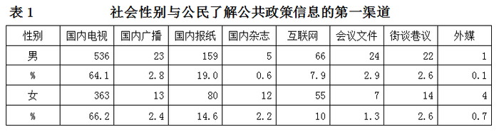

请根据表1回答126—129题。

### 第 126 题

从表1可以看出，公民获取政策信息的主渠道有三个，按照选择人数多少依次是：

A. 国内电视、国内报纸、互联网

B. 国内报纸、国内电视、互联网

C. 互联网、国内电视、互联网

D. 国内报纸、互联网、国内电视

第 126 题 · 答案与解析

**参考答案（粉笔题库参考内容）**

A

**解析**

由于表中数据差距比较明显，很容易从表中两比例行得到：不论是男公民还是女公民获取政策信息的三个主渠道依次是国内电视、国内报纸、互联网，因此公民获取政策信息的主渠道按照选择人数多少也应该依次是国内电视、国内报纸、互联网。

故正确答案为A。

**考点**：排序类、综合资料

**来源**：2008年山东省公务员录用考试《行测》题第126题

### 第 127 题

从以上三大渠道获取政策信息的人数合计占总数的比例是：

A. 91.03%

B. 90.88%

C. 90.97%

D. 91.3%

第 127 题 · 答案与解析

**参考答案（粉笔题库参考内容）**

C

**解析**

此题目因选项差异太小，无法使用估算法。三大主渠道获取政策信息的人数合计占总人数的比例，因此从以上三大渠道获取政策信息的人数合计占总数的比例是90.97%。

故正确答案为C。

**考点**：现期比重、综合资料

**来源**：2008年山东省公务员录用考试《行测》题第127题

### 第 128 题

如果样本人数相等，则选择“国内报纸”、“会议文件”作为接受政策信息第一渠道的男性公民人数分别是女性公民人数的：

A. 1.2倍、2.2倍

B. 1.3倍、1.5倍

C. 3.7倍、1.3倍

D. 1.3倍、2.2倍

第 128 题 · 答案与解析

**参考答案（粉笔题库参考内容）**

D

**解析**

如果样本人数相等，则选择“国内报纸”作为第一渠道的男性公民是女性公民人数的倍，选择“会议文件”作为第一渠道的男性公民是女性公民人数的倍。其中；。

故正确答案为D。

**考点**：现期倍数、综合资料

**来源**：2008年山东省公务员录用考试《行测》题第128题

### 第 129 题

以上数据能说明的是：

A. 男、女公民在选择接受政策信息的渠道方面没有明显不同的偏好

B. 男性比女性更倾向于利用“国内报纸”、“各种会议文件”获取政策信息

C. 男性比女性更倾向于利用“国内杂志”、“互联网”获取政策信息

D. 男性比女性更倾向于利用外国或港澳台媒体获取政策信息

第 129 题 · 答案与解析

**参考答案（粉笔题库参考内容）**

B

**解析**

从表格中比例两栏可知，男、女公民在选择接受政策信息的渠道方面有着明显的差异，因此A选项错误；

男性有19.0%而女性只有14.6%利用“国内报纸”获取政策信息，男性有2.9%而女性只有1.3%利用“各种会议文件”获取政策信息，因此B选项正确；

男性有0.6%而女性有2.2%利用“国内杂志”获取政策信息，男性有7.9%而女性有10%利用“互联网”获取政策信息，因此C选项错误；

男性有0.1%而女性有0.7%利用“外媒”获取政策信息，因此D选项错误。

故正确答案为B。

**考点**：综合分析、综合资料

**来源**：2008年山东省公务员录用考试《行测》题第129题

## 材料 2

为了解公民参与政策制定的动机，本研究设计了“如果你有过参与政策制定的想法或行为，其原因是什么”的问题。该问题为多项选择，备选答案有六项，依次为：“基于从众行为”、“出于个人兴趣”、“由于个人利益”、“出于维护公共利益”、“基于公民权利”、“出于公民责任心”。六项备选答案的排列顺序是基于其同政治制度的关系。

        在选项中，“出于公民责任心”和“出于维护公共利益”并不是同一个概念。共有1974人次对参与政策制定的动机做出了回答，其中男性公民1169人次，女性公民805人次。统计结果见下表。

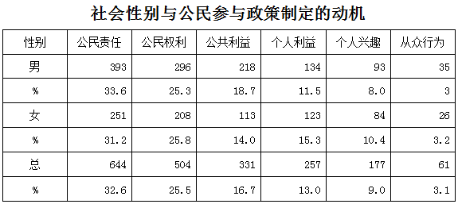

### 第 130 题

女性公民在“公民责任、公民权利、公共利益”三个高选择率上选择人次占女性总选择人次的：

A. 71.1%

B. 77.5%

C. 74.9%

D. 75.1%

第 130 题 · 答案与解析

**参考答案（粉笔题库参考内容）**

A

**解析**

女性公民在“公民责任、公民权利、公共利益”上的选择人次占女性总选择人次的比例为：，最接近的选项为A。

故正确答案为A。

**考点**：现期比重、综合资料

**来源**：2008年山东省公务员录用考试《行测》题第130题

### 第 131 题

从表2看出，在个人利益、个人兴趣两个选项上，女性选择人次比例高于男性；在公民责任、公共利益两个选项上，男性选择人次比例高于女性。这说明：

A. 女性在公共政策制定的参与动机上比男性更加感性化

B. 女性在公共政策制定的参与动机上比男性更加理性化

C. 与男性相比，女性参与动机呈现出高公共性的特征

D. 社会性别与公民参与政策制定的频次问题

第 131 题 · 答案与解析

**参考答案（粉笔题库参考内容）**

A

**解析**

女性凭个人利益和个人兴趣参与制定政策的比例高于男性，说明女性比男性更感性；同时，男性以公民责任和公共利益为动机参与制定政策的比例高于女性，说明男性更加理性。因此A选项正确，B选项错误；

从表中男女两个比例行中可以看出，男性各比例要比女性各比例集中，因此C选项错误；

题中给的是比例，不能判断公民参与政策制定的频次，因此D选项错误。

故正确答案为A。

**考点**：综合分析、综合资料

**来源**：2008年山东省公务员录用考试《行测》题第131题

### 第 132 题

以下理解有误的是：

A. 参与动机与政治制度的关系越紧密，越容易激发公民参与公共政策制定的积极性

B. 参与动机接受政治制度的干预越多，越容易激发公民参与公共政策制定的积极性

C. 参与动机与政治制度的关系越紧密，越不容易激发公民参与公共政策制定的积极性

D. 参与动机接受政治制度的干预越多，越容易引发更多的公民参与政策制定

第 132 题 · 答案与解析

**参考答案（粉笔题库参考内容）**

C

**解析**

B、D选项是一个意思，因此同时排除B选项和D选项。如果参与动机与政治制度毫无关系的话，公民就不会有参政的积极性；反之，只有两者的关系越紧密，公民的参政热情才会高，因此A选项理解是正确的，C选项是错误的。

本题为选非题，故正确答案为C。

**考点**：综合分析、综合资料

**来源**：2008年山东省公务员录用考试《行测》题第132题

### 第 133 题

表2数字显示：

A. 公共政策制定中的公民参与动机，是出于公心、出于有利于他人

B. 公共政策制定中的公民参与动机，是出于高尚的情操和道德

C. 从主流来说，我国公民参与公共政策制定的动机是可靠的

D. 出于个人利益、个人兴趣、个人从众行为的选择占有不小的比例

第 133 题 · 答案与解析

**参考答案（粉笔题库参考内容）**

D

**解析**

从表中男女两比例行可以看出男女参与政策制定的动机前两位都是公民责任和公民权利，因此A选项和B选项都是错误的；出于个人利益、个人兴趣、从众行为的选择占比例为13%+9%+3.1%=25.1%，所占比例不低，因此可以判断选择C选项错误，D选项正确。

故正确答案为D。

**考点**：综合分析、综合资料

**来源**：2008年山东省公务员录用考试《行测》题第133题

## 材料 3

本问卷设计了“在过去的两年中，您直接参与公共政策制定的次数是多少”的问题，旨在考察公民参与公共政策制定的频次，了解社会性别对参与次数的影响。该问题为单项选择问题，备选答案有六项：零次、1~2次、3次、4次、5次、6次以上。共有1383人进行了回答，其中，男性公民835人，女性公民548人。答案选择情况见下表。

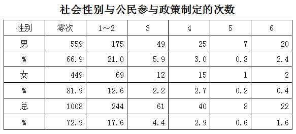

### 第 134 题

通过表3能够得出的最恰当结论是：

A. 不同性别的公民参与政策制定的次数有差异

B. 性别对公民参与政策制定的次数具有影响

C. 不同性别的公民参加政策制定的次数有显著差异，性别对公民参与政策制定的次数具有重要影响

D. 不同性别的公民参加政策制定的次数没有显著差异，性别对公民参与政策制定的次数不具有重要影响

第 134 题 · 答案与解析

**参考答案（粉笔题库参考内容）**

C

**解析**

从图中的比例不难看出，我们看到在零次制定参与公共政策制定方面，女性公民远远高于男性公民(81.9%>66.9%)。男性在参与公共政策制定方面比例都高于女性公民，因此说明不同性别的公民参与政策制定的次数有显著差异，性别对公民参与政策制定的次数具有重要影响，通过比较四个选项，概括最全最准确的是C选项。

故正确答案为C。

**考点**：综合分析、综合资料

**来源**：2008年山东省公务员录用考试《行测》题第134题

### 第 135 题

对女性公民参与人数随着参与次数的增多所产生的递减速度较慢现象的原因，不可能的解释是：

A. 女性公民独立的政策诉求更加明晰，实现自身政治价值的理念日益强化，分外珍惜参与政策制定的机会

B. 大多数女性公民尽可能地利用各种方式和途径保护自己的权利，不轻易放弃表达政策诉求的努力

C. 在参与人数递减时，使得递减现象也处于低组织化状态，容易形成较大规模的群体参与行为的递减现象

D. 低组织化状态对女性公民参与人数的递减速度起到了一种缓冲作用

第 135 题 · 答案与解析

**参考答案（粉笔题库参考内容）**

C

**解析**

女性公民参与人数随着参与次数的增多所产生的递减速度较慢现象，这个现象是对女性公民的肯定，而我们看到A、B都是对女性公民的肯定，所以A、B正确；

而C说“容易形成较大规模的群体参与行为的递减现象”，与事实不符，所以C错误；

D的“缓冲作用”也能说明递减速度较慢现象，所以D正确。

本题为选非题，故正确答案为C。

**考点**：综合分析、综合资料

**来源**：2008年山东省公务员录用考试《行测》题第135题

## 材料 4

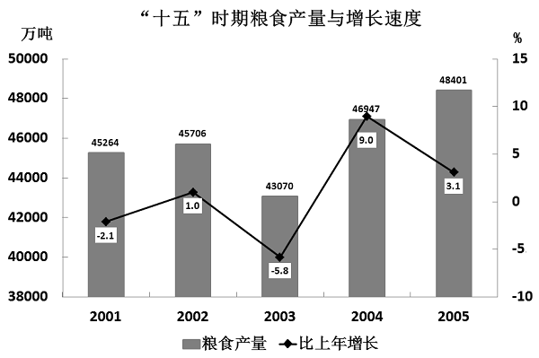

### 第 136 题

根据上图，下列说法正确的是：

A. “十五”时期粮食产量逐年上升

B. “十五”时期粮食产量年增长率逐年提高

C. “十五”时期粮食产量最高年份是2004年

D. “十五”时期粮食产量年增长率最高年份是2004年

第 136 题 · 答案与解析

**参考答案（粉笔题库参考内容）**

D

**解析**

2003年粮食产量减产了，所以A、B两项错误；

“十五”期间2005年粮食产量最高，因此C项错误；

通过观察图中折线上的数据点可以判断出2004年增长率最高，因此D项正确。

故正确答案为D。

**考点**：统计图、综合分析

**来源**：2008年山东省公务员录用考试《行测》题第136题

### 第 137 题

2004年粮食产量比2003年提高了多少个百分点？

A. 9

B. 3.1

C. 1

D. \-2.1

第 137 题 · 答案与解析

**参考答案（粉笔题库参考内容）**

A

**解析**

2004年粮食产量同比2003年提高了：，最接近的选项为A。

故正确答案为A。

**考点**：直接找数、统计图

**来源**：2008年山东省公务员录用考试《行测》题第137题

### 第 138 题

“十五”时期粮食产量最高的年份是哪年？

A. 2002年

B. 2003年

C. 2004年

D. 2005年

第 138 题 · 答案与解析

**参考答案（粉笔题库参考内容）**

D

**解析**

观察图中，“柱子”最高的那一年粮食产量最高，即为2005年。

故正确答案为D。

**考点**：直接找数、统计图

**来源**：2008年山东省公务员录用考试《行测》题第138题

### 第 139 题

2005年粮食产量比2001年增加：

A. 3137吨

B. 3137万吨

C. 5331吨

D. 5331万吨

第 139 题 · 答案与解析

**参考答案（粉笔题库参考内容）**

B

**解析**

本题需要注意表中数据单位是万吨，48401-45264=3137万吨。

故正确答案为B。

**考点**：增长量计算、统计图

**来源**：2008年山东省公务员录用考试《行测》题第139题

### 第 140 题

根据上图，下列说法不正确的是：

A. “十五”时期粮食产量有所波动

B. 2005年粮食产量增长率比上一年有所下降

C. 2003年粮食产量比2002年增加2636万吨

D. 总体来讲，“十五”时期粮食产量呈上升趋势

第 140 题 · 答案与解析

**参考答案（粉笔题库参考内容）**

C

**解析**

A项：定位统计图可得，2001-2005年粮食产量分别为45264万吨、45708万吨、43070万吨、46947万吨、48401万吨，期间有升有降，故“十五”时期粮食产量有所波动，正确；

B项：定位统计图可得，2004年粮食产量增长率为9.0%，2005年粮食产量增长率为3.1%，即2005年粮食产量增长率比上一年有所下降，正确；

C项：定位统计图可得，2002年粮食产量为45708万吨，2003年粮食产量为43070万吨，2003年粮食产量比2002年减少，并非增加，错误；

D项：定位统计图可得，“十五”时期粮食产量总体呈上升趋势，正确。

本题为选非题，故正确答案为C。

**考点**：统计图、综合分析

**来源**：2008年山东省公务员录用考试《行测》题第140题

