# 2009年山东省公务员录用考试《行测》题

<!-- gwy:overview:start -->
> **山东 · 2009 · 行测 · 统考** ｜ 140 题 · 图片 122 处 · 答案随题折叠

| 题型模块 | 题量 | 题号 |
| --- | ---: | ---: |
| 言语理解与表达 | 35 | 1–35 |
| 判断推理 | 35 | 36–70 |
| 常识判断 | 30 | 71–100 |
| 数量关系 | 20 | 101–120 |
| 资料分析 | 20 | 121–140 |
| **合计** | **140** | |

导航：[题型与作答说明](#题型与作答说明) · [题目](#题目) · [材料 1](#材料-1)
<!-- gwy:overview:end -->

> 候选采集稿。参考答案及解析来自粉笔页面，不代表官方答案或真实高分答卷；来源使用许可与原卷对应关系仍需人工核实。

## 题型与作答说明

言语理解与表达

（35题）

本部分包括表达与理解两方面的内容。请根据题目要求，在四个选项中选出一个最恰当的答案。

判断推理

（35题）

本部分包括图形推理、定义判断、类比推理与逻辑判断四种类型的试题。

常识判断

（30题）

本部分包括单项选择与不定项选择两种类型的试题。71~90题为单项选择题，91~100题为不定项选择题。

数量关系

（20题）

本部分包括数字推理与数学运算两种类型的试题。

资料分析

（20题）

下列所给出的图、表、文字或综合性资料均有若干个问题，请你根据资料提供的信息进行分析、比较、计算和判断处理，正确选项只有一个，请将正确答案选出。

## 题目

### 第 1 题

每一届《感动中国》的感动点，实际上都和当年中国特定的大背景相关联，触动了中国公众最敏感的神经，代表了当年最能＿＿＿＿公众＿＿＿＿，最能感动中国的力量。

依次填入画横线部分最恰当的一项是：

A. 引起 共鸣

B. 打动 心灵

C. 拨动 心弦

D. 震撼 内心

第 1 题 · 答案与解析

**参考答案（粉笔题库参考内容）**

C

**解析**

第一空，从句式看，B项“打动”、C项“拔动”能与前后文的“触动”“感动”形成语义对应，故排除A项的“引起”以及D项程度较重的“震撼”。

第二空，结合语境，横线处所填入的词语也应当能表现出公众的思想感情因受外界事物影响而感动，C项“拨动······心弦”能与“神经”一词相对应，而B项“心灵”与“神经”不能构成对应。

故正确答案为C。

### 第 2 题

唐山十三位农民兄弟：不是归途，是千里奔波，雪中送炭；不是邻里，是素不相识，出手相援。他们用纯朴、＿＿＿＿和＿＿＿＿的行为，告诉了我们“兄弟”的含义。

依次填入画横线部分最恰当的一项是：

A. 正直 坚强

B. 感恩 非凡

C. 善良 倔强

D. 真情 执着

第 2 题 · 答案与解析

**参考答案（粉笔题库参考内容）**

C

**解析**

本题考查近义实词不同侧重点的辨析和语境搭配。

“素不相识，出手相援”是农民兄弟善良、质朴本色的体现；“千里奔波，雪中送炭”是一种倔强、执著精神的体现，所以用“纯朴、善良、倔强”来形容唐山十三位农民兄弟的行动最为合适。

A项“正直”强调公平公正；B项“感恩”强调感谢；D项“真情”强调真实且不能修饰“行为”，均不符合语意。

故正确答案为C。

### 第 3 题

在相携相伴的风雨同行中，一批人走过风华正茂，正在经行而立不惑，一批人领略了春夏的＿＿＿＿而收获着金秋的＿＿＿＿ 。

依次填入画横线部分最恰当的一项是：

A. 炙热 静美

B. 明媚 丰厚

C. 绚烂 丰盈

D. 烂漫 静谧

第 3 题 · 答案与解析

**参考答案（粉笔题库参考内容）**

C

**解析**

本题考查近义实词不同侧重点的辨析和语境搭配。

“炙热”意为温度极高、热烈，通常用来形容夏季；“明媚”指鲜明可爱，通常用来形容春季；“绚烂”意为浓烈繁华、绚丽多彩；“烂漫”意为光彩四射、绚丽多彩。

由第一个空可知，形容“春夏”可首先排除“炙热”和“明媚”，答案锁定C、D项。

第二个空中，“丰盈”意为富足；“静谧”形容静寂无声或忧愁的样子。金秋的收获应该是富足的。

故正确答案为C。

### 第 4 题

牺牲在抗灾前线的年轻战士武文斌：山崩地裂之时，绿色的迷彩撑起了生命的希望，他竖起了旗帜，自己却悄然倒下，在那灾难的＿＿＿＿背景下，他26岁的青春，是＿＿＿＿的那束光。

依次填入画横线部分最恰当的一项是：

A. 沉重 明亮

B. 阴森 耀眼

C. 黑色 最亮

D. 慌乱 绚丽

第 4 题 · 答案与解析

**参考答案（粉笔题库参考内容）**

C

**解析**

本题考查近义实词的程度辨析和语境搭配。

第一空中，“沉重”意为心事重重的、心情极度忧虑或不安，多用来形容心情；“阴森”意为阴沉、可怕，常用来形容地方、气氛、脸色等；“慌乱”意为慌张忙乱，通常只能用来形容人。本题中形容“灾难”只能选择“黑色”。

可以再看第二空验证。联系语境，年仅26岁的武文斌牺牲在抗灾前线，这样的生命，这样的青春，令人震撼。比较四个选项的第二个词，“最亮”最能体现令人震撼的那种强烈语气；“明亮”“耀眼”比较中性，体现不出语气的强烈；“绚丽”意为灿烂美丽，与语境渲染的气氛不符。

故正确答案为C。

### 第 5 题

要创作一件艺术作品包括一篇文学作品，需要一些条件，这就是知识、经验、想象三样东西，把知识和经验＿＿＿＿组织起来，这就是＿＿＿＿。

依次填入画横线部分最恰当的一项是：

A. 结合 创造力

B. 糅合 创作力

C. 调和 想象力

D. 协调 感受力

第 5 题 · 答案与解析

**参考答案（粉笔题库参考内容）**

C

**解析**

本题可从第二空入手，横线前出现“这”，结合前文“知识、经验、想象三样东西”，那么把知识和经验组织起来就是想象力，对应C项。

第一空代入验证，“调和”能够体现出知识和经验相结合之意。

故正确答案为C。

### 第 6 题

消防战士李隆：火场、废墟，有多少次出生入死，就有多少次不离不弃。他用希望＿＿＿＿希望，用生命＿＿＿＿生命。

依次填入画横线部分最恰当的一项是：

A. 点燃 换回

B. 带来 挽救

C. 扩展 激活

D. 连接 拯救

第 6 题 · 答案与解析

**参考答案（粉笔题库参考内容）**

C

**解析**

本题考查近义实词不同侧重点的辨析和语境搭配。

C项“扩展”指向外伸展，即本来就有希望，消防战士将它更进一步拓展了，这与题干语意相符。“激活”意为刺激机体内某种物质，使其活跃地发挥作用。“生命激活生命”的表述更能体现生命的存在感，更加感动人心，C选项恰当。

A项“点燃”指点着、使燃烧，意为希望从无到有。而句中需要救的人自身并非完全没有希望，故“点燃”不合语意；同理B项的“带来”也不符合语意；D项“连接”意为使连接，起中介作用，词语色调平淡，与句中文字的感情色彩不符。

故正确答案为C。

### 第 7 题

就一个群体而言，发生某种风险的几率会随着规模的扩大而趋向一个常数。层次越高，范围越大，人数越多，这个客观存在的＿＿＿＿就越＿＿＿＿、越稳定。

依次填入画横线部分最恰当的一项是：

A. 定数 集中

B. 变数 显著

C. 常数 明显

D. 固数 明确

第 7 题 · 答案与解析

**参考答案（粉笔题库参考内容）**

C

**解析**

本题考查近义实词的语境搭配。

第一空中，前半句说“风险的几率趋向一个常数”，可知语意重点落在“常数”。按照思维的逻辑，后面文字的重点也会是“常数”，而“这个”就起到了指代“常数”的作用。因此答案锁定C项。

第二空中，再将C项的“明显”代入句中，符合语意。

故正确答案为C。

### 第 8 题

在这个世界上，依然有很多朋友热爱纸质的芬芳，翰墨的留香，也依然有很多人经过岁月的＿＿＿＿后仍坚守着朴实的＿＿＿＿，渴望真诚的交流，欣赏丰富而＿＿＿＿的灵魂。

依次填入画横线部分最恰当的一项是：

A. 淘洗 信念 淡定

B. 洗礼 理想 平静

C. 磨砺 理念 激扬

D. 检验 作风 优雅

第 8 题 · 答案与解析

**参考答案（粉笔题库参考内容）**

A

**解析**

本题考查近义实词不同侧重点的辨析和语境搭配。

第一空中，“淘洗”意为通过冲刷作用而分出其中有价值的物质和无价值或价值较少的物质；“洗礼”比喻斗争中的磨练和考验，例如经历过战火的洗礼；“磨砺”意为磨练、锻炼，例如艰苦的生活可以磨砺人的意志；“检验”指通过观察和判断，适当地结合测量、试验所进行的符合性的评价。通过对四个词语的分析，可以判断出“经过岁月的淘洗”在语意中是最恰当、最鲜活的修饰。

再分析后面的两个空格，可以得知“朴实的信念”“淡定的灵魂”是最恰当的选择。

本题的最佳突破点在第三个空格上。由句中“朴实的”“真诚的”可知，“淡定的”最符合其叙述风格和感情基调。

故正确答案为A。

### 第 9 题

2008年，中国大地上堪称祸福更替，悲喜交集。所谓“福”和“喜”，大抵是百年一遇，普照人心，如迎接北京奥运会和残奥会，纪念改革开放30周年；而所谓“祸”与“悲”，则属于＿＿＿＿＿＿、＿＿＿＿＿＿。

依次填入画横线部分最恰当的一项是：

A. 惊天动地 千难万险

B. 惊涛拍岸 山河破碎

C. 猝不及防 石破天惊

D. 防不胜防 有惊有险

第 9 题 · 答案与解析

**参考答案（粉笔题库参考内容）**

C

**解析**

本题考查成语的语境分析。

由常识可知，2008年的“祸”与“悲”主要是指南方的冰灾和汶川的地震，都属于造成重大损失的天灾。这里的“祸”“悲”是与前面的“福”“喜”相对应的，故空缺处所填的两个词语也应分别与“百年一遇”“普照人心”构成对应关系。 “百年一遇”是从事情发生的时间角度阐释，“普照人心”是从事情发生后的效果角度阐释。四个选项中最能体现这种对应效果的只有C项的“猝不及防”“石破天惊”。

故正确答案为C。

【文段出处】《现实与历史的深层谛视》

### 第 10 题

党的十七届三中全会通过的《中共中央关于推进农村改革发展若干重大问题的决定》指出：农业基础依然薄弱，最需要＿＿＿＿；农村发展依然滞后，最需要＿＿＿＿；农民增收依然困难，最需要＿＿＿＿。

依次填入画横线部分最恰当的一项是：

A. 强化 带动 扶助

B. 加固 支持 提高

C. 加强 扶持 加快

D. 夯实 加快 扶持

第 10 题 · 答案与解析

**参考答案（粉笔题库参考内容）**

C

**解析**

本题考查近义实词的语境搭配。

农业在我国处于基础地位，这个基础地位依然薄弱，所以需要“加强”；农村发展落后于城市发展，需要政府和政策的大力“扶持”；农民人均收入一直低于全国人均收入水平，且提高收入依然困难，所以增收需要“加快”。因此最恰当的选项为C。

也可以用排除法从词语对应的角度考虑。第三个空“增收依然困难”中“增”与“加快”的“加”为同义词，增收依然困难相当于否定，故选“加快”比较恰当，这样就可排除A；“薄弱”的反义词着重点在“强”，故可排除B、D。

故正确答案为C。

应试者如果多了解一些时事政治和相关政策文件，作答此类题目就相对简单了。

### 第 11 题

清人纪晓岚讲过：有个官员一辈子没做过坏事，所到之处，也不过饮人一杯清水而已，于是想要阎王爷赏他来生还去做官。阎王爷却讥笑道：不贪不占，就能算是好官吗？假若不搜刮民财就是好官，那么塑一个木偶放在官府，连井水也不喝，岂不更好？该官辩解：我虽无功，但也无罪呀。岂料阴司对为官者行为俱记录在案：做官三年，无绩可求，纯属混混一个。

这段文字意在说明：

A. 为官之道

B. 无功即为有过

C. 为官需廉政亦需勤政

D. 为官不为民做主，不如回家种红薯

第 11 题 · 答案与解析

**参考答案（粉笔题库参考内容）**

C

**解析**

根据提问“意在”一词可知本题为中心理解题。

材料通过纪晓岚讲述的故事，来讨论无功算不算是好官。从阎王爷和阴司的记录可以看出，“不贪不占”也不一定是好官，“无绩可求”说明做官需要有“绩”，不仅要不贪，而且不能混日子。

因此，结合选项应该选择C。

A项“为官之道”的内涵太过宽泛，没有表达出材料主要说明的问题，排除；B项扩大了文段讨论的范围，文段讨论的是“做官”，扩大到其他范围之后“无功即为有过”不成立，排除；D项“为民做主”的内容在材料中并未涉及也无法引申出来，属于无关选项，排除。

故正确答案为C。

### 第 12 题

仙人掌这种无叶有节、长着刺的“常青植物”、“卫士植物”，无论是生长在沙漠、悬崖这种人迹罕至之地，或是公园、路边这种人流如川之地，她都能做到坦然无忧，笑迎日出日落。无论是其形胖如山丘，或是其体瘦如孤峰，她都能安身为乐，外不劳形去减肥；无忧为福，内不思悲以滋补，很有点“莫思身外无穷事，且尽生前有限杯”的味道。

这段文字描述的主要是：

A. 仙人掌的做派是豁达的，仙人掌的风骨是秀爽的。

B. 仙人掌的胸襟是博大的，仙人掌的精神是高尚的。

C. 仙人掌的生命是顽强的，仙人掌的情趣是自然的。

D. 仙人掌是平常的花瓶，但又是不平常的刺头。

第 12 题 · 答案与解析

**参考答案（粉笔题库参考内容）**

C

**解析**

根据提问“主要”一词可知本题为中心理解题。

文段第一句说仙人掌无论生存环境的好坏，都能坦然无忧，这说明其生命是顽强的；第二句说仙人掌无论形体的胖瘦，都能安身为乐，这说明她并不依外界的要求改变自己，情趣是自然的。两句“无论”都构成相同句式并列，故全面概括。结合选项应该选择C。

A项的“秀爽”、B项的“高尚”均与文意不符；D项“不平常”过于宽泛，没抓住仙人掌的特质。

故正确答案为C。

### 第 13 题

根基坚固，才有繁枝茂叶，硕果累累；倘若根基浅薄，便难免枝衰叶弱，不禁风雨。山不解释自己的高度，并不影响它的耸立云端；海不解释自己的深度，并不影响它容纳百川；地不解释自己的厚度，但没有谁能取代它孕育万物的地位······人生在世，我们常常产生想解释点什么的想法。然而，一旦解释起来，却发现任何解释都是那样的苍白无力。

这段文字告诉我们的道理是：

A. 开水不响，响水不开

B. 欲成事者必须严以律己

C. 低调做人，是一种智慧

D. 解释的多余和尴尬

第 13 题 · 答案与解析

**参考答案（粉笔题库参考内容）**

C

**解析**

根据提问“道理”一词可知本题为中心理解题。

材料以山、海、地的不解释（不张扬），说明低调并不会影响自身内在的价值，而“解释”却苍白无力。即材料通过对自然界景物的描述和拟人来引出做人的道理。

因此，结合选项应该选择C。

A项“开水不响，响水不开”形容真正有内涵的人不会到处张扬表现自己，而没有什么知识的人却极喜欢表现自己，这样的表述过于绝对；B项的“严以律己”在材料中并没有涉及；D项是干扰项，只从字面意思对材料进行理解，没有作进一步的引申，不是暗含的道理。

故正确答案为C。

### 第 14 题

在春秋战国时期宋国有个叫子罕的以不贪而名垂青史。有一次，一个人得了块玉，拿去送给当权的子罕。子罕拒不接受。那人说，让做玉的师傅看过，说是件宝物，才敢送给你的。子罕道，你的宝物是这块玉，我的宝物是“不贪”，我若收下你这块玉，你和我的宝物不都丧失了吗？还不如各人留着各自的宝物好啊！

这段文字给人的警语是：

A. 君子慎独

B. 君子坦荡荡，小人长戚戚

C. 一丝一缕，我之名节；一厘一毫，民之脂膏

D. 宽一分，民受赐不止一分；取一文，我为人不值一文

第 14 题 · 答案与解析

**参考答案（粉笔题库参考内容）**

A

**解析**

根据材料和提问知本题为中心理解题。

题干要求选择文段给人的警语，所谓“警语”，需言简意赅，并具有一定深度。

结合选项应该选择A。A项“慎独”是我国古代儒家创造出来的具有我国民族特色的自我修身方法，指的是人们在个人独自居处的时候，也能自觉地严于律己，谨慎地对待自己的所思所行，防止有违道德的欲念和行为发生，从而使道义时时刻刻伴随主体之身。这与文中子罕的“不贪”相符。

B项是说君子和小人在行为、性情上的差别，与文意相去甚远；C项和D项表达的都是“不贪”的含义，但“一厘一毫，民之脂膏”和“宽一分，民受赐不止一分”不契合有人给子罕送玉的文意，且C、D两项都不算警语。

故正确答案为A。

### 第 15 题

看到室内墙角处的一轮旧纺线车，耳际似乎响起那彻夜不眠的嗡嗡声；目睹旧织布机，往事仿佛在那节奏感强烈的织布声中浮现脑海。家织土布属于古老的传统技术，男耕女织，天经地义。土布常被作为农村姑娘的嫁妆和她们心灵手巧的见证。农家妇女坐在织布机旁，把她们多姿多彩的生活与梦想编织在或清白如雪或繁花似锦的土布里。

这段文字表达的主要是：

A. 心灵的归本还原、还淳返朴

B. 人间的真情珍藏在土布中

C. 旧事民风，睹物生情

D. 昔日的浮华如梭穿过

第 15 题 · 答案与解析

**参考答案（粉笔题库参考内容）**

C

**解析**

根据提问“主要”一词知本题为中心理解题。

材料描述了旧纺线车、土布、如何纺线等旧事民风，后文都是阐述人们对土布的寄寓。“看到······耳际······响起”“目睹······往事······浮现”透出一种情怀。概括起来，即为C项“旧事民风，睹物生情”。

A项引申过度，不是材料主要表达的情怀；B项只是材料最后一句表达的内容，不够全面；D项属凭空臆测，引申过偏。

故正确答案为C。

### 第 16 题

汉字的方块式结构由点画穿插而成，经历过多次演变，形成篆、隶、草、行、楷五种字体。篆书是匀净的线条组织，结构类似图案。隶书笔画变篆书的婉转为方折，横平竖直、撇捺翻挑，结构仿佛“崇台重宇”。楷书的笔画形状最丰富，结体欹侧而端庄。行书也是欹侧的体态，但是笔画牵连映带，具有流利的美韵。草书线条连绵盘曲，结构简略，放逸生奇。

这段文字表达的主要是：

A. 中国书法是书写汉字的艺术

B. 书法的外在形式美来自汉字形态

C. 书法的内在美韵来自书写的笔力、笔势

D. 书法这门艺术的显著特征是由“汉字”与“书写”所决定

第 16 题 · 答案与解析

**参考答案（粉笔题库参考内容）**

B

**解析**

根据提问“主要”一词知本题为中心理解题。

分析文意可知，文段主要讲述了汉字五种字体在外在形式上的美感特征。第一句总说汉字外在形式经过历史演变而形成了五种字体，后五句分别介绍了篆、隶、楷、行、草五种字体在形态（线条和结构）上的特点，故整个文段为总—分结构，首句即为重点，对应B项。

A项是关于中国书法的定义，D项论述显著特征的决定因素，文段均并未提及，无中生有，排除；C项“书法的内在美韵”在文段中没有体现，文段重在强调五种汉字书法的外在形式，排除。

故正确答案为B。

### 第 17 题

有人说：没有享受到某种社会服务的人就好像一个大沙漠，享受到这种社会服务的人就好像大沙漠中的一个绿洲，沙漠永远在吞噬着绿洲，而保护绿洲的唯一办法，就是把沙漠尽快地改造成为绿洲。

这段文字说明的是：

A. 大数定律

B. 沙漠效应

C. 绿洲效应

D. 此长彼消法则

第 17 题 · 答案与解析

**参考答案（粉笔题库参考内容）**

C

**解析**

根据提问知本题为中心理解题。

材料首先阐述沙漠永远在吞噬绿洲这一问题，接着用转折词“而”提出解决问题的办法——把沙漠尽快改造成绿洲。“绿洲效应”指当一项社会保障制度只对一小部分公民有效时，大多数没有保障的人就会千方百计地来利用这项制度。

因此，结合选项应该选择C。

“大数定律”指一个保险项目参保的人越多，发生风险的几率就越小，因此保险项目本身的风险也就越小，亦即保险项目的稳定性、可靠性就越大，故排除A；现存的知识中并没有“沙漠效应”和“此长彼消法则”的相关理论，显然，B项和D项是出题者设置的干扰项。

故正确答案为C。

### 第 18 题

《史记》中《公仪休嗜鱼》说的是，公仪休在鲁国当丞相的时候特别喜欢吃鱼，有很多人投其所好送鱼给他，他一概不收。有人问：你为什么喜欢吃鱼却不收鱼？他说，我现在做丞相买得起鱼，自己可以买来吃。如果因接受了别人送的鱼而被免职，我从此就买不起鱼，也吃不起鱼了。

这段文字意在说明：

A. 贪欲猛如虎，贪欲如洪水

B. 人的性格各异，嗜好有别

C. 做一个正直向上的人，首先要“寡欲”

D. 贪欲是把一个人推向不归路的“助推器”

第 18 题 · 答案与解析

**参考答案（粉笔题库参考内容）**

C

**解析**

根据提问“意在”一词可知本题为中心理解题。

由文中的“如果因接受了别人送的鱼而被免职，我从此就买不起鱼，也吃不起鱼了”可看出，要想经常有鱼吃，关键在自己，要“寡欲”，说的是解决欲望的方法。

因此，结合选项应该选择C。

A、D项说的是贪欲的结果；B项材料并未涉及，为无关项。

故正确答案为C。

### 第 19 题

在觅食过程中，成百上千只蚂蚁在蚁穴和食物所在处之间来来往往，最终都能够在相对最短的时间内得到食物，却从来不会有拥堵现象出现。德国科学家赫尔冰发现，避免道路拥堵是基于蚂蚁之间的交流。在一条路有可能出现拥堵时，返回的蚂蚁就向迎面过来的同伴发出信息素，让它选择另一条路。他认为，人类可以采取相同方法减少车辆拥塞现象。

这段文字说明的主要是：

A. 聪明蚂蚁启发人类解决交通拥堵

B. 解决难题，从蚂蚁觅食中找思路

C. 互通情况，绕道可避免遭遇拥堵

D. 蚂蚁的不拥堵与人类的车辆拥塞

第 19 题 · 答案与解析

**参考答案（粉笔题库参考内容）**

A

**解析**

根据提问“主要”一词可知本题为中心理解题。

材料第一句先说蚂蚁不会出现拥堵现象，第二、三句叙述蚂蚁不会出现拥堵现象的原因，最后一句由蚂蚁引申到人类，提出可以用相同方法解决车辆拥堵问题。可见材料主要讲述德国科学家由蚂蚁的不拥堵得到启示，认为可以用相同方法减少车辆拥堵现象。

因此，结合选项应该选择A。

B项的表述太过笼统，只说解决难题，没有提到车辆拥堵；C项是文段的信息之一，但没有抓住重点；D项本身不构成观点，也不是文段的主要内容。

故正确答案为A。

### 第 20 题

三个和尚在破庙里相遇。“这庙荒废必是和尚不虔。”甲和尚说。“必是和尚不勤。”乙和尚说。“必是和尚不敬。”丙和尚说。三人争执不下，决定留下来各尽所能。于是甲和尚礼佛念经，乙和尚整理庙务，丙和尚化缘讲经，果然香火渐盛。但是，后因三人争功闹个不休，庙里的盛况又逐渐消失了。

这段文字告诉我们的道理是：

A. 所有的成败得失，取决于天时、地利和人和

B. “三个和尚没水吃”这句话是有道理的

C. 成也人心，败也人心；得也人心，失也人心

D. 分工负责、各尽所能十分重要

第 20 题 · 答案与解析

**参考答案（粉笔题库参考内容）**

C

**解析**

根据提问“道理”一词知本题为中心理解题。

材料展现了一座庙破败、兴盛、破败和三个和尚争执、团结、争执的过程，这个过程现象的背后是“人心”，人心决定了事物的成败和得失，这是材料告诉人们的道理。

因此，结合选项应该选择C。

A项“天时、地利”材料并未涉及；B项引申宽泛，没抓住材料重点；D项分工负责、各尽所能的重要性体现在香火渐盛上，到后来的盛况逐渐消失就涉及不到了，故D项不能全面反映文段内容。

故正确答案为C。

### 第 21 题

楷树，果实椭圆形，红色，木材细致。相传这种树最早生长在孔子墓旁，树干挺拔，枝繁叶茂，似为众树的榜样。模树，春天青翠碧绿，夏季赤红如血，秋日变白，冬日变黑，因其色泽纯正，“不染尘俗”也为诸树之榜样，相传此树最早生长在周公的墓旁。这两种树分别称之为“楷”和“模”，以树喻人，故把人的模范行为称之为“楷模”。

这段文字意在说明：

A. “楷”和“模”是两种树木的名称

B. “楷模”二字都带“木”字

C. “楷模”原指两种树

D. 楷树、模树皆有灵气

第 21 题 · 答案与解析

**参考答案（粉笔题库参考内容）**

C

**解析**

根据提问“意在”一词知本题为中心理解题。

材料主要阐述了“楷模”原指两种树，后被人们演化成一个专有、具有特定含义的词汇。

因此，结合选项应该选择C。C项提到“原指”，涵盖了材料的主要内容。

A项是材料的信息之一，但没表现出后来的演化；B、D项材料并未涉及。

故正确答案为C。

### 第 22 题

2008年12月2日央视《新闻联播》播出了有关“山寨现象”的内容，五成网友看好“山寨产品”。“山寨风”在民间流行已久，并深深地打上了草根创新、群众智慧的烙印，它在模仿与超越的羊肠小道上一路狂奔，终于闯进了主流文化的视野。它一开始瞄准的只是低端消费群体，但慢慢地突破了低收入消费群体的局限，演变为一种大众流行时尚。

这段文字表达的主要是：

A. 山寨风何以刮进了新闻联播

B. 关于山寨流行文化意义上的解读

C. “山寨风”把貌似高端的产品送到了普通百姓手中

D. 从经济消费的视角透析一下“山寨风”的亲民路径

第 22 题 · 答案与解析

**参考答案（粉笔题库参考内容）**

B

**解析**

根据提问“主要”一词可知本题为中心理解题。首句由《新闻联播》关于“山寨现象”的报道引出讨论主体“山寨产品”，后两句是这段话阐述的主要内容，概括起来分别是“终于闯进了主流文化的视野”和“演变为一种大众流行时尚”，关键词是“主流文化”和“大众流行”。

B项的“流行文化”综合了这两个关键词，文段主旨为对山寨产品的文化意义上的解读。因此，对应B项。

A项，文段首句提及《新闻联播》报道“山寨现象”是引出论题，后文并没涉及山寨风为何会刮进新闻联播，无中生有，排除；C项，“貌似高端的产品”在文段中没有出现，属于无中生有，排除；D项仅概括了材料第三句的内容，没有反映出“主流文化”这一关键词，不够全面，排除。

故正确答案为B。

### 第 23 题

成语中的数字运用很多，如一鼓作气、百废俱兴。非整数也进入了成语，如半途而废、半壁江山。还有两个成语：一举两得、一箭双雕。“两”和“双”是数字“2”的不同表示法。多数成语都是由四个文字组成的，数目字有时还被“连用”，如五光十色、三头六臂。也有成语纯粹由数目字组成，如三三两两、一五一十。

最适合做这段文字标题的是：

A. 成语与数字的关系

B. 成语数字趣谈

C. 数字成语与成语数字

D. 成语用遍数目字

第 23 题 · 答案与解析

**参考答案（粉笔题库参考内容）**

B

**解析**

本题考查标题选择。

材料第一句话即表述了所要阐述的主要内容——成语中的数字运用，后面文字分别举例介绍了非整数成语、“2”的变形成语、数字连用成语、纯粹数字成语等。因此最适合做这段文字标题的是“成语数字趣谈”。

结合选项应该选择B。

A项将成语和数字并列，而材料的侧重点在于成语，且“关系”表述宽泛；C项的“成语数字”文段中没有提及，排除；文中举例强调数字运用很多，并没有说成语中用到了所有的数目字，D项的观点无中生有，排除。

故正确答案为B。

### 第 24 题

先秦诸子百家中，儒家和道家是影响最大的两家，而儒家和道家正是中国传统文化的两条主线。《论语》、《老子》分别是儒家和道家思想的主要代表作，把儒家和道家思想的源头抓住了，就比较容易把握中国传统文化的来龙去脉，还可以避免对中国传统文化的单向理解，易于进行儒、道两家思想的比较。

这段文字的主旨是：

A. 要弘扬中国的传统文化，首先就要读懂《论语》和《老子》

B. 《论语》和《老子》对中国的政治产生了广泛和深远影响

C. 在中国传统文化中，最经典的原著是《论语》和《老子》

D. 熟读《论语》和《老子》，就能为传播中国文化打好基础

第 24 题 · 答案与解析

**参考答案（粉笔题库参考内容）**

A

**解析**

根据提问“主旨”一词知本题为中心理解题。

第一句话首先提出儒家和道家是中国传统文化的两条主线，第二句是对此进一步阐释，即读懂《论语》和《老子》有利于把握好中国传统文化。

因此，结合选项应该选择A。

B项材料主要阐述中国的传统文化，并未谈及中国的政治；C项《论语》和《老子》是儒家和道家思想的主要代表作，但说“最经典”过于绝对，且并非材料的主要观点；D项《论语》和《老子》不能代表全部中国文化，熟读也并不一定能够传播，“就能”表述过于绝对。

故正确答案为A。

### 第 25 题

英国某家报纸曾举办一项有奖征答活动，题目是：在一个热气球上载有三人。一是环保专家，他可使人们免于因环境污染而死亡的厄运；二是核专家，他有能力防止全球性的核战争；三是粮食专家，他能使几千万人脱离饥荒。此刻热气球即将坠毁，必须丢出一个人以减轻载重，问该丢下谁？应答信如雪片飞来，结果，巨额奖金的得主是一个小男孩。他的答案是：最胖的下去。

对这段文字的理解正确的是：

A. 这是办法总比问题多的实例

B. 这是复杂问题简单化的典范

C. 这是棘手事情快处理的选择

D. 这是小顽童解决大难题的故事

第 25 题 · 答案与解析

**参考答案（粉笔题库参考内容）**

B

**解析**

材料前面大量的文字和设定的对象都在描述所要解决的问题是如何复杂，但一个小男孩给出的答案却是简单至极且正确的。这是一个抓住问题本质、把复杂问题简单化的典范。

因此，结合选项应该选择B。

A项“办法总比问题多”，强调的是一种面对问题的积极态度，与文意不符；C项的“棘手事情快处理”，突出的是“快”，材料并未涉及；D项未切中重点，材料强调的并不是“小男孩”，而是他的答案。

故正确答案为B。

### 第 26 题

虽有秋风秋霜，白菜却茂盛成长。深秋里的成片新绿并不多见。此时，田野百花凋零，白菜仍旧水灵。叶柄宽而肥厚，瓷勺状的叶瓣弯弯的往上翘，在阳光下欢喜地仰着脸，叫人生出希望。白菜的白和南瓜的黄、辣椒的红一样，都是美的极点。

最能概括这段文字的话是：

A. 霜降对植物是一种历练

B. 家常白菜生成美的极点

C. 霜打过的白菜有回味的甘甜

D. 白菜溢出了生活本真的气息

第 26 题 · 答案与解析

**参考答案（粉笔题库参考内容）**

D

**解析**

根据提问“概括”一词可知本题为中心理解题。

材料讲的是深秋里白菜茂盛成长，接着描写了其生机和“白”的美。白菜和日常普通生活关系密切，白菜到处洋溢着生活本真的气息。

因此，结合选项应该选择D。

A项“霜降”和C项“霜打”在文中都未涉及；B项偷换主语，且没有概括材料的内容，材料从白菜的“生机”的角度来阐述白菜的美，而非“家常白菜”。

故正确答案为D。

### 第 27 题

在公共汽车上，一个人张大嘴打了个哈欠，他周围会有几个人也忍不住打起了哈欠。有些人不打哈欠是因为他们受暗示性不强。哪些人受暗示性强呢？可以通过一个简单的测试检查出来。让一个人水平伸出双手，掌心朝上，闭上双眼。告诉他现在他的左手上系了一个氢气球，并且不断向上飘；他的右手上绑了一块大石头，向下坠。三分钟以后，看他双手之间的差距，距离越大，则受暗示性越强。

这段文字说明的主要是：

A. 人常常迷失在自我当中，形成一定程度的从众心理

B. 人很容易受到来自外界信息的暗示，从而出现自我知觉的偏差

C. 人很容易相信一个笼统的、一般性的人格描述特别适合他

D. 在日常生活中，人不可能总把自己放在局外人的地位来观察自己

第 27 题 · 答案与解析

**参考答案（粉笔题库参考内容）**

B

**解析**

根据提问“主要”一词可知本题为中心理解题。

材料叙述了两件事，都涉及到暗示性的问题，而第二件事即测试的结果是双手间的差距越大，则受暗示性越强。因此材料说明的主要是暗示对人的自我知觉的影响。

因此，结合选项应该选择B。

材料谈的是“受暗示性”而非“从众心理”，A项不符合题意；材料并未涉及C项和D项的内容。

故正确答案为B。

### 第 28 题

“80后”这个词，最早于2001年出现在网络论坛中，指的是一批活跃于网络论坛的出生于20世纪80年代的诗人。2003年开始，它更多指的是一批被商业运作出名的生于1980年以后的写手。2004年底，随着“80后作家”的批量涌现，这个词逐渐被用来指称整个20世纪80年代出生的年轻人群体。

最适合做这段文字标题的是：

A. “充满希望”的一代

B. “80后”的由来

C. 用新视角理性看待“80后”

D. “80后”引起社会的广泛关注

第 28 题 · 答案与解析

**参考答案（粉笔题库参考内容）**

B

**解析**

本题考查标题选择。

材料表述的意图明确，脉络清晰。“‘80后’这个词，最早于2001年出现······2003年开始······2004年底······逐渐······”，由此可以看出，本文主要阐述“80后”这一称呼的由来与发展。

因此，结合选项应该选择B。

A、C两项的表述文段中没有提到，属于无中生有，排除；D项过度引申文段阐述，且没有切中文段重点，排除。

故正确答案为B。

### 第 29 题

黄山松在黄山岩石丛这种难以见容、与己为敌的环境里生长，海拔高达一千六七百米，名松的树龄都以数百年计。这些松树因抗风御霜，针叶短粗，冠平如削，绿色深沉，枝干坚韧且富弹性，一株株显得生气勃勃，十分顽强。迎客松挺立在青狮石旁，玉屏峰与天都峰的风口上，寿逾千年，两只巨臂向四海宾客致意。

这段文字让人们悟出：

A. 松与石同外界自然密切联系

B. 松树与石头之间，不再是有我无你，你死我活

C. 人与环境，人与人，变不利为互惠，在竞赛、竞争中通达和谐

D. 从许多人、事、物当中，洞悉他人所无法体会的绝妙世界

第 29 题 · 答案与解析

**参考答案（粉笔题库参考内容）**

C

**解析**

根据提问“悟出”一词可知本题为中心理解题。

材料描述了黄山松在恶劣的生长环境中坚韧挺拔，展现了黄山松与其生长的环境融合在一起，形成一幅和谐的景象。因此引申出人与环境之间的关系。

因此，结合选项应该选择C。

A、B项都没有引申，只停留在现象的表层，且A项没有点出松的坚韧和融合；D项过于宽泛，没抓住重点。

故正确答案为C。

### 第 30 题

一间坐满了观众的剧院突然发生大火，争于逃生的观众都渴望从有限的紧急出口中尽快逃出去，但当所有人挤成一团时，必然会因为相互拥挤和彼此践踏而影响逃生速度。在这种紧急情境下，最佳的解决方案是大家同时采取合作策略，按照一定规则有序通过紧急出口。

这段文字所强调的主要是：

A. 当事人不合作既会损害自身利益也会损害他人利益

B. 利己策略往往无法实现自身收益最大化的目标

C. 维护自身利益是需要与他人合作和付出一定代价的

D. 合作策略比利己策略更有利于实现当事各方效用的最大化

第 30 题 · 答案与解析

**参考答案（粉笔题库参考内容）**

D

**解析**

根据提问“主要”一词知本题为中心理解题。

材料首先提出问题，接着提出了在这种情况下的解决方法——合作，即合作策略比利己策略更有利于实现当事各方效用的最大化。解决方法为阐述重点。

因此，结合选项应该选择D。

A、B项错误，材料阐述“合作策略”，而非“利己策略”和“不合作”；C项错误，材料并未提到“付出一定代价”。

故正确答案为D。

### 第 31 题

此次金融危机之所以会蔓延到全球，很大程度上是因为各个经济体都经历了6~7年的金融规模超常扩张、金融创新及其金融衍生品空前发展的“经济繁荣”时期。在这一模式下，各种资产价格都被不断地非理性地推高。治理危机关键要让曾经被炒作到高价格的各种资产，回归到其合理的价格水平。一段时期的资产贬值不可避免，这是对过去超速增值的“还债”。

对这段文字的准确概括是：

A. 应采取积极的财政政策和适当宽松的货币政策来刺激经济

B. 刺激经济同时也要挤“泡沫”

C. 刺激经济的目标是促使经济正常运转起来

D. 要通过政府行为或政府宣传来维护高水平的资产价格

第 31 题 · 答案与解析

**参考答案（粉笔题库参考内容）**

B

**解析**

根据提问“概括”一词知本题为中心理解题。

材料分析了此次金融危机大范围蔓延的原因，并提出治理危机的关键，即“让曾经被炒作到高价格的各种资产，回归到其合理的价格水平”。价格不合理是因为存在“泡沫”，因此可知治理危机的关键是挤“泡沫”。

因此，结合选项应该选择B。

A项不是材料的观点；C项没抓住重点；D项本身说法不符合现实，在材料中也未涉及。

故正确答案为B。

### 第 32 题

美国经济学家保罗·费德曼每拿到一个研究合同时，总会买面包圈分给大家。后来他养成了习惯，每到周末都会在办公室放一筐面包圈让大家吃。为了收回成本，他在面包筐旁放了一个篮子，标有建议价格。结果这个没人看守的收款篮收回了95%的面包钱。后来，他辞职专卖面包圈。每天一早，他将面包圈和收款篮放好。几年后，费德曼赚的钱和原来当研究分析师时一样多。

最适合做这段文字标题的是：

A. 一个关于诚实的试验

B. 一个靠智慧赚钱的故事

C. 一种新的销售方式的产生

D. 把生意当作一种经济学实验

第 32 题 · 答案与解析

**参考答案（粉笔题库参考内容）**

A

**解析**

本题考查标题选择。

经济学家有一个非常著名的假设：自私自利是人的本性。人们在从事经济活动时，都以追求自己最大的经济利益为目的。很多经济学理论都把“经济人”这个概念作为基本出发点。然而另一些人却不愿意相信赤裸裸的自私就是号称万物主宰的“人”的全部，因为人还拥有一样独一无二的天赋——道德。通过材料的“没人看守”可以看出，经济学家保罗·费德曼相信人们是“诚实的”，因此做了一个关于诚实的“无人看管的面包圈”的试验，后文继续阐述这个试验的成功。

因此，结合选项应该选择A。

B、C项都没有抓住“没人看守”却成功回收钱的试验关键和结果——人有道德这个重点；D项作为标题不够醒目、突出，且不符合文意，保罗是通过试验开始了生意。

故正确答案为A。

### 第 33 题

一个人离开你的视线，只消失几秒钟，你便会给他一个评语，正视的时候却不行。聪明的人，一定把后背比前脸看得更加重要。这后背就是自己的一个雕像。雕塑是由别人操作的，材料和尺度则完全由自己提供。我们不奢望把每个人都塑造成完人，但至少自己“走过去”别让人戳脊梁骨。

最适合做本段文字标题的是：

A. 看好你的背影

B. 背影比前脸更重要

C. 人过留名，雁过留声

D. 背影是一个人的德行和名声

第 33 题 · 答案与解析

**参考答案（粉笔题库参考内容）**

A

**解析**

本题考查标题选择。

材料由“聪明的人”引出背影的重要，接着提醒人们要塑造好自己的“背影”。用“看好你的背影”做标题，新颖、独特、具有吸引力，且同时能给人以警戒和忠告。

因此，结合选项应该选择A。

B项说法过于绝对；C项强调的是人的名声，不切合材料的主要观点；D项作为标题不够有吸引力，且仅强调了背影的重要性，没有表达出塑造好自己的背影的观点，概括不完整。

故正确答案为A。

### 第 34 题

非洲草原上有一种尖毛草，是那里长得最高的茅草，可它的生长过程却极为特别。在最初的半年里，它几乎是草原上最矮的草，只有一寸高，但半年后雨水一旦到来时，却像施了魔法一样，三五天后，便会长到一米六至两米的高度。原来，在前六个月里，尖毛草不是不长，而是一直在长根部，雨季前，它虽然露头一寸，但却扎根地下超过28米。

这段文字启示人们：

A. 一个人成长不能只要地面以上的高度

B. 一个人的基础越牢，发展潜力越大

C. 起步最早的，不一定是发展最好的

D. 人不可貌相，海水不可斗量

第 34 题 · 答案与解析

**参考答案（粉笔题库参考内容）**

B

**解析**

根据提问“启示”一词知本题为中心理解题。

材料前面的部分描述了非洲草原上尖毛草的独特生长过程，最后一句话揭示了造成这个独特现象的内因——尖毛草深深扎根于地下，基础牢固。这给了人们一个深刻的启示：一个人的基础越牢，发展潜力越大。

因此，结合选项应该选择B。

A、C、D项观点没错，但都没有抓住“基础牢固”这一重点。

故正确答案为B。

### 第 35 题

梅兰芳不像绝大多数因媒体包装而走红的明星那样瞬间就被人们忘却。他并不是因《一缕麻》、《牢狱鸳鸯》之类的新编剧目获得观众爱戴，而是由于在《贵妃醉酒》、《霸王别姬》、《汾河湾》这些传统戏的表演中，既恪守规矩，又能超越前人。虽因大众媒体的鼓动，经历过一段陈旧布新的喧嚣时光，终因回归传统风范而成为一代宗师。

这段文字主要说明：

A. 梅兰芳是20世纪上半叶中国的媒体英雄人物

B. 梅兰芳的艺术之树长青，是因为他有深厚的传统艺术积淀

C. 梅兰芳的成功之路，就是我国经济的成功之路

D. 梅兰芳是如何成为京剧观众心目中最卓越的表演艺术家的

第 35 题 · 答案与解析

**参考答案（粉笔题库参考内容）**

B

**解析**

根据提问“主要”一词知本题为中心理解题。

材料首尾两句说的是梅兰芳被人们牢记、成为一代宗师，中间用“不是······而是”引出原因：既能恪守规矩，又能超越前人。因此材料主要阐述的是他成为宗师的原因。

因此，结合选项应该选择B。

A项是材料信息之一，但没抓住重点；C项“经济的成功之路”无中生有；D项说的是过程，而材料主要阐述的是原因。

故正确答案为B。

### 第 36 题

从所给四个选项中，选择最合适的一个填入问号处，使之呈现一定规律性：

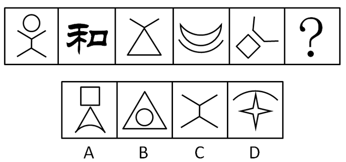

A. A

B. B

C. C

D. D

第 36 题 · 答案与解析

**参考答案（粉笔题库参考内容）**

D

**解析**

元素组成凌乱，题干中给出的五幅图都是有一个封闭的面，选项面数依次为2、2、0、1。

故正确答案为D。

### 第 37 题

从所给四个选项中，选择最合适的一个填入问号处，使之呈现一定规律性：

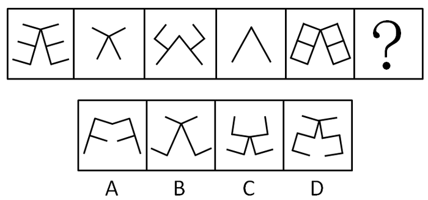

A. A

B. B

C. C

D. D

第 37 题 · 答案与解析

**参考答案（粉笔题库参考内容）**

D

**解析**

特殊考点，题干给出的五幅图都是相同的两个阿拉伯数字关于竖轴的对称，符合此规律的只有D。A、B、C都不是由阿拉伯数字组合而成。

故正确答案为D。

### 第 38 题

从所给四个选项中，选择最合适的一个填入问号处，使之呈现一定规律性：

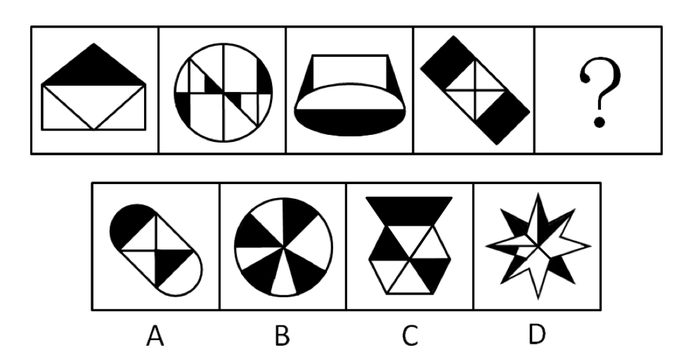

A. A

B. B

C. C

D. D

第 38 题 · 答案与解析

**参考答案（粉笔题库参考内容）**

D

**解析**

元素组成凌乱，考查数量规律。

题干给出的四幅图中黑色部分的个数分别为1，4，3，2。当选出的图中有5或0个黑色的部分时，重新排序后，黑色部分的个数可能构成一组连续自然数列。选项中只有D中有5个黑色部分。

故正确答案为D。

### 第 39 题

从所给四个选项中，选择最合适的一个填入问号处，使之呈现一定规律性：

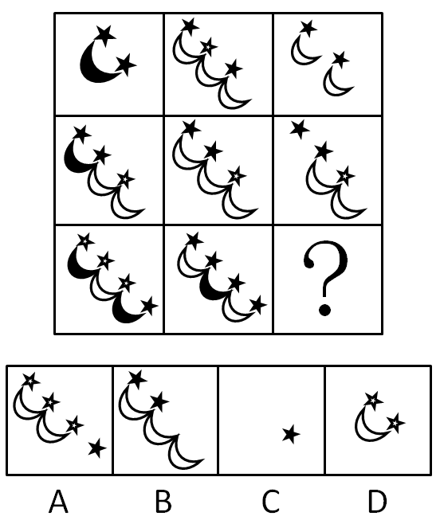

A. A

B. B

C. C

D. D

第 39 题 · 答案与解析

**参考答案（粉笔题库参考内容）**

C

**解析**

元素组成相似，考查黑白阴影的叠加运算。

题干中第一行的三幅图和第二行的三幅图共有的规律是：前两幅图中的黑色月亮与白色月亮重合，则这个月亮在第三幅图中消失；前两幅图中的黑色星星与白色星星重合，则这个星星在第三幅图中消失。因此第三行的前两幅图中有三个星星和全部月亮因重合而消失，最后只剩下一个黑色星星。

故正确答案为C。

### 第 40 题

左边是给定的外表面展开图，右边哪一项能由它折叠而成？

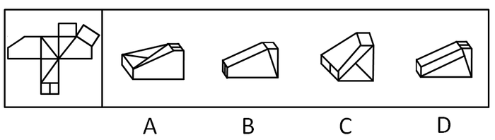

A. A

B. B

C. C

D. D

第 40 题 · 答案与解析

**参考答案（粉笔题库参考内容）**

B

**解析**

观察题干可知，立体图形的五个斜面是矩形，两个斜面是直角梯形，因此排除A、C；原图的梯形部分不会出现D图中的那样一条直线，因此排除D。

故正确答案为B。

### 第 41 题

人文关怀是指一种普通的人类自我关怀，表现为人格、人的价值、人的命运和尊严的关切，对人的生存状态和社会地位、人的进步需求、生活条件保障的关注，以及对理想人格的肯定和塑造。

根据上述定义，下列属于人文关怀的是：

A. 对民众的博大的爱，深刻地理解和无私地付出

B. 对人生存状况的关注，对人的生命和健康的呵护

C. 对人的精神状态和人性的深切关怀，对人的情感、意志和价值的尊重

D. 在强调国家利益的同时，关心个人的价值和利益及个人的困难和困境

第 41 题 · 答案与解析

**参考答案（粉笔题库参考内容）**

C

**解析**

第一步：抓住定义中的关键词。

人文关怀强调“人类自我关怀”，表现的是对于人自身相关需求和状态的“关注”。

第二步：逐一判断选项。

A中“对民众的付出”并非是题干中所指的“关注”，A不符合定义；

B中前半句“对人生存状况的关注”属于人文关怀，而后半句“对人的生命和健康的呵护”不属于人文关怀，B不符合定义；

C中前半句和后半句都体现了对人的关怀，C符合定义；

D中“强调国家利益”不属于人文关怀，D不符合定义。

故正确答案为C。

### 第 42 题

社会责任是公民、企业和各种组织对国家或社会公共利益方面应尽的责任或义务。社会责任就是行为主体对社会负有一定的责任，人是社会的动物，只有在社会中才能体现出人的真正本质。

根据上述定义，下列属于公民社会责任的是：

A. 宪法法律规定以外的公民义务

B. 公民应尽的非道德责任的责任

C. 爱国守法、明礼诚信、敬业奉献

D. 在工作单位应尽的一些岗位职责

第 42 题 · 答案与解析

**参考答案（粉笔题库参考内容）**

C

**解析**

第一步：抓住定义中的关键词。

社会责任强调行为主体对“国家或社会公共利益方面”应尽的责任或义务。

第二步：逐一判断选项。

A、B中没有明确指出是对“国家或社会公共利益方面”应尽的责任或义务，A、B不符合定义；

C中的责任和义务可以明确归为对“国家或社会公共利益方面”应尽的责任和义务，C符合定义；

D中岗位职责是行为主体对工作单位应尽的责任，不属于社会责任的范围，D不符合定义。

故正确答案为C。

### 第 43 题

公共意识是独立自由的个体所具有的一种整体意识或整体观念。公共意识一方面是个人主体自由的体现，另一方面是对于一个超越于个体自身以外的共同整体的体现。

根据上述定义，下列属于公共意识的是：

A. 期望公民必须变得无私并在行为上完全利他

B. 公民顾及私利的同时，追求公共目标和利益

C. 现代社会所张扬的一种精神气质和公共精神

D. 把自己认定为一个与他人联系在一起的集合体

第 43 题 · 答案与解析

**参考答案（粉笔题库参考内容）**

D

**解析**

第一步：抓住定义中的关键词。

公共意识强调“独立自由的个体”具有“整体意识或整体观念”，即同时体现“个人主体自由”和“超越于个体自身以外的共同整体”。

第二步：逐一判断选项。

A中“无私并完全利他”要求体现“共同整体”而不体现“个人主体自由”，但是题干要求同时体现“个人主体自由”和“超越于个体自身以外的共同整体”，A错误；

B说“追求公共目标和利益”，但是题干强调“具有共同整体的观念”，二者不是同一概念，B错误；

C中“现代社会所张扬的一种精神气质和公共精神”，但题干中并没有体现出公共意识是现代社会所独有的，所以C错误；

D中“把自己认定为一个与他人联系在一起的集合体”是“个体”具有“整体意识”的体现，符合关键词，所以D正确。

故正确答案为D。

### 第 44 题

团队精神是指团队的成员为了团队的利益和目标，而相互协作、竭尽全力的意愿和作风。高绩效团队强大竞争力的根源，不在于其成员个人能力的卓越，而在于其成员整体“合力”的强大，其中起关键作用的就是团队精神。

根据上述定义，下列属于团队精神的是：

A. 忠诚、投入、志趣相投、相互吸引

B. 有凝聚力和为团队利益牺牲的意愿

C. 高绩效团队的灵魂和难以模仿的特质

D. 将每个成员“粘”在一起的“胶”

第 44 题 · 答案与解析

**参考答案（粉笔题库参考内容）**

B

**解析**

第一步：抓住定义中的关键词。

题干的关键在于“团队的成员”、“为了团队的利益和目标而相互协作、竭尽全力”、“意愿和作风”。

第二步：逐一判断选项。

A中“忠诚、投入、志趣相投、相互吸引”不是“为了团队的利益和目标”，A错误；

B中“有凝聚力和为团队利益牺牲的意愿”符合“相互协作、竭尽全力”、“意愿和作风”，B正确；

C中“难以模仿的特质”并未在题干中体现，C错误；

题干中“团队精神”对成员整体“合力”的强大起作用，但这种作用并非和“胶”的概念完全对应，D错误。

故正确答案为B。

### 第 45 题

城市化是人类生产与生活方式由农村型向城市型转化的历史过程，表现为乡村人口向城市人口转化以及城市不断发展和完善的过程。党的十七届三中全会会议公报指出，到2020年，城乡经济社会发展一体化机制将基本建立。

根据上述定义，下列对城市化的理解正确的是：

A. 大批的农民迁移到城市，由农民变为市民

B. 农民进城的数量越来越多，就说明城市化率越高

C. 农民进城越多，这个地方的社会发展越先进

D. 农民生产方式的工业化、生活方式的城市化

第 45 题 · 答案与解析

**参考答案（粉笔题库参考内容）**

D

**解析**

第一步：抓住定义中的关键词。

城市化的内涵是“人类生产与生活方式由农村型向城市型转化”。

第二步：逐一判断选项。

A项中“农民迁移到城市”是城市化进程中的表现和特征，并不意味着生产和生活方式向城市型转化，A不符合城市化的内涵，A错误；

B项中“农民进城的数量增加”是城市化的表现，并不代表他们的“生产与生活方式”变得城市化，同理C项中“农民进城的数量”并不能反映“城市化率的高低”和“社会发展的水平”，所以B、C错误；

D项中“农民生产方式的工业化”是“生产方式由农村型转向城市型”，“农民生活方式的城市化”是“生活方式由农村型转向城市型”，均符合定义中的关键词，所以D正确。

故正确答案为D。

### 第 46 题

不正当竞争是指一切违反商业道德和善良风俗，特别是违反有关法律规定的商品生产经营行为。它包括垄断行为，限制竞争行为，经营者采用欺骗、胁迫、利诱、诋毁、窃用以及其他不道德手段从事市场交易的行为。

根据上述定义，下列属于不正当竞争行为的是：

A. 欺骗性交易行为、不正当销售行为、拒绝“三包”行为

B. 诋毁竞争对手行为、商业贿赂行为、无合格商品标志行为

C. 贬低竞争对手行为、附加条件的交易行为、协议限制的竞争行为

D. 侵犯商业秘密行为、不出具购物发票行为、无视消费者权益行为

第 46 题 · 答案与解析

**参考答案（粉笔题库参考内容）**

C

**解析**

第一步：抓住定义中的关键词。

不正当竞争的行为主体主要是“经营者”。不正当竞争是“经营者相互之间”违反有关法律规定的商品生产经营行为，其造成的影响也主要是针对竞争对手。

第二步：逐一判断选项。

A中“拒绝‘三包’行为”，B中“无合格商品标志”和D中“不出具购物发票、无视消费者权益”主要是经营者针对消费者的违法行为，而非“经营者之间的行为”，A、B、D不完全符合不正当竞争定义；

C中三个行为都是“经营者相互之间”的行为，且符合定义。

故正确答案为C。

### 第 47 题

企业文化的核心就是以人为本的价值观，具体来说就是尊重人，服务人，发展人。尊重人，就是对人平等、关心、理解、宽容；服务人，就是为人提供周到细致的服务，提供各种保护和保障举措；发展人，就是应因人的现实需求和目标需要，实现人的各种权益和利益。

根据上述定义，下列属于企业文化的核心的是：

A. 企业领导人的一些大的经营理念和经营方略

B. 企业的责任、创新、诚信、推动力、影响力

C. 把人而不是金钱、机器看作自然资源

D. 企业管理者、业内人士、普通员工的价值观

第 47 题 · 答案与解析

**参考答案（粉笔题库参考内容）**

C

**解析**

第一步：抓住定义中的关键词。

企业文化强调“以人为本的价值观”，其主体是“人”。“以人为本”就是把人看作自然资源，就会尊重人、服务人、发展人。

第二步：逐一判断选项。

A中“经营理念和经营方略”，B中“企业的责任、创新、诚信、推动力、影响力”和D中“管理者、员工的价值观”都没有指出把人当作企业的资源和根本；

C中“把人看作自然资源”体现了“以人为本”。

故正确答案为C。

### 第 48 题

逆向思维是一种比较特殊的思维方式，它的思维取向是与常人的思维取向相反的。逆向思维并不是主张人们在思考时违逆常规，不受限制的胡思乱想，而是训练一种小概率思维模式，即在思维活动中关注小概率可能性的思维。

根据上述定义，下列属于逆向思维的是：

A. 人弃我取，人进我退，人动我静，人刚我柔

B. 以某一复杂问题的结果为发散点，尽可能多的把它与别的事物组合成新问题

C. 以某一复杂问题的结果为发散点，推出各种结果的各种原因

D. 将人们通常思考的思路稍加扭转，“歪打正着”

第 48 题 · 答案与解析

**参考答案（粉笔题库参考内容）**

A

**解析**

第一步：抓住定义中的关键词。

逆向思维强调“与常人的思维取向相反”、“关注小概率可能性”。

第二步：逐一判断选项。

A中“人弃、进、动、刚，我取、退、静、柔”表明我的行为和别人取向相反，这属于逆向思维，A符合；

B、C中“以结果为发散点进行多种推导”，这属于发散性思维，B、C不符；

D中“对常人的思维稍加扭转”并非“与常人的思维相反”，D不符。

故正确答案为A。

### 第 49 题

揣摩指的是对自身以外的人和事的推测、估量、判断等。揣摩必须以良好的心态为基础，以实践经验总结为依据，以认真分析思考为前提。能够比较全面、客观和准确地推测、估量、估计、判断他人内心情感，是人们认识和处理复杂问题时必需的一种基本功。

根据上述定义，下列属于揣摩的是：

A. 知己知彼，百战不殆

B. 凡事预则立，不预则废

C. 仁者见仁，智者见智

D. 己所不欲，勿施于人

第 49 题 · 答案与解析

**参考答案（粉笔题库参考内容）**

A

**解析**

第一步：抓住定义中的关键词。

揣摩强调“对自身以外的人和事的推测、估量、判断”、“以良好的心态为基础，以实践经验总结为依据，以认真分析思考为前提”。

第二步：逐一判断选项。

A的意思是：如果对敌我双方的情况都能判断透彻，打起仗来就可以一直立于不败之地。所以A体现了“以实践经验总结为依据，以认真分析思考为前提”、“对敌方心态的推测和判断”，这很显然属于揣摩，A正确；

B的意思是：不论做什么事，事先有准备，就能得到成功，不然就会失败。所以B中“对事情预先做准备”是“对自身以外的事的估量”，但B并没有体现“以实践经验总结为依据”，B错误；

C的意思是：对同一个问题，不同的人从不同的立场或角度有不同的看法。所以C不存在“对自身以外的人和事的推测、估量、判断”，C错误；

D的意思是：自己不想做的事情，不要强加给别人，而不用考虑别人是否真的不想做，所以D未涉及“推测、判断”他人内心的想法。

故正确答案为A。

### 第 50 题

食品添加剂是为提高食品品质和色、香、味、形以及防腐、保鲜和加工工艺的功能而加入食品中的化学合成或天然物质。食品添加剂只要以合理方式、合理剂量使用，不会引发食品安全问题。

根据上述定义，下列属于食品添加剂的是：

A. 色素、膨松剂、蛋白精、防腐剂

B. 甜味剂、水分、乳化剂、硫化钠

C. 味精、木糖醇、维生素、矿物质

D. 着色剂、罂粟壳、面粉处理剂

第 50 题 · 答案与解析

**参考答案（粉笔题库参考内容）**

C

**解析**

第一步：抓住定义中的关键词。

食品添加剂是指在合理使用时“不会引发食品安全问题”的化学合成或天然物质。

第二步：逐一判断选项。

A中“蛋白精”是以三聚氰胺、羟甲基羧基氮等工业废料为原料生产的非蛋白氮饲料添加剂，对人体有害，不属于食品添加剂；

B中“硫化钠”是一种易燃，具强腐蚀性、刺激性的化学物品，对人体有害，不属于食品添加剂；

C中四种物质都属于食品添加剂；

D中“罂粟壳”易使人上瘾，不属于食品添加剂。

故正确答案为C。

### 第 51 题

位置：高度

A. 卧室：厨房

B. 室内：墙壁

C. 苏打：漂白

D. 网球：排球

第 51 题 · 答案与解析

**参考答案（粉笔题库参考内容）**

B

**解析**

第一步：判断题干词语间逻辑关系。

题干中“位置”指物体某一时刻在空间的所在处，是没有具体数量规定的认识对象（一般空间）。题干中“高度”是指自平均海平面至一个平面、一个点或者可以视为一个点的物体的垂直距离，是有具体数量规定的认识对象（具体空间）。因此“位置”和“高度”是内容和表现形式的对应关系。

第二步：判断选项词语间逻辑关系。

A中“卧室”和“厨房”是并列关系，A不符；

B中“室内”是空间上的一般认识，“墙壁”是用于分隔“室内”和“室外”的具体表现，因此“室内”和“墙壁”符合内容和表现形式的对应关系，B符合；

C中“苏打”和“漂白”是功能上的对应关系，C不符；

D中“网球”和“排球”是并列关系，D不符。

故正确答案为B。

### 第 52 题

地球：北极

A. 星球：月亮

B. 昆虫：蚊虫

C. 联合国：中国

D. 书本：封面

第 52 题 · 答案与解析

**参考答案（粉笔题库参考内容）**

D

**解析**

第一步：判断题干词语间逻辑关系。

题干中“地球”和“北极”是包容关系中的物理组成关系。

第二步：判断选项词语间逻辑关系。

A中“星球”和“月亮”是种属关系，A错误；

B中“昆虫”和“蚊子”是种属关系，B错误；

C中“中国”和“联合国”是包容关系，但“联合国”并不是多个国家的物理组成，C错误；

D中“书本”和“封面”也是包容关系中的物理组成关系，D正确。

故正确答案为D。

### 第 53 题

丰功：伟绩

A. 维和：行动

B. 风餐：露宿

C. 文化：传播

D. 风卷：残云

第 53 题 · 答案与解析

**参考答案（粉笔题库参考内容）**

B

**解析**

第一步：判断题干词语间逻辑关系。

题干中“丰功”和“伟绩”构成并列式成语。

第二步：判断选项词语间逻辑关系。

A中“维和”和“行动”不能构成成语；

B中“风餐”和“露宿”同样构成并列式成语；

C中“文化”和“传播”不能构成成语；

D中“风卷”和“残云”构成动宾式成语。

故正确答案为B。

### 第 54 题

心理：承受

A. 干扰：闹钟

B. 信息：刺激

C. 睡眠：质量

D. 消化：吸收

第 54 题 · 答案与解析

**参考答案（粉笔题库参考内容）**

B

**解析**

第一步：判断题干词语间逻辑关系。

题干中“心理”和“承受”可构成主谓短语。

第二步：判断选项词语间逻辑关系。

A项中“闹钟”具有“干扰”作用，属于功能对应关系，与题干逻辑关系不一致，排除；

B项中“信息”和“刺激”可构成主谓短语，与题干逻辑关系一致，当选；

C项中“睡眠”和“质量”构成偏正式短语，与题干逻辑关系不一致，排除；

D项中“消化”和“吸收”构成并列式短语，与题干逻辑关系不一致，排除。

故正确答案为B。

### 第 55 题

期刊：杂志

A. 水果：柠檬

B. 酱油：食品

C. 油墨：印刷

D. 皮肤：瘙痒

第 55 题 · 答案与解析

**参考答案（粉笔题库参考内容）**

A

**解析**

第一步：判断题干词语间逻辑关系。

题干中“期刊”和“杂志”是种属关系。“杂志”是“期刊”的一种。

第二步：判断选项词语间逻辑关系。

A中“水果”和“柠檬”是种属关系，“柠檬”是“水果”的一种；

B中“酱油”和“食品”是种属关系，与题干顺序不同；

C、D中的词语间明显不是种属关系，而是对应关系。

故正确答案为A。

### 第 56 题

双杠：单杠

A. 阑尾：心脏

B. 毫米：口径

C. 南宋：北宋

D. 纪念：周年

第 56 题 · 答案与解析

**参考答案（粉笔题库参考内容）**

C

**解析**

第一步：判断题干词语间第一重逻辑关系，并在选项中进行选择。

题干中“双杠”和“单杠”构成并列关系，符合此逻辑关系的有A、C。

第二步：再判断题干词语间第二重逻辑关系，并在选项中进行选择。

题干中“双杠”和“单杠”都是体操工具，功能相近，C中“南宋”和“北宋”是宋朝两朝，朝代相连，C正确；

A中“阑尾”与“心脏”在人体器官中，重要程度相差很大，A错误。

故正确答案为C。

### 第 57 题

真皮：标志

A. 模拟：通信

B. 噪声：范围

C. 火车：车厢

D. 中国：邮票

第 57 题 · 答案与解析

**参考答案（粉笔题库参考内容）**

B

**解析**

第一步：判断题干词语间逻辑关系。

题干中“真皮”和“标志”合成“真皮标志”。“真皮标志”是“真皮”的证明标志，用于保障消费者的权益。

第二步：判断选项词语间逻辑关系。

A中“模拟”和“通信”虽然可以合成“模拟通信”，但是“模拟通信”是“通信”的一种，并且这也不符合题干的逻辑顺序，所以A错误；

B中“噪声范围”是“噪声”的考量标准，用于保护公民的健康，所以B正确；

C中“火车车厢”和“火车”是组成关系，所以C错误；

D中“中国邮票”和“中国”是对应关系，所以D错误。

故正确答案为B。

### 第 58 题

军队：军人

A. 灯具：台灯

B. 车辆：轿车

C. 饰品：挂件

D. 文具：笔墨

第 58 题 · 答案与解析

**参考答案（粉笔题库参考内容）**

B

**解析**

第一步：判断题干词语间逻辑关系。

军队和军人是包容关系，且军队中的“队”可以作为“军人”的量词，组词为“一队军人”。

第二步：判断选项词语间逻辑关系。

A项：灯具和台灯是包容关系，但灯具中的“具”不能作为“台灯”的量词，与题干逻辑关系不一致，排除；

B项：车辆和轿车是包容关系，且车辆中的“辆”可以作为“轿车”的量词，组词为“一辆轿车”，与题干逻辑关系一致，当选；

C项：饰品和挂件是包容关系，但饰品中的“品”不能作为“挂件”的量词，与题干逻辑关系不一致，排除；

D项：文具和笔墨是包容关系，但文具中的“具”不能作为“笔墨”的量词，与题干逻辑关系不一致，排除。

故正确答案为B。

### 第 59 题

红光：满面

A. 东山：再起

B. 魂牵：梦绕

C. 五光：十色

D. 雨打：芭蕉

第 59 题 · 答案与解析

**参考答案（粉笔题库参考内容）**

A

**解析**

第一步：判断题干词语间逻辑关系。

题干中“红光”和“满面”构成偏正式成语，用作谓语、定语。

第二步：判断选项词语间逻辑关系。

A中“东山”和“再起”构成偏正式成语，用作谓语、定语，A符合；

B中“魂牵”和“梦萦”构成联合主谓式成语，用作谓语、状语；

C中“五光”和“十色”构成并列式成语，用作谓语、定语、状语；

D中“雨打”和“芭蕉”不能构成成语。

故正确答案为A。

### 第 60 题

休克：昏厥

A. 同一：统一

B. 口误：误口

C. 分类：划分

D. 再见：再会

第 60 题 · 答案与解析

**参考答案（粉笔题库参考内容）**

D

**解析**

第一步：判断题干词语间逻辑关系。

题干中“休克”和“昏厥”是一对近义词。

第二步：判断选项词语间逻辑关系。

A中“同一”的近义词是“相同”，而不是“统一”；

B中“口误”的近义词是“说错”；

C中“分类”的近义词是“分别、区分”；

D中“再会”和“再见”也是一对近义词。

故正确答案为D。

### 第 61 题

2008年以来，索马里附近海域先后发生累计120起海盗劫船事件。海盗何以猖獗？甲乙丙丁四人断定如下：

甲：海盗猖獗的主因是被劫船只的船主通常都愿支付高额赎金。

乙：如果海盗猖獗的主因是被劫船主愿意支付高额赎金，那么肯定会助长海盗的气焰。

丙：确实助长了海盗的气焰，但其主因并非被劫船主都愿意支付高额赎金。

丁：海盗猖獗的主因是被劫船主愿支付高额赎金，但其嚣张气焰并非由此生成。

如果上述断定有一个为真，那么以下断定不可能为真，除了：

A. 甲

B. 乙

C. 丙

D. 丁

第 61 题 · 答案与解析

**参考答案（粉笔题库参考内容）**

B

**解析**

第一步：翻译题干。

甲：主因是支付高额赎金；

乙：主因是支付高额赎金助长气焰；

丙：助长气焰∧－主因是支付高额赎金；

丁：主因是支付高额赎金∧－助长气焰。

第二步：找突破口。

从第一步的翻译可看出，丁的断定是乙的断定的负命题，乙、丁的话存在矛盾关系，两人的话必有一真一假，此为本题的突破口。

第三步：看其他的话。

因为本题只有一句话为真，故甲、丙的话都为假。由甲的话为假，可知主因不是船主通常都愿支付高额赎金，可翻译为“－主因是支付高额赎金”。又知丙的话为假，因为丙的话是联言命题，其后件为真，故前件必须为假，即“助长气焰”为假，因此“－助长气焰”为真。

第四步：判断突破口两句话的真假。

从第三步可知，“－主因是支付高额赎金”为真，“－助长气焰”为真，丁的话是个联言命题，前件为假，整句话都为假，乙的话是个假言命题，前件为假，则整句话为真，即丁的话为假，乙的话为真。

故正确答案为B。

### 第 62 题

下派干部中：有三个人是到基层锻炼过的，四个是山东人，两个是济南人，五个是研究生学历。以上情况涉及了开现场会的所有人员，其中济南人不是研究生学历，那么开现场会的全部人数是：

A. 最少5人，最多12人

B. 最少7人，最多12人

C. 最少5人，最多14人

D. 最少7人，最多14人

第 62 题 · 答案与解析

**参考答案（粉笔题库参考内容）**

B

**解析**

第一步：观察题干。

题干中人员的身份存在交叉，要求得出总的人数。

第二步：根据题干进行推导。

根据常识可知，“山东四人”和“济南两人”可包含，因此最多减两人。

由题干“济南人不是研究生学历”可知，“济南人”与“研究生”不可交叉，因此最少加两人。

综上所述，可以列出计算式：3＋4＋2＋5－2＝12；5＋2＝7。

故正确答案为B。

### 第 63 题

有一件未留姓名的好人好事在某社区传开，甲乙丙丁四人有如下对话：

甲说：这件事肯定是乙、丙、丁中的一位做的。

乙说：我没有做这件事，好人好事是丙做的。

丙说：此事是甲和乙中的一位做的。

丁说：乙说的是事实。

经调查，证实这四人中有两人说的符合实际。

由此推出：

A. 是甲做的好事

B. 是乙做的好事

C. 是丙做的好事

D. 是丁做的好事

第 63 题 · 答案与解析

**参考答案（粉笔题库参考内容）**

B

**解析**

第一步：找突破口。

由题干可知，乙和丁的话是突破口，乙和丁同真同假。

第二步：建立假设，逐一判断选项。

假设乙为真，则甲和丁都真，“甲、乙、丁都为真”与题干中“两真两假”不符，所以假设不成立，乙为假。

假设乙为假，则乙、丁为假，甲、丙为真，这与题干中“两真两假”符合，所以假设成立，乙为假。由乙为假可以推出好事是乙做的。

故正确答案为B。

### 第 64 题

研究人员挑选了600多名学生，让他们在屏幕背景分别为红蓝两色的电脑上接受测试。结果用红色背景电脑的人在记忆、校对等准确性测试方面得分较高，而使用蓝色背景电脑的人则表现出了更出色的想象力和创造力。2004年夏季奥运会上，穿红色服装的运动员在拳击、跆拳道、摔跤等比赛中的获胜率为60%。蓝天、海洋给人带来开放和宁静感。

由此推出：

A. 红色在潜意识中象征某种优势

B. 蓝色易促使人表现出更多的创造力

C. 红色和蓝色容易影响人的认知和行为

D. 红色易使人联想起愤怒、进攻性和勇气

第 64 题 · 答案与解析

**参考答案（粉笔题库参考内容）**

C

**解析**

第一步：抓住每句话中的对象及其关系。

第一句说学生做测试。第二句说用红色背景电脑的人更有准确性，而使用蓝色背景电脑的人更有想象力和创造力。第三句说在搏击比赛中，穿红色服装的运动员更易胜出。第四句说蓝色给人带来宁静感。

第二步：判断整体关系。

从题干给出的研究结果、奥运会比赛结果及蓝天、海洋给人感觉的描述中，可以推出：红色和蓝色容易影响人的认知和行为，所以C正确。

第三步：逐一判断选项。

A中“红色象征某种优势”，B中“蓝色促使人表现创造力”，D中“红色易使人联想起愤怒等”都只是题干体现的某一个方面，而不是题干整体推导出的结论，所以A、B、D错误。

故正确答案为C。

### 第 65 题

在一次对全市中学假期加课情况的检查后，甲乙丙三人有如下结论：

甲：有学校存在加课问题。

乙：有学校不存在加课问题。

丙：一中和二中没有暑期加课情况。

如果上述三个结论中只有一个正确，则以下哪项一定为真：

A. 一中和二中都存在暑期加课情况

B. 一中和二中都不存在暑期加课情况

C. 一中存在加课情况，但二中不存在

D. 一中不存在加课情况，但二中存在

第 65 题 · 答案与解析

**参考答案（粉笔题库参考内容）**

A

**解析**

第一步：找突破口。

甲的话和乙的话是反对关系，两句话不可同假但可同真，因此必有一真。

第二步：看其他的话。

题干说“三个结论中只有一个正确”，又因为甲和乙的话之中必有一真，所以丙的话为假。丙的话为假，则一中和二中至少有一个存在加课情况。

第三步：判断突破口中两句话的真假。

根据第二步的结论，所以甲的话必为真。因为题干说“三个结论中只有一个正确”，所以乙的话为假。乙的话为假，“有的不”的否定是“所有都”，所以一中和二中都存在加课情况，A正确。

故正确答案为A。

### 第 66 题

自今年起的每年8月8日为“全民健身日”。甲、乙、丙、丁四人议论“全民健身日”的性质。甲说：“我们办公室所有人都知道这不是法定的健身活动日。”乙说：“如果小张说这不是法定的健身活动日，那么他就认为是法定的‘国家体育日’。”丙说：“小张说这不是法定的健身活动日，也不是法定的北京奥运会纪念日。”丁说：“我们办公室有人就不知道这是法定的健身活动日，而认为是体育节。”

已知上述四人中只有一人说的不符合事实，由此能推出：

A. 甲说假话

B. 乙说假话

C. 丙说假话

D. 丁说假话

第 66 题 · 答案与解析

**参考答案（粉笔题库参考内容）**

D

**解析**

题干当中没有直接的矛盾或反对关系，解题的关键在于对丁的话如何理解。“我们办公室有人就不知道这是法定的健身活动日，而认为是体育节。”这句话的前提是：这是法定的健身活动日。与甲的话构成矛盾。只有一个人说的不符合事实，所以乙、丙为真，丙说：“小张说这不是法定的健身活动日”，也就是“有人说这不是法定的健身活动日”，与丁的陈述的前提相反。因此只能是丁说的与事实不符。

故正确答案为D。

### 第 67 题

飞鸟的集体自杀，是大自然的一个难解之谜。当今一个通行的说法是：鸟类集体自杀，主要是地球磁极的移动使他们看不准定向标。

以下哪项如果为真，最能削弱上述专家的观点：

A. 空气漂浮的大量毒气云团是飞鸟致死的元凶

B. 飞鸟的集体死亡一般是大自然的偶然事件

C. 飞鸟吃了河海里以有毒藻类为食的虾蟹致死

D. 火山爆发产生大量硫化物造成飞鸟的集体死亡

第 67 题 · 答案与解析

**参考答案（粉笔题库参考内容）**

B

**解析**

第一步：分析题干论证过程。

论点：鸟类集体自杀，主要是地球磁极的移动使他们看不准定向标。

第二步：逐一分析选项。

地球磁极的移动是有规律的（地球北磁极正以每年40英里的速度向俄罗斯方向移动），所以鸟类集体自杀也应呈现出规律性特征。

B选项“飞鸟的集体死亡一般是大自然的偶然事件”否定了论点成立的前提条件。

故正确答案为B。

### 第 68 题

关于确定一项突击性任务的人选，甲、乙、丙三位推荐人的意见分别是：

甲：不是选派小张，就是选派小王。

乙：如果不选派小张，就不选派小王。

丙：只要不选派小王，就不选派小张。

以下几项中，同时满足甲、乙、丙三人意见的方案是：

A. 两人都选派

B. 两人都不选派

C. 选小张，不选小王

D. 选小王，不选小张

第 68 题 · 答案与解析

**参考答案（粉笔题库参考内容）**

A

**解析**

第一步：翻译题干。利用充分必要条件。

甲：张或者王。

乙：-张王。利用逆否规则，即王张。

丙：-王张。利用逆否规则，即张王。

第二步：看其他的话。

甲的话为“张和王，至少选一个”。乙和丙的话为“选王就选张，选张就选王”。根据题干，方案要满足甲、乙、丙。那么只有A项“两人都选”能同时满足甲、乙、丙三人的意见。

故正确答案为A。

### 第 69 题

研究人员通过基因操作，使实验鼠体内能够代谢葡萄糖和脂肪酸，但不能代谢醋酸，然后比较这些实验鼠和正常实验鼠在喂给饵料和绝食48小时的情况下，身体状态有何不同。结果发现，在被迫长时间绝食的状态下，不能代谢醋酸的实验鼠体温和耐力明显降低。醋酸是生命体内基本物质，而实验鼠身体构造又与人体非常接近。

由此推出：

A. 醋酸在其维持人体能力供应中起着至关重要的作用

B. 醋酸可以作为人体一种不会提升血糖值的能量源

C. 代谢产生的三磷酸腺苷是生命活动的能量源泉

D. 在持久运动时，脂肪酸和酮体是ATP的主要来源

第 69 题 · 答案与解析

**参考答案（粉笔题库参考内容）**

A

**解析**

第一步：抓住题干中的重点对象及其作用。

题干中三个并列的分句作为论据：（1）长时间绝食，不能代谢醋酸的实验鼠体温和耐力明显降低；（2）醋酸是生命体内基本物质；（3）实验鼠身体构造与人体非常接近。

第二步：根据论据进行推导。

根据（1）和（2）可推出醋酸在维持实验鼠能力供应中起着重要作用，根据（3）可知人体可以与实验鼠身体构造做类比，综上可知醋酸维持在人体能力供应中起着重要作用，因此A项正确；

B、C、D项中的“不提升血糖的能量源”、“三磷酸腺苷”、“脂肪酸和酮体”在题干中找不到任何证据支持，因此B、C、D三项错误。

故正确答案为A。

### 第 70 题

近几年，为治理城镇污水，污水处理厂的建设不断升温。大规模上马污水处理厂，的确能在短期内实现城镇生活用水COD的减排。但是，一些地方城镇生活污水经过鱼塘和天然湿地的生态净化，COD浓度也能大幅度降低。

由此推出：

A. 单一的集中治理模式不符合环境保护自身的规律

B. 治污就是要付出消耗能量和资金的代价的

C. 减排手段应因地制宜，多种方式相结合

D. 为治污而治污，不能将节能与减排结合好

第 70 题 · 答案与解析

**参考答案（粉笔题库参考内容）**

C

**解析**

第一步：抓住题干中的重点对象。

题干第二句指出“污水处理厂能在短期内实现城镇用水COD的减排”。第三句指出“地方城镇生活污水经过鱼塘和天然湿地生态净化，COD浓度也能大幅降低”。

第二步：判断整体关系。

题干第二句、第三句分别指出不同地方、不同情况采用的不同方法，可概括为C“减排手段因地制宜，多种方式相结合”，所以C正确。

第三步：逐一判断选项。

A中“单一模式不符合规律”太绝对，不能直接从题干中体现，所以A错误；

B中“就是要付出代价”不是从题干中推导出来的，因为题干中体现治污的效果而不涉及“代价”，所以B错误；

题干中不涉及要将“减排”和“节能”相挂钩的内容，所以D错误。

故正确答案为C。

### 第 71 题

下列古谚、古训不蕴含同一哲学原理的一组是：

A. 郑人买履；按图索骥；邯郸学步；对牛弹琴

B. 鲁侯养鸟；张冠李戴；良莠不分；指鹿为马

C. 千里之行，始于足下；千里之堤，溃于蚁穴；水滴石穿；防微杜渐

D. 入山问樵，入水问渔；不入虎穴，焉得虎子；凡事要好，须问“三老”；百闻不如一见

第 71 题 · 答案与解析

**参考答案（粉笔题库参考内容）**

D

**解析**

A选项正确，“郑人买履”指郑人犯了教条主义错误，造成了买不到鞋子的后果，说明因循守旧，不思变通，终将一事无成；“按图索骥”用来比喻办事机械、死板，不求事物本质；“邯郸学步”比喻模仿不成，反把自己原有的长处失去了；“对牛弹琴”比喻说话不看对象，也就实现不了目标。这四个成语均说明了一个哲学原理：做事情需要实事求是，具体问题具体分析；

B选项正确，“鲁侯养鸟”说明好的愿望必须符合事实，如果只有主观愿望而违背客观实际，好事便会变成坏事；“张冠李戴”比喻认错了对象，就会弄错事实；“良莠不分”比喻将好人坏人混杂在一起，不加区分；“指鹿为马”比喻故意颠倒黑白，混淆是非。这四个成语均说明一个哲学原理：做事情要从客观情况出发，实事求是；

C选项正确，“千里之行，始于足下”比喻事情的成功，是从小到大逐渐积累起来的；“千里之堤，溃于蚁穴”比喻小事不注意会酿成大祸或造成严重的损失；“水滴石穿”比喻只要有恒心，不断努力，事情就一定能成功；“防微杜渐”指错误或坏事需要在萌芽的时候及时制止，不然会出现严重的结果。这四个成语均说明一个哲学原理，即量变引起质变；

D选项错误，“入山问樵，入水问渔”指一切从实际出发，具体问题具体分析；“不入虎穴，焉得虎子”比喻经过最艰苦的实践，才能取得真知；“凡事要好，须问‘三老’”体现的是经验来自实践的原理；“百闻不如一见”表示亲眼看到的远比听人家说得更为确切。第一、三个词语，主要说明的是经验的重要性，第二、四个词语，主要强调的是实践的重要性。

本题为选非题，故正确答案为D。

### 第 72 题

“曲高和寡”出自战国宋玉的《对楚王问》，这一成语的本义是曲调高深，能跟着唱的人就少，多指知音难得。引申义是言论或作品不通俗，能了解的人很少。如果从经济学的角度来理解，它所体现出的道理是：

A. 价格应定在边际成本上

B. 价格应定在消费者的需求线上

C. 价格应该由政府整合调控好

D. 价格应定在社会实际需求上

第 72 题 · 答案与解析

**参考答案（粉笔题库参考内容）**

A

**解析**

A项正确，从经济学的角度来分析，如果一种产品的价格定得太高，消费者不愿意购买，就会造成消费者不能满足自己的需求和生产者实现不了生产的目的，即出现“曲高和寡”的现象。在经济学和金融学中，边际成本指的是每一单位新增生产的产品（或者购买的产品）带来的总成本的增量。价格只有定在边际成本上，消费者的消费需求和生产者的生产需求才能同时满足。

B项错误，如果价格定在消费者的需求线上，生产者会出现亏损而停止生产。

C项错误，价格由市场决定，资源才能得到最优的配置。

D项错误，实际需求很难收集与界定，根据社会实际需求定价不具有可操作性。而且这种定价方式也没有考虑到厂商的生产成本问题。

故正确答案为A。

### 第 73 题

下列观点不属于达尔文进化理论的是：

A. 生物在代代相传的繁育过程中都有可能发生变异

B. 变异的长期积累，导致各个物种出现千变万化

C. 变异是长期存在、逐步发展的，进化是逐渐发生的

D. 生物进化不是“适者生存”，而是“幸者生存”

第 73 题 · 答案与解析

**参考答案（粉笔题库参考内容）**

D

**解析**

达尔文进化论的核心是“物竞天择，适者生存”。 主要包括四个子学说：

（1）一般进化论：物种是可变的，现有的物种是从别的物种变来的，一个物种可以变成新的物种。

（2）共同祖先学说：所有的生物都来自共同的祖先。

（3）自然选择学说：自然选择是进化的主要机制。

（4）渐变论：生物进化的步调是渐变式的，是一个在自然选择作用下累积微小的优势变异的逐渐改进的过程，而不是跃变式的。

本题为选非题，故正确答案为D。

### 第 74 题

下列陈述中错误的是：

A. 在地球上的能源中，地热能仅次于太阳辐射能，排在第二位

B. 太阳能、风能、地热、潮汐能以及生物质能都是可再生资源

C. 三聚氰胺是一种含氮杂环有机化工原料，主要用于做密胺塑料

D. 1纳米等于二十亿分之一米，约为4～5个原子排列起来的长度

第 74 题 · 答案与解析

**参考答案（粉笔题库参考内容）**

D

**解析**

纳米（符号为nm）是长度单位，原称毫微米，就是米（10亿分之一米），即毫米（100万分之一毫米）。如同厘米、分米和米一样，是长度的度量单位。相当于4倍原子大小，比单个细菌的长度还要小。

本题为选非题，故正确答案为D。

### 第 75 题

干燥的冷空气和富含水蒸气的暖空气相遇，发生大规模碰撞时形成的极端天气现象是：

A. 热带风暴

B. 台风

C. 飓风

D. 龙卷风

第 75 题 · 答案与解析

**参考答案（粉笔题库参考内容）**

D

**解析**

龙卷风是在极不稳定天气下，由两股空气强烈对流运动而产生的一种伴随着高速旋转的漏斗状云柱的强风涡旋。龙卷风内部空气极为稀薄，导致温度急剧降低，促使水汽迅速凝结，这是形成漏斗云柱的重要原因。它的形成与暖湿空气强烈上升、冷空气南下、地形作用等有关。

故正确答案为D。

**本题相关知识点：**

1.台风是热带气旋的一个类别。在气象学上，按世界气象组织定义：热带气旋中心持续风速在12级至13级（即每秒32.7米至41.4米）称为台风（typhoon）或飓风（hurricane），飓风的名称使用在北大西洋及东太平洋；而北太平洋西部（赤道以北，国际日期线以西，东经100度以东）使用的近义字是台风。

2.热带风暴（Tropical storm）是热带气旋的一种，其中心附近持续风力为每小时63-87公里，即烈风程度的风力。是所有自然灾害中最具破坏力的。每年飓风都从海洋横扫至内陆地区，强劲的风力和暴风雨过后留下的只是一片狼藉。也是台风的一种，是指中心最大风力达8-9级（17.2至24.4米/秒）的台风。

### 第 76 题

在人类探测月球过程中，可以用不同方式将月球探测器送入月球轨道，我国“嫦娥一号”采用的经济、稳妥的方式是：

A. 火箭将月球探测器送入近地轨道，然后探测器自行加速进入地月转移轨道到达月球

B. 将月球探测器送入环地大椭圆轨道，在大椭圆轨道近地点加速进入地月转移轨道

C. 火箭将月球探测器送到地月引力平衡点处，探测器加速进入月球轨道到达月球

D. 火箭将月球探测器直接送入地月转移轨道到达月球

第 76 题 · 答案与解析

**参考答案（粉笔题库参考内容）**

B

**解析**

考虑到我国的具体情况，嫦娥一号卫星的发射窗口按35分钟控制。经过精确的分析和计算，为了用最小的代价实现奔月过程，嫦娥一号卫星最终选择了运载火箭将月球探测器送入环地球的大椭圆轨道，然后探测器在椭圆轨道的近地点处加速进入地月转移轨道并到达月球的方式。

故正确答案为B。

### 第 77 题

我国“十一五”时期能源发展规划提出了能源发展的总体要求。其中，属于维护我国能源安全的基本方略是：

A. 节约优先，把节能作为基本国策，坚持开发与节约并重，不断提高能源利用率

B. 主要依靠国内解决能源供给问题，加快能源工业发展，增强国内能源供给能力

C. 加强合作，坚持平等互利、合作双赢，积极开展能源领域的国际合作

D. 坚持以煤炭为主体，以电力为中心，加快再生能源和新能源开发

第 77 题 · 答案与解析

**参考答案（粉笔题库参考内容）**

B

**解析**

“十一五”时期，我国能源发展的总体要求是：用科学发展观和构建社会主义和谐社会两大战略思想统领能源工作，贯彻落实节约优先、立足国内、多元发展、保护环境，加强国际互利合作的能源战略，努力构筑稳定、经济、清洁、安全的能源供应体系，以能源的可持续发展支持我国经济社会可持续发展。本题ABCD选项都涉及到前述内容。

但谈及能源安全，一般定义为保障对一国经济社会发展和国防至关重要的能源的可靠而合理的供应，问题细化为这些供应是靠国内还是靠国外的问题。

故正确答案为B。

**本题相关知识点：**

“节约优先”，就是把节约能源资源作为基本国策，坚持能源开发与节约并重，把节约放在首位，大力节约和合理开发利用能源资源，不断提高能源效率。

“立足国内”，就是坚持把主要依靠国内解决能源供给问题，作为维护中国能源安全的基本方略，加快能源工业发展，增强国内能源供给能力。

“多元发展”，就是坚持以煤炭为主体，以电力为中心，加强石油天然气勘探开发，加快可再生能源和新能源开发，形成合理的能源结构。

“保护环境”，就是高度重视环境问题，将环境保护作为能源政策的重要组成部分，努力实现能源与环境的协调发展。

“加强合作”，就是坚持平等互利、合作共赢，从维护全球能源安全的大局出发，充分利用各方资源、经济、技术等方面的互补性，积极开展能源领域的国际合作。

### 第 78 题

2008年，国务院发布推进长三角地区改革发展的指导意见，提出了长三角地区改革发展的四项主要原则，其中坚持一体化发展的重要内容是：

A. 努力提高自主创新能力，切实加强资源节约和环保

B. 着力保障和改善民生，加强社会主义民主和法制建设

C. 加强与周边地区和长江中下游地区的联合与协作

D. 统筹区域内基础设施建设，形成统一开放的市场体系

第 78 题 · 答案与解析

**参考答案（粉笔题库参考内容）**

D

**解析**

长三角地区改革发展的主要原则是：

（1）坚持科学发展，努力提高自主创新能力，切实加强资源节约和环境保护，推进经济发展方式的转变；

（2）坚持和谐发展，着力保障和改善民生，加强社会主义民主法制建设，维护社会公平正义；

（3）坚持率先发展，加强与周边地区和长江中上游地区的联合与协作，强化服务和辐射功能，带动中西部地区发展；

（4）坚持一体化发展，统筹区域内基础设施建设，形成统一开放的市场体系，促进生产要素合理流动和优化配置；

（5）坚持改革开放，继续在体制创新上先行先试，率先在重要领域和关键环节取得突破，为又好又快发展提供制度保障。

故正确答案为D。

### 第 79 题

最近，我国以前所未有的力度扩大投资规模，启动和加快建设一批国家级重点工程。其中，投资额为千亿元级的四大工程是：

A. 青藏铁路、南水北调、西气东输、西电东送

B. 月球探测二期、西部路网、阳江核电站、北京地铁新线

C. 西气东输二线、京沪高铁、核电工程、南水北调

D. 天湾核电站、人造卫星发射、上海磁悬浮铁路、城际轨道交通

第 79 题 · 答案与解析

**参考答案（粉笔题库参考内容）**

C

**解析**

“十五”计划期间，我国曾启动改写中国经济版图的“青藏铁路、南水北调、西气东输、西电东送”这四大工程闻名于世。

2008年，为抵御国际金融危机冲击、解决当前我国经济运行中的突出问题，中国以前所未有的力度扩大投资规模，启动和加快建设一批国家级重点工程。这其中又凸显出投资额为千亿元级的西气东输二线、京沪高铁、核电工程、南水北调开工项目这新“四大工程”。

故正确答案为C。

### 第 80 题

我国面临的生态环境形势十分严峻，生态环境状况已临近生态阈值。下列陈述正确的是：

A. 现有荒漠化土地面积已占国土总面积的10%

B. 荒漠化土地每年仍在增加1万多平方公里

C. 七大江河水系，劣五类水质占20%

D. 50%的湖泊出现不同程度的富营养化

第 80 题 · 答案与解析

**参考答案（粉笔题库参考内容）**

B

**解析**

A项错误，我国荒漠化土地面积已达267.4万平方公里，占国土面积的27.8%；

C项错误，七大江河水系中劣五类水质占41%，沿海赤潮的年发生次数比20年前增加了3倍；

D项错误，全国75%的湖泊出现不同程度的富营养化。

故正确答案为B。

### 第 81 题

以马克思的逻辑看来，资本主义的古典危机与当代危机并无本质不同，都是生产过剩危机。但在古典危机中，生产过剩直接表现为商品卖不出去，最终引发金融动荡，股市崩溃；而在当代危机中，生产过剩直接表现为：

A. 有效需求不足

B. 有效需求旺盛

C. “透支消费”

D. “寅吃卯粮”

第 81 题 · 答案与解析

**参考答案（粉笔题库参考内容）**

B

**解析**

次贷危机的内在逻辑：市场经济的内在矛盾—有效需求不足—生产过剩—透支消费—违约率上升—次贷危机。

在市场经济的古典危机中（比如1929年的大萧条），生产过剩直接表现为有效需求不足，商品卖不出去；在市场经济的现代危机中（比如当下的次贷危机），生产过剩不再直接表现为有效需求不足，而是表现为有效需求旺盛，表现为有效需求“过度”，也就是“寅吃卯粮”“透支消费”。从古典危机演变为现代危机，只不过是把皮球从供给方踢给了需求方，把资本主义的内在矛盾的爆发，从今天推到了未来。

故正确答案为B。

### 第 82 题

目前，“金砖四国”的经济总量大致是美国的一半，在全球金融风暴的当下，虽然经济也遭受影响，但“金砖四国”的实力仍令世界刮目相看。“金砖四国”是指：

A. 巴西、俄罗斯、印度和中国

B. 中国、南非、俄罗斯和印度

C. 巴西、印度、英国和南非

D. 印度、法国、南非和英国

第 82 题 · 答案与解析

**参考答案（粉笔题库参考内容）**

A

**解析**

“金砖四国”（BRIC）引用了巴西、俄罗斯、印度和中国的英文首字母。由于该词与英语单词的砖（Brick）类似，因此被称为“金砖四国”。南非加入后，其英文单词将变为“BRICS”，并改称为“金砖国家”。2011年4月，金砖国家领导人第三次会晤在中国三亚举行，五国领导人商讨了如何协调应对重大国际问题，如何深化和扩大彼此间合作，如何加强金砖国家合作机制等问题。

故正确答案为A。

### 第 83 题

中央经济工作会议提出的2009年经济工作的首要任务是保持经济平稳，要着力在：

A. 扩内需上下功夫

B. 保增长上下功夫

C. 促改革上下功夫

D. 惠民生上下功夫

第 83 题 · 答案与解析

**参考答案（粉笔题库参考内容）**

B

**解析**

中央经济工作会议指出，贯彻落实2009年经济工作的总体要求，必须抓住关键、突出重点。必须把保持经济平稳较快发展作为明年经济工作的首要任务。要着力在保增长上下功夫。

故正确答案为B。

**本题相关知识点：**

2011年中央经济工作会议指出，推动明年经济社会发展，要突出把握好“稳中求进”的工作总基调。

稳，就是要保持宏观经济政策基本稳定，保持经济平稳较快发展，保持物价总水平基本稳定，保持社会大局稳定。

进，就是要继续抓住和用好中国发展的重要战略机遇期，在转变经济发展方式上取得新进展，在深化改革开放上取得新突破，在改善民生上取得新成效。

### 第 84 题

“依法治国，建设社会主义法治国家”作为中国共产党领导人民治理国家的基本方略，以宪法修正案的形式写进宪法的时间是：

A. 1988年

B. 1993年

C. 1995年

D. 1999年

第 84 题 · 答案与解析

**参考答案（粉笔题库参考内容）**

D

**解析**

1999年3月15日，九届全国人大二次会议通过的《中华人民共和国宪法修正案》，把“中华人民共和国实行依法治国，建设社会主义法治国家”写入了《宪法》第五条。

故正确答案为D。

**本题相关知识点：**

1982年宪法是我国现行宪法。随着政治经济等各领域不断发展。该宪法经过了五次修订。

1988年4月12日，宪法修正案对私营经济的地位、作用和国家政策做了明确规定。

1993年3月29日，将社会主义初级阶段、建设有中国特色社会主义的理论、坚持改革开放等内容写进宪法。

1999年3月15日，将邓小平理论的指导思想地位、依法治国的基本方略、国家现阶段的基本经济制度和分配制度以及非公有制经济的重要作用写进了宪法。

2004年3月14日，宪法修正案确立“三个代表”重要思想在国家政治和社会生活中的指导地位。

### 第 85 题

两岸海运直航、空运直航、直接通邮正式启动时间是：

A. 2008年10月1日

B. 2008年12月15日

C. 2008年12月31日

D. 2009年1月1日

第 85 题 · 答案与解析

**参考答案（粉笔题库参考内容）**

B

**解析**

“大三通”是实现海峡两岸直接“通邮、通航、通商”的简称，最早是1979年全国人大常委会在《告台湾同胞书》中提出，它反映了两岸人民的迫切要求。

2008年11月4日，海协会与台湾海基会在台北就两岸海运直航、空运直航、直接通邮签署了协议，这些协议于2008年12月14日生效（15日正式启动），两岸开启一个全新的“大三通”时代。

故正确答案为B。

### 第 86 题

《世界人权宣言》，是联合国大会以48票赞成，0票反对，8票弃权通过的，是全世界人权事业进入一个崭新阶段的重要里程碑。世界人权宣言通过的时间是：

A. 1948年

B. 1984年

C. 1986年

D. 1966年

第 86 题 · 答案与解析

**参考答案（粉笔题库参考内容）**

A

**解析**

《世界人权宣言》是联合国大会于1948年12月10日通过（联合国大会第217号决议，A/RES/217）的一份旨在维护人类基本权利的文献。 由于该文件是由联合国大会通过的。

《世界人权宣言》并非强制的国际公约，但是它为之后的两份具有强制性的联合国人权公约，《公民权利和政治权利国际公约》和《经济、社会及文化权利国际公约》做了铺垫。

故正确答案为A。

### 第 87 题

《中华人民共和国公务员法》规定，录用公务员，必须在规定的编制限额内进行，并有相应的：

A. 职位空缺

B. 计划空缺

C. 职务空缺

D. 职数空缺

第 87 题 · 答案与解析

**参考答案（粉笔题库参考内容）**

A

**解析**

编制具有计划性，是行政管理资源，编制管理也是一种资源配置行为。

编制通常分为行政编制和事业编制，根据《公务员法》的规定，公务员使用行政编制。录用公务员必须在规定的编制限额内，并有相应的职位空缺。

故正确答案为A。

### 第 88 题

2009年山东省政府工作报告提出今年山东经济和社会发展的多项主要预期目标，其中生产总值增长：

A. 7%左右

B. 8%左右

C. 9%左右

D. 10%左右

第 88 题 · 答案与解析

**参考答案（粉笔题库参考内容）**

D

**解析**

2009年2月13日山东省省长姜大明在全省第十一届人民代表大会第二次会议上所作的政府工作报告中提出，2009年经济和社会发展的主要预期目标是：生产总值增长10%左右，地方财政收入增长8%左右，全社会固定资产投资增长20%以上，社会消费品零售总额增长15%左右，外贸进出口增长10%左右，城镇居民人均可支配收入和农民人均纯收入均增长7%，新增城镇就业90万人，登记失业率控制在4.6%以内，居民消费价格总水平涨幅控制在4%左右。

故正确答案为D。

### 第 89 题

在公文写作中，一些数词有固定的用法。以下表述不正确的是：

A. 从10增加到50，可以说“增加了4倍”

B. 从100增加到500，可以说“增加到4倍”

C. 从10减少到1可以说“减少了”

D. 从100减少到10，可以说“减少到”

第 89 题 · 答案与解析

**参考答案（粉笔题库参考内容）**

B

**解析**

“增加了”与“增加到”的区别和联系。

区别：增加了是指单纯的比原来扩大了多少，增多了多少；而增加到是指扩大到原来的多少，增多到原来的多少。

联系：增加了，是扩大、增多了的意思。而增加到则是扩大、增多到什么程度的意思。从字面的理解来看，两者都具有比原来扩大、增多了。

B项错误，从100增加到500，可以说“增加了4倍”，不可以说“增加到4倍”。

本题为选非题，故正确答案为B。

### 第 90 题

山东是中华文明的发祥地之一，下列说法有误的是：

A. 发现最早的“沂源人”，可把山东的历史上推到四五十万年以前

B. 临淄为西周、春秋时期齐国的国都，战国时期齐国迁都曲阜

C. 《管子·地员》是世界上最早的生态学与地质学著作

D. 山东省境内有鲁文化、齐文化、运河文化、泰山文化等

第 90 题 · 答案与解析

**参考答案（粉笔题库参考内容）**

B

**解析**

B项错误，战国时期齐国的国都并未迁移，仍为临淄。曲阜是春秋战国时期鲁国的国都。

本题为选非题，故正确答案为B。

### 第 91 题

实事求是是马克思主义哲学中的一个基本命题。实事求是中的求实精神与实用主义的实用原则都讲实际。但它们的精神实质迥然不同，其区别在于：

A. 前者所求的“是”为客观事物的规律，后者追求的是实际效果

B. 前者所讲的“实际”为客观存在的一切事物，后者是个人经验

C. 前者以客观实际为出发点，后者以个人的经验和行动为出发点

D. 前者是一种普遍性的方法原则，后者代表美国特有的思维方式

第 91 题 · 答案与解析

**参考答案（粉笔题库参考内容）**

ABCD

**解析**

马克思主义的实事求是指从实际对象出发，探求事物的内部联系及其发展的规律性，认识事物的本质。它是一种具有普遍适用性的方法原则。

实用主义是在美国土壤上生长的一个哲学流派，代表了美国特有的思维方式。它的主要论点是：（1）强调实际经验是最重要的，原则和推理是次要的；（2）信仰和观念是否真实在于它们是否能带来实际效果；（3）理论只是对行为结果的假定总结，是一种工具，是否有价值取决于是否能使行动成功；（4）人对现实的解释，完全取决于现实对他的利益有什么效果。

故正确答案为ABCD。

### 第 92 题

对自然地理中“东亚”和“亚太”概念范围的认定正确的是：

A. “东亚”包括“东亚”和“东南亚”

B. “东亚”包括中国、日本、蒙古和朝鲜半岛

C. “亚太”包括亚洲、濒临太平洋的美洲国家、澳洲和南太平洋岛国

D. “亚太”包括亚洲东部沿太平洋的国家及地区、濒临太平洋的美洲国家和澳洲

第 92 题 · 答案与解析

**参考答案（粉笔题库参考内容）**

BC

**解析**

从自然地理概念来看，“东亚”和“亚太”的含义十分明确，“东亚”包括中国、日本、蒙古和朝鲜半岛；“亚太”包括整个亚洲、濒临太平洋的美洲国家、澳洲和南太平洋岛国。

故正确答案为BC。

**本题相关知识点：**

从经济地理概念来看，“东亚”的范围扩大到东南亚，泛指自然地理概念中的“东亚”和“东南亚”。而“亚太”的经济概念只包括亚洲东部沿太平洋的国家和地区、濒临太平洋的美洲国家、澳洲国家和南太平洋诸岛国。

### 第 93 题

世界四大地热带均沿着板块边缘分布。其中通过中国的有：

A. 环太平洋地热带

B. 大西洋中脊地热带

C. 地中海-喜马拉雅地热带

D. 红海-亚丁湾-东非裂谷地热带

第 93 题 · 答案与解析

**参考答案（粉笔题库参考内容）**

AC

**解析**

环太平洋地热带是世界最大的太平洋板块与美洲、欧亚、印度板块的碰撞边界。地中海—喜马拉雅地热带是欧亚板块与非洲板块和印度板块的碰撞边界。中国的西藏羊八井及云南腾冲地热田也在这个地热带中。

故正确答案为AC。

### 第 94 题

中国革命史上，一些历史事件产生了深远影响。按事件发生先后排列无误的是：

A. 南昌起义—秋收起义—百色起义

B. 西安事变—卢沟桥事变—皖南事变

C. 平型关大捷—百团大战—重庆谈判

D. 上党战役—莱芜战役—孟良崮战役

第 94 题 · 答案与解析

**参考答案（粉笔题库参考内容）**

ABCD

**解析**

本题考查毛中特。

A项正确，南昌起义发生在1927年8月1日，秋收起义发生在1927年9月9日，百色起义发生在1929年；

B项正确，西安事变发生在1936年12月12日，卢沟桥事变发生在1937年7月7日，皖南事变发生在1941年；

C项正确，平型关大捷发生在1937年9月25日，百团大战发生在1940年，重庆谈判发生在1945年；

D项正确，上党战役发生在1945年9月10日，莱芜战役发生在1947年1～2月，孟良崮战役发生在1947年3月。

故正确答案为ABCD。

### 第 95 题

“未秋先秋，踏断蛮牛”“生地茄子熟地瓜，生地菜子熟地花”“庄稼施肥有技巧，看天看地又看苗”“天灾不由人，抗灾不由天”。这些农谚告诉我们的哲学道理是：

A. 用联系、发展、矛盾的观点看问题

B. 坚持一切从实际出发，具体问题具体分析

C. 坚持规律客观性和主观能动性的统一

D. 发挥主观能动性必须以尊重客观规律为前提

第 95 题 · 答案与解析

**参考答案（粉笔题库参考内容）**

ABCD

**解析**

A选项正确，“看天看地又看苗”暗含的哲理是事物是联系发展的；

B选项正确，“生地茄子熟地瓜，生地菜子熟地花”暗含的哲理是看问题需要具体问题具体分析；

C、D选项正确，“天灾不由人，抗灾不由天”暗含了C项和D项的哲学道理。

故正确答案为ABCD。

### 第 96 题

以下对中国封建社会一些专有名词的解释准确的是：

A. 秦朝“三公”“九卿”中的“三公”，为丞相、太尉和御史大夫

B. 隋朝“三省”“六部”中的“三省”，为中书省、门下省和尚书省

C. 明朝科考“八股文”规定每篇由破题、承题、起讲、领题等组成

D. 清朝“连中三元”即在乡试、会试、殿试三次考试中均名列前茅

第 96 题 · 答案与解析

**参考答案（粉笔题库参考内容）**

AB

**解析**

C项错误，八股文是明朝考试制度所规定的一种特殊文体。八股文专讲形式、没有内容，文章的每个段落死守在固定的格式里面，连字数都有一定的限制，人们只是按照题目的字义敷衍成文。分为破题、承题、起讲、入手、起股、中股、后股、束股等组成部分；

D项错误，科举制度称乡试、会试、殿试的第一名为解元、会元、状元，合称“三元”。接连在乡试、会试、殿试中考中了第一名被称为“连中三元”。“名列前茅”不准确。

故正确答案为AB。

### 第 97 题

如今，一些在东部地区“人人喊打”的小化工企业，却成为中西部地区招商引资的“香饽饽”。这种“污染大搬家”的现象表明，污染企业只是“区域淘汰”，而不是市场淘汰。解决这一问题应当：

A. 取消当地因环境问题被取缔的企业主申办新企业的资格

B. 被取缔的企业名单纳入到全国各大媒体的“黑名单”中

C. 建立全国统一的监督网络，不让污染小化工企业异地重生

D. 针对小化工企业搬家问题进行专项整治，在各地形成取缔之势

第 97 题 · 答案与解析

**参考答案（粉笔题库参考内容）**

CD

**解析**

虽然被取缔的污染小化工企业在一定程度上破坏了生态安全，但是行政机关执政时仍然不能违反法律的规定。

A选项错误，违反了法律对公民经营自主权的保护；

B选项错误，在一定程度上侵犯了企业的名誉权和隐私权。

故正确答案为CD。

### 第 98 题

党的十七大报告指出，深入贯彻落实科学发展观，要求我们：

A. 始终坚持“一个中心、两个基本点”的基本路线

B. 积极构建社会主义和谐社会

C. 继续深化改革开放

D. 切实加强和改进党的建设

第 98 题 · 答案与解析

**参考答案（粉笔题库参考内容）**

ABCD

**解析**

党的十七大报告指出，深入贯彻落实科学发展观，要求我们始终坚持“一个中心、两个基本点”的基本路线。深入贯彻落实科学发展观，要求我们积极构建社会主义和谐社会。深入贯彻落实科学发展观，要求我们继续深化改革开放。深入贯彻落实科学发展观，要求我们切实加强和改进党的建设。

故正确答案为ABCD。

### 第 99 题

今年的中央一号文件强调，进一步规范农村土地承包经营权的流转。所谓要规范，就是要：

A. 重申过去的法律和政策，必须让农民自愿地选择

B. 任何人不能强迫农民去流转土地

C. 任何人不得阻止农民依法自愿地流转土地

D. 不得改变土地的所有权、用途和损害承包方的利益

第 99 题 · 答案与解析

**参考答案（粉笔题库参考内容）**

ABC

**解析**

2009年中央一号文件强调，对于农民承包土地在依法自愿有偿的前提下，允许农村土地承包经营权的流转，这个政策由来已久，但需要规范。所谓要规范，就是要重申过去的法律和政策，必须让农民自愿地选择，任何人不能强迫农民去流转土地，或者阻止农民自愿地流转土地。

D项是土地承包经营权流转的具体规定，不属于政策要规范的内容，不符合题意。

故正确答案为ABC。

**本题相关知识点：**

2012年中央一号文件公布，把农业科技摆上更加突出位置。这份文件指出，实现农业持续稳定发展、长期确保农产品有效供给，根本出路在科技。农业科技是确保国家粮食安全的基础支撑，是突破资源环境约束的必然选择，是加快现代农业建设的决定力量，具有显著的公共性、基础性、社会性。

### 第 100 题

今年是推进“十一五”规划顺利实施的关键一年，山东要实现由经济大省向经济文化强省的新跨越，就要做好“新、特、优”三篇文章，当前应重点抓好：

A. 创新发展理念、更新发展思路、转变发展方式，形成协调发展新格局

B. 发展能够使地域、资源等优势得到充分发挥的特色产业、特色经济

C. 优化经济结构，优化产品质量，优化资源利用，优化生态环境

D. 优化整顿金融秩序，防范金融风险

第 100 题 · 答案与解析

**参考答案（粉笔题库参考内容）**

ABC

**解析**

根据《山东省人民政府关于加强企业技术改造实施工业发展新特优工程的意见》文中所述，山东省要在新起点上建设经济文化强省，实现富民强省的新跨越，必须把优化工业结构作为一项十分紧迫的任务，进一步加强企业技术改造，实施工业发展“新特优工程”。

“新”就是创新发展理念，更新发展思路，坚持走新型工业化道路，不断推进技术创新，发展高新技术产业和具有时代先进水平的新产品，培育新的经济增长点，再造工业发展的新优势。

“特”就是因势利导发展特色产业和特色产品。

“优”就是优化产业结构，提高产品质量档次，优化资源利用，优化生态环境。

故正确答案为ABC。

### 第 101 题

13，9，31，71，173，。

A. 235

B. 315

C. 367

D. 417

第 101 题 · 答案与解析

**参考答案（粉笔题库参考内容）**

D

**解析**

数列无明显特征，观察相邻项关系有：，，，可得：第一项第二项=第三项。则所求项为：。

故正确答案为D。

### 第 102 题

3，10，29，66，127，。

A. 218

B. 227

C. 189

D. 321

第 102 题 · 答案与解析

**参考答案（粉笔题库参考内容）**

A

**解析**

数列作差无规律，观察发现各项均为幂次数附近的数字，考虑幂次修正数列：，，，，，故该数列为立方数修正数列，底数是公差为1的等差数列，修正项为+2，故所求项为。

故正确答案为A。

### 第 103 题

13，17，26，，67，103

A. 28

B. 36

C. 42

D. 45

第 103 题 · 答案与解析

**参考答案（粉笔题库参考内容）**

C

**解析**

数列无明显特征，且数字依次递增，变化不大，优先考虑作差。后一项减前一项得到新数列：4，9，（    ），（    ），36。新数列为明显的幂次数列：，，（    ），（    ），。即幂次数均为2，底数是公差为1的等差数列。故新数列括号内分别为，。即16和25。验证到原数列中，67-25=42。同理：26+16=42，均符合条件。

故正确答案为C。

### 第 104 题

2，4，3，，，，

A. 1

B. 

C. 

D. 4

第 104 题 · 答案与解析

**参考答案（粉笔题库参考内容）**

B

**解析**

观察数列，变化不大且分母存在明显的倍数关系，考虑递推数列。观察相邻项关系有：，后三项，即考虑相邻两项之和的一半等于下一项。则括号内应为：，验证规律：，符合规律。

故正确答案为B。

### 第 105 题

2，1，，，，。

A. 

B. 

C. 

D. 

第 105 题 · 答案与解析

**参考答案（粉笔题库参考内容）**

B

**解析**

观察数列大部分都是分数，选项也都是分数，考虑分数数列。观察分子分母不是单调变化，考虑反约分。原数列可转化为：，，，，，（    ）。观察数列，分子部分是公差为2的等差数列，下一项分子为10+2=12；分母部分是公差为3的等差数列，下一项分母为13+3=16。则原数列所求项应为，即。

故正确答案为B。

### 第 106 题

一小型货车站最大容量为50辆车，现有30辆车，已知每小时驶出8辆，驶入10辆，则多少小时车站容量饱和：

A. 8

B. 10

C. 12

D. 14

第 106 题 · 答案与解析

**参考答案（粉笔题库参考内容）**

B

**解析**

因为每小时驶出8辆，驶入10辆，所以每小时车站增加10-8=2辆车，假设需要n小时车站容量饱和，则有，解得n=10。

故正确答案为B。

### 第 107 题

某单位有78个人，站成一排，从左向右数，小王是第50个，从右向左数，小张是第48个，则小王小张之间有多少人：

A. 16

B. 17

C. 18

D. 20

第 107 题 · 答案与解析

**参考答案（粉笔题库参考内容）**

C

**解析**

解析1：

因为从左向右数，小王是第50个，所以小王左边有49人，从右向左数，小张是第48个，所以小张左边有78-48=30人，所以两人之间有49-30-1=18人。

解析2：

根据题意，画出如下示意图。

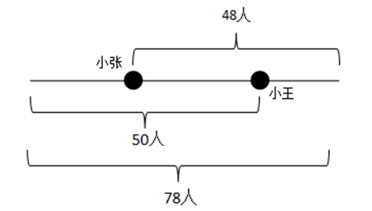

所以(48+50)-78=20为小张和小王两人为头的列数人数，他们之间的人数为20-2=18人。

故正确答案为C。

### 第 108 题

疾病控制中心，对某校高中三个年级的学生进行抽样做视力状况调查，抽样的方法为分层抽样(按比例抽样)若高中一、二、三年级学生人数分别为626、703、780，样本容量为84，则应从高二年级抽样的学生人数为多少：

A. 24

B. 26

C. 28

D. 30

第 108 题 · 答案与解析

**参考答案（粉笔题库参考内容）**

C

**解析**

根据条件，高中一、二、三年级学生人数分别为626、703、780，所以样本中高二年级应该占的比例为，则样本中高二年级人数为。

故正确答案为C。

### 第 109 题

某高校有A、B两个食堂，开学第一天A食堂就餐人数为8000，但其中20%在第二天流失到B食堂就餐，同时，第一天在B食堂就餐者有30%于第二天流失到A食堂，如果第二天两食堂就餐人数相同，则第一天B食堂人数为多少：

A. 10000

B. 11000

C. 12000

D. 13000

第 109 题 · 答案与解析

**参考答案（粉笔题库参考内容）**

C

**解析**

根据题意，设第一天B食堂人数为m，则有，解得m=12000。

故正确答案为C。

### 第 110 题

商场开展促销活动，凡购物满100元返还现金30元，小王现有280元，最多能买到多少元的物品：

A. 250

B. 280

C. 310

D. 400

第 110 题 · 答案与解析

**参考答案（粉笔题库参考内容）**

D

**解析**

方法一：根据题意，买到的物品价格一定比现有的280元高，故排除A、B两项；代入C项，如果买到310元物品，则满3个100元，有返现元，则小王原有310-90=220元，不符合题意，排除；代入D项，如果买到400元物品，满4个100元，有返现元，则小王原有400-120=280元，符合题意，当选。

方法二：假设可以买到x元的商品，则根据题意可得（注：为向下取整符号），代入选项只有x=400满足条件。

故正确答案为D。

### 第 111 题

大学四年级某班共有50名同学，其中奥运会志愿者10人，全运会志愿者17人，30人两种志愿者都不是，则班内是全运会志愿者而非奥运会志愿者的同学为多少人：

A. 3

B. 7

C. 10

D. 17

第 111 题 · 答案与解析

**参考答案（粉笔题库参考内容）**

C

**解析**

设班内既是全运会志愿者又是奥运会志愿者的同学有x人，根据两集合容斥原理公式：A+B-A∩B=总数-都不，可得：10+17-x=50-30，解得x=7。则班内是全运会志愿者而非奥运会志愿者的同学为17-7=10人。

故正确答案为C。

### 第 112 题

有两种电话卡：第一种每分钟话费0.3元，除此以外，无其他费用；第二种电话卡，每分钟0.2元，另有每月固定费用10元（无论拨打与否都要扣）。如果小王每月通话量不低于两个小时，则他办理哪种卡比较合算：

A. 第一种

B. 第二种

C. 两个卡一样

D. 无法判断

第 112 题 · 答案与解析

**参考答案（粉笔题库参考内容）**

B

**解析**

设小王每月通话量m分钟，则使用第一种电话卡费用为，使用第二种电话卡费用为10+0.2m，则第一种电话卡和第二种差值为：0.3m-0.2m-10=0.1m-10。又因为m＞120，则有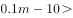，第一种电话卡费用高于第二种，所以办理第二种电话卡比较合算。

故正确答案为B。

### 第 113 题

某商场以摸奖的方式回馈顾客，盒内有五个乒乓球，其中一个为红色，2个为黄色，2个为白色，每位顾客从中任意摸出一个球，摸到红球奖10元，黄球奖1元，白球无奖励，则每一位顾客所获奖励的期望值为多少：

A. 10

B. 1.2

C. 2

D. 2.4

第 113 题 · 答案与解析

**参考答案（粉笔题库参考内容）**

D

**解析**

根据条件，顾客获得奖励有两种情况：一种是摸到红球，另一种是摸到黄球。其中摸到红球的概率为：，摸到黄球的概率为：。故每一位顾客所获奖励的期望值为。

故正确答案为D。

### 第 114 题

用2、3、4、5、6、7六个数字组成两个三位数，每个数字只用一次，这两个三位数的差最小是多少：

A. 47

B. 49

C. 69

D. 111

第 114 题 · 答案与解析

**参考答案（粉笔题库参考内容）**

A

**解析**

因为每个数字只能用一次，首位决定大小，因此两个三位数的百位数要相差最小，即相差1。为了使差值最小，两个三位数要尽可能接近，故这两个三位数中：较小的三位数的末两位应尽可能大，即可以为476。而较大的三位数的末两位的末两位应尽可能小，即可以为523。此时两个三位数的差值最小，最小差值为523-476=47。

故正确答案为A。

### 第 115 题

某单位有3名职工和6名实习生需要被分配到A、B、C三个地区进行锻炼，每个地区分配1名职工和2名实习生，则不同的分配方案有多少种：

A. 90

B. 180

C. 270

D. 540

第 115 题 · 答案与解析

**参考答案（粉笔题库参考内容）**

D

**解析**

根据题意，首先为A、B、C三地各分配1名职工，共有方案种；然后为三地各分配2名实习生，共有方案种；则一共有6×90=540种方案。

故正确答案为D。

### 第 116 题

甲、乙两人由于顺路搭乘同一辆出租车，甲坐了4公里后下了车，出租车又走了6公里，乙下车并付了18元车费，如果车费由两人分摊，甲应分摊多少：

A. 3元

B. 3.6元

C. 7.2元

D. 7.5元

第 116 题 · 答案与解析

**参考答案（粉笔题库参考内容）**

B

**解析**

由题干出租车共行驶了4+6=10公里，车费为18元，则每公里车费为1.8元，故前4公里的车费为元，这部分费用由两人共同承担，所以甲应分摊元。

故正确答案为B。

### 第 117 题

某校初一年级共有三个班，一班与二班人数之和为98，一班与三班人数之和为106，二班与三班人数之和为108，则二班人数为多少人：

A. 48

B. 50

C. 58

D. 60

第 117 题 · 答案与解析

**参考答案（粉笔题库参考内容）**

B

**解析**

方法一：设一班、二班、三班分别有a、b、c人，则根据题意可得，a+b=98，a+c=106，b+c=108，联立解得b=50。

方法二：由题意可得，一班、二班、三班共有人，所以二班人数=总人数-一班与三班人数和=156-106=50人。

故正确答案为B。

### 第 118 题

电影票原价若干元，现在每张降价3元出售，观众增加一半，收入也增加，一张电影票原来为多少元：

A. 4.5

B. 7.5

C. 12

D. 15

第 118 题 · 答案与解析

**参考答案（粉笔题库参考内容）**

D

**解析**

根据题意，设原来每张电影票m元，观众n人，则有，解之得m=15。

故正确答案为D。

### 第 119 题

某工程项目由甲项目公司单独做，需4天完成，由乙项目公司单独做，需6天才能完成，甲、乙、丙三个公司共同做2天就可以完成，现因交工日期在即，需多公司合作，但甲公司因故退出，则由乙、丙公司合作完成此项目共需多少天：

A. 3

B. 4

C. 5

D. 6

第 119 题 · 答案与解析

**参考答案（粉笔题库参考内容）**

B

**解析**

赋值总工程量为4、6和2的最小公倍数12，则甲公司的效率为，乙公司的效率为，丙的效率为。则乙、丙两公司合作需要天。

故正确答案为B。

### 第 120 题

分多次用等量清水去冲洗一件衣服，每次均可冲洗掉上次所残留污垢的，则至少需要多少次才可使得最终残留的污垢不超过初始污垢的1%：

A. 3

B. 4

C. 5

D. 6

第 120 题 · 答案与解析

**参考答案（粉笔题库参考内容）**

B

**解析**

根据条件每次均可冲洗掉上次所残留污垢的，则每次清洗之后污垢变为原来的，所以n次之后污垢为原来的。由题意可得：，即，则，所以至少需要4次才可使得最终残留的污垢不超过初始污垢的1%。

故正确答案为B。

## 材料 1

2008年中国家庭居民的消费水平持续提高，与2006年社会状况综合调查结果比较，消费支出总额从17388元升高到22555元（未考虑价格变动因素），消费结构也进一步改善，作为家庭生活水平标志的恩格尔系数（家庭食品支出占消费总支出的比例）进一步降低。在2008年城乡家庭消费支出细项中，列前三位的消费类型是食品、教育和医疗，分别占总支出的34.0%、11.5%和10.6%。

        调查还显示，城乡居民消费的总体结构及家庭生存型消费（包括食品与衣着类）与发展型消费（包括居住、交通、通讯、文教、娱乐用品、医疗保健、旅游等）所占比重，都发生了重要变化。从购买商品和服务的消费情况看，城乡居民消费层次有所提高。大众耐用消费品普及率提高较快，但家庭消费率总体仍偏低。

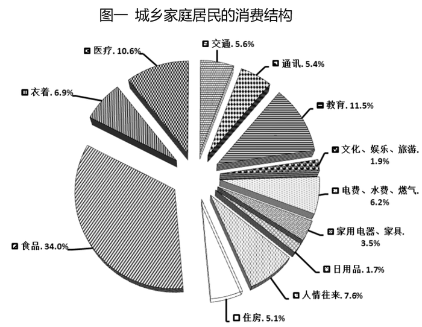

### 第 121 题

城乡家庭居民的消费结构最主要的特点是：

A. 居民消费水平持续提高，总体结构进一步改善

B. 城乡居民消费商品化程度较高，但消费层次存在明显差异

C. 家庭消费率总体偏低，消费率随收入提高而边际递减

D. 大众耐用消费品普及率较高，农村消费发展潜力巨大

第 121 题 · 答案与解析

**参考答案（粉笔题库参考内容）**

A

**解析**

A项：定位文字材料第一段：2008年中国家庭居民的消费水平持续提高，与2006年社会状况综合调查结果比较，消费支出总额从17388元升高到22555元（未考虑价格变动因素），消费结构也进一步改善，正确；

B项：材料中没有关于“城乡居民消费商品化程度”的表述，属无中生有，错误；

C项：材料中没有关于“消费率随收入提高而边际递减”的表述，属无中生有，错误；

D项：材料中没有关于“农村消费发展潜力巨大”的表述，属无中生有，错误。

故正确答案为A。

### 第 122 题

“图一：城乡家庭居民的消费结构”说明：在城乡家庭消费支出中，生存型消费的比重约占到消费总支出的近：

A. 31%

B. 41%

C. 51%

D. 61%

第 122 题 · 答案与解析

**参考答案（粉笔题库参考内容）**

B

**解析**

定位文字材料第二段：调查还显示，城乡居民消费的总体结构及家庭生存型消费（包括食品与衣着类），据饼形图可知：食品与衣着类分别占比34.0%和6.9%，故生存型消费的比重为34.0%+6.9%=40.9%，与B项最接近。

故正确答案为B。

### 第 123 题

由“图一：城乡家庭居民的消费结构”可见：在城乡家庭消费支出中，发展型消费的比重占到消费总支出的：

A. 40%以上

B. 50%以上

C. 60%以上

D. 70%以上

第 123 题 · 答案与解析

**参考答案（粉笔题库参考内容）**

B

**解析**

定位文字材料第二段：调查还显示，城乡居民消费的总体结构及家庭生存型消费（包括食品与衣着类）与发展型消费（包括居住、交通、通讯、文教、娱乐用品、医疗保健、旅游等）所占比重，都发生了重要变化。根据上题，因为生存型消费占比为40.9%，则发展型消费占比约1-40.9%=59.1%。

故正确答案为B。

### 第 124 题

城乡家庭居民的消费结构图说明：中国的消费结构已经在总体上完成了从生存型向发展型的过渡，进入了：

A. 大众消费阶段

B. 适度消费阶段

C. 中等消费阶段

D. 较高消费阶段

第 124 题 · 答案与解析

**参考答案（粉笔题库参考内容）**

A

**解析**

定位文字材料第二段：大众耐用消费品普及率提高较快。又根据前两题，城乡居民发展型消费所占消费总支出比例接近60%，所以我国的消费结构已在总体上完成了从生存型向发展型的过渡，进入了大众消费阶段。

故正确答案为A。

### 第 125 题

教育和医疗支出占城乡家庭消费总支出的比例比较高，分别占11.5%和10.6%，教育和医疗的家庭消费支出比例较高，主要显示了：

A. 家庭消费结构升级的发展趋势

B. 教育、健康方面的支出是一种刚性消费

C. 教育、医疗的费用和支出，存在比重过高的问题

D. 教育、医疗的费用和支出增长过快，影响到居民一般生活质量的改善

第 125 题 · 答案与解析

**参考答案（粉笔题库参考内容）**

D

**解析**

教育、医疗的费用和支出增长过快，会迫使普通家庭减少生存型支出，从而影响到居民一般生活质量的改善。

故正确答案为D。

## 材料 2

**请根据表一和文字资料完成以下各题。**

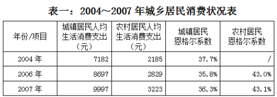

另据统计，2004年农村居民人均食品消费支出为1032元。

### 第 126 题

与2006年相比较，2007年农村居民人均生活消费支出增长：

A. 近12%

B. 近13%

C. 近14%

D. 近15%

第 126 题 · 答案与解析

**参考答案（粉笔题库参考内容）**

C

**解析**

根据题干“与2006年相比较，2007年······增长”，结合选项都是百分数，可判定本题为一般增长率计算问题。定位材料表格可得：2007年农村居民人均生活消费支出3223元，2006年农村居民人均生活消费支出2829元。根据增长率。

故正确答案为C。

### 第 127 题

如果以恩格尔系数作为衡量居民生活水平高低的标准，根据统计数据，与2006年相比，2007年我国城乡居民家庭生活水平：

A. 略有降低

B. 略有提高

C. 没有变化

D. 无法确定

第 127 题 · 答案与解析

**参考答案（粉笔题库参考内容）**

A

**解析**

根据表格，因为2007年城镇和农村居民的恩格尔系数都比2006年高，根据恩格尔系数的定义，恩格尔系数越高，说明居民生活水平越低。

故正确答案为A。

### 第 128 题

2004年农村居民恩格尔系数约为：

A. 14.4%

B. 15.4%

C. 42.7%

D. 47.2%

第 128 题 · 答案与解析

**参考答案（粉笔题库参考内容）**

D

**解析**

根据题干“2004年······恩格尔系数约为”，结合恩格尔系数的公式：，可以判定本题为现期比重问题。定位表格第二行：人均生活消费支出为2185元；定位文字材料：2004年农村居民人均食品消费支出为1032元，所以恩格尔系数为，与D项最接近。

故正确答案为D。

### 第 129 题

2007年的城镇家庭食品支出额约为：

A. 1172元

B. 1433元

C. 3629元

D. 4309元

第 129 题 · 答案与解析

**参考答案（粉笔题库参考内容）**

C

**解析**

根据题干“2007年······食品支出额约为”和材料中给出的恩格尔系数，可以判定本题为现期比重的逆运算问题。定位表格材料：2007年的城镇居民人均生活消费支出额为9997元，恩格尔系数为36.3%。已知整体和比重，求部分量，则公式为：部分量=整体比重，代入数据可得：部分量元，C项最为接近。

故正确答案为C。

### 第 130 题

由“表一：年城乡居民消费状况表”可知，2007年城镇居民家庭食品支出比农村家庭食品支出高：

A. 1.61倍

B. 2.61倍

C. 1.41倍

D. 1.31倍

第 130 题 · 答案与解析

**参考答案（粉笔题库参考内容）**

A

**解析**

根据题干“2007年······比······高”和选项中的“倍”，可以判定本题为现期倍数问题，且高几倍就是多几倍。定位表格材料：2007年的城镇居民人均生活消费支出额为9997元，恩格尔系数为36.3%；农村居民人均生活消费支出额为3223元，恩格尔系数为43.1%。根据部分量=整体比重，可得2007年的城镇居民食品支出额为；农村居民食品支出额为。根据：多几倍=是几倍-1，代入数据可得：。

故正确答案为A。

## 材料 3

**请根据表二和文字资料完成以下各题。**

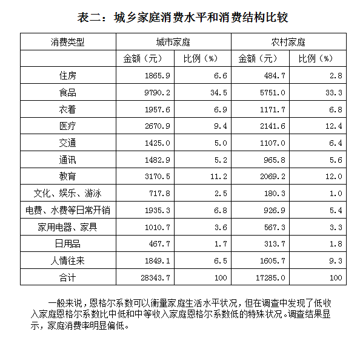

### 第 131 题

由“表二：城乡家庭消费水平和消费结构比较”分析得出：城乡居民家庭消费差异和问题主要是：

A. 城乡家庭消费水平差异较大，消费结构差异明显

B. 教育、医疗等发展型消费呈刚性特点

C. 低收入家庭生活质量受到影响

D. 家庭消费率总体偏低，消费率随收入提高而边际递减

第 131 题 · 答案与解析

**参考答案（粉笔题库参考内容）**

A

**解析**

根据图表，A选项“城乡家庭消费水平差异较大，消费结构差异明显”正确，B、C、D并不能看出来。

故正确答案为A。

### 第 132 题

上述文字资料主要显示：

A. 食品支出占家庭总消费支出的比例越高，家庭生活水平就越低

B. 食品支出占家庭总消费支出的比例越低，家庭生活水平就越高

C. 低收入家庭的食品支出数额较低，占消费总支出的比例也较低

D. 城市低收入家庭食品支出数额高于中等收入家庭食品支出数额

第 132 题 · 答案与解析

**参考答案（粉笔题库参考内容）**

C

**解析**

A、B选项含义相同，属于基本概念，并非文字资料要显示的主旨；

D选项本身说法就不能判断其正确性，所以D也错误。

文字资料主要表明“低收入家庭恩格尔系数比中低和中等收入家庭恩格尔系数低的特殊情况”。

故正确答案为C。

### 第 133 题

调查发现，城市低收入家庭平均食品支出数额为4898.8元，占消费总支出14321元的比例为：

A. 24.2%

B. 28.2%

C. 34.2%

D. 38.2%

第 133 题 · 答案与解析

**参考答案（粉笔题库参考内容）**

C

**解析**

根据题干“······占······比例”和选项中的“%”，可以判定本题为现期比重问题。题干当中给出了部分和整体的量，代入比重公式：比重，可得：比重，C项最为接近。

故正确答案为C。

### 第 134 题

通过数据分析发现，低收入家庭的恩格尔系数较低的特殊情况，主要是因为：

A. 为了保证教育和医疗等发展型消费而省吃俭用

B. 城市低收入家庭住房消费支出数额较高

C. 城市低收入家庭的保险等消费数目较大

D. 城乡低收入家庭食品消费支出一直不高

第 134 题 · 答案与解析

**参考答案（粉笔题库参考内容）**

A

**解析**

中国家庭重视教育，而且低收入家庭看病大部分需要自费，所以更多地依靠省吃俭用来保障教育和医疗的支出，故而其恩格尔系数较低，但生活水平也较低。

故正确答案为A。

### 第 135 题

我国家庭的消费率长期低于发达国家和其他同等水平的发展中国家，其原因主要是：

A. 与长期形成的勤俭持家传统有关

B. 与中国家庭文化和消费观念有关

C. 为了应对住房、医疗、教育等大宗消费支出的不确定性

D. 消费品零售价格偏高

第 135 题 · 答案与解析

**参考答案（粉笔题库参考内容）**

C

**解析**

其他国家的医疗、教育基本上居民不用支付费用，而中国的住房费用也明显高于其他国家。

故正确答案为C。

## 材料 4

根据调查结果测算，家庭平均消费率在76%左右，城市家庭消费率为77.6%，高于农村家庭的74.1%，说明城市家庭的即期消费倾向要略高于农村。调查结果表明，不论城市还是农村，家庭消费率随着收入增加而递减。低收入家庭消费率高达90%以上，高收入家庭消费率比较低，城市和农村高收入家庭的消费率分别为57.9%和53.9%。高收入家庭的消费水平与其他几类家庭的差距较为悬殊，高收入家庭的消费绝对数额约等于中等收入加上中高收入家庭的消费数额。以城市为例，中等收入家庭年平均消费支出24790.5元，中高收入家庭年平均消费支出31508.7元，两者相加仅比高收入家庭年平均消费支出55772.6元高526.6元。

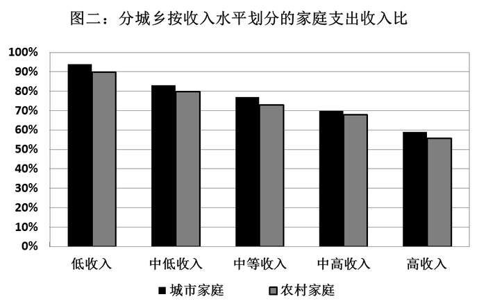

### 第 136 题

“图二：分城乡按收入水平划分的家庭支出收入比”显示：不同收入层次的家庭，其消费率的变化呈现出规则的曲线，以家庭消费率代表家庭即期消费的倾向，比率越高，即期消费倾向：

A. 越强烈

B. 越微弱

C. 越显著

D. 越明显

第 136 题 · 答案与解析

**参考答案（粉笔题库参考内容）**

A

**解析**

定位文字材料第一行，“城市家庭消费率为77.6%，高于农村家庭的74.1%，说明城市家庭的即期消费倾向要略高于农村”可以看出：比率越高，即期消费倾向越强烈。

故正确答案为A。

### 第 137 题

“图二：分城乡按收入水平划分的家庭支出收入比”说明：从增加收入以刺激消费的角度来看，高收入家庭收入的增加：

A. 不会在短时间内带动商品消费的增长

B. 会在长时间内带动商品消费的增长

C. 会在短时间内带动服务消费的增长

D. 将不会产生更多的家庭积累和储蓄

第 137 题 · 答案与解析

**参考答案（粉笔题库参考内容）**

A

**解析**

定位统计图，可以看出高收入家庭的消费率比较低，所以高收入家庭增加收入会产生更多的家庭积累和储蓄，不会在短时间内带动商品消费的增长。

故正确答案为A。

### 第 138 题

调查结果表明：“不论城市还是农村，家庭消费率随着收入增加而递减。低收入家庭消费率高达90%以上。”根据这一结果，下列说法不正确的是：

A. 低收入家庭每年收入几乎全部用于消费

B. 低收入家庭收入水平提高，能够更快、更多地提高消费支出水平

C. 增加低收入家庭的收入比增加高收入家庭的收入，对刺激消费更加有效

D. 低收入家庭每年收入的10%以上用于储蓄和积累

第 138 题 · 答案与解析

**参考答案（粉笔题库参考内容）**

D

**解析**

定位统计图，因为低收入家庭消费率高达90%以上，所以D中低收入家庭每年收入用于储蓄和积累的比例应该在10%以下。

本题为选非题，故正确答案为D。

### 第 139 题

高收入家庭消费率比较低，意味着城市和农村高收入家庭每年收入的：

A. 20%以上用于储蓄和积累

B. 30%以上用于储蓄和积累

C. 40%以上用于储蓄和积累

D. 50%以上用于储蓄和积累

第 139 题 · 答案与解析

**参考答案（粉笔题库参考内容）**

C

**解析**

定位统计图，“城市和农村高收入家庭的消费率分别为57.9%和53.9%”可知，高收入家庭年收入的40%以上用于储蓄和积累。

故正确答案为C。

### 第 140 题

拉动内需，促进城乡居民消费是重要对策，为此投资的重点应该是加大就业、教育、医疗、住房、社会保障等领域的投资力度，最关键的措施是：

A. 认清当前我国家庭消费所处发展阶段，促消费保增长保就业

B. 改革和完善住房、医疗和教育制度体系，解决家庭正常消费的后顾之忧

C. 完善城乡均等的公共服务体系，减少农村家庭公共服务消费支出比例

D. 理顺收入分配关系，重点帮扶农村和低收入家庭提高收入水平

第 140 题 · 答案与解析

**参考答案（粉笔题库参考内容）**

B

**解析**

普通家庭应对教育、医疗、住房消费支出增高的储蓄策略选择，不利于政府实施刺激消费、扩大内需的政策实施，因而，刺激消费、拉动内需必须建立在包括住房、医疗、教育等一系列社会保障机制相对完备的基础上，否则，难以形成提高家庭和个人消费意愿，带动国内需求增长的局面。

故正确答案为B。

