# 2012年山东省公务员录用考试《行测》题

<!-- gwy:overview:start -->
> **山东 · 2012 · 行测 · 统考** ｜ 120 题 · 图片 57 处 · 答案随题折叠

| 题型模块 | 题量 | 题号 |
| --- | ---: | ---: |
| 言语理解与表达 | 30 | 1–30 |
| 常识判断 | 20 | 31–50 |
| 数量关系 | 15 | 51–65 |
| 判断推理 | 35 | 66–100 |
| 资料分析 | 20 | 101–120 |
| **合计** | **120** | |

导航：[题型与作答说明](#题型与作答说明) · [题目](#题目) · [材料 1](#材料-1)
<!-- gwy:overview:end -->

> 候选采集稿。参考答案及解析来自粉笔页面，不代表官方答案或真实高分答卷；来源使用许可与原卷对应关系仍需人工核实。

## 题型与作答说明

言语理解与表达

（30题）

本部分包括表达与理解两方面的内容。请根据题目要求，在四个选项中选出一个最恰当的答案。

常识判断

（20题）

根据题目要求，在四个选项中选出一个最恰当的答案。

数量关系

（15题）

本部分包括数字推理与数学运算两种类型的试题。

判断推理

（35题）

本部分包括图形推理、定义判断、类比推理与逻辑判断四种类型的试题。

资料分析

（20题）

所给出的图、表、文字或综合性资料均有若干个问题要你回答，你应根据资料提供的信息进行分析、比较、计算和判断处理。

## 题目

### 第 1 题

思想观念的价值，在竞争中才会＿＿＿＿＿，在实践中才能检验。“我不同意你的看法，但我捍卫你说话的权利”，这是一种胸怀，更是一种＿＿＿＿＿。“不同即敌对”的思维模式，在本质上是一种狭隘虚弱的表现。

依次填入画横线部分最恰当的一项是：

A. 流露 雅量

B. 展现 理解

C. 体现 宽容

D. 彰显 自信

第 1 题 · 答案与解析

**参考答案（粉笔题库参考内容）**

D

**解析**

本题考查实词的语境搭配。

从第二空切入，由“更”字可知，填入词语的意思要比“胸怀”更进一步。“雅量”、“理解”、“宽容”都在不同程度上表现出“胸怀”大。“自信”与“胸怀”含义不同，在语意上比“胸怀”更进一步，且“胸怀”与后文的“狭隘”对应，而“自信”与“虚弱”对应，故该空应选“自信”。

第一空，填入词语应与“价值”搭配。“流露”、“展现”与“价值”搭配不当。由“在竞争中”可知，价值的显现应是主动的，因此“彰显价值”比“体现价值”更贴切，故该空应选“彰显”。

故正确答案为D。

**考点**：实词填空、对应关系-前后呼应、词的辨析-搭配对象、词的辨析-程度轻重

**来源**：2012年山东省公务员录用考试《行测》题第1题

### 第 2 题

在画家的笔端，梅兰竹菊，被赋予文人风骨；牡丹荷花，被赋予盛世风范······无论色彩丰富还是清淡，都能读出诗意，读出真诚。要它的＿＿＿＿＿，有每一笔最自然的亮丽，要它的＿＿＿＿＿，有攀附向上生命力的线条，要它的＿＿＿＿＿，有花间人的恬淡自在，要它的＿＿＿＿＿，有藤萝架上鸟儿的清唱。

依次填入画横线部分最恰当的一项是：

A. 表 里 远 近

B. 色 形 意 音

C. 情 趣 静 动

D. 美 力 真 声

第 2 题 · 答案与解析

**参考答案（粉笔题库参考内容）**

B

**解析**

本题考查语境搭配的实词填空。

第一空后的“亮丽”形容颜色，则该空应填“色”。

第二空后的“线条”指形态，则该空应填“形”。

第三空后的“恬淡自在”是一种意境，则该空应填“意”。

第四空后的“清唱”体现了声音，则该空应填“音”。

故正确答案为B。

**考点**：实词填空、对应关系-前后呼应

**来源**：2012年山东省公务员录用考试《行测》题第2题

### 第 3 题

世间的事物很少能比大学更美。在这里，憎恨无知的人奋力求知，＿＿＿＿＿真理的人传授真理，在青年们长知识的年华里，大学给予他们远大目标和共同生活的规范，给予他们渴望得到的亲密友情，让青年人永无止境地对永恒的主题＿＿＿＿＿。没有这些，青春便只是耗费时光。

依次填入画横线部分最恰当的一项是：

A. 通晓 言无不尽

B. 谙悉 各抒己见

C. 敬畏 上下求索

D. 掌握 高谈阔论

第 3 题 · 答案与解析

**参考答案（粉笔题库参考内容）**

B

**解析**

第一空，由句意可知，只有洞悉真理的人才能传授真理，“敬畏”有敬重害怕之意，与文意不符，排除C项。

第二空，“高谈阔论”原指志趣高雅、范围广泛的谈论，含褒义；现也用来指大发议论或不着边际的谈论，含贬义，而文段中既没有体现出传授真理的人志趣高雅，又没有体现出贬义语境，排除D项。“言无不尽”多与“知无不言”连用，强调把知道的全部说出来，没有保留，文段侧重的是对主题的讨论，而不是全部说出来，排除A项。

故正确答案为B。

**考点**：对应关系-前后呼应、混搭填空

**来源**：2012年山东省公务员录用考试《行测》题第3题

### 第 4 题

在日常生活中，礼貌语言作用之大往往超出一般人的\_\_\_\_\_\_，当人与人之间发生这样那样的\_\_\_\_\_\_时，礼貌、谦让的语言会如熏风般暖人心扉，将龃龉化为乌有，令瑕疵变成笑靥。

依次填入画横线部分最恰当的一项是：

A. 期望 冲突

B. 想象 摩擦

C. 估计 争端

D. 设想 磕碰

第 4 题 · 答案与解析

**参考答案（粉笔题库参考内容）**

B

**解析**

本题考查实词的语境搭配。

从第二空切入，“冲突”“争端”在“日常生活”的语境中语意过于严重，故可排除A、C两项。

第一空，“设想”有假设的意思，材料未体现出假设之意，排除。“超出想象”是固定搭配，故该空应选“想象”，B项当选。

故正确答案为B。

**考点**：实词填空、对应关系-前后呼应、词的辨析-程度轻重

**来源**：2012年山东省公务员录用考试《行测》题第4题

### 第 5 题

人类历史上，技术革命往往和社会发展的\_\_\_\_\_\_相互作用、互为因果。今天，以微博为代表的互联网技术应用正\_\_\_\_\_\_着它推进社会生活各个领域发生变化的巨大潜能。

依次填入画横线部分最恰当的一项是：

A. 步伐 实现

B. 变革 释放

C. 速度 发挥

D. 方向 挖掘

第 5 题 · 答案与解析

**参考答案（粉笔题库参考内容）**

B

**解析**

本题考查实词的语境搭配。

从第二空切入，“实现”不能与“潜能”搭配，排除A项；根据文意，互联网技术正推进社会生活发生变化，互联网技术的这一“潜能”已不需要“挖掘”，而是已经“释放”“发挥”出来了，排除D项。

第一空，应填入“变革”，“技术革命”与“社会发展”的变革相呼应，且与后文的“社会生活各个领域发生变化”相呼应，均体现出变化之意。

故正确答案为B。

**考点**：实词填空、对应关系-前后呼应、词的辨析-搭配对象

**来源**：2012年山东省公务员录用考试《行测》题第5题

### 第 6 题

浮雕是雕塑与绘画结合的产物，它采用压缩的方法来处理对象，＿＿＿＿＿透视等因素来表现三维空间，供一面或两面观看。浮雕一般是＿＿＿＿＿在另一平面上的，因此在建筑上使用更多，用具器物上也经常可以看到。

依次填入画横线部分最恰当的一项是：

A. 凭借 附属

B. 通过 呈现

C. 依照 展现

D. 融汇 依附

第 6 题 · 答案与解析

**参考答案（粉笔题库参考内容）**

A

**解析**

本题考查实词的语境搭配。

第一空，所在的句子语意为借助透视来表现三维空间，“依照”“融汇”均不符合语意，故可排除C、D项。

第二空，浮雕一般在建筑、用具器物上使用，说明浮雕是附在平面上的。“呈现”“展现”显然不符合语意。“依附”带有依赖的感情色彩，用在“浮雕”这一事物上不如“附属”贴切。故该空应选“附属”。

故正确答案为A。

**考点**：实词填空、对应关系-前后呼应

**来源**：2012年山东省公务员录用考试《行测》题第6题

### 第 7 题

吴越历史舞台的中心在哪里，多年来一直是学者与公众共同关注的焦点。尽管古籍文献对此有所\_\_\_\_\_\_，但是多\_\_\_\_\_\_，有的虽言之凿凿却只是演义。

依次填入画横线部分最恰当的一项是：

A. 论证 浮光掠影

B. 涉及 穿凿附会

C. 记载 语焉不详

D. 描述 轻描淡写

第 7 题 · 答案与解析

**参考答案（粉笔题库参考内容）**

C

**解析**

本题考查实词与成语的混搭填空。

第一空，古籍文献只能是记载或描述，不能论证，排除A项。

第二空，根据前文“古籍对此有所记录”，后文“但”转折关联词出现，转折前后语义相反，横线应该体现记录不全面，较少之意，对应C项。

故正确答案为C。

**考点**：对应关系-前后呼应、混搭填空

**来源**：2012年山东省公务员录用考试《行测》题第7题

### 第 8 题

通过探测重力的微小变化，科学家发现一些地方的地下水越来越少。尽管卫星数据显示地下水出现了＿＿＿＿＿，相关部门对这些信号仍然相当＿＿＿＿＿，他们对科学家最近的发现提出了＿＿＿＿＿。

依次填入画横线部分最恰当的一项是：

A. 警戒 反感 批评

B. 枯竭 不满 辩驳

C. 危机 谨慎 质疑

D. 问题 不安 反对

第 8 题 · 答案与解析

**参考答案（粉笔题库参考内容）**

C

**解析**

第一空，填入词语应与前句“地下水越来越少”对应。“警戒”与“出现”搭配不当，“枯竭”语意过重。地下水变少，是地下水出现的一种“危机”，并非“问题”，故该空应选“危机”。第二空，由“尽管”“仍然”这对表转折的关联词可知，相关部门对科学家调查结果不信任，进而提出了质疑。有关部门的态度是不盲目相信数据，体现为谨慎，而非反感。第二空只有C项“谨慎”能表达出不信任的意思。“不满”“反感”与语境不符，“不安”在材料中没有体现。第三空，“质疑”符合语境。“辩驳”“反对”均不能与“提出”搭配，“批评”与语境不符。

故正确答案为C。

**考点**：实词填空、对应关系-前后呼应、词的辨析-搭配对象

**来源**：2012年山东省公务员录用考试《行测》题第8题

### 第 9 题

文化应该是多元共生的，中国文化要走向国际社会，首先要了解国外社会的文化＿＿＿＿＿。为此，中国电影需要开拓更加宽广的＿＿＿＿＿，寻找更加多元素的表达＿＿＿＿＿。

依次填入画横线部分最恰当的一项是：

A. 需要 领域 方式

B. 品位 范围 手段

C. 动态 视野 形式

D. 价值 题材 手法

第 9 题 · 答案与解析

**参考答案（粉笔题库参考内容）**

A

**解析**

本题考查实词的语境搭配。

从第二空切入，“范围”“题材”不能与“开拓”搭配，可排除B、D两项。
第三个空，搭配“表达”，“表达”通常与“方式”搭配，“表现”通常与“形式”搭配，排除C项。

第一空，代入验证，了解国外社会的文化“需要”，符合语境。

故正确答案为A。

**考点**：实词填空、词的辨析-搭配对象

**来源**：2012年山东省公务员录用考试《行测》题第9题

### 第 10 题

春分，昼夜平分，春色与茶色平分。看，春染茶山，峰峦叠翠，采茶姑娘那灵巧的双手在茶树上翩翩起舞；听，山泉潺潺，鸟鸣蜂吟，婉转悠扬的茶歌在天地间久久回荡。春分时节，静坐在绿色盎然的美景里，沏上一杯春分茶，沐浴着柔和暖阳，看茶烟袅袅，见嫩绿碧汤，怡然自得。茶中绿意，幽若山林，茗香清醇，去浊扬清，滋润身心。春之色、春之味、春之韵，尽在这春分茶中。

最适合做这段文字标题的是：

A. 春分茶韵

B. 茶以春为贵

C. 春贵在其时

D. 春分采香茶

第 10 题 · 答案与解析

**参考答案（粉笔题库参考内容）**

A

**解析**

整个材料都是围绕主题词“春分茶”展开的，材料第一句先引出春分茶，其后提到采春分茶，最后讲品春分茶。

因此，结合选项应该选择A，A项体现了“春分茶”这一主题词，语言简练优美，适合做标题。

B、C两项没有体现主题词，均不选；D项只提到了“采春分茶”，而忽略了“品春分茶”环节，没有涵盖文字的全部内容，不能做标题。

故正确答案为A。

**考点**：标题填入题

**来源**：2012年山东省公务员录用考试《行测》题第10题

### 第 11 题

我国家庭的小型化特点造成了家庭养老功能的不足，所以必须有社会化的服务为养老提供支持。为此，政府将积极推进居家养老服务，鼓励社会团体和企业从事居家养老方面的服务，同时也应积极推进利用网络资源建立养老服务的热点、养老服务的求助系统和救援系统的工作。也就是说，要建立一个“没有围墙的养老院”。

这段文字中“没有围墙的养老院”指的是：

A. 多方参与的社会化居家养老系统

B. 政府提供服务的公益性养老系统

C. 个人自办的居家养老场所

D. 基于网络的开放性资源共享的养老院

第 11 题 · 答案与解析

**参考答案（粉笔题库参考内容）**

A

**解析**

“也就是说”引导的句子应与前一句意思一致，由此可知“没有围墙的养老院”指代前一句话的内容。前一句话中“同时”表示并列关系，则“没有围墙的养老院”应指代多方参与的社会化居家养老系统。

因此，结合选项应该选择A。

由“政府将积极推进居家养老服务，鼓励社会团体和企业从事居家养老方面的服务”可知，养老系统不是个人自办，也不是政府单一提供的，排除B、C两项；D项“基于网络”是对文意的过度解读，排除。

故正确答案为A。

**考点**：句子

**来源**：2012年山东省公务员录用考试《行测》题第11题

### 第 12 题

每个企业都有自己的核心价值观，它是企业一切理念、制度和技术的价值基础。企业在重视财务、营销、技术的同时，更应重视员工。员工是企业的主人，是企业的根本，只有建立起以“重视员工”为核心价值观的企业文化，企业才能凝聚员工、创造个性，为自身的发展提供目标、方向和动力。

这段文字意在说明：

A. 企业文化是企业发展的内在动力

B. 建立企业核心价值观的途径

C. 企业文化应以重视员工为中心

D. 企业如何形成和加强自身的凝聚力

第 12 题 · 答案与解析

**参考答案（粉笔题库参考内容）**

C

**解析**

本题为中心理解题。从递进关系词“更”后面的内容可提取材料的主题词为“重视员工”。又由“只有建立起以‘重视员工’为核心价值观的企业文化······”可知，文段意在说明“企业文化应以重视员工为中心”。因此，结合选项应该选择C。

A、B、D三项都没有包含材料的主题词“重视员工”，均不选。

故正确答案为C。

**来源**：2012年山东省公务员录用考试《行测》题第12题

### 第 13 题

“煎饼人”是“门门通、门门松”的万金油式的“知识分子”，他们不是将精力专注于某一个感兴趣的领域，而是力求在各个领域都至少获得一些基本知识。他们爱好浅阅读，极度依赖搜索引擎，缺乏思辨力和想象力。他们的涉猎面铺地薄而大，像煎饼一样，但没有厚而重的知识积累。在信息时代，能够在短时间内获得稀缺信息的能力有其积极的一面，但同时也容易出现使人不愿意深究某一主题的倾向。

关于“煎饼人”，下列说法正确的是：

A. 善于学习新知识

B. 具有触类旁通的能力

C. 热衷涉猎却不求甚解

D. 占有大量稀缺的信息资源

第 13 题 · 答案与解析

**参考答案（粉笔题库参考内容）**

C

**解析**

由材料“门门通、门门松”和“他们不是将精力专注于某一个感兴趣的领域，而是力求在各个领域都至少获得一些基本知识”可知，“煎饼人”热衷涉猎却不求甚解。

因此，结合选项应该选择C。

A、B两项在材料中未提及；D项错在偷换概念，材料提到“煎饼人”“能够在短时间内获得稀缺信息的能力”，并不代表其“占有大量稀缺的信息资源”。

故正确答案为C。

**考点**：实词

**来源**：2012年山东省公务员录用考试《行测》题第13题

### 第 14 题

一个善于思考、用心思考、有强烈创新欲望的人，哪里都是他产生创新火花和灵感的风水宝地。从某种意义上说，无论创作、创新还是创造，都永远属于那些用心思考、积极思考的人。作为教学一线的课堂也是一个不可忽视的创新场所，有许多知识和学术问题等待人们去研究，这里应该成为科技创新的不竭源泉。

这段文字意在说明：

A. 课堂也可以成为创新的重要场所

B. 教师应在课堂上注重创新人才的培养

C. 善于思考的人才能产生创新的火花

D. 课堂教学既要传授知识也要培养创新思维

第 14 题 · 答案与解析

**参考答案（粉笔题库参考内容）**

A

**解析**

整个材料为分—总结构，第一、二句讲用心思考、积极思考的人容易创新，其后引出观点“作为教学一线的课堂也是一个不可忽视的创新场所”及“这里应该成为科技创新的不竭源泉”。文段的主题词是“课堂”，对应A项。

B项包含“课堂”一词，但谈论的核心是教师培养人才，而非“课堂”这个地方，偏离文段中心，排除；C项没有包含“课堂”这一主题词，偏离文段中心，排除；D项“课堂教学”，谈论的核心是“教学”，而非“课堂”这个地方，偏离文段中心，排除。

故正确答案为A。

**考点**：关联词-对策

**来源**：2012年山东省公务员录用考试《行测》题第14题

### 第 15 题

人类已经进入知识经济时代。人才、知识、科技、教育等要素，在经济社会发展中的重要性日益凸显。高等教育作为高端人才培养和技术创新的主阵地，已经成为经济社会发展的重要引擎；高等教育发展的质量，已经成为影响一个国家和民族发展能力的重要因素。新的形势，迫切要求高等教育深化改革，更进一步增强社会服务功能，更加深入地参与到经济社会发展中来，参与到改革发展的时代大潮中来。

这段文字意在说明：

A. 新形势下高等教育改革的迫切性和改革方向

B. 新时期高等教育应为经济发展培养更多的高素质人才

C. 知识经济时代为高等教育进一步改革提供了广阔空间

D. 知识经济时代高等教育肩负的责任越来越重大

第 15 题 · 答案与解析

**参考答案（粉笔题库参考内容）**

A

**解析**

文段首先指出人类进入知识经济时代，在这一背景下，人才、科技等重要性凸显。接着通过“；”引导的并列分句指出高等教育在知识经济时代的重要性。尾句提出新的形势对高等教育的要求，即需要迫切改革，以更好地为社会服务，参与到经济社会发展中去。A 项“迫切性和改革方向”为文段尾句，即中心句的同义替换，当选。

B项，对应文段中“；”之前的第一个分句，D项，对应文段中“；”之后的第二个分句，均表述片面，排除；C项，文段强调的重点是高等教育改革，而“知识经济时代为高等教育进一步改革提供了广阔空间”强调的是知识经济时代的重要性，偏离文段中心，排除。

故正确答案为 A。

**考点**：关联词-对策

**来源**：2012年山东省公务员录用考试《行测》题第15题

### 第 16 题

在元代画家的笔下，花鸟画已经成为借物抒情、托物言志的途径，这种发展无疑丰富了花鸟画的内涵。发展至明清时期，许多花鸟画家更把家国观念、道德品评、祈求幸福等传统的人文精神寄托于画中，有些画家甚至将花鸟内容个性化，借以表达喜怒哀乐。因此，画家创作时重视追求境界多于形似，因而特别讲究笔墨运用，注重意境。他们不把绘画称为“画画”，而叫“写画”，确实有其原因。

这段文字意在：

A. 比较元代和明清绘画技法的不同

B. 叙述古代花鸟画的演变过程

C. 解释“画画”和“写画”的区别

D. 强调明清花鸟画的创作更加注重意境

第 16 题 · 答案与解析

**参考答案（粉笔题库参考内容）**

D

**解析**

由总结词“因此”引出材料主旨句，主题词是“注重意境”，进一步引申材料的主旨为明清花鸟画家创作时更注重意境。因此，结合选项应该选择D。

A项“绘画技法”在材料中未提及；材料仅提到明清画家把绘画称为“写画”而非“画画”，并没有解释“画画”和“写画”的区别，C项错误；B项未抓住材料重点。

故正确答案为D。

**考点**：关联词-因果

**来源**：2012年山东省公务员录用考试《行测》题第16题

### 第 17 题

社会管理不是为了加强控制，它是柔性的、协同的和互动的，这正是它与传统单位制管理模式的根本区别，也是“大管理”的要旨所在。长期以来，单位就是社会，它包揽了我们的一切。“单位制”和“身份制”构成了我国计划经济时代社会运行的基本特征，国家和政府通过严密的单位体系和街居体系管理职工及城市居民。单位制的重要特征就是控制性、封闭性和单一性，是典型的“小管理”。或许，在当时的条件下，“单位制”有其合理的一面，但与之相对应的就是社会的萎缩，以至于我们生活在社会中却对“社会”很迷茫，社会是什么？社会在哪里？

下列说法与这段文字相符的是：

A. “单位制”管理模式削弱了人们对社会的认识

B. 社会管理的核心是提倡个人的主动参与

C. 现代社会要求“小管理”和“大管理”的结合

D. 计划经济时代我国社会管理模式主要是“身份制”

第 17 题 · 答案与解析

**参考答案（粉笔题库参考内容）**

A

**解析**

由材料中“在当时的条件下，‘单位制’有其合理的一面，但与之相对应的就是社会的萎缩，以至于我们生活在社会中却对‘社会’很迷茫”，可知A项正确。

B、C两项在材料中均未提及。

D项表述不准确，文段中除了“身份制”还有“单位制”。

故正确答案为A。

**考点**：细节判断题

**来源**：2012年山东省公务员录用考试《行测》题第17题

### 第 18 题

科学的本质是创新，那些变不可能为可能的发现，树立了科学史上一个又一个里程碑，比如19世纪有机尿素的合成，打破了“有机物只有靠动植物的生命力才能合成”的思想禁锢。但当我们自信能够通过合成超出自然的物质去战胜自然时，也应反思这些物质对健康、环境的反作用，毕竟它们改变着我们的衣食住行。

这段文字意在说明：

A. 不应过于迷信科技的作用

B. 应对合成技术进行全面评估

C. 应全面审视科技对人类及环境的影响

D. 科技改变了人类的生活及人类的思维方式

第 18 题 · 答案与解析

**参考答案（粉笔题库参考内容）**

B

**解析**

本题为中心理解题。文段首先以科学创新树立里程碑作为引入，并以“比如”为标志举例说明有机尿素的合成如何打破思想禁锢。随后以“但”为标志的转折词，强调即便合成物能战胜自然，我们也必须反思这些物质，即合成物对健康、环境的反作用。总而言之，转折词后重点论述的主题词为合成物，因此我们需要反思、需要全面评估的对象为合成技术，对应B项。

A、C、D三项均将关注重点落在科学技术这一大概念上，并非文段强调的重点。

故正确答案为B。

文段来源：《科学家建构出“不可能存在”的化合物》

**考点**：关联词-转折

**来源**：2012年山东省公务员录用考试《行测》题第18题

### 第 19 题

就本质而言，《人民文学》质量高低，\_\_\_\_\_\_，与传播媒介所处位置并没有必然的因果关联。从某种意义上讲，销量也不能必然反映文学的真正价值，今天的畅销作者中，有多少能经得起历史的检验呢？有媒体统计发现，2010年，王蒙、贾平凹、周国平、麦家四人的总版税，比不过一个“当年明月”，但这并不能因此就否认这四人的文学造诣。

填入画横线部分最恰当的一句是：

A. 并不体现在它的市场价值上

B. 唯一衡量标准在于作品本身

C. 与读者群体的阅读喜好息息相关

D. 取决于作者的文学底蕴和思想深度

第 19 题 · 答案与解析

**参考答案（粉笔题库参考内容）**

B

**解析**

本题考查语句填空。“与传播媒介所处位置并没有必然的因果关联”表明横线处应是说明《人民文学》质量高低与什么因素有关，即用什么标准来衡量质量的高低，填入句子要与后文的“文学价值”构成相互对应关系。因此，结合选项应该选择B项。其质量高低的衡量标准在于作品本身。

A项所说的市场价值与上下文无对应；C项在上下文中未体现，分析材料结构可知，第二、三句是对第一句的进一步论证；D项并未体现作品文学价值，故排除。

故正确答案为B。

**考点**：横线在开头

**来源**：2012年山东省公务员录用考试《行测》题第19题

### 第 20 题

民间草根对传统文化特别是儒家文化的热情成为这一波中国文化热的巨大推动力量，它的出现和规模，完全超出了知识精英的预期，其力量也远不是学院知识分子可以相比的。其中虽然带些盲目的成分，但毋庸置疑的是，“文化场”不再由学者一统天下。这从一个侧面反映出，社会和民间的文化价值取向将成为知识精英必须重视的因素。

这段文字意在说明：

A. 新一波中国文化热主要源于民间

B. 民间文化价值取向的影响力不容忽视

C. 民间草根对传统文化的热情带有盲目性

D. 知识精英需在借鉴草根文化的基础上寻求新发展

第 20 题 · 答案与解析

**参考答案（粉笔题库参考内容）**

B

**解析**

本题为中心理解题。由总结短语“这从一个侧面反映出”引出材料主旨“社会和民间的文化价值取向将成为知识精英必须重视的因素”，进一步引申为“民间文化价值取向的影响力不容忽视”。因此，结合选项应该选择B。

材料第一句是说民间草根对传统文化特别是儒家文化的热情成为了这一波中国文化热不可忽视的推动力量，而这并不能说明新一波中国文化热主要源于民间，故A项错误；材料提到“虽然带些盲目的成分，但······”可知，“盲目性”是转折词前面的内容，故C项不是材料的主旨；由材料“民间草根”“它的出现和规模”“其力量”可知，文段强调的是民间草根的重要性，并非知识精英，D项落脚点在知识精英，故不是材料主旨。

故正确答案为B。

**考点**：关联词-因果

**来源**：2012年山东省公务员录用考试《行测》题第20题

### 第 21 题

网络不只发现问题，有时它还扮演了解决问题的线索提供者和监督者的角色。相对于各种监督管理的机制，网络的监督能力已经出现了超前的态势。似乎许多问题的端倪，总是先暴露在网络之上，然后才会被深究，继而解决处理。对此，我们应该清醒地认识到，网络的监督固然在目前发挥了显著作用，但这绝不是一个法治社会下正常的监督问责途径，也不应当成为一种主流的监督方式。如何充分发挥原有监督机制的应有作用，是摆在我们面前亟待解决的问题。

这段文字意在说明：

A. 法制社会不能主要依靠网络进行有效监督

B. 网络相对于其他监督机制具有更为超前的监管能力

C. 网络监督在自我完善的基础上才能更好地发挥作用

D. 当今社会的一条重要监督途径是网络监督

第 21 题 · 答案与解析

**参考答案（粉笔题库参考内容）**

A

**解析**

本题为中心理解题。由总结词“对此”引出材料的主旨句“网络的监督固然在目前发挥了显著作用，但这绝不是一个法治社会下正常的监督问责途径，也不应当成为一种主流的监督方式”，即法制社会不能主要依靠网络进行有效监督。因此，结合选项应该选择A。

B项偷换概念，将“超前的态势”偷换成“超前的监管能力”。C项在材料中未提及。由材料中的“固然······但······也······”可知，D项错误。

故正确答案为A。

**考点**：关联词-因果

**来源**：2012年山东省公务员录用考试《行测》题第21题

### 第 22 题

2002年诺贝尔化学奖颁给了提出“测定生物大分子质量原始思想”的日本科学家田中耕一，比他晚一两个月发明更有效的测定方法的德国化学家米夏埃尔·卡拉斯和弗伦茨·希伦坎普只好望洋兴叹；2008年诺贝尔生理学或医学奖颁给了首次发现“人类免疫缺陷病毒”的两位法国科学家西诺西和蒙塔尼，另一位为“发现人类免疫缺陷病毒”作出重大贡献的美国科学家盖洛则名落孙山······

这段文字主要说明：

A. 以“第一”论英雄是一些国际科学奖项所遵循的原则

B. 诺贝尔奖获奖成果基本上都经过长时间的沉淀和考验

C. 科学研究中的发明和创造是不折不扣的一种智力冒险

D. 国际大奖注重的是发现者在科研中的独一无二的贡献

第 22 题 · 答案与解析

**参考答案（粉笔题库参考内容）**

A

**解析**

本题为中心理解题。

由材料中的分号可知，分段是并列关系，整个材料构成分—分的结构。第一个“分”的“原始思想”与“更有效的测定方法”，与第二个“分”的“首次发现”与“作出重大贡献”的对比可知，国际大奖更注重的是“第一”的评奖标准。因此，结合选项应该选择A。

B、D两项明显错误；C项属于强加理解。

故正确答案为A。

**考点**：关联词-并列

**来源**：2012年山东省公务员录用考试《行测》题第22题

### 第 23 题

在大自然面前，万物没有优劣之分。达尔文在《物种起源》中提出的进化论，把人类放在了一个很普通的位置上。然而，一直有很多人不愿接受这种观点，而是先入为主地将达尔文的进化论曲解为进步论并加以传播。根据进化论，我们很难预测出一个物种的进化趋势，因为进化的机制包含两个因素——环境和物种自身。我们无法预测环境的变化，物种自身怎样遗传和变异，我们也难以完全把握。进化论很大程度上只能给予解释，而非精确的预测，所以依据进化论去给出物种的进化趋势是没有道理的。尽管进化论难以刻画物种进化的细节，但还是帮助人们对生命有了深刻的理解。

这段文字意在说明：

A. 进化论和进步论的根本区别

B. 反进化论的观点缺乏事实根据

C. 进化论很难预测物种的进化趋势

D. 应科学认识进化论的含义和作用

第 23 题 · 答案与解析

**参考答案（粉笔题库参考内容）**

D

**解析**

文段开篇指出大自然中万物无优劣之分，并说明达尔文进化论将人类置于普通位置。接着通过转折词“然而”引出问题，即很多人曲解进化论为进步论并加以传播。随后分析原因，指出进化论难以预测物种进化趋势，因其机制涉及环境和物种自身两方面，均难以完全把握。通过“所以”总结，强调依据进化论给出物种进化趋势没有道理，然后又以“尽管······但······”形成转折，肯定进化论帮助人们深刻理解生命的作用，整个文段辩证分析进化论，即应该科学认识进化论，对应D项。

A项，“根本区别”文段未重点比较，且“进步论”仅为曲解后的错误观点，非重点，排除；

B项，“反进化论的观点”文段未提及，无中生有，排除；

C项，“很难预测物种的进化趋势”对应原因分析部分，非重点，排除。

故正确答案为D。

**考点**：关联词-转折

**来源**：2012年山东省公务员录用考试《行测》题第23题

### 第 24 题

专家在测试时发现，缺觉的学生虽然可以回答难题，却记不住简单的单词。同时，睡眠缺失对孩子的学习记忆可能造成不可逆的损害。研究发现睡眠不足时，大脑部分功能区出现了不同程度的抑制状态，这使得学生在进行一些简单学习时常常出现失误。而面对难题时，由于通过额外激活与记忆、注意密切相关的前额叶皮质区域来补偿缺失的功能，学生答题的正确率以及反应时间并未受到显著影响。专家认为，虽然没有足够证据证明睡眠不足会直接影响智商，但有证据可以证明缺觉学生的注意力以及记忆力都会受到影响。

缺觉的孩子回答难题和简单题目表现出差异的根本原因是：

A. 采用的答题策略不同

B. 使用大脑的具体部位不同

C. 睡眠不足对大脑部分功能区的抑制程度不同

D. 回答难题时前额叶皮质区比回答简单题活跃

第 24 题 · 答案与解析

**参考答案（粉笔题库参考内容）**

D

**解析**

本题为中心理解题。由材料“睡眠不足时，大脑部分功能区出现了不同程度的抑制状态”和“由于通过额外激活与记忆、注意密切相关的前额叶皮质区域来补偿缺失的功能，学生答题的正确率以及反应时间并未受到显著影响”可知，缺觉的孩子回答难题时前额叶皮质区比回答简单题活跃。因此，结合选项应该选择D。

A、B两项在材料中未提及；睡眠不足对大脑部分功能抑制，是导致孩子简单学习失误的原因，并非面对难题时这种抑制程度低，面对简单题时这种抑制程度高，故C项错误。

故正确答案为D。

**考点**：细节判断题

**来源**：2012年山东省公务员录用考试《行测》题第24题

### 第 25 题

①将会造成时间上的错位，舍近求远

②靠单纯大力发展新能源，远水解不了近渴

③如果忽视了这点，而盲目发展可再生能源的“装机容量”

④目前而言，最需要重点对待的是传统能源的改进和合理利用

⑤但是可再生能源(含水能)产量只相当于6亿吨标准煤，约占全部能源的13%

⑥根据目前的能源消耗水平进行测试，到2020年，我国总耗能约达45亿吨标准煤

将以上6个句子重新排列，语序正确的是：

A. ⑥②①③④⑤

B. ⑥⑤②④③①

C. ④⑥①⑤②③

D. ④③①⑥②⑤

第 25 题 · 答案与解析

**参考答案（粉笔题库参考内容）**

B

**解析**

对比选项，确定首句，④句介绍目前最需要重点对待的情况，⑥句介绍到2020年我国总耗能，均可作为首句。继续寻找线索，⑤⑥两句均讨论的是“标准煤”这一话题，故可根据共同信息将⑥⑤两句捆绑，且⑥句指出总耗能达45亿吨标准煤，⑤句通过转折关联词“但是”指出可再生能源的产量只有6亿吨标准煤，根据关联词捆绑可知⑥句在⑤句前，对应B项。

故正确答案为B。

**考点**：确定捆绑

**来源**：2012年山东省公务员录用考试《行测》题第25题

### 第 26 题

①新兴城市也有杂乱的居民大院，但那不是严格意义上的杂院

②居住者不是高官显贵，便是富商大贾

③大杂院是城市的“特产”

④产大杂院的城市得有一把年纪

⑤大杂院是什么时候出现的，没看过有关的考证，猜想大约在晚清之后

⑥晚清之前这些院子就都存在了，但那时不叫大杂院，叫府第或大宅门

将以上6个句子的顺序重新排列，语序正确的是：

A. ③④①⑤⑥②

B. ③⑤④⑥②①

C. ⑤⑥②③①④

D. ⑤③④②⑥①

第 26 题 · 答案与解析

**参考答案（粉笔题库参考内容）**

A

**解析**

本题考查语句的排序。首先，从选项判断首句，对比③⑤两句，③句是对中心词“大杂院”的简单定义，⑤句是围绕大杂院产生时间这一概念进行具体阐述，故③句通过下定义引入文段更为合适，更适合作首句，排除C、D两项。

接下来判定③句后面接④句还是接⑤句，③句说大杂院是城市的“特产”，④句在说产大杂院的城市，而⑤句是围绕大杂院这一概念具体阐述，显然③句与④句都围绕“产生”大杂院这一话题进行论述，衔接更为紧密，③④两句捆绑，排除 B 项。

其次，通过⑤句和⑥句之间的共同信息——“晚清”，基本可以断定⑤⑥两句应捆绑在一起。

故正确答案为A。

**考点**：确定捆绑、确定首句-首句特征

**来源**：2012年山东省公务员录用考试《行测》题第26题

### 第 27 题

如果我们必须用一句话给免疫系统下个定义，答案一定是“识别非我的机制”。这是免疫系统最核心的部分，其余的东西，比如抗体的形成或者吞噬细胞消灭敌人的能力，都必须建立在这个机制之上。换句话说，只要生命体能够将敌人辨认出来，剩下的事情就好办了。目前医学界遇到的最难对付的几种疾病，比如艾滋病和自身免疫疾病，＿＿＿＿＿＿＿＿＿＿。

填入画横线部分最恰当的一句是：

A. 均因免疫器官受到损害

B. 近阶段还难有突破性成果

C. 其病理机制尚未研究清楚

D. 关键问题都出在这一步上

第 27 题 · 答案与解析

**参考答案（粉笔题库参考内容）**

D

**解析**

本题为语句填空题。材料提到“只要生命体能够将敌人辨认出来，剩下的事情就好办了”，进而提到“最难对付”。也就是说，艾滋病和自身免疫疾病等这几种最难对付的疾病难以被免疫系统识别，即艾滋病和自身免疫疾病的关键问题都出在难以识别上。对应选项，D项中的“这一步”指代前文的识别机制，当选。

A项中的“免疫器官”表述错误，文段侧重的是“识别机制”，排除；B、C两项没有提到前文的“识别机制”，与前文衔接不当。

故正确答案为D。

**考点**：横线在结尾

**来源**：2012年山东省公务员录用考试《行测》题第27题

### 第 28 题

儒家学说认为一个人如果没有美德，就不可能获得幸福，人生的幸福体现在个人的善行之中，人们不断提升个人的过程就是追求幸福的过程。而为了修炼美德，就不能执著于物质生活的享乐，即便是“一箪食，一瓢饮”，只要能够修得高尚的品德，这样的苦行也是幸福的。

这段文字意在强调：

A. 人们如何提升个人美德

B. 拥有美德是幸福的前提

C. 幸福如何在善行中体现

D. 美德与幸福的相互关系

第 28 题 · 答案与解析

**参考答案（粉笔题库参考内容）**

B

**解析**

本题为中心理解题。

第一句提出“一个人如果没有美德，就不可能获得幸福”的观点，其后进一步说明幸福体现的方式及修炼美德的方式，整个材料构成“提出观点—补充说明”的总—分结构。材料的主旨为“总”的部分，进一步引申为“拥有美德是幸福的前提”。因此，结合选项应该选择B项。

A、C两项均为“分”的部分，不是材料的主旨；材料仅提到美德对幸福的重要性，两者的关系是单面的，并非互相的，故D项错误。

故正确答案为B。

**考点**：分述句特征-其他

**来源**：2012年山东省公务员录用考试《行测》题第28题

### 第 29 题

哲学不是仅仅供人欣赏的精神财宝，也不是供人打发时间的思维游戏。哲学家的价值观，最终被人类所面临的最根本的生存问题所左右。哲学如果离开了与之相适应的时代，就会无家可归；而一个时代如果离开了与之相适应的哲学，就会没有灵魂。因此，哲学史的研究固然十分重要，但寻找时代的精神家园，即寻找时代的核心价值观，始终是哲学不可逃避的社会责任。哲学的研究落后于时代的发展，必将影响到整个社会科学和全部精神文化的发展，影响到人类实践行为的合理发展。

这段文字意在说明：

A. 哲学离不开现实社会

B. 哲学研究需要走在时代的前沿

C. 哲学无法独立于相适应的时代而存在

D. 哲学以寻找时代的核心价值为主要目的

第 29 题 · 答案与解析

**参考答案（粉笔题库参考内容）**

D

**解析**

文段首先引出“哲学”这一话题，并分析了“哲学”和“时代”的相互联系，最后通过“因此”进行总结，得出结论，并通过转折词“但”引出文段中心“哲学的社会责任是寻找时代的核心价值”，对应D项。A项偷换概念，将“与之相适应的时代”偷换成“现实社会”； B项，文末强调哲学研究不能落后于时代发展，但也并非要求一定要走在时代前沿，可以同步于时代发展，排除； C项在结论之前，非重点，且表述片面，排除。

故正确答案为D。

【文段出处】《哲学的责任：寻找时代精神的家园》

**考点**：关联词-因果

**来源**：2012年山东省公务员录用考试《行测》题第29题

### 第 30 题

所谓“以IP地址或者网络名称作为被告”，其实只是针对预立案程序而言的。这样，网络侵权的原告可以申请人民法院调查被告身份的相关信息，可以查实的正式立案审理，无法查明的则不予受理。由此可见，这么做实际是原告请求法院通过其调查权，来查明IP地址或者网络名称背后的人，将调查核实“被告人具体身份”的权力转移给了法院，原告并不具备特别调查权，多数公众也都没有技术手段来进行网络追踪。如果法院介入后仍然无法查清，还是不会受理。只要没有明确的被告，原告的诉讼就失去了意义——且不说庭审过程中，“被告”无法进行辩护，就算原告赢得了官司，也没有责任人来承担相应的民事责任。

对这段文字的主旨概括最准确的是：

A. 介绍网络时代处理法律问题面临的困境

B. 分析原告在网络侵权案件中所处的不利地位

C. 解释法院在处理案件时被告人身份确定的重要性

D. 说明网络侵权案件中明确被告人的方式及其意义

第 30 题 · 答案与解析

**参考答案（粉笔题库参考内容）**

D

**解析**

文段首先指出“以IP地址或者网络名称作为被告”是针对预立案程序而言的，接着论述原告并不具备特别调查权，多数公众也都没有技术手段来进行网络追踪，故需将调查核实“被告人具体身份”交由法院确定，即明确被告的方式。后文指出法院亦可能无法确定被告人，那么原告的诉讼就将由于无人承担相应的责任而失去了意义，即只有确定了被告，诉讼案件才有意义。由此可知，文段重在介绍在网络侵权案件中明确被告人的方式及意义，对应D项。

A项“法律问题”、C项“案件”扩大概念，文段论述的核心话题为“网络侵权案件”，均排除；

B项，“不利地位”并非文段论述重点，文段并非强调原告在网络侵权案件中处于不利地位，而是强调可以由法院明确网络侵权案件的被告人，以及如果确定不了被告人就会使诉讼失去意义，排除。

故正确答案为D。

【文段出处】《IP地址当被告的进步与难题》

**考点**：分述句特征-引入铺垫

**来源**：2012年山东省公务员录用考试《行测》题第30题

### 第 31 题

2012年的山东省政府工作报告中提到“制定现代海洋和高效生态示范园区建设标准和管理办法”，重点打造三个海洋经济新区，加快建设三个中外合作园区，着力推动海洋产业联动发展示范基地和黄河三角洲国家现代农业科技示范区发展。“三个海洋经济新区”指的是：

A. 青岛海岸、烟台滨海、日照南海

B. 日照沿海、烟台沿海、威海沿海

C. 青岛西海岸、潍坊滨海、威海南海

D. 青岛西海岸、日照滨海、威海南海

第 31 题 · 答案与解析

**参考答案（粉笔题库参考内容）**

C

**解析**

山东省政府在工作报告中提到的重点打造三个海洋经济新区，指的是青岛西海岸、潍坊滨海、威海南海。

故正确答案为C。

**考点**：中国地理

**来源**：2012年山东省公务员录用考试《行测》题第31题

### 第 32 题

某公司由甲、乙、丙三位股东出资设立，丁和戊分别被依法选为公司的执行董事和监事，该公司因经营不善而无法按期偿还银行贷款。根据法律规定，下述主张能获得支持的是：

A. 银行要求作出贷款决策的丁返还贷款

B. 银行要求该公司返还贷款

C. 银行要求已足额缴纳出资的甲、乙、丙三股东返还贷款

D. 银行要求对该公司承担监督检查责任的戊返还贷款

第 32 题 · 答案与解析

**参考答案（粉笔题库参考内容）**

B

**解析**

《公司法》第三条规定：“公司是企业法人，有独立的法人财产，享有法人财产权。公司以其全部财产对公司的债务承担责任。”因此，银行可以要求该公司返还贷款。

故正确答案为B。

**考点**：劳动法和经济法

**来源**：2012年山东省公务员录用考试《行测》题第32题

### 第 33 题

下列关于外汇储备的说法不正确的是：

A. 可以用来弥补国际收支逆差

B. 规模越大越有利于实现国民经济的内外均衡

C. 是实现国民经济内外平衡的重要手段

D. 可以用来干预外汇市场以维持本国货币的汇率稳定

第 33 题 · 答案与解析

**参考答案（粉笔题库参考内容）**

B

**解析**

本题考查经济常识。

外汇储备又称外汇存底，是一个国家货币当局持有并可以随时兑换外国货币的资产。外汇储备是一个国家国际清偿力的重要组成部分，同时对于平衡国际收支、稳定汇率有重要影响。

A项正确，当国际收支出现逆差时，动用外汇储备可以促进国际收支的平衡，中央银行在市场上卖出外汇买入本币，增加对国内的投资和商品需求，资金流入弥补逆差。

B项错误，适度外汇储备水平取决于多种因素，如进出口状况、外债规模、实际利用外资等。应根据持有外汇储备的收益、成本，把外汇储备保持在适度的水平上，并非越大越好。

C项正确，一定的外汇储备是一国进行经济调节、实现内外平衡的重要手段。利用外汇储备可以促进国际收支平衡，促进宏观经济平衡，维持汇率稳定等。

D项正确，当汇率出现波动时，可以利用外汇储备干预汇率，使之趋于稳定。比如汇率降低时，中央银行可以卖出外汇买入本币，增加本币需求量，使汇率不至于进一步下跌。

本题为选非题，故正确答案为B。

**考点**：国际经济及组织

**来源**：2012年山东省公务员录用考试《行测》题第33题

### 第 34 题

下列经济学理论或政策，与之对应不正确的是：

A. 新自由主义——凯恩斯

B. 经济危机理论——马克思

C. 国家调节和干预经济——罗斯福

D. 自由放任——亚当•斯密

第 34 题 · 答案与解析

**参考答案（粉笔题库参考内容）**

A

**解析**

狭义新自由主义主要是指以哈耶克为代表的新自由主义。广义新自由主义，除了以哈耶克为代表的伦敦学派外，还包括以弗里德曼为代表的货币学派、以卢卡斯为代表的理性预期学派、以布坎南为代表的公共选择学派和以拉弗、费尔德斯坦为代表的供给学派等，其中影响最大的是伦敦学派、现代货币学派和理性预期学派。凯恩斯主张政府干预经济，开创的是宏观经济学。

本题为选非题，故正确答案为A。

**考点**：宏观经济与调控政策

**来源**：2012年山东省公务员录用考试《行测》题第34题

### 第 35 题

以下归类不正确的一组是：

A. 五音：宫、商、角、徵、羽

B. 五等爵：公、侯、伯、子、男

C. 六部：吏、户、礼、兵、刑、工

D. 五经：《诗》、《书》、《礼》、《易》、《论语》

第 35 题 · 答案与解析

**参考答案（粉笔题库参考内容）**

D

**解析**

《五经》指《诗》、《书》、《礼》、《易》、《春秋》。《论语》是四书之一。

本题为选非题，故正确答案为D。

**考点**：文化常识

**来源**：2012年山东省公务员录用考试《行测》题第35题

### 第 36 题

关于我国人民调解制度，下列说法正确的是：

A. 基层人民检察机关对人民调解委员会调解民间纠纷进行业务指导

B. 人民调解委员会是依法设立的调解民间纠纷的群众性组织

C. 村民委员会、居民委员会、企业事业单位必须设立人民调解委员会

D. 人民调解委员会调解民间纠纷，可依法适当收取费用，但不能超出工作经费需要

第 36 题 · 答案与解析

**参考答案（粉笔题库参考内容）**

B

**解析**

A项错误，《人民调解法》第五条：“基层人民法院对人民调解委员会调解民间纠纷进行业务指导”；

B项正确，《人民调解法》第七条：“人民调解委员会是依法设立的调解民间纠纷的群众性组织”；

C项错误，《人民调解法》第八条：“村民委员会、居民委员会设立人民调解委员会。企业事业单位根据需要设立人民调解委员会”；

D项错误，《人民调解法》第四条：“人民调解委员会调解民间纠纷，不收取任何费用”。

故正确答案为B。

**考点**：诉讼法

**来源**：2012年山东省公务员录用考试《行测》题第36题

### 第 37 题

关于琴棋书画，下列说法不正确的是：

A. 米芾的山水画自成一家

B. 东晋书法家王献之被称为“书圣”

C. 围棋在我国古代称为“弈”

D. “高山流水”讲的是琴师俞伯牙和樵夫钟子期的故事

第 37 题 · 答案与解析

**参考答案（粉笔题库参考内容）**

B

**解析**

B项说法错误，东晋书法家王羲之被称为“书圣”。

其他选项说法正确。

本题为选非题，故正确答案为B。

**本题相关知识点：**

王献之，字子敬，汉族，书法家、诗人，祖籍山东琅琊（今山东临沂），生于会稽（今绍兴），王羲之第七子。死时四十三岁。以行书和草书闻名后世。王献之幼年随父羲之学书法，兼学张芝。书法众体皆精，尤以行草著名，敢于创新，不为其父所囿，为魏晋以来的今楷、今草作出了卓越贡献，在书法史上被誉为“小圣”，与其父并称为“二王”。

**考点**：文化常识

**来源**：2012年山东省公务员录用考试《行测》题第37题

### 第 38 题

丁某与村委会签约承包本村一鱼塘，后丁某搬到镇上居住，遂拟将鱼塘转包给本村经营另一鱼塘的赵某。下列说法正确的是：

A. 鱼塘转包应经过村委会同意

B. 丁某拖欠村委会5万元，村委会有权收回鱼塘抵顶欠款

C. 如转包费高于丁某向村委会交纳的承包金，则超出部分由村委会享有

D. 如因鱼塘承包经营发生纠纷，丁某既可向农村土地承包仲裁机构申请仲裁，也可直接向法院起诉

第 38 题 · 答案与解析

**参考答案（粉笔题库参考内容）**

D

**解析**

根据《农村土地承包法》的规定，“承包期内，承包方全家迁入小城镇落户的，应当按照承包方的意愿，保留其土地承包经营权或者允许其依法进行土地承包经营权流转”。

A项错误，“采取转让方式流转的，应当经发包方同意；采取转包、出租、互换或者其他方式流转的，应当报发包方备案”，所以，鱼塘转包只需报村委会备案，不需经村委会同意；

B项错误，“承包期内，发包方不得单方面解除承包合同，······不得将承包地收回抵顶欠款”；

C项错误，“土地承包经营权流转的转包费、租金、转让费等，应当由当事人双方协商确定。流转的收益归承包方所有，任何组织和个人不得擅自截留、扣缴”；

D项正确，“因土地承包经营发生纠纷的，可以向农村土地承包仲裁机构申请仲裁，也可以直接向人民法院起诉”。

故正确答案为D。

**考点**：民法典

**来源**：2012年山东省公务员录用考试《行测》题第38题

### 第 39 题

应对物价上涨，可采取的措施是：

A. 降低基准利率

B. 扩大财政支出

C. 提高存款准备金率

D. 扩大财政赤字

第 39 题 · 答案与解析

**参考答案（粉笔题库参考内容）**

C

**解析**

物价上涨，一般伴随通货膨胀，此时，应该回笼货币。存款准备金即为了保证商业银行运行安全，必须从存款中上交中央银行的部分。收拢货币，需要提高存款准备金率。

故正确答案为C。

**考点**：宏观经济与调控政策

**来源**：2012年山东省公务员录用考试《行测》题第39题

### 第 40 题

下列建筑名称与古代天文相关的是：

A. 文渊阁

B. 中和殿

C. 坤宁宫

D. 紫禁城

第 40 题 · 答案与解析

**参考答案（粉笔题库参考内容）**

D

**解析**

A项错误，文渊阁是明清两代国家藏书处，亦为皇帝讲读之所。明太祖始建文渊阁于南京奉天门东，后成祖朱棣迁都北京，又于紫禁城内东南建文渊阁。

B项错误，中和殿是故宫三大殿之一，在太和殿之北。《礼记·中庸》中说：“中也者，天下之本也；和也者，天下之道也。”“中和”一词便是由此而来。

C项错误，坤宁宫位于北京故宫中“内庭”的最后面，其名出自《易·序卦》“乾，天也，故称乎父；坤，地也，故称乎母”。在老子《道德经》中也有“天得一清，地得一宁······”之句，象征着天地、阴阳、父母，喻天清地宁。

D项正确，依照中国古代星象学说，紫微垣（即北极星）位于中天，乃天帝所居，天人对应，是以皇帝的居所又称紫禁城。

故正确答案为D。

**考点**：文化常识

**来源**：2012年山东省公务员录用考试《行测》题第40题

### 第 41 题

下列关于电影的说法不正确的是：

A. 最早的电影只有画面，没有声音

B. 电影蒙太奇是一种镜头剪接技术

C. 《摩登时代》是卓别林的经典作品

D. 长镜头是指在拍摄中使用焦距很长的镜头

第 41 题 · 答案与解析

**参考答案（粉笔题库参考内容）**

D

**解析**

“长镜头”，指的不是实体镜头外观的长短或是焦距，也不是摄影镜头距离拍摄物的远近，而是拍摄之开机点与关机点的时间距，也就是影片的片段的长短。长镜头并没有绝对的标准，是相对而言较长的单一镜头。

本题为选非题，故正确答案为D。

**本题相关知识点：**

卓别林是20世纪最伟大的批判现实主义电影艺术家，世界上最著名的喜剧电影明星。他最大的贡献是他把为笑而笑的庸俗“闹剧”，提到批判现实主义艺术的高度。他以独特的喜剧艺术表演风格和辛辣的讽刺，尖锐的批判了资本主义社会的罪恶。主要作品有《淘金记》《摩登时代》《大独裁者》《杀人狂》《舞台生涯》《纽约王》《大马戏团》《城市之光》《巴黎一妇人》《寻子遇仙记》等。

**考点**：文化常识

**来源**：2012年山东省公务员录用考试《行测》题第41题

### 第 42 题

下列人物与各项主张、言论对应不正确的是：

A. 卢梭——人民主权

B. 梁启超——民主共和

C. 孔子——己所不欲，勿施于人

D. 孙中山——民族、民权、民生

第 42 题 · 答案与解析

**参考答案（粉笔题库参考内容）**

B

**解析**

梁启超、康有为发起戊戌变法，主张君主立宪，而民主共和是孙中山先生提出的主张。

本题为选非题，故正确答案为B。

**考点**：文化常识

**来源**：2012年山东省公务员录用考试《行测》题第42题

### 第 43 题

关于野生动物保护，下列说法符合法律规定的是：

A. 走私国家禁止进出口的珍贵动物，最高可判无期徒刑

B. 国家重点保护的野生动物分为一级、二级和三级保护野生动物

C. 除农村集体土地上的野生动物资源以外，其他野生动物资源属于国家所有

D. 持政府颁发的猎捕证猎捕野生动物给他人造成损失的，由政府和猎捕者共同承担赔偿

第 43 题 · 答案与解析

**参考答案（粉笔题库参考内容）**

A

**解析**

A项正确，根据《刑法》第一百五十一条规定：走私国家禁止出口的文物、黄金、白银和其他贵重金属或者国家禁止进出口的珍贵动物及其制品的，处五年以上十年以下有期徒刑，并处罚金；情节特别严重的，处十年以上有期徒刑或者无期徒刑，并处没收财产；情节较轻的，处五年以下有期徒刑，并处罚金；

B项错误，《中华人民共和国野生动物保护法》第九条规定：国家对珍贵、濒危的野生动物实行重点保护。国家重点保护的野生动物分为一级保护野生动物和二级保护野生动物；

C项错误，《中华人民共和国野生动物保护法》第三条第一款规定：“野生动物资源属于国家所有。”第八条规定：“国家保护野生动物及其生存环境，禁止任何单位和个人非法猎捕或者破坏。”就是说，野生动物资源的所有权主体只有一个，即国家，其他任何组织和个人都不能成为野生动物资源的所有者；

D项错误，政府颁发的猎捕证只是政府确认了猎捕行为合法，但是因为猎捕行为给别人造成损失，当然要猎捕者承担责任的，因为损失的造成和猎人的猎捕行为有直接的因果关系，依据《民法典》猎捕者当然要承担法律责任。

故正确答案为A。

**考点**：刑法

**来源**：2012年山东省公务员录用考试《行测》题第43题

### 第 44 题

关于图片中的青铜器，下列说法不正确的是：

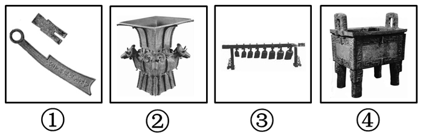

A. ①是先秦时期的货币

B. ②相传是大禹铸造的

C. ③是古代一种重要的乐器

D. ④在古代主要用于祭祀场合

第 44 题 · 答案与解析

**参考答案（粉笔题库参考内容）**

B

**解析**

B项错误，四羊方尊，商朝晚期偏早青铜器，属于礼器，祭祀用品。它是中国现存商代青铜器中最大的方尊，高58.3厘米，重近34.5公斤，1938年出土于湖南宁乡县黄材镇月山铺转耳仑的山腰上。不是大禹铸造的。

本题为选非题，故正确答案为B。

**本题相关知识点：**

1、先秦时期，货币以贝，刀、布、圆钱、蚁鼻钱（鬼脸钱）等为主。大部分的刀、布币币身极薄（部分地区釿布、戈邑方足布、即墨小刀等的币身较厚），刀币的浇口在首端。刀、布的浇口及边缘常有浇铸时挤出范外的多铜，因未加磨琢而呈自然状态。

2、图③为编钟，编钟是中国古代的一种打击乐器，用青铜铸成，它由大小不同的扁圆钟按照音调高低的次序排列起来，悬挂在一个巨大的钟架上，用丁字形的木锤和长形的棒分别敲打铜钟，能发出不同的乐音，因为每个钟的音调不同，按照音谱敲打，可以演奏出美妙的乐曲。

3、鼎是祭器，亦是食器，一般为三足两耳，形制有方有圆。后多作为祭器礼器，成为权力和威势的象征。

**考点**：中国历史

**来源**：2012年山东省公务员录用考试《行测》题第44题

### 第 45 题

下列有关知识产权的说法符合法律规定的是：

A. 国家版权局是著作权集体管理组织

B. 注册商标有效期满前未申请续展注册的，应在有效期满后被注销

C. 发明和实用新型属于专利权，而外观设计属于版权的范畴

D. 原则上县级以上行政区划的地名和公众知晓的外国地名不得作为商标

第 45 题 · 答案与解析

**参考答案（粉笔题库参考内容）**

D

**解析**

A项错误，根据《著作权集体管理条例》第三条第一款规定：“本条例所称著作权集体管理组织，是指为权利人的利益依法设立，根据权利人授权、对权利人的著作权或者与著作权有关的权利进行集体管理的社会团体。”

B项错误，根据《商标法》第四十条第一款规定：“注册商标有效期满，需要继续使用的，商标注册人应当在期满前十二个月内按照规定办理续展手续；在此期间未能办理的，可以给予六个月的宽展期。每次续展注册的有效期为十年，自该商标上一届有效期满次日起计算。期满未办理续展手续的，注销其注册商标。”因此，注册商标有效期满后还有六个月的宽展期，宽展期未续展的才注销商标。

C项错误，根据《专利法》第二条第一款规定：“本法所称的发明创造是指发明、实用新型和外观设计。”

D项正确，根据《商标法》第十条第一款规定：“县级以上行政区划的地名或者公众知晓的外国地名，不得作为商标。但是，地名具有其他含义或者作为集体商标、证明商标组成部分的除外；已经注册的使用地名的商标继续有效。”因此，原则上县级以上行政区划的地名和公众知晓的外国地名不得作为商标。

故正确答案为D。

**考点**：民法典

**来源**：2012年山东省公务员录用考试《行测》题第45题

### 第 46 题

下列有关新陈代谢的表述不正确的是：

A. 光合作用属于绿色植物新陈代谢的过程

B. 生物的新陈代谢过程都需要氧气的参与

C. 新陈代谢既有能量交换又有物质转化

D. 能否进行新陈代谢是区分生物与非生物的标准之一

第 46 题 · 答案与解析

**参考答案（粉笔题库参考内容）**

B

**解析**

生物体与外界环境之间的物质和能量交换以及生物体内物质和能量的转变过程叫做新陈代谢。根据生物体在氧化作用过程中对氧的需求情况，新陈代谢的基本类型可以分为需氧型、厌氧型和兼性厌氧型三种。厌氧型这一类型的生物有乳酸菌和寄生在动物体内的寄生虫等少数动物，它们在缺氧的条件下，仍能够将体内的有机物氧化，从中获得维持自身生命活动所需要的能量。这种新陈代谢类型叫做厌氧型，也叫做无氧呼吸型。并非生物的新陈代谢都需要氧气的参与。

本题为选非题，故正确答案为B。

**考点**：生物常识

**来源**：2012年山东省公务员录用考试《行测》题第46题

### 第 47 题

下列有关医药常识不正确的是：

A. 脾脏是人体的消化器官之一

B. 腮腺炎是呼吸道传染病

C. 河豚的毒素在其内脏中含量最高

D. 很多矿物质可以作为中药材使用

第 47 题 · 答案与解析

**参考答案（粉笔题库参考内容）**

A

**解析**

A项错误，脾脏是人体最大的周围淋巴样器官，其实质由红髓和白髓构成，具有造血和血液过滤功能，也是淋巴细胞迁移和接受抗原刺激后发生免疫应答、产生免疫效应分子的重要场所。

B项正确，腮腺炎是由腮腺炎病毒侵犯腮腺引起的急性呼吸道传染病，是儿童和青少年中常见的呼吸道传染病，成人中也有发病，由腮腺炎病毒所引起。

C项正确，河豚毒素主要聚集在血液和内脏中。

D项正确，硼砂、雄黄等矿物质也可作为中药材使用。

本题为选非题，故正确答案为A。

**考点**：生物常识

**来源**：2012年山东省公务员录用考试《行测》题第47题

### 第 48 题

下列网络技术中，不属于数据安全技术的是：

A. 网络防火墙

B. 数字媒体技术

C. 数字签名技术

D. 数字水印技术

第 48 题 · 答案与解析

**参考答案（粉笔题库参考内容）**

B

**解析**

数字媒体技术主要包含场景设计、角色形象设计、游戏程序设计、多媒体后期处理、人机交互技术，主要针对游戏开发和网站美工还有创意设计这类工作设计的专业，不是数据安全技术的范畴。

故正确答案为B。

**考点**：科技理论与成就

**来源**：2012年山东省公务员录用考试《行测》题第48题

### 第 49 题

下列有关生活常识的叙述，不正确的是：

A. 不慎扭伤关节，不应立即揉搓按摩

B. 洪水来袭，如来不及逃生可向高处转移等候营救

C. 火灾逃生时，应用湿毛巾或口罩蒙鼻，匍匐着撤离

D. 电热毯折叠加热，升温快，且便于热量保存

第 49 题 · 答案与解析

**参考答案（粉笔题库参考内容）**

D

**解析**

电热毯严格禁止折叠使用。折叠电热毯致使一些元件损坏，线路不畅通，容易导致漏电，所以使用电热毯的过程中，应经常检查电热毯是否有堆集、打褶现象，如有，应将皱褶摊平后再使用。

本题为选非题，故正确答案为D。

**考点**：生活常识

**来源**：2012年山东省公务员录用考试《行测》题第49题

### 第 50 题

对我国现阶段“三农”政策的理解不准确的是：

A. 扶贫标准是农民人均纯收入2300元

B. 农村最低生活保障制度就是扶贫开发

C. 农村集体土地指农民集体所有的建设用地、农用地和未利用地

D. 农业补贴政策包括种粮农民直接补贴、农资综合补贴、良种补贴和农机具购置补贴

第 50 题 · 答案与解析

**参考答案（粉笔题库参考内容）**

B

**解析**

本题考查时事政治。

农村最低生活保障制度和扶贫开发是两项制度。农村最低生活保障制度指由地方政府为家庭人均纯收入低于当地最低生活保障标准的农村贫困群众，按最低生活保障标准，提供维持其基本生活的物质帮助。该制度是在农村特困群众定期定量生活救济制度的基础上逐步发展和完善的一项规范化的社会救助制度。

本题为选非题，故正确答案为B。

**考点**：时事政治-其他

**来源**：2012年山东省公务员录用考试《行测》题第50题

### 第 51 题

甲乙两人参加射击比赛，规定每中一发记5分，脱靶一发倒扣3分。两人各打了10发子弹后，分数之和为52，甲比乙多得了16分。问甲中了多少发：

A. 9

B. 8

C. 7

D. 6

第 51 题 · 答案与解析

**参考答案（粉笔题库参考内容）**

B

**解析**

甲和乙的分数之和是52，分数之差是16，那么甲的分数是分，要是甲10发全部打中，则应该得50分，由差异分析可知，甲脱靶的发数为发，所以打中的发数为10－2＝8发。

故正确答案为B。

**考点**：和差倍比问题

**来源**：2012年山东省公务员录用考试《行测》题第51题

### 第 52 题

某公司计划采购一批电脑，正好赶上促销期，电脑打9折出售，同样的预算可以比平时多买10台电脑。问该公司的预算在平时能买多少台电脑：

A. 60

B. 70

C. 80

D. 90

第 52 题 · 答案与解析

**参考答案（粉笔题库参考内容）**

D

**解析**

设平时电脑10元一台，能买n台，由题意有10n=9(n+10)，解得n＝90。

故正确答案为D。

**考点**：经济利润问题

**来源**：2012年山东省公务员录用考试《行测》题第52题

### 第 53 题

某单位依据笔试成绩招录员工，应聘者中只有1/4被录取。被录取的应聘者平均分比录取分数线高6分，没有被录取的应聘者平均分比录取分数线低10分，所有应聘者的平均分是73分。

问录取分数线是多少分：

A. 80

B. 79

C. 78

D. 77

第 53 题 · 答案与解析

**参考答案（粉笔题库参考内容）**

B

**解析**

赋值应聘者共4人，则一人录取，3人被淘汰。假定录取分数线为A，则可知被录取者的分数为A+6，没有被录取的3个人的平均分为（A－10）分。

方法一：则根据题意可列式：A＋6＋3(A－10)＝4×73，解得A=79。

方法二：根据线段法口诀“距离（平均分差）与量（人数）成反比”得，（A+6-73）：（73-(A-10)）=3：1，解得A＝79。

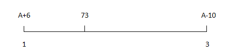

故正确答案为B。

**来源**：2012年山东省公务员录用考试《行测》题第53题

### 第 54 题

某蓄水池有一进水口A和一出水口B，池中无水时，打开A口关闭B口，加满整个蓄水池需2小时；池中满水时，打开B口关闭A口，放干池中水需1小时30分钟。现池中有占总容量1/3的水，问同时打开A、B口，需多长时间才能把蓄水池放干：

A. 90分钟

B. 100分钟

C. 110分钟

D. 120分钟

第 54 题 · 答案与解析

**参考答案（粉笔题库参考内容）**

D

**解析**

设水池中的水总量是3，那么A口一小时加1.5的量，B口一小时排2的量。因此两口同开，一小时排0.5的量。现在水池里有的量，所以需要2小时。

故正确答案为D。

**考点**：给完工时间型

**来源**：2012年山东省公务员录用考试《行测》题第54题

### 第 55 题

某篮球比赛14:00开始，13:30允许观众入场，但早有人来排队等候入场，假设从第一个观众来到时起，每分钟来的观众人数一样多，如果开3个入场口，13:45时就不再有人排队；如果开4个入场口，13:40就没有人排队，那么第一个观众到达的时间是：

A. 13:00

B. 13:05

C. 13:10

D. 13:15

第 55 题 · 答案与解析

**参考答案（粉笔题库参考内容）**

A

**解析**

本题为牛吃草的变形题型。设每分钟到达的观众人数为x，则根据牛吃草问题公式可得：（3-x）×15=（4-x）×10，解得x=1，即每分钟到达的观众人数为1。到13：45分时，总共有15×3=45人入场。因每分钟来的观众人数一样多，故从第一个观众到达一共经历了45÷1=45分钟。则第一个观众到达的时间为13：00。

故正确答案为A。

**来源**：2012年山东省公务员录用考试《行测》题第55题

### 第 56 题

甲从A地到B地需要30分钟，乙从B地到A地需要45分钟，甲乙两人同时从A、B两地相向而行，中间甲休息了20分钟，乙也休息了一段时间，最后两人在出发40分钟后相遇。

问乙休息了多长时间：

A. 25

B. 20

C. 15

D. 10

第 56 题 · 答案与解析

**参考答案（粉笔题库参考内容）**

A

**解析**

甲和乙走完全程分别要30、45分钟。甲在相遇时走了20分钟，走了全程的2/3，乙走了全程的1/3，应该用分钟。因此乙休息了40－15＝25分钟。

故正确答案为A。

**考点**：普通行程

**来源**：2012年山东省公务员录用考试《行测》题第56题

### 第 57 题

有两个三口之家一起出行去旅游，他们被安排坐在两排相对的座位上，其中一排有3个座位，另一排有4个座位。如果同一个家庭成员只能被安排在同一排座位相邻而坐，那么共有多少种不同的安排方法：

A. 36

B. 72

C. 144

D. 288

第 57 题 · 答案与解析

**参考答案（粉笔题库参考内容）**

C

**解析**

排座位坐两家人，有如下两种情况：

每个座位图有两排座位，每个家庭有3口人，因此每个图中所显示的坐法分别有种排列；两种坐法一共有种排列。

故正确答案为C。

**考点**：相邻问题

**来源**：2012年山东省公务员录用考试《行测》题第57题

### 第 58 题

某路公交车单程共有10个车站，从始发站出发时，车上共有乘客20人，之后中间每站新上5人，且车上所有乘客最多坐3站下车。

问最多会有多少名乘客在终点站下车：

A. 20

B. 10

C. 5

D. 15

第 58 题 · 答案与解析

**参考答案（粉笔题库参考内容）**

D

**解析**

由题意可知，最初的20人在第4站都要下车；每站新上的人都在3站后下车，那么只有第7站及以后的人才可能在终点站下车。也就是说最多有第7站、第8站、第9站的新上的人在终点站下车，因此最多有15人在终点站下车。

故正确答案为D。

**来源**：2012年山东省公务员录用考试《行测》题第58题

### 第 59 题

某公司的6名员工一起去用餐，他们各自购买了三种不同食品中的一种，且每人只购买了一份。已知盖饭15元一份，水饺7元一份，面条9元一份，他们一共花费了60元。

问他们中最多有几人买了水饺：

A. 1

B. 2

C. 3

D. 4

第 59 题 · 答案与解析

**参考答案（粉笔题库参考内容）**

C

**解析**

假定购买盖饭、水饺、面条的人数分别为X、Y、Z，根据题意X＋Y＋Z＝6，15X＋7Y＋9Z＝60。要使得水饺最多，则其他尽可能少。根据奇偶性质，可知X、Y、Z三个数中必然两个为奇数一个为偶数，或者三个均为偶数。将选项代入验证，若Y＝4，此时X、Z无正整数解；若Y＝3，可知X＝2，Z＝1，符合题意。

故正确答案为C。

**来源**：2012年山东省公务员录用考试《行测》题第59题

### 第 60 题

木工师傅为下图所示的3层模具刷漆，每层模具分别由1、3、6个边长1米的正方形组成。如果用一公斤漆可以刷20平方米的面积。那么为这个3层模具的所有外表面上色，需要几公斤漆：

A. 1.8

B. 1.6

C. 1.5

D. 1.2

第 60 题 · 答案与解析

**参考答案（粉笔题库参考内容）**

A

**解析**

堆积模具两个侧面及底面各有1＋2＋3个正方形，而斜坡方向上有这样组合3个，因此模具共有表面积为6×6＝36平方米。一公斤漆可以刷20平方米，所有外表面上色需要漆36÷20=1.8公斤，因此需要油漆1.8公斤。

故正确答案为A。

**考点**：几何公式类-立体图形

**来源**：2012年山东省公务员录用考试《行测》题第60题

### 第 61 题

1/6，1/3，1，4，20，( )。

A. 100

B. 108

C. 120

D. 128

第 61 题 · 答案与解析

**参考答案（粉笔题库参考内容）**

C

**解析**

原数列为作商递推数列。

该数列从第二项开始每一项分别是前一项的2倍、3倍、4倍、5倍，因此第六项应该是第五项的6倍，即20×6=120。

故正确答案为C。

**来源**：2012年山东省公务员录用考试《行测》题第61题

### 第 62 题

1，5，5，25，25，45，125，( )。

A. 45

B. 65

C. 125

D. 150

第 62 题 · 答案与解析

**参考答案（粉笔题库参考内容）**

B

**解析**

原数列为交叉数列。

奇数项：1、5、25、125，成等比数列；

偶数项：5、25、45、(65)，成等差数列。

故正确答案为B。

**来源**：2012年山东省公务员录用考试《行测》题第62题

### 第 63 题

\-1，2，0，4，4，12，（   ）

A. 4

B. 8

C. 12

D. 20

第 63 题 · 答案与解析

**参考答案（粉笔题库参考内容）**

D

**解析**

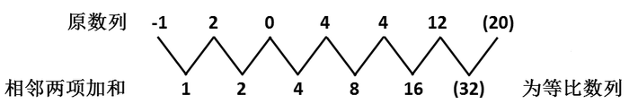

故正确答案为D。

**来源**：2012年山东省公务员录用考试《行测》题第63题

### 第 64 题

2.5，2，3，4，10，38，( )。

A. 92

B. 134

C. 256

D. 378

第 64 题 · 答案与解析

**参考答案（粉笔题库参考内容）**

D

**解析**

前两项之积，再减去2，等于第三项。因此未知项为10×38－2＝378。

故正确答案为D。

**来源**：2012年山东省公务员录用考试《行测》题第64题

### 第 65 题

A. 9

B. 18

C. 28

D. 32

第 65 题 · 答案与解析

**参考答案（粉笔题库参考内容）**

C

**解析**

。

具体的规律为，，按照这个规律，未知项为。

故正确答案为C。

**来源**：2012年山东省公务员录用考试《行测》题第65题

### 第 66 题

请从所给的四个选项中，选择最合适的一个填入问号处，使之呈现一定的规律性：

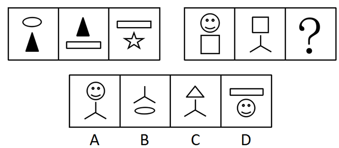

A. A

B. B

C. C

D. D

第 66 题 · 答案与解析

**参考答案（粉笔题库参考内容）**

B

**解析**

由题干可知，每个图形由上下两个元素构成，后一个图形上面的元素与前一个图形下面的元素相同，且下面的元素为新元素。依此规律观察选项，可知B选项符合题干规律。

故正确答案为B。

**考点**：数量规律-素

**来源**：2012年山东省公务员录用考试《行测》题第66题

### 第 67 题

请从所给四个选项中，选择最合适的一项填入问号处，使之呈现一定的规律性：

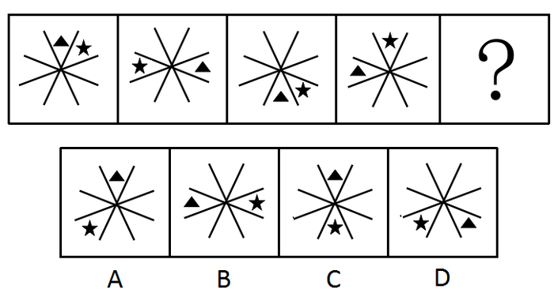

A. A

B. B

C. C

D. D

第 67 题 · 答案与解析

**参考答案（粉笔题库参考内容）**

A

**解析**

元素组成相同，考查位置规律。题干中前一个图形中黑色三角形顺时针移动两格，同时黑色五角星逆时针移动三格得到后一个图形。依此规律观察选项，可知A选项符合题干规律。

故正确答案为A。

**考点**：位置规律-平移

**来源**：2012年山东省公务员录用考试《行测》题第67题

### 第 68 题

从所给四个选项中，选择最合适的一个填入问号处，使之呈现一定的规律性。

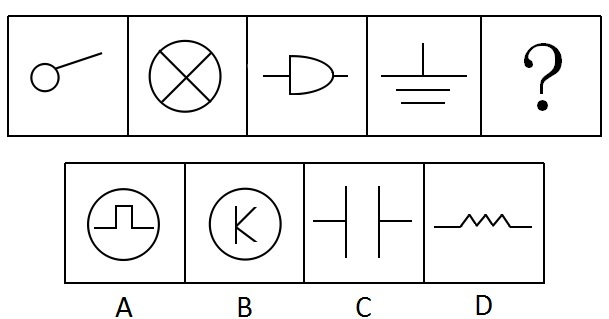

A. A

B. B

C. C

D. D

第 68 题 · 答案与解析

**参考答案（粉笔题库参考内容）**

A

**解析**

元素组成凌乱，考查数数--数直线。题干各图的直线数量依次为1、2、3、4、（？）。观察选项可知，直线数量分别为5，3，4，8。A项有5条直线，符合题干规律。

故正确答案为A。

**考点**：数量规律-线

**来源**：2012年山东省公务员录用考试《行测》题第68题

### 第 69 题

请从所给的四个选项中，选择最合适的一项填写在问号处，使之呈现一定的规律性。

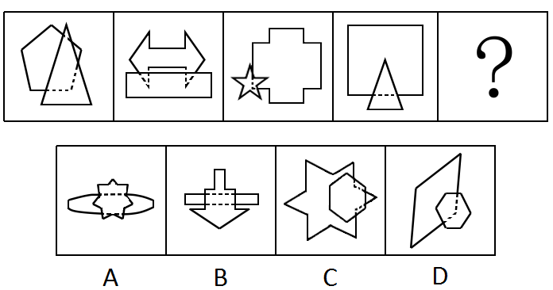

A. A

B. B

C. C

D. D

第 69 题 · 答案与解析

**参考答案（粉笔题库参考内容）**

C

**解析**

元素组成不同，且每幅图均为两个封闭图形相交，考虑图形间关系。观察发现，题干均由两个图形构成，边数少的图形位于边数多的图形上方，并且边数多的图形被边数少的图形覆盖的区域用虚线标示，只有C项符合规律。

故正确答案为C。

**考点**：特殊规律-图形间关系

**来源**：2012年山东省公务员录用考试《行测》题第69题

### 第 70 题

下列四项去掉哪一项后，剩下的图形可以呈现出一定的规律性：

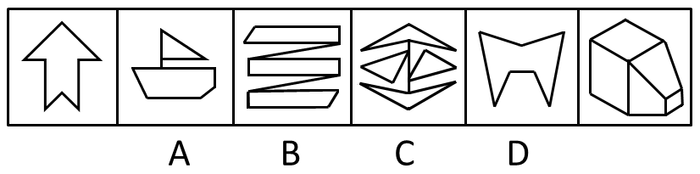

A. A

B. B

C. C

D. D

第 70 题 · 答案与解析

**参考答案（粉笔题库参考内容）**

D

**解析**

元素组成凌乱，考虑数数。本题考查封闭空间数量的递增。题干图形的封闭空间数量依次为1、2、3、4、1、5，去掉第五个图后，即去掉D项，图形封闭空间数量依次递增。

故正确答案为D。

**考点**：数量规律-面

**来源**：2012年山东省公务员录用考试《行测》题第70题

### 第 71 题

有形磨损和无形磨损是描述机器设备价值下降的概念。人才作为一种资源，也面临着有形磨损和无形磨损。人才的有形磨损是指随着年龄和工作时间的增长，同人才的身体和心理状况有关的体力、进取心和合作性等因素水平的下降。人才的无形磨损是指由于人才的观念、知识、方法相对落后造成人才的使用价值的下降。

根据上述定义，下列属于人才无形磨损的是：

A. 科室的陈力对新引进的遥感设备不感兴趣，也不积极学习

B. 在同一个岗位做了20年，刘主任有时觉得很烦躁、意志减退

C. 大学毕业生赵刚工作方法简单，经常受到同事的批评

D. 45岁的王组长常觉得自己的体力不支，发出“心有余而力不足”的感慨

第 71 题 · 答案与解析

**参考答案（粉笔题库参考内容）**

A

**解析**

第一步：找出定义中关键词。

人才无形磨损的关键词有“人才的观念、知识、方法相对落后”和“使用价值下降”。人才有形磨损的关键词有“体力、进取心和合作性”。

第二步：逐一判断选项。

A项： “新引进”“不积极学习”说明陈力原来的知识不够用，对应题干的“知识相对落后”，符合人才无形磨损定义；

B项：刘主任属于情绪变化，不符合人才无形磨损定义；

C项：赵刚方法简单，但不能定义为“落后”，不符合人才无形磨损定义；

D项：王组长属于人才有形磨损。

故正确答案为A。

**考点**：常规问法

**来源**：2012年山东省公务员录用考试《行测》题第71题

### 第 72 题

结构性流动指的是因生产技术或者社会结构方面的变革引起的社会环境、社会阶层和人口性质与分布的大规模变化，往往不以人的意志为转移。

根据上述定义，下列哪项不属于结构性流动：

A. 随着东部沿海经济的迅速发展，中西部人口大量东移

B. 由于国内发生军事政变，某国公民近期大量涌入邻国

C. 不满一线城市生活质量下降，人才纷纷向二三线城市回流

D. 城市化表现为乡村人口向城市的转移以及城市的不断发展、完善

第 72 题 · 答案与解析

**参考答案（粉笔题库参考内容）**

C

**解析**

第一步：找出定义关键词。

“因生产技术或者社会结构方面的变革引起”、“不以人的意志为转移”。

第二步：逐一分析选项。

C项中人才的回流是以个人意志为转移的，不符合“不以人的意志为转移”，不符合定义，当选。

A、B、D三项均符合“因生产技术或者社会结构方面的变革引起”、“不以人的意志为转移”，符合定义，排除。

本题为选非题，故正确答案为C。

**考点**：原因结果

**来源**：2012年山东省公务员录用考试《行测》题第72题

### 第 73 题

复种指数指的是一年内农作物总播种面积与耕地面积之比，一般用百分数表示。复种指数的高低受当地日照、土壤、水利、肥料、劳力和科学技术水平等条件的制约。日照条件好、无霜期长、水分充足、合理套种等是提高复种指数的基础。

根据上述定义，下列关于复种指数的叙述哪项是正确的：

A. 我国由南向北，地区复种指数逐渐增高

B. 复种指数和地区所处的经度有密切关系

C. 春季和秋季的复种指数要高于夏季和冬季

D. 较高的农业科技水平可使复种指数超过百分之百

第 73 题 · 答案与解析

**参考答案（粉笔题库参考内容）**

D

**解析**

第一步：抓住定义中关键词句。

定义强调“日照条件好、无霜期长、水分充足、合理套种等是提高复种指数的基础”。

第二步：逐一判断选项。

我国南方比北方湿润、暖和，所以复种指数由南向北是逐渐降低，A项错误；复种指数和地区的纬度密切相关，和经度关系不大，B项错误；春秋季的复种指数是低于夏季的，C项错误。D项描述的是利用科学技术水平提高复种指数，一年中农作物总播种面积是很容易超过耕地面积的，所以复种指数也能超过百分之百，描述正确。

故正确答案为D。

**考点**：单定义-其他句式

**来源**：2012年山东省公务员录用考试《行测》题第73题

### 第 74 题

能力的补偿是指同一个体的不同能力之间或组织内部成员之间能力的相互替代和补偿作用，从而保持或维持活动的正常进行。其中辐射补偿是指优势能力有效地加强了各种能力之间的相互联系或带动其它能力同时提高的现象。放大补偿是指优势能力的高度发展，有效地弥补某些薄弱能力的现象。

根据上述定义，下列各项中应用了辐射补偿的是：

A. 甲国足球队7号球员奔跑速度快，盘带技术强，在他的带动下，本方多次突破对方防线，射门得分

B. 乙国篮球运动员在体能上存在不足，但是凭借“魔鬼训练”弥补了身体上条件的不足，创造了奥运会三连冠的佳绩

C. 丙国跳水队中一位小将技术全面，实力较强，但是由于临场经验不足，有时会发挥失常，因此教练安排他参加团体比赛，第二个出场

D. 丁国乒乓球运动员的进攻实力是世界一流的，但是防守能力相对薄弱，在多次世界大赛中他们依靠强大的进攻使对手疲于防守，从而取得了胜利

第 74 题 · 答案与解析

**参考答案（粉笔题库参考内容）**

A

**解析**

第一步：抓住定义中关键词。

辐射补偿的关键词有“加强······联系”、“带动······提高”；放大补偿的关键词有“发展······弥补”。

第二步：逐一判断选项。

A项中，在“7号球员带动下······多次突破”符合辐射补偿定义；

B项中，“凭借······弥补”属于放大补偿；

C项中，让小将第二个出场，目的是为了降低他发挥失常的可能性，不符合定义；

D项中，运动员通过强大进攻弥补防守的薄弱，属于放大补偿。

故正确答案为A。

**考点**：常规问法

**来源**：2012年山东省公务员录用考试《行测》题第74题

### 第 75 题

短板理论是指木桶的盛水量是由组成木桶的木板中最短的那一块决定的，这块短板即为这个木桶盛水量的“限制因素”。

根据上述定义，下列不符合短板理论的是：

A. 某单位员工工作积极性降低，单位遂任命一位新领导，提高了团队士气

B. 某家长注重孩子的智力培养，忽视其心理健康，使得孩子因为心理问题而迷失自我

C. 某企业注重对技术精英的培养，对一般员工的使用和开发不足，致使团队士气受挫

D. 某酒业集团投入巨资做广告，一度成为酒业的新秀，但最终因产能不足，导致企业破产

第 75 题 · 答案与解析

**参考答案（粉笔题库参考内容）**

A

**解析**

第一步，找出定义关键词。

定义中强调的关键词句：“短板即为······限制因素”。

第二步，逐一分析选项。

A项中没有体现出短板对团队的影响，不符合定义；B项因为“忽视其心理健康”，C项“对一般员工的使用和开发不足”，D项的“产能不足”均属于短板的限制因素，符合定义。

本题为选非题，故正确答案为A。

**考点**：故事类

**来源**：2012年山东省公务员录用考试《行测》题第75题

### 第 76 题

替代效应是指当某种税的征收或税率变化影响相对价格或相对效益时，人们就选择另一种消费或活动来代替原先的消费或活动。

根据上述定义，下列不涉及替代效应的是：

A. 我国加入WTO后，不少进口商品的税率降低，人们更多地选购这些商品

B. 工资累进税率提高后，不少白领阶层选择用休息的方式来代替部分工作时间

C. 1717年英国曾征收窗户税，为了避免纳税，多数人纷纷将自家的窗户堵上

D. 国家开始对工业锅炉烧用的原油征税以后，不少企业纷纷更新设备或改用其他原料

第 76 题 · 答案与解析

**参考答案（粉笔题库参考内容）**

A

**解析**

第一步：找出定义关键词。

定义主要强调因为“税”的变化，“选择另一······代替原先的······”。

第二步：逐一分析选项。
A项：结果是“人们更多地选购这些商品”，但并没有包含“选择另一种消费来代替原先的消费”这层信息，因此不属于替代效应；

B项：因累进税变化，选择用休息代替工作，属于替代效应；
C项：因税收变化，住户放弃采光收益，进而“堵窗”，即选择另一种活动来代替原先的活动，属于替代效应；

D项：因原油税率的变化改用其他原料，属于替代效应。

本题为选非题，故正确答案为A。

**考点**：原因结果

**来源**：2012年山东省公务员录用考试《行测》题第76题

### 第 77 题

片利共生是指在生物界中两个物种间的生态关系，一种生物会因这个关系而获得生存上的利益，另一种生物在这个关系中，并没有获得任何益处，但也没有获得害处，只是带动对方去获取利益。

根据上述定义，下列现象属于片利共生的是：

A. 微生物寄生在反刍动物的胃内，同时还可以帮助反刍动物消化食物

B. 鲫鱼的游泳能力较差，其背鳍演变成吸盘吸附在鲨鱼身上，随着鲨鱼遨游四海，在鲨鱼捕获猎物时，鲫鱼就偷吃那些残存的食物

C. 藻类植物生长在树獭的粗毛夹缝中，在雨季时，藻类繁盛，形成绿色的伪装，使树獭更易在树丛中生存，藻类则借助树獭作为衍生的工具

D. 水母捕食海螺的幼虫，幼虫进入水母的体腔后不会被消化，反而获得食物及保护，幼虫长成离开水母体腔时，会带走一个水母繁殖体

第 77 题 · 答案与解析

**参考答案（粉笔题库参考内容）**

B

**解析**

第一步：找出定义关键词。

定义关键词： “一种生物······获得利益，对另一种生物······没有影响”。

第二步：逐一分析选项。

A、C两项中两种生物都获得了益处，D项中两种生物都受到影响，因此A、C、D三项均不符合定义；B项中鲫鱼借助鲨鱼获利，对鲨鱼没有任何影响，符合定义。

故正确答案为B。

**考点**：原因结果

**来源**：2012年山东省公务员录用考试《行测》题第77题

### 第 78 题

社会事实指的是存在于社会之中的一类具有非常特殊性质的事实。这类事实存在于个人之外，由具有使个人不能不服从的行为方式、思维方式和感觉方式构成，对于个人的行为具有约束力和强制性。它潜移默化地存在于人们的日常生活之中，个人如果触犯它就会受到惩罚。

根据上述定义，下列哪项不涉及社会事实：

A. 尊老爱幼

B. 先天下之忧而忧

C. 王子犯法，与庶民同罪

D. 入乡随俗

第 78 题 · 答案与解析

**参考答案（粉笔题库参考内容）**

B

**解析**

第一步：抓住定义中关键词。

定义强调的是“存在于个人之外······使个人不能不服从”。

第二步：逐一判断选项。

B项“先天下之忧而忧”只是一些人的理想，不是所有人都要服从的，不符合定义。A、C、D三项分别是中国的传统美德、规范和行为方式，均符合定义。

本题为选非题，故正确答案为B。

**考点**：单定义-其他句式

**来源**：2012年山东省公务员录用考试《行测》题第78题

### 第 79 题

无因管理是指未受委派，并无法定或约定义务而为他人管理事务。

根据上述定义，不属于无因管理的是：

A. 乙应甲的请求带其6岁的孩子到海边玩耍，小孩不慎落水，乙将其救起

B. 甲、乙是邻居，甲外出打工，乙为了避免甲的老宅遭受台风侵袭而垮塌，自行招工修缮甲宅

C. 甲家的马丢失，乙捡到马后，寻找马主未果，便养在自己家中，后甲找到乙将马取回

D. 甲养的鱼正值出售时节，甲突然因急事外出，乙看甲不在就将其所养的鱼出售，在甲回来后扣除销售成本将剩余钱款给甲

第 79 题 · 答案与解析

**参考答案（粉笔题库参考内容）**

A

**解析**

第一步：抓住定义中关键词。

无因管理强调的是“未受委派”、“并无法定或约定义务”。

第二步：逐一判断选项。

A项中乙应甲的请求带孩子玩耍，有照顾孩子的约定义务，不符合定义；B项中乙属于自愿行为，符合定义；C项中乙养马是捡到后的行为，符合定义；D项中乙未受委派并无义务出售甲的鱼，符合定义。

本题为选非题，故正确答案为A。

**考点**：单定义-其他句式

**来源**：2012年山东省公务员录用考试《行测》题第79题

### 第 80 题

行为经济学认为，互惠行为是一种条件合作行为，是对善意和助人的行为进行回报。互惠行为通过实施报答的形式而使对方获得利益，这种报答往往通过降低或损害自我利益而实现。根据上述定义，下列属于互惠行为的是（    ）。

A. 企业家刘志刚每年捐款资助癌症患者，获得社会各界的赞誉

B. 为了感谢同事救了自己落水的孩子，李玲让出了自己升职加薪的机会

C. 小王利用空余时间帮助新来的大学生熟悉业务，自己也因此得到锻炼

D. 为了长期的共同合作，总经理给供货商提供了很多优厚条件

第 80 题 · 答案与解析

**参考答案（粉笔题库参考内容）**

B

**解析**

第一步：判断题干中的关键词。

方式：“通过实施报答的形式而使对方获得利益”、“降低或损害自我利益”。

第二步：逐一分析选项。

A项，刘志刚资助癌症患者，不是对癌症患者的报答，不符合题干；

B项，李玲为了报答助人者，让出了自己升职加薪的机会，损害了自我利益，符合题干；

C项，小王帮助大学生，不是对大学生的报答，并且也没有降低或损害自我利益，不符合题干；

D项，共同合作，不是实施报答，不符合题干。

故正确答案为B。

**考点**：方式目的

**来源**：2012年山东省公务员录用考试《行测》题第80题

### 第 81 题

侦探：线索：结论

A. 医生：病情：诊断

B. 交警：违章：罚单

C. 裁缝：针线：衣服

D. 学生：复习：成绩

第 81 题 · 答案与解析

**参考答案（粉笔题库参考内容）**

A

**解析**

第一步：判断题干词语之间逻辑关系。

侦探通过调查线索得出结论。

第二步：判断选项词语之间逻辑关系。

A项，医生通过了解病情做出诊断，与题干逻辑关系一致，当选；

B项，交警对违章行为开出罚单，违章是动词，而题干中的线索是名词，与题干逻辑关系不一致，排除；

C项，裁缝用针线缝制衣服，针线是裁缝使用的工具，与题干逻辑关系不一致，排除；

D项，学生通过复习考出成绩，复习是实现目的的方式，而不是依据，与题干逻辑关系不一致，排除。

故正确答案为A。

**考点**：逻辑关系-对应关系

**来源**：2012年山东省公务员录用考试《行测》题第81题

### 第 82 题

锁具：保安员：安全

A. 日月：星辰：光明

B. 航母：导弹：战争

C. 手镯：项链：美观

D. 画框：纽扣：装饰

第 82 题 · 答案与解析

**参考答案（粉笔题库参考内容）**

C

**解析**

第一步：判断题干词语之间逻辑关系。

题干词语间属于对应关系。“锁具”和“保安员”的作用都是“安全”。

第二步：判断选项词语之间逻辑关系。

A项中“星辰”的作用不是“光明”，排除；B项中“航母”和“导弹”都应用于战争，而非作用是战争，排除；C项中“手镯”和“项链”的作用都是“美观”，当选；D项中“纽扣”的作用并不是“装饰”，排除。

故正确答案为C。

**考点**：逻辑关系-对应关系

**来源**：2016年重庆市选调优秀大学生到基层工作考试《行测》题第89题

### 第 83 题

蓝天：飞行员：战斗机

A. 草原：牧民：牛羊

B. 刺绣：绣女：绣花针

C. 森林：伐木工：电锯

D. 大海：水兵：军舰

第 83 题 · 答案与解析

**参考答案（粉笔题库参考内容）**

D

**解析**

第一步：判断题干词语间逻辑关系。

题干三个词属于对应关系，飞行员驾驶战斗机飞行在蓝天上，战斗机是飞行员的专用军用工具，蓝天是场所。

第二步：判断选项词语间逻辑关系。

A项，牛羊是放牧的客体，非牧民也可以放牧，牛羊不属于牧民的专用工具，不符合题意；

B项，刺绣是绣女的作品，而非场所，不符合题意；

C项，非伐木工也可使用电锯，电锯不是伐木工的专用工具，不符合题意；

D项，水兵驾驶军舰行驶在大海上，军舰是水兵的专用军用工具，大海是场所，符合题意。

故正确答案为D。

**考点**：逻辑关系-对应关系

**来源**：2012年山东省公务员录用考试《行测》题第83题

### 第 84 题

理想对于（    ），相当于（    ）对于行动。

A. 现实 作风

B. 动机 规划

C. 蓝图 希望

D. 奋斗 目标

第 84 题 · 答案与解析

**参考答案（粉笔题库参考内容）**

D

**解析**

逐一代入选项。

A项，前两词构成反义关系，后两词无明显逻辑关系，前后逻辑关系不一致，排除；

B项，前两词无明显逻辑关系，后两词为依据的对应关系，前后逻辑关系不一致，排除；

C项，蓝图可以象征理想，后两词无明显逻辑关系，前后逻辑关系不一致，排除；

D项，通过奋斗实现理想，通过行动实现目标，前后两词均为方式目的的对应关系，前后逻辑关系一致，当选。

故正确答案为D。

**考点**：逻辑关系-对应关系

**来源**：2012年山东省公务员录用考试《行测》题第84题

### 第 85 题

（    ）对于汽车，相当于（    ）对于人体。

A. 发动机 心脏

B. 车轮 关节

C. 汽油 肌肉

D. 方向盘 眼睛

第 85 题 · 答案与解析

**参考答案（粉笔题库参考内容）**

A

**解析**

第一步：将选项逐一代入，判断词语之间的逻辑关系。

A项中心脏为人体提供动力，就如同发动机为汽车提供动力，均为类比的对应关系；B、C、D三项代入后前后均为对应关系，但类比均不恰当。

第二步：逻辑关系相同即为答案。

A项前后逻辑相同，类比恰当。

故正确答案为A。

**考点**：逻辑关系-对应关系

**来源**：2012年山东省公务员录用考试《行测》题第85题

### 第 86 题

荷花：莲子

A. 绿豆：豆芽

B. 韭菜花：韭菜

C. 大蒜：蒜苗

D. 葵花：葵花子

第 86 题 · 答案与解析

**参考答案（粉笔题库参考内容）**

D

**解析**

第一步：判断题干词语间逻辑关系。

题干两词为对应关系，莲子是荷花的种子。

第二步：判断选项词语间逻辑关系。

A项，绿豆是绿豆芽而非豆芽的种子，且两者顺序与题干不一致，排除；

B项，韭菜花是韭菜开的花，而非种子，排除；

C项，大蒜为蒜苗的种子，但两者顺序与题干不一致，排除；

D项，葵花子为葵花的种子，符合题干，当选。

故正确答案为D。

**考点**：逻辑关系-对应关系

**来源**：2012年山东省公务员录用考试《行测》题第86题

### 第 87 题

锦上添花：雪上加霜

A. 美不胜收：目不暇接

B. 耀武扬威：弃甲曳兵

C. 水滴石穿：磨棒成针

D. 雨后春笋：每况愈下

第 87 题 · 答案与解析

**参考答案（粉笔题库参考内容）**

B

**解析**

第一步：判断题干词语间逻辑关系。

“锦上添花”形容好上加好，“雪上加霜”形容坏上加坏，二者是反义词。

第二步：判断选项词语间逻辑关系。

A项：“美不胜收”形容美好的东西很多，一时看不过来。“目不暇接”形容眼前美好事物太多，或景物变化太快，眼睛来不及观看。二者是近义词，与题干逻辑关系不一致，排除；

B项：“耀武扬威”表示炫耀武力，显示威风。“弃甲曳兵”形容打败仗后狼狈逃跑的样子。二者是反义词，与题干逻辑关系一致，当选；

C项：“水滴石穿”比喻学习或工作有恒心，有毅力，坚持不懈，这样才能获得成功。“磨棒成针”比喻只要有恒心，有毅力，做任何事情都能成功。二者是近义词，与题干逻辑关系不一致，排除；

D项：“雨后春笋”比喻新生事物迅速大量地涌现出来。“每况愈下”表示情况越来越坏。二者不是反义词，与题干逻辑关系不一致，排除。

故正确答案为B。

**考点**：语义关系-反义关系

**来源**：2012年山东省公务员录用考试《行测》题第87题

### 第 88 题

大步流星：走路

A. 指手画脚：教导

B. 歌舞升平：跳舞

C. 奋笔疾书：书写

D. 闻鸡起舞：勤奋

第 88 题 · 答案与解析

**参考答案（粉笔题库参考内容）**

C

**解析**

第一步：判断题干词语之间逻辑关系。

大步流星修饰走路的状态，题干两词属于对应关系。

第二步：判断选项词语之间逻辑关系。

C项，奋笔疾书修饰书写的状态，与题干逻辑一致；A、B两项前面词语均不存在对后面词语状态的修饰关系；D项中的勤奋为形容词，而题干中的走路为动词。

故正确答案为C。

**考点**：逻辑关系-对应关系

**来源**：2012年山东省公务员录用考试《行测》题第88题

### 第 89 题

教师：学生

A. 丈夫：妻子

B. 出版商：读者

C. 商家：客户

D. 警察：罪犯

第 89 题 · 答案与解析

**参考答案（粉笔题库参考内容）**

D

**解析**

第一步：判断题干词语间逻辑关系。

造句子：教师教导学生，二者为主宾关系，且教师是一种职业。

第二步：判断选项词语间逻辑关系。

A项：丈夫不是职业，与题干逻辑关系不一致，排除；

B项：出版商是负责出版作品的，与读者没有明显的逻辑关系，与题干逻辑关系不一致，排除；

C项：商家服务客户而不是教导客户，且商家不是一种具体的职业，而是一个抽象的概念，与题干逻辑关系不一致，排除；

D项：警察教导罪犯，二者为主宾关系，且警察是一种职业，与题干逻辑关系一致，当选。

故正确答案为D。

**考点**：语法关系

**来源**：2012年山东省公务员录用考试《行测》题第89题

### 第 90 题

桥梁：河岸

A. 信件：邮局

B. 楼梯：楼层

C. 电话：沟通

D. 火车：终点

第 90 题 · 答案与解析

**参考答案（粉笔题库参考内容）**

B

**解析**

第一步：判断词语之间逻辑关系。

题干两词均为名词，且桥梁连接河岸，两词构成对应关系。

第二步：判断选项词语之间逻辑关系。

C项沟通不属于名词；A、D两项不构成“连接”的对应关系；B项中楼梯连接楼层，与题干逻辑关系一致。

故正确答案为B。

**考点**：逻辑关系-对应关系

**来源**：2012年山东省公务员录用考试《行测》题第90题

### 第 91 题

垃圾焚烧发电被列入国家发改委《可再生能源发展“十一五”规划》，有专家认为垃圾焚烧是一种安全环保的垃圾处理方式。

以下哪项如果为真，最能削弱上述专家观点：

A. 焚烧垃圾产生的有机物无法自然分解

B. 1吨生活垃圾焚烧后可以发电300度至500度

C. 1吨生活垃圾焚烧后残留物只有原先的10%至15%

D. 在日本，70%的生活垃圾被回收利用而不是被焚烧

第 91 题 · 答案与解析

**参考答案（粉笔题库参考内容）**

A

**解析**

第一步：找到论点和论据。

论点为：垃圾焚烧是一种安全环保的垃圾处理方式；题干中没有论据。

第二步：判断削弱方式。削弱论点。

第三步：逐一判断选项。

A项说明垃圾焚烧的缺点，有力地削弱了论点；B、C两项为垃圾焚烧的优点，与题干意思一致，属加强项；D项说明大部分垃圾没有被焚烧，但不一定焚烧垃圾就不好，且是日本的做法，与我国无关，属无关项。

故正确答案为A。

**考点**：削弱论点

**来源**：2012年山东省公务员录用考试《行测》题第91题

### 第 92 题

在城镇化过程当中，当城镇化率超过50%以后，城镇化减速的现象将逐渐出现。阻止城镇化减速的一个必备的战略思路是加快农民工市民化进程，加快这一进程的一个必要举措是建设农民工信息系统和信用体系。

由此可以推出：

A. 如果没能阻止城镇化减速，也就没有加快农民工市民化

B. 如果加快农民工市民化进程，就可以阻止城镇化减速

C. 如果不建设农民工信息系统和信用体系，就不能阻止城镇化减速

D. 如果建设农民工信息系统和信用体系，就可以推进农民工市民化进程

第 92 题 · 答案与解析

**参考答案（粉笔题库参考内容）**

C

**解析**

第一步：翻译题干，利用充分必要条件。

①阻止城镇化减速→加快农民工市民化进程；②加快农民工市民化进程→建设农民工信息系统和信用体系。

两个推导关系连起来为：阻止城镇化减速→加快农民工市民化进程→建设农民工信息系统和信用体系

第二步：逐一翻译选项并判断正确选项，利用逆否规则。

A项，－阻止城镇化减速→加快农民工市民化进程，“－阻止城镇化减速”是否定①中的前件，否前件不能推出否后件，错误；B项，“加快农民工市民化进程→阻止城镇化减速”，是肯定①中的后件，肯后件无法推出肯前件，错误；C项，－建设农民工信息系统和信用体系→阻止城镇化减速，为题干推导关系②的逆否命题，正确；D项，建设农民工信息系统和信用体系→加快农民工市民化进程，“建设农民工信息系统和信用体系”肯定②中的后件，肯后件无法推出肯前件，错误。

故正确答案为C。

**考点**：常规翻译

**来源**：2012年山东省公务员录用考试《行测》题第92题

### 第 93 题

英国剑桥大学专家称，早期人类的大脑比现代人类更大，而且现代人类比早期人类身材矮小10%。这项研究颠覆了此前的理论——现代人类伴随着进化变得更高、更强壮。科学家称，这种人类进化衰减性出现在过去一万年左右，很可能是由于农业的出现导致的。农业耕作出现之后，人类受限于食物种类的减少以及疾病的蔓延，所以出现了进化衰减现象。

以下哪项如果为真，最不能质疑研究人员的假设：

A. 据研究，人类大规模农业耕作出现在5000年前

B. 一万年前，居住在非洲的人身材和现代人类差不多

C. 随着农业水平的提高，人类的食物种类远多于一万年前

D. 早期人类患病没有办法医治，身体残弱者在进化中均遭到淘汰

第 93 题 · 答案与解析

**参考答案（粉笔题库参考内容）**

D

**解析**

第一步：找到论点和论据。

论点是“这种人类进化衰减性出现在过去一万年左右，很可能是由于农业的出现导致的”。论据是“农业耕作出现之后，人类受限于食物种类的减少以及疾病的蔓延，所以出现了进化衰减现象”。

第二步：判断削弱方式。

论点本身包含了一个因果关系，而论据说明了这个因果关系，因此需削弱论点，即削弱这个因果关系。

第三步：逐一判断选项。

A项中“人类大规模农业耕作出现在5000年前”表明农业耕作出现的时间与衰减性出现的时间不一致，这说明人类衰退与农业耕作无关，削弱了论点中的因果关系。

B项中“一万年前，居住在非洲的人身材和现代人类差不多”说明衰退化现象并没有出现，没有衰退现象就意味着农业耕作与人类衰退无关，削弱了论点中的因果关系。

C项中“人类的食物种类远多于一万年前”说明农业耕作出现后，人类并没有受限于食物的种类，因此人类衰退和农业耕作无关，削弱了论点中的因果关系。

D项中“身体残弱者在进化中均遭到淘汰”表明现代人类比早期人类更强壮，人类并没有衰退，但是没有涉及农业耕作在这过程中的影响，没有削弱论点中的因果关系，最不能质疑假设。

故正确答案为D。

**考点**：削弱选非题

**来源**：2012年山东省公务员录用考试《行测》题第93题

### 第 94 题

在人事科科长人选问题上，某局决定由单位全体工作人员投票产生，得票前三名作为候选人，每人只需在本局职工名单上打勾即可。计票组发现，刚毕业的张浩没有打任何人的勾；凡是对赵杰打勾的人，王明对这些人都打了勾；没有得全票的人李紫露都打了勾。

由此可以推出：

A. 王明和李紫露相互没打勾

B. 王明和李紫露相互打了勾

C. 王明选了李紫露，但是李紫露没有选王明

D. 王明没选李紫露，但是李紫露选了王明

第 94 题 · 答案与解析

**参考答案（粉笔题库参考内容）**

B

**解析**

第一步：抓住题干主要信息。

①刚毕业的张浩没有打任何人的勾；②凡是对赵杰打勾的人，王明对这些人都打了勾；③没有得全票的人李紫露都打了勾。

第二步：从事实信息开始推导，得出答案。

从事实信息“张浩没有打任何人的勾”可知，没有人得全票。而李紫露给没得全票的人都打了勾，因此李紫露给所有人都打勾了，包括赵杰、王明。而所有给赵杰打勾的人，王明都给打勾了，因此王明给李紫露打勾了。

故正确答案为B。

**考点**：日常结论

**来源**：2012年山东省公务员录用考试《行测》题第94题

### 第 95 题

在某次调查中，有高达2/3的受访者认为目前影响安全感最重要的因素是收入的高低。分析不同收入人群的安全感，发现月收入在3000～6000元的人群，安全感要明显低于月收入在6000～8000元的人群。因此，收入越低，安全感越低。

以下哪项如果为真，不能削弱上述观点：

A. 收入在3000~6000元的人群生活成本比其他群体更高

B. 很多人认为收入稳定比收入多更容易给人安全感

C. 收入在1500~3000元的人群更有安全感

D. 收入不是影响安全感的唯一因素，食品、婚姻等都对安全感有同等重要的作用

第 95 题 · 答案与解析

**参考答案（粉笔题库参考内容）**

A

**解析**

第一步：找到论点和论据。

论点：收入越低，安全感越低。

论据：月收入在3000~6000元的人群，安全感要明显低于月收入在6000~8000元的人群。

第二步：判断削弱方式。

论点和论据间存在逻辑联系，需削弱论点。

第三步：逐一判断选项。

A项说收入在3000~6000元的人群生活成本，而题干说收入水平与安全感的联系，与题干论点无关；

B项中“很多人认为收入稳定比收入多更容易给人安全感”和D项中“收入不是影响安全感的唯一因素，食品、婚姻等都对安全感有同等重要的作用”都说明导致安全感低的原因不只是收入问题，B、D两项削弱了论点中的原因，即削弱了论点；

C项中“收入在1500~3000元的人群更有安全感”表明收入低的人群更有安全感，直接削弱了论点。

故正确答案为A。

**考点**：削弱选非题

**来源**：2012年山东省公务员录用考试《行测》题第95题

### 第 96 题

无论是从全球范围，还是从我国的实际情况来看，人类文明都发展到了这样一个阶段，即保护生态环境，确保人与自然的和谐，是经济能够得到可持续发展的必要前提，也是人类文明得以延续的保证。

由此可以推出：

A. 如果经济不可持续发展，就是没有搞好环境保护

B. 只有搞好环境保护，才能实现经济的可持续发展

C. 即使没有搞好环境保护，也能实现经济的可持续发展

D. 只有实现了经济的可持续发展，环境保护才能搞得好

第 96 题 · 答案与解析

**参考答案（粉笔题库参考内容）**

B

**解析**

第一步：翻译题干。

题干指出保护生态环境是经济可持续发展的必要前提，即经济可持续发展→保护生态环境。

第二步：逐一分析选项。

A项：翻译为“-经济可持续发展→—保护生态环境”，是对题干条件的否前，否前得不到确定性的结论，无法推出，排除；

B项：翻译为“经济可持续发展→保护生态环境”，是对题干条件的肯前，肯前必肯后，可以推出，当选；

C项：“即使······也······”不是逻辑关联词，一般不翻译，根据题干“经济可持续发展→保护生态环境”可知，没有保护生态环境，经济就一定不能可持续发展，所以选项的“也能实现经济的可持续发展”无法推出，排除；

D项：翻译为“保护生态环境→经济可持续发展”，是对题干条件的肯后，肯后得不到确定性的结论，无法推出，排除。

故正确答案为B。

**考点**：常规翻译

**来源**：2012年山东省公务员录用考试《行测》题第96题

### 第 97 题

某研究机构耗时9年，追踪调查6.3万健康人士的饮食习惯，包括肉的食用量、肉类烹调方式以及肉类煮熟程度等，研究小组按食用烤肉量的多少把研究对象分为5组。截止研究结束时，共有208人患上胰腺癌，他们大多集中在烤肉食用量最高的两组。因此，研究者得出大量食用烤肉更容易患胰腺癌。

以下哪项如果为真，最能削弱上述结论：

A. 研究表明，父母若有一人患胰腺癌，子女患该病的几率将提高30%

B. 研究表示，长期食用煮食肉类和长期食用烤肉的人群相比，患胰腺癌的比例相当

C. 调查数据表示，大量食用烤肉的人有98%都喜欢一边喝啤酒一边吃烤肉，并且常常熬夜

D. 该研究中偏好半熟烤肉的人罹患胰腺癌的比例比偏好全熟烤肉的人高约60%

第 97 题 · 答案与解析

**参考答案（粉笔题库参考内容）**

C

**解析**

第一步：找出论点和论据。

论点：大量食用烤肉更容易患胰腺癌。

论据：研究小组按食用烤肉量的多少把研究对象分为5组。截止研究结束时，共有208人患上胰腺癌，他们大多集中在烤肉食用量最高的两组。

第二步：逐一分析选项。

A项：该项说明遗传因素会提高患胰腺癌的概率，与大量食用烤肉是否更容易患胰腺癌无关，为无关项，不能削弱，排除；

B项：该项说明长期食用煮食肉类和长期食用烤肉的人群相比，患胰腺癌的比例相当，而论点讨论的是大量食用烤肉，话题不一致，不能削弱，排除；

C项：该项说明大量食用烤肉的人同时有喝啤酒和常常熬夜的习惯，在大量食用烤肉的基础上增加了“喝啤酒和常常熬夜”，属于他因削弱，当选；

D项：该项指出偏好半熟烤肉的人罹患胰腺癌的比例比偏好全熟烤肉的人高，吃半熟烤肉的人和全熟烤肉的人都是吃烤肉的人，不能削弱，排除。

故正确答案为C。

**考点**：他因削弱

**来源**：2012年山东省公务员录用考试《行测》题第97题

### 第 98 题

小女孩喜欢洋娃娃，小男孩更爱玩具汽车，这是天生本能反应还是后天环境影响下的选择？在一项实验中，研究人员观察了3~8个月大的婴儿对玩具的喜好，发现女婴盯着粉色洋娃娃看的时间明显长于玩具卡车，而男婴关注蓝色卡车的时间更多。因此，研究者认为婴儿对玩具的不同偏好或许是由性别基因决定的。

上述结论隐含的假设是什么：

A. 婴儿对新鲜事物关注的时间长

B. 婴儿对玩具的爱好不受玩具的颜色的影响

C. 玩具卡车和洋娃娃的摆放位置的不同会对婴儿的注意力产生影响

D. 大多数婴儿更容易注意到和自己衣服色调相同或接近的玩具

第 98 题 · 答案与解析

**参考答案（粉笔题库参考内容）**

B

**解析**

第一步：找到论点和论据。

论点：婴儿对玩具的不同偏好由性别基因决定。

论据：女婴盯着粉色洋娃娃看的时间明显长于玩具卡车，而男婴关注蓝色卡车的时间更多。

第二步：逐一分析选项。

A项：强调对新鲜事物关注时间长，没有提到婴儿的性别和玩具选择之间的关系，无关项，排除；

B项：题干中有玩具颜色和玩具种类两种变量，选项排除了玩具颜色对实验结果的影响，从而说明只有玩具种类对实验结果有影响，又因为男婴和女婴对玩具种类的偏好不同，所以证明了婴儿对玩具的不同偏好由性别基因决定，加强了论证，当选；

C项：说明摆放位置不同会影响婴儿对玩具的偏好，那么说明婴儿对玩具的不同偏好不是由性别基因决定的，而是受到了摆放位置的影响，削弱了论点，排除；

D项：强调婴儿自己衣服颜色会影响婴儿对玩具的偏好，说明婴儿对玩具的不同偏好不是由性别基因决定的，而是受到婴儿衣服颜色的影响，削弱了论点，排除。

故正确答案为B。

**考点**：必要条件

**来源**：2012年山东省公务员录用考试《行测》题第98题

### 第 99 题

实验发现，将小鼠突然置身于巨大的声响（恐惧）中小鼠大脑杏仁体内特定细胞更活跃，脑内一种特殊的“恐惧蛋白”会增加，这种“恐惧蛋白”含量在于一种名为“GluAl”的物质。缺少“GluAl”的小鼠会保持与巨大声响相关的恐惧记忆，而其他小鼠则不会。因此实验得出结论，研制“GluAl”类药物可以帮助人们删除痛苦或恐惧等不好的记忆，只留下快乐时光。

下列哪项如果为真，不能质疑上述结论：

A. 小鼠跟人的神经系统差距很大，小鼠实验结果很难应用到人身上

B. 杏仁体负责掌管焦虑、急躁、惊吓及恐惧等负面情绪的产生和调控

C. GluAl删除了恐怖记忆，也删除了自我保护记忆

D. 长期服用GluAl类药物可能导致健忘症

第 99 题 · 答案与解析

**参考答案（粉笔题库参考内容）**

B

**解析**

第一步：找到论点和论据。

论点为“GluAl”类药物可以帮助人们删除痛苦或恐惧等不好的记忆；论据为缺少“GluAl”的小鼠会保持与巨大声响相关的恐惧记忆，而其他小鼠则不会。

第二步：逐一判断选项的削弱方式。

A项切断了论据与论点的联系，属于削弱论证；B项中的杏仁体与题干论点论据无关；C、D两项说明了GluAl的缺点，直接削弱论点。

故正确答案为B。

**考点**：削弱选非题

**来源**：2012年山东省公务员录用考试《行测》题第99题

### 第 100 题

吴旭、郑洁和沈瑶三人打算到南京故地重游，三人选择飞机、火车、汽车和轮船之一出行，但各人出行方式均不相同。如果郑洁选择汽车出行，则吴旭不选择轮船；如果吴旭选择火车出行，则沈瑶不选择飞机；沈瑶选择飞机、火车之一出行。

根据以上陈述可知，下列哪项必定是错误的：

A. 沈瑶选择飞机，而郑洁选择汽车

B. 沈瑶选择飞机，而郑洁选择轮船

C. 沈瑶选择火车，而郑洁选择汽车

D. 沈瑶选择火车，而郑洁选择飞机

第 100 题 · 答案与解析

**参考答案（粉笔题库参考内容）**

A

**解析**

第一步：分析题干条件。

（1）郑洁汽车→—吴旭轮船；

（2）吴旭火车→—沈瑶飞机；

（3）沈瑶→飞机/火车。

第二步：根据题干条件进行推理。

提问方式为“必定错误”，优先考虑代入法。

代入A项：“沈瑶选择飞机”是对条件（2）的否后，否后必否前，可以得到吴旭不选择火车。由于只有飞机、火车、汽车、轮船四种方式，沈瑶选择飞机，吴旭不选择火车，那么吴旭只能选择汽车或轮船。且根据选项可知“郑洁选择汽车”，那么吴旭只能选择轮船。但“郑洁选择汽车”是对条件（1）的肯前，肯前必肯后，可以得到吴旭不选择轮船，那么此时轮船、汽车、火车、飞机吴旭均不能选，与题干不符，该项必定错误，当选；

代入B项：沈瑶选择飞机，吴旭只能选择汽车或轮船，且郑洁选择轮船，则吴旭可以选择汽车，该项可能成立，排除；

代入C项：沈瑶选择火车符合条件（3）。郑洁选择汽车，则吴旭不选择轮船，那么吴旭必然选择飞机，该项可能成立，排除；

代入D项：沈瑶选择火车符合条件（3）。郑洁选择飞机，那么吴旭可以选择汽车或轮船，该项可能成立，排除。

本题为选非题，故正确答案为A。

**考点**：常规翻译

**来源**：2012年山东省公务员录用考试《行测》题第100题

## 材料 1

根据所给的资料，完成各题。

        2010年，我国黄金产量340.88吨，同比增长8.57%。其中矿产金280.04吨，同比增长7.27%；有色副产金60.84吨，同比增长14.95%。

        2010年，我国黄金企业实现工业总产值2292.88亿元，同比增长66.72%；实现利润248.74亿元，同比增78.19%。

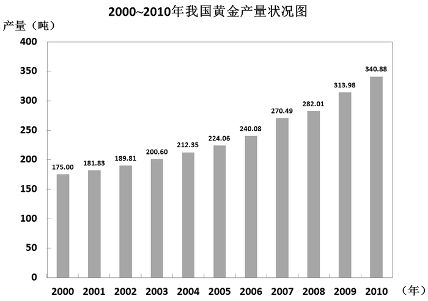

### 第 101 题

2010年，我国矿产金产量占黄金产量的比重约为：

A. 80%

B. 82%

C. 84%

D. 86%

第 101 题 · 答案与解析

**参考答案（粉笔题库参考内容）**

B

**解析**

根据题干所求“2010年······占······的比重”，结合材料时间，可判定本题为现期比重问题。定位材料第一段可得，“2010年我国矿产金产量280.04吨，黄金产量为340.88吨”。故2010年我国矿产金产量占黄金产量的比重为。

故正确答案为B。

**考点**：现期比重、综合资料

**来源**：2012年山东省公务员录用考试《行测》题第101题

### 第 102 题

上图中我国的黄金产量超过200吨的年份有几个：

A. 7

B. 8

C. 9

D. 10

第 102 题 · 答案与解析

**参考答案（粉笔题库参考内容）**

B

**解析**

定位柱状图中的数据可知，图中我国的黄金产量超过200吨的年份有8个，分别为2003年~2010年。

故正确答案为B。

**考点**：直接找数、综合资料

**来源**：2012年山东省公务员录用考试《行测》题第102题

### 第 103 题

2010年，我国黄金企业工业总产值同比增长了约多少亿元：

A. 918

B. 920

C. 922

D. 924

第 103 题 · 答案与解析

**参考答案（粉笔题库参考内容）**

A

**解析**

根据题干所求“2010年，我国黄金企业工业总产值同比增长······亿元”，可判定本题为增长量计算问题。定位材料第二段可得，“2010年，我国黄金企业实现工业总产值2292.88亿元，同比增长66.72%”。故2010年我国黄金企业工业总产值同比增长量为=亿元，与A项最接近。

故正确答案为A。

**考点**：增长量计算、综合资料

**来源**：2012年山东省公务员录用考试《行测》题第103题

### 第 104 题

能够从上述资料中推出的是：

A. 2009年我国黄金企业利润约为170亿元

B. 2010年我国黄金产量是2000年的2倍多

C. 2010年我国黄金产量首次突破300吨

D. 2000年以来我国黄金产量每年均有所增长

第 104 题 · 答案与解析

**参考答案（粉笔题库参考内容）**

D

**解析**

A项，定位材料第二段可得，“2010年我国黄金企业实现利润248.74亿元，同比增长78.19%”，2009年利润为亿元，排除；

B项，定位柱状图可得，2000年黄金产量为175吨，2010年黄金产量为340.88吨，所求倍数为340.8/1751.95，排除；

C项，定位柱状图可得，2009年我国黄金产量已经突破了300吨，2010年并非“首次”突破300吨，排除；

D项，定位柱状图可得，2000年以来我国黄金产量每年均有所增长，当选。

故正确答案为D。

**考点**：综合分析、综合资料

**来源**：2012年山东省公务员录用考试《行测》题第104题

### 第 105 题

以下哪一年黄金产量同比增速最快：

A. 2007年

B. 2008年

C. 2009年

D. 2010年

第 105 题 · 答案与解析

**参考答案（粉笔题库参考内容）**

A

**解析**

根据题干所求“哪一年同比增速最快”，可判定本题为增长率比较问题。定位柱状图数据，代入增长率计算公式：。

A项，2007年，黄金产量同比增速；

B项，2008年，黄金产量同比增速；

C项，2009年，黄金产量同比增速；

D项，2010年，黄金产量同比增速。

故2007年黄金产量同比增速最快。

故正确答案为A。

**考点**：一般增长率、综合资料

**来源**：2012年山东省公务员录用考试《行测》题第105题

## 材料 2

根据所给资料，完成各题。

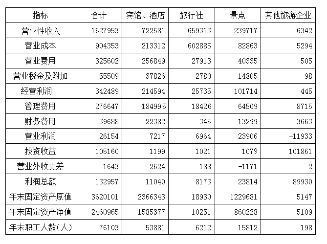

### 第 106 题

下列关于2009年该市旅游部门财务情况的描述，与资料相符的是：

A. 营业成本占营业收入比重最高的是旅行社

B. 景点的利润总额不到宾馆、酒店的两倍

C. 宾馆、酒店的投资收益在各旅游部门中最高

D. 景点的年末职工人数占所有旅游部门年末职工人数的一半以上

第 106 题 · 答案与解析

**参考答案（粉笔题库参考内容）**

A

**解析**

A项，定位表格可得，宾馆、酒店，旅行社，景点，其他旅游企业营业成本占营业收入的比重分别为：213312/722581，602885/659313，82863/239717，5294/6342，首先通过观察可判断旅行社和其他旅游企业比重较高，其中旅行社比重=，其他旅游企业比重，所以比重最高的是旅行社，正确；

B项，定位表格数据可得，景点的利润为23814万元，宾馆、酒店的利润为11040万元，故所求比值为23814/11040\>2，错误；

C项，定位表格数据可得，投资收益最高的是其他旅游企业，不是宾馆、酒店，错误；

D项，定位表格数据可得，景点的年末职工人数为15812人，所有旅游部门年末职工人数为76103人，故所求比重=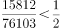，错误。

故正确答案为A。

**考点**：统计表、综合分析

**来源**：2012年山东省公务员录用考试《行测》题第106题

### 第 107 题

2009年，该市旅行社营业成本占所有旅游部门营业总成本的比重约为：

A. 65%

B. 66%

C. 67%

D. 68%

第 107 题 · 答案与解析

**参考答案（粉笔题库参考内容）**

C

**解析**

根据题干所求“2009年······占······的比重”，结合材料时间，可判定本题为现期比重问题。定位表格可得，2009年该市旅行社营业成本为602885万元，所有旅游部门营业总成本为904353万元，故所求比重为，与C项最接近。

故正确答案为C

**考点**：现期比重、统计表

**来源**：2012年山东省公务员录用考试《行测》题第107题

### 第 108 题

2009年该市景点年末固定资产净值约是旅行社的多少倍：

A. 82

B. 84

C. 86

D. 88

第 108 题 · 答案与解析

**参考答案（粉笔题库参考内容）**

B

**解析**

根据题干所求“2009年······是······的多少倍”，结合材料时间，可判定本题为现期倍数问题。定位表格数据可得，2009年该市景点年末固定资产净值860228万元，旅行社年末固定资产净值10251万元，故所求倍数=860228/10251≈860000/10200≈84倍。

故正确答案为B。

**考点**：现期倍数、统计表

**来源**：2012年山东省公务员录用考试《行测》题第108题

### 第 109 题

以下哪一类旅游部门2009年的经营利润占当年营业收入的比重最高：

A. 宾馆、酒店

B. 景点

C. 旅行社

D. 其他旅游企业

第 109 题 · 答案与解析

**参考答案（粉笔题库参考内容）**

B

**解析**

根据题干所求“哪一类旅游部门2009年······占······的比重最高”，结合材料时间，可判定本题为现期比重比较问题。定位表格数据，代入比重计算公式可得，2009年的经营利润占当年营业收入的比重分别如下：

宾馆、酒店：214594/722581≈30%；

景点：101714/239717≈42%；

旅行社：25735/659313≈3.9%；

其他旅游企业：445/6342≈7%；

其中景点比重最高。

故正确答案为B。

**考点**：现期比重、统计表

**来源**：2012年山东省公务员录用考试《行测》题第109题

### 第 110 题

2009年，该市旅游部门经营利润中管理费用约是财务费用的多少倍：

A. 4

B. 5

C. 6

D. 7

第 110 题 · 答案与解析

**参考答案（粉笔题库参考内容）**

D

**解析**

根据题干所求“2009年······是······的多少倍”，结合材料时间，可判定本题为现期倍数问题。定位表格数据可得，2009年旅游部门经营利润中管理费用为276647万元，财务费用为39688万元，故所求倍数。

故正确答案为D。

**考点**：现期倍数、统计表

**来源**：2012年山东省公务员录用考试《行测》题第110题

## 材料 3

根据所给资料，完成各题。

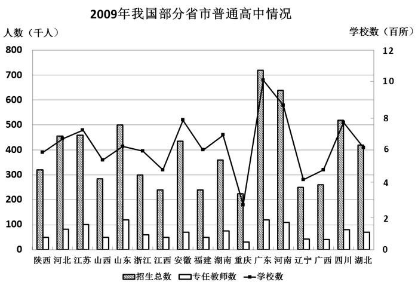

### 第 111 题

下列关于2009年各省市普通高中招生数与专任教师数之比的描述，正确的是：

A. 辽宁多于广西

B. 湖南多于安徽

C. 浙江多于陕西

D. 河南多于山东

第 111 题 · 答案与解析

**参考答案（粉笔题库参考内容）**

D

**解析**

根据题干所求“2009年······与······之比”，结合选项均为两者大小关系，可判定本题为比值比较问题。定位柱状图数据，无法得到得各省市普通高中招生数与专任教师数具体数量，但是可观察到大小关系，依次比较四个选项：

A选项，招生数辽宁＜广西，专任教师数辽宁＞广西，所以前者比值小于后者，错误；

B选项，招生数湖南＜安徽，专任教师数湖南＞安徽，所以前者比值小于后者，错误；

C选项，招生数浙江＜陕西，专任教师数浙江＞陕西，所以前者比值小于后者，错误；

D选项，招生数河南＞山东，专任教师数河南＜山东，所以前者比值大于后者，正确。

故正确答案为D。

**考点**：统计图、综合分析

**来源**：2012年山东省公务员录用考试《行测》题第111题

### 第 112 题

上图中2009年普通高中专任教师数最多的三个地区为：

A. 广东、河南和安徽

B. 广东、河南和四川

C. 广东、四川和山东

D. 广东、山东和河南

第 112 题 · 答案与解析

**参考答案（粉笔题库参考内容）**

D

**解析**

定位柱状图可得， 2009年普通高中专任教师数最多的三个地区为广东、山东、河南。

故正确答案为D。

**考点**：直接找数、统计图

**来源**：2012年山东省公务员录用考试《行测》题第112题

### 第 113 题

2009年浙江普通高中招生人数约是山东的：

A. 40%

B. 50%

C. 60%

D. 90%

第 113 题 · 答案与解析

**参考答案（粉笔题库参考内容）**

C

**解析**

根据题干所求“2009年······是······的”，结合选项为百分数，可判定本题为现期倍数问题。定位柱状可得，2009年浙江普通高中招生人数为300千人，山东省招生人数为500千人，故所求倍数为。

故正确答案为C。

**考点**：现期倍数、统计图

**来源**：2012年山东省公务员录用考试《行测》题第113题

### 第 114 题

下列关于2009年各省市校均招生人数的描述，正确的是：

A. 广东多于山西

B. 辽宁多于重庆

C. 江苏多于河北

D. 江西多于四川

第 114 题 · 答案与解析

**参考答案（粉笔题库参考内容）**

A

**解析**

根据题干所求“2009年各省市校均招生人数”，结合选项为两者大小关系，可判定本题为现期平均数比较问题。校均招生人数，定位柱状图可得各省市学校招生总数与学校数量，故可求出各省市大致校均招生人数。

A项：广东，山西，广东＞山西，正确；

B项：辽宁，重庆，辽宁＜重庆，错误；

C项：江苏、河北招生数大致持平，但学校数江苏明显大于河北，故校均招生数江苏应小于河北，错误；

D项：江西，四川，江西＜四川，错误。

故正确答案为A。

**考点**：现期平均数、统计图

**来源**：2012年山东省公务员录用考试《行测》题第114题

### 第 115 题

下列关于2009年图中各省市普通高中情况的描述，与资料相符的是：

A. 普通高中数量超过800所的省份有4个

B. 辽宁的校均专任教师数少于广西

C. 招生总数和学校数最多的省份是同一个

D. 普通高中招生总数超过50万人的都是沿海省份

第 115 题 · 答案与解析

**参考答案（粉笔题库参考内容）**

C

**解析**

A项，定位柱状图中折线数据可得，普通高中数量超过800所的省份有3个，错误。

B项，校均专任教师数，定位柱状图中数据可得，辽宁专任教师数与广西基本相同，辽宁学校数少于广西，所以辽宁校均专任教师数大于广西，错误。

C项，定位柱状图中数据可得，招生总数和学校数最多的都是广东，正确。

D项，定位柱状图中灰色柱体可得，招生总数超过50万人的省份为广东、河南与四川，河南与四川不属于沿海省份，错误。

故正确答案为C。

**考点**：统计图、综合分析

**来源**：2012年山东省公务员录用考试《行测》题第115题

## 材料 4

根据所给资料，完成各题。

        2010年全国完成税收总收入73202亿元，同比增收13681亿元，比上年同期增速加快了13.2个百分点。

        2010年增值税收入21091.95亿元，同比增长14.1%，比上年同期增速加快了11.4个百分点。2010年成品油、原油和煤炭行业增值税同比分别增长73.2%、39.7%和29.7%。

2010年消费税收入6017.54亿元，同比增长27.5%，比上年同期增速回落了57.9个百分点。分产品看，国内消费税的增收主要集中在汽车、卷烟和贵重首饰三类产品，同比分别增长55.8%、32%和29%。

        2010年营业税收入11157.64亿元，同比增长13.8%，比上年同期增速加快了5.6个百分点。分行业看，保险业、房地产和建筑业营业税收入快速增长，同比分别增长37.8%、32.4%和30.7%。

        2010年企业所得税收入12842.79亿元，同比增长11.3%，比上年同期增速加快8.1个百分点。全年工业企业缴纳所得税5168.85亿元，同比增长40.4%。房地产企业缴纳所得税同比增长50%。

        2010年个人所得税收入4837.17亿元，同比增长22.5%。

### 第 116 题

2010年全国各项税收收入由高到低排序正确的是：

A. 消费税、营业税、企业所得税

B. 营业税、个人所得税、企业所得税

C. 增值税、营业税、消费税

D. 企业所得税、个人所得税、消费税

第 116 题 · 答案与解析

**参考答案（粉笔题库参考内容）**

C

**解析**

定位材料二至六段可得，2010年增值税收入为21091.95亿元，消费税为6017.54亿元，营业税为11157.64亿元，企业所得税为12842.79亿元，个人所得税为4837.17亿元。从高到低排序是增值税、企业所得税、营业税、消费税、个人所得税。只有C项符合。

故正确答案为C。

**考点**：排序类、文字资料

**来源**：2012年山东省公务员录用考试《行测》题第116题

### 第 117 题

2010年全国增值税比2009年增长了约多少亿元：

A. 2610

B. 2608

C. 2606

D. 2604

第 117 题 · 答案与解析

**参考答案（粉笔题库参考内容）**

C

**解析**

根据题干所求“2010年······比2009年增长了······亿元”，可判定本题为增长量计算问题。定位材料第二段可得，2010年增值税收入21091.95亿元，同比增长14.1%。选项过于接近需要精算，故所求增长量。

故正确答案为C。

**考点**：增长量计算、文字资料

**来源**：2012年山东省公务员录用考试《行测》题第117题

### 第 118 题

2009年全国税收总收入同比增速约为：

A. 10%

B. 8%

C. 7%

D. 6%

第 118 题 · 答案与解析

**参考答案（粉笔题库参考内容）**

A

**解析**

根据题干所求“2009年······同比增速约为”，结合选项为百分数，材料时间为2010年，可判定本题为基期增长率计算问题。定位材料第一段可得，“2010年全国完成税收总收入73202亿元，同比增收13681亿元，比上年同期增速加快了13.2个百分点”。则2010年增长率，故所求2009年增长率=23%-13.2%=9.8%，与A项最接近。

故正确答案为A。

**考点**：一般增长率、文字资料

**来源**：2012年山东省公务员录用考试《行测》题第118题

### 第 119 题

2010年增值税与消费税收入合计占全国税收总收入的比重约为：

A. 37%

B. 3%

C. 21%

D. 2%

第 119 题 · 答案与解析

**参考答案（粉笔题库参考内容）**

A

**解析**

根据题干“2010年······占······的比重”，可判定本题为现期比重问题。定位材料前三段可得，2010年全国完成税收总收入73202亿元，增值税收入为21091.95亿元，消费税为6017.54亿元。故所求比重。

故正确答案为A。

**考点**：文字资料、现期比重

**来源**：2012年山东省公务员录用考试《行测》题第119题

### 第 120 题

能够从资料中推出的是：

A. 2009年同比增速最快的税种是营业税

B. 2010年消费税收入同比增速快于煤炭行业增值税收入同比增速

C. 2010年企业所得税收入同比增速快于工业企业缴纳所得税同比增速

D. 2010年个人所得税收入占税收总收入的比重约为6.6%

第 120 题 · 答案与解析

**参考答案（粉笔题库参考内容）**

D

**解析**

A项，定位材料第六段可得，2010年个人所得税收入4837.17亿元，同比增长22.5%。由材料已知条件不能得出2009年个人所得税的增速，因此无法判断2009年营业税与个人所得税同比增速的大小，无法判断2009年营业税是否增长最快，错误。

B项，定位材料第二、三段可得，2010年消费税收入同比增速为27.5%，低于煤炭行业的增速29.7%，错误。

C项，定位材料第五段可得，2010年企业所得税同比增速为11.3%，低于工业企业的增速40.4% ，错误。

D项，定位材料第一、六段可得，2010年全国完成税收总收入73202亿元，个人所得税收入4837.17亿元。故所求比重为，正确。

故正确答案为D。

**考点**：文字资料、综合分析

**来源**：2012年山东省公务员录用考试《行测》题第120题

