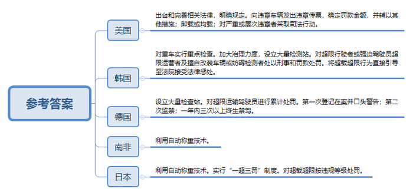
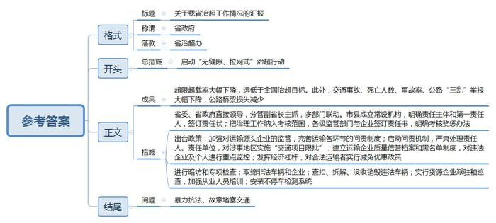

# 2013年山东省公考《申论》题（A类）

<!-- gwy:overview:start -->
> **山东 · 2013 · 申论 · A类** ｜ 4 题 · 图片 2 处 · 答案随题折叠

导航：[题目](#题目) · [材料 1](#材料-1)
<!-- gwy:overview:end -->

> 候选采集稿。参考答案及解析来自粉笔页面，不代表官方答案或真实高分答卷；来源使用许可与原卷对应关系仍需人工核实。

## 给定材料

### 材料 1

多年来，我国公路运输超限超载问题日益严重，逐渐成为危及道路安全、人民群众生命安全和国家财产安全，影响经济社会健康发展的一个突出问题。超限超载现象出现于上世纪90年代中期，2000年以来超限超载现象骤增，问题日渐突出。据某自治区公路管理局国省干线公路计重收费站超载运输车辆通告数据反映，仅2012年3月1日至31日，在通行该自治区国省干线公路40个计重收费站的货运车辆中，超限超载车辆达33.54万辆，占通行车辆总数的67%。数据显示，由于超限超载严重，该自治区路桥安全形势越来越严峻。2011年第三季度，自治区专业管养桥梁安全排查发现的四类、五类危桥共142座，与2009年相比，危桥数量增加了13%。2011年第四季度，新增四类、五类危桥17座。2012年第一季度，又新增危桥5座。截至2012年底，全自治区专业公路养护总里程为1.96万公里，其中优良路率仅为50.5%、差路率达12%。另据报道，西北某省国省干线公路总里程为9646公里，每年新改建公路大约400公里。由于超限超载运输缩短公路使用寿命，每年需要增加大中修2000公里以上，造成损失高达每年10亿多元。专家估算，如果不考虑超限超载运输逐年增长的因素，仅按目前的损害程度评估，不到5年，该省境内国省干线的60%以上将面临全线瘫痪。此外，恶性超限超载运输车辆压垮公路桥梁的事故也频频发生。超限超载的严重危害已经引起了社会各界的广泛关注。

### 材料 2

2004年4月30日，国务院成立由交通部牵头，公安部、国家发展改革委等9部委参加的全国治理超限超载工作领导小组。9部委联合推出了《关于在全国开展车辆超限超载治理工作的实施方案》，在我国展开了对公路车辆超限超载治理的“攻坚战”。《方案》要求各执法机构应严格按照有关认定标准，坚决查处，纠正各种超限超载行为。《方案》同时提出：“从2004年5月中旬起，力争在1-2年时间内由交通部和国家发展改革委共同出台相关政策，对车辆通行费和公路养路费的收费标准和征收方式进行调整和完善，并提出具体的政策措施，用经济杠杆调节车辆超限超载的利益关系。”

据某省有关执法部门调查反映，该省运输市场运费大约为每吨公里0.2元甚至0.1元，运价很低。多年来由于公路通行费增加和各种规费、罚款等因素影响，为了营利，企业和司机不得不增加装载量。由于我国公路通行费等规费都是按车辆核定吨位收取，不管是否超载、核载或空载，均按同一标准收费。比如标10吨的车，过路过桥费是按10吨来交，多装也是这个标准。于是实际装的有六七十吨甚至七八十吨，因为超的这部分不用交通行费了，运输企业大多用这样的办法来弥补运价低的损失。

2006年，交通部出台了一个《收费公路试行计重收费指导意见》，规定车辆收费不再按货车的核定载重量而是按其实际载重量收费，即计重收费，尝试用经济手段遏制超限超载行为。有专家算了一笔账，以载重量5吨的货车为例，车辆自重7.5吨加上载货5吨，原来执行按车收费标准时，约需60元/100公里。执行计重收费标准后，满载12.5吨时仍为60元/100公里，车货总重为10吨时为55元/100公里，空载时为45元/100公里，均比按车收费标准节省了费用，可见实行计重收费后，货运成本将会降低。据了解，作为全国率先实施计重收费的江苏省已经取得了明显的成效——恶意超限超载车辆减少，超限50%至100%的车辆减少42.86%，超限100%以上的车辆减少83.74%。但在其他地区，计重收费效果却并不乐观。据某省公路管理局人士称：“实行计重收费后，大量超限超载运输车辆改道行驶普通公路，造成大量普通公路不堪重负，路面病害迅速发展，通行路况日益恶化。一些超限超载车辆为规避计重收费，还想方设法改走农村公路。由于农村公路设计的建设等级低、承载能力差、损坏速度加快。已经严重影响到农民的安全出行。”

2007年，为巩固和扩大治超成果，9部委又颁布《全国车辆超限超载长效治理实施意见》，提出了建立治超工作长效机制，确保治超工作长期、有效和稳步推进的长远目标。

业内人士指出，超限超载问题在一些资源能源地区情况更加严重。特别是煤炭、石油以及基建用的砂石、钢材、水泥等建材运输比较集中的地区，因为直接涉及到一些地方和行业的经济发展。“干扰多、阻力大、矛盾多、压力大”的现象十分突出。

### 材料 3

货物堆得像小山一样、车速慢得像老牛一样、黑烟冒得像拖拉机一样……这是人们对公路上超限超载车辆形象的比喻。记者深入某省超限超载治理现场，了解超限超载车辆疯狂的背后。

稽查科科长周俊：超载超限实在也是没办法。最主要的是车子的运费这几年没涨，但是油价和驾驶员的工资涨了，车主的成本高了。还有一个就是我们工厂造的车子，它本身会引起超载、超限发生。

记者：什么叫工厂造的车子会引起超载、超限发生？

周俊：有的生产厂家在设计过程中就把超载能力算进去了。这么跟你说吧，有的车即使不改动也可以超载，而且批量生产的时候，一些厂家还会对所用钢材的材质、型号做改动，这些改动从外观上很难辨别，但车辆的载重能力会增加不少。

记者：这种车上路会有危险吗？

驾驶员王师傅：危险肯定有的，拉多了刹车不灵，也容易出事故。其实谁都不想超载，现在就是不超载挣不到钱，不超载的话跑一趟亏一趟。

据周俊所言 ，目前全国公路车辆运力总体上是供大于求，竞争过度，唯一的竞争手段就是杀价。上世纪80年代每吨公里2毛钱左右，如今20多年了，最多只涨到3毛钱左右。面对激烈的市场竞争，运输企业及个体户竞相压价。很多车主不得不采取超载方式争抢生意。

除了资本生产企业，全国各地数量众多的汽车改装厂也提供货车改装服务。记者以客户身份来到一家紧挨210国道的汽车修配厂，只见满地油污的店前停着两辆自卸货车，一片狼藉的地上丢弃着一串弹簧钢板。

记者：这车还挺新的啊，还要做些什么？

工人：加装辅轮和后桥，加高栏板，还要加固弹簧钢板。

记者：是增加载重量吗？

工人：对。

记者：要花多少钱？

工人：3000来块。

记者：车改装后上路安全吗？

工人：不知道，我们只知道给钱干活。

记者接着询问改装是否需要什么手续。一旁的老板说，客户有要求双方可以签一个合同，别的不需要。但车辆被查的话，我们不负责任。

### 材料 4

超限一词源于我国《公路法》。其中第50条规定了超限车辆“不得在有限定标准的公路、公路桥梁、公路隧道内行驶。”交通部令2000年第2号《超限运输车辆行驶公路管理规定》中对运输车辆的超限标准做出了具体规定：如车货总高度从地面算起4米以上(集装箱车货总高度从地面算起4.2米以上)；车货总长18米以上；车货总宽度2.5米以上；车辆轴载质量在规定值以上等。机动车辆行驶需要遵守不同等级公路的限载标准，如果超限运输，必须接受执法部门的查处。根据《公路法》有关条款，超限的法律责任除罚款外，造成公路损害的应当依法承担民事责任。根据国务院《道路交通管理条例》有关条款，超载行为可处以罚款、警告并同时吊扣驾驶证等行政处罚。

据某省交通厅交通稽查总队张主任介绍，交通部门查车，主要是查超限，而交警则主要查超载。虽然根据法律要求，交通路政和公安交警分工明确，各管一摊，但具体执法过程中却常常出现问题。比如交通、公安两家在治理超限超载中，有时会出现处罚标准不一的情况。按照《道路交通安全法》规定，机动车超过核定载质量的，处200元以上500元以下罚款；超过核定载质量30%或者违反规定载客的，处500元以上2000元以下罚款。但交通厅部署的大规模治超专项整治行动，则要求对超载车辆单车处罚不得超过1000元。两个标准前后不一，很多司机询问我们究竟该遵循哪个标准？此外，因两家检测站点数量和分布不均，经常发生重复处罚，严重的一次甚至出现十几辆被重复处罚的车辆集中堵在检测站口，造成高速路大面积拥堵，严重影响正常的公路交通秩序。

有专家指出，随着我国公路建设的快速发展，很多地区固定治超检测点布局明显滞后，数量过少，根本无法满足《公路安全保护条例》规定的就近引导和卸载处理的要求。加上流动治超受人员、设备、安全环境条件等因素限制，难以做到对超限超载车辆监控检测全覆盖。由于检测站数量有限，而国省干线公路车流量大、超限超载运输车辆多、超限吨位大，检测工作难度不小。据有关部门测算，每个检测站昼夜24小时连续单向检测，其检测率仅为该线路单向超限车辆总数的28%，尚有72%的超限车辆漏检。由于检测站偏少，管理、执法难以到位，各种对抗执法检查的招数层出不穷。如有的超限超载车辆采取在检测站前分载，驶离检测站后再合载的办法；有的超限超载车辆绕道逃避；有的司机花钱雇一些闲散人员每天“望风”，根据执法人员的行踪调整“闯关”时机；有的运输企业和司机甚至买通交警或公路执法人员，通过建立稳定的保护伞逃避处罚。还有一些执法站点迫于风险和压力，采取“以罚代管”，交罚款就放行，客观上造成超限超载愈演愈烈。

### 材料 5

公路运输超限超载是一个世界性难题。有关专家曾形象的将超限超载车辆比喻为“掠夺性命的武器，道路设施的天敌”。许多国家在市场经济发展的初期，都不同程度地存在着超限超载问题，也相应采取了严格的管理措施。如美国出台多部法律治超，1913年通过第一部限制车重的法律，随后又出台了多部联邦法律，对超限超载车辆的管理做出了明确规定。目前，美国的超限超载车辆约占被检测货运车辆总数的3.5%。处理超限超载车辆的主要措施有：一是向违章车辆发出违章传票，确定罚款金额，并辅以其他惩罚措施，如交付路产补偿金、被列入驾驶员和运输企业不良记录档案等。二是卸载或均载(移动货物直到轴载不超限)。三是对严重超限超载或屡次违章者采取司法行动，包括刑事诉讼、短期拘留和多达1年以上的监禁。韩国从1973年7月开始对重车实行重点检查。1994年10月，超限超载车辆过多导致圣水大桥坍塌后，韩国政府进一步加大了治理力度，在全国设立了400余个超限超载检测站(点)。目前，韩国超限超载车辆仅占被检测货运车辆的1.5%。韩国法律规定，对超限行驶者或强迫驾驶员超限运营者判处1年以下有期徒刑或处以200万元韩币(约合人民币1.5万元)以下罚款；对擅自改装车辆或妨碍检测者处2年以下有期徒刑或处以700万元韩币(约合人民币5.2万元)罚款。超限运输车辆一经发现，将被公路部门直接引导至法院接受法律惩处。德国在11000公里的高速公路上共设有700多个超限超载检查站。 德国对超限运输驾驶员的处罚办法中规定，第一次超限的驾驶员将被登记在案并口头警告；第二次被发现将面临3个月的监禁；1年内超限3次以上的驾驶员，将被吊销驾驶执照，列入“黑名单”，终身不得从事驾驶行业工作。南非非常重视车辆自动称重技术的研究工作，将电子秤应用于治理超限超载工作中。电子秤可以对时速不低于10公里的重载车辆进行自动称重，并显示在重载车辆信息管理系统上，管理部门据此对这些超重车辆进行卸载和处罚。这一技术系统在近10年来的治理超限超载工作中起到了巨大的作用，目前南非超限超载车辆的比例已下降到10%以下。日本使用固定或移动称重设备对超限车辆进行检测，在高速公路收费站设有电子秤测量超载，大型货车还要安装货物自动测重仪。日本还实行“一超三罚”制度，即罚货主、罚运输企业、罚司机。根据日本相关法律，超过行驶证最大载重量的，处6个月以下徒刑，10万元罚款(约合人民币7400元)；超过车辆总重量一般限值20吨的，处以30万元罚款(约合人民币2.2万元)；禁止货运企业接受超载运输业务或指示驾驶员进行超载运输等。

### 材料 6

作为我国能源生产和运输大省、“西煤东运”的咽喉要道之一，山西省一度是全国超限超载最严重的地区。2007年是山西超限超载最为严重的一年。当年全省超限超载率达到了13%，全省25万辆货运车辆中，每天有近3万多辆属于超限超载运输，有的大型超载车辆重达百吨。被人戏称为火车跑在公路上，混乱局面触目惊心。全省因车辆超限超载造成的交通事故占全省交通事故总数的六分之一，死亡近600人，而当年全省煤矿事故死亡人数400多人。损毁高速和国省干线公路共3838公里，造成危桥827座，直接经济损失十多亿元。严重的超限超载已经发展成为影响山西经济社会稳定发展的一大顽疾。由于超限超载治理的复杂性、艰巨性和反复性，山西省数年的多次治超都没有取得实质进展。每次行动一般只能维持三五个月，“风声”过后，超限超载行为更加猖獗，越治越超的局面愈演愈烈。

2007年12月，山西省全面启动了“无缝隙、拉网式”治超行动，下决心根治超限超载行为。这次治超由以往部门牵头改为省委、省政府直接领导，分管副省长主抓，公安、交通、工商、质监等21个部门联合组成治理联动小组，统一领导。各市县也相应成立了常设机构，强化治超专项职能。各市县明确市、县政府为责任主体，市长、县长为第一责任人，各级政府层层签订责任状，落实治理责任。各市县还把治理工作纳入政府年度目标责任制考核范围，省、市、县相关监管部门与相关企业层层签订了治理目标责任书，并明确了考核奖惩办法。

省政府出台了《山西省道路货物送输源头治理超限超载暂行办法》，把煤、焦、铁等各类货物运输源头企业的装载行为纳入监管范围。同时针对有关货物源头，检测站点等每个运输环节的问责制度也随之出台。省治超办明确规定，发现超限超载车后，必须进行追查。查明车辆途经哪些站点，是哪个装货点装的货，车辆是否非法改装，涉及到的责任部门(交通、交警、工商、运管、经信委等)是哪一个，哪个环节出了问题就追究到哪个环节。2008年，山西省治超办稽查人员在太原古交市、大同南郊区进行检查时，发现了治超点执法人员不称重放行车辆，人员脱岗，非法储（售）煤场死灰复燃、货物源头监管失职、超载车辆严重反弹等一系列问题。省治超办立即启动问责机制。根据《山西省治理车辆非法超限超载工作责任追究办法》《山西省治理车辆非法超限超载工作责任追究实施细则》等规定，对问题所涉及的多个部门进行追根溯源，古交市有关部门18名责任人和南郊区政府以及区公路、经贸、公安交警、煤运公司等5个责任单位共26人进行了严肃处理，其中开除公职11人。省治超办还对两地实施了“交通项目限批”，即暂停交通建设相关项目及资金拨付。同年3月，有群众举报朔州市山阴县出现大批超载车，省治超办根据线索进行了多次暗访，并组织进行专项检查，确认情况属实。其中，四个检测站点的交警、交通执法人员对超载车辆“睁一只眼闭一只眼”，个别执法人员发现检查组人员后，竟然指挥超载车辆从小路逃遁，检查组成员还受到不明身份人员的棍棒威胁和跟踪。针对这起严重事件，省委省政府进行了严肃处理。4月，中共朔州市委免去了山阴县县长的县委副书记、常委委员职务，并提名免去其县长职务。山阴县县长成为全国首名因治超不力而丢官的县级干部，同时被查处的相关责任人共有23人。三年来，山西省共有450多名干部因治超不力受到党纪、政纪处分，其中县处级干部达13人。

由于措施得力，这一轮治超成果喜人。一年来，工商部门共取缔非法车辆改装、修理厂111处，非法储(售)煤场1927户；交管部门查扣无牌无证货车7.7万辆，拆解非法改装车辆941辆，没收并销毁拼装车辆108辆；运管部门对经公示的1.1万户货源企业实行了派驻和巡查，对7998户货源企业的2.9万名装载、计量、开票人员进行了培训。由于监管严格，货源企业严把“进厂、装载、过磅、验票”4个环节，确保了出厂车辆无超载行为。省运管局还建立了全省运输企业质量信誉档案及违法单位和个人“黑名单”制度，对违法企业及个人进行重点监控。与此同时，山西省充分发挥经济杠杆作用，出台了高速公路通行费对合法运输者减免10%的优惠政策。仅此一项，就相当于每年减少3.5亿元的财政收入。

为了改变“人盯、车跑、手工记”的人海战术，山西省高速公路全部安装了不停车检测系统。2011年，全省45万辆货车全部发放了道路运输IC卡，所有高速公路超限检测站实现了不停车快速检测，大大提高了工作效率。三年时间里，全省2万多名执法人员共检测货运车辆18亿次，查处超限超载车辆7.7万次，处罚违法企业210家。面对执行部门的“动真格”，这一轮治超以来，山西各地均出现了司机强行冲卡或故意堵塞交通的事件。据统计，全省共发生各类暴力抗法事件上百起，82名执法人员被打伤打残，两人英勇牺牲。尽管存在一些干扰，但由于目标明确，真抓实干，治超工作还是克服种种困难，取得了阶段性成果。

据统计，从2007年12月开始实施新一轮治超到2010年，仅仅三年，山西全省超限超载率由13%下降到0.2%以下，大大低于全国6%的治超目标，这在世界上都是一个比较高的水平。此外，道路交通事故减少4590起，平均每年减少死亡人数300人，事故率下降60%以上；公路“三乱”举报下降38%，其中涉及治超的下降了66%；累计减少公路桥梁损失119亿元，相当于2010年山西全省财政收入的13%。

## 题目

### 第 1 题

**认真阅读、梳理“给定资料”，简要概括一些地区超限超载运输日益严重的主要原因。（20分）**

关联材料：材料 1、材料 2、材料 3、材料 4、材料 5、材料 6

作答要求：

要求：概括准确，内容全面，条理清晰；不超过350字。

第 1 题 · 答案与解析

**参考答案（粉笔题库参考内容）**

一、制度设计不科学。通行费、规费和罚款高，负担重；通行费、规费按核定吨位收取，超载部分不收费。

二、政府干预。涉及地方和行业经济发展，治超干扰多、阻力大、矛盾多、压力大。

三、市场因素。工资、油价上涨，成本大；行业竞争过度，运力销大于求，运费压低。

四、管理困难。1.管理体制不完善，多头管理，处罚标准不统一，重复性处罚；2.监测点布局不合理，数量少，且受人员、设备、安全环境条件等因素限制，监控检测覆盖面窄；3.司机对抗执法检查；4.执法人员素质低，腐败多，充当保护伞；5.执法部门以罚代管，加剧超限超载。

五、司机和企业安全意识淡薄。1.重视经济利益，忽视安全；2.车辆设计将超载计算入内；3.改装业务不规范，手续简单。

**解析状态：unknown（来源未提供）**

**来源**：2013年山东省公考《申论》题（A类）

### 第 2 题

**“给定资料**5**”提到国外治理超限超载的一些做法。请简要分析这些做法对我国治超工作的启示。（20分）**

关联材料：材料 5

作答要求：

要求：分析到位，言简意赅，具有针对性；不超过350字。

第 2 题 · 答案与解析

**参考答案（粉笔题库参考内容）**

美国：出台和完善相关法律，明确规定。向违章车辆发出违章传票，确定罚款金额，并辅以其他措施；卸载或均载；对严重或屡次违章者采取司法行动。

韩国：对重车实行重点检查。加大治理力度，设立大量检测站。对超限行驶者或强迫驾驶员超限运营者及擅自改装车辆或妨碍检测者处以刑事和罚款处罚。将超载超限行为直接引导至法院接受法律惩处。

德国：设立大量检查站。对超限运输驾驶员进行累计处罚。第一次登记在案并口头警告；第二次监禁；一年内三次以上终生禁驾。

南非：利用自动称重技术。

日本：利用自动称重技术。实行“一超三罚”制度。对超载超限按违规等级处罚。

**解析状态：unknown（来源未提供）**

**来源**：2013年山东省公考《申论》题（A类）

### 第 3 题

**“给定资料**6**”提到山西省治超工作取得了阶段性成果。假如你是省治超办的一名工作人员，请起草一份上报省政府的治超工作情况汇报。（20分）**

关联材料：材料 6

作答要求：

要求：格式规范，概述准确，切合题意，结构清晰；不超过600字。

第 3 题 · 答案与解析

**参考答案（粉笔题库参考内容）**

关于我省治超工作情况的汇报

省政府：

我省启动“无缝隙、拉网式”治超行动，取得了阶段性成果，基本情况汇报如下：

一、成果：超限超载率大幅下降，远低于全国治超目标。此外，交通事故、死亡人数、事故率、公路“三乱”举报大幅下降，公路桥梁损失减少。

二、措施：1.省委、省政府直接领导，分管副省长主抓，多部门联动。市县成立常设机构，明确责任主体和第一责任人，签订责任状；把治理工作纳入考核范围，各级监管部门与企业签订责任书，明确考核奖惩办法。2.出台政策，加强对运输源头企业的监管，完善运输各环节的问责制度；启动问责机制，严肃处理责任人、责任单位，对涉事地区实施“交通项目限批”；建立运输企业质量信誉档案和黑名单制度，对违法企业及个人进行重点监控；发挥经济杠杆，对合法运输者实行减免优惠政策。3.进行暗访和专项检查；取缔非法车辆和企业；查扣、拆解、没收销毁违法车辆；实行货源企业派驻和巡查，加强从业人员培训；安装不停车检测系统。

但是依然存在诸多问题，如暴力抗法、故意堵塞交通等。因此，治超工作必须常抓不懈。

省治超办

XXXX年XX月XX日

**解析状态：unknown（来源未提供）**

**考点**：公文写作题

**来源**：2013年山东省公考《申论》题（A类）

### 第 4 题

**请结合对全部“给定资料”的理解与思考，以《谈“执法”》为题，写一篇文章。（40分）**

关联材料：材料 1、材料 2、材料 3、材料 4、材料 5、材料 6

作答要求：

要求：观点鲜明，内容充实，结构完整，语言流畅；900字左右。

第 4 题 · 答案与解析

**参考答案（粉笔题库参考内容）**

**谈“执法”**

现阶段，双超治理工作中暴力抗法、徇私舞弊、道路破坏、桥梁垮塌等问题也频频出现在公众视野中，危及道路安全、人民生命财产安全和经济社会健康发展，严重影响了政府的形象和公信力。在这样的背景下，治理双超，加强执法，已经刻不容缓。

要谈治超的执法，必然绕不开以下三个问题：所执何法？何人执法？何处执法？

**要谈治超执法，先要明确所执何法。**完善的治超法律法规建设是双超治理的大前提。我国现阶段治超法律法规建设相对滞后。一方面，由于法制的不完善，执法过程中也存在着多头管理的问题，处罚标准不一；另一方面，对于超限超载责任主体的惩罚力度不足，仅依靠单纯的经济处罚无法有效遏制双超问题。反观治超工作成绩斐然的国家，无一不是以明确完善的法律建设和严格的处理方式来解决双超问题。因此，必须完善治超法律法规，统一处罚标准，对源头、运输、检查站点各个环节的责任都作出明确规定。

**要谈治超执法，还需约束执法之人。**治超执法者的素质高低会直接影响执法的效果。目前，部分治超部门执法能力偏低，执法理念陈旧，执法工作粗糙，以罚代管；一些地方执法不规范、不文明，甚至徇私舞弊，为了私利甘愿成为违法者的“保护伞”，也损害了政府部门的形象。因此，必须加强执法规范化建设，加强队伍建设。一方面，可以通过教育手段，加强作风建设和技能培训，树立“廉洁、安全、规范、文明”的执法意识，提升执法水平和工作能力；另一方面，要对于违反纪律、徇私舞弊的执法人员从严惩处，有效震慑部分执法者的投机欲望。

**要谈治超执法，终须保证有处执法。**我国当前治超工作中，检测站的数量偏少是面临的一个很大问题。由于数量偏少，执法工作难以有效开展，不少超限超载车辆因此漏网，逃避了处罚。在治超工作上取得了卓著成效的德国与韩国，在治超站点的建设上均不遗余力，以高密度的检查点设置严格检查过往车辆，也取得了很好的成绩。这一点值得我们借鉴。因此，政府部门应加强基础设施建设，在部分重点路段多开设检查站，并配齐专业人员及设备，以保障对超限超载车辆监控检测全覆盖。

治超治限非朝夕之功，只有建立完善的治超法律法规、高素质的执法队伍、完善的硬件设施，才能建立起治理双超的坚固城墙，才能让超载超限远离公众视野！

**解析状态：unknown（来源未提供）**

**来源**：2013年山东省公考《申论》题（A类）

