# 2013年山东省公务员录用考试《行测》题

<!-- gwy:overview:start -->
> **山东 · 2013 · 行测 · 统考** ｜ 120 题 · 图片 67 处 · 答案随题折叠

| 题型模块 | 题量 | 题号 |
| --- | ---: | ---: |
| 言语理解与表达 | 30 | 1–30 |
| 常识判断 | 20 | 31–50 |
| 数量关系 | 15 | 51–65 |
| 判断推理 | 35 | 66–100 |
| 资料分析 | 20 | 101–120 |
| **合计** | **120** | |

导航：[题型与作答说明](#题型与作答说明) · [题目](#题目) · [材料 1](#材料-1)
<!-- gwy:overview:end -->

> 候选采集稿。参考答案及解析来自粉笔页面，不代表官方答案或真实高分答卷；来源使用许可与原卷对应关系仍需人工核实。

## 题型与作答说明

言语理解与表达

（30题）

每道题包含一段文字(或一个句子)，后面是一个不完整的陈述。要求你从四个选项中选出一个来完成陈述。注意：问题可能是选择一个词语或一个句子使表达最为准确，也可能是考察对文字内容的理解。你的选择应与题目要求最相符合。

常识判断

（20题）

根据题目要求，在每个选项中选出一个正确答案。

数量关系

（15题）

每道题中呈现一段表述数字关系的文字，要求你迅速、准确地计算出答案。

判断推理

（35题）

本部分包括图形推理、定义判断、类比推理与逻辑判断四种类型的试题。

资料分析

（20题）

所给出的图、表、文字或综合性资料均有若干个问题要你回答。你应根据资料提供的信息进行分析、比较、计算和判断处理。

## 题目

### 第 1 题

一般地说，“智慧”不同于“知识”的最大特点在于“智慧”具有原创性。“知识”要求“广”，“智慧”要求“新”。但两者并非绝对＿＿＿＿＿：“智慧”必须有“知识”做基础，反之，只死读书，而无己见，无创意，那就容易成为＿＿＿＿，也不算是“智慧”。

依次填入画横线处最恰当的一项是：

A. 对立 学究

B. 矛盾 古董

C. 等同 桎梏

D. 排斥 束缚

第 1 题 · 答案与解析

**参考答案（粉笔题库参考内容）**

A

**解析**

第一空，根据转折关联词“但”可知，横线部分与前文语义相反，表达两者并非“不一样”的意思。A、B、D三项均可，保留。C项“等同”是指相同，与文意相悖，排除。

第二空，根据文段中“只死读书，而无己见，无创意”可知，横线部分表达人的死板、迂腐。A项“学究”多指迂腐的读书人，符合文意，当选。B项“古董”比喻陈旧过时的东西或古板迂腐的人，不如“学究”恰当，排除；D项“束缚”指约束限制，与文意不符，排除。

故正确答案为A。

**考点**：关联关系-转折关系、实词填空、对应关系-解释说明

**来源**：2013年山东省公务员录用考试《行测》题第1题

### 第 2 题

文学解读和批评可以是感性的、印象式的，亦可以是理性的和高度理论化的。文学不是用单纯的社会学方法便可以＿＿＿＿＿的，就像心灵不能用此时此刻或彼时彼刻的一孔之见来一概而论。

填入画横线处最恰当的一项是：

A. 可见一斑

B. 一览无余

C. 明察秋毫

D. 拨云见雾

第 2 题 · 答案与解析

**参考答案（粉笔题库参考内容）**

B

**解析**

根据“就像”可知，横线处与后文“一概而论”形成对应，表达用同一标准来对待或处理之意。B项“一览无余”意为一眼就能将全部内容看得清清楚楚，符合文意，当选。A项“可见一斑”常与“管中窥豹”连用，指可以从观察到的一部分推测全貌，C项“明察秋毫”形容为人非常精明，任何小问题都看得很清楚，D项“拨云见雾”为成语误用，正确用法应为“拨云见日”，意为拨开乌云，见到太阳，比喻消除黑暗势力，重见光明，也比喻受到启发，思想豁然开朗，均无法与“一概而论”形成对应，排除。

故正确答案为B。

**考点**：对应关系-解释说明、成语填空

**来源**：2013年山东省公务员录用考试《行测》题第2题

### 第 3 题

幸福有没有标准？我认为，现实生活离不开比较，但是幸福的比拼，本身就是比较＿＿＿＿＿的事情。幸福耐不住人家打扰，经不起科学研究，当幸福成为指数、成为概念、成为一批标准时，也就变得＿＿＿＿＿了。

依次填入画横线处最恰当的一项是：

A. 混乱 一文不值

B. 私密 可有可无

C. 模糊 无足轻重

D. 荒诞 遥不可及

第 3 题 · 答案与解析

**参考答案（粉笔题库参考内容）**

D

**解析**

第一空，根据“幸福耐不住人家打扰，经不起科学研究······”可知，横线处表达“幸福的比拼”是不合理的。D项“荒诞”符合文意，保留。A项“混乱”、B项“私密”、C项“模糊”均无法体现不合理的意思，排除。

第二空，代入验证，D项“遥不可及”指非常遥远、难以得到的东西，符合文意，当选。

故正确答案为D。

**考点**：关联关系-转折关系、对应关系-前后呼应、混搭填空

**来源**：2013年山东省公务员录用考试《行测》题第3题

### 第 4 题

周敦颐通过自己的努力，丰富和发展了儒学思想理论体系，开拓了儒学发展的新境界，使之＿＿＿＿，一扫魏晋南北朝及隋唐五代的＿＿＿＿＿，回归到原有的正统地位，赢得了与释、道竞争的全面胜利，取得了意识形态的主导权。

依次填入画横线处最恰当的一项是：

A. 独树一帜 弊端

B. 柳暗花明 萧条

C. 脱胎换骨 落寞

D. 焕然一新 颓势

第 4 题 · 答案与解析

**参考答案（粉笔题库参考内容）**

D

**解析**

第一空，根据文段“开拓了儒学发展的新境界”可知，横线处要表达“新”的意思。D项“焕然一新”指改变旧面貌，出现崭新的气象，符合文意，保留。A项“独树一帜”意为独自树起一面旗帜，比喻与众不同，自成一家或一派，但文段并非强调在周敦颐的努力之下儒学自成一派，与文意不符，排除；B项“柳暗花明”比喻在困境中出现希望或转机，文段只强调儒学变新了，并未提及儒学遇到了困难，排除；C项“脱胎换骨”比喻思想感情等发生根本变化，填入文段程度太重，排除。

第二空，代入验证，D项“一扫颓势”为常见搭配，符合文意，当选。

故正确答案为D。

**考点**：关联关系-因果关系、对应关系-前后呼应、混搭填空、词的辨析-搭配对象

**来源**：2013年山东省公务员录用考试《行测》题第4题

### 第 5 题

列夫·托尔斯泰创造了19世纪俄国小说艺术的巅峰，他能把拿破仑进军俄国的战争史诗般的场面驾驭自如，能把安娜的人性刻画得＿＿＿＿＿，像这样的大手笔后来的作品再也没有了。

填入画横线处最恰当的一项是：

A. 惟妙惟肖

B. 妙笔生花

C. 入木三分

D. 鬼斧神工

第 5 题 · 答案与解析

**参考答案（粉笔题库参考内容）**

C

**解析**

横线处搭配“刻画”，表达“把人性刻画得非常到位”之意。C项“入木三分”比喻见解、议论非常深刻，搭配恰当，且符合文意，当选。A项“惟妙惟肖”意为模仿或描写得非常美妙，非常逼真，多搭配人物形象，而非人性，排除；B项“妙笔生花”形容写作技巧高超，能创作出精美的作品，侧重强调人的写作功力，排除；D项“鬼斧神工”意为鬼神所造，非人力所为，形容建筑、雕塑等技艺高超奇妙，与“写作”的语境不符，排除。

故正确答案为C。

**考点**：成语填空、词的辨析-搭配对象

**来源**：2013年山东省公务员录用考试《行测》题第5题

### 第 6 题

近年来，网络阅读、手机阅读并存的多元化阅读方式，带来了铺天盖地的＿＿＿＿＿，这在＿＿＿＿＿人们知识面的同时，也使得以快餐式、跳跃性、碎片化为特征的“浅阅读”取代了“深阅读”。

依次填入画横线处最恰当的一项是：

A. 资讯 拓展

B. 信息 延伸

C. 新闻 扩大

D. 内容 开拓

第 6 题 · 答案与解析

**参考答案（粉笔题库参考内容）**

A

**解析**

第一空，根据文意可知，横线处表达多元化阅读方式带来了很多讯息。A项“资讯”、B项“信息”均符合文意，保留。C项“新闻”比“资讯”“信息”的概念范围窄，通过阅读得到的不仅仅是“新闻”，排除；D项“内容”与“铺天盖地”搭配不当，排除。

第二空，横线处搭配“知识面”。A项“拓展”意为开拓扩展，往往指范围的扩大，与“知识面”搭配恰当且符合文意，当选。B项“延伸”意为延展伸长，往往指线性的延展，与“知识面”搭配不当，排除。

故正确答案为A。

**考点**：实词填空、对应关系-前后呼应、词的辨析-搭配对象

**来源**：2013年山东省公务员录用考试《行测》题第6题

### 第 7 题

灾难性事件往往以突发的方式出现，给个人与社会造成巨大的破坏和影响。灾难的突发性决定了报道的＿＿＿＿＿是第一位的，最快的时间、最新的报道，才能满足人们在灾难发生后对＿＿＿＿＿的巨大需求和思想混乱时的心理需求。能否快速地投入新闻报道，成为决定此类新闻报道能否成功的关键性问题。

依次填入画横线处最恰当的一项是：

A. 内容 真相

B. 方式 沟通

C. 实效 事实

D. 速度 信息

第 7 题 · 答案与解析

**参考答案（粉笔题库参考内容）**

D

**解析**

第一空，根据文段“突发性”“最快的时间”“最新的报道”可知，横线处表达“快、新”的意思。D项“速度”符合文意，保留。A项“内容”、B项“方式”、C项“实效”均与“快”无关，排除。

第二空，代入验证，灾难发生后人们需要更多方面的“信息”，D项“信息”符合文意，当选。

故正确答案为D。

**考点**：实词填空、对应关系-前后呼应

**来源**：2013年山东省公务员录用考试《行测》题第7题

### 第 8 题

留学异国的人常有“边缘人”的苦闷。人们显然不可能在进入一块陌生国土的同时，就在一瞬间也加入它的文化，而原来的文化背景又会由于天长地远而渐渐疏离。在实际生活中，两种＿＿＿＿＿的文化，会经常骤然直率地在我们面前相遇、碰撞，一开始真有无所适从亦无可躲避的＿＿＿＿＿。

依次填入画横线处最恰当的一项是：

A. 水火不容 尴尬

B. 截然不同 窘迫

C. 南辕北辙 狼狈

D. 针锋相对 失落

第 8 题 · 答案与解析

**参考答案（粉笔题库参考内容）**

B

**解析**

文段主要讲两种文化的不同给留学生活带来的困扰，而不是强调两种文化的对立，B项“截然不同”体现了中西方两种文化的不同，与文意相符，保留。A项“水火不容”程度过重，排除；C项“南辕北辙”意指行动与目标的对立，与“文化”搭配不当，排除；D项“针锋相对”常指观点、立场的对立，亦不可修饰“文化”，排除。

第二空，代入验证，B项“窘迫”与“无所适从亦无可躲避”对应恰当，当选。

故正确答案为B。

**考点**：对应关系-前后呼应、混搭填空、词的辨析-搭配对象、词的辨析-程度轻重

**来源**：2013年山东省公务员录用考试《行测》题第8题

### 第 9 题

生活中，每一秒都有无数种可能，任何瞬间一旦错过，就永远不会再重演，但是并不是任何瞬间都有记录的价值和意义。只有那些能够向我们＿＿＿＿＿足够有力信息和情绪的决定性瞬间才有记录的价值和意义，为了记录这样的瞬间，我们可能需要付出很多，比如洞察这种瞬间的感知力、等待这种瞬间的＿＿＿＿＿ 和捕捉这种瞬间的＿＿＿＿＿。

依次填入画横线处最恰当的一项是：

A. 传递 耐心 技巧

B. 展示 信心 素质

C. 表达 决心 能力

D. 获取 恒心 灵感

第 9 题 · 答案与解析

**参考答案（粉笔题库参考内容）**

A

**解析**

第一空，与“信息和情绪”搭配，且根据前文“向我们······”可知，侧重强调“决定性瞬间”带来的影响。A、B、C三项均搭配恰当，保留。D项“获取”与文意不符，排除。

第二空，与“等待”对应。A项“耐心”最为恰当，保留。B项“信心”、C项“决心”均体现不出“等待”的意思，排除。

第三空，代入验证，A项“捕捉这种瞬间的技巧”搭配恰当，且符合文意，当选。

故正确答案为A。

**考点**：实词填空、对应关系-前后呼应、词的辨析-搭配对象

**来源**：2013年山东省公务员录用考试《行测》题第9题

### 第 10 题

人类社会自有了国家，就开始了征税的历史。从古到今，各国开征的税种＿＿＿＿，但总的来说，可以将它们＿＿＿＿为直接税和间接税两大类。直接税如土地税、房屋税等，间接税如盐税、渔税等。两种税种本身以及主体税种的＿＿＿＿经历了一个漫长演进的过程。

依次填入画横线处最恰当的一项是：

A. 大同小异 概括 出现

B. 林林总总 划分 发展

C. 不胜枚举 归纳 更替

D. 五花八门 合并 蜕变

第 10 题 · 答案与解析

**参考答案（粉笔题库参考内容）**

C

**解析**

第一空，根据文段可知，横线处形容税种“多”。B、C、D三项均符合文意，保留。A项“大同小异”指大体相同，略有差异，与文意不符，排除。

第二空，根据“它们······为直接税和间接税两大类”可知，横线处表达将特别多的税种整理分为两类。C项“归纳”、D项“合并”均符合文意，保留。B项“划分”指把整体分成若干部分，而文段强调把零散的整理成两大类，与文意不符，排除。

第三空，根据文意可知，横线处表达税种本身及主体税种经过了更换的过程。C项“更替”指更换，填入文段语义恰当，当选。D项“蜕变”多形容人或事物发生质变，文段并未强调税种发生了本质的改变，排除。

故正确答案为C。

**考点**：关联关系-转折关系、对应关系-前后呼应、混搭填空

**来源**：2013年山东省公务员录用考试《行测》题第10题

### 第 11 题

如果把不同的异文化仅看成是认识的对象、认识的客体，就意味着主体对客体可以任意地处置，异文化作为客体也就成了被研究、被注视、被处置、被奴役的了，＿＿＿＿＿＿＿。殖民主义时期殖民者对土著文化采用的便是这种态度。

填入画横线部分最恰当的一句是：

A. 这里就会出现不平等

B. 这在当今社会已成为一种常见的现象

C. 同时无法赢得对方的尊重

D. 这样跨文化交际就难以进行

第 11 题 · 答案与解析

**参考答案（粉笔题库参考内容）**

A

**解析**

横线部分位于文段中间，起承上启下的作用，需要结合上下文进行分析。横线之前提到异文化“被处置、被奴役”，表明主体和客体之间存在不公平的现象，横线之后以殖民主义时期殖民者的态度进行举例，所以横线处句子重在强调主体与客体的不平等，对应A项，当选。

B项，“当今社会”在文段中并未提及，文段仅提到“殖民主义时期”的例子，故无法与下文衔接，排除；

C项，“无法赢得对方的尊重”与文段强调的不平等相比，程度太轻，排除；

D项，“跨文化交际”，文段并未提到“交际”，无中生有，排除。

故正确答案为A。

**考点**：横线在中间

**来源**：2013年山东省公务员录用考试《行测》题第11题

### 第 12 题

所谓国民媒介素养，是指国民正确判断媒介信息的价值、意义和作用并有效使用和传播信息的素养。在信息时代，国民媒介素养已成为国民综合素养的重要组成部分。加强国民媒介素养教育，提高国民媒介素养，对于提升国家文化软实力具有重要意义。作为媒介受众，国民如果具有较高的媒介素养，就可以分清大众传媒背后的各种思想意识和价值观念，对接收的信息去伪存真、去粗取精，从而坚持和弘扬健康向上的观念和文化，抵制和批判消极腐朽的观念和文化。

这段文字意在说明：

A. 什么是国民媒介素养

B. 提高国民媒介素养的重要意义

C. 如何保持较高的媒介素养

D. 要分层推进不断提高国民媒介素养

第 12 题 · 答案与解析

**参考答案（粉笔题库参考内容）**

B

**解析**

文段开篇阐述了国民媒介素养的含义及其地位，随后指出提高国民媒介素养具有重要的意义，接下来详细解释了提高国民媒介素养的意义。故文段意在强调提高国民媒介素养的意义，对应B项。

A项，强调国民媒介素养的定义，非重点，排除；

C项，“如何保持”无中生有，文段并未提及保持较高媒介素养的具体做法，排除；

D项，“要分层推进不断提高”无中生有，文段并未提及，排除。

故正确答案为B。

**考点**：关联词-对策

**来源**：2013年山东省公务员录用考试《行测》题第12题

### 第 13 题

天坛由于天地合祀，故内外垣墙皆前方后圆。主要建筑皆为圆形，而圜丘外垣墙和祈年殿外垣墙皆为方形，象征天圆地方。天坛内外垣墙遍植槐柏，一片绿海，摒除视野的一切干扰。置身圜丘，仰望苍天，环视绿色大地，肃穆的氛围，引向皇权神授、天地人合一、人与天地对话的境界。祈年殿中四柱象征四极，内外双列十二柱喻十二月及十二时辰。顶棚高耸，龙蟠藻井。祭祀时香烟飘渺，乐声齐鸣，加强了对上天的崇敬与信仰。

这段文字主要介绍了天坛的：

A. 建筑意境

B. 艺术风格

C. 布局特点

D. 设计理念

第 13 题 · 答案与解析

**参考答案（粉笔题库参考内容）**

A

**解析**

文段首先介绍了天坛及其主要建筑的布局特点、造型形式等，接下来描写了人身处其中的感受，故文段意在强调天坛建筑营造的一种意境，对应A项。

B、C、D三项，均对文段概括得不够全面，无法体现人在其中的感受，排除。

故正确答案为A。

**考点**：关联词-并列

**来源**：2013年山东省公务员录用考试《行测》题第13题

### 第 14 题

当宇航员在国际空间站执行任务时，太空中的化合物会黏在他们的衣服上，被带回空间站，而宇宙的气味就在这些特殊的化合物上。于是他们就“闻到”了宇宙的真实味道：外太空闻起来像是汽车比赛中的气味，混合了发热金属、柴油和烧烤的气味。这些气味主要是那些快要消亡的恒星剧烈燃烧产生的副产品散发出来的。这种副产品是一种味道强烈的化合物——多环芳烃，这些分子充斥了整个宇宙，并且会永久漂浮下去。彗星、流星和太空尘埃中都有它们的身影，它们也是地球生命最初形成时的重要成分之一，地球上的煤炭、石油甚至食物中，也都没能缺少它。

下列说法与原文相符的是：

A. 即将消亡的恒星在剧烈燃烧中会产生多环芳烃

B. 多环芳烃是地球生命得以延续和进化的基础

C. 太空中化合物种类丰富

D. 宇宙气味对宇航员有一定危害

第 14 题 · 答案与解析

**参考答案（粉笔题库参考内容）**

A

**解析**

根据题干可知本题为细节判断题。

A项，由文段中“这些气味主要是那些快要消亡的恒星剧烈燃烧产生的副产品散发出来的。这种副产品是一种味道强烈的化合物——多环芳烃”可知，与原文相符，当选；

B项，由文段中“它们也是地球生命最初形成时的重要成分之一”可知，“进化”无中生有，排除；

C项，文段主要描写了多环芳烃，“化合物种类丰富”无中生有，排除；

D项，由文段可知，“有一定危害”无中生有，文中并未提及，排除。

故正确答案为A。

**考点**：细节判断题

**来源**：2013年山东省公务员录用考试《行测》题第14题

### 第 15 题

双轨制度是中国从计划经济向市场经济过渡所采取的制度安排，曾在各个经济领域广泛使用。到目前为止，中国所有工业品和绝大多数农产品的市场已经全部放开，但是粮食领域的双轨制度依然存在，这在一个侧面反映出粮食流通体制的改革具有复杂性和特殊性。

根据这段文字，关于“双轨制度”理解正确的是：

A. 双轨制度在市场经济下完全退出时机尚不成熟

B. 在计划经济时代，工业产品普遍采用双轨制度

C. 农产品市场的全面开放指日可待

D. 粮食市场的双轨制度限制了粮食的自由交易

第 15 题 · 答案与解析

**参考答案（粉笔题库参考内容）**

A

**解析**

“双轨制度”在文段首尾句均出现，需结合全文内容进行理解。文段开篇指出“双轨制度是中国从计划经济向市场经济过渡所采取的制度安排”，接下来强调了粮食领域的双轨制度依然存在并解释了原因，由文段可知，A项正确。

B项，“在计划经济时代”与文段表述不符，文段指出双轨制度是过渡时期的制度，排除；

C项，“全面开放”无中生有，由“绝大多数农产品的市场已经全部放开”“粮食流通体制的改革具有复杂性和特殊性”可知，文段并未提及农产品市场将要全面开放，排除；

D项，“限制了粮食的自由交易”无中生有，文段并未提及，排除。

故正确答案为A。

**考点**：实词

**来源**：2013年山东省公务员录用考试《行测》题第15题

### 第 16 题

最近，研究人员开发出一种新型锂电池，有望广泛用于笔记本电脑、手机等电子产品。传统的锂电池使用液态电解质，并用一层聚合物薄膜隔开正负极，而在这种新型锂电池中，两者被结合在一起，制作出一种类似果冻的胶状物。这种胶状物看起来是固态的，但其中70%的成分是液体电解质，它可以很好地起到传统锂电池中液态电解质的导电作用，在此基础上制成的新型锂电池的功能与传统锂电池相当。突出优点是在安全方面，传统锂电池如封装工艺不好，起火和爆炸的风险相对较高，而使用胶状物的新型锂电池相比之下就要安全得多。

根据这段文字，可以知道：

A. 新型锂电池的胶状物燃点更高所以更安全

B. 传统锂电池不需要聚合物隔膜隔开正负极

C. 新型锂电池已经广泛使用于手机等电子产品

D. 两种锂电池的内部结构相异但导电原理相同

第 16 题 · 答案与解析

**参考答案（粉笔题库参考内容）**

D

**解析**

A项，“燃点更高”无中生有，文段并未提及，排除；

B项，“不需要聚合物隔膜隔开正负极”表述错误，由第二句可知，传统锂电池使用液态电解质，并用一层聚合物薄膜隔开正负极，排除；

C项，“已经广泛使用”表述错误，由第一句“有望广泛用于······”可知，新型锂电池尚未广泛使用于电子产品，排除；

D项，由第二句“传统的锂电池······而在这种新型锂电池中······”可知，两者的结构不一样，由第三句“它可以很好地起到传统锂电池中液态电解质的导电作用”可知，两者的导电原理相同，表述正确，当选。

故正确答案为D。

**考点**：细节判断题

**来源**：2013年山东省公务员录用考试《行测》题第16题

### 第 17 题

自上世纪90年代以来，有“工业维生素”美称的稀土全球年消费量从3.3万吨增加到10多万吨。由于特殊的原子结构和物理化学性质，稀土不仅是钢铁、有色金属、石油化工和轻工纺织等传统产业不可缺少的重要原料，而且随着科技的进步，在光电信息、催化、新能源、激光等高新技术和新材料领域中显示出不可替代的作用。当今世界，几乎每隔3～5年人们就会发现稀土的一种新用途，每四项新技术就有一项与稀土有关。中国是稀土最大的资源国，保护稀土资源刻不容缓。

这段文字主要说明：

A. 稀土的特性和价值正逐步被人类了解

B. 我国稀土资源的开发利用前景广阔

C. 国际社会已将稀土视为一种战略资源

D. 稀土的开发利用制约着高新技术应用

第 17 题 · 答案与解析

**参考答案（粉笔题库参考内容）**

A

**解析**

文段首句先强调了稀土全球消费量在增加，接着指出稀土不仅是一种重要的原料，还在光电信息等领域显示出不可替代的作用。随后又说明每隔几年就会发现稀土的新用途。尾句强调保护稀土资源刻不容缓，故文段重在强调稀土的价值和用途被不断挖掘，应保护好稀土资源，对应A项。

B项，“开发利用”偏离文段核心，文段强调的是“保护”，排除；

C项，“国际社会”对于稀土的态度在文段中并没有出现，无中生有，排除；

D项，“制约着高新技术应用”表述与文意相悖，文段强调稀土在高新技术领域具有不可替代的作用，排除。

故正确答案为A。

【文段出处】半月谈《我国稀土资源遭无序开采和贱卖 储量仅够10多年》

**考点**：关联词-并列

**来源**：2013年山东省公务员录用考试《行测》题第17题

### 第 18 题

在城市化的进程中，地铁等大型公共设施或建筑，常常承载着城市记忆的功能，是城市历史文化的一部分。城市中的大型公共建筑并非要紧跟潮流，也无须趋向同一化，而是要将建筑与城市的历史文脉、人文环境等相联系。在某种程度上，焕然一新已经成为主导性的城市美学追求，城市因而处于种种不必要的求新求变中，城市建筑特色模糊，有时沦为“换装比赛”的牺牲品，久而久之，使得城市的文化内涵始终难以形成和延续。

这段文字意在说明：

A. 城市建筑缺乏整体设计会使城市失去人文特色

B. 城市的文化内涵无法形成和延续的情况已经到了刻不容缓的境地

C. 城市建设的求新求变会导致城市的模式化

D. 历史和人文在城市建设中是不容忽略的重要元素

第 18 题 · 答案与解析

**参考答案（粉笔题库参考内容）**

D

**解析**

文段首句指出大型公共设施或建筑是城市历史文化的一部分，接下来指出城市建筑要与城市的历史文脉、人文环境等相联系，后文通过反面论证的形式进一步论证了前文的观点，故文段重在强调城市建设要与历史文脉和人文环境相结合，对应D项。

A、C两项，“缺乏整体设计会使城市失去人文特色”和“求新求变会导致城市的模式化”表述不明确，文段已经明确提出了对策，即要与历史文脉和人文环境相结合，排除；

B项，“文化内涵无法形成和延续”为尾句反面论证中不好的结果，非重点，排除。

故正确答案为D。

**考点**：关联词-对策

**来源**：2013年山东省公务员录用考试《行测》题第18题

### 第 19 题

英国保守党党魁亲自在广告中招揽年轻人，工党设有青年工党全国委员会，并在2005年修订的党章中指出，要争取年轻人对工党理念和主张的共鸣；自由民主党甚至放松年龄，连12岁的儿童都可以加入其青年组织。这也推动了政党领袖的年轻化趋势，给英国政坛带来了活力：前工党首相布莱尔44岁就上任，现任首相卡梅伦39岁就当上了保守党领袖。

这段文字意在说明：

A. 英国鼓励青年从政的文化和环境俱佳

B. 英国三大政党都重视吸收年轻成员

C. 英国年轻人有较强的参政意识

D. 英国政党领袖年轻化的趋势日趋明显

第 19 题 · 答案与解析

**参考答案（粉笔题库参考内容）**

D

**解析**

文段首先指出保守党、工党、自由民主党均重视对年轻成员的吸收，接着通过“这”总结上文，指出英国各党派吸收年轻人推动了政党领袖的年轻化趋势，最后通过列举“布莱尔”“卡梅伦”的例子进行详细论证，故文段重在强调英国政党领袖年轻化的趋势，对应D项。

A项，“鼓励青年从政的文化”无中生有，文段并未提及这一方面的文化，排除；

B项，对应“这”之前的内容，为总结前的内容，非文段重点，排除；

C项，主题词错误，文段中心是“英国政党的做法”，而非“年轻人”，排除。

故正确答案为D。

**考点**：分述句特征-举例子

**来源**：2013年山东省公务员录用考试《行测》题第19题

### 第 20 题

在目前地球上所有的生命中，人类已经不是传统意义上食物链上的成员，而是在制造甚至控制着食物链，并对自然生态系统施加前所未有的影响。原子武器、转基因技术的滥用，足以使我们赖以生存的地球生命系统毁灭，追求享乐的消费模式所制造的垃圾将覆盖整个星球，并透支了子孙后代的地下资源、空间资源甚至太空资源。日益升温的地球，已为人类引以自豪的技术文明敲响了警钟。

这段文字意在说明：

A. 地球升温与人类活动有关，必须引起重视

B. 人类在发展技术的同时，必须注重可持续发展

C. 人类对自然进行着前所未有的破坏，必然深受其害

D. 技术进步改变了人类的生活方式，造成了严重的后果

第 20 题 · 答案与解析

**参考答案（粉笔题库参考内容）**

B

**解析**

文段开篇通过人类对所有生命和自然生态系统造成了影响提出问题，接下来通过原子武器、转基因技术、制造垃圾等例子进行了具体的解释说明，尾句提到“为人类引以自豪的技术文明敲响了警钟”，强调问题的核心是人类技术文明，故文段意在强调人类在发展技术文明的同时不能破坏地球，对应B项。

A项，“地球升温”非重点，文段强调问题的核心是人类技术文明，排除；

C、D两项，“必然深受其害”和“造成了严重的后果”均属于问题的表述，非重点，文段重在强调解决问题的对策，排除。

故正确答案为B。

**考点**：关联词-对策

**来源**：2013年山东省公务员录用考试《行测》题第20题

### 第 21 题

①历史上严重的干旱和洪水给生命和财产带来了难以估计的损失

②但却未能从根本上摆脱严重的干旱和洪水反复给经济社会带来的巨大灾难

③几千年来，人类以巨大的努力不屈不挠地进行着筑堤防洪、截流蓄水、开渠引水、掘井取水等传统模式的水利建设，推动着文明的发展

④而现代社会在严重的旱涝灾害面前仍然脆弱无力

⑤而且到处分布和大规模聚集的人口更易受生态破坏、气候恶化所带来的自然灾害高频率、高难度的更大冲击

将以上5个句子重新排列，语序正确的是：

A. ③②①④⑤

B. ①④③②⑤

C. ③④⑤②①

D. ①③④②⑤

第 21 题 · 答案与解析

**参考答案（粉笔题库参考内容）**

A

**解析**

观察选项，确定首句，①句指出历史上干旱和洪水带来的损失难以估计，③句“几千年来，人类······”，均可作为背景，首句不好确定。寻找其他线索，②句出现转折关联词“但”，前后的语句意思相反。②句强调干旱和洪水带来灾难，③句介绍我们如何利用水利建设来解决问题，推动文明发展，前后语义相反。可知③②句捆绑，排除C、D两项。对比AB两项，④句后接③句或⑤句。因④句指出了现代社会也仍对其无能为力，并以“而”引导与前文“历史上”的情况作对比，⑤句介绍“到处分布和大规模聚集人口······”为现代社会情况，同时出现了递进关联词“更”，可知，⑤句应接④句后，构成递进关系。而③句介绍自古以来我们如何利用水利建设来解决问题，④句介绍现代社会面临的问题，中间缺少转折关联词，逻辑衔接不当，排除B项。

故正确答案为A。

**考点**：确定捆绑、确定顺序

**来源**：2013年山东省公务员录用考试《行测》题第21题

### 第 22 题

①根据专业统计，消费者在每封信件上只会停留短短7秒钟

②要想消费者从众多的直邮中拆开你的信件，那你的信封就必须够独特，够有诱惑力

③如果将企业的直邮销售看成一个产品，那么信封就是这个产品的包装

④如果目标顾客连你的信封都不拆开，就别提直邮营销的成功率了

⑤目标顾客邮箱里天天电话单、朋友寄来的贺卡、银行账单、各种企业目录等信件源源不断

将以上5个句子重新排列，语序正确的是：

A. ④①②③⑤

B. ③⑤②①④

C. ⑤①④③②

D. ①⑤③②④

第 22 题 · 答案与解析

**参考答案（粉笔题库参考内容）**

B

**解析**

本题为语句排序题，可从选项入手分析。判断首句，对比③④两句可知，③句引出“信封”这一文段核心概念，④句为反面论证，不适合做首句，故排除A项。①⑤两句不易判断首句，进入捆绑集团阶段。⑤句中的“源源不断”与②句中的“众多”一词构成语义衔接，故排除C、D两项。

故正确答案为B。

**考点**：确定顺序、确定首句-非首句特征

**来源**：2013年山东省公务员录用考试《行测》题第22题

### 第 23 题

1977年在安徽阜阳西汉汝阴侯夏侯灶墓中出土的“不知名漆器”，经考证，它是世界上现存的年代最早且具有确定年代功能的天文测量仪器—圭表。“不知名漆器”打开后顺着南北方向摆放，利用其北侧立耳在正午时投下的影子，就能指示冬至、春分、夏至和秋分的到来。这种类型的圭表适用的地理纬度是固定的，经测算，汝阴侯墓圭表的适用纬度恰恰就在汉代长安到汝阴侯国（今安徽阜阳）一带。这架圭表的精妙之处还在于，四个节气日影所在的位置不是用刻度表示，而是暗含在木块和漆器上的一些特殊图案和位置中。

关于这架圭表，以下说法正确的是：

A. 可指示二十四节气

B. 使用年代不详

C. 适用于特定地理位置

D. 表上标有详细的时间刻度

第 23 题 · 答案与解析

**参考答案（粉笔题库参考内容）**

C

**解析**

A项，根据文段第二句“就能指示冬至、春分、夏至和秋分的到来”可知，圭表只能指示4个节气，而不是所有节气，故“二十四节气”表述错误，排除；

B项，文段第一句“它是世界上现存的年代最早且具有确定年代功能的天文测量仪器——圭表”指出了其使用年代，故“使用年代不详”表述错误，排除；

C项，根据第三句“这种类型的圭表适用的地理纬度是固定的”可知，表述正确，当选；

D项，根据最后一句“四个节气日影所在的位置不是用刻度表示”可知，圭表上没有刻度，故“标有详细的时间刻度”表述错误，排除。

故正确答案为C。

**考点**：细节判断题

**来源**：2013年山东省公务员录用考试《行测》题第23题

### 第 24 题

考试技术有先进和落后之分，但高校招考制度很难说有先进和落后之分。1993年，美国学者在研究各国高中毕业后的考试制度后便指出：考试制度与各国的国家教育制度及社会情况紧密结合，有些国家的考试制度具有高度持久性，而且不易改变；有些国家的考试制度则正在经历实质、甚至快速的改制。此外，各国考试制度的改变方向也不尽相同。

这段文字体现作者怎样的观点：

A. 对考试制度应进行历史的客观的评价

B. 高校招考制度各有千秋，很难区分优劣

C. 应根据国家的具体情况改革高校招考制度

D. 国外的考试制度历史悠久，值得借鉴

第 24 题 · 答案与解析

**参考答案（粉笔题库参考内容）**

C

**解析**

文段首先指出“高校招考制度很难说有先进和落后之分”，接着指出美国学者在研究完各国考试制度后的观点，即考试制度与国家教育制度及社会情况紧密结合，后文通过“；”和“此外”连接并列结构，阐述了各国的考试制度有的不易改变，有的正在经历改制，改革的方向也不同，故文段重在强调考试制度要根据国家的情况而改变，对应C项。

A项，“应进行历史的客观的评价”无中生有，文段并未对考试制度进行评价，排除；

B项，“很难区分优劣”对应文段首句话题引入的内容，非重点，排除；

D项，“国外的考试制度”对应文段“有些国家的考试制度······有些······”，为举例内容，非重点，且文段并非强调借鉴国外经验，而是考虑本国具体情况，排除。

故正确答案为C。

**考点**：关联词-对策

**来源**：2013年山东省公务员录用考试《行测》题第24题

### 第 25 题

若批评不自由，则赞美无意义。从某种意义上讲，赞美的可信度要靠批评的自由度来检验。如果我们处在一个不能自由表达批评意见的环境中，那么无论赞美的声音表达得有多么充分，也不能让公众信以为真，因为最真实的评价总是在一个可以自由竞争的言论环境中产生的。一旦缺失了这一保障赞美言论公信力的制度土壤，哪怕赞美真的是出自当事人的真情实感，效果也会大打折扣。

对这段文字的主旨概括的最准确的是：

A. 赞美与批评是矛盾的统一体

B. 真实的赞美才能达到最好的效果

C. 批评和赞美都需要自由的言论环境

D. 能够自由表达批评才能有真实的赞美

第 25 题 · 答案与解析

**参考答案（粉笔题库参考内容）**

D

**解析**

文段首句指出“若批评不自由，则赞美无意义”，接下来从正面加强论证，指出“赞美的可信度要靠批评的自由度来检验”，后文从反面进行论证，共同支撑首句观点。故文段强调的是自由批评的环境是赞美有意义的前提，对应D项。

A、B两项，均未提及“自由”，偏离文段中心，排除；

C项，“都需要自由的言论环境”表述与文段不符，文段只是强调批评需要自由的言论环境，并未提到赞美也需要自由的言论环境，排除。

故正确答案为D。

**考点**：关联词-对策、分述句特征-多角度论述

**来源**：2013年山东省公务员录用考试《行测》题第25题

### 第 26 题

通常人们认为，废旧的老式电视机显像管（阴极射线管）是一种包含有毒物质的废料。但一项新研究显示，这种废料也许有用。研究人员在放射性活度800万亿贝克勒尔的钴放射源和测量辐射剂量的仪器之间放置阴极射线管玻璃的碎屑，以测定其屏蔽放射线的能力。分析结果表明，即使对阴极射线管的玻璃碎屑不进行任何加工，55厘米厚的玻璃碎屑就能使辐射剂量下降至原来的1%，这相当于约9厘米厚的铅板的屏蔽能力。而铅被认为是迄今为止吸收屏蔽核辐射能力最强的物质。如果将玻璃碎屑和粉碎阴极射线管产生的玻璃粉混合到一起，那么约40厘米厚度就能达到上述效果。

关于阴极射线管的玻璃碎屑，以下说法正确的是：

A. 吸收核辐射的能力和铅不相上下

B. 厚度增加，其屏蔽核辐射的能力也能提高

C. 其包含有毒物质的观点受到质疑

D. 对其加工的精细程度会影响屏蔽核辐射的能力

第 26 题 · 答案与解析

**参考答案（粉笔题库参考内容）**

D

**解析**

A项，根据55厘米厚的玻璃碎屑与9厘米厚的铅板吸收辐射能力相当可知，两者吸收辐射能力相同是有条件的，缺少了条件则不能说两者能力相当，表述错误，排除；

B项，文段并未提及厚度增加，其屏蔽能力提高，无中生有，排除；

C项，文段并没有质疑阴极射线管包含有毒物质的观点，只是说明这种废料也许有用，无中生有，排除；

D项，根据文段“如果将玻璃碎屑和粉碎阴极射线管产生的玻璃粉混合到一起，那么约40厘米厚度就能达到上述效果”可知，加工的精细程度会影响屏蔽核辐射的能力，表述正确，当选。

故正确答案为D。

**考点**：细节判断题

**来源**：2013年山东省公务员录用考试《行测》题第26题

### 第 27 题

艺术博物馆经过近200年的发展，已经从最初的“艺术家的机构”演变为今天“公众的艺术机构”。艺术博物馆的馆长、总监、策展人发现，他们现在面临的最大问题不是和捐赠人、收藏家、同行打交道，而是如何把没有受过艺术教育、缺乏艺术体验的普通人吸引到艺术博物馆里来。潜在的观众群不进博物馆是因为他们不懂艺术史，缺乏相关的艺术体验，一直认为博物馆不欢迎他们，里面没有让他们感兴趣的东西。消除“不舒服感”需要淡化艺术博物馆的精英色彩。艺术并不只关乎大人物，更关乎普通人。从社会学角度讲，后者更重要。

这段文字主要说明：

A. 艺术教育的普及将大众引向博物馆

B. 去精英化是当下艺术发展的方向

C. 艺术博物馆应该主动贴近普通大众

D. 公众的艺术欣赏水平和层次不断提高

第 27 题 · 答案与解析

**参考答案（粉笔题库参考内容）**

C

**解析**

文段开篇指出了艺术博物馆的变化，接着提出“如何把没有受过艺术教育、缺乏艺术体验的普通人吸引到艺术博物馆里来”这一问题，并对其原因进行了分析，指出需要“淡化艺术博物馆的精英色彩”，接着通过程度词“更”强调艺术关乎“普通人”。故文段重在强调艺术博物馆要重视普通人，C项为文段中心的同义替换，当选。

A、B、D三项，“艺术教育”“艺术发展”“公众的艺术欣赏水平和层次”均未提及文段核心话题“艺术博物馆”，非文段重点，排除。

故正确答案为C。

**考点**：关联词-对策

**来源**：2013年山东省公务员录用考试《行测》题第27题

### 第 28 题

政府职能与成本问题一直是备受争议的现实与理论问题，但这方面的研究似乎还处于一种观点与立场远未一致的分裂状态，有时分歧还非常大。导致这种状况的一个重要原因，是研究视角与方法的局限。大体上看，对政府职能与成本问题的研究，走的是两条思路，一条是信守新古典经济学理论预设，认为市场可以有效解决经济社会发展中的问题，持“小政府”观点；另一条是信守政府干预主义理论预设，认为政府不时干预是市场能够健康运转的必要条件。笔者认为，要解决这种相互对立的两难困境，必须有新的理论视野和新的研究方法，而新兴古典经济学理论就是其中之一。

这段文字接下来最有可能讲述的是：

A. 新兴古典经济学的理论框架与研究方法

B. 新理论视野对提高政府的行政效率有何帮助

C. 新古典经济学理论预设的局限性

D. 政府职能与成本之间矛盾难解的原因

第 28 题 · 答案与解析

**参考答案（粉笔题库参考内容）**

A

**解析**

文段开篇指出“政府职能与成本问题一直是备受争议”的问题，分歧大，接下来分析了问题产生的原因，并从两个角度进行了具体的解释说明，尾句提出对策，即“必须有新的理论视野和新的研究方法”，接着引出了新兴古典经济学理论就是其中之一，故接下来会围绕尾句核心话题“新兴古典经济学理论”展开论述，对应A项。

B项，“新理论视野”与尾句核心话题不一致，尾句重点为新兴古典经济学理论，排除；

C项，“局限性”与尾句感情色彩不符，文段尾句强调的是新兴古典经济学理论是解决困境的办法，为积极的表述，排除；

D项，对应的是尾句之前的内容，且与尾句话题不一致，排除。

故正确答案为A。

**考点**：接语选择题

**来源**：2013年山东省公务员录用考试《行测》题第28题

### 第 29 题

传统节日有了法定假期，未必就不会渐行渐远。一个古老节日之所以沿袭不衰，真正原因不在于它有多热闹、能带来多少商机，而在于它承载着中国人代代累积下来的那份感情，流淌着中华民族赖以生存繁衍的精神血脉和文化基因。如今社会进步、经济发展，人们对传统节日有了更高的要求和期待，既期待它回归，帮助我们找到历史深处民族精神的根，也期待它更新，富有实在鲜活的当代内容，而无论哪种期待，都是期待传统节日更厚重、更有文化、更有精神内涵、更有教育意义。

这段文字旨在说明：

A. 过度商业化会削弱传统节日的精神内涵

B. 传统节日的生命力在于其精神内涵的继承与发扬

C. 人们期待历史价值与现实意义相统一的传统节日

D. 传统节日可以为人们提供情感归宿和精神家园

第 29 题 · 答案与解析

**参考答案（粉笔题库参考内容）**

B

**解析**

文段首句阐述“传统节日有了法定假期，未必就不会渐行渐远”，接着分析一个古老节日之所以沿袭不衰，重点在于其精神血脉和文化基因，最后指出“人们对传统节日有了更高的要求和期待”“而无论哪种期待，都使期待传统节日更厚重、更有文化、更有精神内涵、更有教育意义”，故文段重在强调传统节日沿袭不衰在于其精神内涵，对应B项。

A项，文段并未提及“过度商业化会削弱传统节日的精神内涵”，无中生有，排除；

C项，对应尾句，分析论证内容非重点，且尾句通过“无论哪种期待，都是······”侧重强调的是“传统节日更厚重、更有文化、更有精神内涵、更有教育意义”，排除；

D项，阐述传统节日对人们的作用，非文段重点，文段重点论述传统节日沿袭不衰的原因，排除。

故正确答案为B。

**考点**：分述句特征-其他

**来源**：2013年山东省公务员录用考试《行测》题第29题

### 第 30 题

20世纪80年代以来以市场为取向的改革，使人力资本的市场价值得以实现，居民的教育收益率从较低水平提高到10%左右，这也是不同受教育水平劳动者之间收入差距扩大的重要原因。随着劳动者受教育程度普遍提高，高学历劳动者不再稀缺，教育收益率逐渐稳定，高学历与低学历劳动者的工资比不再上升，近年来甚至出现工资趋同的现象，不同学历劳动者之间的收入差距在缩小。随着我国中等教育和高等教育的进一步普及和教育公平得到保障，教育对缩小收入分配差距的积极效应将进一步显现。

与这段文字内容相符的是：

A. 学历高低与劳动者收入多少成正比

B. 劳动者受教育程度普遍提高，不同学历劳动者之间的工资比稳中有降

C. 人力资本市场不断调整，使得教育因素对收入的影响逐渐减小

D. 教育普及和教育公平的保障，使收入分配差距不断减小

第 30 题 · 答案与解析

**参考答案（粉笔题库参考内容）**

D

**解析**

A项，根据文段“高学历与低学历劳动者的工资比不再上升，近年来甚至出现工资趋同的现象，不同学历劳动者之间的收入差距在缩小”可知，“成正比”表述错误，排除；

B项，根据文段“高学历与低学历劳动者的工资比不再上升”可知，文段并没有提到工资比下降，且“不同学历劳动者之间的工资比”表述不明确，排除；

C项，根据文段“教育对缩小收入分配差距的积极效应将进一步显现”可知，教育因素对收入还会有更显著的积极影响，C项表述与文意不符，排除；

D项，根据文段“随着我国中等教育和高等教育的进一步普及和教育公平得到保障，教育对缩小收入分配差距的积极效应将进一步显现”可知，表述正确，当选。

故正确答案为D。

**考点**：细节判断题

**来源**：2013年山东省公务员录用考试《行测》题第30题

### 第 31 题

关于我国防震减灾和抗震救灾工作的说法，不正确的是：

A. 防震减灾工作应当纳入县级以上国民经济和社会发展计划

B. 国家鼓励和支持防震减灾科研活动和先进科研成果推广工作

C. 国务院抗震救灾指挥机构负责统一组织各级各类抗震救灾工作

D. 中国人民解放军按照国务院和中央军委的命令执行抗震救灾任务

第 31 题 · 答案与解析

**参考答案（粉笔题库参考内容）**

C

**解析**

A项正确，《中华人民共和国防震减灾法》第四条规定：“县级以上人民政府应当加强对防震减灾工作的领导，将防震减灾工作纳入本级国民经济和社会发展规划，所需经费列入财政预算。”

B项正确，该法第十一条规定：“国家鼓励、支持防震减灾的科学技术研究，逐步提高防震减灾科学技术研究经费投入，推广先进的科学研究成果，加强国际合作与交流，提高防震减灾工作水平。”

C项错误，该法第六条规定：“国务院抗震救灾指挥机构负责统一领导、指挥和协调全国抗震救灾工作。县级以上地方人民政府抗震救灾指挥机构负责统一领导、指挥和协调本行政区域的抗震救灾工作。”

D项正确，该法第九条规定：“中国人民解放军、中国人民武装警察部队和民兵组织，依照本法以及其他有关法律、行政法规、军事法规的规定和国务院、中央军事委员会的命令，执行抗震救灾任务，保护人民生命和财产安全。”

本题为选非题，故正确答案为C。

**考点**：中国地理

**来源**：2013年山东省公务员录用考试《行测》题第31题

### 第 32 题

关于中国共产党的会议，下列说法不正确的是：

A. 中共十三大开幕式第一次提出“建设有中国特色的社会主义”的崭新命题

B. 中共十四大确立了我国经济体制改革的目标是建立社会主义市场经济体制

C. 中共十五大确立了依法治国的基本方略

D. 中共十六大确立了全面建设小康社会的奋斗目标

第 32 题 · 答案与解析

**参考答案（粉笔题库参考内容）**

A

**解析**

本题考查中共党史。

A项错误，中共十二大邓小平提出，走自己的道路，建设有中国特色的社会主义。

B项正确，中共十四大明确提出了我国经济体制改革的目标是建立社会主义市场经济体制。

C项正确，中共十五大提出广大人民群众在党的领导下，依照宪法和法律规定，保证国家各项工作依法进行，即确立了依法治国的基本方略。

D项正确，中共十六大提出全面建设小康社会，加快推进社会主义现代化，为开创中国特色社会主义事业新局面而奋斗。

本题为选非题，故正确答案为A。

**考点**：其他建设

**来源**：2013年山东省公务员录用考试《行测》题第32题

### 第 33 题

关于山东省情，下列说法不正确的是：

A. 截至2012年，山东省粮食产量实现“九连增”

B. 聊城、菏泽两市和东平县被纳入中原经济区规划

C. 目前发现最早的山东人——“沂源人”，可以把山东的历史推到四五十万年以前

D. 山东省2013年生产总值预期增长目标是9.5%左右

第 33 题 · 答案与解析

**参考答案（粉笔题库参考内容）**

A

**解析**

本题考查山东省情。

A项错误，《2013年山东省政府工作报告》在“大力推进经济结构战略性调整，发展方式加快转变”部分指出，“实施千亿斤粮食生产能力规划和农业十大特色产业振兴规划，大力推进农业科技创新，粮食产量实现‘十连增’，达到902.3亿斤”，并非“九连增”。

B项正确，《2013年山东省政府工作报告》在“突出‘蓝黄’引领重点带动，城乡区域发展更趋协调”部分指出，“支持菏泽科学发展和沂蒙革命老区各项政策得到较好落实。聊城、菏泽两市和东平县纳入中原经济区规划”。

C项正确，1981年9月18日，山东省沂源县文物普查工作者根据群众提供的线索，到土门镇进行文物考察，发现一块猿人头盖骨化石，后经国家有关单位命名为“沂源猿人”，把山东的历史推到四五十万年以前。

D项正确，《2013年山东省政府工作报告》在“2013年主要工作”部分指出，“今年全省经济社会发展的主要预期目标是，生产总值增长9.5%左右，地方财政收入增长12%左右，固定资产投资增长17%左右，社会消费品零售总额增长15%左右，进出口总额力争增长8%左右，实际利用外资稳步增加。”

本题为选非题，故正确答案为A。

**考点**：中国地理

**来源**：2013年山东省公务员录用考试《行测》题第33题

### 第 34 题

安全生产法规定，在生产经营单位中，对安全生产工作负全面责任的是：

A. 生产经营单位中负责安全生产工作的分管负责人

B. 所在行政区域地方政府的上级政府安全生产管理部门

C. 所在行政区地方政府的安全生产管理部门

D. 生产经营单位的主要负责人

第 34 题 · 答案与解析

**参考答案（粉笔题库参考内容）**

D

**解析**

A项错误，《中华人民共和国安全生产法》第五条规定：“生产经营单位的主要负责人对本单位的安全生产工作全面负责。”因此，对本单位的安全生产工作全面负责的是生产经营单位的主要负责人，并非负责安全生产工作的分管负责人。

B、C两项错误，《中华人民共和国安全生产法》第九条规定：“国务院安全生产监督管理部门依照本法，对全国安全生产工作实施综合监督管理；县级以上地方各级人民政府安全生产监督管理部门依照本法，对本行政区域内安全生产工作实施综合监督管理。”因此，政府安全生产管理部门是负责实施综合监督管理。

D项正确，《中华人民共和国安全生产法》第五条规定：“生产经营单位的主要负责人对本单位的安全生产工作全面负责。”

故正确答案为D。

**考点**：其他法律法规

**来源**：2013年山东省公务员录用考试《行测》题第34题

### 第 35 题

甲、乙结婚后，乙的父母于2011年11月1日出资300万为甲、乙购买了房屋，房屋产权登记在乙的名下，由于甲外出打工，乙长期在娘家居住，经夫妻协商将房屋出租。2012年4月20日，因甲在外出打工期间与他人同居，乙提起诉讼离婚，法院判决甲与乙离婚。

下列说法不正确的是：

A. 该房屋认定为乙的个人财产

B. 该房屋应视为乙的父母只对乙的赠与

C. 房屋租金属于夫妻共同财产

D. 应当将房屋视为夫妻共同财产并依法分割

第 35 题 · 答案与解析

**参考答案（粉笔题库参考内容）**

AB

**解析**

本题考查法律常识。

A、B两项错误，D项正确，根据《最高人民法院关于适用&lt;中华人民共和国民法典>婚姻家庭编的解释（一）》第二十九条规定：“当事人结婚前，父母为双方购置房屋出资的，该出资应当认定为对自己子女个人的赠与，但父母明确表示赠与双方的除外。当事人结婚后，父母为双方购置房屋出资的，依照约定处理；没有约定或者约定不明确的，按照民法典第一千零六十二条第一款第四项规定的原则处理。”《民法典》第一千零六十二条第一款第四项规定：“夫妻在婚姻关系存续期间所得的下列财产，为夫妻的共同财产，归夫妻共同所有：······（四）继承或者受赠的财产，但是本法第一千零六十三条第三项规定的除外······”《民法典》第一千零六十三条第三项规定“第一千零六十三条：“下列财产为夫妻一方的个人财产：······（三）遗嘱或者赠与合同中确定只归一方的财产······”由此可知，甲、乙婚后夫妻关系存续期间，乙的父母出资登记在乙名下的房产，因无明确协议说明只归乙一方所有，故应视为对甲、乙夫妻双方的赠与，归甲、乙共同所有，离婚时也应当将房屋视为夫妻共同财产依法分割。

C项正确，《民法典》第一千零六十二条规定：“夫妻在婚姻关系存续期间所得的下列财产，为夫妻的共同财产，归夫妻共同所有：（一）工资、奖金、劳务报酬；（二）生产、经营、投资的收益；（三）知识产权的收益；（四）继承或者受赠的财产，但是本法第一千零六十三条第三项规定的除外；（五）其他应当归共同所有的财产。夫妻对共同财产，有平等的处理权。”由此可知，房屋租金属于夫妻共同财产。

本题为选非题，故正确答案为AB。

**考点**：民法典

**来源**：2013年山东省公务员录用考试《行测》题第35题

### 第 36 题

当事人因以下协议发生争议，不能适用合同法的是：

A. 商品房买卖协议

B. 收养协议

C. 赠与协议

D. 政府采购协议

第 36 题 · 答案与解析

**参考答案（粉笔题库参考内容）**

B

**解析**

本题考查法律常识，主要涉及《中华人民共和国合同法》相关内容。

A项正确，商品房买卖协议属于《中华人民共和国合同法》中的买卖合同。

B项错误，《中华人民共和国合同法》第二条规定：“本法所称合同是平等主体的自然人、法人、其他组织之间设立、变更、终止民事权利义务关系的协议。婚姻、收养、监护等有关身份关系的协议，适用其他法律的规定。”

C项正确，赠与协议属于《中华人民共和国合同法》中的赠与合同。

D项正确，《中华人民共和国政府采购法》第四十三条第一款规定：“政府采购合同适用合同法。采购人和供应商之间的权利和义务，应当按照平等、自愿的原则以合同方式约定。”

本题为选非题，故正确答案为B。

**考点**：劳动法和经济法

**来源**：2013年山东省公务员录用考试《行测》题第36题

### 第 37 题

关于世界贸易组织（WTO），下列说法不正确的是：

A. 前身是关税及贸易总协定

B. 2001年中国成为成员

C. 俄罗斯不是其成员

D. 总部设在瑞士日内瓦

第 37 题 · 答案与解析

**参考答案（粉笔题库参考内容）**

C

**解析**

C项说法错误，世界贸易组织成立于1995年1月1日，以取代成立于1947年的关贸总协定，总部设在瑞士日内瓦，目前拥有164个成员国，中国于2001年加入WTO，俄罗斯于2011年加入WTO。

本题为选非题，故正确答案为C。

**考点**：国际经济及组织

**来源**：2013年山东省公务员录用考试《行测》题第37题

### 第 38 题

关于京杭大运河，下列说法不正确的是：

A. 北起北京，南到杭州

B. 流经河南洛阳

C. 沟通海河、黄河、淮河、长江、钱塘江五大水系

D. 是世界上最长的人工运河

第 38 题 · 答案与解析

**参考答案（粉笔题库参考内容）**

B

**解析**

本题考查地理国情。京杭大运河是世界上里程最长、工程最大的古代运河，是中国古代劳动人民创造的一项伟大工程，是中国文化地位的象征之一。

A项正确，京杭大运河南起余杭（今杭州），北到涿郡（今北京）。

B项错误，京杭大运河流经北京、天津两市和浙江、江苏、河北、山东四省。流经地属东部省市，而河南洛阳地处我国中部。

C项正确，京杭大运河贯通海河、黄河、淮河、长江、钱塘江五大水系。

D项正确，京杭大运河是世界上里程最长、工程最大的古代运河，也是最古老的运河之一，是中国古代劳动人民创造的一项伟大工程，是中国文化地位的象征之一。

本题为选非题，故正确答案为B。

**考点**：中国地理

**来源**：2013年山东省公务员录用考试《行测》题第38题

### 第 39 题

关于唐代诗人及诗歌，下列说法不正确的是：

A. “小李杜”指的是李商隐、杜牧

B. 王维和孟浩然是边塞诗的代表作家

C. 杜甫的诗因为反映了安史之乱时的社会现实而被称为“诗史”

D. “海内存知己，天涯若比邻”是王勃的名句

第 39 题 · 答案与解析

**参考答案（粉笔题库参考内容）**

B

**解析**

本题考查人文历史。

A项正确，“大李杜”指李白和杜甫共同创造了盛唐诗歌的一个几乎无可企及的巅峰。“小李杜”指李商隐和杜牧在晚唐业已没落的诗风中添上瑰丽的一页。

B项错误，王维和孟浩然是“田园诗”的代表作家，而非“边塞诗”。王维参禅悟理，精通诗、书、画、音乐等，诗歌多咏山水田园，有“诗佛”之称。孟浩然是盛唐山水田园诗派的第一人，“兴象”创作的先行者。

C项正确，杜甫，字子美，自号少陵野老，唐代伟大的现实主义诗人，被后人称为“诗圣”。他的诗反映了安史之乱时的社会现实，也有“诗史”的称号。

D项正确，诗句出自王勃的《送杜少府之任蜀州》，诗人通过“海内存知己，天涯若比邻”来安慰即将远任的朋友，不要伤心，我们的心时时刻刻都在一起。

本题为选非题，故正确答案为B。

**考点**：文学常识

**来源**：2013年山东省公务员录用考试《行测》题第39题

### 第 40 题

我国历史上曾有一些人因参与处理中央政权与少数民族政权的关系而知名，下列对应不正确的是：

A. 霍去病——匈奴

B. 岳飞——女真

C. 文天祥——蒙古

D. 于谦——鲜卑

第 40 题 · 答案与解析

**参考答案（粉笔题库参考内容）**

D

**解析**

A项正确，霍去病是西汉著名抗匈将领。

B项正确，岳飞是南宋抗金名将，金朝是由女真族建立的封建王朝。

C项正确，文天祥是抗元名臣，元朝是蒙古族建立的封建王朝。

D项错误，于谦是明朝名臣，曾指挥京师保卫战，击退瓦剌。瓦剌是明朝人对西部蒙古的称呼。

本题为选非题，故正确答案为D。

**考点**：中国历史

**来源**：2013年山东省公务员录用考试《行测》题第40题

### 第 41 题

关于中国传统节日寒食节，下列说法不正确的是：

A. 是农历中的二十四节气之一

B. 这一天人们按照习俗吃冷食

C. 是为了纪念春秋时的介子推

D. “且将新火试新茶”说的是节日之后的情景

第 41 题 · 答案与解析

**参考答案（粉笔题库参考内容）**

A

**解析**

A项错误，寒食节亦称“禁烟节”“冷节”，属于节日之一，并非二十四节气之一。

B项正确，寒食节又叫禁烟节，用以纪念春秋时期晋国的名臣义士介子推，在介子推死难之日不生火做饭，要吃冷食。

C项正确，春秋时期，晋国公子重耳为躲避祸乱而流亡他国，大臣介子推始终追随左右，后重耳回国重新掌权。但介子推不求利禄，与母亲归隐绵山，晋文公为了迫其出山相见而下令放火烧山、介子推坚决不出山，最终被火焚而死。晋文公为纪念介子推，令在介子推死难之日禁火寒食，以寄哀思，这就是“寒食节”的由来。

D项正确，此句出自苏轼的《望江南·超然台作》，“寒食后，酒醒却咨嗟。休对故人思故国，且将新火试新茶。”意思是：寒食节过后，酒醒反而因思乡而叹息不已，只得自我安慰：不要在老朋友面前思念故乡了，姑且点上新火来烹煮一杯刚采的新茶。所以是在寒食节之后。

本题为选非题，故正确答案为A。

**考点**：文化常识

**来源**：2013年山东省公务员录用考试《行测》题第41题

### 第 42 题

下列短语能体现“实践是认识的来源”这一哲学原理的是：

A. 三个臭皮匠，顶一个诸葛亮

B. 城门失火，殃及池鱼

C. 近水知鱼性，靠山识鸟音

D. 星星之火，可以燎原

第 42 题 · 答案与解析

**参考答案（粉笔题库参考内容）**

C

**解析**

A项错误，该短语包含的哲学原理是当部分以合理有序的结构构成整体时，整体的功能大于部分功能之和。

B项错误，该短语体现的是“事物是普遍联系”的哲学原理，即任何事物都处在联系之中，整个世界是一个普遍联系的有机整体，没有一个事物是孤立存在的。

C项正确，“近水知鱼性，靠山识鸟音”是说如果生活在水边，经年累月地观察水中的鱼，那么就能熟悉鱼的性情；同样，如果生活在山上，经年累月地观察山上的鸟，那么就能听懂鸟的叫声。这说明要了解一个人或一种事物，一定要接近这个人或这种事物，近距离实践观察，即实践是认识的来源。

D项错误，“星星之火，可以燎原”体现质量互变的哲学原理。

故正确答案为C。

**考点**：文化常识

**来源**：2013年山东省公务员录用考试《行测》题第42题

### 第 43 题

关于文学常识，下列说法不正确的是：

A. 《楚辞》以屈原的诗歌为主

B. 《琵琶行》是杜甫的作品

C. 《红楼梦》原名《石头记》

D. 《儒林外史》反映的是科举制度

第 43 题 · 答案与解析

**参考答案（粉笔题库参考内容）**

B

**解析**

本题考查人文历史。

A项正确，《楚辞》是中国文学史上第一部浪漫主义诗歌总集。它运用楚地（今湖南、湖北一带）的方言声韵，叙写楚地的山川人物、历史风情，具有浓厚的地域文化色彩，以屈原的诗歌为主。由于《楚辞》对整个中国文化系统具有不同寻常的意义，因此后世称此种文体为“楚辞体”、“骚体”。

B项错误，《琵琶行》是唐朝诗人白居易的长篇乐府诗之一。此诗通过对琵琶女高超弹奏技艺和她不幸经历的描述，揭露了封建社会官僚腐败、民生凋敝、人才埋没等不合理现象，表达了诗人对她的深切同情，也抒发了诗人对自己无辜被贬的愤懑之情。

C项正确，《红楼梦》，中国古代章回体长篇小说，又名《石头记》《金玉缘》，被列为中国古典四大名著之首，是清代作家曹雪芹所著。小说以贾、史、王、薛四大家族的兴衰为背景，以富贵公子贾宝玉为视角，描绘了一批举止见识出于须眉之上的闺阁佳人们的人生百态，展现了正邪两赋有情人的人性美和悲剧美。

D项正确，《儒林外史》，是清代吴敬梓创作的长篇小说。全书五十六回，以写实主义描绘各类人士对于“功名富贵”的不同表现，一方面真实的揭示人性被腐蚀的过程和原因，从而对当时吏治的腐败、科举的弊端、礼教的虚伪等进行了深刻的批判和嘲讽；另一方面热情地歌颂了少数人物以坚持自我的方式所做的对于人性的守护，从而寄寓了作者的理想。

本题为选非题，故正确答案为B。

**考点**：文学常识

**来源**：2013年山东省公务员录用考试《行测》题第43题

### 第 44 题

下列战争及战争结果对应正确的是：

A. 鸦片战争——签订《尼布楚条约》

B. 第二次鸦片战争——割让香港岛

C. 甲午战争——圆明园被焚毁

D. 八国联军侵华战争——庚子赔款

第 44 题 · 答案与解析

**参考答案（粉笔题库参考内容）**

D

**解析**

本题考查人文历史。

A项错误，尼布楚条约（《尼布楚议界条约》）是清朝和沙皇俄国之间于1689年签定的第一份边界条约。条约划分了中俄两国东部边界，从法律上确立黑龙江和乌苏里江流域包括库页岛在内的广大地区仍属于中国领土。两次鸦片战争分别签署的是《南京条约》和《天津条约》《北京条约》。

B项错误，割让香港岛是第一次鸦片战争失败后，被迫签订的《南京条约》中的条款。

C项错误，火烧圆明园是1860年英法联军攻占北京，占据圆明园后的暴行。甲午战争，清政府战败后被迫签订《马关条约》。

D项正确，八国联军侵占北京后，于1901年与清政府签订《辛丑条约》。条约规定，中国从海关银等关税中拿出4亿5千万两白银赔偿各国，并以各国货币汇率结算，按4%的年息，分39年还清。这笔钱史称“庚子赔款”。

故正确答案为D。

**考点**：中国历史

**来源**：2013年山东省公务员录用考试《行测》题第44题

### 第 45 题

下列哪项最合适选作这幅画的标签：

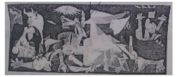

A. 梵高 斗牛士 现代派 德国

B. 梵高 格尔尼卡 油画 荷兰

C. 毕加索 斗牛士 印象派 法国

D. 毕加索 纳粹 立体主义 西班牙

第 45 题 · 答案与解析

**参考答案（粉笔题库参考内容）**

D

**解析**

这幅作品为油画《格尔尼卡》，创作于20世纪30年代，作者是西班牙画家毕加索。画面表现的是1937年纳粹德国空军轰炸西班牙小城格尔尼卡的情景。另外，画家把具象的手法与立体主义的手法结合，并借助几何线的组合，使作品获得严密的内在结构和紧密联系的形式，以激动人心的形象艺术语言，控诉了法西斯战争惨无人道的暴行。

故正确答案为D。

**考点**：文化常识

**来源**：2013年山东省公务员录用考试《行测》题第45题

### 第 46 题

关于日常生活用品，下列说法正确的是：

A. 牙膏的成分中含有摩擦剂

B. 添加了高级脂肪酸的肥皂，质量更好一些

C. 加碘盐应注意防潮，保存在有阳光照射、干燥通风的地方

D. “生抽”是酿造酱油，而“老抽”是配制酱油

第 46 题 · 答案与解析

**参考答案（粉笔题库参考内容）**

A

**解析**

A项正确，牙膏成分包括摩擦剂、保湿剂、表面活性剂等。

B项错误，肥皂的主要成分是高级脂肪酸盐，添加高级脂肪酸与肥皂质量没有关系。

C项错误，加碘盐应该放置在干燥、避光、避高温处。

D项错误，“生抽”和“老抽”都是经过酿造发酵的酱油。

故正确答案为A。

**考点**：生活常识

**来源**：2013年山东省公务员录用考试《行测》题第46题

### 第 47 题

山东省政府提出，要促进信息化和工业化深度融合，推动云计算、物联网等信息技术广泛应用，建设包括北斗系统示范工程、量子通信在内的新型信息技术类基础设施，健全信息安全保障措施，加快构建（    ）。

A. 智慧山东

B. 美丽山东

C. 科技山东

D. 信息山东

第 47 题 · 答案与解析

**参考答案（粉笔题库参考内容）**

A

**解析**

本题考查时事政治。

山东省省长姜大明在山东省第十二届人民代表大会第一次会议中提出了“智慧山东”的概念。

故正确答案为A。

**来源**：2013年山东省公务员录用考试《行测》题第47题

### 第 48 题

关于世界地理，下列说法不正确的是：

A. 里海是世界上最大的内陆湖

B. 刚果盆地是世界上最大的盆地

C. 巴西高原是世界上最高的高原

D. 安第斯山脉是世界上最长的山脉

第 48 题 · 答案与解析

**参考答案（粉笔题库参考内容）**

C

**解析**

本题考查世界地理相关知识。

A项正确，里海面积约为386400平方千米，是世界上最大的内陆湖泊。

B项正确，刚果盆地面积约为337万平方千米，是世界上面积最大的盆地。

C项错误，世界上最高的高原是青藏高原，并非巴西高原，巴西高原是世界上面积最大的高原。

D项正确，安第斯山脉从北到南全长8900余千米，是世界上最长的山脉。

本题为选非题，故正确答案为C。

**考点**：世界地理

**来源**：2013年山东省公务员录用考试《行测》题第48题

### 第 49 题

由同一种元素所构成的不同单质被称为同素异形体，下列哪组物质不属于同素异形体：

A. 钢和铁

B. 金刚石和石墨

C. 红磷和白磷

D. 氧气和臭氧

第 49 题 · 答案与解析

**参考答案（粉笔题库参考内容）**

A

**解析**

A项错误，钢是混合物，不是单质。

B项正确，金刚石和石墨都由碳元素组成，只是碳原子的排列不同。

C项正确，红磷和白磷均为由磷元素构成的单质，是磷元素的两种重要的同素异形体。

D项正确，臭氧和氧气组成分子的原子数不同，是一对同素异形体。

本题为选非题，故正确答案为A。

**考点**：化学常识

**来源**：2013年山东省公务员录用考试《行测》题第49题

### 第 50 题

遇到雷电天气时，下列说法不正确的是：

A. 要及时从汽车中逃离

B. 在建筑物中应远离电话、电视等

C. 要远离单独的高大树木

D. 在野外可以蜷缩在地面较低的区域

第 50 题 · 答案与解析

**参考答案（粉笔题库参考内容）**

A

**解析**

A项错误，汽车本身就是一个金属壳体，相当于一个屏蔽室，当雷电击中汽车时，电流会沿着汽车表面的金属导入地面，汽车里面的人员相对更加安全。

B项正确，电话、电视等天线有极佳的导电性，其电磁波也会引雷。

C项正确，雷雨天气时，不要在孤立的高大建筑物和大树下避雨，因为高大物体易遭雷击。

D项正确，蜷缩在地面较低的区域，是因为雷电容易击中较高的地方，低洼的地方一般不会遭雷击。

本题为选非题，故正确答案为A。

**考点**：物理常识

**来源**：2013年山东省公务员录用考试《行测》题第50题

### 第 51 题

某天办公桌上台历显示的是一周前的日期，将台历的日期翻到今天，正好所翻页的日期加起来是168，那么今天是几号？

A. 20

B. 21

C. 27

D. 28

第 51 题 · 答案与解析

**参考答案（粉笔题库参考内容）**

D

**解析**

日期是公差为1的等差数列，所翻的“一周前”共有7天，根据等差数列求和公式，则，故这7天分别为21号、22号、23号、24号、25号、26号、27号。题干问的是“今天”，为第八天，可推出为28号。

故正确答案为D。

**考点**：数列问题、星期日期问题

**来源**：2013年山东省公务员录用考试《行测》题第51题

### 第 52 题

一个圆形牧场面积为3平方公里，牧民骑马以每小时18公里的速度围着牧场外沿巡视一圈，约需多少分钟？

A. 12

B. 18

C. 20

D. 24

第 52 题 · 答案与解析

**参考答案（粉笔题库参考内容）**

C

**解析**

该圆形牧场的面积为3平方公里，则半径为公里，周长为公里。因此牧民骑马巡视一圈用时为。

故正确答案为C。

**考点**：几何公式类-平面图形、普通行程

**来源**：2013年山东省公务员录用考试《行测》题第52题

### 第 53 题

某工厂生产的零件总数是一个三位数，平均每个车间生产了35个，统计员在记录时粗心地将该三位数的百位数与十位数对调了，结果统计的零件总数比实际总数少270个。问该工厂所生产的零件总数最多可能是多少个？

A. 525

B. 630

C. 855

D. 960

第 53 题 · 答案与解析

**参考答案（粉笔题库参考内容）**

B

**解析**

由平均每个车间生产了35个，可知零件总数可以被35整除（既能被5又能被7整除），仅A、B两项符合。观察这两个选项，百位数与十位数对调后差值均为270，所求为零件总数最多可能的个数，故应该选择比较大的B项。

故正确答案为B。

**来源**：2013年山东省公务员录用考试《行测》题第53题

### 第 54 题

某单位向希望工程捐款，其中部门领导每人捐50元，普通员工每人捐20元，某部门所有人员共捐款320元。已知该部门总人数超过10人，问该部门可能有几名部门领导？

A. 1

B. 2

C. 3

D. 4

第 54 题 · 答案与解析

**参考答案（粉笔题库参考内容）**

B

**解析**

设该部门领导、普通员工的人数分别为x人、y人，根据“所有人员共捐款320元”可得，50x+20y=320，化简可得5x+2y=32，根据奇偶特性，由于2y与32均为偶数，则x必为偶数，排除A、C两项；又“该部门总人数超过10人”，即x+y>10，将B、D两项代入验证，若x=2，则y=11，x+y=13>10，符合要求；若x=4，则y=6，x+y=10，不符合要求。

故正确答案为B。

**来源**：2013年山东省公务员录用考试《行测》题第54题

### 第 55 题

甲、乙两地相距20公里，小李、小张两人分别步行和骑车，同时从甲地出发沿同一路线前往乙地，小李速度为4.5公里/小时，小张速度为27公里/小时。出发半小时后，小张返回甲地取东西，并在甲地停留半小时后再次出发前往乙地。问小张追上小李时，两人距离乙地多少公里？

A. 8.1

B. 9

C. 11

D. 11.9

第 55 题 · 答案与解析

**参考答案（粉笔题库参考内容）**

D

**解析**

根据运动过程可知，小张从开始出发到返回甲地后再次出发，共用时1.5个小时（出发半小时、返回半小时、甲地停留半小时）。在这段时间内，小李前进了4.5×1.5＝6.75公里。此后运动过程即小张对小李的追及过程，追及距离为6.75公里，追及时间为小时，因此追上时距离乙地20－27×0.3＝11.9公里。

故正确答案为D。

**考点**：相遇追及

**来源**：2013年山东省公务员录用考试《行测》题第55题

### 第 56 题

在空间中最多能放置多少个正方体，使得任意两个正方体都有一部分表面相接触？

A. 4

B. 5

C. 6

D. 7

第 56 题 · 答案与解析

**参考答案（粉笔题库参考内容）**

C

**解析**

空间图形比较难想象，可以先考虑平面图形。在同一平面上，最多可以同时有3个正方形两两相接触。转换到空间中，把两个平面相重合，通过调整正方体的边长，最多可以放置6个正方体使任意两个正方体都有一部分表面相接触，如下面俯视图所示。

故正确答案为C。

**考点**：几何公式类-立体图形、几何其他题型、非典型最值问题

**来源**：2013年山东省公务员录用考试《行测》题第56题

### 第 57 题

箱子中有编号1～10的10个小球，每次从中抽出一个记下编号后放回，如果重复3次，则3次记下的小球编号乘积是5的倍数的概率是多少？

A. 43.2%

B. 48.8%

C. 51.2%

D. 56.8%

第 57 题 · 答案与解析

**参考答案（粉笔题库参考内容）**

B

**解析**

若3次记下的小球编号乘积是5的倍数，则至少有一次需要抽到5或10。其反向为3次抽出的号码都不是5或10，这种情况的概率为0.8×0.8×0.8＝0.512。故3次记下的小球编号乘积是5的倍数的概率为1－51.2%＝48.8%。

故正确答案为B。

**考点**：给情况求概率

**来源**：2013年山东省公务员录用考试《行测》题第57题

### 第 58 题

某单位举办象棋比赛，规则为胜一场得4分，负一场得-1分，平一场不得分，一轮比赛中参赛人员100人，两两配对后分别比赛，所有人总得分为126分，问该轮比赛中平局有多少场？

A. 4

B. 8

C. 12

D. 16

第 58 题 · 答案与解析

**参考答案（粉笔题库参考内容）**

B

**解析**

若分出胜负，则该场比赛合计得分为4－1＝3分；若平局，则合计得分为0分。所有人总得分为126分，126÷3＝42分，即共有42场比赛不是平局，100个人共组成50场比赛，所以有50-42＝8场为平局。

故正确答案为B。

**来源**：2013年山东省公务员录用考试《行测》题第58题

### 第 59 题

有100个编号为1～100的罐子，第1个人在所有编号为1的倍数的罐子中倒入1毫升水，第2个人在所有编号为2的倍数的罐子中倒入1毫升水······第100个人在所有编号为100的倍数的罐子中倒入1毫升水，问此时第92号罐子中装了多少毫升的水？

A. 2

B. 6

C. 46

D. 92

第 59 题 · 答案与解析

**参考答案（粉笔题库参考内容）**

B

**解析**

根据题意可知，向92号罐子中倒水的人数为92因数的个数，对92进行因数分解，可得 92=1×92=2×46=4×23，其因数有1、2、4、23、46、92，共6个，即共有6人向92号罐子中倒水，则最后92号罐子中装了6×1=6毫升的水。

故正确答案为B。

**考点**：公倍数与公约数问题

**来源**：2013年山东省公务员录用考试《行测》题第59题

### 第 60 题

某单位共有职工72人，年底考核平均分数为85分，根据考核分数，90分以上的职工评为优秀职工，已知优秀职工的平均分为92分，其他职工的平均分数是80分，问优秀职工的人数是多少？

A. 12

B. 24

C. 30

D. 42

第 60 题 · 答案与解析

**参考答案（粉笔题库参考内容）**

C

**解析**

方法一：设优秀职工为x人，则其他职工为（72-x）人。根据题意可得：92x+80×（72-x）=85×72，解得x=30。

方法二：设优秀职工为x人，则其他职工为（72-x）人。根据线段法：距离与量成反比，可列式：，解得x=30。

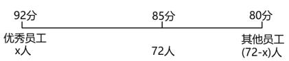

故正确答案为C。

**考点**：和差倍比问题

**来源**：2013年山东省公务员录用考试《行测》题第60题

### 第 61 题

2台大型收割机和4台小型收割机在一天内可收完全部小麦的，8台大型收割机和10台小型收割机在一天内可收完全部小麦，如果单独用大型收割机和单独用小型收割机进行比较，要在一天内收完小麦，小型收割机要比大型收割机多用多少台？

A. 8

B. 10

C. 18

D. 20

第 61 题 · 答案与解析

**参考答案（粉笔题库参考内容）**

C

**解析**

假定全部小麦为1。设大型收割机与小型收割机的效率分别为x、y，则可得：，8x+10y=1，解得，。因此单独用大型收割机收完需要12台，单独用小型收割机收完需要30台，相差30－12＝18台。

故正确答案为C。

**考点**：给效率比例型

**来源**：2013年山东省公务员录用考试《行测》题第61题

### 第 62 题

甲、乙两仓库各放有集装箱若干个，第一天从甲仓库移出和乙仓库集装箱总数同样多的集装箱到乙仓库，第二天从乙仓库移出和甲仓库集装箱总数同样多的集装箱到甲仓库，如此循环，则到第四天后，甲乙两仓库集装箱总数都是48个，问甲仓库原来有多少个集装箱？

A. 33

B. 36

C. 60

D. 63

第 62 题 · 答案与解析

**参考答案（粉笔题库参考内容）**

D

**解析**

方法一：代入排除法。根据题意知两仓库共有96个集装箱，第一天从甲仓库移出和乙仓库同样多的集装箱，所以甲仓库的数量一定大于乙仓库的数量，排除A、B两项。将C项60代入，第一次搬运：甲24、乙72，第二次搬运：甲48、乙48，可得第二天两仓库的数量就可以达到相等，排除C项，D项当选。

方法二：逆向考虑即可，从第四天起向前逆推，甲48、乙48→甲24、乙72→甲60、乙36→甲30、乙66→甲63、乙33（此为第一天移动前），则甲仓库原来有63个集装箱。

故正确答案为D。

**考点**：和差倍比问题

**来源**：2013年山东省公务员录用考试《行测》题第62题

### 第 63 题

某彩票设有一等奖和二等奖，其玩法为从10个数字中选出4个，如果当期开奖的4个数字组合与所选数字有3个相同则为二等奖，奖金为投注金额的3倍，4个数字完全相同则为一等奖。为了保证彩票理论中奖金额与投注金额之比符合国家50%的规定，则一等奖的奖金应为二等奖的多少倍？

A. 8

B. 9

C. 10

D. 11

第 63 题 · 答案与解析

**参考答案（粉笔题库参考内容）**

D

**解析**

10个数字中选出4个，恰有3个相同中二等奖，则二等奖中奖的情况数有种。恰有4个相同中一等奖，一等奖中奖的情况数有种，随机选出4个数字的总情况数有种。设一等奖的奖金为x，赋值每注彩票的投注金额为1，则二等奖的奖金为3，则，解得x=33。一等奖的奖金是二等奖的倍。

故正确答案为D。

**考点**：基础排列组合

**来源**：2013年山东省公务员录用考试《行测》题第63题

### 第 64 题

某公司推出的新产品预计每天销售5万件，每件定价为40元，利润为产品定价的30%。公司为了打开市场推出九折促销活动，并且以每天10万元的费用作为产品和促销活动的广告宣传。问销量至少要达到预计销量的多少倍以上，每天的盈利才能超过促销活动之前：

A. 1.75

B. 2.25

C. 2.75

D. 3.25

第 64 题 · 答案与解析

**参考答案（粉笔题库参考内容）**

A

**解析**

假定最低倍数为M，根据题意可得，解得M＝1.75，所以若要每天的盈利超过促销活动之前，销量至少要达到预计销量的1.75倍以上。

故正确答案为A。

**考点**：经济利润问题

**来源**：2013年山东省公务员录用考试《行测》题第64题

### 第 65 题

有甲、乙两个水池，其中甲水池中一直有水注入，如果分别用8台抽水机去抽空甲和乙水池，分别需要16小时和4小时，如给甲水池加5台，提前10小时抽完。若共安排20台抽水机，则为了保证两个水池能同时抽空，在甲水池的抽水机比乙水池多多少台？

A. 4

B. 6

C. 8

D. 10

第 65 题 · 答案与解析

**参考答案（粉笔题库参考内容）**

C

**解析**

假设1台抽水机效率为1，则乙水池水量为32。设甲水池水量为y，注水效率为x，则可得y＝（8－x）×16，y＝（13－x）×6，解得y＝48，x＝5；现假设甲、乙水池用的抽水机台数分别为M、N，为保证同时抽完，可得48:32=(M-5):N，M+N=20，解得M=14，N=6，因此甲水池的抽水机比乙水池多8台。

故正确答案为C。

**来源**：2013年山东省公务员录用考试《行测》题第65题

### 第 66 题

从所给的四个选项中，选择最合适的一个填入问号处，使之呈现一定的规律性。

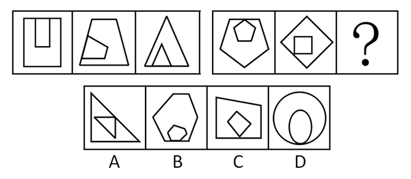

A. A

B. B

C. C

D. D

第 66 题 · 答案与解析

**参考答案（粉笔题库参考内容）**

C

**解析**

考查图形间关系。每一幅图内外元素都是相同图形，且不存在曲线，排除D项；前三幅图内外元素都有一部分线段重合，后两幅图内外元素均有一个交点，待选图形也应符合此规律，排除B项；观察内外图形相交的位置，依次为上、左、下、上、左，故问号处图形内外相交的位置应该在下方，排除A项。

故正确答案为C。

**考点**：属性规律-曲直性、特殊规律-图形间关系

**来源**：2013年山东省公务员录用考试《行测》题第66题

### 第 67 题

从所给的四个选项中，选择最合适的一个填入问号处，使之呈现一定的规律性。

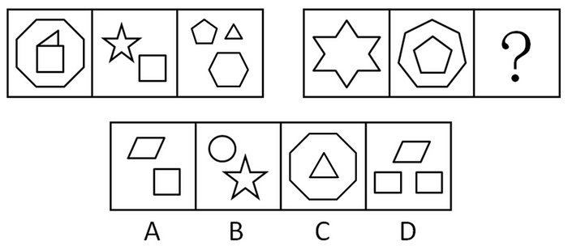

A. A

B. B

C. C

D. D

第 67 题 · 答案与解析

**参考答案（粉笔题库参考内容）**

D

**解析**

本题图形元素组成不同，优先考虑属性规律，属性无规律，考虑数量规律。题干图形有多边形，优先考虑数直线数。第一组三幅图均包含14条直线。将此规律应用到第二组图中，第二组前两幅图均包含12条直线，待选图形也应符合此规律。A、B、C三项直线条数分别为8，10，11，只有D项包含12条直线。

故正确答案为D。

**考点**：数量规律-线

**来源**：2013年山东省公务员录用考试《行测》题第67题

### 第 68 题

从所给的四个选项中，选择最合适的一个填入问号处，使之呈现一定的规律性。

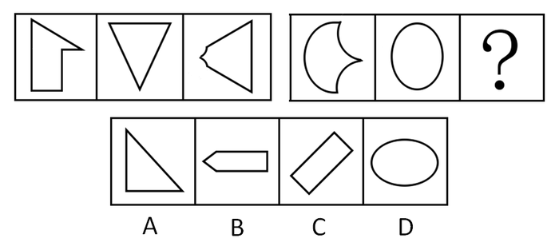

A. A

B. B

C. C

D. D

第 68 题 · 答案与解析

**参考答案（粉笔题库参考内容）**

D

**解析**

本题元素组成不同，无明显属性规律，考虑数量规律。观察发现，前三幅图中均含有直线相交构成的角，后两幅图均没有直线构成的角，故？处也应符合此规律，只有D项符合条件。

故正确答案为D。

**考点**：数量规律-角

**来源**：2013年山东省公务员录用考试《行测》题第68题

### 第 69 题

从所给的四个选项中，选择最合适的一个填入问号处，使之呈现一定的规律性。

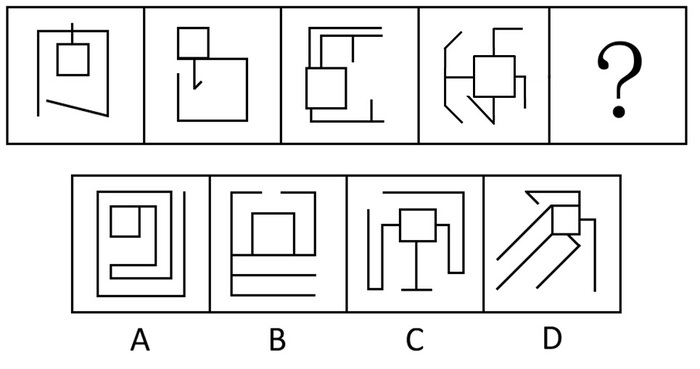

A. A

B. B

C. C

D. D

第 69 题 · 答案与解析

**参考答案（粉笔题库参考内容）**

D

**解析**

本题元素组成凌乱，考数数，具体考查相交线数。每幅图均含有一个正方形，正方形发散延伸的线条个数分别为1，2，3，4，依次递增，故问号处图形中正方形发散延伸的线条数应为5，只有D项符合此规律。

故正确答案为D。

**考点**：数量规律-线

**来源**：2013年山东省公务员录用考试《行测》题第69题

### 第 70 题

以下哪两个图形调换位置后，所有图形能呈现一定的规律性？

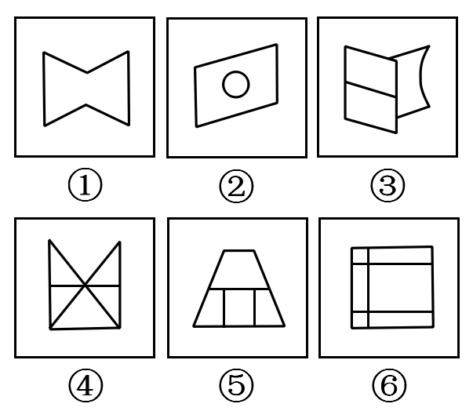

A. ②和③

B. ③和④

C. ④和⑤

D. ⑤和⑥

第 70 题 · 答案与解析

**参考答案（粉笔题库参考内容）**

C

**解析**

本题元素组成凌乱，考数数。题干中图形的封闭区域数依次为1，2，3，5，4，6，将④和⑤对调后，为1，2，3，4，5，6，依次递增。

故正确答案为C。

**考点**：数量规律-面

**来源**：2013年山东省公务员录用考试《行测》题第70题

### 第 71 题

水土流失是指在水力、重力、风力等外力作用下，水土资源和土地生产力遭受的破坏和损失，包括土地表层侵蚀和水的损失，亦称水土损失。水土流失是不利的自然条件与人类不合理的经济活动互相交织作用产生的。

根据以上定义，下列不存在水土流失的是：

A. 某地在一次暴雨后发生泥石流

B. 某些地区在强风作用下逐步沙漠化

C. 岩石经过长期的风化变成沙砾

D. 黄河将高原大量的泥沙挟带至下游

第 71 题 · 答案与解析

**参考答案（粉笔题库参考内容）**

C

**解析**

第一步：找到定义关键词。

“土地表层侵蚀”、“水土损失”。

第二步：逐一分析选项。

C项“岩石”不属于土地表层，只是简单的风化作用，不存在水土流失，当选。A项“泥石流”属于水土损失；B项“沙漠化”属于土地表层侵蚀；D项高原“泥沙”属于水土损失。A、B、D三项均符合定义关键词，都存在水土流失。

本题为选非题，故正确答案为C。

**考点**：单定义-其他句式

**来源**：2013年山东省公务员录用考试《行测》题第71题

### 第 72 题

化归思想是指当问题难以直接解决时，根据问题的性质、条件和关系的特点，采取适当的变换方法而对问题进行转换，最终把它化为容易的、较简单的或已经解决的问题的思想。

根据上述定义，下列运用了化归思想的是：

A. 人类发明了钨丝做灯丝的电灯泡，取代了以往的碳丝电灯，从而使电灯的亮度明显提高

B. 在掌握了扇形和三角形的面积计算公式以后，用图形分割的方法求出弓形的面积

C. 张教授用新的实验方法取代以往的实验方法，从而攻克了一道技术上的难题

D. 法学研究者将法学方法加以理论化，从而上升为法学方法论

第 72 题 · 答案与解析

**参考答案（粉笔题库参考内容）**

B

**解析**

第一步：找到定义关键词。

“问题难以直接解决”、“采取适当的变换方法而对问题进行转换”、“化为容易的、较简单的或已经解决的问题”。

第二步：逐一分析选项。

B项，图形分割的方法是适当转化，弓形面积是难以直接解决的问题，扇形和三角形的面积计算公式是容易的、较简单的、已经解决的问题，符合定义要件，当选；

A项，电灯亮度的提高，使得电灯在技术上得到了提升，并没有变得简单，不符合定义要件，排除；

C项，解决手段即实验方法发生了变化，但问题本身并没有进行转换，不符合定义要件，排除；

D项，法学方法理论化，在理论深度上进一步加强，上升为法学方法论，变得更难理解，不符合定义要件，排除。

故正确答案为B。

**考点**：方式目的

**来源**：2013年山东省公务员录用考试《行测》题第72题

### 第 73 题

道路交通事故是指车辆在道路上因过错或者意外造成的人身伤亡或者财产损失的事件。其中“道路”是指公路、城市道路和虽在单位管辖范围但允许社会机动车辆通行的地方，包括广场、公共停车场等用于公众通行的场所。“车辆”是指机动车和非机动车。“非机动车”是指人力或者畜力驱动上道路行驶的交通工具，以及虽有动力装置驱动但设计最高时速、空车质量，外形尺寸符合有关国家标准的残疾人机动轮椅车、电动自行车等交通工具。

根据上述定义，下列不属于道路交通事故的是：

A. 小王在进行封闭管理的小区内倒车时不慎将一老人撞倒

B. 周小姐带着宠物狗横穿马路时，乱闯的宠物狗不幸丧生在车轮下

C. 小赵将汽车停在商场附近的停车场，取车时发现车尾部被撞，肇事车辆已逃跑

D. 绿灯亮时，小姜穿过斑马线过马路，被一辆闯红灯的自行车撞伤

第 73 题 · 答案与解析

**参考答案（粉笔题库参考内容）**

A

**解析**

第一步：找到定义关键词。

道路交通事故的定义：“因过错或者意外造成的人身伤亡或者财产损失”；

道路的定义：“公路、城市道路和虽在单位管辖范围但允许社会机动车辆通行的地方”；

车辆的定义：“机动车和非机动车”。

第二步：逐一分析选项。

A项，倒车时将老人撞倒，符合“因过错或者意外造成的人身伤亡或者财产损失”，但是题干中对公路的定义重点在于“公共”二字，而A项中的封闭管理的小区不能算作是一种公共区域，因此，不符合定义；

B项，宠物狗作为周小姐的个人财产，在过马路时不幸丧生在车轮下，符合意外造成的财产损失，场所和车辆的定义也都符合题干要求，因此属于道路交通事故；

C项，在停车场车尾部被撞，肇事车辆已逃跑，道路场所和车辆的概念都符合定义关键词，属于道路交通事故；

D项，自行车符合车辆的定义，过马路时符合道路场所的定义，属于道路交通事故。

本题为选非题，故正确答案为A。

**考点**：原因结果

**来源**：2013年山东省公务员录用考试《行测》题第73题

### 第 74 题

自我障碍策略指的是当人们预期自己会失败的时候，常常会提前设置一些障碍来阻挠自己获得成功，以作为解释失败的借口，这种行为被称为自我障碍策略。

根据上述定义，下列使用自我障碍策略的是：

A. 小李的学习成绩一直是全班第一，但对马上来临的期末考试很没有把握，索性谎称自己生病了，以此来逃避期末考试

B. 营销员张某的业绩出现下滑，经理找其谈话，张某解释这是因为最近一段时间自己神经衰弱、工作状态不佳导致的

C. 小杨一路披荆斩棘，最终杀入全国网球总决赛。这时他突然担心决赛拿不到好名次，故意在训练中扭伤脚，带伤去参加比赛

D. 中学时期一直是尖子生的小刘，高考发挥失常，只考上一所不起眼的大学，之后破罐子破摔，再也提不起学习的兴趣了

第 74 题 · 答案与解析

**参考答案（粉笔题库参考内容）**

C

**解析**

第一步：找到定义关键词。

“预期自己会失败”、“提前设置一些障碍”、“以作为解释失败的借口”。

第二步：逐一分析选项。

C项，小杨“担心决赛拿不到好名次”符合第一个要件，“故意在训练中扭伤脚”符合第二个要件，“带伤去参加比赛”符合第三个要件，当选；

A项，根本未参加期末考试，不能说失败了，不符合“以作为解释失败的借口”，“谎称自己生病”也不是实际的障碍，不符合定义要件，排除；

B项，不符合“预期失败”，也没有“提前设置一些障碍”，不符合定义要件，排除；

D项，“发挥失常”但并没有“提前设置一些障碍”，不符合定义要件，排除。

故正确答案为C。

**考点**：方式目的

**来源**：2013年山东省公务员录用考试《行测》题第74题

### 第 75 题

知识营销是指企业在营销过程中，使企业的广告、宣传、公关、产品注入一定的知识含量与文化内蕴，帮助消费者增加与商品相关并实用的信息与知识，提高他们的消费与生活质量，从而达到推广产品、建立形象、提升品牌竞争力的目的。

根据上述定义，下列属于知识营销的是：

A. 某保健品生产企业深入社区为居民开设健康生活讲座，并在讲座中推销其保健品

B. 某体育用品生产企业为希望小学捐献价值20万元的体育用品，多家媒体报道了这则事迹

C. 某师范院校派出大学生支教团，在支教的同时宣传教育的重要性，为该校在当地的招生起到了积极作用

D. 某证券公司股票分析师经常受电视台邀请在电视节目中为广大股民进行股票分析

第 75 题 · 答案与解析

**参考答案（粉笔题库参考内容）**

A

**解析**

第一步：找到定义关键词。

“企业在营销过程中”、“帮助消费者增加与商品相关并实用的信息与知识”、“达到推广产品、建立形象、提升品牌竞争力的目的”。

第二步：逐一分析选项。

A项，属于营销过程，“开设健康生活讲座”符合第二个定义要件，“推销其保健品”符合第三个定义要件，当选；

B项，不符合“与商品相关并实用的信息与知识”这一定义要件，并且捐款的行为也并非发生在营销过程中，不符合定义，排除；

C项，“某师范院校”不属于企业，所以不存在营销过程，不符合定义要件，排除；

D项，属于个人行为，且只是单纯的分析商品，并没有“帮助消费者增加与商品相关并实用的信息与知识”，不符合定义要件，排除。

故正确答案为A。

**考点**：方式目的

**来源**：2013年山东省公务员录用考试《行测》题第75题

### 第 76 题

利群偏差是指人们对自己的群体成员的行为总是倾向于给予善意的解释，而在解释其他群体成员的类似行为时，更容易从坏的角度去设想。

根据上述定义，下列存在利群偏差的是：

A. 东道主球队的胜利得益于天时地利人和，我们客场作战失利是因为球员在异国他乡水土不服

B. 我们队员比赛失利的主要原因是训练过度劳累，没有很好地保存实力去比赛，让对方球员捡了个大便宜

C. 某公司经理认为去年公司业绩不尽如人意的主要原因是低估了竞争对手的实力，让对方抢走了绝大多数的客户

D. 某班主任看到自己班学生的打闹行为认为只是玩笑胡闹，看到其他班同学的类似行为会认为是品质恶劣

第 76 题 · 答案与解析

**参考答案（粉笔题库参考内容）**

D

**解析**

第一步：找出定义关键词。

“解释自己群体时善意”、“解释其他群体时恶意”。

第二步：逐一分析选项。

A项，对于“东道主球队的胜利得益于天时地利人和”，这并不是从坏的角度去设想，不符合题干逻辑关系，而且其他群体也没有出现比赛失利的类似行为，排除；

B项，只分析了自己队员失利的原因，没有分析对方队员胜利的原因，而且其他群体没有出现比赛失利的类似行为，不符合题干，排除；

C项，只分析了自己公司业绩不好的原因，没有分析对手公司胜利的原因，而且也没有出现业绩不好的类似行为，不符合题干，排除；

D项，分析自己班学生的打闹行为时是善意的，分析别的班同学的打闹行为时是恶意的，符合题干逻辑关系，当选。

故正确答案为D。

**考点**：单定义-其他句式

**来源**：2013年山东省公务员录用考试《行测》题第76题

### 第 77 题

互补商品是指两种或几种共同满足消费者同一种欲望的相关商品，在消费者的爱好、货币收入和其他商品价格保持不变的情况下，如果商品甲价格的下跌引起对商品乙需求的增长，那么甲和乙就是互补商品。

根据上述定义，下列属于互补商品的是：

A. 在胶片相机价格不变时，胶片价格的上涨使得人们对胶片相机的需求也相应减少

B. 由于原料成本的增加，某酒厂将其生产的葡萄酒每瓶的价格由原先的10元调至11元，但并没有影响市场上酒杯的价格

C. 一些地区为了缓解交通压力出台汽车限购令，使得一些汽车的价格有所下降，与此同时，由于石油紧缺，汽油的价格却在不断上涨

D. 某学校为了组建一支乒乓球队，采购了一批乒乓球和球拍，后发现球拍的质量不好，又增购了一批高质量的球拍

第 77 题 · 答案与解析

**参考答案（粉笔题库参考内容）**

A

**解析**

第一步：找到定义关键词。

“满足消费者同一种欲望”、“爱好、货币收入和其他商品价格保持不变”、“商品甲价格的下跌引起对商品乙需求的增长”。

第二步：逐一分析选项。

A项，“胶片相机价格不变”体现了“爱好、货币收入和其他商品价格保持不变”，胶片价格上涨引起对胶片相机需求的减少，这个与“商品甲价格的下跌引起对商品乙需求的增长”不同；

B项，原料成本增加体现出其他商品价格发生了变化，每瓶价格的增加却没有引起酒杯的价格变化，与A项相比，B项与题干定义的契合度更差；

C项，汽油价格的上涨并不是由于汽车价格的下降引起的，不存在甲和乙的关联关系；D项，重新购买高质量的球拍，并不是因为原先购买的球拍的价格下跌，而是因为质量关系。

经过对选项的比较分析，发现B、C、D三项都有明确的不符合定义的地方，A项虽然与定义所述不完全一致，但是至少体现出了一种商品价格的变化对另一种商品需求的影响，与定义所述含义保持一致，因此，A项更好。

故正确答案为A。

**考点**：单定义-其他句式

**来源**：2013年山东省公务员录用考试《行测》题第77题

### 第 78 题

内隐认知是指人的大脑对各种刺激的内部加工过程，即在认知过程中，虽然行为者不能回忆某一过去经验，但这一经验已潜在地对行为者的行为和判断产生影响。

根据上述定义，下列符合内隐认知的是：

A. 小方在电视上看到某品牌手机的广告，她想到爸爸使用的手机听筒有问题，不如买一款广告中的手机送给他

B. 小辉利用业余时间学习了法语，工作后由于没有从事法语相关工作，法语学习就被迫中断了

C. 三十岁的张明很怕毛毛虫，母亲认为这是因为他一岁半时曾被毛毛虫蜇伤过

D. 一些企业借鉴国外经验，请名人为公司产品代言，并进行广泛宣传，以此为企业赢得利润和声誉

第 78 题 · 答案与解析

**参考答案（粉笔题库参考内容）**

C

**解析**

第一步：找到定义关键词。

“过去经验”、“行为者不能回忆”、“潜在地对行为者的行为和判断产生影响”。

第二步：逐一分析选项。

C项，“一岁半时曾被毛毛虫蜇伤过”这一“过去经验”，张明已不能回忆，但却造成了他很怕毛毛虫的这一认知，符合定义要件，当选；

A项，小方回忆起“爸爸使用的手机听筒有问题”这一“过去经验”，不符合定义要件，排除；

B、D两项，都没有涉及到“过去经验”，不符合定义要件，排除。

故正确答案为C。

**考点**：单定义-其他句式

**来源**：2013年山东省公务员录用考试《行测》题第78题

### 第 79 题

挤进效应是指政府采用扩张性财政政策时，能够诱导民间消费和投资的增加，从而带动产出总量或就业总量增加的效应；挤出效应是指当供应和需求有新的增加时，随着政府支出的增加而引起的私人消费或投资降低的效果，这会导致部分资金从原来的预支中挤出，而流入到新的商品中。

根据上述定义，下列属于挤出效应的是：

A. 某地区县政府对家庭困难的个体经营者减免税收，从而带动当地的个体经济

B. 某地区政府计划投资一些大型化工项目并建立化工厂，由于工厂将占用一部分耕地，因此该地区粮食价格上涨

C. 由于适龄儿童增加，该地区政府加大了对学校基础建设的资金投入，并降低学杂费，于是当地家庭为孩子报艺术班的比例增加了

D. 某市实行房屋限购令后，楼市交易低迷，人们转向投资邻市，使邻市楼市被进一步催热

第 79 题 · 答案与解析

**参考答案（粉笔题库参考内容）**

C

**解析**

第一步：分析题干关键词。

“供应和需求有新的增加”、“随着政府支出的增加”、“私人消费或投资降低”、“部分资金从原来的预支中挤出”、“到新的商品中”。

第二步：逐一分析选项。

A项，没有体现出“供应和需求有新的增加”，也看不出“政府支出的增加”，只是减免了个人的税收而已，没有涉及政府的支出，排除；

B项，没有体现出“私人消费或投资降低”，也没有体现出“部分资金从原来的预支中挤出”的变动，排除；

C项，“政府加大了对学校基础建设的资金投入”体现了“政府支出的增加”，“降低学杂费”体现了“私人消费或投资降低”，“为孩子报艺术班的比例增加”体现了“供应和需求有新的增加”、“部分资金从原来的预支中挤出”、“到新的商品中”，完全符合题干定义要求，当选；

D项，这里没有体现出“新的商品”，因为人们还是投资楼市，只不过由本市转移到了外市，排除。

故正确答案为C。

**考点**：常规问法

**来源**：2013年山东省公务员录用考试《行测》题第79题

### 第 80 题

内部行政行为是指行政主体（包括行政机关、法律法规授权的组织和部分国有事业单位）在内部行政组织管理过程中所做的只对行政组织内部产生法律效力的行政行为。依照内部行政行为的内容可将其大致分为两类：一类是涉及行政机关公务员权利义务的内部人事管理行为，如行政主体对内部行政人员的奖惩、任免、考核、退休等；另一类是行政主体间工作关系行为，如上下级行政机关以及同级行政机关之间的请示、报告、批复、通知等。

根据上述定义，下列属于内部行政行为的是：

A. 某省粮食局制定保障粮食生产发展纲要，要求各市县粮食局贯彻实施

B. 某市工商局指导当地外资企业进行网上年检，简化手续并提高了工作效率

C. 某市国税局购进一批办公桌椅，因质量存在严重问题，做出暂缓向销售商支付剩余款项的决定

D. 某市政府与打扫办公室卫生的清洁工签订劳动合同，并对工作不合格的人员做出解除劳动关系的决定

第 80 题 · 答案与解析

**参考答案（粉笔题库参考内容）**

A

**解析**

第一步：找到定义关键词。

“行政主体”、“在内部行政组织管理过程中”、“只对行政组织内部产生法律效力”。一共两类，符合其中一类即可。

第二步：逐一分析选项。

A项，属于内部行政行为第二类中的上下级行政机关之间的通知，当选；

B、C两项，均不符合“内部行政组织管理过程中”，不符合定义内容，排除；

D项，清洁工不是内部行政人员，所以不符合“只对行政组织内部产生法律效力”这一定义要件，不属于内部行政行为，排除。

故正确答案为A。

**考点**：大前提

**来源**：2013年山东省公务员录用考试《行测》题第80题

### 第 81 题

尝试：成功

A. 奋斗：目标

B. 动力：创造

C. 劝说：接受

D. 改革：进步

第 81 题 · 答案与解析

**参考答案（粉笔题库参考内容）**

D

**解析**

第一步：判断题干词语间逻辑关系。

尝试会得到成功这样的结果，二者为因果对应关系，且成功是尝试的一个可能性结果。

第二步：判断选项词语间逻辑关系。

A项：以奋斗的方式，取得达到目标这样的目的，二者为方式目的对应关系，与题干逻辑关系不一致，排除；

B项：创造时需要动力，二者并非因果对应关系，与题干逻辑关系不一致，排除；

C项：通过劝说让别人接受，二者为因果对应关系，且接受是劝说的一个可能性结果，与题干逻辑关系一致，保留；

D项：改革之后会得到进步这样的结果，二者为因果对应关系，且进步是改革的一个可能性结果，与题干逻辑关系一致，保留。

对比C、D两项，题干“尝试”和“成功”的主体可以一致；C项“劝说”和“接受”的主体不同；D项“改革”和“进步”的主体可以一致，故D项当选。

故正确答案为D。

**考点**：逻辑关系-对应关系

**来源**：2013年山东省公务员录用考试《行测》题第81题

### 第 82 题

原告：被告

A. 交警：司机

B. 正方：反方

C. 上级：下级

D. 雇主：雇员

第 82 题 · 答案与解析

**参考答案（粉笔题库参考内容）**

B

**解析**

第一步：判断题干词语间逻辑关系。

题干两词为并列关系中的反对关系，原被告是法律诉讼中的主体，地位平等。

第二步：判断选项词语间逻辑关系。

B项与题干逻辑关系一致，正反方是辩论赛中的主体，地位平等，当选。

A、C、D三项都是对应关系，后者均为前者的管理对象，与题干逻辑关系不一致，排除。

故正确答案为B。

**考点**：逻辑关系-并列关系

**来源**：2013年山东省公务员录用考试《行测》题第82题

### 第 83 题

超市：消费者

A. 医院：患者

B. 法院：犯人

C. 学校：老师

D. 军队：军人

第 83 题 · 答案与解析

**参考答案（粉笔题库参考内容）**

A

**解析**

第一步：判断题干词语间逻辑关系。

题干两词为对应关系，是服务机构与服务对象的对应关系，“超市”是为“消费者”服务的。

第二步：判断选项词语间逻辑关系。

只有A项逻辑关系与之一致，“医院”是为“患者”服务的，当选。B项，“法院”与“犯人”是对应关系，“法院”是用来审判“犯人”的；C项，“学校”是“老师”的工作场所，是工作场所与职业的对应；D项，“军队”是“军人”服役的地方。B、C、D三项的对应关系均与题干不一致。

故正确答案为A。

**考点**：逻辑关系-对应关系

**来源**：2013年山东省公务员录用考试《行测》题第83题

### 第 84 题

成本：价格

A. 北方：寒冷

B. 金钱：成功

C. 身高：体重

D. 工时：质量

第 84 题 · 答案与解析

**参考答案（粉笔题库参考内容）**

C

**解析**

第一步：判断题干词语间逻辑关系。

题干两词为对应关系，“成本”是影响“价格”的必然因素之一。

第二步：判断选项词语间逻辑关系。

只有C项逻辑关系与之一致，“身高”是影响“体重”的必然因素之一，C项符合题干逻辑关系。北方在夏天的时候也不寒冷，有无金钱都可以走向成功，工时长短不一定能决定质量，A、B、D三项均与题干逻辑不一致。

故正确答案为C。

**考点**：逻辑关系-对应关系

**来源**：2013年山东省公务员录用考试《行测》题第84题

### 第 85 题

植物：授粉：结果

A. 米酒：发酵：保鲜

B. 绿茶：采摘：加工

C. 灯丝：导电：发光

D. 石油：加热：沉积

第 85 题 · 答案与解析

**参考答案（粉笔题库参考内容）**

C

**解析**

第一步：判断题干词语间逻辑关系。

“植物”因为经过“授粉”才能“结果”，“授粉”是植物能够“结果”的原因，二者存在因果关系。

第二步：判断选项词语间逻辑关系。

A项：“米酒”要先进行“发酵”然后再进行保鲜，二者存在时间先后上的对应关系，但“发酵”不是“保鲜”的原因，与题干逻辑关系不一致，排除；

B项：“绿茶”先经过“采摘”然后再进行“加工”，二者存在时间先后上的对应关系，但“采摘”不是“加工”的原因，与题干逻辑关系不一致，排除；

C项：“灯丝”因为能“导电”所以才能“发光”，二者存在因果关系，与题干逻辑关系一致，当选；

D项：制作“石油”需要先进行“加热”然后再冷却，冷却后“沉积”分层，二者存在时间先后上的对应关系，但“加热”不是“沉积”的原因，与题干逻辑关系不一致，排除。

故正确答案为C。

**考点**：逻辑关系-对应关系

**来源**：2013年山东省公务员录用考试《行测》题第85题

### 第 86 题

勘探：矿石：工厂

A. 运输：货物：火车

B. 养殖：鲤鱼：餐厅

C. 训练：士兵：战场

D. 驯服：海豚：大海

第 86 题 · 答案与解析

**参考答案（粉笔题库参考内容）**

B

**解析**

第一步：判断题干词语间逻辑关系。

“勘探”得到的“矿石”由“工厂”加工，前两词为动宾关系，后两词为原料与加工场所的对应关系。

第二步：判断选项词语间逻辑关系。

A项：用火车运输货物，“火车”为运输货物的工具，后两词为工具上的对应关系，与题干逻辑关系不一致，排除；

B项：“养殖”得到的“鲤鱼”由“餐厅”进行加工，前两词为动宾关系，后两词为原料与加工场所的对应关系，与题干逻辑关系一致，当选；

C项：“训练”“士兵”是为了让他们在“战场”上保家卫国，前两词为动宾关系，和第三词存在目的上的对应关系，与题干逻辑关系不一致，排除；

D项：“驯服”“海豚”，二者构成动宾关系，“海豚”生活在“大海”里，是生活场所的对应关系，与题干逻辑关系不一致，排除。

故正确答案为B。

**考点**：语法关系、逻辑关系-对应关系

**来源**：2013年山东省公务员录用考试《行测》题第86题

### 第 87 题

芒种：成熟：节气

A. 音响：立体：设备

B. 流星：闪光：天体

C. 冠礼：婚嫁：礼仪

D. 古稀：高寿：称谓

第 87 题 · 答案与解析

**参考答案（粉笔题库参考内容）**

D

**解析**

第一步：判断题干词语间逻辑关系。

题干三词是对应关系，“芒种”是代表“成熟”的“节气”。

第二步：判断选项词语间逻辑关系。

只有D项与之逻辑关系一致，“古稀”是中国人自古指七十“高寿”的“称谓”，当选。A项“立体”声是“音响”自身所具有的一种实际属性，而不是一种代表义；B项，“流星”不是一种“天体”，而是流星体进入大气层后，因摩擦而发光发热的现象；C项，“冠礼”是一种代表“成年”的“礼仪”，而不是“婚嫁”。A、B、C三项均与题干逻辑关系不一致。

故正确答案为D。

**考点**：逻辑关系-包容关系、逻辑关系-对应关系

**来源**：2013年山东省公务员录用考试《行测》题第87题

### 第 88 题

湖笔 对于 （    ） 相当于 （    ） 对于 指南针

A. 宣纸 司南

B. 端砚 火药

C. 印章 造纸

D. 镇纸 印刷

第 88 题 · 答案与解析

**参考答案（粉笔题库参考内容）**

B

**解析**

A项，“湖笔”与“宣纸”是并列关系，二者都是文房四宝之一；“司南”和“指南针”是全同关系，“司南”是“指南针”的原始状态。前后两组词逻辑关系不同，排除；

B项，“湖笔”与“端砚”是并列关系，二者都是文房四宝之一；“火药”和“指南针”是并列关系，二者都是中国古代四大发明之一。前后两组词逻辑关系一致，当选；

C项，“湖笔”和“印章”是并列关系，二者都是文具。注意，一般会把印章误认为不是文具，其实印章是一种印于文件上表示鉴定或签署的文具。“造纸”和“指南针”没有明显的逻辑关系。注意，“造纸术”和“指南针”才是并列关系，“造纸”不同于“造纸术”，排除；

D项，“湖笔”和“镇纸”是并列关系，二者都是文具；“印刷”和“指南针”没有明显的逻辑关系，解释同C项，注意区分“印刷”和“印刷术”，排除。

故正确答案为B。

**考点**：逻辑关系-并列关系

**来源**：2013年山东省公务员录用考试《行测》题第88题

### 第 89 题

传记 对于 （  ） 相当于 （  ） 对于 基因

A. 自传 细胞

B. 人物 遗传学

C. 文学 染色体

D. 纪实 治疗

第 89 题 · 答案与解析

**参考答案（粉笔题库参考内容）**

B

**解析**

将选项逐一代入，判断各选项前后部分的逻辑关系。

代入A项，“自传”是“传记”的一种，但“基因”不是“细胞”的一种，前后逻辑关系不一致，排除；

代入B项，“人物”是“传记”的主要记录对象，“基因”是“遗传学”的主要研究对象，前后逻辑关系一致，当选；

代入C项，“传记”是一种“文学”，但“染色体”不是一种“基因”，而是“基因”的一种携带形式，前后逻辑关系不一致，排除；

代入D项，“传记”是一种“纪实”，而“治疗”与“基因”没有明显的逻辑关系，前后逻辑关系不一致，排除。

故正确答案为B。

**考点**：逻辑关系-对应关系

**来源**：2013年山东省公务员录用考试《行测》题第89题

### 第 90 题

误会：（  ）：朋友 相当于 贸易：（  ）：（  ）

A. 消除 协商 伙伴

B. 误解 协商 伙伴

C. 消除 合同 出口

D. 误解 合同 出口

第 90 题 · 答案与解析

**参考答案（粉笔题库参考内容）**

A

**解析**

逐一代入选项。

A项：“误会”“消除”成为“朋友”，“贸易”“协商”成为“伙伴”，前后逻辑关系一致，当选；

B项：“误会”和“误解”为近义关系，“贸易”“协商”成为“伙伴”，三者不存在近义关系，前后逻辑关系不一致，排除；

C项：“消除”“误会”成为“朋友”，“贸易”可能需要签署“合同”，二者是对应关系，“出口”是“贸易”的一种，二者是种属关系，前后逻辑关系不一致，排除；

D项：“误会”和“误解”为近义关系，“贸易”可能需要签署“合同”，二者是对应关系，“出口”是“贸易”的一种，二者是种属关系，前后逻辑关系不一致，排除。

故正确答案为A。

**考点**：语法关系

**来源**：2013年山东省公务员录用考试《行测》题第90题

### 第 91 题

科学家对发掘于埃塞俄比亚哈达尔遗址的南方古猿足骨化石的第4根跖骨进行分析研究后发现，非洲南方古猿在当时便具有了定型的弓形足。他们据此认为，人类的祖先早在320万年前就开始像现代人一样用双脚行走。

以下哪项为真，最能支持上述论证？

A. 只有分析第4根跖骨化石，才能发现非洲南方古猿具有定型的弓形足

B. 只有南方古猿才是人类的祖先

C. 只有具有定型的弓形足，才能使用双脚行走

D. 只有使用双脚行走，才具有定型的弓形足

第 91 题 · 答案与解析

**参考答案（粉笔题库参考内容）**

D

**解析**

第一步：找到论点论据。

论点：人类的祖先像现代人一样用双脚行走。

论据：非洲南方古猿具有定型的弓形足。

第二步：判断加强方式。

论点强调人类的祖先像现代人一样用双脚行走，论据强调南方古猿具有定型的弓形足，二者主体和话题都不同，没有明显的因果关系，所以既可以在论点和论据的主体之间搭桥，也可以在话题之间搭桥。

第三步：逐一分析选项。

A项，只是说明了得到论据的方式，并没有与论点建立联系，无法加强，排除；

B项，同时提到了论点中人类的祖先和论据中的南方古猿，“只有…才…”后推前，从人类的祖先搭到南方古猿，即论点搭到论据，但搭桥的方向反了，应该是南方古猿搭到人类的祖先，即论据搭到论点，无法加强，排除；

C项，同时提到了论点中“双脚行走和论据中的有定型的弓形足”，“只有…才…”后推前，从双脚行走搭到定型的弓形足，即论点搭到论据，搭桥的方向反了，应该是从定型的弓形足搭到双脚行走，即论据搭到论点，无法加强，排除；

D项，同时提到了论点中双脚行走和论据中的有定型的弓形足”，“只有…才…”后推前，从定型的弓形足搭到双脚行走，即论据搭到论点，方向正确，加强论证，当选。

故正确答案为D。

**考点**：搭桥

**来源**：2013年山东省公务员录用考试《行测》题第91题

### 第 92 题

美国睡眠专家设计了一项测试，让志愿者在睡眠实验室里连续度过13个夜晚。前4个夜晚，志愿者每晚能睡足8小时；接下来6天，他们的睡眠时间缩短至每晚6小时；最后3个晚上，志愿者出现“补觉”现象，每天要睡10小时。测试结果显示，持续几天睡眠不足后，志愿者反应速度变慢。补觉后，虽然感觉头脑清醒一些，但仍行动迟缓、笨拙。由此可见，连续工作一周，睡眠不足后，用3个晚上补觉可以改善困倦的状况，但是不能改善缺觉对认知功能造成的累积影响。

以下哪项如果为真，最能支持上述结论？

A. 很多志愿者难以适应睡眠实验室的环境，晚上经常做梦

B. 志愿者平时习惯的睡眠时间不等，平均睡眠时间是每晚6小时

C. 实验前后对志愿者进行大脑功能扫描，发现大脑结构并无明显异常

D. 补觉后让志愿者进行反应灵敏度测试，多数人的灵敏度明显低于平时

第 92 题 · 答案与解析

**参考答案（粉笔题库参考内容）**

D

**解析**

第一步：找出论点和论据。

论点：补觉不能改善缺觉对认知功能造成的累积影响。

论据：持续几天睡眠不足后，志愿者反应速度变慢，补觉后仍行动迟缓、笨拙。

第二步：逐一分析选项。

A项：很多志愿者难以适应实验室环境经常做梦，说明实验室环境影响了睡眠质量，实验操作不当，属于削弱选项，无法加强，排除；

B项：“平均睡眠时间是每晚6小时”，说明测试期间，志愿者并没有睡眠不足，所以并非睡眠不足影响了认知功能，削弱了题干前提，属于削弱选项，无法加强，排除；

C项，论点说的是补觉是否能够改善认知功能，该项说的是大脑结构是否有异常，话题不一致，无法加强，排除；

D项，“灵敏度明显低于平时”，说明补觉后仍行动迟缓、笨拙是因为灵敏度下降，灵敏度下降即认知功能下降，也就是说补觉不能改善缺觉对认知功能的影响，举例加强了论点，补充论据，当选。

故正确答案为D。

**考点**：补充论据

**来源**：2013年山东省公务员录用考试《行测》题第92题

### 第 93 题

某研究机构调查分析了208名有心痛和心律不齐等症状的病人。在开始接受手术治疗时，通过问卷报告了自己对病情的看法，其中约20%的人非常担忧病情会恶化，有的人甚至还害怕因此死亡，其他人就没有那么多担忧。后来随访调查表明，那些术前有严重担忧情绪的人术后半年复发率高于其他人。研究人员认为担忧情绪不利于心脏病的康复。

以下哪项如果为真，最能支持上述结论？

A. 有研究表明担忧情绪会抑制大脑前额叶皮层活动，使人更忧郁

B. 研究人员发现那些有严重担忧情绪的人更关注自己的健康状况

C. 那些有严重担忧情绪的人血液中含有加重心脏病风险的化学物质

D. 担忧情绪对健康是一个潜在危险，会导致癌症、糖尿病等多种疾病

第 93 题 · 答案与解析

**参考答案（粉笔题库参考内容）**

C

**解析**

第一步：找出论点和论据。

论点：担忧情绪造成了术后复发率高，不利于心脏病的康复。

论据：随访调查表明，那些术前有严重担忧情绪的人术后半年复发率高于其他人。

第二步：逐一分析选项。

A项：论点说的是担忧情绪与心脏病是否复发之间的关系，该项说的是担忧情绪是否抑制大脑前额叶皮层活动，话题不一致，无法加强，排除；

B项：论点说的是担忧情绪与心脏病是否复发之间的关系，该项说的是有担忧情绪的人更关注自己的健康，话题不一致，无法加强，排除；

C项：有严重担忧情绪的人血液中含有加重心脏病风险的化学物质，这种化学物质可能会导致心脏病复发，也就是说担忧情绪造成了术后复发率高，补充论据，当选；

D项：论点说的是担忧情绪与心脏病是否复发之间的关系，该项说的是担忧情绪和癌症、糖尿病等之间的关系，话题不一致，无法加强，排除。

故正确答案为C。

**考点**：补充论据

**来源**：2013年山东省公务员录用考试《行测》题第93题

### 第 94 题

某水果店只有进货价低于正常价格时，才能以低于市场的价格卖水果而获利。除非该水果店的销售量很大，否则，不能从果农那里购得低于正常价格的水果。要想有大的销售量，该水果店就要拥有特定品种水果的独家销售权。因为种种原因，该水果店没有得到特定品种水果的独家销售权。

由此可以推出：

A. 该水果店的销售量很大

B. 该水果店的进货价低于正常价格

C. 该水果店不能以低于市场的价格卖水果而获利

D. 该水果店获利很少

第 94 题 · 答案与解析

**参考答案（粉笔题库参考内容）**

C

**解析**

第一步：翻译题干。

①低于市场的价格卖水果而获利→进货价低于正常价格→销售量很大→拥有特定品种水果的独家销售权；

②-特定品种水果的独家销售权（事实信息）；

③-特定品种水果的独家销售权→销售量很大→进货价低于正常价格→低于市场的价格卖水果而获利。

第二步：逐一分析选项。

A项：该水果店销量很大，与题干推出信息不一致，排除；

B项：该水果店进货价低于正常价格，与题干推出信息不一致，排除；

C项：该水果店不能以低于市场的价格卖水果而获利，与题干推出信息一致，当选；

D项：该水果店获利很少，与题干推出信息不一致，排除。

故正确答案为C。

**考点**：常规翻译

**来源**：2013年山东省公务员录用考试《行测》题第94题

### 第 95 题

挪威研究人员分析了该国过去几十年里230万份出生记录，以及相应孕妇的健康数据，结果发现，如果母亲怀孕期间出现妊娠剧吐症状，女儿后来怀孕时也出现该症状的可能性是其他人的3倍。研究还表明，孕妇妊娠剧吐与腹中胎儿是否含有来自丈夫一方的相关基因没有关系，导致这一症状的基因只可能来自母亲。因此研究人员认为，妊娠剧吐与父亲的基因无关，而是由母亲遗传给女儿。

以下哪项如果为真，最能削弱上述结论：

A. 女儿和母亲生活的自然和家庭环境（气候、饮食习惯等）比较类似

B. 一项亚洲研究表明，母亲有妊娠剧吐，女儿出现的可能性是其他人的1.5倍

C. 研究表明，外婆怀孕时有妊娠剧吐，外孙女出现的可能性是其他人的3倍

D. 在过去十年中，挪威妇女吸烟的比例逐年上升，而吸烟与妊娠剧吐有关

第 95 题 · 答案与解析

**参考答案（粉笔题库参考内容）**

A

**解析**

第一步：找出论点和论据。

论点：妊娠剧吐与父亲的基因无关，而是由母亲遗传给女儿的。

论据：挪威研究显示母亲怀孕期间出现妊娠剧吐症状，女儿后来怀孕时也出现该症状的可能性是其他人的3倍。孕妇妊娠剧吐症状的基因只可能来自母亲，与父亲一方基因没有关系。

第二步：逐一分析选项。

A项：指出女儿和母亲生活的自然和家庭环境比较类似，说明论点中的妊娠剧吐也可能是由于自然和家庭环境导致，加入了新的可导致结果的原因，属于他因削弱，当选；

B项：亚洲研究表明母亲有妊娠剧吐，女儿出现的可能性是其他人的1.5倍，举例说明女儿妊娠剧吐和母亲有关，补充论据，无法削弱，排除；

C项：说明外孙女妊娠剧吐可能和外婆有关，外孙女和外婆之间的纽带为母亲，能够证明妊娠剧吐和母亲有关，属于加强选项，无法削弱，排除；

D项：只说明挪威妇女吸烟的比例上升，并没有指出孕妇是否抽烟，属于不明确选项，无法削弱，排除。

故正确答案为A。

**考点**：他因削弱

**来源**：2013年山东省公务员录用考试《行测》题第95题

### 第 96 题

大雁一般排成整齐的人字形或一字形飞行，这是集群本能的表现。因为这样有利于防御敌害。雁群总是由有经验的老雁当“队长”，飞在队伍的最前面。在飞行中，带队的大雁体力消耗得很厉害。因而它常与别的大雁交换位置。幼鸟和体弱的鸟，总是插在队伍的中间。因此，飞行时它们不会受到敌害的攻击。

以下哪项如果为真，可以成为得出上述结论所需要的前提？

A. 大雁的队形兼具防守和攻击两种功能

B. 体弱的不可能成为带队的大雁

C. 飞行时敌害不会攻击大雁飞行队列的中间

D. 雁群中需要有不止一只能带队的大雁

第 96 题 · 答案与解析

**参考答案（粉笔题库参考内容）**

C

**解析**

第一步：找出论点和论据。

论点：幼鸟和体弱的鸟不会受到敌害的攻击。

论据：幼鸟和体弱的鸟总是插在队伍的中间。

第二步：逐一分析选项。

A项：大雁阵形具备什么样的功能与是否受到敌害攻击没有必然联系，属于不明确选项，无法加强，排除；

B项：只说明体弱的鸟不会带队，但它们是否会遭受敌害不确定，属于不明确选项，无法加强，排除；

C项：在“插在队伍的中间”与“不会受到敌害的攻击”之间建立了联系，在论点论据之间搭桥，当选；

D项：论点说幼鸟和体弱的鸟不会遭受敌害，该项说，飞行中，带队的大雁体力消耗得很厉害，常与别的大雁交换位置，话题不一致，无法加强，排除。

故正确答案为C。

**考点**：搭桥

**来源**：2013年山东省公务员录用考试《行测》题第96题

### 第 97 题

研究发现，如果开饭时间晚了几分钟，人类的婴儿就会大声哭叫，而对于3、4个月大的企鹅幼崽来说，它们却异常平静。在小企鹅的父母外出觅食时，它们甚至要适应长达几天没有食物的困境。

以下哪项如果为真，能够解释这一现象？

A. 3、4个月大的企鹅消化系统并未发育健全，因此它们的食量相对较小

B. 当雌企鹅去觅食时，雄性企鹅会用胃内的分泌物喂食幼崽

C. 大企鹅外出时，小企鹅常会在夜间聚在一起互相取暖

D. 当大企鹅不在时，小企鹅的叫声会引来天敌

第 97 题 · 答案与解析

**参考答案（粉笔题库参考内容）**

D

**解析**

第一步：抓住题干主要信息。

第一句话：开饭时间晚了几分钟，对于三四个月大的企鹅幼崽来说，它们却异常平静。

第二句话：父母外出觅食时，它们甚至要适应长达几天没有食物的困境。

第二步：逐一分析选项。

A项：3、4个月大的企鹅消化系统发育健全与否并不能解释小企鹅异常平静这一现象，排除；

B项：题干中提到“在小企鹅的父母外出觅食时，它们甚至要适应长达几天没有食物的困境”，雄性企鹅喂食幼崽与题干矛盾，排除；

C项：“小企鹅常会在夜间聚在一起互相取暖”没有涉及“小企鹅异常平静”，同样不能解释这一现象，排除；

D项：小企鹅的叫声会引来天敌，因此不敢叫，异常平静，可以解释这一现象，当选。

故正确答案为D。

**考点**：原因解释

**来源**：2013年山东省公务员录用考试《行测》题第97题

### 第 98 题

某军事驻地有9名士兵陆续出现身体极度不适的症状。据调查，在距这9名士兵驻守点约200米处停有两辆被贫铀弹击毁的坦克。医生认为，这是由于他们吸入了贫铀弹爆炸产生的放射性粉尘。但有关专家反对说，贫铀弹击中目标后，其产生的放射性粉尘最终会沉降在爆炸点150米的范围内，因此不会影响这些士兵的身体健康。

以下哪项如果为真，能够反驳上述专家的言论？

A. 研究已经证明，贫铀弹会诱发各种肿瘤疾病

B. 该地区的风一向很大，贫铀弹爆炸产生的放射性粉尘会被风吹到40公里外的地方

C. 在爆炸点150米范围内吸入放射性粉尘的士兵均出现了身体不适症状

D. 爆炸事件发生后，路过该地的某居民没有出现明显的不适症状

第 98 题 · 答案与解析

**参考答案（粉笔题库参考内容）**

B

**解析**

第一步：找到论点论据。

论点：不会影响距离爆炸点200米处驻守士兵的身体健康。

论据：贫铀弹击中目标后，其产生的放射性粉尘最终会沉降在爆炸点150米的范围内。

第二步：逐一分析选项。

B项，说明“贫铀弹爆炸产生的放射性粉尘会被风吹到40公里以外的地方”，削弱了论据，当选；

A项，贫铀弹是否会诱发疾病，都不影响爆炸范围外的士兵，不能削弱结论，排除；

C、D两项，涉及到的人员均与结论中的驻守士兵无关，属于无关选项，排除。

故正确答案为B。

**考点**：削弱论据

**来源**：2013年山东省公务员录用考试《行测》题第98题

### 第 99 题

当鸟类面临栖息地破坏、天敌威胁和环境污染等生存压力时，自身就会分泌一种名为皮质醇的激素。因此，经常处于生存压力状态下的鸟类，其羽毛会变得较为稀疏。

以下哪项如果为真，最能支持上述论证？

A. 鸟类体内的皮质醇含量可能会因全球变暖而发生变化

B. 一些鸟类更换栖息地后，体内的激素水平会增高

C. 皮质醇会影响鸟类羽毛的生长和代谢

D. 如果鸟类的羽毛变得稀疏，则它们一定处于长期的压力状态

第 99 题 · 答案与解析

**参考答案（粉笔题库参考内容）**

C

**解析**

第一步：找到论点和论据。

论点：经常处于生存压力状态下的鸟类，其羽毛会变得较为稀疏。

论据：当鸟类面临压力时，自身会分泌一种名为皮质醇的激素。

论点强调羽毛变得稀疏，论据强调分泌皮质醇，二者范围不同，没有明显的因果关系，需要在二者间搭桥，加强论证。

第二步：逐一分析选项。

C项，“皮质醇会影响鸟类羽毛的生长和代谢”，在“皮质醇”与“羽毛变得稀疏”之间建立了联系，加强了论证，当选；

A、B两项，涉及到皮质醇激素水平高低变化，只分析了论据，没有在论据和论点之间搭桥，不能加强论证，排除；

D项，只在论点包含的因果关系之间搭桥，没有涉及到论据，不能加强论证，排除。

故正确答案为C。

**考点**：搭桥

**来源**：2013年山东省公务员录用考试《行测》题第99题

### 第 100 题

某国政府在半年内两次宣布降低购房按揭贷款的利率，因此很多潜在的购房者都处于持币待购的状态，进一步观望利率能否再探新低，所以六月份新建房屋的销售量大幅下降。但是，一个值得关注的现象是，在新建房屋销售量大幅下降的同时，新建房屋销售的平均价格却在快速上涨。

以下哪项如果为真，能解释这一矛盾现象：

A. 新建高价房处于热销中，价格一路上涨，因为高价房的购买者基本不受利率波动的影响

B. 受利率波动的影响，已购房者惜售手中的房屋，造成二手房的供应量不足

C. 过去三年中，由于住房供应短缺的问题越来越严重，使得新建房屋的销售量一直在缓慢上涨

D. 受国际市场的影响，一年来该国建筑材料价格不断波动

第 100 题 · 答案与解析

**参考答案（粉笔题库参考内容）**

A

**解析**

第一步：找出题干矛盾。

新建房屋销售量大幅下降的同时，新建房屋销售的平均价格却在快速上涨。

第二步：逐一分析选项

A项：“因为高价房的购买者基本不受利率波动的影响”，所以新建高价房处于热销中，价格一路上涨，相应的低价房销售量下降，导致总体平均价格快速上涨，可以解释题干矛盾，当选；

B项：二手房供应量是否充足都与新建房屋的平均价格无关，不能解释题干矛盾，排除；

C项：题干没有提到总体销售量与平均价格的关系，所以通过新建房屋销售量的变化不能确定平均价格的变化趋势，不能解释题干矛盾，排除；

D项：建筑材料价格波动即价格有升有降，对新建房屋的价格造成什么影响不明确，不能解释题干矛盾，排除。

故正确答案为A。

**考点**：原因解释

**来源**：2013年山东省公务员录用考试《行测》题第100题

## 材料 1

2011年，某省广电产业实际创收收入为192.98亿元，同比增长32.33%。该省电影票房收入为10.6亿元，同比增长45.24%。有线电视用户数达1970.12万户，比上年末净增84.24万户，其中有线数字电视用户为1177.48万户。

        从结构分析：广告收入为89.38亿元，占总创收的46.32%；有线网络收入为53.18亿元，占总创收的27.55%；其他收入为50.42亿元，占总创收的26.13%，同比增长51.12%。

        从层级分析：省级收入为100.64亿元，同比增长54.07%；地市级收入为47.36亿元，同比增长13.82%；县级收入为44.98亿元，同比增长15.63%。

        从区域分析：省以下实际创收92.34亿元，其中南部地区占60.63%，中部地区占22.66%，北部地区占16.71%。创收过亿的县达13个，其中南部8个，中部5个，13县共创收24.77亿元。

### 第 101 题

2011年该省平均每月净增有线电视用户约多少万户？

A. 7

B. 12

C. 84

D. 144

第 101 题 · 答案与解析

**参考答案（粉笔题库参考内容）**

A

**解析**

根据题干所求“2011年······平均每月净增······万户”，结合材料时间为2011年，可判定本题为现期平均数问题。定位文字材料第一段可得，2011年该省有线电视用户净增84.24万户，则平均每月净增。

故正确答案为A。

**考点**：文字资料、现期平均数

**来源**：2013年山东省公务员录用考试《行测》题第101题

### 第 102 题

2010年广电产业其他创收收入约为多少亿元？

A. 17

B. 33

C. 50

D. 68

第 102 题 · 答案与解析

**参考答案（粉笔题库参考内容）**

B

**解析**

根据题干所求“2010年······为······亿元”，结合材料时间为2011年，可判定本题为基期计算问题。定位文字材料第二段可得，2011年其他收入为50.42亿元，同比增长51.12%。故所求基期量。

故正确答案为B。

**考点**：基期计算、文字资料

**来源**：2013年山东省公务员录用考试《行测》题第102题

### 第 103 题

2011年省级收入占该省广电产业实际创收收入的比重比地市级高多少个百分点？

A. 23

B. 28

C. 33

D. 38

第 103 题 · 答案与解析

**参考答案（粉笔题库参考内容）**

B

**解析**

根据题干所求“2011年······占······的比重比······高多少个百分点”，结合材料时间为2011年，可判定本题为现期比重问题。定位文字材料第一、三段可知，2011年广电实际总收入为192.98亿元，省级收入为100.64亿元，地市级收入为47.36亿元。故所求比重差，即27.5个百分点，与B项最接近。

故正确答案为B。

**考点**：文字资料、现期比重

**来源**：2013年山东省公务员录用考试《行测》题第103题

### 第 104 题

2011年该省创收过亿元的县创收合计占全省县级总创收的比重约为：

A. 13%

B. 27%

C. 41%

D. 55%

第 104 题 · 答案与解析

**参考答案（粉笔题库参考内容）**

D

**解析**

根据题干所求“2011年······占······比重约为”，结合材料时间为2011年，可判定本题为现期比重问题。定位文字材料第三、四段可知，2011年该省县级收入为44.98亿元，创收过亿元的县创收合计24.77亿元，故所求比重为，与D项最接近。

故正确答案为D。

**考点**：文字资料、现期比重

**来源**：2013年山东省公务员录用考试《行测》题第104题

### 第 105 题

以下关于2011年该省广电产业的描述正确的是：

A. 电影票房同比增速低于广电产业整体增速

B. 有线数字电视用户占有线电视用户比重接近七成

C. 县级收入占总收入比重比上年有所上升

D. 北部地区省以下实际创收超过15亿元

第 105 题 · 答案与解析

**参考答案（粉笔题库参考内容）**

D

**解析**

A项，定位文字材料第一段可知，2011年该省电影票房同比增长45.24%，广电产业实际创收收入同比增长32.33%，前者高于后者，错误；

B项，定位文字材料第一段可知，2011年该省有线数字电视用户1177.48万户，有线电视用户1970.12万户，所求比重为，低于七成，错误；

C项，定位文字材料第三段可知，2011年该省县级收入同比增长15.63%（a），低于广电产业实际创收收入同比增速32.33%（b），故占比下降了，错误；

D项，定位文字材料第四段可知，2011年北部地区省以下实际创收为亿元，即超过15亿元，正确。

故正确答案为D。

**考点**：文字资料、综合分析

**来源**：2013年山东省公务员录用考试《行测》题第105题

## 材料 2

2005年中非贸易额为396.9亿美元，其中中国对非洲出口186.5亿美元，自非洲进口210.4亿美元。2006年中非贸易额为554.9亿美元，其中中国对非洲出口266.9亿美元，自非洲进口288亿美元。2007年中国与非洲双边贸易总额首次突破700亿美元，达到735.7亿美元，其中中国对非洲出口372.9亿美元，自非洲进口362.8亿美元，实现贸易顺差10.1亿美元。2008年中国与非洲贸易额首次迈上千亿美元的新台阶，达到1068.4亿美元，其中出口508.4亿美元，进口560.0亿美元。2009年中国与非洲贸易额为910.7亿美元，其中出口477.4亿美元，进口433.3亿美元。

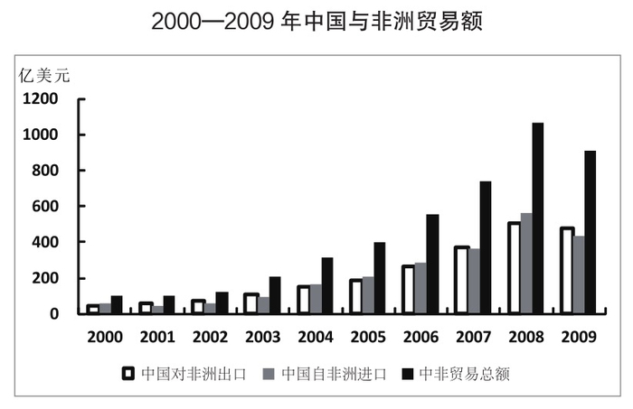

### 第 106 题

2001—2009年，中国对非洲贸易逆差的年份有几个？

A. 4

B. 5

C. 6

D. 7

第 106 题 · 答案与解析

**参考答案（粉笔题库参考内容）**

A

**解析**

中国对非洲贸易逆差说明中国对非洲的出口额要小于进口额，定位柱状图材料可得，逆差年份为2004、2005、2006和2008年，共4个。

故正确答案为A。

**考点**：直接找数、综合资料

**来源**：2013年山东省公务员录用考试《行测》题第106题

### 第 107 题

以下哪一年中非贸易总额的同比增量最高？

A. 2006年

B. 2007年

C. 2008年

D. 2009年

第 107 题 · 答案与解析

**参考答案（粉笔题库参考内容）**

C

**解析**

根据题干所求“哪一年······同比增量最高”，可判定本题为增长量比较问题。定位柱状图材料中黑色柱体可得，明显2008年的增量最大。

故正确答案为C。

**考点**：增长量比较、综合资料

**来源**：2013年山东省公务员录用考试《行测》题第107题

### 第 108 题

2009年中国对非洲贸易顺差比2007年高多少亿美元？

A. 34

B. 38

C. 43

D. 48

第 108 题 · 答案与解析

**参考答案（粉笔题库参考内容）**

A

**解析**

定位文字材料可得，2009年中国对非洲出口477.4亿美元，进口433.3亿美元，贸易顺差为477.4-433.3=44.1亿美元；2007年贸易顺差10.1亿美元，则2009年比2007年高出44.1-10.1=34亿美元。

故正确答案为A。

**考点**：简单加减计算、综合资料

**来源**：2013年山东省公务员录用考试《行测》题第108题

### 第 109 题

2008年我国自非洲进口额的同比增速比对非洲出口额的同比增速：

A. 低6个百分点

B. 低18个百分点

C. 高6个百分点

D. 高18个百分点

第 109 题 · 答案与解析

**参考答案（粉笔题库参考内容）**

D

**解析**

根据题干“2008年······同比增速比······同比增速”，可判定本题为一般增长率问题。定位文字材料可得：2008年中国对非洲出口508.4亿美元，自非洲进口560.0亿美元；2007年中国对非洲出口372.9亿美元，自非洲进口362.8亿美元。根据公式：增长率，则题目所求，即高18个百分点。

故正确答案为D。

**考点**：一般增长率、综合资料

**来源**：2013年山东省公务员录用考试《行测》题第109题

### 第 110 题

根据以上资料，以下说法正确的是：

A. 2000-2008年，中国自非洲进口额呈逐年增长态势

B. 2000-2006年，中国与非洲双边贸易总额均低于700亿美元

C. 2002年，中国对非洲贸易顺差为2000-2009年间最大

D. 2001-2009年，中国对非洲双边贸易总额保持逐年上升的趋势

第 110 题 · 答案与解析

**参考答案（粉笔题库参考内容）**

B

**解析**

A项，定位柱状图材料可知，2001年中国自非洲进口额要低于2000年，错误；

B项，定位文字材料可得，2007年中国与非洲双边贸易总额首次突破700亿元，正确；

C项，定位柱状图材料可得，2000-2009年间，2009年的贸易顺差最大，并非2002年，错误；

D项，定位柱状图材料可得，2009年的双边贸易总额明显小于2008年，因此2001-2009年并非逐年上升，错误。

故正确答案为B。

**考点**：综合分析、综合资料

**来源**：2013年山东省公务员录用考试《行测》题第110题

## 材料 3

**2003—2010年某省城镇居民每百户主要耐用消费品拥有量**

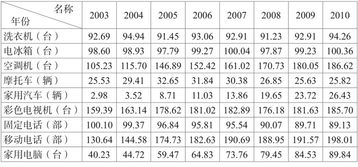

### 第 111 题

2010年，该省城镇居民户均拥有量超过1件的耐用消费品有几类？

A. 2

B. 3

C. 4

D. 5

第 111 题 · 答案与解析

**参考答案（粉笔题库参考内容）**

C

**解析**

户均拥有量超过1件即每百户拥有量超过100件。定位表格材料最后一列数据可知，数值大于100的有电冰箱、空调机、彩色电视机和移动电话4类。

故正确答案为C。

**考点**：直接找数、统计表

**来源**：2013年山东省公务员录用考试《行测》题第111题

### 第 112 题

下图反映了2003年—2010年该省城镇居民哪种主要耐用消费品每百户拥有量的变化趋势？

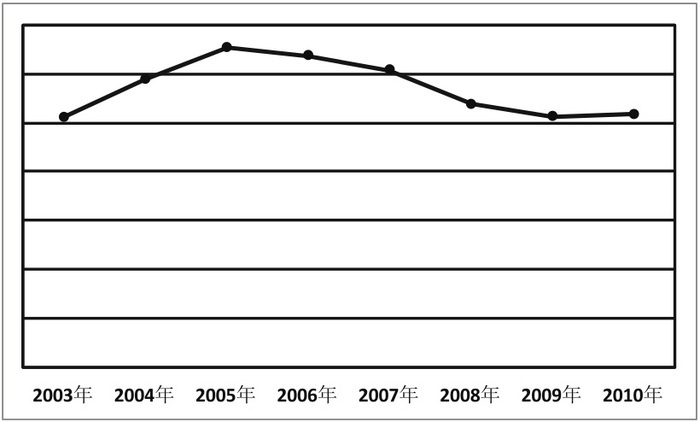

A. 电冰箱

B. 彩色电视机

C. 摩托车

D. 家用电脑

第 112 题 · 答案与解析

**参考答案（粉笔题库参考内容）**

C

**解析**

折线图反映的变化趋势：年逐年上升，年逐年下降，年基本持平。定位表格材料数据可知，符合这一变化规律的只有摩托车。

故正确答案为C。

**考点**：直接找数、统计表

**来源**：2013年山东省公务员录用考试《行测》题第112题

### 第 113 题

在该省城镇居民户均家用汽车保有量增速最快的那年中，有几类耐用消费品的户均保有量下降？

A. 2

B. 3

C. 4

D. 5

第 113 题 · 答案与解析

**参考答案（粉笔题库参考内容）**

B

**解析**

定位表格材料第6行数据可知，户均家用汽车保有量增速最快的是2005年，远超过100%，对应2005年表格中的耐用消费品户均保有量同比下降的有洗衣机、电冰箱、固定电话3类。

故正确答案为B。

**考点**：直接找数、统计表

**来源**：2013年山东省公务员录用考试《行测》题第113题

### 第 114 题

2010年该省城镇居民户均保有量最高的耐用消费品，在以下哪一年的保有量增速最高？

A. 2004年

B. 2005年

C. 2006年

D. 2007年

第 114 题 · 答案与解析

**参考答案（粉笔题库参考内容）**

B

**解析**

根据题干所求“哪一年增速最高”，可判定本题为增长率比较问题。定位表格材料最后一列数据可知，2010年户均保有量最高的耐用消费品是移动电话。代入公式增长率计算各年增长率。2004年增长率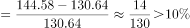；

2005年增长率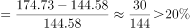；2006年增长率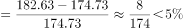；2007年增长率。

只有2005年增长率高于20%，为增速最高的年份。

故正确答案为B。

**考点**：一般增长率、统计表

**来源**：2013年山东省公务员录用考试《行测》题第114题

### 第 115 题

以下关于该省城镇居民主要耐用消费品户均保有量的说法，能从资料中推出的是：

A. 2009年家用电脑的户均保有量比2004年高一倍多

B. 2009年所有耐用消费品的户均保有量均比上年更多

C. 家用汽车是2003-2010年间户均保有量增速最快的耐用消费品

D. 2010年移动电话的户均保有量首次超过固定电话的2倍

第 115 题 · 答案与解析

**参考答案（粉笔题库参考内容）**

C

**解析**

A项，定位表格材料最后一行可得，2009年家用电脑的百户均保有量为84.53台，2004年为44.72台，则2009年比2004年高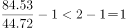，即低于一倍，错误；

B项，定位表格材料可知，2009年摩托车和固定电话的户均保有量均低于上年，错误；

C项，定位表格材料可知，2003-2010年间，家用汽车倍数关系明显，显然家用汽车户均保有量增速最快，是耐用消费品中增长最快的，正确；

D项，定位表格材料可知，2008年移动电话的户均保有量首次超过固定电话的2倍，错误。

故正确答案为C。

**考点**：统计表、综合分析

**来源**：2013年山东省公务员录用考试《行测》题第115题

## 材料 4

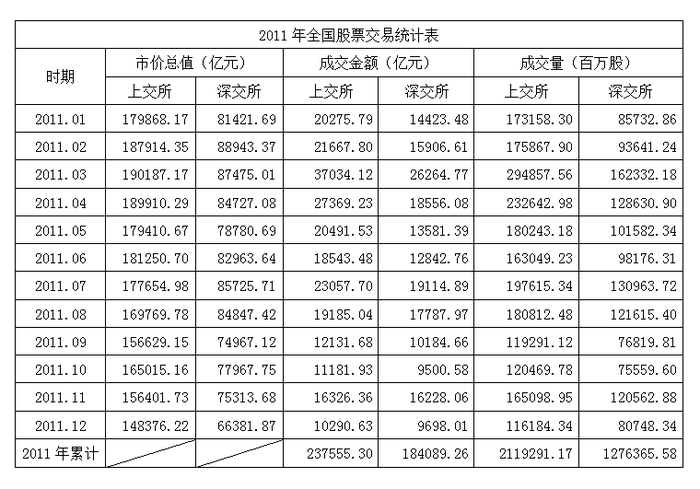

### 第 116 题

2011年12月与1月相比，上交所月度成交量下降了约：

A. 18%

B. 23%

C. 28%

D. 33%

第 116 题 · 答案与解析

**参考答案（粉笔题库参考内容）**

D

**解析**

根据题干所求“2011年12月与1月相比······下降了约”，结合选项为百分数，可判定本题为增长率计算问题。定位表格材料中数据可得，上交所12月成交量为116184.34百万股，1月为173158.30百万股。故所求增长率，即下降了33%。

故正确答案为D。

**考点**：一般增长率、统计表

**来源**：2013年山东省公务员录用考试《行测》题第116题

### 第 117 题

2011年上交所成交额最高的月份，当月深交所上市公司的市价总值比上月：

A. 下降约1500亿元

B. 下降约2700亿元

C. 上升约300亿元

D. 上升约4200亿元

第 117 题 · 答案与解析

**参考答案（粉笔题库参考内容）**

A

**解析**

根据题干所求“当月······比上月”，结合选项为带单位具体数值，可判定本题为增长量计算问题。定位表格材料可得，2011年上交所成交额最高的月份为3月，对应3月深交所的市价总值为87475.01亿元，2月为88943.37亿元。故所求，即下降约1400亿元，与A项最接近。

故正确答案为A。

**考点**：增长量计算、统计表

**来源**：2013年山东省公务员录用考试《行测》题第117题

### 第 118 题

2011年深交所成交金额最低的季度，其成交金额占全年两市总成交金额的：

A. 4%

B. 6%

C. 8%

D. 10%

第 118 题 · 答案与解析

**参考答案（粉笔题库参考内容）**

C

**解析**

根据题干所求“2011年······占······”，结合选项为百分数，可判定本题为现期比重问题。定位表格材料第五列数据可得，2011年深交所成交金额最低的季度为第四季度，该季度成交金额为(9500.58+16228.06+9698.01)亿元，全年两市总成交金额为(237555.30+184089.26)亿元，故所求比重，与C项最接近。

故正确答案为C。

**考点**：现期比重、统计表

**来源**：2013年山东省公务员录用考试《行测》题第118题

### 第 119 题

2011年2—12月间，上交所与深交所上市公司市价总值均环比下降的月份有几个：

A. 3

B. 4

C. 5

D. 6

第 119 题 · 答案与解析

**参考答案（粉笔题库参考内容）**

D

**解析**

定位表格材料二、三列数据可得，2011年2-12月间，上交所与深交所上市公司市价总值均环比下降的月份有4、5、8、9、11、12月，共6个月。

故正确答案为D。

**考点**：直接找数、统计表

**来源**：2013年山东省公务员录用考试《行测》题第119题

### 第 120 题

以下关于2011年全国股票交易情况的描述，与资料相符的是：

A. 1-12月间，沪深两市上市公司市价总值均下滑了30%以上

B. 1-12月间，上交所每个月的成交金额都高于市价总值的10%

C. 1-12月间，上交所每个月的成交金额都低于深交所同期

D. 上交所下半年的总成交量低于上半年

第 120 题 · 答案与解析

**参考答案（粉笔题库参考内容）**

D

**解析**

A项，定位表格材料二、三列数据可得，1-12月间，上交所市价总值下降了，错误；

B项，定位表格材料二、四列数据可得，1-12月间，9、10、12月，上交所成交金额低于市价总值的10%，错误；

C项，定位表格材料四、五列数据可得，1-12月间，上交所每个月的成交金额都高于深交所同期，错误；

D项，定位表格材料第六列数据可得，上半年总成交量=173158.30+175867.90+294857.56\=1220000百万股，下半年=197615.34+180812.48+119291.12\=910000百万股。显然上交所下半年总成交量低于上半年，正确。

故正确答案为D。

**考点**：统计表、综合分析

**来源**：2013年山东省公务员录用考试《行测》题第120题

