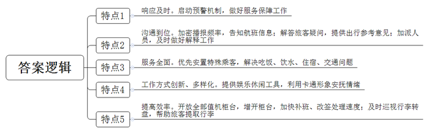
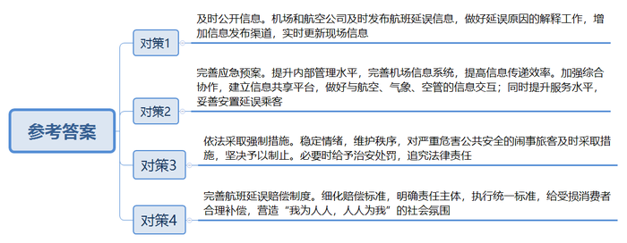
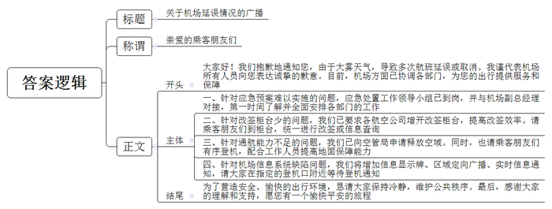
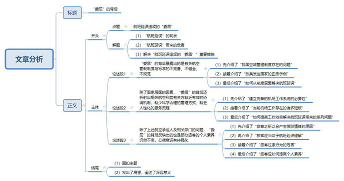

# 2014年山东省公考《申论》题（A卷）

<!-- gwy:overview:start -->
> **山东 · 2014 · 申论 · A类** ｜ 4 题 · 图片 4 处 · 答案随题折叠

导航：[题目](#题目) · [材料 1](#材料-1)
<!-- gwy:overview:end -->

> 候选采集稿。参考答案及解析来自粉笔页面，不代表官方答案或真实高分答卷；来源使用许可与原卷对应关系仍需人工核实。

## 给定材料

### 材料 1

在我国，航班延误问题严重，呈上升趋势，航空运输服务投诉量猛增，成为公共关注的焦点。因航班延误纠纷引发的事件，已演变成一个社会问题，它破坏机场正常秩序、威胁民用航空安全，危害性很大，必须创新管理，加大力度，采取得力措施予以解决……旅客碰到航班延误，如果信息不灵，着急烦躁，心神不宁，往往与航空公司的工作人员发生冲突，若处置不当，不能及时得到控制，将严重破坏机场的正常秩序，影响航空运输的正常运营。由于产生航班延误的原因复杂，需要正确处理安全与效益之间的关系，因而治理航班延误是一项系统工程。

2012年4月11日，A机场受雷雨天气影响，一航班20余名旅客因航班延误10多个小时，在航班延误赔偿方面与航空公司存在分歧，擅自走入停机坪滑行道，“拦停”一架刚刚着陆滑行的飞机，严重影响了飞行安全。进入机场跑道的一名乘客表示：“采取极端方式维权是希望引起有关部门重视。”为平息旅客的失控情绪，避免后续航班继续长时间延误，航空公司最终决定对补班旅客给予每人1000元人民币的补偿。时隔两天，B机场因受降雨影响，出现大面积航班延误，也出现旅客冲击机场停机坪事件，部分民众认为这是A机场“拦机”事件引发的不良效仿。

这些事件对航空运输正常生产秩序和安全运营造成严重威胁，而民航公安并未依法对严重危害公共安全的闹事旅客给予治安处罚，涉事的航空公司甚至还对他们给予了超出正常范围的经济补偿。这不能不让人质疑，对于那些殴打工作人员，打砸机场设备、占机、霸机甚至冲闯停机坪等危害公共安全的违法犯罪行为，民航公安机关为什么不能及时依法追究相关责任？我们不禁要问：这究竟是旅客素质低劣，还是相关民航部门在航班延误后不作为，才导致了事件的发生？

### 材料 2

市民徐女士乘飞机从济南飞往西宁，抵达的时间比原计划晚点3个多小时，在机场询问晚点原因，机场的答复是“天气原因”。令徐女士不解的是，明明出发地济南天气状况很好，并且查询到达地西宁的天气也很好，哪来的“恶劣天气”导致晚点？是其他原因转嫁到天气原因上，还是航空公司忽悠人？

余先生准备乘坐飞机由宁波飞往厦门，原定起飞时间为22点35分，当余先生在为登机做准备时，航空公司工作人员突然告知“由于空中管制航班晚点，可能要等到凌晨一两点才能起飞”。随后，余先生同其他乘客被机场工作人员带到酒店休息，此后又被告知由于天气原因飞机备降其他机场，飞行时间延迟到第二天早上10点左右。余先生和航空公司工作人员交涉是否可以退票或转签时，未得到明确回复，当他第二天赶往机场后，工作人员却称“机组人员飞行时间太长需要休息，起飞时间再次延后”，余先生不解地说：“天空那么大，难道也需要管制？如果明确不了航班到底什么时候能飞，至少应该告诉我们可以退票或改签，结果航空公司始终没给准信，总说马上就能飞，并且不能飞行的理由也总是在变换，空中管制和天气原因就是航空公司延误的托辞。”

针对旅客对航班延误原因的疑问，某航空公司副总经理J说：“民航飞机在空中就如同汽车在地面一样，必须按照规定的航路、限定的高度飞行，飞机间也要保证一定的高度和距离差。航空对天气的要求和大家肉眼观察到的天气不一样，航路上某个区域出现低云、侧风、雷雨等恶劣天气，又不能绕路走，那就得推迟起飞。目前中国的空域管理权属于空军，民航部门只能在空军的允许范围内使用空域，随时接受空军管理，当前民航可用的空域也就20%—25%左右。同一时间、同一航路的航班数量受限，当数量超限时，后面的飞机就需要等待。航班激增，航路就那么多，天空就免不了‘堵车’，机场起降能力也是有限的，超过就得进行流量控制。事实上，现实中天气、航空管制等原因通常彼此叠加影响，造成延误连锁反应。一架飞机一天通常要飞6—8个航班，如果早上的第一班就受管制，接下来的航班都可能受影响。”

### 材料 3

2013年1月3日10时许，K机场开始大雾弥漫，直到16点，机场34个航班受大雾天气影响备降导致延误。17点后，接到机场客管处发出的天气预报消息称，当天晚上20点天气会转好，到了晚上20点却发现，天气更加恶劣了。晚20点30分左右，机场方才召开紧急会议，决定取消所有航班，造成7500名旅客滞留机场。从3日下午就被延误至次日凌晨1时许，滞留旅客全部接送完毕，延误接近10个小时。

K机场有大面积航班延误应急处置工作领导小组，凡延误达到10架次、4小时以上，便启动预案。1月3日下午，机场虽已经启动预案，但该小组组长只是机场副总经理，及至启动才发觉，一个机场的副总经理，无法协调和领导在机场内参与服务的多个部门。

1月3日当天，各航空公司都自顾不暇，大部分驻场航空公司的改签柜台只有1至2个，等待改签旅客的队伍长达10多米，队伍拥堵，流动的旅客们与工作人员之间，言语冲撞、肢体推搡时有发生。某航空公司由于退票、改签旅客过多，所属网站由于访问量过大，导致系统崩溃，已不能查阅航班信息，前来咨询的乘客都被告知，柜台查不到最新航班信息，旅客需自行查阅。现场多名旅客表示质疑并反问工作人员：“你们工作人员都查不到，让我们旅客去哪里查去？”

直到1月4日6点，机场飞行区管理中心运行指挥部才收到前一天应该上报的全部航空公司的当日航班计划，4日的计划航班，达到史无前例的940架次，超出了机场700架次的保障能力。前一日延误的航班多数将在4日补飞。空管首先协调空军暂停训练飞行，释放空域，空域范围的可利用率，从近5成提高到9成多。因前晚航班无法降落，K机场只有4架飞机（通常有100架左右）。为了离开，旅客们首先要等待搭乘自己离开的飞机到来。13时10分，进港航班114架次，但出港航班只有42架次，100多架飞机都“趴窝”了，无法起飞的原因有很多：有的因为行李搬运慢，有的是因为机务人员排不过来等。有一架停在远机位的航班，为了等待摆渡车，足足等了近5个小时；一架航班计划停靠停机位1个多小时便起飞，但因为地面保障跟不上，加上旅客围堵登机口，这架航班最终等了7个小时。

由于机场信息系统的问题和缺陷，4日上午起，候机楼里的航班时间、机位、登机口调整等实时信息显示牌便不再更新了。1月4日这天，共有140多个航班在登机口都没有刷新记录。机场采用的是区域定向广播，通常只有一两个登机口能听到，每天信息须排队播放，有时航班登完机了，广播才开始，致使部分乘客未及时接到登机通知。

航空公司内部信息传递同样滞后，航班的延误、补班信息更新速度慢。1月4日19时左右，部分已经延误一天的旅客因为各种原因被二次延误，在等待办理退票、改签手续期间，有些旅客情绪激动，与工作人员发生肢体冲突。现场多个值机柜台被砸，还有旅客堵住登机口导致部分航班无法正常起飞。

### 材料 4

航空运输是现代文明的象征，在航空旅行途中和机场等场所，营造“我为人人，人人为我”的社会氛围，这样广大旅客和民航工作人员都心情愉快，安全祥和。如果发生航班延误时，个别旅客不听劝阻，采取所谓“维权”的过激违法行为，公安机关应履行职责。根据《中华人民共和国治安管理处罚法》和《中华人民共和国民用航空安全保卫条例》，须及时采取措施，坚决予以制止，维护正常秩序……

“索赔不成拒绝登机，6名旅客滞留机场16个小时”“航班延误11小时，千人滞留机场，旅客冲击机台”“因座位问题4名旅客在飞机上斗殴，导致航班延误3小时”……航班延误事件经常发生，对于经常搭乘飞机的旅客来说，已经由无奈成为一种“习惯”，民航航班正常率及航班延误引发的群体性事件备受社会关注。

2013年3月26日，又是因天气原因，B机场部分航班发生延误，出现了旅客“拦机”事件，影响旅客和飞行安全，造成航班再次延误，且阻碍民警执行公务，机场公安随后对3名冲击停机坪的旅客予以行政拘留。针对近期由于天气原因多次发生航班大面积延误的状况，B机场表示，已经细化了航班延误预案，以提高处置反应速度；在航班延误时，安排了专人手持“航班住宿指引牌”等，全程引导延误旅客的餐宿以及改签等事项；同时增加信息发布渠道，让旅客随时了解航班动态。

机场集团方面表示，由于近期雷雨天较多，多次引发B机场航班大面积延误，个别旅客在维权时冲破了法律底线。4月25日，机场公安局依法处罚了扰乱机场秩序的4名旅客，其中3人被依法行政拘留，1人被罚款。

当日，广州至厦门FM9348航班旅客余某为向航空公司索赔，鼓动其他旅客堵塞登机口，阻拦其他正常航班旅客登机，民警在劝告无效后将余某强制带离，依法对其处以行政拘留10日。此外，广州至南昌MU5256航班的部分旅客试图不经安检直接从安检口应急通道进入隔离区，在冲闯中损坏通道玻璃门，B机场公安局民警依法强制带离带头冲闯闹事的旅客张某和熊某以及阻拦民警正常执法的旅客刘某。公安部门依法对违法情节恶劣的旅客张某处以行政拘留10日；对认错态度较好、情节较轻的旅客熊某处以罚款200元；对刘某处以行政拘留10日，并罚款200元。

### 材料 5

2013年12月6日至8日，C国际机场因为持续3天的雾霾导致了航班大面积延误，3天延误航班653个，机场先后启动航班大面积延误黄色、橙色应急预警机制。

运输服务部第一时间响应，全力做好旅客服务保障工作。利用机器广播、人工广播、登机口张贴告示相结合的方式加密信息播报频率，及时告知旅客航班信息；安排人员加班备助，耐心为旅客解答疑问，为旅客出行提供参考意见；问讯人员为旅客提供毛毯、热水，优先安置老、弱、病、残等特殊旅客，帮助联系火车、汽车等地面交通工具；考虑到早班对后续航班保障的影响，“航班小组”提前与宾馆、配餐单位、车队进行联系，预留房间、车辆，保障旅客的相关需要；在登机口、问讯处等窗口加派人员，及时做好旅客解释工作；“流动问讯”人员推着小车，免费发放软件、扑克、一次性纸杯、杂志等物品；还有专人扮演卡通“轻松熊”，在旅客中穿行服务，营造轻松氛围。值机柜台全部开放，并专门增开补班、改签柜台为旅客加快处理速度，为一直未成行的旅客办理补班手续；行李科在航班落地第一时间加派人员巡视行李转盘，帮助旅客提取行李，防止行李转盘拥堵。机场总体秩序忙而不乱，旅客情绪相对稳定。

### 材料 6

《2012年民航行业发展统计公报》显示：2012年，航空公司计划航班250.2万次，其中正常航班187.2万班次，平均航班正常率为744.83%。在造成航班延误的原因当中，38.5%为航空公司自身原因，25.0%为流量控制原因，21.6%为天气原因，剩余14.9%为其他原因。

航班延误是指航班降落时间比计划降落时间（航班时刻表上的时间）延迟30分钟以上或航班取消的情况。准点率，是指航空旅客运输部门在执行运输计划时，航班实际出发时间与计划出发时间较为一致的航班数量与全部航班数量的比率。航班延误影响着航空公司的运行效率和服务质量，一般使用准点率来衡量承运人的运输效率和运输质量。

乘坐飞机的旅客要经过这样的环节：到达机场、换登机牌、过安检、登机、飞机起飞、降落、出机场等。这些环节可谓环环相扣，任何一个咬合不上，整个链条就会出现问题。民航本身就是一个高度链条化，整体如同齿轮咬合一样联动的行业，在旅客眼里本是一体的民航链条，在现有的民航体制下，被分割为四个“婆婆”管理：除首都机场、西藏机场外，其余全国的机场归地方政府管理；航空公司归国资委管理；空管归民航局管理；公安归公安部管理。机场方面，国务院颁布的《民航机场管理条例》明晰了机场是公共服务基础设施的属性，但至今没有落实；地方政府对机场的考核指标仍是盈利。航空公司方面，国资委对其考核国有资产的保值增值；民航局承担对航空公司的安全管理职责，对服务也没有硬性的管理手段和考核指标。空管方面，如何提高空管系统的空中交通指挥能力，应是管理部门迫切需要解决的问题。但目前我国还没有针对空管航班正点率考核的责任制。

### 材料 7

航班延误往往是多种因素交织的结果，民航旅客、航空公司、民航机场、辅助单位、管理部门等民航运输活动的主体和客体都是航班延误事件的“受害者”，面对社会舆论压力，形成了“人人委屈”“互相指责”的局面。

空管：留给民航的空域就那么大，航班年年在增加，“流量控制”是不可避免的管理措施；天气何时转晴不好预测，空管没权让航空公司“取消航班”，也没权确定航空公司的哪架航班“先飞”或者“后飞”。

航空公司：没有哪家航企愿意延误，遭遇延误后，航空公司从地面服务、到空乘、机长不但要陪着旅客一起经历“折腾”之旅，还要给旅客提供服务，更是“累上加累”，航班延误给企业造成的成本增加，动辄上千万元，还要经受社会舆论指责，要面对行业主管部门各种惩罚。

机场：机场只是把地盘租给航空公司使用，航班延误时，机场有什么办法？怎么能怪机场？

机长：旅客在飞机上等多久，我们也等多久，还要反复申请、协调、调动所有智慧去争取早些起飞。我们一天要飞好几个班次，一次延误，会影响到全天的工作，我们比乘客登机时间早，事实上，飞机延误我们等待的时间更长。旅客众口难调，有的说等这么久干吗不果断取消航班，有的又说不管等多久我都必须飞到目的地，怎么做都是错。

乘务员、地面服务人员：我们决定不了什么，但旅客情绪一激动往往是我们冲在最前面，受骂挨打。

旅客S：天气不好，飞机延误我们能理解。但能不能少折腾旅客？既然不能落地，为何当天不直接取消航班，让旅客去休息？大面积延误时，在机场经常得不到有效信息，关于延误理由总在不断更改，作为旅客我们连最起码的知情权都没有。

旅客X：航班延误我们能理解，但是服务不能“延误”。天气不好不是机场的错，但我们交了机场建设费，机场是不是应该提供基本的服务呢？如休息的地方、价格合理的餐饮、合理恰当的签转方案及信息通知，但是出现延误后这些基本权利得不到保障，才会有过激行为发生，面对延误的赔偿，目前的局面是“不闹不赔、小闹小赔、大闹大赔”，我们的权利得不到保障。

旅客Y：因工作原因经常乘飞机穿梭于国内城市，本来某些航班因为一些小事耽误了10分钟，但因为一些旅客的过激行为，导致小延误变成了大延误，而延误又容易造成连锁反应，给后续航班带来各种影响。要减少航班延误，提高旅客素质非常重要。

### 材料 8

为解决航班延误后的赔偿问题，《民用航空法》《中国民用航空旅客、行李国内运输规则》对航班延误都有具体规定；中国民用航空局公布的《航班延误经济补偿指导意见》、中国航空运输协会下发的《航空运输服务质量不正常航班承运人服务和补偿规范（试行）》文件，对赔偿标准都进行了细化，在规定中对补偿原因予以区分，分为非承运人原因和承运人原因。非承运人原因致延误不补偿、不包住宿；任何原因造成航班在经停站延误，航空公司应根据需要向经停旅客提供免费的餐饮服务和住宿场所，延误4小时以上才有现金补偿。由于承运人原因造成航班延误、取消，客票的退、改、签费用，由航空公司承担。航空公司应根据延误时间向旅客提供免费的餐饮服务和休息场所。延误预计在1~4小时以内（含4小时）的航班，及时向旅客提供餐饮。目前非航空公司原因延误情况下对旅客的食宿与交通安排，是航空公司对旅客服务的一种“成本超越”，与法律制度要求的责任无关。

关于航班延误所引发的旅客要求赔偿的现象在现实中的执行已经变成了“讨价还价”，民航局发布的《航班延误经济补偿指导意见》规定，航空公司应对因自身原因造成的航班延误承担对旅客的经济补偿。现实当中，由于天气、突发事件、空中交通管制、安检以及旅客等非航空公司原因，造成航班延误或取消，航空公司并没有相应的义务对旅客进行补偿。

也就是说，凡提到延误赔偿，前提必须是延误系航空公司自身原因造成。然而，现实中航班延误多归咎于天气、流量控制或空中交通管制。由于解释航班延误原因的职责在于航空公司，在信息不对称的情况下，这种方式的确难以保证消费者不对延误原因真实性提出质疑。除此之外，处理航班延误索赔时，消费者因为不了解标准或者对标准开出的条件不服等原因，提出不符合标准的赔偿要求，航空公司均视实际情况分别对待，这便导致延误理赔始终处在“讨价还价”的状态。而航空公司和机场方面也本着“大事化小，小事化无”的原则，在实际赔偿方面没有形成一个统一的标准。

### 材料 9

关于航班延误问题，相关部门组织了一次研讨会，以下是几位与会代表的意见：

专家A：事实上，民航这几年的服务水平已经大幅度地提高，但是旅客的要求提高得更快，民航提供的服务、人员、设备、资源包括管理流程等会有一些脱节或者不匹配的地方，这也是难免的，乘客坐飞机确实是为了办急事，一旦出现延误，乘客第一反应是着急，但民航方面首要任务是保证航班的安全，很多情况比如积云厚度超过多少绕不过去了，它就得返航、就得备降，这样一来后续的航班肯定会延误，这是必须做的，没有任何可以商量的余地；或者说出现了一些小的机器故障，为了保证万无一失，机组决定还是不飞，返回再检查清楚，实际上是对乘客的生命安全做最好的保证。所以从这方面来说，我们不能一味地从旅客的不满来看延误问题，毕竟保证安全才是第一位的，这个问题还是需要综合地看。

专家B：目前民航的另一种普遍做法是把乘客请上飞机再说滞留或者航空管制。这是因为在我国，如果飞机舱门不关闭，塔台就不允许航班进入流控队列，一旦遇到飞机需要排队则会造成进一步延误。因此即使遭遇雷雨天气，机组还是会让旅客按时登机，目的就是争取排在队伍前列。另外，民航部门统计航班准点率的时间界线是以“舱门关闭时间”来计算，也就是说，只要准点关闭舱门就算是航班准点。但实际上，相比让旅客在候机楼等待，坐在飞机上更耗成本，因为发动机在不停地工作，而且旅客往往在登机后会认为航空公司没有履行相应的告知义务。

旅客代表C：有一次我坐飞机，原定起飞时间是晚上7点半，但从晚上8点开始，一直到11点多，3个小时了，没有人告诉我们到底是什么原因不能起飞。我们到处打电话询问，我找到机场，对方都知道是这边的飞机出故障了，而航空公司就是什么都不说。直到11时30分，才有人出来说此前是轮胎出了故障，已经更换好，可以登机了。其实旅客最不能接受的就是这种有事拖延隐瞒的态度了！我们完全没有感受到作为一个消费者的尊严！

### 材料 10

自2009年以来，在国家空管委办公室的指导帮助下，经军民航双方共同努力，先后开辟了119条临时航线供各航空公司使用。在临时航线的使用中，存在一些临时航线使用率偏低，航线使用不能提前掌控等问题。

针对2013年上半年出现的较严重的航班延误现象，民航局加大了整治力度，先后出台了多项措施并制定了相关文件，以提高航班正常率。2013年8月，华北地区部分航线调整方案正式实施，减少了与首都机场飞机起降产生的冲突，降低了首都机场延误率。2013年12月，我国华北地区连接西南地区的空中大容量通道——京昆空中大通道投入运行，涉及我国东北、华北、西北、西南4地区54个机场，460多条航线，有效提高了航班正常率。制定了《优化空中交通管制运行规范的暂行规定》《机场航班运行保障标准》《航空公司航班正常运行标准》和《做好航班正常工作若干规定》，对航班的正常运行提出具体的标准和规定。在2014年全国民航工作会议暨航空安全会议上，中国民用航空局已制定出航班正点起飞统计新标准，将在年内择机实施，自从开展航班延误专项整治以来，根据民航局的统计数据，2013年9月至11月的平均航班正常率较上半年提高5.3个百分点。

中国航协的有关负责人认为，航班延误严重不是空域不够多，而是现有航线利用率低。航空业内专家测算，中国目前的航线利用率为60%，欧美发达国家可达到80%甚至更多。管理仍有提升空间，不论是哪个环节，都有改善流程，提高效率的余地，各方应主动承担责任，而不是相互推诿。航班延误的复杂性也提醒我们，“头痛医头、脚痛医脚”解决不了根本问题，应从更高层面建立有效的协调机制，强化对航空承运人与各种服务主体的监督与管理，化解延误痼疾。

在专家看来，减少航空延误，首要的解决方案是空域体制改革。但是，除了坐等需要“国家层面”才能推动的改革之外，民航局、航空公司、机场、机票服务商，包括乘客自己，都可以通过一些改善而减少航班延误，减少航班延误给乘客带来的痛苦，减少群体性事件的发生。

中国民航大学教授L表示，在诸多相关利益主体下，旅客的利益特别是航班延误以后，航班延误的管理，可能就成了一个空白……对于旅客来说，面对法律与规章日益完善的服务环境，我们可能需要冷静地看待自己的权利……处理航班延误问题的现行法律法规是相对健全的，只要认真执法、正确执法、严格执法，纠纷问题并不难解决……

## 题目

### 第 1 题

**请根据给定资料5，概括C机场在航班延误处理工作方面体现的特点。（15分）**

关联材料：材料 5

作答要求：

要求：概括准确，内容全面，条理清晰，不超过200字。

第 1 题 · 答案与解析

**参考答案（粉笔题库参考内容）**

一、响应及时。启动预警机制，做好服务保障工作。

二、沟通到位。加密播报频率，告知航班信息；解答旅客疑问，提供出行参考意见；加派人员，及时做好解释工作。

三、服务全面。优先安置特殊乘客，解决吃饭、饮水、住宿、交通问题。

四、工作方式创新、多样化。提供娱乐休闲工具，利用卡通形象安抚情绪。

五、提高效率。开放全部值机柜台，增开柜台，加快补班、改签处理速度；及时巡视行李转盘，帮助旅客提取行李。

**解析**

**参考答案说明：**本参考答案从“响应及时”“沟通到位”“服务全面”“工作方式创新、多样化”“提高效率”等5个不同方面进行了分条撰写。各条要点之间在内容上是相互并列，没有先后顺序，并且在撰写每条要点时，都尽量将每条要点中概括性较强的信息进行前置。

**考点**：单一题

**来源**：2014年山东省公考《申论》题（A卷）

### 第 2 题

**因航班延误纠纷引发的群体性事件，破坏机场正常秩序，威胁民用航空安全，已演变成为一个社会问题，假如你是一名行政执法人员，请结合给定资料就这一现状提出解决对策。（20分）**

关联材料：材料 1、材料 2、材料 3、材料 4、材料 5、材料 6、材料 7、材料 8、材料 9、材料 10

作答要求：

要求：分析准确，内容全面，条理清晰；不超过300字。

第 2 题 · 答案与解析

**参考答案（粉笔题库参考内容）**

一、及时公开信息。机场和航空公司及时发布航班延误信息，做好延误原因的解释工作，增加信息发布渠道，实时更新现场信息。

二、完善应急预案。提升内部管理水平，完善机场信息系统，提高信息传递效率。加强综合协作，建立信息共享平台，做好与航空、气象、空管的信息交互；同时提升服务水平，妥善安置延误乘客。

三、依法采取强制措施。稳定情绪，维护秩序，对严重危害公共安全的闹事旅客及时采取措施，坚决予以制止。必要时给予治安处罚，追究法律责任。

四、完善航班延误赔偿制度。细化赔偿标准，明确责任主体，执行统一标准，给受损消费者合理补偿，营造“我为人人，人人为我”的社会氛围。

**解析**

**参考答案说明：**答案从“及时公开信息”“完善应急预案”“依法采取强制措施”“完善航班延误赔偿制度”四个不同的角度进行了分条撰写。各条要点之间在内容上是并列的，没有先后顺序，并且在撰写每条要点时，都尽量将每条要点中概括性较强的信息进行前置。

**考点**：提出对策类

**来源**：2014年山东省公考《申论》题（A卷）

### 第 3 题

**针对“给定资料3”中K机场在延误事件中所说的各种问题，机场有关部门打算面向乘客播报一篇广播稿，请代为拟稿。（25分）**

关联材料：材料 3

作答要求：

要求：内容全面，条理清晰，针对性强；不超过500字。

第 3 题 · 答案与解析

**参考答案（粉笔题库参考内容）**

关于机场延误情况的广播

亲爱的乘客朋友们：

大家好！我们抱歉地通知您，由于大雾天气，导致多次航班延误或取消。我谨代表机场所有人员向您表达诚挚的歉意。目前，机场方面已协调各部门，为您的出行提供服务和保障。

一、针对应急预案难以实施的问题，应急处置工作领导小组已到岗，并与机场副总经理对接，第一时间了解并全面安排各部门的工作。

二、针对改签柜台少的问题，我们已要求各航空公司增开改签柜台，提高改签效率。请乘客朋友们到柜台，统一进行改签或信息查询。

三、针对通航能力不足的问题，我们已向空管局申请释放空域。同时，也请乘客朋友们有序登机，配合工作人员提高地面保障能力。

四、针对机场信息系统缺陷问题，我们将增加信息显示牌、区域定向广播、实时信息通知，请大家在指定的登机口附近等待登机通知。

为了营造安全、愉快的出行环境，恳请大家保持冷静，维护公共秩序。最后，感谢大家的理解和支持，愿您有一个愉快平安的旅程。

**解析**

**参考答案说明:**（1）格式方面，本参考答案写到了“标题”“称谓”“正文”。（2）正文部分，一方面从内容来看，围绕着“K机场延误事件”这一主题，本参考答案的开头先写到了“延误事件原因”“致歉”；主体对策部分从“针对应急预案难以实施的问题”“针对改签柜台少的问题”“针对通航能力不足的问题”“针对机场信息系统缺陷问题”四个方面给出了具体的对策，满足了“针对性强”的要求。另一方面，形式上，本参考答案做到了分段、分条撰写，整体上条理较为清晰。（3）为了体现公文题的逻辑性，还加上了“大家好！我们抱歉地通知您”“我谨代表机场所有人员向您表达诚挚的歉意”“目前，机场方面已协调各部门，为您的出行提供服务和保障”“为了营造安全、愉快的出行环境”“最后，感谢大家的理解和支持，愿您有一个愉快平安的旅程”等连接语句，使得答案在逻辑上联系更紧密。

**考点**：宣传类

**来源**：2014年山东省公考《申论》题（A卷）

### 第 4 题

**航班延误造成旅客、航空、机场等多方“委屈”的现象，请结合对全部给定资料的理解与思考以《“委屈”的背后》为题，自选角度，写一篇文章。（40分）**

关联材料：材料 1、材料 2、材料 3、材料 4、材料 5、材料 6、材料 7、材料 8、材料 9、材料 10

作答要求：

要求：

（1）观点明确，联系实际；

（2）内容充实，论述深刻；

（3）结构完整，语言流畅；

（4）1000~1200字。

第 4 题 · 答案与解析

**参考答案（粉笔题库参考内容）**

**“委屈”的背后**

航班延误问题日趋严重，由此引发的旅客过激行为屡见不鲜，这不仅破坏了机场的正常秩序，也延误了旅客的行程安排，更对民用航空的安全造成了严重的威胁。然而，旅客、机场和航空公司都“委屈”地成为“受害者”，形成了“人人委屈”的尴尬局面。航班延误原因复杂，关键在于能否正确处理安全与效益之间的关系。治理航班延误是一项系统工程，“头痛医头，脚痛医脚”显然治标不治本，只有深入思考，有效协调，才能寻求“委屈”背后的根本因素。

**“委屈”的背后暴露出的是有关航空管制制度与标准的不完善、不健全、不规范。**我国空域管理制度不合理，可供民航使用的空域有限，加之航班数量多，“堵车”在所难免。反观欧美发达国家却航路畅通，延误问题少有发生，这其中的差别正在于我国现行的空管制度。因此，要让大家不再“委屈”，首要的解决方案就是进行空域体制改革，对航班的正常运行提出具体的标准和规划，军民航共同努力开辟新航线。此外，相关政府部门要加大整治力度，出台多项措施并制定相关文件，创新性建设空中大容量通道，提高航班正常率。

**除了国家层面的因素，“委屈”的背后还折射出相关航空利益有关方缺乏有效的协调机制，缺少科学合理的管理方式，缺乏人性化的服务流程**。机场工作流程繁琐、细节颇多，必须建立起科学、完备的工作系统，让各环节无缝连接。但现实中，行李搬运慢，等待摆渡车过久，浪费旅客大量时间；信息公开不及时，服务滞后，让本就着急的旅客更加火上眉梢。落后的管理，低效的工作，延长了旅客等待的时间，点燃了他们不满的情绪，从而破坏了机场运行的秩序。对此，必须要在一定高度上，建立各个利益有关方的内部协调机制，提高工作效率，科学分化内部工作，合理规范服务流程，改进工作方法，细化航班延误预案，强化监督管理，让工作秩序忙而不乱。正如C机场，在面对航班延误时，为我们展现了一次教科书式的示范。

**除了上述航空承运人及相关部门的问题，“委屈”的背后反映出的也是部分旅客的个人素养仍然不高，公德意识有待强化。**乘客之所以选择乘坐飞机，是希望能够在最短的时间到达目的地，作为航班延误的直接“受害人”，旅客的“委屈”能够引起大众的强烈共鸣，但是航班延误原因复杂且具有极强的客观性，旅客应当给予该“失误”以最大的理解。如果因为愤怒的情绪而产生过激行为，小延误则会变成大问题，进而引起连锁反应。因此，当遇到航班延误时，旅客应冷静看待、行使手中的权利，万万不能因个人利益受损产生冲动、过激、违法行为，给集体利益带来莫大的损害。

航空运输是现代文明的标识。只有加强服务，健全管理体制，才能消除委屈，营造“我为人人，人人为我”的良好社会氛围，才能让广大民航工作人员及旅客安全飞行、愉悦出行！

**解析**

**文章分析**

**“委屈”的背后**

【**标题的优点：**严格按照题目的要求，以“‘委屈’的背后”为标题。】

（1）航班延误问题日趋严重，由此引发的旅客过激行为屡见不鲜，这不仅（2）破坏了机场的正常秩序，也延误了旅客的行程安排，更对民用航空的安全造成了严重的威胁。然而，旅客、机场和航空公司都“委屈”地成为“受害者”，形成了“人人委屈”的尴尬局面。（3）航班延误原因复杂，关键在于能否正确处理安全与效益之间的关系。治理航班延误是一项系统工程，“头痛医头，脚痛医脚”显然治标不治本，只有深入思考，有效协调，才能寻求“委屈”背后的根本因素。

【**开头的优点：**★内容方面：范文的开头是紧扣题目给定的“航班延误造成的‘委屈’”这一主题展开的。首先，开头点出了主题，做到了主题明确。其次，对“航班延误造成的‘委屈’”这一主题进行了分析阐述，指出了（1）“航班延误”的现状。（2）“航班延误”带来的危害。（3）解决“航班延误造成的‘委屈’”重要措施。注意以上三个方面的阐述在逻辑上有先后顺序：先写问题，再写危害，最后写对策。★文字表达方面：使用了“不仅……也”“只有……才”等关联词，使语言表达有逻辑性。此外，排比、比喻等修辞方法的使用，让文字表达更加生动、有力。】

**“委屈”的背后暴露出的是有关航空管制制度与标准的不完善、不健全、不规范。**（1）我国空域管理制度不合理，可供民航使用的空域有限，加之航班数量多，“堵车”在所难免。（2）反观欧美发达国家却航路畅通，延误问题少有发生，这其中的差别正在于我国现行的空管制度。因此，要让大家不再“委屈”，（3）首要的解决方案就是进行空域体制改革，对航班的正常运行提出具体的标准和规划，军民航共同努力开辟新航线。此外，相关政府部门要加大整治力度，出台多项措施并制定相关文件，创新性建设空中大容量通道，提高航班正常率。

【**论述段1的优点：**★观点句：范文的观点句是紧扣“航班延误造成的‘委屈’”这一文章主题提出的。形式上，它在段首处直接写出，位置突出，容易发现。内容上，关键词突出，内容要点明确，可以明显看出它是从“制度层面”入手，指出了“‘委屈’背后暴露出的问题”。★论述内容：（1）先介绍了“我国空域管理制度存在的问题”；（2）接着介绍了“欧美发达国家的正面示例”；（3）最后介绍了“如何从制度层面解决航班延误”。注意：以上三个方面的内容都是紧扣“‘委屈’的背后暴露出的是有关航空管制制度与标准的不完善、不健全、不规范”这个观点句进行分析论述的，论述的针对性强，内容层次丰富。在论述方法和论据的选取上做到了讲道理、举例子相结合，做到了内容充实、丰富多样。】

**除了国家层面的因素，“委屈”的背后还折射出相关航空利益有关方缺乏有效的协调机制，缺少科学合理的管理方式，缺乏人性化的服务流程**。（1）机场工作流程繁琐、细节颇多，必须建立起科学、完备的工作系统，让各环节无缝连接。但现实中，（2）行李搬运慢，等待摆渡车过久，浪费旅客大量时间；信息公开不及时，服务滞后，让本就着急的旅客更加火上眉梢。落后的管理，低效的工作，延长了旅客等待的时间，点燃了他们不满的情绪，从而破坏了机场运行的秩序。对此，（3）必须要在一定高度上，建立各个利益有关方的内部协调机制，提高工作效率，科学分化内部工作，合理规范服务流程，改进工作方法，细化航班延误预案，强化监督管理，让工作秩序忙而不乱。正如C机场，在面对航班延误时，为我们展现了一次教科书式的示范。

【**论述段2的优点：**★观点句：范文的观点句是紧扣“航班延误造成的‘委屈’”这一文章主题提出的。形式上，它在段首处直接写出，位置突出，容易发现。内容上，关键词突出，内容要点明确，可以明显看出它是从“相关航空利益有关方”入手，指出了“‘委屈’背后暴露出的问题”。★论述内容：（1）先介绍了“建立完备的机场工作系统的必要性”；（2）接着介绍了“当前机场工作存在的诸多短板”；（3）最后介绍了“如何提高工作效率解决航班延误带来的系列问题”。注意：以上三个方面的内容都是紧扣“‘委屈’的背后还折射出相关航空利益有关方缺乏有效的协调机制，缺少科学合理的管理方式，缺乏人性化的服务流程”这个观点句进行分析论述的，论述的针对性强，内容层次丰富。在论述方法和论据的选取上做到了讲道理、举例子相结合，做到了内容充实、丰富多样。】

**除了上述航空承运人及相关部门的问题，“委屈”的背后反映出的也是部分旅客的个人素养仍然不高，公德意识有待强化。**（1）乘客之所以选择乘坐飞机，是希望能够在最短的时间到达目的地，作为航班延误的直接“受害人”，旅客的“委屈”能够引起大众的强烈共鸣，但是（2）航班延误原因复杂且具有极强的客观性，旅客应当给予该“失误”以最大的理解。如果因为愤怒的情绪而产生过激行为，（3）小延误则会变成大问题，进而引起连锁反应。因此，当遇到航班延误时，（4）旅客应冷静看待、行使手中的权利，万万不能因个人利益受损产生冲动、过激、违法行为，给集体利益带来莫大的损害。

【**论述段3的优点：**★观点句：范文的观点句是紧扣“航班延误造成的‘委屈’”这一文章主题提出的。形式上，它在段首处直接写出，位置突出，容易发现。内容上，关键词突出，内容要点明确，可以明显看出它是从“旅客”入手，指出了“‘委屈’背后暴露出的问题”。★论述内容：（1）先介绍了“旅客之所以会产生愤怒情绪的原因”；（2）再介绍了“旅客应当给予航班延误理解”；（3）接着介绍了“旅客过激行为的危害”；（4）最后介绍了“旅客应如何提高个人素养”。注意：以上四个方面的内容都是紧扣“‘委屈’的背后反映出的也是部分旅客的个人素养仍然不高，公德意识有待强化”这个观点句进行分析论述的，论述的针对性强，内容层次丰富。在论述方法和论据的选取上做到了道理论据为主，逻辑层次清晰。】

【**论述段之间的关系**：★内容的内在逻辑：范文的论述段之间是依照“并列”的逻辑展开的。论述段1先写了“制度层面的问题”，论述段2再写了“航空相关利益有关方的问题”，论述段3接着写了“旅客的问题”。★段与段的外在衔接：论述段2的段首处的过渡句“除了国家层面的因素，‘委屈’的背后还折射出相关航空利益有关方缺乏有效的协调机制，缺少科学合理的管理方式，缺乏人性化的服务流程”，起到了承接论述段1、引出了论述段2的作用。论述段3的段首处的过渡句“除了上述航空承运人及相关部门的问题，‘委屈’的背后反映出的也是部分旅客的个人素养仍然不高，公德意识有待强化”，起到了承接论述段2、引出了论述段3的作用。】

航空运输是现代文明的标识。只有加强服务，健全管理体制，（1）才能消除委屈，（2）营造“我为人人，人人为我”的良好社会氛围，才能让广大民航工作人员及旅客安全飞行、愉悦出行！

【**结尾的优点**：范文的结尾回扣了“航班延误造成的‘委屈’”这一主题。（1）再次提到了“委屈”这一主题词。（2）发出了呼吁，阐述了“消除‘委屈’”的深远意义。】

**考点**：文章写作题

**来源**：2014年山东省公考《申论》题（A卷）

