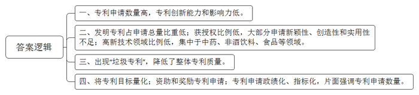
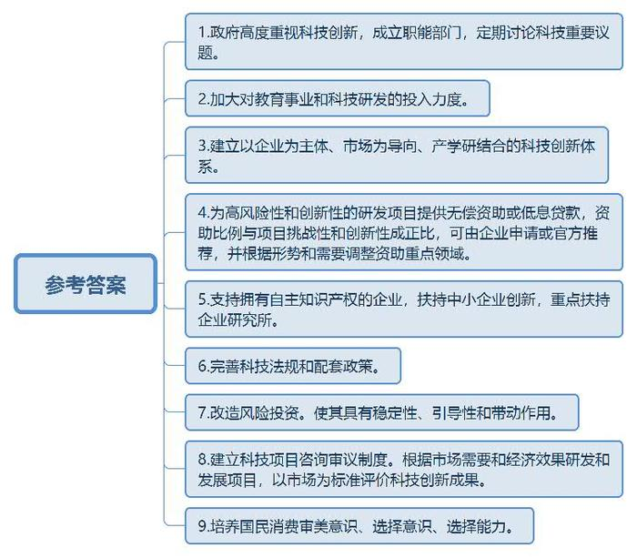
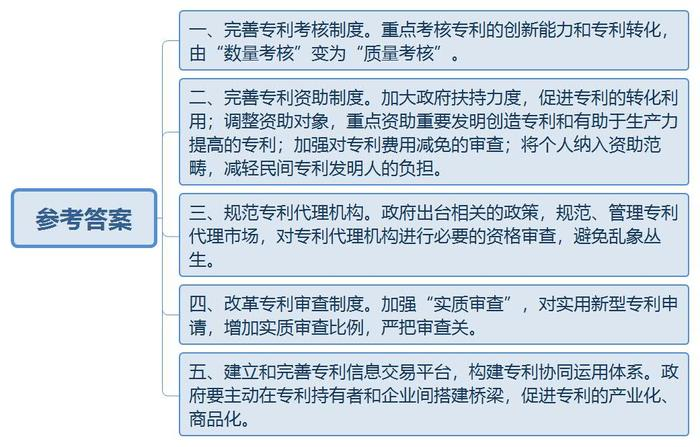
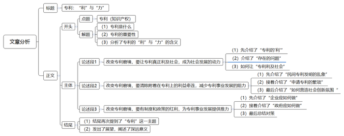

# 2014年山东省公考《申论》题（B卷）

<!-- gwy:overview:start -->
> **山东 · 2014 · 申论 · B类** ｜ 4 题 · 图片 4 处 · 答案随题折叠

导航：[题目](#题目) · [材料 1](#材料-1)
<!-- gwy:overview:end -->

> 候选采集稿。参考答案及解析来自粉笔页面，不代表官方答案或真实高分答卷；来源使用许可与原卷对应关系仍需人工核实。

## 给定材料

### 材料 1

专利是专利权的简称，指国家按专利法授予申请人在一定时间内对其发明创造成果所享有的独占、使用和处分的权利。专利数量反映的是一个国家或企业技术创新的活跃程度。

专利受理数量等指标排行榜的榜首位置曾长期被德、日、美三国轮番占据。据《2012年世界知识产权指标》报告显示，2011年中国受理专利申请的数量已经超过美国，成为世界最大的专利受理国。然而由全球最大的专业信息服务提供商汤森路透集团推出的“2012年度全球创新力百强”榜单中，专利申请第一的中国，无论是企业、政府机构，还是学术机构，无一入选。汤森路透中国区总裁刘煜介绍，该评选的核心标准是专利，目的在于衡量企业在专利创新方面的能力和影响力。

我国专利法把专利分为发明专利、实用新型专利和外观设计专利三种。从保护技术创新的角度而言，发明专利技术含量高、创新价值大、保护期长，更具有意义。从1985年4月到2011年11月，在中国各项专利申请总量中，发明专利所占比重较低，仅占32.9%，其中还有相当一部分属于国外申请人申请的发明专利。我国《专利法》第二十二条规定：授予专利权的发明和实用新型，应当具备新颖性、创造性和实用性。因此大部分发明专利申请后，因其不符合发明专利申请条件而未获授权，2010年、2011年的授权量均仅占申请量的约三分之一。我国发明专利申请量比例最高的领域是中药，之后为非酒饮料、食品等，而国外在中国申请的发明专利则主要集中在高新技术领域，如无线电传输、移动通讯等。与此同时，近年随着我国专利申请数量的迅速增加，也出现了一些“垃圾专利”。“垃圾专利”指的是那些没有任何创新内容的专利，尽管也有人认为“垃圾专利”有其自身价值，但“垃圾专利”的比例还是反映了整体专利的质量。

### 材料 2

2011年国家“十二五”规划中首次将“每万人口发明专利拥有量”列入国民经济与社会发展综合考核指标体系，提出2015年每万人发明专利权拥有量要从2010年的1.7件提高到3.3件。此后，各地也陆续出台了专利发展规划，明确了量化的专利目标。浙江省提出，“十二五”期间专利申请、授权总量年均增长15%，至2015年底实现翻一番。安徽省计划到2015年，每万人发明专利拥有量达到3.4件。天津市提出“十二五”期间每万人发明专利拥有量达到9件。

不少地方政府都出台了专门政策对专利申请进行资助和奖励。如《江苏省省级专利资助资金管理办法》规定，“国内发明专利的申请费、实审费，由省级专利资助资金资助50%，其余由申请人所在地市、县财政承担。”

一些科研机构和高校也对专利进行资助和奖励。如上海交通大学就规定，“专利申请与版权登记所发生的费用、发明专利授权后的证书费和三年内的年费、实用新型与外观设计授权后的证书费和当年的年费，由学校支付。专利授权后，发明专利每项奖励现金2000元，实用新型和外观设计专利每项奖励现金500元”。但当这些专利通过审查获得授权，专利律师通知单位去缴费以领取专利证书时，有的单位居然放弃领证。

还有一些地方政府为了完成年度专利申请数量，向所属企业和科研单位下达硬性指标，要求每年必须达到多少件专利申请数。长期以来，唯SCI、唯数量、快出成果的考核评价体系让科研人员疲于奔命，职称、考核任务成为不少科研人员的中心工作。很多科研项目不是从产业发展需要的角度出发，而是从理论、概念、论文发表等因素的需要出发，偏离了科技创新的正确方向。

### 材料 3

专利制度通过给予发明者在一定时期内的市场垄断权，以获得经济利益来弥补创新所付出的成本。通过专利授权来诱发专利的产生，从而形成从“研发端”到“应用端”的推动力，这也是专利制度设计的根本目的。

某市一家中小型科技企业约有100名科研人员。2012年，企业申请专利160项，2013年计划突破200项。老板鼓励科研人员申请专利，承诺只要撰写的专利通过申请受理，就兑现奖金。老板坦言，多申请专利就可以多向政府要钱。按照当地的专利政策，当企业的年专利申请量超过100件时，专利申请费就将由政府买单。该企业通过这些专利又能申请到各种名目的科研经费达几百万元。尝到了甜头后，企业成立了专利经营部门，专门申请专利，再向政府伸手要钱。专利经营部门是全公司投入产出比最好的部门。

北京某资深知识产权代理人孟先生透露，不少企业申请专利不是为了“使用”或“独占”，而是另有打算。“我们有的客户在提出申请获得受理申请书后，就可以拿着受理书去参加招投标，一般招标方都是认可的。有的企业申请专利就是为了以后申请高新技术企业或获得税费减免政策，还有的纯粹就为了宣传博个噱头”，“高校也一样，专利也是评职称、争优秀的有力砝码”。

目前我国已有专利代理机构870多家，包括涉外代理机构。我国年均专利申请的70%左右是经专利代理完成的。专利代理以其专业性保证发明人正确地办理获得和维持专利权的各种法定手续，并具有细致简单、省时高效的优势。

据北京某知识产权代理事务所的吕先生介绍：“申请实用新型和外观设计专利的代理费用是1500元，你如果再交5000元，我们给你包过。申请发明专利的代理费用是5000元，发明专利因为有实质审查，所以通过比较难，要根据你的专利技术情况，一般保过费要4万元左右。”对于费用过高的问题，他们表示可以通过其所在的代理事务所向企业所在区的知识产权局申请减免，申请费、公布费、审查费都可以减免70%。“个人和企业也可以申请减免政策，但你们自己申请会很难，因为我们比较熟悉系统流程，而且我们也有自己的关系。”

### 材料 4

2012年，广东某公司发票识别笔爆出“乌龙”，误将儿童有声读物鉴定为发票。从原理来看，这一冠以“自主创新”头衔的“GLD发票识读笔”之所以会将儿童有声读物误读为发票，是因为其信息编码与有声读物通用的松翰OID信息编码类似，实际上就是毫无技术秘密可言的“教育点读笔”。

世界各国的专利审查制度主要有“形式审查”和“实质审查”两种。“形式审查”主要对该专利申请的申请文件及相关手续、文件的格式、缴纳申请费等形式上的条件进行审核，审查合格后，即予登记、授予专利权。而“实质审查”则是除了对专利申请进行“形式审查”之外，还要对该发明创造的技术内容进行实质审查，即对该项专利是否具有新颖性、创造性和实用性进行审查。我们目前针对实用新型和外观设计专利申请采取的是形式审查制度。比如在此次发票识别乌龙事件中，该厂家提出所谓的“GLD防伪认证专利技术”申请，只要手续齐全，程序无瑕疵，就能够获得国家的专利授权；对于这项技术是否具有防伪功能，则不在专利审查范围之内。这种制度设计的考虑是，这样可以使申请审批迅速、及时、费用少，由于公布早，使得科技情报得以及时传播。

### 材料 5

61岁的c先生搞发明在当地是出了名的，他现在已经成功申请到22项专利，像他这样的人被称为草根专利发明人。然而，他至今只卖出过1项专利，由于专利需要交年费，他已经“主动”放弃了其中16项专利的所有权。c先生从搞发明到现在，累计投入资金达十几万元，如果他一直握有这二十多项专利权，那么每年要支付的年费就将近2万元，而他现在每月的退休工资只有1000多元，这是他无论如何也承受不了的。“我放弃了，别人谁想用谁用，也算为国家做了贡献。”c先生这样安慰着自己，“老伴对我意见很大，觉得我乱花钱，投钱不少还挣不来钱，只是管不住罢了。”

c先生唯一卖出的1项专利是被东营一家企业买走的。其实卖出这项专利，也实属偶然。“我所在的工作室原先是一个厂子，后来厂子倒闭了，东营这家企业不知道这个情况，来这个厂子订货。在闲谈中看到了我的发明，最终买下了它。”c先生现在手里还有5项专利，其中有3项正在与一家建筑公司谈合作的事。c先生说，他的这3项专利是关于空心砖保温的，但现在双方还没有达成正式的合作意向。因为他的专利涉及到建筑材料，需要经过质监部门鉴定之后才能被应用到建筑上，此前他去找过质监部门，要求做一个鉴定，但质监部门只对企业做，对个人没有这项业务，所以他的想法也没能实施。

前两年，他看到建筑工地上有些短木料使用时需要拼接，但所有的工地都没有这样的设备，于是他费了一番功夫，研究出一台专门的拼接机，几个建筑队用了之后都觉得效果不错，都来订货。越来越多的人要求购买他的这一设备，再后来有人参照他的设备作出了仿制品，也很畅销，“当我觉得它市场价值大的时候，产品已经投放市场，已不再符合专利申请的条件”，C先生说，虽然自己心里觉得可惜，但也只能放弃，好在通过这种设备，他赚到了几万元钱，用这些赚到的钱，他可以继续搞发明研究。

c先生的最新专利是适宜城市十字路口的立交桥设计方案。“那时候我在女儿家帮着买菜，出去都要经过一个很大的十字路口、每次等红绿灯的时间都很长。”c先生眼瞅着车和人都停下等红绿灯，自己就想为什么不研制一种新的立交桥，让人和车各行其道呢？有了一个想法，他便利用买菜间隙去搞自己的立交桥模型，“以往的专利授权都需要一年左右的时间，但我这次的专利授权特别快，仅用了8个月，现在我已经让女儿托朋友去相关的交通和建设部门推荐一下，看有没有单位愿意采用我的方案”。C先生知道，他的这项专利与城市规划和建设有关，涉及到众多部门，没有政府的政策扶持，专利是很难转化的。

### 材料 6

芬兰是一个创新意识很强的国家，同时也是世界上拥有最佳创新环境的国家之一。由芬兰政府总理主持的芬兰研发创新政策委员会定期讨论有关科技的重要议题。每年，芬兰政府在教育方面的支出仅次于社会福利开支，在国家预算中占第二位。芬兰政府在教育方面的大量投入形成了完善的教育机制，为国家和企业培养出大批具有创新能力的专业人才。

20世纪80年代以来，芬兰在研发方面的投入增长速度是世界上最快的，即使是在20世纪90年代初经济大萧条时期，芬兰也没有减少在科技研发方面的投入。20世纪90年代，芬兰就已建立了适合本国经济发展的科技创新体系：即以企业为主体、市场为导向、产学研（企业、高等院校和研究机构）结合的创新体系。芬兰政府鼓励企业、高等院校和研究机构密切合作，加速技术开发及科技成果转化。

芬兰国家技术开发与创新中心主要为具有高风险性和创新性的研发项目提供无偿资助或低息贷款，目的在于创造新产品、新技术、新的服务、新的生产方式与程序以及新的商业理念。研发项目越具有挑战性和创新性，所获得的资助比例越大，贷款的比例则相对越小。企业在计划进行研发和产品研制项目的初期阶段，就可以向该中心设在赫尔辛基的总部申请研发项目的资助或贷款，各地分中心也可以向总部推荐有关研发项目。该中心资助的重点是中小型企业，将50%至60%的资助提供给中小型企业。此外，该中心还根据新的形势和需要不断调整其资助的重点领域，目前资助的重点领域为能源和环保、信息和通信技术以及服务行业。

在韩国，企业是创新的主体，每一个企业经营者都深刻地意识到，如果缺乏自主知识产权，就不会得到政府的支持，更不会得到民众的理解和欢迎。因此，在韩国拥有自主的品牌，成为创业者最原始的动力。韩国政府认为，只有掌握了核心技术才能走出“引进、落后、再引进、再落后”的怪圈。亚洲金融危机后，韩国政府进一步完善科技法规和配套科技政策，从资金、税收、信息、人才等方面加大对中小企业创新的扶持，重点扶持企业拥有的研究所。韩国大力改造风险投资，更加注重其稳定性、引导性和带动作用，有效解决了企业创新的融资问题，推动企业真正成为自主创新的主体。

韩国企业实行职务发明报酬制度，这是推进科技创新、保护知识产权的一大举措。韩国对高新技术研发实行集中咨询和审议制度，根据市场需要确定研发项目，集中力量发展对国民经济拉动作用大和市场潜力大的项目，很多项目在研发初期便与市场挂钩，研发成果很快实现产业化、商品化。对技术创新成果的评价也是以市场为标准，看重研究成果能够顺利实现产业化、商品化，是否能帮助提高市场占有率；另一方面，像当年日本政府花很大的力气培养国民消费当中的审美意识一样，韩国政府举办一些活动，让公民来评选优秀设计作品；办一些专门的讲座、画展等，来提高公民在消费过程中的选择意识和选择能力。由此，需求提升了，企业家才会更加迫切地去进行技术创新。

### 材料 7

专利价值体现在其转化后带来的商业价值上，如果获得了专利权而不转化，则是对专利资产的一种浪费，科技部火炬中心技术市场发展咨询专家林耕表示，我国22万个项目合同中，只有2571个是专利转让合同，如果以我们的专利授权数作分母，那么专利转让实施率只有0.41%。

武汉市知识产权局2013年统计数据显示，企业、高校和民间发明人构成专利申请的三大主力。就专利转化而言，企业申请的专利因贴近市场，转化率相对高，但高校专利转化率并不高，民间发明转化率更低。教育部2011年发布的《中国高校知识产权报告》也显示，如果平均计算，高校专利转化率也只有5%；《中国科学报》报道，2011年我国专利技术实施率仅为0.29%。科技厅最近在省内做过一次调研：湖北高校科技成果转化率不到15%，企业的科技成果转化率达到75%。

近年来，让企业成为科技创新主体的呼声强烈。一方面，企业已成为国家科技投入的主体之一；另一方面，受行政因素影响，企业又往往在创新中处于被动地位。对此，全国政协委员、中国工程院院士张改平认为，让企业成为科技创新的主体至少应该包含三层含义：其一，企业是技术创新投入的主体；其二，企业是实施研究开发的主体；其三，企业是科研成果受益的主体。

### 材料 8

2013年7月，中央人才工作协调小组办公室负责人在接受采访时指出，“我国流失的顶尖人才数量居世界首位，其中科学和工程领域国外滞留率平均达87%。”就这一消息《欧洲时报》撰文认为，软环境是人才“抖擞精神”的必要条件。有儒家文化传统的东方国家所重视的家族利益、等级秩序、人际关系等颇具“人情味”的规则，有时会成为人才发展的阻力，甚至导致归国人才的“逆淘汰”。中国科技战略研究院产业科技发展研究所所长刘峰认为，相对于制度上的择优扶强，更应该创造一个公平、开放、竞争的环境，让国内外、全社会的个人和机构，只要愿意，都能够参与进来，在竞争中求发展。

从创立之初注册资本仅有2.4万的民营高科技企业，到如今让人尊敬的国际通信巨头，华为技术有限公司(以下简称华为)很早就定下每年将不少于10%的销售收入投入技术创新研发，并将研发经费的10%投入到新技术预研的政策。

华为的创新队伍占到15万员工的近一半。其中，有1400多人专职从事中长期技术研究工作。华为在美国、德国、瑞典等地设立了20个研究所，与行业领先的运营商成立了20多个联合创新中心。

迄今为止，华为已累计在全球申请专利40148件。其中，国外专利申请达8279件，已获得授权3060件，而且85%的外国授权专利是在欧美发达国家获得的。同时，华为也开始谋求国际标准的“话语权”进行全球专利布局，成功地由行业标准的“接受者”转为“制定者”。据华为有关负责人介绍，华为已加入123个国际行业标准机构和论坛，并在其中担任了180多个关键领导职位。“在全球范围内，每个行业都有很多热点方向，要推动自有技术方案纳入标准，就必须提高自己的话语权。”

成立于1995年的华为知识产权部已拥有200多名专门从事知识产权相关工作的技术专家、专利工程师和负责版权、商标、许可等业务的律师，其在北京、上海、北美、欧洲等地均设有分部。加强知识产权保护力度是华为为企业构筑的“防护网”。

要拓展国际市场，就要遵守国际市场规则，通过付费或者交叉知识产权的方式，快速满足客户需求。鉴于此，华为积极广泛地与全球电信领域的同行厂商、知识产权持有人开展知识产权许可谈判，与一系列公司签署了知识产权交叉许可协议。单纯的专利申请对企业并无效益，但当企业将这些知识产权与技术相对领先的西方公司进行交叉许可时，不仅会大大降低单向的专利许可费用，而且会促进专利技术的广泛应用，带来巨大效益。华为每年花费数千万美元在全球申请专利，但经过交叉许可后，每年节省的专利许可费达数亿美元甚至10亿美元以上。华为公司知识产权部部长丁建新说：“用专利换技术，通过交叉许可实现对全球范围的创新成果的整合应用，是中国企业快速提升竞争力、拓展海外市场的重要基础。”

除却自身的创新努力，华为也在从更广泛的视野来思考创新体制。华为轮值CEO兼副董事长胡厚崑表示，开放和公平竞争的市场环境是造就创新的土壤。另外，“成功的创新者理应对创新成果拥有产权和获得合理回报，这样才能激发出创新的原动力，也才能刺激对于创新的深度投资。”胡厚崑强调：“创新是一场马拉松，我们要做的是让它变成长久的竞争力。”

### 材料 9

作为全国首个国家科技创新型试点市，合肥用10年时间书写了一座城市的创新答卷：基础研究实力被英国《自然》杂志评为中国第三；国家高新技术企业数、发明专利申请量、高新技术产业产值等多项指标位列省会城市前十。创新驱动已经成为这个中部城市的发展引擎和个性标签。

2010年从德国归来后，郭涛在合肥创办了一家发展生物燃气技术的能源环境科技企业。创办之初，他并没有想到自己的这家小公司能获得政策的“优待”，政府为他们这些海归创业者提供了办公场所，并提供企业成长辅导，还给予他们相应的税收和资金支持，这些都让他的企业在短短几年里不断发展壮大。

自2004年被科技部命名为首个科技创新型试点市以来，合肥在集聚创新资源、营造创新生态方面展开了大刀阔斧的改革。合肥市将科技工作从部门工作上升到市级层面，专门成立了市自主创新领导小组，建立高层面、跨部门的科技管理体系，由市主要领导任组长，设立创新办，与市科技部门合署办公，统筹协调各部门开展创新工作，每年将创新型城市建设目标任务分解到全市25个相关部门，作为党政领导和部门重点考核内容。

合肥市还通过整合分散在各部门的科技资金，形成自主创新专项资金，改善政出多门、项目重复、经费浪费的状况。通过改革科技计划体系，合肥在全国率先取消科技项目评审，改革成果鉴定制度，引入第三方社会中介和市场评价，形成以创新绩效为导向的“后补助”政策。

“现在企业无论大小，只要有实实在在的创新成果，每年就可以据此申请相应的‘后补助’政策。改变了过去科技部门关门评审，企业为报项目拿资金找门路找关系的问题。”合肥市科技局局长朱策说。

未来的产业竞争是技术之争、标准之争。只有更加注重原始创新成果的转化，才是真正的自主创新，才可能在未来技术、标准之争中占据一席之地。在改革科技管理体制的同时，合肥市还不断完善公共研究平台、创业孵化器、科技金融等创新服务体系建设，积极探索试点股权激励等新政，激发创新活力。“合芜蚌自主创新试验区”获批享受的“中关村政策”，其核心是以更灵活的方式激发科技人员的创新热情。根据政策，企业可将近3年税后利润形成的净资产增值额的35%，以股权奖励、股权出售、股票期权等形式激励有突出贡献的骨干人员。企业实施科技成果转化，技术人员亦可获得一定比例的股权或分红等激励。

科技创新要有主战场，那就是面向经济一线，服务产业发展。跳出项目科技、部门科技，服务产业发展和经济一线是合肥市在推动科技创新中牢牢把握的出发点和落脚点。

2013年，在合肥市创新大道旁的一栋“X”型建筑吸引了不少海外创新团队的目光。这栋建筑就是由安徽省、中科院、合肥市与中科大四方合作共建的中国科学技术大学先进技术研究院(简称中科大先研院)。和这栋建筑的独特造型一样，这个先进技术研究院也肩负着合肥科技创新的独特使命：敢为人先、打破体制樊篱、探索政产学研的协同创新之路。

## 题目

### 第 1 题

**请根据“给定资料**1**~**2**”，概括当前我国专利申请的主要特点。(15分)**

关联材料：材料 1、材料 2

作答要求：

要求：概括准确，内容全面，条理清晰；不超过200字。

第 1 题 · 答案与解析

**参考答案（粉笔题库参考内容）**

一、专利申请数量高，专利创新能力和影响力低。

二、发明专利占申请总量比重低；获授权比例低，大部分申请新颖性、创造性和实用性不足；高新技术领域比例低，集中于中药、非酒饮料、食品等领域。

三、出现“垃圾专利”，降低了整体专利质量。

四、将专利目标量化；资助和奖励专利申请；专利申请政绩化、指标化，片面强调专利申请数量。

**解析**

**参考答案说明：**答案从“专利申请数量和质量失衡”“发明专利质量不高”“‘垃圾专利’浮现”“政府参与情况”等不同的范畴进行了分条撰写。各条要点之间在内容上是并列关系。

### 第 2 题

**“给定资料**6**”介绍了芬兰和韩国政府鼓励创新的做法。请谈谈这些做法对我国政府在科技创新中应该发挥的作用提供了哪些有益的启示。(20分)**

关联材料：材料 6

作答要求：

要求：分析准确，内容全面，条理清晰；不超过300字。

第 2 题 · 答案与解析

**参考答案（粉笔题库参考内容）**

1.政府高度重视科技创新，成立职能部门，定期讨论科技重要议题。2.加大对教育事业和科技研发的投入力度。3.建立以企业为主体、市场为导向、产学研结合的科技创新体系。4.为高风险性和创新性的研发项目提供无偿资助或低息贷款，资助比例与项目挑战性和创新性成正比，可由企业申请或官方推荐，并根据形势和需要调整资助重点领域。5.支持拥有自主知识产权的企业，扶持中小企业创新，重点扶持企业研究所。6.完善科技法规和配套政策。7.改造风险投资。使其具有稳定性、引导性和带动作用。8.建立科技项目咨询审议制度。根据市场需要和经济效果研发和发展项目，以市场为标准评价科技创新成果。9.培养国民消费审美意识、选择意识、选择能力。

**解析**

**参考答案说明：**本参考答案从“成立职能部门”“加大资金投入”“科技创新体系建设”“企业资助”“鼓励企业掌握核心技术”“完善政策法规”“改造风险投资”“科研项目审议”“促进消费升级”九个不同方面进行了分条撰写。各条要点之间在内容上相互并列，没有交叉。

### 第 3 题

**“给定资料**3**~**5**”反映了我国专利申请过程中存在的一些问题。假如你是政府相关职能部门的工作人员，请提出解决这些问题的建议。 (25分)**

关联材料：材料 3、材料 4、材料 5

作答要求：

要求：内容全面，条理清晰，针对性强；不超过500字。

第 3 题 · 答案与解析

**参考答案（粉笔题库参考内容）**

一、完善专利考核制度。重点考核专利的创新能力和专利转化，由“数量考核”变为“质量考核”。

二、完善专利资助制度。加大政府扶持力度，促进专利的转化利用；调整资助对象，重点资助重要发明创造专利和有助于生产力提高的专利；加强对专利费用减免的审查；将个人纳入资助范畴，减轻民间专利发明人的负担。

三、规范专利代理机构。政府出台相关的政策，规范、管理专利代理市场，对专利代理机构进行必要的资格审查，避免乱象丛生。

四、改革专利审查制度。加强“实质审查”，对实用新型专利申请，增加实质审查比例，严把审查关。

五、建立和完善专利信息交易平台，构建专利协同运用体系。政府要主动在专利持有者和企业间搭建桥梁，促进专利的产业化、商品化。

**解析**

**参考答案说明：**本参考答案围绕我国“专利申请过程”存在的问题，分别从“专利考核制度”“专利资助制度”“专利代理机构”“专利审查制度”“专利信息交易平台”五个方面指出了解决“对策”。各条要点内部进行了分条撰写，并且每条要点在内容上是并列关系。

### 第 4 题

**请结合对全部给定资料的理解与思考，以《专利：“利”与“力”》为题，写一篇文章。(40分)**

关联材料：材料 1、材料 2、材料 3、材料 4、材料 5、材料 6、材料 7、材料 8、材料 9

作答要求：

要求：

1.观点明确，联系实际

2.内容充实，论述深刻

3.结构完整，语言流畅

4.总字数1000—1200字。

第 4 题 · 答案与解析

**参考答案（粉笔题库参考内容）**

**专利：“利”与“力”**

世界已经进入知识经济时代，知识产权成为了各国综合实力的重要体现，而专利属于知识产权的一种，它的数量和质量，反映的是一个国家或企业技术创新的活跃程度，同时也是衡量一个国家、地区技术创新能力和经济竞争实力的重要标志。
目前，我国对专利发展规划，明确了量化的专利目标，很多企业已经意识到专利在保护知识产权中的重要性，但在此进程中，却屡屡遭遇扭曲和变形，其“利”激发的不是创造而是贪欲，其“力”推动的不是进步而是窘境。因此，**在市场经济的游戏规则下，如何全面认识专利对企业的重要作用，最大限度地利用专利数据库，使之真正成为企业发展的助推器，是当前我国企业增强核心竞争力的当务之急**。
**改变专利窘境，要让专利真正利及社会，成为社会发展的动力**。专利的本身目的是为了社会的“利”——是造福社会的原动力，然而有些地方政府下达硬性指标，要求每年必须完成一定的专利申请；一些科研项目并不是从产业发展需要的角度出发，偏离了科技创新的正确方向。作为激发创新精神的制度设计——专利，如果不能正本清源，就不能焕发其内在和真正力量。不正当的“利”就会变成阻力。当下亟须树立正确的专利价值观和意识，加大宣传力度，摆脱中国国际分工低端地位，使“中国制造”离我们越来越近。
**改变专利窘境，要清除附着在专利上的利益牵连，减少专利事业发展的阻力**。61岁的D先生被称为草根专利发明人，他已经成功申请到多项专利，然而他至今只卖出过1项专利，由于专利需要交年费，他已经主动放弃了16项专利权。同时还出现专利代理公司通过专利牟利，交钱包过的现象。我们可以看到，过于繁琐的申请手续、过于高昂的专利持有费用，严重影响着专利的转化，专利事业的社会效应和经济效应也就大打折扣。有关部门亟须建立严厉打击专利收费乱象的执法队伍，提高违法成本。激发专利活力，重在固创新创造之本。清除申请、持有等种种制度障碍，让专利带来真真切切的利益，唯有如此，才能激发全社会的创新活力，营造出创新的社会氛围。
**改变专利窘境，要有制度和政策的红利，为专利事业发展提供推力**。要进一步构建鼓励和支持企业创新的新体系，加大力度提高创新力。专利的主角是企业和企业家。因为社会进步，归根结底是靠企业及其内部员工。芬兰是一个创新意识很强的国家，同时也是世界上拥有最佳创新环境的国家之一，芬兰政府在教育方面投入形成了完善的机制，为国家和企业培养出大批具有创新能力的专业人才。华为的成功，就在于其拥有企业家的洞察力和科学家的创新精神。因此，推动企业的创新，为企业的专利构建良好的制度，输入具有创新能力的高质量专业人才队伍，是改变专利窘境的当务之急。
随着我国加入WTO后，在技术、商贸等领域与国际交往日益频繁，企业之间的竞争愈加激烈，改变专利事业的窘境，是让我国企业在国际市场竞争中立于不败之地的有效武器！

**文章分析**

**专利：“利”与“力”**

【**标题的优点：**严格按照题目的要求，以“专利：‘利’与‘力’”为标题。】
世界已经进入知识经济时代，知识产权成为了各国综合实力的重要体现，（1）而专利属于知识产权的一种，它的数量和质量，反映的是一个国家或企业技术创新的活跃程度，（2）同时也是衡量一个国家、地区技术创新能力和经济竞争实力的重要标志。

目前，我国对专利发展规划，明确了量化的专利目标，很多企业已经意识到专利在保护知识产权中的重要性，但在此进程中，却屡屡遭遇扭曲和变形，（2）其“利”激发的不是创造而是贪欲，其“力”推动的不是进步而是窘境。因此，**在市场经济的游戏规则下，如何全面认识专利对企业的重要作用，最大限度地利用专利数据库，使之真正成为企业发展的助推器，是当前我国企业增强核心竞争力的当务之**急。

【**开头的优点：**★内容方面。范文的开头是紧扣“专利”这一主题展开的。首先，开头即点出主题，做到了主题明确。其次，对“专利”这一主题进行了分析阐述，指出了（1）“专利是什么”；（2）“专利的重要性”；（3）分析了专利的“利”与“力”的含义。注意以上三个方面的阐述在逻辑上有先后顺序：先介绍“专利”是什么，再写“专利”的重要性。★文字表达方面：使用了“而”“同时”等关联词，使语言表达有逻辑性。】

**改变专利窘境，要让专利真正利及社会，成为社会发展的动力**。（1）专利的本身目的是为了社会的“利”——是造福社会的原动力，（2）然而有些地方政府下达硬性指标，要求每年必须完成一定的专利申请；一些科研项目并不是从产业发展需要的角度出发，偏离了科技创新的正确方向。作为激发创新精神的制度设计——专利，如果不能正本清源，就不能焕发其内在和真正力量。不正当的“利”就会变成阻力。（3）当下亟须树立正确的专利价值观和意识，加大宣传力度，摆脱中国国际分工低端地位，使“中国制造”离我们越来越近。

【**论述段****1****的优点：**★观点句：范文的观点句是紧扣“专利”这一文章主题提出的。形式上，它在段首处直接写出，位置突出，容易发现。内容上，关键词突出，内容要点明确，可以明显看出它是从“专利的'利'与“力””入手，指出了“如何让专利利及社会、成为社会发展的动力”。★论述内容：（1）介绍了“专利的'利'”；（2）介绍了存在的问题；（3）如何让专利利及社会。注意：以上三个方面的内容都是紧扣“改变专利窘境，要让专利真正利及社会，成为社会发展的动力”这个观点句进行分析论述的，论述的针对性强，内容层次丰富。最后，在论述方法和论据的选取上以讲道理为主，论述透彻。】
**改变专利窘境，要清除附着在专利上的利益牵连，减少专利事业发展的阻力。**61岁的D先生被称为草根专利发明人，他已经成功申请到多项专利，然而他至今只卖出过1项专利，（1）由于专利需要交年费，他已经主动放弃了16项专利权。同时还出现专利代理公司通过专利牟利，交钱包过的现象。我们可以看到，（2）过于繁琐的申请手续、过于高昂的专利持有费用，严重影响着专利的转化，专利事业的社会效应和经济效应也就大打折扣。（3）有关部门亟须建立严厉打击专利收费乱象的执法队伍，提高违法成本。激发专利活力，重在固创新创造之本。清除申请、持有等种种制度障碍，让专利带来真真切切的利益，唯有如此，才能激发全社会的创新活力，营造出创新的社会氛围。

【**论述段****2****的优点：**★观点句：范文的观点句是紧扣“专利”这一文章主题提出的。形式上，它在段首处直接写出，位置突出，容易发现。内容上，关键词突出，内容要点明确，可以明显看出它是从“专利的‘利’与‘力’”入手，指出了“如何清除专利的不当之‘利’，减少发展‘阻力’”。★论述内容：（1）介绍了“民间专利发明的乱象”；（2）介绍了“申请专利的繁琐”；(3)如何营造社会创新氛围。注意：以上三个方面的内容都是紧扣“改变专利窘境，要清除附着在专利上的利益牵连，减少专利事业发展的阻力”这个观点句进行分析论述的，论述的针对性强，内容层次丰富。最后，在论述方法和论据的选取上做到了以摆事实和讲道理结合，做到了丰富多样。】
**改变专利窘境，要有制度和政策的红利，为专利事业发展提供推力**。要进一步构建鼓励和支持企业创新的新体系，加大力度提高创新力。（1）专利的主角是企业和企业家。因为社会进步，归根结底是靠企业及其内部员工。芬兰是一个创新意识很强的国家，同时也是世界上拥有最佳创新环境的国家之一，（2）芬兰政府在教育方面投入形成了完善的机制，为国家和企业培养出大批具有创新能力的专业人才。华为的成功，就在于其拥有企业家的洞察力和科学家的创新精神。因此，推动企业的创新，为企业的专利构建良好的制度，输入具有创新能力的高质量专业人才队伍，是改变专利窘境的当务之急。

【**论述段****3****的优点：**★观点句：范文的观点句是紧扣“专利”这一文章主题提出的。形式上，它在段首处直接写出，位置突出，容易发现。内容上，关键词突出，内容要点明确，可以明显看出它是从“专利的‘利’与‘力’”入手，指出了“如何发挥专利的推力，释放红利”。★论述内容：（1）介绍了“企业应如何做”；（2）介绍了“政府应如何做”；（3）总结对策。注意：以上几个方面的内容都是紧扣“ 改变专利窘境，要有制度和政策的红利，为专利事业发展提供推力”这个观点句进行分析论述的，论述的针对性强，内容层次丰富。最后，在论述方法和论据的选取上做到了摆事实和讲道理结合，做到了丰富多样。】
随着我国加入WTO后，在技术、商贸等领域与国际交往日益频繁，企业之间的竞争愈加激烈，（1）改变**专利**事业的窘境，（2）是让我国企业在国际市场竞争中立于不败之地的有效武器！

【**结尾的优点：**范文的结尾回扣了“专利”这一主题。（1）再次提到“专利”；（2）发出了展望，阐述了深远意义。】

**解析状态：unknown（来源未提供）**

