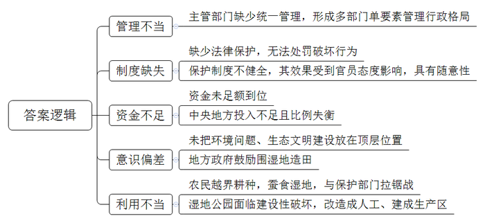
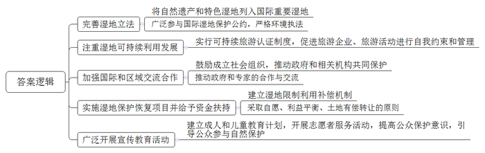
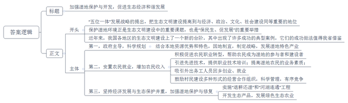
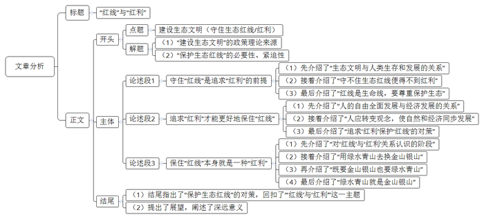

# 2014年山东省公考《申论》题（C卷）

<!-- gwy:overview:start -->
> **山东 · 2014 · 申论 · C类** ｜ 4 题 · 图片 4 处 · 答案随题折叠

导航：[题目](#题目) · [材料 1](#材料-1)
<!-- gwy:overview:end -->

> 候选采集稿。参考答案及解析来自粉笔页面，不代表官方答案或真实高分答卷；来源使用许可与原卷对应关系仍需人工核实。

## 给定材料

### 材料 1

湿地是指陆地和水域的过渡地带，包括沼泽、滩涂、湿草等，也包括低潮时水深不超过6米的水域。湿地通常分为自然和人工两大类，自然湿地包括沼泽地、泥炭地、湖泊、河流、海滩和盐沼等；人工湿地主要有水稻田、水库、池塘等。据资料统计，全世界共有自然湿地850余万平方千米，占陆地面积的6.4%。

湿地对于人类的作用非常重要，它能够调节降水量的不均带来的洪涝与干旱，将过多的降水存储、缓冲，然后逐步放出，发挥着蓄洪抗旱的功能；它能够通过多种多样的湿地植被抵御海浪、台风和风暴的冲击，防止对海岸的侵蚀，保护沿海工农业生产，防止土地盐碱化；它在沉积物沉降，促淤造陆方面的速度是裸地的3-5倍。同时，湿地也是鸟类、鱼类、两栖动物繁殖、栖息、迁徙、越冬的重要场所；我国著名的杂交水稻所利用的野生稻也来源于湿地，所以湿地保持生物多样性的功能是其他任何生态系统无法代替的。另外，湿地中还有许多水生植物，它们能够在其组织中富集金属及一些有害物质，很多植物还能参与解毒过程，对污染物质进行吸收、代谢、分解，达到净化水体的效果，起到降解环境污染物的作用。

但是在“人口爆炸”和经济发展的双重压力下，从上世纪50年代以来，我国湿地被开垦面积达1000万公顷，其中全国沿海滩涂面积已削减过半，56%以上的红树林消失。全国各类大小湖泊消失上千，被誉为“千湖之省”的湖北省湖泊锐减了2/3。众多湿地水质逐年恶化，不少湿地生物濒临灭绝，约1/3的天然湿地存在着被改变和消失的危险。根据相关数据，中国现存自然或半自然湿地约占国土面积的3.77%，远低于世界6%的平均水平，且面积下降的趋势仍未得到有效遏制。

### 材料 2

在一些专家眼里，M湿地是世界上最美丽的湿地。因为在这里，有景色秀美的草原、湖泊以及动植物资源。除了美丽的景色，M湿地对于维系黄河、长江中下游地区生态安全具有非常重要的作用。但是近年来，M湿地的“健康状况”令人担忧，长年致力于M湿地保护的某环保组织成员小王说：“M湿地被破坏的主要原因有三个，即草场沙化、过度放牧、鼠兔灾害，但归根到底还是和过度放牧有关。”

据小王介绍，从上世纪六七十年代开始，当地政府采取了很多措施，鼓励牧民扩大畜牧业生产，包括M湿地在内的很多地区牛羊数量急剧增长。改革开放以后，当地政府为了发展经济，牧民为了增加收入，牛羊数目继续增加，据统计，目前M湿地牧民的人均年收入达到了4700元以上，个别家庭的年收入甚至超过了30万元。但同时，由于牛羊数量已经远远超出了M湿地草场的承载量，造成过度放牧，所以使得湿地草场严重退化，鼠害日趋严重，沙漠化加剧，大量野生动植物消失。仅M湿地靠近黄河的部分，就已经出现了220公里的沙化带，大量野生动植物种群也因为沙化而消失。单就动物而言，从上世纪六七十年代至今，M湿地的各类珍稀动物已经从230多种下降到140多种；随着天敌的减少，对植物破坏力非常大的鼠兔迅速繁殖，又进一步加剧了湿地的沙化；此外，湿地沙化还造成了该区域风沙侵蚀和水土流失，使黄河赖以补给的水资源大量减少，增加了黄河中下游广大地区旱涝灾害的发生频次。

M湿地沙化现象虽然早已引起了相关部门的注意，并采取了相应的措施进行治理，但效果并不明显，当地政府在保护M湿地过程中也面临着诸多无奈。

上世纪80年代以后，按照联产承包制的规定，M湿地已经按户承包给了当地居民。在牧民们看来，利用自己的生产资料去创造财富，无可厚非。牧民A就反问记者说：“我在自己的土地上养牛养羊，养多养少，难道还要向政府汇报吗？”

牧民B向记者坦言，与过去相比，居住在湿地中的牧民收入确实有了很大提高，但是由于交通不便等种种原因，牧区除牛羊肉以外的各种物资都要依靠外部供给，与偏高的消费水平相比，生活水平的提高并不明显。所以，对于普通居民而言，如果不增加牛羊的数量，可以说很难维持基本的生活水准。

“牧民们也知道牛羊养得太多对湿地草场不好，但这也是为了生活。”牧民C直接告诉记者，“如果政府能够通过补偿牧民因为少养牛羊而受到的损失，我们肯定会主动减少牛羊数量，总不能为了保护湿地而让我们吃不饱饭吧！”

记者在采访过程中也发现，M湿地的很多地方条件非常艰苦，人畜共患病现象突出，医疗教育等公共设施非常不完善。如果没有一定的收入作为保障，生活确实不易。

既要“收入”，又要“保护”，二者如何同步，的确是个难题！在记者结束采访的时候，小王也说了一句沉甸甸的话：“老少边穷地区的居民一样有追求自己幸福的权利，在要求他们为大家守护这片美丽湿地的同时，我们难道不应该去想想他们的幸福吗？”

### 材料 3

德国河流湿地面积155万公顷，占国土面积的4.4%，涉及79条主要河流，堤坝建设使河流沿岸洪泛区面积减少了2/3；大河（如莱茵河、易北河）两岸大多数地段只有原有溢洪面积的10%—20%；1/3以上的河流湿地正被密集地开发利用，只有10%的现有湿地接近自然状态。

西班牙位于欧洲西南部伊比利亚半岛。很多代表西班牙丰富自然遗产和独具特色的湿地被列入国际重要湿地。目前虽大部分湿地已得到法律保护，但湿地面临的威胁仍相当严重。

德国、西班牙都是《欧洲自然保护框架》的成员国，该框架始于1979年签署的欧盟“鸟类法令”。1992年签署的欧盟《动物植物栖息地法律》与《鸟类法令》组成了具有综合性和代表性的“Natura2000网络”，其成员国根据标准确认和保护相关区域，两国境内重要的湿地几乎全部属于保护范围。《欧洲水资源框架法令》要求成员国需在2015年前使各类水体水质达到良好水平，对违反欧盟法令规定的行为，欧洲法院可强制执行处罚。

20世纪末，自然保护区旅游活动除了带来经济效益外，也给自然环境和当地社会造成了各种负面影响，尤其是生态破坏问题越来越严重，《欧洲保护区可持续旅游宪章》就是在这一背景下，由欧洲国家公园联盟制定的。该宪章制定的目的就是促进旅游企业、旅游活动在保护地生态环境保护方面进行自我约束和管理，实行可持续旅游认证制度。保护区可持续旅游认证，一方面使旅游企业有了动力和压力来提高其环境保护水平，减少旅游活动对生态环境的负面影响；另一方面也唤起了旅游者对其旅游活动和消费行为的审视，使旅游者在选择旅行社、宾馆、饭店和其他旅游服务时更加重视环境因素，从而直接或间接地为环境保护做出贡献。

“欧洲自然与国家公园联盟”是一个非政府组织，成立于1973年，目前在欧洲有39个国家400个成员单位。其宗旨是促进自然保护地的良好管理，推动管理者和专家的合作与交流，促进政府和相关机构支持保护地的工作。该联盟总部设在德国雷根斯堡，2007年在布鲁塞尔设立办公室。该组织设主席和协调员，任务是与总部和各部门、各分支机构沟通交流，加强成员间的联络、组织研讨活动和成员大会，准备项目建议，保持网络交流等。联盟作为各国家公园、生物园保护区和自然公园等保护地的一体性组织，代表欧洲保护地的声音。

在德国和西班牙，公众参与自然保护历史悠久，有力地推动了湿地保护事业的开展。一些保护地由非政府组织管理并与公共团体和私营机构建立了伙伴关系。莱茵河宾根至爱特维尔湿地静水区、岛屿、浅滩是水鸟的重要栖息地。德国自然保护协会（Nabu）莱茵奥恩自然保护中心作为非政府民间组织，积极对湿地进行了保护管理。

德国、西班牙相关湿地保护和恢复项目可以获得欧盟的资金支持。《欧盟农业共同政策》也提供了对湿地限制利用的相关补偿机制，欧盟补助湿地标准为每年每公顷350欧元。德国、西班牙两国中央、区域政府和企业也支持了一大批湿地保护恢复项目，在恢复治理过程中，采取自愿原则、利益平衡原则、土地有偿转让原则。

西班牙多尼亚纳国家公园20年来一直是环境教育发展的先锋，公园与14个周边城市的政府和学校有成人和儿童教育计划，每年安排10项学校课程计划，受教育学生多达1.7万多名。每年安排3个成人教育计划，共有7000多名参与者。他们广泛建设了公共参与设施，包括休闲娱乐、科学和农业旅游、感知自然运动等，每年有30万名游客在游客中心注册。公园还开展了2项重要的志愿者行动，让来自各地的人都可以得到培训并与公园工作人员共同工作，且建立了志愿者网络，每年有200多人参与到志愿者服务中。

### 材料 4

最近，由国家相关部门牵头，围绕我国的湿地保护召开了一次座谈会，下面是参加会议的部分代表的发言：

中部某省D厅长：湿地涉及多项资源要素，国土、林业、农业、环保、水利、海洋、建设等多个部门的职能均有涉及。根据政府有关规定，国家林业局在湿地保护方面的职责是组织、协调、指导、监督全国的湿地保护工作，这也就是说林业局在湿地保护方面负有组织协调的职能，却并没有“统一管理”职能，因而形成了林业局统一组织协调下的多部门单要素管理的行政管理格局。其直接结果是，形式上我国湿地的主管部门是林业部门，但是大量的滩涂湿地却依旧归海洋部门管理，林业部门根本就插不上手。在一些内陆省份，林业部门插手湿地管理也常常受到农业、环保、渔政等部门的非议和责难，所以很多湿地保护区基本上都是遵循这样一个准则：哪一个部门愿意给项目资金，就归哪一个部门管理。

E局长：很多湿地保护区与农民的耕地直接相连，因为湿地非常肥沃，所以农民会越界耕种。因此，蚕食湿地的情况十分严重。这也导致湿地保护者与农民之间长期的“拉锯战争”，他们种完了，我们毁，我们毁了，他们再去偷着种，不断地重复拉锯战，我们知道这并不是最好的选择，但如果不这样，湿地根本守不住。一开垦动辄就是百亩，特别是春耕前后的那两三个月，湿地保护部门的工作人员“根本别想回家睡觉”。

F副厅长：森林有《森林法》，土地有《土地法》，海洋有《海洋法》，而湿地没有法，这意味着湿地可以随意破坏，把湿地毁了，把它变成开发区了，也没事，没人追究，因为没有法嘛。到处都在填海，你看多么严重，为什么填呢？因为便宜啊，填海比征地来得便宜和简单，而且又没有法律去约束它，为什么不填呢？作为主管部门，我们肯定是反对，但我们没有法律依据去制裁它或是处罚它。不能像《森林法》那样进行刑事制裁，根本看不住。

西部某省G主任：“十一五”期间，国务院批准了《全国湿地保护工程实施规划》，根据该规划，“十一五”期间保护工程总投资90亿元，其中中央42亿元，地方配套48亿元。但实际上，无论是中央还是地方的资金，都没有足额到位，整个“十一五”期间中央累计投入14亿元，地方配套资金17亿元。在一些地方，中央与地方的投入比例已经失衡。湿地保护资金投入严重不足。国家如果要投入1块钱，地方要配4块钱，这对西部地区来说是十分困难的，即使是中央拿4块钱，地方配1块钱，西部都做不到，配到最后都是假的，即使承诺了，但最后用完国家那1块钱也就用完了。

H教授：在目前的体制下，地方官员对湿地的态度直接决定了保护的效果。比如，有些城市，它想搞生态城，它就有保护湿地的意识，将湿地作为旅游景点开发和保护；但如果它想发展工业的时候，就会把湿地填掉搞开发区，这种随意性在很多城市都存在。然而一旦这个湿地被保护好了，开发商又想过来，因为在一个比较好的湖边或海边做开发肯定能赚钱。湿地已经成为房地产开发的新热点，所以一些城市的滨海湿地成为了经济思维下满足欲望的牺牲品。

沿海某省I主任：为了发展农业，满足农民耕地需要，在一些沿海省份，都会采取不同的措施鼓励“围湿地造田”。以Z省为例，根据《Z省滩涂围垦管理条例》，滩涂的宜农宜建开发被明确鼓励。在2010年初围垦工作会议上，当地官方这样总结：“围垦的贡献在我省是有目共睹的，仅‘十一五’以来的四年，我省就圈围了47万亩……”事实上，其他省份也都有这样的规定。有时甚至规定开垦一亩滩涂给予高达6000元的补助。很多地方直接把海边的小山或者高地炸平，然后将土石填到前面向海洋过度的滩涂湿地上，导致漫长的海岸线上很多宽阔的滩涂湿地永久性地消失了。

J局长：建立湿地公园是保护湿地最直接、最有效的途径，但从旅游环境保护和生态角度来讲，保护得好的原生态就是最好的景观。所以建立湿地公园时，应该避免把自然改造成人工、把生态区建成生产区的做法，不要“建设性”地破坏自然，力求达到湿地生物多样性和文化多样性结合的效果，确保湿地公园不是度假村、游乐场、人工花园或者徒有虚名的荒野区。

某大学经济研究所博士生导师K教授：无论是十八大报告将生态文明建设与经济建设、政治建设、文化建设、社会建设并列而提出“五位一体”的发展战略，还是习近平总书记对生态文明提出的“决不以牺牲环境为代价去换取一时的经济增长”“牢固树立生态红线的观念”，都非常明确表明：生态环境问题、生态文明建设，不再是经济社会发展之后才考虑的问题，而是必须把它放在与发展社会主义市场经济、民主政治、先进文化、和谐社会同等重要的顶层位置，可以这样认为，经济建设是根本，政治建设是保障，文化建设是灵魂，社会建设是条件，生态文明建设则是基础。

### 材料 5

莲藕被他们一根根插进水下面的泥土，码头被他们一砖一瓦地搭建起来，游船被他们一艘艘地布置一新，饭店被他们一家家地建起，为游客服务的程序被他们一遍遍地完善……从农民到湿地的建设者、经营者，设计码头、开游船、做更夫、当保管员、做项目负责人……原来的农民职业变得“五花八门”，随着祖祖辈辈所居住的这片湿地的旅游开发，这些原本贫穷的村民开始了崭新的人生之旅。

王金宝是W镇的农民，世世代代务农为生，最近他接了一个新任务：栽种荷花。以前只会种粮种菜，种荷花还要从头学起。这1万多公斤首次在这里种植的荷花花种都是整支的藕，是当地政府专门从某省购进的。除此之外，镇政府还请了专业的荷花培育人员培训他们荷花种植的相关技术。

不止王金宝一人，很多农民都因开发湿地而掌握了新技术。42岁的村民王炳仁经过海事部门的培训，掌握了开船技术，成为“路吉”船队的队长。每天，他驾驶着画舫船从码头至各大景点，拉着全船人游览湿地风光。“以前种地从来没想过要对别人负责。现在，一船人的安全都在我身上呢。”王炳仁深感现在的工作与以前种地的区别，对新工作一点不敢疏忽，在实践中已积累起通过掌握风速、水速来控制船速的经验。

“转业农民”对湿地的热情，让马镇长体会很深。他说：“我们镇靠江边，以前一发水，农田就被淹，所以比较穷。大家都把开发湿地旅游当作改变自身命运的机会。现在已建设好的码头就是由有这方面打工经验的村民们一起研究、设计，并亲手建造的。同样是滨水而居，但湿地开发前后，当地居民的心气儿大不一样。”

“过去村里许多人与水没太大关系，而现在湿地的经营和建设几乎是全村参与。”W镇某村村支书说，“现在，虽然湿地开发刚起步，但村里已经成立了四个合作社，80%的村民都通过参加合作社的方式参与到湿地经营。其中，直接参与湿地建设的有约60名村民。”

今天是“顺心如意楼”开业的日子，直到下午3时，崔莉莉才算能喘口气。以前靠捕鱼为生的崔莉莉家里的房子距离湿地景区只有两三分钟的路程，通过当地政府部门的支持，房子经过一番装修，变成了现在一楼是餐饮、二楼是住宿的“顺心如意楼”。崔莉莉也带着孩子回来和父母一起开店。“做什么菜、每道菜需要多大的量以及进鱼、进菜的渠道这些问题，都需要一点点摸索经验。”连续几天，她都和同屯子的朋友每天商量到晚上10点多。现在，她初步理清了头绪，决定利用自己和父亲都会捕鱼的优势，在坝外的水域里用网围出一片区域，把打出来的鱼放在那里，客人可以到那里捞最新鲜的鱼。

开饭店对姜涛来说一点不陌生。10年多前，他就和表哥张海生在天津租了个大约300平方米的门面开东北菜馆。虽然生意也不错，但他总摆脱不了心里的漂泊感。家乡开发湿地旅游后，他敏锐地感到了其中的商机，和表哥一起回来了。把原来自己住的房子重新装修，就变成了现在这家200多平方米的农家饭庄。姜涛说：“回来开饭店的好处太多了，对这边人的消费观点、饮食口味都了如指掌，关键是能回到自己家了，安心。”开发湿地旅游，在家乡就能有大发展，这是吸引姜涛毅然回乡最强劲的理由。仅仅姜涛所在的这一个村，目前陆续从外面回来的外出打工者就已有几十人。

镇党委徐书记说，开始湿地开发后，当地成立了捕捞合作社和旅游合作社，其中成立捕捞合作社是为了统一鱼价。一是保证渔民收入提高，二是防止渔民间恶性竞争导致餐饮业恶性竞争，方便统一几十家农家乐的菜价。现在，在W镇的湿地上，渔船上鱼的售价基本一致，2.5公斤以上的鲤鱼每公斤30元。

村民赵文斌说对于他们的创业方向都有计划。他说，全镇计划开设农家乐、渔家乐饭店48家，目前以江鱼宴为主，为了配合湿地旅游主打的“金源文化”，以后这些饭店将做“金宴”。自从去年滨江湿地开始开发建设以来，已有上千人闻名“捷足先登”了，这让赵文斌他们对自己的“湿地大业”充满了信心。

### 材料 6

水波荡漾，草长莺飞，鸭舞鸟鸣，这是地处吉林省长白山麓龙岗山脉中段——哈泥河国家级自然保护区的真实写照。近年来，当地通过有效的保护与恢复，不仅使哈泥湿地水资源日渐丰富，而且让这里的生态环境更加优越，再现其生机盎然的景象。

Y镇党委白书记说，为破解环境保护与经济发展的难题，Y镇于2011年提出“产业兴镇，项目活镇”的发展战略，着力构建“有机食品示范区”的产业发展新格局，真正实现在保护中发展，在发展中保护。

为此，Y镇结合本地资源优势，以当地现代农业生产企业的蓝莓基地为依托，采用“公司+农户+基地”的形式来扩大蓝莓种植面积，一位企业技术人员告诉记者：“在全力构建有机食品示范区建设的同时，我们更充分认识到只有保护好环境，有机食品生产加工企业才有生存发展的根基，所以保护哈泥河湿地对于我们来说不仅是企业应当承担的社会责任，而且也是企业赖以生存发展的基础。”

殷董事长说，这种合作方式是公司从农民手中将土地转租过来统一管理，将农民变成产业工人。公司向农户承诺：挣了算农户的，赔了算公司的。双方合作方式为股份合作，合作社成员用土地入股，然后承包管理入股土地，其余（技术、信息、培训、收储、加工、冷链、物流、市场、品牌建设等）全部由公司负责。公司有效地整合了土地、资金和人力资源，农户增收显著，合作愿望强烈。

据了解，种植1000亩蓝莓等于在水源保护区增加了1000亩生态林。种植蓝莓需要大量的生物有机肥作改土材料，能有效遏制土壤退化，从而保护了黑土地，哈泥湿地的生态环境也将明显改善。

村民张继舟满脸幸福地说：“过去家里种地收入低，我只好外出务工，一年到头也赚不了几个钱，自从有了这蓝莓企业，我就回来了，不用离开老婆孩子和父母，一年收入比我在外面挣得多，现在的生活真不错。”

目前，镇里正在合作发展1000亩蓝莓种植基地建设项目，入社成员增加至200户，从业人员达400人以上，户均5亩蓝莓，保底增收15200元，较种植传统农作物增收3.8倍，农民增收将更加显著。

无独有偶，在与Y镇几里之隔的V国家湿地公园是企业投资管理的公园，近年来，他们探索走出了一条湿地保护与生态农业和谐发展的路子。2012年，建园初期实施退耕还湿工程，将水库上游的耕地通过生态补偿的办法，退出生产经营活动，并从河北白洋淀引种芦苇，恢复湿地面积40公顷，河道清淤综合治理延长500米，湿地水质已达到有记录以来的历史最好水平。

湿地公园还以每亩1100元的价格租赁周边农民4100亩水稻田的使用权，用于有机稻种植，开发了湿地农业观光、蟹田米、龙虾米等生态产品，年产值达1500万元。同时在公园湿地湖区开展了绿色渔业养殖，现已批准为省级健康水产品养殖场。

这些项目共安置农民就业150人，年增加农民收入450万元，再加上流转土地增加的收入，仅湿地保护建设一项，就增加农民收入1065万元。V国家湿地公园已累计投资3300万元，在湿地保护与循环经济发展道路上，越走越宽广，“生态红利”日益凸显。

吉林省环境科学研究院梁院长指出，保护好湿地生态，也是改善民生和发展生产力的重要举措。基于“五位一体”的发展战略，生态文明建设和生态文明体制改革，必然体现在经济、政治、文化、社会体制改革的过程当中。近年来，吉林省在加强湿地保护与修复方面，通过“河湖连通”等重点湿地工程，有效发挥调蓄洪水的作用，解决了水土流失的问题，使全省湿地面积萎缩和功能退化的趋势得到缓解。

## 题目

### 第 1 题

**请认真阅读“给定资料**4**”，整理归纳座谈会代表们反映的主要问题，供相关部门参阅。（15分）**

关联材料：材料 4

作答要求：

要求：准确、全面、简洁，不超过200字。

第 1 题 · 答案与解析

**参考答案（粉笔题库参考内容）**

1.管理不当：主管部门缺少统一管理，形成多部门单要素管理行政格局。2.制度缺失：缺少法律保护，无法处罚破坏行为；保护制度不健全，其效果受到官员态度影响，具有随意性。3.资金不足：资金未足额到位，中央地方投入不足且比例失衡。4.意识偏差：未把环境问题、生态文明建设放在顶层位置；地方政府鼓励围湿地造田。5利用不当：农民越界耕种，蚕食湿地，与保护部门拉锯战；湿地公园面临建设性破坏，改造成人工、建成生产区。

**参考答案说明：**答案从“管理不当”“制度缺失”“资金不足”“意识偏差”“利用不当”等五个方面进行了分条撰写。各条要点之间在内容上是并列关系，没有交叉。并且撰写每条要点时，都提炼出了概括性强的总结词并前置，满足了题干中的“整理归纳”一词的要求。

**解析状态：unknown（来源未提供）**

### 第 2 题

**“给定资料**3**”介绍了德国和西班牙在湿地保护方面的一些经验做法，请简要分析说明其对我国湿地保护工作的启示。（20分）**

关联材料：材料 3

作答要求：

要求：观点明确，表达简洁，不超过300字。

第 2 题 · 答案与解析

**参考答案（粉笔题库参考内容）**

1.完善湿地立法。将自然遗产和特色湿地列入国际重要湿地；广泛参与国际湿地保护公约，严格环境执法。

2.注重湿地可持续利用发展。实行可持续旅游认证制度，促进旅游企业、旅游活动进行自我约束和管理。

3.加强国际和区域交流合作。鼓励成立社会组织，推动政府和相关机构共同保护；推动政府和专家的合作与交流。

4.实施湿地保护恢复项目并给予资金扶持。建立湿地限制利用补偿机制，采取自愿、利益平衡、土地有偿转让的原则。

5.广泛开展宣传教育活动。建立成人和儿童教育计划，开展志愿者服务活动，提高公众保护意识，引导公众参与自然保护。

**参考答案说明****:**答案从“完善湿地立法”“注重湿地可持续利用发展”“加强国际和区域交流合作”“实施湿地保护恢复项目并给予资金扶持”“广泛开展宣传教育活动”5个不同的维度进行了分条撰写。各条要点之间在内容上是并列关系，没有交叉。并且撰写每条要点时，都将概括性强的总结词前置，满足了题目要求中规定的“简要分析说明”。

**解析状态：unknown（来源未提供）**

### 第 3 题

**“给定资料**5**、**6**”介绍了湿地保护与开发方面的几个成功案例。假如你是某省政府相关部门的工作人员，需要就此整理一份经验总结材料，请拟出这份材料的内容要点。（25分）**

关联材料：材料 5、材料 6

作答要求：

要求：内容全面，要点明确；条理清晰，表达简洁；不超过500字。

第 3 题 · 答案与解析

**参考答案（粉笔题库参考内容）**

加强湿地保护与开发，促进生态经济和谐发展

“五位一体”发展战略的提出，把生态文明建设提高到与经济、政治、文化、社会建设同等重要的地位。保护湿地环境正是生态文明建设中的重要课题，也是“保民生、促发展”的重要举措。近年来，我国各地区的生态文明建设上了一个新的台阶，其中出现了许多成功的典型案例，它们的成功做法值得我省借鉴。

第一，政府主导，科学规划。结合本地资源优势和特色，因地制宜，制定战略，发展湿地特色产业。

第二，安置农民就业，增加农民收入。积极促进农民职业转型，帮助农民成为湿地的参与者和建设者；引进先进技术，提供职业技术培训；提高湿地农民的业务素质；吸引外出务工人员回乡创业、就业；鼓励村民建设多种形式的经营合作组织，科学管理，有序竞争。

第三，坚持经济发展与生态保护并重，加强湿地保护与修复。实施“退耕还湿”和“河湖连通”工程，开发生态产品，发展绿色生态农业。

**参考答案说明****:**（1）本题虽然不要求考虑格式，但为了保险起见，建议加上标题。（2）正文部分，一方面从内容来看，围绕着“湿地保护与开发”这一主题，本参考答案的开头先写到了“背景、意义”；主体部分从“政府主导，科学规划”“安置农民就业，增加农民收入”“坚持经济发展与生态保护并重”三个方面给出了具体的对策。另一方面，形式上，本参考答案做到了分段、分条撰写，整体上条理较为清晰。（3）本参考答案能够结合题目要求条理清晰，表达简洁的特点，在语言表达上做到了简洁、流畅。

**解析状态：unknown（来源未提供）**

### 第 4 题

**请结合对全部给定资料的理解和思考，以《“红线”与“红利”》为题，写一篇文章。（40分）**

关联材料：材料 1、材料 2、材料 3、材料 4、材料 5、材料 6

作答要求：

要求：

（1）观点明确，联系实际；

（2）内容充实，论述深刻；

（3）结构完整，语言流畅；

（4）总字数1000-1200字。

第 4 题 · 答案与解析

**参考答案（粉笔题库参考内容）**

**“红线”与“红利”**

“走向生态文明新时代，建设美丽中国，是实现中华民族伟大复兴的中国梦的重要内容。”习近平同志的发言思想深刻、内涵丰富，是党的十八大以来关于生态文明建设最新智慧结晶。然而，理论的提出不是偶然的，当前诸如城市雾霾、湿地锐减、草场退化、水资源污染等种种生态问题再一次敲响了警钟。生态红线是个不容讨论的问题，保住这条“生命线”也就保住了中华民族的未来。

**——守住“红线”是追求“红利”的前提。**

生态文明关系着人类的生存与发展，是几千年来人类繁衍生息的纽带。古代先贤有言“人法地，地法天，天法道，道法自然”，自然的和谐、生态的平衡、人类的进步应是并行不悖的关系。一味的向大自然索取，只会换来相反的结果。雨果说：“大自然是善良的慈母，同时也是冷酷的屠夫。”实践表明，“唯GDP是举主义”的政绩工程并不能带来人类的幸福与存在感。几千年前的孟子就告诫我们“斧斤以时入山林”，尊重生态的平衡与可持续发展。“红线”是中国的“生命线”，是我们追求经济发展的“红利”的最不可忽视的根本前提。

**——追求“红利”才能更好地保住“红线”。**
实现人的全面自由发展是一个亘古如一的话题。事实上，人类自身价值的实现、自我品格的完善、人的尊严与进步的体现等都离不开人类经济的发展。一方面，如何真正实现在保护中发展，在发展中保护是一个难题。让二者发展同步，就需人类转变发展观念，在保护自然的前提下发展经济，比如循环经济、绿色产业等。这样的经济发展也可以使我们更好地保护大自然。另一方面，更高的技术标准、更先进的管理理念在人类治理环境难题时有着无法取代的重要作用。发达国家在治理全球气候变暖的过程中所取得的巨大进步就值得我们很好地借鉴。

**——保住“红线”本身就是一种“红利”。**

改革开放以来，人们对“金山银山”与“绿水青山”关系的认识大致经历了三个阶段。第一个阶段，就是用绿水青山去换金山银山，只要能有GDP，就不去过多考虑资源环境承载能力。第二个阶段，既要金山银山也要绿水青山，开始注意到环境保护的重要性，采取了一些保护措施，但还只是“为生态而生态”，并没有从战略高度与哲学思维上认识生态的重要意义。第三个阶段，绿水青山就是金山银山，蓝天白云、青山绿水就是人类发展的最大本钱。倘若有一天，我们再也看不到“呦呦鹿鸣，食野之苹”的景象，再也回不到“绿遍山原白满川，子规声里雨如烟”的美丽家乡，再也不能身临“暮春三月，江南草长，杂花生树，群莺乱飞”的场景时，一切的经济发展只会造成人类自我的“逆发展”——新的异化。所以，从某种层面上来说，“红线”本身就是“红利”。

所以，我们必须携起手来、群策群力，共建我们的美好家园。

实施湿地保护工程，留住我们的湿地。我们必须进一步加大“退耕还湿”力度，想方设法提高湿地周边居民的生活水平，依靠先进的科技与管理，带动当地的经济发展与社会进步。实施空气清洁工程和河道绿化工程，真正实现“清凌凌的水、蓝盈盈的天”的美好画面。让生态环境更美，建成美丽中国。

**文章分析**

**“红线”与“红利”**

【**标题的优点：**严格按照题目的要求，以“‘红线’与‘红利’”为标题。】

“走向生态文明新时代，（1）建设美丽中国，是实现中华民族伟大复兴的中国梦的重要内容。”习近平同志的发言思想深刻、内涵丰富，是党的十八大以来关于生态文明建设最新智慧结晶。然而，理论的提出不是偶然的，当前诸如城市雾霾、湿地锐减、草场退化、水资源污染等种种（2）生态问题再一次敲响了警钟。生态红线是个不容讨论的问题，保住这条“生命线”也就保住了中华民族的未来。

【**开头的优点：**★内容方面。范文的开头是紧扣题目给定的“‘红线’与‘红利’”这一标题展开的。首先，开头第一句话点出主题，做到了主题明确。其次，对“‘红线’与‘红利’”这一主题进行了分析阐述，指出了（1）“建设生态文明”的政策理论来源。（2）“保护生态红线”的必要性、紧迫性。注意以上两个方面的阐述在逻辑上有先后顺序：先写“理论来源”，再写“必要性、紧迫性”。★文字表达方面：长短句配合使用，使语言表达有节奏感。】

——**守住****“红线”是追求“红利”****的****前提**。

（1）生态文明关系着人类的生存与发展，是几千年来人类繁衍生息的纽带。古代先贤有言“人法地，地法天，天法道，道法自然”，自然的和谐、生态的平衡、人类的进步应是并行不悖的关系。（2）一味的向大自然索取，只会换来相反的结果。雨果说：“大自然是善良的慈母，同时也是冷酷的屠夫。”实践表明，“唯GDP是举主义”的政绩工程并不能带来人类的幸福与存在感。几千年前的孟子就告诫我们“斧斤以时入山林”，（3）尊重生态的平衡与可持续发展。“红线”是中国的“生命线”，是我们追求经济发展的“红利”的最不可忽视的根本前提。

【**论述段****1的优点：**★观点句：范文的观点句是紧扣“‘红线’与‘红利’”这一文章主题提出的。形式上，它以单独段落的形式直接写出，位置突出，容易发现。内容上，关键词突出，内容要点明确，可以明显看出它是强调“红线”是“红利”的前提。★论述内容：（1）介绍了“生态文明与人类生存和发展的关系”；（2）介绍了“守不住生态红线便得不到红利”；（3）介绍了“红线是生命线，要尊重保护生态”。注意：以上三个方面的内容都是紧扣“守住‘红线’是追求‘红利’的前提”这个观点句进行分析论述的，论述的针对性强，内容层次丰富。最后，在论述方法和论据的选取上做到了讲道理、举例子相结合，让论述内容丰富多样。】

——**追求****“红利”才能更好地保住“红线”**

（1）实现人的全面自由发展是一个亘古如一的话题。事实上，人类自身价值的实现、自我品格的完善、人的尊严与进步的体现等都离不开人类经济的发展。一方面，如何真正实现在保护中发展，在发展中保护是一个难题。让二者发展同步，（2）就需人类转变发展观念，在保护自然的前提下发展经济，比如循环经济、绿色产业等。这样的经济发展也可以使我们更好地保护大自然。另一方面，（3）更高的技术标准、更先进的管理理念在人类治理环境难题时有着无法取代的重要作用。发达国家在治理全球气候变暖的过程中所取得的巨大进步就值得我们很好地借鉴。

【**论述段****2的优点：**★观点句：范文的观点句是紧扣“‘红线’与‘红利’”这一文章主题提出的。形式上，它以单独段落的形式直接写出，位置突出，容易发现。内容上，关键词突出，内容要点明确，可以明显看出它是强调“红利”保障“红线”。★论述内容：（1）介绍了“人的自由全面发展与经济发展的关系”；（2）介绍了“人应转变观念，使自然和经济同步发展”；（3）介绍了“追求‘红利’保护‘红线’的对策”。注意：以上三个方面的内容都是紧扣“追求‘红利’才能更好地保住‘红线’”这个观点句进行分析论述的，论述的针对性强，内容层次丰富。最后，在论述方法和论据的选取上以讲道理为主，鞭辟入里，分析详细。】

——**保住****“红线”本身就是一种“红利”**。

改革开放以来，（1）人们对“金山银山”与“绿水青山”关系的认识大致经历了三个阶段。第一个阶段，（2）就是用绿水青山去换金山银山，只要能有GDP，就不去过多考虑资源环境承载能力。第二个阶段，（3）既要金山银山也要绿水青山，开始注意到环境保护的重要性，采取了一些保护措施，但还只是“为生态而生态”，并没有从战略高度与哲学思维上认识生态的重要意义。第三个阶段，（4）绿水青山就是金山银山，蓝天白云、青山绿水就是人类发展的最大本钱。倘若有一天，我们再也看不到“呦呦鹿鸣，食野之苹”的景象，再也回不到“绿遍山原白满川，子规声里雨如烟”的美丽家乡，再也不能身临“暮春三月，江南草长，杂花生树，群莺乱飞”的场景时，一切的经济发展只会造成人类自我的“逆发展”——新的异化。所以，从某种层面上来说，“红线”本身就是“红利”。

【**论述段****3的优点：**★观点句：范文的观点句是紧扣“‘红线’与‘红利’”这一文章主题提出的。形式上，它以单独段落的形式直接写出，位置突出，容易发现。内容上，关键词突出，内容要点明确，可以明显看出它是强调“红线”就是“红利”。★论述内容：（1）介绍了“对‘红线’与‘红利’关系认识的阶段”；（2）介绍了“用绿水青山去换金山银山”；（3）介绍了“既要金山银山也要绿水青山”；（4）介绍了“绿水青山就是金山银山”。注意：以上四个方面的内容都是紧扣“保住‘红线’本身就是一种‘红利’”这个观点句进行分析论述的，论述的针对性强，内容层次丰富。最后，在论述方法和论据的选取上以讲道理为主，引用大量名言警句，增添文采。】

【**论述段之间的关系**：★内容的内在逻辑：范文的论述段之间是依照“并列”的逻辑展开的。论述段1先写了“守住‘红线’是追求‘红利’的前提”，论述段2再写了“追求‘红利’才能更好地保住‘红线’”，论述段3接着写了“保住‘红线’本身就是一种‘红利’”。★段与段的外在衔接：论述段2的段首处的过渡句“向污染宣战，还要紧握科技的利剑，加快科技创新的步伐”，起到了承接论述段1、引出了论述段2的作用。论述段3的段首处的过渡句“向污染宣战，更要动员全民的力量，形成社会治污的合力”，起到了承接论述段2、引出了论述段3的作用。】

所以，我们必须携起手来、群策群力，共建我们的美好家园。

（1）实施湿地保护工程，留住我们的湿地。我们必须进一步加大“退耕还湿”力度，想方设法提高湿地周边居民的生活水平，依靠先进的科技与管理，带动当地的经济发展与社会进步。实施空气清洁工程和河道绿化工程，真正实现“清凌凌的水、蓝盈盈的天”的美好画面。（2）让生态环境更美，建成美丽中国。

【**结尾的优点：**范文的结尾（1）指出了“保护生态红线”的对策，回扣了“‘红线’与‘红利’”这一主题。（2）提出了展望，阐述了深远意义。】

**解析状态：unknown（来源未提供）**

