# 2014年山东省公务员录用考试《行测》题

<!-- gwy:overview:start -->
> **山东 · 2014 · 行测 · 统考** ｜ 120 题 · 图片 88 处 · 答案随题折叠

| 题型模块 | 题量 | 题号 |
| --- | ---: | ---: |
| 言语理解与表达 | 30 | 1–30 |
| 常识判断 | 20 | 31–50 |
| 数量关系 | 15 | 51–65 |
| 判断推理 | 35 | 66–100 |
| 资料分析 | 20 | 101–120 |
| **合计** | **120** | |

导航：[题型与作答说明](#题型与作答说明) · [题目](#题目) · [材料 1](#材料-1)
<!-- gwy:overview:end -->

> 候选采集稿。参考答案及解析来自粉笔页面，不代表官方答案或真实高分答卷；来源使用许可与原卷对应关系仍需人工核实。

## 题型与作答说明

言语理解与表达

（30题）

本部分包含表达与理解两方面的内容，请根据题目要求，在四个选项中选出一个最恰当的答案

常识判断

（20题）

根据题目要求，在四个选项中选出一个最恰当的答案。

数量关系

（15题）

在这部分试题中，每道题呈现一段表现数字关系的文字，要求你迅速、准确的计算出答案。

判断推理

（35题）

本部分包含图形推理、定义判断、类比推理和逻辑判断四个部分，根据要求选出符合要求的一项。

资料分析

（20题）

所给出的图、表、文字或综合资料均有若干个问题要你回答，请根据材料提供的信息进行分析、比较、计算和判断处理。

## 题目

### 第 1 题

这个世界不是孤岛，谁都不可能真的“ ＿＿＿＿＿＿＿ ”，尤其是在网络时代，个人的生活越来越多地与他人关联，旁观他人的生活，感受别人的情绪，接受他们的“传播”。

填入划横线部分最恰当的一项是：

A. 洁身自好

B. 自得其乐

C. 独善其身

D. 一尘不染

第 1 题 · 答案与解析

**参考答案（粉笔题库参考内容）**

C

**解析**

由横线前“不可能”可知，横线处所填成语应与后文内容形成反义对应。后文强调“个人的生活越来越多地与他人关联，旁观他人的生活，感受别人的情绪，接受他们的‘传播’”，则反义对应即为只顾自己的生活。

C项“独善其身”指只顾自己不管别人，符合文段语境，当选。A项“洁身自好”形容在污浊的环境中保持自身清白，不同流合污，D项“一尘不染”形容非常清洁、干净，两项均有“出淤泥而不染”之意，与文意不符，排除；B项“自得其乐”表示自己能从中得到乐趣，原文并无“乐趣”之意，排除。

故正确答案为C。

### 第 2 题

从时代的发展方向来看，在相当一段时间以内，传统文化与现代观念不可能＿＿＿＿＿＿成为人们行为的绝对指导思想，现在的情况是两者共存并时常交锋，待相互＿＿＿＿＿＿＿一段时间后，必然是将两者中适合中国国情的内容、熔铸成新的既能推进社会前进、又能让大多数中国人乐于接受并自觉实践的伦理观、道德观与社会观。

依次填入划横线部分最恰当的一项是：

A. 单独 磨合

B. 同时 接触

C. 先后 融合

D. 独立 交汇

第 2 题 · 答案与解析

**参考答案（粉笔题库参考内容）**

A

**解析**

第一空，以“不可能”为标志，可知横线处所填词语与后文“共存”形成反义并列，故排除语义相同的B项“同时”和表示顺序的C项“先后”。

第二空，对比“磨合”与“交汇”，A项“磨合”指经过调整、改善，逐步形成共识；D项“交汇”指水流、气流等汇合在一起。原文意在表达思想的共存、交锋，进而达成共识，而并非融合在一起，故可排除D项。

故正确答案为A。

### 第 3 题

真正做公益，不是说投入精力或资金以后，自己就可以＿＿＿＿＿＿了，而是看我们真正能做多少，怎么使我们的投入最大 ＿＿＿＿＿＿地解决问题。

依次填入划横线部分最恰当的一项是：

A. 高枕无忧 水平

B. 一劳永逸 限度

C. 袖手旁观 效率

D. 心安理得 范围

第 3 题 · 答案与解析

**参考答案（粉笔题库参考内容）**

B

**解析**

第一空，根据横线前“不是说投入精力或资金以后”及横线后“而是看我们真正能做多少”可知，横线处表达不能觉得投入精力或资金之后自己就认为够了，而是要继续去做一些事之意。A项“高枕无忧”形容平安无事，无所顾虑，比喻思想麻痹，丧失警惕，B项“一劳永逸”指辛苦一次，把事情办好，以后就不再费事了，两项均符合文意，保留。C项“袖手旁观”比喻人置身事外、不帮助别人，D项“心安理得”指“自以为做的事情合乎道理，心里很坦然”，两项均体现不出“自己认为够了，不需要做其他事”之意，排除。

第二空，搭配“最大”，B项“最大限度”为惯用搭配，当选。A项“水平”一般与“高、低”搭配，与“最大”搭配不当，排除。

故正确答案为B。

### 第 4 题

许多人文社科类著作因对人的处境有着真切的关心，对人的命运有深刻的认识，对人的内心经验有＿＿＿＿＿＿的体谅，并精骛八极、＿＿＿＿＿＿＿ ，因此都应成为我们阅读的重点。

依次填入划横线部分最恰当的一项是：

A. 感同身受 鞭辟入里

B. 设身处地 深入浅出

C. 情真意切 入木三分

D. 细致入微 入情入理

第 4 题 · 答案与解析

**参考答案（粉笔题库参考内容）**

A

**解析**

第一空，横线处搭配“体谅”，且根据“对人的处境有着真切的关心，对人的命运有深刻的认识，对人的内心经验有＿＿＿＿＿＿的体谅”可知，“真切”用以修饰“关心”，C项“情真意切”与前文内容重复，排除；D项“细致入微”形容事情做得非常精细周密，常搭配体贴、关心，或用以形容表演，与“体谅”搭配不当，排除；B项，“体谅”本意即为设身处地为他人着想，无法用“设身处地”修饰，排除；A项“感同身受”多指未经历却能体会他人感受，与“体谅”搭配得当，且符合文意，保留。

第二空，代入验证，“鞭辟入里”意为分析透彻，切中要害，与表示“诗人进行艺术构思、艺术创作时，思想可以纵横驰骋而不受时空的限制”之意的“精骛八极”构成并列，共同形容人文社科类著作的优秀之处，A项当选。

故正确答案为A。

### 第 5 题

金融市场是一个信息的市场，金融市场的信息不对称是＿＿＿＿＿＿金融机构道德风险行为的主要原因，而金融自由化和金融创新＿＿＿＿＿＿了市场的信息不对称，也激发了金融机构更多也更为＿＿＿＿＿＿  的道德风险行为。

依次填入划横线部分最恰当的一项是：

A. 引发 加剧 隐蔽

B. 诱发 凸显 严重

C. 构成 加快 频繁

D. 导致 强化 直接

第 5 题 · 答案与解析

**参考答案（粉笔题库参考内容）**

A

**解析**

第一空，根据“······的主要原因”可知，横线处须填入表示因果关系的词语，故可排除C项“构成”。

第二空，考查词语含义。“加剧”指使程度变得更为严重，局势更加恶化；“凸显”指突出，显著；“强化”指增强，加强。文中“金融自由化和金融创新”与“信息不对称”之间应为“加剧”或“强化”的因果关系，而并非“凸显”表达的本质与表象关系。且根据与后文“激发”一词的并列对应可知，整个文段都是在讨论“金融自由化和金融创新”“信息不对称”“道德风险行为”三者之间的因果关系，故可排除B项“凸显”。而D项“强化”一词多搭配积极正向的词语，与“信息不对称”搭配不当，排除。

第三空，代入验证，“更多也更为隐蔽”可构成并列搭配，共同修饰“道德风险行为”，A项当选。

故正确答案为A。

### 第 6 题

对许多汽车迷来说，喜欢手表与汽车其实都出于同样的情绪——对于复杂机械系统的热爱。早在汽车发明之初，手表已经非常精密复杂，与之相比，粗糙简单得多的早期汽车显然可以从中＿＿＿＿＿＿不少成熟的机械设计。如今层出不穷的汽车题材的手表从汽车外在特征上寻找设计灵感。虽然少了许多可以更加深入探讨的＿＿＿＿＿＿，但对于普通表迷的吸引力却越来越大，成为车表渊源的最佳＿＿＿＿＿＿。

依次填入划横线部分最恰当的一项是：

A. 复制 层次 联系

B. 借用 细节 佐证

C. 模仿 关键 代表

D. 吸收 角度 理由

第 6 题 · 答案与解析

**参考答案（粉笔题库参考内容）**

B

**解析**

第一空，根据文段语境，可知所填词语的意思应该是“借用”或“模仿”，故排除A、D两项。

第二空，B项“细节”、C项“关键”置于此处均可，不好判断。

第三空，根据词语的含义，“渊源”对应的就是“佐证”，即证据的意思，排除C项。

故正确答案为B。

【实词辨析】

第一空词语解析，“复制”指的是以印刷、复印、临摹、拓印、录音、录像、翻录、翻拍等方式将作品制作一份或者多份的行为。“借用”指借别人的东西来使用。“模仿”指照某种现成的样子学着做。“吸收”指用不同方法吸取。

第二空词语解析，“层次”指顺序、阶段。“细节”指细小的环节或情节。“关键”比喻事物最重要的部分，对事物和事件情况起决定作用的因素。“角度”比喻看事情的出发点。

第三空词语解析，“联系”指事物内部矛盾双方和事物之间所发生的关系。“佐证”指以材料证明，即证据的意思。“代表”指能显示同一类事物共同特征的人或事物。“理由”指事情的道理。

### 第 7 题

对真正了解音乐、懂得思考的演奏家来说，练习只是确保舞台上的演出水平，并非练出一个不可改变的诠释。技巧越是铜墙铁壁、＿＿＿＿＿＿ ，演奏家也越能在表演时驰骋想象，随心所欲而不逾矩。同理，越是体察作曲家意念，越是深入解析作品之和声理路，思考也就越能＿＿＿＿＿＿，表现只会越灵活越丰富，而非＿＿＿＿＿＿、动辄得咎。

依次填入划横线部分最恰当的一项是：

A. 固若金汤 触类旁通 投鼠忌器

B. 坚如磐石 删繁就简 循规蹈矩

C. 积重难返 出神入化 墨守成规

D. 根深蒂固 举一反三 进退维谷

第 7 题 · 答案与解析

**参考答案（粉笔题库参考内容）**

A

**解析**

第一空，与“铜墙铁壁”构成并列，共同形容技巧的基础性作用。“铜墙铁壁”意为坚固而不可摧毁的事物，也比喻坚固严密的防御。A项“固若金汤”比喻城池、阵地不易攻破，符合文意，保留。B项“坚如磐石”比喻不可动摇，重在强调意志坚定，C项“积重难返”指经过长时间形成的思想作风或习惯，很难改变（多指不好的民俗、恶习、弊端发展到了难以革除的地步），含贬义，D项“根深蒂固”比喻基础牢固，不易动摇，均与文意不符，排除。

第二空，代入验证，与“表现只会越灵活越丰富”并列，A项“触类旁通”意为掌握了解某一事物的变化、趋势及规律，从而类推了解同类的其他事物的变化、趋势及规律，这一类推过程恰好体现出灵活之意，保留。

第三空，代入验证，根据顿号可知，横线处与“动辄得咎”并列，“动辄得咎”意为动不动就受到指摘或责难。A项“投鼠忌器”比喻做事有所顾忌，不敢放手进行，与“动辄得咎”共同体现出内心有所顾忌之意，当选。

故正确答案为A。

【成语积累】

删繁就简：去掉繁杂部分，使它趋于简明。

出神入化：形容技艺高超达到了绝妙的境界。

举一反三：比喻从一件事情类推而知道其他许多事情。

循规蹈矩：指拘守旧准则，不敢稍做变动。

墨守成规：指思想保守，守着老规矩不肯改变。

进退维谷：形容处境艰难，进退两难。

### 第 8 题

闲暇时光，或＿＿＿＿＿＿在暖阳里，或＿＿＿＿＿＿在清风中，泡一壶香茗，在茶香的氤氲中轻轻地打开书卷，让一个个灵动的文字，跳进眼眸，拨动心弦，这难道不是一种最优雅的姿态？

依次填入划横线部分最恰当的一项是：

A. 浸润 徜徉

B. 润泽 沐浴

C. 滋养 沉浸

D. 温润 洋溢

第 8 题 · 答案与解析

**参考答案（粉笔题库参考内容）**

B

**解析**

第一空，所填词语搭配“暖阳”，A、B、C三项搭配均可，保留。D项“温润”指温和柔润，通常修饰玉或人，与“暖阳”搭配不当，排除。

第二空，根据文意可知，所填词语搭配“清风”，且与后文“泡一壶香茗，在茶香的氤氲中轻轻地打开书卷……”相对应。B项“沐浴”常与“风”搭配使用，如“如沐春风”，且“沐浴”在“清风中”可以体现出十分惬意、悠闲的状态，可与后文内容相对应，符合文意，当选。A项“徜徉”指徘徊，自由自在地行走，如果是在“清风”中行走，则无法与后文“泡一壶香茗，在茶香的氤氲中轻轻地打开书卷……”这种悠然自得的状态相对应，排除；C项“沉浸”多比喻进入某种境界或思想活动中，与“清风”搭配不当，排除。

故正确答案为B。

### 第 9 题

三山五岳在中国虽不是最高的山，但都＿＿＿＿＿＿在平原或盆地之上，这样也就显得格外＿＿＿＿＿＿ 。东、西、中三岳都位于黄河岸边，黄河是中华民族的摇篮，是华夏祖先最早定居的地方。《诗经》中有“泰山岩岩，鲁邦所瞻”“嵩高维岳，骏极于天”等诗句，可以看出泰山、嵩山在古人心目中的地位。三山处于南方长江沿线，相对于中原稍远，继五岳之后成名，反映了华夏民族的南向扩展和华夏文化的传播。

依次填入划横线部分最恰当的一项是：

A. 耸立 峻峭

B. 矗立 陡峭

C. 屹立 高峻

D. 高耸 险峻

第 9 题 · 答案与解析

**参考答案（粉笔题库参考内容）**

D

**解析**

第一空，前文提到“最高的山”，故横线处所填词语应直接而充分地体现出“高”这一特点，D项“高耸”明确地体现出“高”的语义，能与前文对应，保留。A项“耸立”和B项“矗立”多用于形容建筑物，C项“屹立”多用于抽象概念，排除。

第二空，代入验证，D项“险峻”意指山势高而险，“高”顺应前文，“险”为接下来要论述的重点。故填入空格合适。实际上，“峻峭”“陡峭”“高峻”“险峻”词义并无明显差别，故本题重点仍为对第一空的判断。

故正确答案为D。

### 第 10 题

“用最严谨的标准、最严格的监管、最严厉的处罚、最严肃的问责，确保广大人民群众‘舌尖上的安全’”。不久前闭幕的中央农村工作会议，把食品安全放在更加重要的位置来谋划，四个“最”＿＿＿＿＿＿，一个“确保”＿＿＿＿＿＿。这样的宣示与承诺，对农产品生产提出了更高要求，回应了全社会对食品安全的关切，更彰显了党和政府勇于担当、为民纾困的坚强决心。

依次填入划横线部分最恰当的一项是：

A. 义正词严 振聋发聩

B. 铿锵有力 掷地有声

C. 抑扬顿挫 铿锵有力

D. 掷地有声 气壮山河

第 10 题 · 答案与解析

**参考答案（粉笔题库参考内容）**

B

**解析**

第一空，根据前文“把食品安全放在更加重要的位置来谋划”可知，“四个‘最’”体现了中央农村工作会议对食品安全的重视，所填词语应体现对食品安全的强调。B项“铿锵有力”形容声音响亮而有劲，D项“掷地有声”比喻文章文辞优美，语言铿锵有力，均符合文意，保留。A项“义正词严”指道理正当，措辞严肃，侧重于道理和措辞，未体现强调之意，排除；C项“抑扬顿挫”形容声音高低起伏，和谐而有节奏，与文意不符，排除。

第二空，搭配“一个‘确保’”，且根据前文“把食品安全放在更加重要的位置来谋划”可知，“一个‘确保’”体现了中央农村工作会议对保障食品安全的决心，横线所填词语需表达对食品安全的重视。B项“掷地有声”比喻文章文辞优美，语言铿锵有力，与“一个‘确保’”搭配恰当，符合文意，当选。D项“气壮山河”形容气概豪迈，使祖国山河因而更加壮丽，与“一个‘确保’”搭配不当，排除。

故正确答案为B。

### 第 11 题

最新数据表明，目前英国每年新增约1.3万名恶性黑色素瘤患者，而1975年时这一数字仅为1800人。从患病率上看，如今每万名英国人中有17人罹患此病，40年前的患病率则是万分之三。恶性黑色素瘤每年在英国造成2000多人死亡，是第五大癌症杀手。英国癌症研究会认为，这种皮肤癌患病率的增高与人们的生活习惯有关，比如不注意防晒，日光浴越发流行，以及逐渐兴起的“人工晒黑”等。该研究会专家提醒，人们在享受阳光的同时一定要注意防晒，晒伤本身就是皮肤细胞中脱氧核糖核酸受损的标志，这种损伤长期积累就会增加皮肤癌风险。

这段文字意在说明：

A. 晒伤的根本原因是皮肤细胞中脱氧核糖核酸受损

B. 忽视防晒致英国皮肤癌发病率猛增

C. 晒伤长期累积就会增加皮肤癌风险

D. 目前英国恶性黑色素瘤患病率是四十年前的50倍多

第 11 题 · 答案与解析

**参考答案（粉笔题库参考内容）**

B

**解析**

文段通过英国统计的皮肤癌患病率增加的数据来说明英国皮肤癌患病率增加，后文得出不注意防晒、日光浴的流行等造成的晒伤为导致这一现象的重要原因这一结论。所以，文段意在说明忽视防晒使得英国皮肤癌患病率增加。B项为文段重点的同义替换，当选。

A项，未提及皮肤癌这一重点，排除；

C项，对应解释说明部分，非文段重点，排除；

D项，为典型的例证选项，排除。

故正确答案为B。

### 第 12 题

自1990年以来，海平面平均上升了大约18厘米。冰川融化带来的威胁不仅仅使某些知名城市面临被淹没的风险，而且随着北极冰川的加速融化，地球重力分布也会受到直接影响。另外，北极的消退冰川和融化水正在大规模泄漏甲烷，这将对全球气候产生重大影响。

这段文字意在说明：

A. 近百年来北极的气候变化明显加剧

B. 冰川融化将会给地球带来许多潜在危险

C. 治理北极地区的甲烷泄漏将是人类面临的重大难题

D. 冰川融化将会使越来越多的城市面临生存威胁

第 12 题 · 答案与解析

**参考答案（粉笔题库参考内容）**

B

**解析**

文段中“另外”一词体现出该文段为并列结构，注意概括要全面。“另外”之前以“不仅······而且······”强调冰川融化带来的威胁，“另外”之后从“泄漏甲烷”的角度论证冰川融化的危险。B项中以“许多”为标志，将冰川融化带来的各种威胁进行概括，符合题意，当选。

A、C两项，未体现“冰川融化”这一主题词，排除；

D项，仅提到冰川融化对城市的威胁，表述片面，排除。

故正确答案为B。

### 第 13 题

瑞士心理学家荣格说：“一切文化都沉淀为人格。不是歌德创造了浮士德，而是浮士德创造了歌德”。他在这里所说的“浮士德”，已经不是一个具体的人名，而是指他所属的民族的集体人格，也就是一种文化的象征。这种集体人格早就存在，歌德只是把它表现出来罢了。

这段文字意在说明：

A. 文学作品承载着表现文化特质的使命

B. 作家与作品之间具有复杂的文化联系

C. 文化的积累形成了特定的集体人格

D. 浮士德的文化象征意义远高于其文化价值

第 13 题 · 答案与解析

**参考答案（粉笔题库参考内容）**

C

**解析**

文段为“总—分”结构。第一句荣格的观点“一切文化都沉淀为人格”为主旨。第二句，由“他在这里所说的”可知，后文均为对观点的解释。故文段意在强调“文化”与“人格”之间的关系，C项为文段中心的同义替换，当选。

A项“作品”与“文化”之间的关系，B项“作家”与“作品”之间的关系均非文段重点，排除；D项“浮士德”为文段例证，非重点，排除。

故正确答案为C。

### 第 14 题

转植酸酶基因玉米主要用于饲料加工，内含的植酸酶可以分解饲料中的植酸磷，能够释放可被动物利用的无机磷；同时，可减少动物粪便中磷的含量，减轻对环境的污染；还可以减少以工业发酵方式生产植酸酶时对厂房、设备、能源的投入。因此，以玉米为载体生产的植酸酶直接用于饲料加工，实现了以环保、节能的农业生产方式生产“绿色”磷的梦想，具有巨大的产业优势和应用前景。

下列选项中对这段文字理解正确的是：

A. 转植酸酶基因玉米饲料加工技术已相当成熟

B. 用转植酸酶基因玉米加工饲料符合现代绿色农业的环保理念

C. 种植转植酸酶基因玉米投资少，收益大

D. 以玉米为载体的植酸酶生产方式将取代现代工业发酵方式

第 14 题 · 答案与解析

**参考答案（粉笔题库参考内容）**

B

**解析**

本题为细节判断题，将选项内容与文段一一对应进行判断。

A项：“转植酸酶基因玉米饲料加工技术已相当成熟”的说法没有根据，排除。

B项：由“因此”之后的中心句——“实现了以环保、节能的农业生产方式生产‘绿色’磷的梦想”可知其为正确选项，当选。

C项：偷换概念，文中提到“可以减少以工业发酵方式生产植酸酶时对厂房、设备、能源的投入”，但由此不能推出“种植转植酸酶基因玉米投资少、收益大”，排除。

D项：“将取代现代工业发酵方式”的说法程度过重，为过度推断，排除。

故正确答案为B。

### 第 15 题

位于中国丝绸之路东道北段的宁夏回族自治区西吉县今日出土17枚铜币，经鉴定为古丝绸之路遗留的“贵霜王朝”钱币。与中国汉代同时代的中亚贵霜王朝，是兴起于中亚细亚的奴隶制国家，公元105至250年发展至鼎盛时期，被认为是当时欧亚四大强国之一，与汉朝、罗马、安息并列。“贵霜”钱币是古丝绸之路具有重要历史价值的一种钱币，采用希腊打压法制造，质地有金、银、铜等材质。钱币正面往往以文字、人物与图案设计并重，形状近似圆形或椭圆形。此前在楼兰遗址及和田地区曾出土数十枚贵霜钱币。

下列说法与原文相符的是：

A. 我国境内首次发掘出贵霜钱币

B. 贵霜王朝兴起于公元一世纪左右

C. 贵霜王朝曾参与古丝绸之路的贸易

D. 贵霜钱币采用当时最流行的铸币技术

第 15 题 · 答案与解析

**参考答案（粉笔题库参考内容）**

C

**解析**

本题为细节判断题，将选项内容与文段一一对应。

A项“首次发掘”在文段中没有提及，无中生有，排除；

B项由文段中提到的“公元105至250年发展至鼎盛时期”可知，贵霜王朝的“兴起时间”有可能是在公元一世纪，也可能更早，早于公元一世纪，选项表述过于绝对，排除；

C项由“经鉴定为古丝绸之路遗留的‘贵霜王朝’钱币”及“‘贵霜’钱币是古丝绸之路具有重要历史价值的一种钱币”可知，选项表述正确；

D项“最流行的铸币技术”文中并未提及，无中生有，排除。

故正确答案为C。

### 第 16 题

对老百姓而言，不仅仅是在乎价格涨了几毛、降了几毛，而是想知道自己掏的钱是不是冤枉、是否合情合理。消费者之所以对电价等资源品价格波动那么敏感，一定程度上是因为这类价格多由政府制定，经营者又多是国有垄断企业。成本不公开、定价不透明，经营企业会不会凭借垄断地位获取暴利？正是因为信息不对称，才容易让消费者对资源品价格改革产生疑虑。

这段文字意在说明：

A. 公众对资源品价格波动相对比较敏感

B. 资源品价格改革应给予公众知情权

C. 垄断才是资源品价格难以改革的真正原因

D. 政府应该退出资源品价格制定机制

第 16 题 · 答案与解析

**参考答案（粉笔题库参考内容）**

B

**解析**

文段首先通过老百姓“想知道自己掏的钱是不是冤枉、是否合情合理”来说明老百姓的态度，即想了解是否花了冤枉钱，随后通过“之所以······是因为”的句式来分析消费者对资源品价格波动“敏感”的原因，即“因为这类价格多由政府制定······成本不公开、定价不透明”，接着通过“正是”进行强调，进一步解释出现此类问题的根本原因在于信息不对称。故文段重在强调资源品价格改革应该让老百姓知晓，对应B项。

A项：是对现实存在的问题进行阐述，而文段重点在于解决当下的问题，排除。

C项：“难以改革”为提出问题，并非文段重点，且“垄断”也不是真正原因，真正原因在于“信息不对称”，排除。

D项：文段中并未提及“政府应该退出”，属于无中生有，排除。

故正确答案为B。

### 第 17 题

科学家认为，海洋对大气中二氧化碳的吸收暂时缓解了二氧化碳浓度的上升速度，一旦这种缓解作用失效，大气中二氧化碳的浓度将以更快速度增长。那么，增加的二氧化碳是否会导致大气温度上升呢？虽然绝大部分科学家相信答案是肯定的，但这毕竟是一个漫长的过程，存在诸多变数，于是气候变化怀疑论者一直在这一点上做文章，试图让老百姓相信二氧化碳浓度不一定和大气温度有关联。这个策略非常有效，以至于很多人至今仍然拒绝相信是人类活动导致了全球变暖，因此拒绝参与减排。

这段文字接下来最可能说的是：

A. 气候变化与二氧化碳浓度关系不大

B. 海洋对二氧化碳的吸收能力越来越弱

C. 人类活动会导致二氧化碳浓度的增加

D. 人类活动是导致全球变暖的主要原因

第 17 题 · 答案与解析

**参考答案（粉笔题库参考内容）**

D

**解析**

本题为接语选择题，重点关注尾句。文段首先提出问题，即“增加的二氧化碳是否会导致大气温度上升”，随后阐述了气候变化怀疑论者面对这个问题的策略，尾句指出“这个策略”，即气候变化怀疑论者的策略，产生的结果——很多人拒绝参与减排。尾句的核心话题为“人类活动”和“全球变暖”的关系，所以接下来作者应围绕该话题展开论述，对应D项。

A、B两项：“气候变化与二氧化碳浓度”、“海洋对二氧化碳的吸收能力”均是文段论述过的内容，且与尾句话题不一致，排除。

C项：探讨的是“二氧化碳浓度”，而尾句论述的是“人类活动”与“全球变暖”的关系，与尾句话题不一致，排除。

故正确答案为D。

### 第 18 题

学习西方并没有错，但把西方视为“真理”则大错特错了，中国并不拒绝其他文明和价值，但中国文化本身必须成为主体。在学习西方过程中，因为没有主体意识，中国文化就失去了主体地位。问题在于，西方文化主导下的西方话语解释不了中国的一切。今天，越来越多的人们已经意识到西方话语不能说明自己。但是，很少有人去创造，去发明。这种情况不改变，中国永远不会有自己的话语、自己的概念和自己的理论，当然更不用说是文化软力量了。

对这段文字的主旨概括最准确的是：

A. 学习西方时应首先确立中国文化的主体地位

B. 中西方文化都应有各自独立的价值体系

C. 自身强大后才能在文化交流中掌握话语权

D. 中西方交流中的文化创造或创新应另辟蹊径

第 18 题 · 答案与解析

**参考答案（粉笔题库参考内容）**

A

**解析**

文段开篇指出学习西方时，中国文化本身必须成为主体，随后具体解释必须有主体意识的原因以及没有主体意识会造成的危害。故文段意在强调学习西方时需要确立中国文化的主体地位，对应A项。

B项，“中西方文化都应有各自独立的价值体系”的主体为“中西方”，文段强调的主体是中国，西方非重点，排除；

C项，从文段无法得出，无中生有，排除；

D项，文段重在强调中国文化要确立自身的主体地位，“中西方交流”偏离重点，排除。

故正确答案为A。

### 第 19 题

生活中几乎人人都懂得绝不能削足适履这一道理，然而，为了职业而改变性格的人却比比皆是。职业这双鞋，难道就真的需要用改变性格的巨大代价来适应吗？这是典型的本末倒置。这一日常生活中再简单不过的道理，为什么我们却要花上几年、甚至几十年的时间才能真正领悟到呢?

这段文字意在强调：

A. 找工作时应考虑自己的性格特点

B. 在生活和工作中应注意扬长避短

C. 事业成就取决于对职业的热爱

D. 真正领悟浅显的道理也需要时间的磨砺

第 19 题 · 答案与解析

**参考答案（粉笔题库参考内容）**

A

**解析**

文段首先阐述了一个人人都懂得的道理，接着通过“然而”进行转折，强调作者并不赞同削足适履，即不能因为职业而改变性格，随后通过“难道”引导的反问句表达作者观点——不应该为了适应职业而改变性格，即应保持自己的性格，对应A项。

B项：未提及文段的核心话题“性格”，且“扬长避短”侧重强调发扬长处、回避短处，与自身优缺点相关，而非与性格相关，排除。

C项：“事业成就”偷换概念，且没有提到核心话题“性格”，排除。

D项：“道理”为转折前的内容，并非文段重点，且没有提到核心话题“性格”，排除。

故正确答案为A。

### 第 20 题

孔子讲“五十而知天命”，朱熹注：“天命，即天道之流行而赋予物者，乃食物所以当然之故也。知此则知极其精，而不惑又不足言矣。”朱熹是从天道说天命，而自人道而言，“知天命”是半世人生奔求之后，知自我人生之局限，知可为不可为，当为不当为，因为这种“知”，不仅产生自我意志行为的深刻变化，而且也形成自我与世界关系的大转换。

这段文字意在：

A. 从人道的角度诠释“知天命”

B. 说明“知天命”即能够掌控自我意志

C. 论证“知天命”需要有一定的人生阅历

D. 辨析不同流派对“知天命的认识”

第 20 题 · 答案与解析

**参考答案（粉笔题库参考内容）**

A

**解析**

文段首先介绍了孔子“五十而知天命”的观点，接着介绍了朱熹的“天道说”，后文通过“而”进行转折，强调从“人道”的角度去分析“知天命”，最后论述了知天命对人产生的具体影响。故文段强调从人道的角度解释“知天命”，对应A项。

B项：文段中并未论述“知天命就能掌控自我意志”，为无中生有，且“即能”一词表述绝对，排除。

C项：文段并未提及“‘知天命’需要有一定的人生阅历”，为无中生有，排除。

D项：“辨析不同流派的认识”，偏离文段的中心，文段侧重强调从人道的角度解释“知天命”，排除。

故正确答案为A。

### 第 21 题

空气污染是工业化和城市化进程的伴生物，我国目前正在经历的阶段，许多发达国家在不同程度上也曾经历过，一些造成严重公共健康影响的大气污染事件，甚至成为世界环保史上引以为戒的案例，如美国洛杉矶光化学烟雾事件等。不过，近半个世纪以来的实践表明，＿＿＿＿＿＿＿＿＿＿＿＿。通过完善城市大气环境质量的监测，以及提高监测信息的透明度，既可以提高全社会对大气污染问题的关注，从而促进大气环境质量的改善，也可以尽可能避免或降低大气污染对人体健康的公共风险。
填入划横线部分最恰当的一句是：

A. 提高公众健康风险意识有助于治理城市空气污染

B. 现行的空气质量标准已不能适应当前环保要求‍

C. 减少污染既要加强治理又要加强环境法制建设

D. 环境信息公开可以成为环境管理的重要手段

第 21 题 · 答案与解析

**参考答案（粉笔题库参考内容）**

D

**解析**

本题为语句填空题，横线在中间，起承上启下的作用。文段第一、二句描述了一些空气污染的现状，横线后“通过完善······透明度”“既可以提高······风险”侧重强调对策带来的好处。故横线处所填语句应表达解决该问题的相关对策，D项“环境信息公开”与上下文话题一致，衔接恰当，当选。

A项：“健康风险意识”是针对公众而言，而后文论述的是管理者的行为，且横线后论述“大气环境质量监测及提高监测信息透明度”，前后话题不一致，排除。

B项：横线前后并未围绕“空气质量标准”论述，话题不一致，排除。

C项：“法制建设”在文段中未体现，属于无中生有，排除。

故正确答案为D。

### 第 22 题

人有自由意志，即主观判断，个人偏好和选择。从心理学研究来看，越是努力获得的成功，越让人感到幸福；越是需要思考的事物所带来的成功，越让人感到幸福；越是经过自我控制而得到的满足，越让人幸福。心理学家的追踪实验发现，越是能够忍耐自己冲动的孩子成年以后更容易考大学，更容易结婚，更容易获得博士学位；而那些忍不住马上满足自己欲望的孩子更容易退学，更容易离婚，更容易受挫折。
这段文字意在说明：

A. 人为成功所付出的努力和其获得的幸福感成正比

B. 对自由意志的控制程度决定了人们感到幸福的程度

C. 幸福作为一种主观体验可用心理学方法进行探索

D. 从小培养孩子的自我控制能力对他的成长至关重要

第 22 题 · 答案与解析

**参考答案（粉笔题库参考内容）**

B

**解析**

文段首先对“自由意志”进行解释说明，接着通过“越······越感到幸福”“越······越让人幸福”，强调自由意志对幸福的重要作用，最后通过一系列追踪实验进一步论证“自由意志和幸福的关系”，故文段重点论述“自由意志”与“幸福”之间的关系，对应B项。

A项：“努力”仅是“自由意志”的表现之一，表述片面，排除。

C项：未提及文段核心话题“自由意志”，偏离文段中心，且“进行探索”表述不明确，排除。

D项：“培养孩子”是文段中举例论证的内容，并非文段重点，排除。

故正确答案为B。

### 第 23 题

在现实中的卢浮宫，你需要在蒙娜丽莎的外围等上数十分钟，才能凑近那发黄的小画看上片刻。虚拟博物馆此时就可以发挥效用：攒动的人潮没有了，距离没有了，推到眼前的只有高度还原的展厅景观和70亿像素无限细腻的细节和质感。而博物馆虽然有丰富的馆藏和长期列展，但因为空间有限，并不会将所有作品同时展示在展厅里，但在数字展厅，那些难得一见的艺术品你都可以随时观览。
这段文字主要介绍了：

A. 数字博物馆的优势

B. 博物馆的未来发展方向

C. 传统博物馆的技术局限

D. 建设数字博物馆的重要性

第 23 题 · 答案与解析

**参考答案（粉笔题库参考内容）**

A

**解析**

文段从时间和空间两个方面对现实中的卢浮宫与数字博物馆进行对比，侧重强调数字博物馆可以解决现实博物馆的局限性，即强调数字博物馆所具备的优势，对应A项。

B项：“未来发展方向”为无中生有，文段重在强调数字博物馆的优势所在，排除。

C项：文段侧重强调“数字博物馆”，而非传统博物馆，偏离文段中心，排除。

D项：“建设数字博物馆”在文段中未提及，属于无中生有，排除。

故正确答案为A。

### 第 24 题

世人心灵深处均多少缺乏安全感，都有克服这种与生俱来的不安全感的需要，人们将这种由此形成的本能的渴望称之为“救赎”。西方文化反映了游牧民族先民的感受，因而当现有的水草用罄时，要找出路永远是寻求外在的绿洲。相反的，中国文化反映了大陆性农民祖先的感受，若今年收成不好，办法不外是就地从自我努力开始，譬如修筑灌溉管道、改进土壤与种子等等，以期来年的庄稼有质与量的增进。
这段文字意在说明：

A. 形成东西方“救赎”观念差异的历史背景

B. 东西方“救赎”观念的差异源于其文化内涵不同

C. 东西方文化对“救赎”有着不同的认识

D. 自我改良才是“救赎”的正确途径

第 24 题 · 答案与解析

**参考答案（粉笔题库参考内容）**

B

**解析**

文段首先引出“救赎”的话题，随后针对“救赎”这一话题，阐述在西方文化与中国文化影响下，对于“救赎”的不同认识，故文段侧重强调东西方文化的不同导致人们对“救赎”的理解也不同，对应B项。

A项：“历史背景”非重点，文段强调的是“不同文化”对于“救赎”观念的影响，排除。

C项：文段重点强调，东西方的人受不同文化的影响而产生对“救赎”的不同认识，并非“东西方文化对‘救赎’的不同认识”，偷换概念，排除。

D项：“自我改良才是‘救赎’的正确途径”并非文段重点，且文段并未表明哪种救赎是正确的，属于无中生有，排除。

故正确答案为B。

### 第 25 题

当代人类学研究认为，文化具有某种人格气质。它往往选择一种气质或融合几种相关的气质，并且把这种选择“专断”地揉进社会生活的每一个方面，而在学术和艺术领域表现尤为突出。这种文化气质论给中国美学研究提供了新的思路和参照。如果我们的视野从“美学”扩延至“审美文化”范畴并且假定中国审美文化具有某种特殊气质，那么对这种气质的类型、构造、成因、背景等等的探究和识别，无疑会拓展出一种新的学术疆域。

这段文字中的“新的学术疆域”最有可能是指：

A. 中国美学的文化根源

B. 中国审美文化的流变

C. 中西审美文化的差异

D. 西方美学对中国的影响

第 25 题 · 答案与解析

**参考答案（粉笔题库参考内容）**

B

**解析**

“新的学术疆域”位于文段末尾，需整体把握文段内容。由“我们的视野从‘美学’扩延至‘审美文化’范畴”可知，新的学术疆域强调的是“审美文化”领域，A、D两项强调的是“美学”，而非“审美文化”，均排除。

根据“假定中国审美文化具有某种特殊气质······”可知，强调的是“中国审美文化”，对应B项。C项“中西审美文化”属于无中生有，文段中并未提及西方的内容，排除。

故正确答案为B。

### 第 26 题

①中国是玉米主要生产国之一，栽培面积和总产量仅次于美国

②玉米营养丰富，是农作物中热量最高的粮食，人们称之为“饲料作物之王”

③明末清初中国人口从1亿增至4亿，玉米功不可没

④现今，全世界约70%的玉米用以发展畜牧业，以换取肉、奶、蛋等生活必需品

⑤学者曾把人均玉米数量视为一个国家畜牧业发展和人民生活水平的重要标志

⑥明末清初时玉米传入中国，许多无法种植小麦的干旱、贫瘠之地也可开垦种植玉米，且产量比小麦高

将以上6个句子重新排列，语序正确的是：

A. ⑥③④①②⑤

B. ①②④③⑥⑤

C. ②④⑤①⑥③

D. ④⑤②①③⑥

第 26 题 · 答案与解析

**参考答案（粉笔题库参考内容）**

C

**解析**

首先对比选项，判断首句。①句对中美玉米栽培面积和总产量进行对比，是对玉米的具体阐述；②句对玉米下定义，引出“玉米”这一话题；④句论述全世界范围内玉米的重要作用；⑥句阐述玉米在中国的种植情况。对比首句①②④⑥可知，②句是对玉米下定义，引出话题，而①④⑥三句是具体解释，②句更适合做首句，故排除A、B、D三项，基本锁定答案为C项。

验证C项，④⑤两句用于解释玉米为“饲料作物之王”，①⑥③三句以“中国”这一共同信息捆绑，举例论证前文观点，符合正常的行文逻辑。

故正确答案为C。

### 第 27 题

①人类的哲学是历史的进步和发展的哲学

②才能历史地为人类提供“最高的支撑点”

③人类的历史是进步和发展的历史

④这就是哲学发展的历史与逻辑

⑤因此，只有塑造和引导新的时代精神的哲学才是真正的“时代精神的精华”

⑥才能把人类不断地推进到更为崇高的境界

将以上6个句子重新排列，语序正确的是：

A. ③④①⑤②⑥

B. ①③④⑤⑥②

C. ③①⑤②⑥④

D. ④①③⑤②⑥

第 27 题 · 答案与解析

**参考答案（粉笔题库参考内容）**

C

**解析**

首先对比选项，判断首句。④句以指代词“这”开头，且在④句中没有指代内容，故不适合做首句，排除D项。①③两句不易判断出哪一句为首句，可进一步观察题干信息。④句中出现指代词“这就是哲学······”，根据指代词捆绑可知，该句前面一句话应提到“哲学”这一话题，而③中谈的主语是“人类的历史”，而非“哲学”，故③④不能捆绑，排除A、B两项。

故正确答案为C。

### 第 28 题

在过去50年间，不合规范的语言使用现象激起了一场严肃的争论，一方是规范主义者，认为需要指导人们如何说话、写字；另一方是描述主义者，认为我们只能讨论语言当前的用法。规范主义者认为，有的用法是正确的，有的是错误的，推广正确的用法是坚持真理、尊敬文明的精华，纵容错误就是鼓励相对主义、粗俗的平民主义和文学的简单化。描述主义者认为，正确的规范是一种强制性的规则，语言是人类创造性的有机活动，人们应该有高兴怎么写就怎么写的自由。

下面说法中符合描述主义者观点的是：

A. 语言的平民化应成为媒体的主流

B. 网络热词可以在更大范围内使用

C. 规范的语言禁锢了人们的思想

D. 语言应该与时俱进

第 28 题 · 答案与解析

**参考答案（粉笔题库参考内容）**

B

**解析**

文段主要介绍了“规范主义者”与“描述主义者”两个派别对于不合规范的语言使用现象的不同观点。根据文段“描述主义者认为，正确的规范是一种强制性的规则，语言是人类创造性的有机活动，人们应该有高兴怎么写就怎么写的自由”可知，描述主义者认为语言应该更加自由，B项“网络热词”属于“语言”，“在更大范围内使用”体现出描述主义者对于语言使用问题的宽容与开放的态度，符合文意。

A、D两项：A项“应成为媒体的主流”和D项“应该与时俱进”表述错误，与“描述主义者”的观点不符，排除；

C项：“禁锢”程度过重，文段只是说“规范是一种强制性的规则”，并没有上升到禁锢的程度，且“禁锢了人们的思想”在文段中没有提及，属于无中生有，排除。

故正确答案为B。

### 第 29 题

在中国传统绘画中，作为使笔运墨的方法，笔墨有些像文言文。文言在秦代以前就是一种书面语言，然而即便在当时，文人们在日常生活中也使用“古白话”，不会使用文言文去说话。因此，＿＿＿＿＿＿＿＿＿＿＿＿ 。同样，笔墨也成了文人画家隔离包括画工在内的广大民众的一道绘画语言的屏障。

填入划横线地方最恰当的一句是:

A. 文言文成了读书人在特定圈子特定时候的特权

B. 除了现实世界，文人们还拥有另一个更丰富的世界

C. 文言文便有了一种特殊的韵味和魅力

D. 文言文成为中国文化的重要载体

第 29 题 · 答案与解析

**参考答案（粉笔题库参考内容）**

A

**解析**

语句填空题，横线位于文段中间，起承上启下的作用。根据文段，横线前论述“文言文是书面语，但是也仅用于某一部分，即使文人们在日常生活中也不使用”；横线后通过“同样，笔墨也成为屏障”可知，横线前后均表达文言的使用具有局限性，故填入画横线部分的内容应契合前后话题，强调文言使用时的消极一面，即局限性，对应A项。

B项“更丰富”、C项“特殊的韵味和魅力”、D项“中国文化的重要载体”，均体现对文言使用的积极态度，与文段语境不符，排除。

故正确答案为A。

### 第 30 题

当我们不再以功利的态度来考虑问题时，当我们不再以职业的观点来面对生活时，当我们把业余的游戏精神引入办公室和教室时，美学便松动了刻板重复的日常生活。我们便可以在其中发现更多的美感愉悦，感悟到更加深刻的生活真谛。老子提出了道家美学的一个经典命题“涤除玄鉴”，“涤除”就是使心灵空明虚静，抛弃那些欲念和偏见，这样便可以“玄鉴”，就是看到深邃的东西。这个命题后来演变成中国美学的一系列重要范畴和命题，诸如庄子的“心斋”“坐忘”，宗炳的“澄怀观道”等等。

这段文字提到老子和庄子等人的思想是为了说明：

A. 美学与日常生活的关系

B. 中国美学的独特之处

C. 无功利美学对日常生活的升华作用

D. 中国美学的发展历史

第 30 题 · 答案与解析

**参考答案（粉笔题库参考内容）**

C

**解析**

通过提问方式可知，老子和庄子思想作为例子论证前文表述的观点，即当我们不以功利的态度、职业的观点对人对事时，我们会发现更多的美感，感悟到更深刻的生活真谛。结合选项可知，C项为文段中心的同义替换，当选。A项：说得不够明确，未指出二者之间的关系到底是什么，排除。B、D两项：未包含“日常生活”，排除。

故正确答案为C。

### 第 31 题

《中共中央关于全面深化改革若干重大问题的决定》提出，科学的宏观调控，有效的政府治理是发挥社会主义市场经济体制优势的内在要求。必须切实转变政府职能，深化行政体制改革，创新行政管理方式，增强政府公信力和执行力，建设：

A. 服务型政府和创新型政府

B. 法治政府和服务型政府

C. 创新型政府和学习型政府

D. 学习型政府和法制政府

第 31 题 · 答案与解析

**参考答案（粉笔题库参考内容）**

B

**解析**

为贯彻落实党的十八大关于全面深化改革的战略部署，十八届中央委员会第三次全体会议研究了全面深化改革的若干重大问题。《中共中央关于全面深化改革若干重大问题的决定》第四章“加快转变政府职能”中指出：科学的宏观调控，有效的政府治理是发挥社会主义市场经济体制优势的内在要求。必须切实转变政府职能，深化行政体制改革，创新行政管理方式，增强政府公信力和执行力，建设法治政府和服务型政府。

故正确答案为B。

### 第 32 题

协商民主是我国社会主义民主政治的特有形式和独特优势。当前，发挥人民政协作为协商民主重要渠道作用，要重点推进政治协商、民主监督、参政议政：

A. 制度化、规范化、法制化

B. 制度化、标准化、程序化

C. 制度化、规范化、程序化

D. 现代化、规范化、程序化

第 32 题 · 答案与解析

**参考答案（粉笔题库参考内容）**

C

**解析**

为贯彻落实党的十八大关于全面深化改革的战略部署，十八届中央委员会第三次全体会议研究了全面深化改革的若干重大问题。《中共中央关于全面深化改革若干重大问题的决定》第八章“加强社会主义民主政治制度建设”第二十八条中指出：发挥人民政协作为协商民主重要渠道作用。重点推进政治协商、民主监督、参政议政制度化、规范化、程序化。各级党委和政府、政协制定并组织实施协商年度工作计划，就一些重要决策听取政协意见。完善人民政协制度体系，规范协商内容、协商程序。拓展协商民主形式，更加活跃有序地组织专题协商、对口协商、界别协商、提案办理协商，增加协商密度，提高协商成效。在政协健全委员联络机构，完善委员联络制度。

故正确答案为C。

### 第 33 题

山东省是中国东部沿海的一个重要省份，境内河湖交错，水网密布，有著名的“南四湖”。下列不属于“南四湖”的是：

A. 微山湖

B. 昭阳湖

C. 东平湖

D. 南阳湖

第 33 题 · 答案与解析

**参考答案（粉笔题库参考内容）**

C

**解析**

“南四湖”位于济宁市微山县境内，是南阳湖、独山湖、昭阳湖、微山湖四个串连湖泊的总称，因在济宁以南而得名，为山东省最大的淡水湖。湖面狭长，中部较窄，南北长约125公里，东西宽5～30公里，湖面面积约1266平方公里。但由于微山湖面积比其他三湖较大，习惯上统称微山湖。

本题为选非题，故正确答案为C。

### 第 34 题

为促进金融业发展，维护区域金融稳定，山东省出台了《关于建立健全地方金融监管体制的意见》。下列不属于《意见》中要求单独设置金融工作办公室的是：

A. 县级人民政府

B. 设区的市人民政府

C. 乡镇人民政府

D. 地级市人民政府

第 34 题 · 答案与解析

**参考答案（粉笔题库参考内容）**

C

**解析**

山东省人民政府《关于建立健全地方金融监管体制的意见》第三章“建立健全地方金融监管体制机制”第二条中指出：县级以上人民政府均单独设置金融工作办公室，挂地方金融监督管理局牌子。市、县（市、区）金融工作办公室在规定的机构限额内可列入同级政府工作部门；不能列入的，可作为同级政府直属事业单位由省政府授权负责地方金融监管工作。具体机构设置由各市、县（市、区）结合本地实际研究确定。

本题为选非题，故正确答案为C。

### 第 35 题

关于行政许可听证制度，下列说法不正确的是：

A. 行政许可听证程序既可以由行政机关主动启动，也可因许可事项的申请人、利害关系人的申请而启动‍

B. 行政许可涉及申请人与他人之间重大利益关系的，行政机关在做出行政许可决定前应当告知申请人、利害关系人享有要求听证的权利‍

C. 行政许可的实施和结果应当公开

D. 申请人、利害关系人不承担行政机关组织听证的费用

第 35 题 · 答案与解析

**参考答案（粉笔题库参考内容）**

C

**解析**

行政许可听证可以分为依职权的听证与依申请的听证两种。依职权的听证是行政机关依据法定职权主动启动的听证；依申请的听证是行政机关因许可事项的申请人、利害关系人的申请而启动的听证。我国《行政许可法》第四十七条规定：行政许可直接涉及申请人与他人之间重大利益关系的，行政机关在作出行政许可决定前，应当告知申请人、利害关系人享有要求听证的权利；申请人、利害关系人在被告知听证权利之日起5日内提出听证申请的，行政机关应当在20日内组织听证。申请人、利害关系人不承担行政机关组织听证的费用。根据我国《行政许可法》第五条的规定，行政许可的实施和结果应当公开，但是涉及国家秘密、商业秘密、个人隐私的除外。

本题为选非题，故正确答案为C。

### 第 36 题

下列货币形态中，流动性相对较强，对物价影响较为显著的是：

A. 单位支票账户存款

B. 居民储蓄存款

C. 定期存款

D. 商业承兑汇票

第 36 题 · 答案与解析

**参考答案（粉笔题库参考内容）**

A

**解析**

M0、M1、M2是反映货币供应量的三个重要指标。我国对货币层次的划分如下（可认为是按照货币流动性标准）：

M0（货币）=流通中的现金，即流通于银行体系之外的现金。

M1（狭义货币）=M0+企业活期存款。

M2（广义货币）=M1+准货币（居民储蓄款+定期存款+其他存款）。

此外，根据金融工具的不断创新，又设置了M3：

M3=M2+金融债券+商业票据+大额可转让定期存单等。

按照流动性强弱来排序应为：M0>M1>M2>M3。

A项，单位支票账户存款，是指在商业银行或其他金融机构中的存款，允许以支票方式提款，故属交易货币，即属于M1。

B、C项，居民储蓄存款和定期存款均属于M2，流动性弱于M1。

D项商业承兑汇票属于M3，流动性最弱。

故正确答案为A。

### 第 37 题

下列战役与成语典故对应不正确的是：

A. 长平之战—纸上谈兵

B. 巨鹿之战—破釜沉舟

C. 赤壁之战—投鞭断流

D. 淝水之战—草木皆兵

第 37 题 · 答案与解析

**参考答案（粉笔题库参考内容）**

C

**解析**

“赤壁之战”是指三国形成时期，孙权、刘备联军于建安十三年在长江赤壁一带大破曹操大军，奠定三国鼎立基础的以少胜多、以弱胜强的著名战役。这是中国历史上以少胜多的著名战役之一，也是三国时期“三大战役”中最为著名的一场。它也是中国历史上第一次在长江流域进行的大规模江河作战，标志着中国军事政治中心不再限于黄河流域。孙、刘联军最后以火攻大破曹军，曹操北回，孙、刘各自夺去荆州的一部分。“投鞭断流”指东晋初年，前秦的势力日趋强大，苻坚即位后一心想消灭东晋统一全国，他在朝会上就亲征问题听取大臣们的意见。秘书监朱彤坚决支持，而左仆射权翼说晋有长江天险，不能进攻。苻坚说我们百万雄师把马鞭投到长江里就可以使长江断流。故C项对应不正确。A、B、D三项对应均正确，排除。

本题为选非题，故正确答案为C。

### 第 38 题

关于下面两幅名画的说法不正确的是：

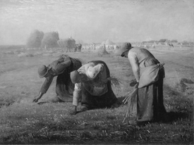

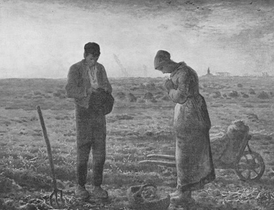

A. 出自拉斐尔之手

B. 是19世纪的作品

C. 反映法国农民的生活

D. 具有现实主义绘画风格

第 38 题 · 答案与解析

**参考答案（粉笔题库参考内容）**

A

**解析**

两幅作品都是法国画家米勒的作品，第一幅是《拾穗者》，第二幅是《晚钟》。米勒是法国近代绘画史上最受人民爱戴的画家。他那纯朴亲切的艺术语言，尤其被广大法国农民所喜爱。《拾穗者》这幅画描写了一个农村中最普通的情景：秋天，金黄色的田野 看上去一望无际，麦收后的土地上，有三个农妇正弯着身子十分细心地拾取遗落的麦穗，以补充家中的食物。她们身后那堆得像小山似的麦垛，似乎和她们毫不相关。我们虽然看不清这三个农妇的相貌及脸部的表情，但米勒却将她们的身姿描绘得有古典雕刻一般庄重的美。《晚钟》属布面油画。这幅画深刻地反映了一种复杂的农民精神生活：画面上，夕阳西下，一天辛勤的田野劳作结束了。一对农民夫妇刚听到远方的教堂钟响，便自然而然地、习惯地俯首摘帽祷告，画家着重于描绘这两个形象对命运的虔诚。

本题为选非题，故正确答案为 A。

### 第 39 题

下列在相同领域做出杰出贡献的一组人物是：

A. 孔子——但丁

B. 严复——伏尔泰

C. 孙膑——普希金

D. 张居正——马克·吐温

第 39 题 · 答案与解析

**参考答案（粉笔题库参考内容）**

B

**解析**

A项错误：孔子，春秋末期著名的思想家、政治家、教育家，为儒家学派的创始人，开创了私人讲学的风气。但丁，意大利诗人，现代意大利语的奠基者，欧洲文艺复兴时代的开拓人物之一，以长诗《神曲》留名后世。他被认为是意大利史上最伟大的诗人，也是西方最杰出的诗人之一，最伟大的作家之一。孔子和但丁的贡献领域不同，排除。

B项正确：严复将西方的社会学、政治学、政治经济学、哲学和自然科学介绍到中国，提出的“信、达、雅”的翻译标准，对后世的翻译工作产生了深远影响，是清末极具影响力的资产阶级启蒙思想家、翻译家和教育家，是中国近代史上向西方国家寻找真理的“先进的中国人”之一。伏尔泰，法国启蒙思想家、文学家、哲学家、史学家，18世纪法国资产阶级启蒙运动的旗手，被誉为“法兰西思想之王”“法兰西最优秀的诗人”“欧洲的良心”。严复和伏尔泰的贡献领域相同，当选。

C项错误：孙膑，中国战国时期军事家，兵家代表人物。普希金是俄国著名诗人、作家及现代俄国文学的创始人，19世纪俄国浪漫主义文学主要代表，同时也是现实主义文学的奠基人，现代标准俄语的创始人，被称为“俄国文学之父”“俄国诗歌的太阳”。孙膑和普希金的贡献领域不同，排除。

D项错误：张居正是明朝中后期政治家、改革家，万历时期的内阁首辅，辅佐万历皇帝开创了“万历新政”。马克·吐温是美国著名作家和演说家。张居正和马克·吐温的贡献领域不同，排除。

故正确答案为B。

### 第 40 题

我国已有或正在建设的航天发射场不包括：

A. 文昌

B. 西安

C. 酒泉

D. 太原

第 40 题 · 答案与解析

**参考答案（粉笔题库参考内容）**

B

**解析**

我国目前（截至2021年10月）已经建成的卫星发射中心有甘肃酒泉卫星发射中心、四川西昌卫星发射中心、山西太原卫星发射中心、海南文昌卫星发射中心和中国东方航天港（海上发射中心母港）。甘肃酒泉卫星发射中心是最早建设的弹道导弹、火箭发射中心，该中心发射设施最为完善，最初是作为我国研制发射战略导弹建立的。那里人烟稀少，天高云淡，便于光学雷达测量和回收返回式卫星，便于发射大质量的近地轨道卫星或飞船，当初选址是为了保密需要。太原卫星发射中心发射场坐落于晋西北黄土高原（具体位于山西省忻州市岢岚县神堂坪乡），其特殊的地理位置和较高的地理纬度，是进行发射太阳同步轨道、中低轨航天器和火箭全程试验的理想场所。四川西昌卫星发射中心是这三个发射中心中最南端的一个，由于纬度较低，便于利用地球自转来发射中、大质量的高轨道卫星。文昌航天发射场位于海南省文昌市龙楼镇，隶属于西昌卫星发射中心，是中国首个开放性滨海航天发射基地，也是世界上为数不多的低纬度发射场之一。该发射场可以发射长征五号系列火箭与长征七号运载火箭，主要承担地球同步轨道卫星、大质量极轨卫星、大吨位空间站和深空探测卫星等航天器的发射任务。中国东方航天港位于山东烟台海阳市，是我国海上发射卫星母港。

本题为选非题，故正确答案为B。

### 第 41 题

下列与天文无关的语句是：

A. 七月流火，九月授衣

B. 星分翼轸，地接衡庐

C. 月出于东山之上，徘徊于斗牛之间

D. 自古逢秋悲寂寥，我言秋日胜春朝

第 41 题 · 答案与解析

**参考答案（粉笔题库参考内容）**

D

**解析**

“自古逢秋悲寂寥，我言秋日胜春朝”意思是：自古以来每逢秋天都会感到悲凉寂寥，我却认为秋天要胜过春天。诗人深深懂得古来悲秋的实质是志士失志，对现实失望，对前途悲观，因而在秋天只看到萧条，感到寂寥，死气沉沉。诗人同情他们的遭遇和处境，但不同意他们悲观失望的情感。针对这种寂寥之感，他偏说秋天比那万物萌生、欣欣向荣的春天要好，强调秋天并不死气沉沉，而是很有生气。此选项所讲述的是天气，并没有反映天文。A、B、C三项均与天文有关。

本题为选非题，故正确答案为D。

### 第 42 题

下列诗句与历史名楼对应不正确的是：

A. 四面河山归眼底，万家忧乐到心头——岳阳楼

B. 阁中帝子今何在，槛外长江空自流——滕王阁

C. 杜少陵五言绝句，范希文两字关情——鹳雀楼

D. 晴川历历汉阳树，芳草萋萋鹦鹉洲——黄鹤楼

第 42 题 · 答案与解析

**参考答案（粉笔题库参考内容）**

C

**解析**

“杜少陵五言绝句”出自诗圣杜甫创作的五言律诗《登岳阳楼》，被誉为古今“登楼第一诗”，诗篇表现了杜甫得偿多年夙愿，即登楼赏美景，同时仍牵挂着国家的百感交集之情，表达了报国无门的哀伤。“范希文两字关情”出自范仲淹的《岳阳楼记》，并留下了“先天下之忧而忧，后天下之乐而乐”的千古佳句，“两字关情”即指“忧”“乐”二字。此句所描述的是岳阳楼。A、B、D三项均对应正确。

本题为选非题，故正确答案为C。

### 第 43 题

关于化石燃料，下列说法不正确的是：

A. 是古代生物遗体在特定地质条件下形成的、可作燃料和化工原料的沉积矿产

B. 包括煤、石油和沼气

C. 大量使用该燃料，会引起全球气候变暖

D. 是不可再生的资源

第 43 题 · 答案与解析

**参考答案（粉笔题库参考内容）**

B

**解析**

化石燃料亦称矿石燃料，是一种碳氢化合物或其衍生物，其包括的天然资源有煤、石油和天然气等。它是古代生物遗体在特定地质条件下形成的、可作燃料和化工原料的沉积矿产。人类不断地燃烧化石燃料而排放二氧化碳（温室气体的主要来源之一）是加快全球变暖的因素之一。化石燃料是不可再生的珍贵资源。而沼气是各种有机物质在隔绝空气（还原条件）并在适宜的温度、湿度下，经过微生物的发酵作用产生的一种可燃性气体，沼气不是化石燃料。

本题为选非题，故正确答案为B。

### 第 44 题

下列关于磁悬浮列车说法不正确的是：

A. 磁铁有同性相斥和异性相吸两种形式，磁悬浮列车也有相应的形式

B. 磁悬浮列车运行时会受到轨道的摩擦力和空气的阻力影响

C. 磁悬浮列车具有速度快、噪音低的特点

D. 我国已经研制出具有自主知识产权的中低速磁悬浮列车

第 44 题 · 答案与解析

**参考答案（粉笔题库参考内容）**

B

**解析**

磁悬浮列车是一种靠磁悬浮力（即磁的吸力和斥力）来推动的列车。由于其轨道的磁力使之悬浮在空中，行走时不同于其他列车需要接触轨道，因此只受到来自空气的阻力。

本题为选非题，故正确答案为B。

### 第 45 题

关于地球圈层，下列表述不正确的是：

A. 内部圈层自外而内可分为地壳、地幔和地核

B. 外部圈层包括大气圈、水圈和生物圈

C. 地幔是平均密度最大的内部圈层

D. 地壳中含量最高的金属元素是铝

第 45 题 · 答案与解析

**参考答案（粉笔题库参考内容）**

C

**解析**

地球的内部圈层可分为地壳、地幔和地核三层。其中，地幔为中间层，厚度约2865公里，主要由致密的造岩物质构成，是地球内部体积最大、质量最大的一层。地幔又可分成上地幔和下地幔两层。上地幔上部存在一个地震波传播速度减慢的层，一般称为软流层，推测是由于放射性元素大量集中，蜕变放热，使岩石高温软化，并局部熔融造成的，很可能是岩浆的发源地。软流层以上的地幔是岩石圈的组成部分。下地幔温度、压力和密度均增大，但密度最大的圈层是地核而非地幔。

本题为选非题，故正确答案为C。

### 第 46 题

下列选项中，不属于洋流形成原因的是：

A. 地转偏向力

B. 太阳辐射

C. 大气运动

D. 磁偏角

第 46 题 · 答案与解析

**参考答案（粉笔题库参考内容）**

D

**解析**

洋流又叫海流，它和周期性地改变着自己的流速和流向的潮流不同，而是具有相对稳定流向的海水流动。洋流可以是一支浅而狭窄的水流，仅仅沿着海洋表面流动；也可以是一股深而广阔的洪流，携带着数百万吨海水前进。洋流的成因主要有：大气运动和行星风系、密度差异、流体的连续性形成的补偿作用、陆地的形状和地球自转产生的地转偏向力。风形成的原因有两个，即地球的转动以及地球表面受太阳加热程度的差别，所以太阳辐射会影响到风的形成，进而影响洋流的形成。其中，盛行风是形成洋流的主要动力，但是，在地转偏向力的作用下，风海流的流向并不与风向完全一致。因此洋流的形成与太阳辐射、大气运动以及地转偏向力均有关系。

本题为选非题，故正确答案为D。

### 第 47 题

酒精灯燃烧的火焰分为外焰、内焰和焰心，下列说法不正确的是：

A. 外焰燃烧最充分

B. 内焰最明亮

C. 外焰一般呈蓝色

D. 焰心的温度最高

第 47 题 · 答案与解析

**参考答案（粉笔题库参考内容）**

D

**解析**

酒精灯是以酒精为燃料的加热工具，广泛用于实验室、工厂、医疗、科研等。由于其燃烧过程中不会产生烟雾，因此也可以通过对器械的灼烧达到灭菌的目的。又因酒精灯在燃烧过程中会产生热量，可以对其他实验材料加热。它的加热温度一般能达到，且安全可靠。酒精灯可分为挂式酒精喷灯、坐式酒精喷灯以及常规酒精灯，实验室等一般以玻璃材质最多，其主要由灯体、棉灯绳（棉灯芯）、瓷灯芯、灯帽和酒精构成。酒精灯的火焰分为外焰、内焰和焰心三部分，外焰的温度最高且一般呈蓝色，焰心的温度最低。

本题为选非题，故正确答案为D。

### 第 48 题

关于科学家的成就，下列说法正确的是：

A. 阿基米德发现了杠杆原理

B. 道尔顿提出了分子说

C. 高斯创立了解析几何

D. 爱迪生发明了炸药

第 48 题 · 答案与解析

**参考答案（粉笔题库参考内容）**

A

**解析**

A项正确：杠杆原理亦称“杠杆平衡条件”，由阿基米德发现。要使杠杆平衡，作用在杠杆上的两个力矩（力与力臂的乘积）大小必须相等，即：动力× 动力臂 = 阻力 × 阻力臂。

B项错误：阿伏加德罗提出了分子学说。

C项错误：解析几何是借助笛卡儿坐标系，由笛卡儿、费马等数学家创立并发展的。

D项错误：炸药由诺贝尔发明。

故正确答案为A。

### 第 49 题

下列关于人体的描述不正确的是：

A. 最小的骨头是听小骨

B. 硬度最高的部分是头骨

C. 皮肤是最大的器官

D. 最大的内分泌腺是甲状腺

第 49 题 · 答案与解析

**参考答案（粉笔题库参考内容）**

B

**解析**

牙齿是一种在很多脊椎动物身上都存在的器官，是人体最坚硬的部分。一般而言，牙齿呈白色（正常人略带微黄色），质地坚硬。牙齿的各种形状适用于多种用途，包括撕裂、磨碎食物等。牙齿是动物天生的自卫武器。人类语言发音与口中前排上下的牙齿密切相关，古汉族标准语被称为“雅言”。牙齿的整洁，甚至关系到社交活动和地位。

本题为选非题，故正确答案为B。

### 第 50 题

下列关于生物的描述不正确的是：

A. 蚯蚓属于雌雄异体的动物

B. 梅花先开花后长叶子

C. 大鲵（娃娃鱼）属于两栖动物

D. 母鸡无须交配就可以下蛋

第 50 题 · 答案与解析

**参考答案（粉笔题库参考内容）**

A

**解析**

蚯蚓是对环节动物门寡毛纲类动物的通称。在科学分类中，它们属于单向蚓目。身体两侧对称，具有分节现象；没有骨骼，在体表覆盖一层具有色素的薄角质层；除了身体前两节之外，其余各节均具有刚毛；雌雄同体，异体受精，生殖时借由环带产生卵茧，繁殖下一代。B、C、D三项描述均正确。

本题为选非题，故正确答案为A。

### 第 51 题

加油站有150吨汽油和102吨柴油，每天销售12吨汽油和7吨柴油。问多少天后，剩下的柴油是剩下的汽油的3倍：

A. 9

B. 10

C. 11

D. 12

第 51 题 · 答案与解析

**参考答案（粉笔题库参考内容）**

D

**解析**

方法一：设经过x天后，剩下的柴油是剩下的汽油的3倍，则可列式为，解得x = 12。

方法二：汽油150吨，柴油102吨，均可被3整除且为偶数，每天销售12吨的汽油（可被3整除且为偶数）、7吨柴油（奇数），且剩下的柴油是剩下的汽油的3倍，因此所需要的天数是3的倍数而且还是偶数。

故正确答案为D。

### 第 52 题

甲、乙、丙三个办公室的职工参加植树活动，三个办公室人均植树分别为4、5、6棵，三个办公室植树总数彼此相等。问这三个办公室总共至少有多少职工：

A. 37

B. 53

C. 74

D. 106

第 52 题 · 答案与解析

**参考答案（粉笔题库参考内容）**

A

**解析**

要让办公室职工数量最少，则应让办公室所种树的数量最少。三个办公室植树总数彼此相等，则每个办公室所植树的数量应为4、5、6的最小公倍数，为60棵。故三个办公室的人数分别为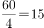、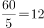、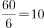，总人数最少为15＋12＋10＝37人。

故正确答案为A。

### 第 53 题

服装店买进一批童装，按每套获利50%定价卖出这批童装的80%后，按定价的八折将剩下的童装全部卖出，总利润比预期减少了390元，问服装店买进这批童装总共花了多少元：

A. 5500

B. 6000

C. 6500

D. 7000

第 53 题 · 答案与解析

**参考答案（粉笔题库参考内容）**

C

**解析**

赋值买进10件童装，设童装一件进价x元，则售价为1.5x元。销售情况如下表所示。

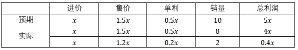

则总利润减少为：5x-（4x+0.4x）=390，解得：x=650。故总进价为：650×10=6500。

故正确答案为C。

### 第 54 题

某人要从A市经B市到C市，从A市到B市的列车从早上8点起每30分钟一班，全程行驶一小时；从B市到C市的列车从早上9点起每40分钟一班，全程行驶1小时30分钟；在B市火车站换乘需用时15分钟。如果想在出发当天中午12点前到达C市，问他有几种不同的乘车方式：

A. 3

B. 2

C. 5

D. 4

第 54 题 · 答案与解析

**参考答案（粉笔题库参考内容）**

D

**解析**

如果当天出发在12点之前到达C市，共有以下几类情况：（1）从A市乘坐8点钟的列车去B市，经过1个小时，9点钟到达B市；在B市换乘15分钟，从9:15起，可乘坐9:40或10:20的列车去C市，经过1.5小时，可在12点之前到达，共两种方式。（2）从A市乘坐8:30的列车去B市，经过1个小时，9:30达到B市；在B市换乘15分钟，从9:45起，可乘坐10:20的列车去C市，经过1.5小时，可在12点之前到达，共一种方式。（3）从A市乘坐9点钟的列车去B市，经过1个小时，10点钟到达B市；在B市换乘15分钟，从10:15起，可乘坐10:20的列车去C市，经过1.5小时，可在12点之前达到，共一种方式。其他方式均不能按要求达到C市，一共有4种乘车方式。

故正确答案为D。

### 第 55 题

某单位要从8名职员中选派4人去总公司参加培训，其中甲和乙两人不能同时参加。问有多少种选派方法：

A. 40

B. 45

C. 55

D. 60

第 55 题 · 答案与解析

**参考答案（粉笔题库参考内容）**

C

**解析**

方法一：从8人当中选出4人参加培训，共有选法；其中甲乙同时参加的情况有选法（甲乙必定参加，只需从剩下6人中选出2名即可）。则甲乙不同时参加的情况数，即总情况数–甲乙同时参加的情况数＝。

方法二：分为三种情况：

（1）甲去乙不去，还需从剩余6人中选3人，即＝20；

（2）乙去甲不去，还需从剩余6人中选3人，即＝20；

（3）甲、乙都不去，还需从剩余6人中选4人，即＝15。

共20＋20＋15＝55种情况。

故正确答案为C。

### 第 56 题

在2011年世界产权组织公布的公司全球专利申请排名中，中国中兴公司提交了2826项专利申请，日本松下公司申请了2463项，中国华为公司申请了1831项，分别排名前3位，从这三个公司申请的专利中至少拿出多少项专利，才能保证拿出的专利一定有2110项是同一公司申请的专利：

A. 6049

B. 6050

C. 6327

D. 6328

第 56 题 · 答案与解析

**参考答案（粉笔题库参考内容）**

B

**解析**

要保证拿出的专利一定有2110项是同一公司申请的专利，考虑最不利情况，拿出了中国华为公司申请的1831项、日本松下公司的2109项、中国中兴公司的2109项，在此极端情况下依然不满足条件。此时，华为公司已全部拿出，从剩下的两个公司任意拿出一项，均满足条件“保证拿出的专利一定有2110项是同一公司申请的专利”，故至少需要拿出1831＋2109＋2109＋1，相加尾数为0，只有B项正确。

故正确答案为B。

### 第 57 题

某单位举办围棋联赛，所有选手的排名都没有出现并列名次。小周发现除自己以外，其他所有人排名数字之和正好是70。

问小周排名第几：

A. 7

B. 8

C. 9

D. 10

第 57 题 · 答案与解析

**参考答案（粉笔题库参考内容）**

B

**解析**

采取代入排除思想。名次一定为从1开始的连续自然数列，除小周外，其他人的排名数字之和为70。设一共有M人，小周的名次为N，则，只有当N＝8的时候满足列式，此时M＝12。

故正确答案为B。

### 第 58 题

某班级的一次考试阅卷后，发现有一道选择题的答案有误，正确答案应为A，但误写为C，此题分值为3分。调整答案时发现，此题未选A、C两个选项的人数为班级总人数的，修改分数后班级平均分提高了1分。

问选择A答案的人数占班级总人数的多少：

A. 1/2

B. 1/3

C. 1/4

D. 2/5

第 58 题 · 答案与解析

**参考答案（粉笔题库参考内容）**

A

**解析**

假设总人数为3人，未选A、C两个选项的人数占总人数的，即为1人，则选择A、C两个选项的人数为2人。未修改前此题的总得分为3C，修改后此题的总得分为3A。平均分提高了1分，即总分提高了3分，故3A-3C=3，同时A+C=2，联立解得，故选A的人数占总人数的。

故正确答案为A。

### 第 59 题

某公司有29名销售员，负责公司产品在120个超市的销售工作。每个销售员最少负责3个，最多负责6个超市。负责4个超市的人最多但少于一半，而负责4个超市和负责5个超市的人总共负责的超市数为75个。

问负责3个超市的人比负责6个超市的人多几个：

A. 2

B. 3

C. 6

D. 9

第 59 题 · 答案与解析

**参考答案（粉笔题库参考内容）**

C

**解析**

根据题干条件，共120个超市，其中负责4个超市和负责5个超市的人总共负责的超市数为75个，则负责3个超市和负责6个超市的人总共负责的超市数为45个。设负责3个、4个、5个、6个超市的销售员分别有a、b、c、d个，则可列式为：，。由②式可知，75与5c均为5的倍数，则4b也必然为5的倍数，则b必然为5的倍数。b的数值最大且小于总人数的一半，即，则可求得b=10，c=7。总人数为29人，则a＋d＝12③，联立①③式可得a＝9，d＝3，则a－d＝6。

故正确答案为C。

### 第 60 题

A、B、C三支施工队在王庄和李庄修路，王庄要修路900米，李庄要修路1250米。已知A、B、C队每天分别能修24米、30米、32米，A、C队分别在王庄和李庄修路，B队先在王庄，施工若干天后转到李庄，两地工程同时开始同时结束。

问B队在王庄工作了几天：

A. 9

B. 10

C. 11

D. 12

第 60 题 · 答案与解析

**参考答案（粉笔题库参考内容）**

B

**解析**

两个工程的总工作量=900+1250=2150；三支队伍的总效率为24＋30＋32＝86，则完成任务一共用时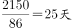。25天中，A一共完成工作量，剩余工作量900-600=300由B完成，则B在王庄工作了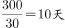。

故正确答案为B。

### 第 61 题

甲杯中有浓度为20%的盐水1000克，乙杯中有1000克水。把甲杯中盐水的一半倒入乙杯中，混合后再把乙杯中盐水的一半倒入甲杯中，混合后又把甲杯中的一部分盐水倒入乙杯中，使得甲、乙两杯中的盐水同样多。

问最后乙杯盐水的浓度为多少：

A. 6%

B. 7%

C. 8%

D. 9%

第 61 题 · 答案与解析

**参考答案（粉笔题库参考内容）**

C

**解析**

溶质部分变化情况：

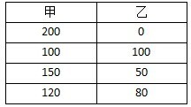

溶液部分变化情况：

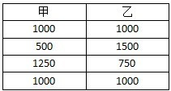

第三次又把甲杯中的一部分盐水倒入乙杯，使得两杯中的盐水一样多，则甲又倒给了乙250克盐水，即自身总数的。故第三次甲也给了自身溶质的，即克，此时乙的溶质质量为50+30=80克，乙的浓度为\=8%。

故正确答案为C。

### 第 62 题

8支足球队参加单循环比赛，胜者得2分，平者得1分，负者得0分，比赛结束后，8支足球队的得分各不相同，且第2名的得分与后4名的得分总和相等，第3名的得分是第5名的两倍，第4名的得分是第6名的两倍。

问第一名比第四名多拿了多少分：

A. 3

B. 4

C. 5

D. 6

第 62 题 · 答案与解析

**参考答案（粉笔题库参考内容）**

D

**解析**

单循环比赛，8支队共比赛比赛，共产生比分。设未知数解题较为复杂，考虑最极端情况，第一名7场比赛全部获胜，共得，第二名输1场赢6场最多可获得12分，第三名输2场赢5场最多可获得10分，第四名获得x分，则可列式：14+12+10+x+12=56，解得x=8，则第一名比第四名多拿14-8=6分。

故正确答案为D。

### 第 63 题

某企业安排30名职工参加体检，其中男性职工的近视比例大于10%小于11%，女性职工的近视比例在20%~30%之间，问男性职工中不近视的人比女性职工中不近视的人多几人：

A. 4

B. 6

C. 7

D. 9

第 63 题 · 答案与解析

**参考答案（粉笔题库参考内容）**

D

**解析**

设男性职工中近视眼的人数为a，根据题干条件可列不等式为，则推出：。当男性职工中近视眼人数为1人时，则男性总人数的范围约在9.1-10之间，男性总人数不为整数，故排除；当男性职工中近视眼人数为2人时，则男性总人数的范围约在18.2-20之间，存在19这一数值。当男性总人数为19人时，女性总人数则为11人。女性职工的近视比例在之间，则可推知女性职工中近视眼人数为3人。则男性职工中不近视的人比女性职工中不近视的人多17-8=9人，满足条件。

故正确答案为D。

### 第 64 题

往返A市和B市的长途汽车以同样的发车间隔从两个城市分别发车，以每小时40公里的速度前往目标城市。上午9点多，李先生以每小时50公里的速度开车从A市长途汽车站前往B市长途汽车站，路途中总共追上了3辆从A市开往B市的长途汽车。问他在路途中最多能迎面遇到多少辆从B市开往A市的长途汽车：

A. 27

B. 25

C. 36

D. 34

第 64 题 · 答案与解析

**参考答案（粉笔题库参考内容）**

C

**解析**

考虑最有利情况，李先生从A市出发时，同时有一辆长途汽车从A市出发；李先生到达B市时，同时有一辆长途汽车到达B市。路途中一共追上3辆长途汽车，即总路程为汽车间距的4倍。在追及而行时，设追及时间间隔为1，则，则，李先生总行驶时间为。在相遇而行时，汽车间距，则。则可相遇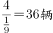迎面开来的长途汽车。

故正确答案为C。

### 第 65 题

A、B、C三地的地图如下图所示，其中A在C正北，B在C正东，连线处为道路。如要从A地到达B地，且途中只能向南、东和东南方向行进，有多少种不同的走法：

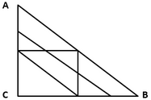

A. 9

B. 11

C. 13

D. 15

第 65 题 · 答案与解析

**参考答案（粉笔题库参考内容）**

D

**解析**

结合题意，“向南、东和东南方向行进”即向下、向右、向右下行进。根据标数法，从上至下，从左至右进行如下标记：

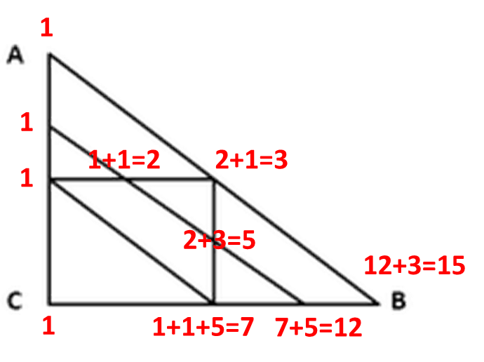

因此可得从A地到达B地共有15种不同的走法。

故正确答案为D。

### 第 66 题

从所给的四个选项中，选择最合适的一个填入问号处，使之呈现一定的规律性：

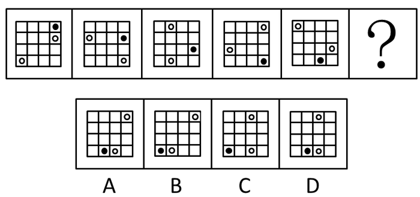

A. A

B. B

C. C

D. D

第 66 题 · 答案与解析

**参考答案（粉笔题库参考内容）**

D

**解析**

图形元素组成相同，优先考虑位置规律，每幅图都由16宫格、2个白圆和1个黑圆组成。观察发现，图中的黑圆每次沿顺时针方向平移1格，白圆每次沿顺时针方向平移2格。问号处也应当符合此规律，D项符合规律。

故正确答案为D。

### 第 67 题

请从所给的四个选项中，选择最适合的一项填在问号处，使之呈现一定的规律性。

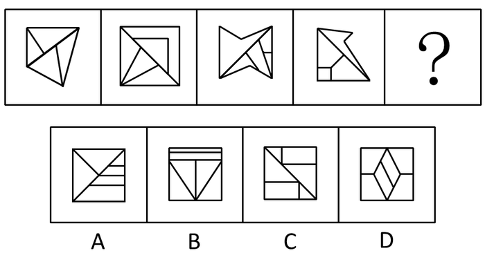

A. A

B. B

C. C

D. D

第 67 题 · 答案与解析

**参考答案（粉笔题库参考内容）**

A

**解析**

元素组成凌乱，本题考点为特殊考点。观察题干可以发现所有图形中只有一条最长的线，且第一、三幅图中的最长的线方向为左下右上，第二、四幅图中的最长的线方向为左上右下，按此规律，第五幅图中的最长的线方向应为左下右上，A项符合。

故正确答案为A。

### 第 68 题

从所给的四个选项中，选择最合适的一个填入问号处，使之呈现一定的规律性：

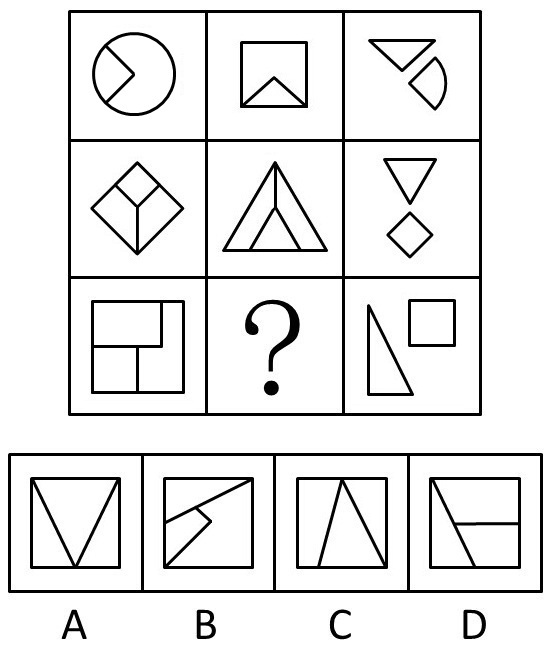

A. A

B. B

C. C

D. D

第 68 题 · 答案与解析

**参考答案（粉笔题库参考内容）**

C

**解析**

本题考点为“叠加+旋转”。本题九宫格按横向看，第一行中第一幅图中的扇形部分和第二幅图中的三角形旋转得到的第三幅图，按照此规律得到第二行的第三幅图。第三行的第二幅图含有由第三幅图中旋转的三角形，C项符合规律。

故正确答案为C。

### 第 69 题

左边给定的是纸盒的外表面，下面哪一项能由它折叠而成？

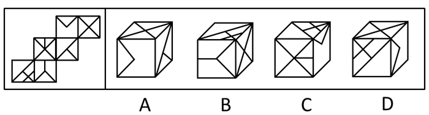

A. A

B. B

C. C

D. D

第 69 题 · 答案与解析

**参考答案（粉笔题库参考内容）**

D

**解析**

对各个面进行标号：如下图

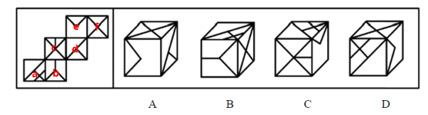

A项：面d、e、f、三个面的公共点在展开图中发射出2条线，而在选项中只发射出1条线，选项与展开图不一致，排除；

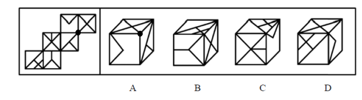

B项：以b面中的Y字开口对着的边为唯一边顺时针画边，展开图中边2挨着a面，选项中边4挨着a面，选项与展开图不一致，排除；

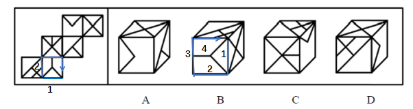

C项：面a、c、e的公共点在展开图中发射出2条线，选项中发射出3条线，选项与展开图不一致，排除；

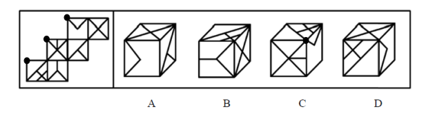

D项：面a、e、f，选项与展开图一致，当选。

故正确答案为D。

### 第 70 题

把下面的六个图形分为两类，使每一类图形都有各自的共同特征或规律，分类正确的一项是：

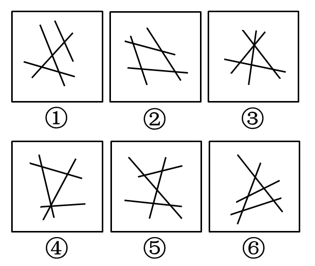

A. ①③④，②⑤⑥

B. ①②④，③⑤⑥

C. ①④⑤，②③⑥

D. ①⑤⑥，②③④

第 70 题 · 答案与解析

**参考答案（粉笔题库参考内容）**

B

**解析**

元素组成凌乱，属性不成规律，考虑数量，本题考点为封闭区域数。①②④有一个封闭区域，③⑤⑥有两个封闭区域。

故正确答案为B。

### 第 71 题

游说是指个人或组织有目的地利用语言、文字或其他传播媒介对特定信息进行解释、说明，以鼓励自己的受众按照自己的意图行事的一种劝服性传播。

根据上述定义，下列属于游说的是：

A. 宣传栏中展示了定期少量献血并不会给身体带来危害，反而有利健康的资料

B. 张教授以图文并茂的方式介绍了自己的研究，学生们都觉得受益匪浅

C. 社区开展了一系列“防害灭害”活动，给每家每户都发放了蟑螂药

D. 妈妈答应了小明，如果他今天中午能多吃一碗饭，周末就带他去公园

第 71 题 · 答案与解析

**参考答案（粉笔题库参考内容）**

A

**解析**

第一步：查找关键词。

游说的定义条件包括：（1）“利用语言、文字或其他传播媒介”；（2）“对特定信息进行解释、说明”；（3）“劝服性传播”。

第二步：逐一分析选项。

A项是通过文字来解释献血的好处，带有劝说大家去献血的目的性，符合定义，当选；

B项不属于“劝服性传播”，不符合定义，排除；

C项发放蟑螂药不符合“利用语言、文字或其他传播媒介对特定信息进行解释、说明”，不符合定义，排除；

D项没有对特定的信息进行解释说明，也不是一种劝服性传播，不符合定义，排除。

故正确答案为A。

### 第 72 题

微博营销是指以微博为营销平台，每个关注者都是潜在营销对象，企业利用更新微博向网友传播企业、产品信息，树立企业形象和产品形象。微博营销的特点是立体化、高速度、便捷性和广泛性。

根据以上定义，下列属于微博营销的是：

A. 小张自从去年开始关注某服装网店微博后，经常会收到其他服装网店的“求关注”信息

B. 某知名英语培训机构官方微博，除了发布机构的课程信息外，还定期发布商务英语单词和句式，供大家学习

C. 小王在某门户网站注册了免费邮箱，注册时注明愿意接受该网站发布的关于娱乐、体育方面的资讯，之后该邮箱经常收到该网站发送的邮件

D. 小李崇拜某歌星，关注该歌星微博，随时了解自己偶像的动向和心情，并自己组建一个该歌星的粉丝群

第 72 题 · 答案与解析

**参考答案（粉笔题库参考内容）**

B

**解析**

第一步：找出定义关键词。

“以微博为营销平台”、“企业利用更新微博向网友传播企业、产品信息”、“树立良好企业形象和产品形象”。

第二步：逐一分析选项。

A项：小张收到其他服装网店的“求关注”信息，并非是传播企业、产品信息，不符合“企业利用更新微博向网友传播企业、产品信息”，不符合定义，排除；

B项：培训机构官方微博定期发布商务英语单词和句式供大家学习，符合“以微博为营销平台”、“企业利用更新微博向网友传播企业、产品信息”、“树立良好企业形象和产品形象”，符合定义，当选；

C项：在某门户网站注册了免费邮箱，并非是微博平台，不符合“以微博为营销平台”，不符合定义，排除；

D项：小李关注该歌星微博，随时了解偶像的动向和心情，关注的是歌星并非企业，不符合“企业利用更新微博向网友传播企业、产品信息”，不符合定义，排除。

故正确答案为B。

### 第 73 题

集合概念是以事物的集合体为反映对象的概念。集合体是由许多个体组成的统一整体，集合体所具有的属性，只为该集合体所具有，而不必为这个集合体中的某一个体所具有。集合概念所涉及的关系不同于类和分子的关系，也不完全同于整体和部分的关系。组成类的各个分子都必然具有类的属性，而组成集合体的个体却不具有集合体的属性；整体是由不同的部分组成的，而集合体则是由同类的个体组成的。

根据上述定义，下列划线词在当前语境下所反映的概念不是集合概念的是：

A. <u>人</u>定胜天

B. 主权在<u>民</u>

C. <u>羊</u>入虎口

D. 正义之<u>师</u>

第 73 题 · 答案与解析

**参考答案（粉笔题库参考内容）**

C

**解析**

A项的“人”是划线部分；B项的“民”是划线部分；C项的“羊”是划线部分；D项的“师”是划线部分。

第一步：找到定义关键词。

集合概念的定义条件包括：“只为该集合体所具有，而不必为这个集合体中的某一个体所具有”。

第二步：逐一分析选项。

A项的“人”、B项的“民”、D项的“师”作为一个整体的概念时具有选项中描述的属性，但是“某一个人”，“某一个民”，“某一个师”并不是必然具有选项中描述的属性，因此都属于集合概念，排除；C项的“羊”这个概念是由无数个羊组成的，而每个“羊”都具有被老虎吃掉这个特征，当选。

本题为选非题，故正确答案为C。

### 第 74 题

转移是一个机构单位向另一个机构单位或个人提供货物、服务或资产，而同时并没有从后一个机构单位获得任何货物、服务或资产作为回报的一种交易。简言之，转移支付单位并没有得到可具体量化的利益作为回报。在国民经济核算体系中，居民的经济转移性收入包括社会补助收入和其他经济转移性收入。社会补助收入包括单位补助收入和政府补助收入及社会救济收入。

根据上述定义，下列不属于居民的经济转移性收入的是：

A. 企业给职工发放的独生子女费

B. 国家发放的残疾、下岗职工补助

C. 国家为调动农民种粮积极性和增强农民收入，按一定的补贴标准和粮食实际种植面积，对农户直接给予的补贴

D. 企业职工每月获得的工资

第 74 题 · 答案与解析

**参考答案（粉笔题库参考内容）**

D

**解析**

第一步：找定义关键词。

居民的转移性收入的定义条件包括：（1）“提供货物、服务或资产”；（2）“没有回报”。

第二步：逐一分析选项。

A项属于单位补助；B项属于社会救济；C项属于政府补助。因此A、B、C三项都属于居民的经济转移性补助的方面。D项中的“工资”属于公民劳动报酬，公民付出自己的劳动，单位获利，同时公民也获得经济收入。因此不属于转移性收入的是D项，当选。

本题为选非题，故正确答案为D。

### 第 75 题

紧随某个行为之后所发生的事件（行为之结果），使得该行为再次出现的可能性增加，行为受其结果的影响不断增加的现象，称之为强化。

根据上述定义，下列不属于强化的是：

A. 三岁的小明见到客人后主动跟客人打招呼，妈妈表扬了他，小明以后每次见到客人都主动打招呼

B. 小王参加聚会时对朋友的敬酒来者不拒，第二天由于宿醉上班迟到，后来，小王参加聚会都会适当拒绝朋友的敬酒

C. 妈妈不给小红买冰激淋，小红就在街上哭闹，妈妈无奈只好给她买冰激淋吃，以后每次妈妈不答应小红的请求，小红都会哭闹

D. 小丽有一次骑自行车去公司上班，发现比乘公交车用时更短，以后每天都骑自行车上班

第 75 题 · 答案与解析

**参考答案（粉笔题库参考内容）**

B

**解析**

第一步：找定义关键词。

强化的定义条件包括：（1）“行为之结果”；（2）“行为受其结果的影响不断增加的现象”。

第二步：逐一分析选项。

A、C、D三项的行为都是增加，符合定义条件（1）（2）；B项中“上班迟到”的行为使得喝酒这件事的可能性在变小，因此跟题干的描述正好相反。

本题为选非题，故正确答案为B。

### 第 76 题

命题可以分为四种：①伪命题，指的是无真假可言的命题；②永真命题，指的是不论在何种情况下都不可能假的命题；③永假命题，指的是不论在何种情况下都不可能真的命题；④可满足命题，指的是在有些情况下为真，在有些情况下为假的命题。

根据上述定义，下列属于永真命题的是：

A. 存在即合理

B. 思想或者是可捉摸的，或者是不可捉摸的

C. 人既能在不同时间跨进同一条河流，又不能在不同时间跨进同一条河流

D. 地球是一直围绕太阳旋转的

第 76 题 · 答案与解析

**参考答案（粉笔题库参考内容）**

B

**解析**

第一步：找定义关键词。

题干中包括四个小定义：伪命题、永真命题、永假命题和可满足命题，抓住“无真假可言”、“不可能假”、“不可能真”、“有真有假”等关键点进行辨别。

第二步：逐一分析选项。

A项，“存在即合理”无真假可言，符合伪命题；B项，“思想或者是可捉摸的，或者不可捉摸的”为或关系命题，即一真则全真，又因为或关系的两个命题必有一真，因此B项符合永真命题；C项，“人既能在不同时间跨进同一条河流，又不能在不同时间跨进同一条河流”的“既······又······”说明为且关系命题，即一假则全假，又且关系的两个定义为矛盾关系，故必有一假，因此C项符合永假命题；D项，“地球是一直围绕太阳旋转的”符合可满足命题。

故正确答案为B。

### 第 77 题

相邻效应指的是个体或者组织的付出和其应该获得的利益之间存在不一致，但由此形成的费用差别和收益差别在社会上却没有相应的弥补来源。

根据上述定义，下列不涉及相邻效应的是：

A. 某厂训练的熟练工跳槽到其他厂家工作

B. 工厂的生产活动中产生的允许范围内的噪音对周边居民的生活有影响

C. 甲厂生产的品牌电脑非常畅销，乙厂也盗用该品牌进行销售

D. 邻居甲家养护良好的草坪花木常常使得习惯早起的乙神清气爽

第 77 题 · 答案与解析

**参考答案（粉笔题库参考内容）**

C

**解析**

第一步：找定义关键词。

关键词包括“付出和其应该获得的利益之间存在不一致”，“费用差别和收益差别没有相应弥补来源”。

第二步：逐一分析选项。

A项，某厂“训练”体现出付出，“跳槽到其他厂家工作”说明和获利不一致，符合定义；

B项，工厂生产活动是获利的，而且影响了居民生活的同时，居民无法因为合理范围内的噪声而获得相应的补偿，因此属于相邻效应；

C项，乙工厂是盗用品牌，甲如果通过法律途径来处理的话是能够获得相应赔偿的，与定义“费用差别和收益差别在社会上却没有相应的弥补来源”不符；

D项，甲“养护良好的草坪花木”，体现出付出，“使得习惯早起的乙神清气爽”，体现出是乙获利，即获利不一致，符合定义。

本题为选非题，故正确答案为C。

### 第 78 题

恐慌是指面临迫近的危险时人们为获得安全而进行的逃逸。恐慌通常出现在这样的情况下：虽然有逃离的路径，但数量有限或是即将消失，因此看起来只有一些、而不是所有的人能够逃离。

根据上述定义，下列不属于恐慌的是：

A. 剧院演出正进入高潮时，突然发生火灾，人们不顾一切地冲向出口以致相互踩踏

B. 当股票持有人目睹股票的资产价值在不断减少时，担心股票价格跌破发行价导致损失，便立即抛售股票

C. 当一篇描述外星人袭击某市的小说在该市被当作真实新闻播出后，该市的许多人迅速驾车逃离，而另一些人则把自己锁在家里，听天由命

D. 小王经历了地震，目睹过地震造成的种种惨烈现象，因而每当周围稍有响动，他都会迅速跑出房屋，寻找安全地带

第 78 题 · 答案与解析

**参考答案（粉笔题库参考内容）**

D

**解析**

第一步：找出定义关键词。

抓住关键词“面临迫近的危险时”、“为获得安全而进行的逃逸”。

第二步：逐一分析选项。

A项，剧院火灾，人们不顾一切冲向出口，可知其符合定义，排除；

B项是股票持有人担心股票跌价损失进行抛售，符合定义，排除；

C项的外星人袭击新闻播出后人们的反应以及寻找安全地带，皆为面临迫近危险所采取的为获安全进行的逃逸，符合定义，排除；

D项的小王根本上未遇到危险，不符合定义，当选。

本题为选非题，故正确答案为D。

### 第 79 题

直接证据是指能够直接证明刑事案件主要事实的证据，间接证据是指不能够单独地直接证明刑事案件主要事实，需要与其他证据相结合才能证明的证据。所谓刑事案件的主要事实，是指犯罪行为是否系犯罪嫌疑人、被告人所实施。

根据上述定义，下列属于直接证据的是：

A. 小区监控拍摄下的犯罪嫌疑人李某盗窃车辆的视频

B. 被害人的邻居王某提供的犯罪嫌疑人在案发前到过案发现场的证言

C. 刑警在凶案现场提取到的男性鞋印

D. 诈骗案受害人姜某提供的自己所遭受的金钱损失的银行记录

第 79 题 · 答案与解析

**参考答案（粉笔题库参考内容）**

A

**解析**

第一步：找定义关键词。

文段中包含了“直接证据”和“间接证据”两个主要定义，附带补充解释了“刑事案件的主要事实”。抓住关键词“直接证明刑事案件主要事实的证据”、“犯罪行为是否系犯罪嫌疑人、被告人所实施”，判定直接证据。

第二步：逐一分析选项。

A项，小区监控拍下的盗窃视频可直接证明案件事实，故为直接证据，当选；B项，“案发前到过现场的证言”并不足以证明案件事实，为间接证据，排除；C项，“案发现场的男性鞋印”并无法直接指证嫌疑人，为间接证据，排除；D项，“金钱损失的银行记录”同样缺乏其他证据证明事实，亦为间接证据，排除。

故正确答案为A。

### 第 80 题

布利丹效应源于法国哲学家布利丹讲述的一个寓言故事：一头驴子外出觅食，发现两堆相距不远的草料。东边是一大堆干草料，西边是一小堆新鲜的嫩草。驴子很高兴，跑到大堆的干草料处，刚要吃，突然想到西边草料那么新鲜，肯定好吃，不去可能会被别的驴子吃掉。于是它就跑到嫩草堆前，刚要吃又想，这堆草虽然很嫩，可别的驴子把那一大堆干草料吃光的话自己就要饿肚子了，还是回去吃干草吧！就这样来来回回，这只可怜的驴子，最后饿死在草堆旁。

根据上述定义，下列不符合布利丹效应的是：

A. 弈者举棋不定，终之败矣

B. 一山望着一山高

C. 凡事预则立，不预则废

D. 鱼，我所欲也；熊掌，亦我所欲也

第 80 题 · 答案与解析

**参考答案（粉笔题库参考内容）**

C

**解析**

第一步：理解文段。

定义通过一个寓言故事来阐述，应先阅读理清故事的寓意。寓言故事通过“驴选草”实质反映：“人们在做决策时犹豫不决、难以取舍并因此遭遇失败的现象”。

第二步：逐一分析选项。

A项，说的是下棋落子犹豫不决则输；B项，指站在这山头觉得那山头更高更好；D项，鱼也想要，熊掌也想要，同样难以取舍。A、B、D三项明显皆符合寓言实质，即布利丹效应。C项，说的是做事要有准备才能成功，与定义不符。

本题为选非题，故正确答案为C。

### 第 81 题

作家：出版社

A. 演员：制片厂

B. 警察：派出所

C. 球员：运动场

D. 医生：手术台

第 81 题 · 答案与解析

**参考答案（粉笔题库参考内容）**

A

**解析**

第一步：判断题干词语间逻辑关系。

“作家”和“出版社”是对应关系，“作家”的作品由“出版社”出版。

第二步：判断选项词语间逻辑关系。

A项：“演员”的作品由“制片厂”发行，“演员”和“制片厂”是对应关系，与题干逻辑关系一致，当选；

B项：“警察”在“派出所”工作，二者是主体与场所的对应关系，与题干逻辑关系不一致，排除；

C项：“球员”在“运动场”上踢球，二者是主体与场所的对应关系，与题干逻辑关系不一致，排除；

D项：手术台是医生的一个工作场所，二者是主体与场所的对应关系，与题干逻辑关系不一致，排除。

故正确答案为A。

### 第 82 题

纸扇：电扇

A. 瓷杯：保温杯

B. 扫帚：吸尘器

C. 马车：自行车

D. 毛笔：钢笔

第 82 题 · 答案与解析

**参考答案（粉笔题库参考内容）**

B

**解析**

第一步：判断题干词语间逻辑关系。

“纸扇”和“电扇”都是纳凉用的，二者是并列关系，且前者依靠人工作，后者靠电力驱动。

第二步：逐一选项。

A项“瓷杯”和“保温杯”是交叉关系，与题干的逻辑关系不一致，排除；

B项“扫帚”和“吸尘器”是并列关系，都是清洁用品，且前者依靠人工作，后者靠电力驱动，与题干的逻辑关系一致，当选；

C项“马车”和“自行车”都是代步工具，前者依靠马工作，后者靠人工作，与题干的逻辑关系不一致，排除

D项“毛笔”和“钢笔”都是文具，区别在原材料和制作工艺不同，与题干的逻辑关系不一致，排除。

故正确答案为B。

### 第 83 题

合同：签字

A. 申请：同意

B. 文件：存档

C. 婚姻：结婚

D. 毕业证：盖章

第 83 题 · 答案与解析

**参考答案（粉笔题库参考内容）**

D

**解析**

第一步：判断题干词语间逻辑关系。

在“合同”上“签字”，“签字”是“合同”生效的必要条件。

第二步：判断选项词语间逻辑关系。

A项：在“申请”上“同意”，“同意”不是“申请”生效的必要条件，与题干逻辑关系不一致，排除；

B项：应该是把“文件”“存档”，“存档”不是“文件”生效的必要条件，与题干逻辑关系不一致，排除；

C项：“结婚”，称为婚姻成立，因此“结婚”并不是“婚姻”生效的必要条件，与题干逻辑关系不一致，排除；

D项：在“毕业证”上“盖章”，“盖章”是“毕业证”生效的必要条件，与题干逻辑关系一致，当选。

故正确答案为D。

### 第 84 题

鸡蛋：孵箱

A. 细胞：器官

B. 胚胎：孕育

C. 受精卵：子宫

D. 养分：土壤

第 84 题 · 答案与解析

**参考答案（粉笔题库参考内容）**

C

**解析**

第一步：判断题干词语间逻辑关系。

“鸡蛋”可以在“孵箱”中孵化，“孵箱”是“孵化”的容器，属于对应关系。

第二步： 判断选项词语间的逻辑关系。

A项：“细胞”与“器官”是包容关系，“器官”由“细胞”组成，与题干逻辑关系不一致，排除；

B项：“胚胎”和“孕育”是对应关系，“孕育”的对象是“胚胎”，与题干逻辑关系不一致，排除；

C项：“受精卵”和“子宫”是对应关系，“受精卵”在“子宫”中孕育新的生命，“子宫”是“受精卵”孵化的容器，与题干逻辑关系一致，当选；

D项：“养分”和“土壤”是包容关系，土壤内含有养分，与题干逻辑关系不一致，排除。

故正确答案为C。

### 第 85 题

语言：文字：文化

A. 辞典：电脑：知识

B. 报纸：电视：传媒

C. 图书：信息：磁盘

D. 邮票：书信：感情

第 85 题 · 答案与解析

**参考答案（粉笔题库参考内容）**

B

**解析**

第一步：判断题干词语间逻辑关系。

“语言”和“文字”都是一种文化的表现形式。

第二步：判断选项词语间逻辑关系。

A项：“辞典”和“电脑”不是知识的表现形式，而是传播知识的工具，与题干逻辑关系不一致，排除；

B项：“报纸”和“电视”都是一种“传媒”，与“传媒”构成种属关系，与题干逻辑关系一致，当选；

C项：“图书”和“磁盘”都可以用来传递“信息”，没有种属关系，与题干逻辑关系不一致，排除；

D项：“邮票”贴在“书信”上，是对应关系，“邮票”本身是邮资凭证但不能增进“感情”，与题干逻辑关系不一致，排除。

故正确答案为B。

### 第 86 题

乐队：听众：音乐

A. 酒店：游客：食宿

B. 电视剧：儿童：故事

C. 俱乐部：会员：车辆

D. 工会：权益：员工

第 86 题 · 答案与解析

**参考答案（粉笔题库参考内容）**

A

**解析**

第一步：判断题干词语间逻辑关系。

“乐队”与“听众”是对应关系，“乐队”演奏“音乐”给“听众”欣赏，且“听众”是“乐队”演奏“音乐”的唯一受众。

第二步：逐一分析选项。

A项“酒店”与“游客”是对应关系，“酒店”提供“食宿”给予“游客”，当选；

B项“儿童”不是“电视剧”播放“故事”的唯一受众，排除；

C项“俱乐部”和“会员”是对应关系，但“车辆”与前两者没有明显关系，排除；

D项“工会”为“员工”维护“权益”，对应次序有误，排除。

故正确答案为A。

### 第 87 题

产品：销售：营利

A. 兴趣：培养：特长

B. 明星：宣传：媒体

C. 问题：解决：创新

D. 起义：发动：革命

第 87 题 · 答案与解析

**参考答案（粉笔题库参考内容）**

D

**解析**

第一步：判断题干词语间逻辑关系。

“销售”“产品”获得“营利”，销售产品是手段，获得营利是最终目的。

第二步：判断选项词语间逻辑关系。

A 项：根据“兴趣”“培养”“特长”,“特长”不是最终目的，排除；

B 项：“明星”通过“媒体”进行“宣传”,“媒体”不是最终目的，排除；

C 项：通过“创新”“解决”“问题”,“创新”不是最终目的，解决问题才是最终目的，排除；

D 项：“发动”“起义”进行“革命”，发动起义是手段，进行革命是最终目的，当选。

故正确答案为 D。

### 第 88 题

烽火台：烟火：军情

A. 货船：海洋：货物

B. 电视：信息：网络

C. 钟表：电量：时间

D. 飞机：导航仪：方向

第 88 题 · 答案与解析

**参考答案（粉笔题库参考内容）**

D

**解析**

第一步：判断题干词语间逻辑关系。

“烽火台”通过“烟火”传递“军情”。“烟火”是传递“军情”所使用的工具。

第二步：判断选项词语间逻辑关系。

A项：“货船”通过“海洋”运送“货物”，“海洋”不是必要条件，与题干逻辑关系不一致，排除；

B项：“电视”是“信息”的一种传播渠道，“网络”是“信息”的一种传播渠道，与题干逻辑关系不一致，排除；

C项：“钟表”通过数字的形式显示“时间”，“电量”显示“钟表”的可用寿命，与题干逻辑关系不一致，排除；

D项：“飞机”通过“导航仪”确定“方向”，“导航仪”是“飞机”确定“方向”的工具，与题干逻辑关系一致，当选。

故正确答案为D。

### 第 89 题

晚霞 对于 （    ） 相当于 （    ） 对于 地形

A. 朝霞 地理

B. 日落 勘探

C. 彩霞 盆地

D. 光线 沙漠

第 89 题 · 答案与解析

**参考答案（粉笔题库参考内容）**

C

**解析**

逐一代入选项。

A项：“晚霞”和“朝霞”是不同时间出现的“彩霞”，二者是并列关系，地理是自然环境及社会要素的统称，“地形”是“地理”的一部分，二者是组成关系，前后逻辑关系不一致，排除；

B项：“晚霞”指“日落”前后出现的彩霞，二者存在时间上的对应关系，“勘探地形”二者是动宾关系，前后逻辑关系不一致，排除；

C项：“晚霞”是“彩霞”的一种，二者是种属关系，“盆地”是“地形”的一种，二者是种属关系，前后逻辑关系一致，当选；

D项：“晚霞”的形成是空气对光线的散射，二者是形成因素的对应关系，沙漠不属于地形，沙漠属于干旱地貌，前后逻辑关系不一致，排除。

故正确答案为C。

### 第 90 题

游轮 对于 （    ） 相当于 （    ） 对于 宣传

A. 观光 海报

B. 航行 飞机

C. 客轮 讲座

D. 港口 广告

第 90 题 · 答案与解析

**参考答案（粉笔题库参考内容）**

A

**解析**

逐一代入选项。

A项：游轮是观光的一种工具，海报是宣传的一种工具，前后逻辑关系一致，当选；

B项：航行是游轮的一种状态，宣传不是飞机的一种状态，前后逻辑关系不一致，排除；

C项：游轮是一种提供享乐旅程的客轮，二者为种属关系，讲座的目的是为了宣传，是目的的对应关系，前后逻辑关系不一致，排除；

D项：游轮在港口停泊，是地点的对应关系，广告的目的是宣传，是目的的对应关系，前后逻辑关系不一致，排除。

故正确答案为A。

### 第 91 题

鲁国的平民都信任孔子的所有的门徒，但是没有一个诡辩者被鲁国的任何一个平民所信任，鲁国的有些平民崇文尚武。

由此可以推出：

A. 崇文尚武的都不是诡辩者

B. 孔子的有些门徒崇文尚武

C. 崇文尚武的有些人被孔子的门徒所信任

D. 孔子的门徒都不是诡辩者

第 91 题 · 答案与解析

**参考答案（粉笔题库参考内容）**

D

**解析**

第一步:翻译题干。

“鲁国的平民都信任孔子的所有门徒”意思是“所有孔子的门徒都被鲁国平民信任”。

1孔子的门徒平民信任；2诡辩者平民信任；3有的平民崇文尚武。

第二步：逐一分析选项。

A项：崇文尚武诡辩者，是对3句肯后，无法得到绝对化推理，排除；

B项：孔子的门徒崇文尚武，前件和后件分别在1句和3句，而这两句之间并无推出关系，排除；

C项：有的崇文尚武被孔子的门徒信任，题干3个条件未涉及被孔子门徒信任的信息，故该推理无法得出，排除；

D项：孔子的门徒诡辩者，孔子的门徒是对1句的肯前，可以得出平民信任，而平民信任又是对2句的否后，根据逆否规则，可以推出“-诡辩者”，推理成立，当选。

故正确答案为D。

### 第 92 题

有研究显示，高果糖溶液会损伤小鼠神经元，导致学习能力受损。将小鼠分为两组，实验组每天喂食高果糖溶液来取代饮用水，对照组则同时喂食高果糖溶液和欧米伽脂肪酸。六周之后，训练两组小鼠走迷宫，对照组可以很容易学会，而实验组则非常难。因而可以认为欧米伽脂肪酸能保护小鼠免受高果糖溶液的损伤。

以下哪项如果为真，是得出该结论的前提：

A. 高果糖溶液浸泡下的大脑神经元易出现萎缩

B. 欧米伽脂肪酸可以增进小鼠记忆力

C. 实验前两组小鼠学习走迷宫的能力不存在差异

D. 实验中两组小鼠均接受了大量的走迷宫训练

第 92 题 · 答案与解析

**参考答案（粉笔题库参考内容）**

C

**解析**

本题属于加强题型。

第一步：找到论点论据。

论点：欧米伽脂肪酸能保护小鼠免受高果糖溶液的损伤。

论据：实验组每天喂食高果糖溶液来取代饮用水，对照组则同时喂食高果糖溶液和欧米伽脂肪酸。六周之后，训练两组小鼠走迷宫，对照组可以很容易学会，而实验组则非常难。

第二步：判断加强方式。

对照实验的前提是优先考虑控制无关变量。

第三步：逐一分析选项。

A项阐述的是高果糖溶液的危害，与欧米伽脂肪酸无关，属于无关选项，排除；

B项说明“欧米伽脂肪酸可以增进小鼠记忆力”，与是否能保护小鼠免受高果糖溶液的损伤无关，属于无关选项，排除；

C项是对小鼠学习走迷宫能力这一无关变量的控制，补充新论据加强了论点，为正确选项，当选；

D项两组小鼠都接受了大量训练，但是否对实验结果有直接的影响不确定，因此是无关选项，排除。

故正确答案为C。

### 第 93 题

按照公布的计划，“昊鲲”战机部署到扶桑洲机场后，将在扶桑洲北部的训练航线上进行超低空飞行训练，训练时间段的28%为傍晚。这意味着居住在训练航线下的居民，将要承受更多的噪音困扰。

以下哪项如果为真，最能支持上述论述：

A. 其他飞机傍晚的飞行训练量减少了26%

B. “昊鲲”的加入，将使原有训练航线的利用率增加21%

C. “昊鲲”部署后，政府将对居住在训练航线下的民众进行搬迁

D. “昊鲲”战机是大型运输机，在傍晚的轰鸣声较之其他类型的飞机稍大

第 93 题 · 答案与解析

**参考答案（粉笔题库参考内容）**

D

**解析**

本题属于加强题型。

第一步：找到论点论据。

论点：居住在训练航线下的居民将承受更多噪音困扰。

论据：“昊鲲”战机将在该训练航线上进行超低空飞行训练，训练时间段的28%为傍晚。

第二步：判断加强方式。

论据只谈论了论点的一个方面，无法支持整个论点，可以考虑补充新论据，加强论点。

第三步：逐一分析选项。

A项说明其他飞机的训练减少了，那么居民承受的噪音困扰可能会降低，削弱了论点，排除；

B项航线利用率的增加不能一定得出噪音增加，属于无关选项，排除；

C项政府会对民众进行搬迁，那么噪音困扰就不存在了，削弱了论点，排除；

D项说明“昊鲲”战机傍晚时的轰鸣声比其他战机稍大，所以噪音也会更大，加强了论点，为正确选项，当选。

故正确答案为D。

### 第 94 题

一项研究中，在其他条件均相同的情况下，研究人员每天用含有0.002克13-oxo-ODA的高热量食物喂食一组肥胖小鼠，另一组肥胖小鼠则单纯喂食高热量食物。4周后测量它们体内中性脂肪含量和血糖值，发现前者血液和肝脏中的中性脂肪比后者少30%左右，血糖值也比后者低20%左右。13-oxo-ODA是一种亚油酸，在西红柿特别是在经过加热处理的西红柿汁中含量较高。

由此可以推出：

A. 13-oxo-ODA有助于降低脂肪含量和血糖值

B. 13-oxo-ODA对小鼠的身体健康有益

C. 食用经过加热处理的西红柿更有利于健康

D. 亚油酸是一种对身体健康有益的物质

第 94 题 · 答案与解析

**参考答案（粉笔题库参考内容）**

A

**解析**

本题属于推理题型。根据题干可以得知：13-oxo-ODA降低了小鼠的中性脂肪含量和血糖值，它在经过加热处理的西红柿汁中含量较高。观察选项，可以发现A项正确；B项，降低脂肪、血糖是否就代表健康从题干中无法得知，错误；C项同理，可以得知加热的西红柿13-oxo-ODA含量高，但无法得知是否利于健康，错误；D项同上，无法得知亚油酸与健康的关系，错误。

故正确答案为A。

### 第 95 题

空气污染已成为危害人类健康的“隐形杀手”。研究表明，包括汽车尾气在内的各种总悬浮颗粒物（即悬浮在大气中不易沉降的所有颗粒物，主要来源于燃料燃烧时产生的烟尘、生产加工过程中产生的粉尘以及建筑和交通扬尘）对心脏有很大的损伤，而且颗粒物体积越小，这种危害越大。

以下哪项如果为真，不能支持上述论述：

A. 动物实验发现，较小颗粒物（0.18微米以下）比较大颗粒物（2.5微米以上）更容易引发心血管病变

B. 较小颗粒物直径可能只有头发丝的1%，很容易沉积在动脉血管壁的脂肪物质上，进而增加罹患心脏病和中风的风险

C. 微小颗粒不容易被过滤，难以检测，日常防护不能抵御它的侵袭，因此很容易引发过敏

D. 微小的颗粒会“关闭”高密度脂蛋白对人体的保护作用，从而导致动脉粥样硬化

第 95 题 · 答案与解析

**参考答案（粉笔题库参考内容）**

C

**解析**

本题属于加强题型。

第一步：找到论点论据。论点：包括汽车尾气在内的各种总悬浮颗粒物对心脏有很大损伤，而且颗粒物体积越小，危害越大。本题无明显论据。

第二步：判断加强方式。本题无明显论据，可以考虑补充新论据加强论点，但要注意，本题问的是“不能支持”，故凡是有加强效果的都要排除。

第三步：逐一分析选项。A项说明较小颗粒物比较大颗粒物对心血管危害更大，通过对比，加强了论点，排除；B项通过解释较小颗粒物增加心脏病和中风的风险的原理，补充了新论据，加强了论点，排除；C项讨论的是微小颗粒引起过敏，没有提到是否对心脏具有危害作用，属于无关选项，没有加强效果，为正确选项，当选；D项说明微小颗粒会导致动脉粥样硬化，而动脉与心脏有直接关系，加强了论点，排除。

本题为选非题，故正确答案为C。

### 第 96 题

在索莱岛上，有四个草屋，每个草屋的门上挂着一块牌子。第一块牌子上写着：“有些草屋中没有食物”。第二块牌子上写着：“该草屋中没有猎枪”。第三块牌子上写着：“所有的草屋中都有食物”。第四块牌子上写着：“该草屋中有草药”。索莱岛上的游客发现，四块牌子中只有一块牌子上写着真话。

由此可以推出：

A. 四个草屋中都有草药

B. 四个草屋中都有食物

C. 第三个草屋中有猎枪

D. 第四个草屋中没有草药

第 96 题 · 答案与解析

**参考答案（粉笔题库参考内容）**

D

**解析**

第一步：找出题干矛盾命题。

（1）第一块牌子：有些草屋中没有食物；

（2）第二块牌子：第二个草屋中没有猎枪；

（3）第三块牌子：所有草屋中都有食物；

（4）第四块牌子：第四个草屋中有草药。

分析题干条件可知，（1）与（3）为矛盾关系，必有一真一假。

第二步：根据题干条件进行推理。

根据题干条件可知，四块牌子中只有一块牌子上写着真话，故条件（2）和条件（4）均为假，可以推出“第二个草屋中有猎枪”和“第四个草屋中没有草药”为真，只有D项符合。

故正确答案为D。

### 第 97 题

箭竹是大熊猫喜爱的一类食物，近来，大熊猫栖息地出现了箭竹大面积开花现象，由于箭竹开花后会成片枯死，不再繁衍，因此人们不免对大熊猫日后的生存产生担忧。

以下哪项如果为真，最能削弱上述结论：

A. 研究表明，目前大熊猫所食用的箭竹总量，不到其所在栖息地可食用箭竹总量的2%

B. 据了解，对大熊猫最大的威胁不是食物箭竹的缺乏，而是栖息地的隔离和减少

C. 箭竹开花的周期一般是在50~70年左右，目前开花的箭竹主要是位于海拔2900米的一类箭竹

D. 目前大熊猫栖息地共有十种箭竹，一般来说，这十种箭竹不可能在同一年或者同一时期开花

第 97 题 · 答案与解析

**参考答案（粉笔题库参考内容）**

D

**解析**

论点：近期的箭竹大面积开花枯死导致大熊猫灭绝。

论据：无。

A项：提及“目前大熊猫所食用的箭竹总量”，不管大熊猫食用的箭竹占总量的多少，只要开花，熊猫就没有食物，仍然会影响熊猫生存，因此A项不能削弱，排除；

B项：提及“对大熊猫最大的威胁不是食物箭竹的缺乏，而是栖息地的隔离和减少”，即他因导致人们对大熊猫日后的生存产生担忧，属于他因削弱，排除；

C项：说的是位于海拔2900米的一类箭竹会死，那么大熊猫到底生活在哪个海拔范围内题干中没有交代，因此属于无关项，排除；

D项：说明箭竹种类多，不可能在同一时期开花，即近期箭竹的枯死只是一部分，不会让大熊猫灭绝。削弱论点，削弱力度比B项更强，当选。

故正确答案为D。

### 第 98 题

在一次流感大流行中，研究人员到农场去探视，发现很多农民感染了流感。但有一家每个人都很健康，这家的女主人说在家里的每个房间都放了一颗没有剥皮的洋葱。研究人员观察后在洋葱上发现了流感病毒，因此得出结论，洋葱吸收了病菌，使这家人保持了健康。但也有专家认为，虽然洋葱是一种不错的蔬菜，但防流感的重任不能交给洋葱。

以下哪项如果为真，最能支持该专家的观点：

A. 另有研究表明，大蒜同样具有预防流感的功效

B. 流感病毒在大自然中存在了亿万年都没有灭绝，反而不断变异

C. 如果身体健康、注意卫生，在空气新鲜且病原微生物密度极低的环境中，人感染流感的概率就小

D. 这家人在流感流行期间每天都吃大量的新鲜蔬菜和水果

第 98 题 · 答案与解析

**参考答案（粉笔题库参考内容）**

D

**解析**

第一步：分析题干，找到论点和论据。

论点：防流感的重任不能交给洋葱。

论据：无明显论据。

第二步：逐一分析选项。

A项：提及大蒜具有预防流感的功效，属于无关选项，排除；

B项：主要说明流感病毒在不断变异，属于无关选项，排除；

C项：主要说明怎样使人感染流感几率变小，属于无关选项，排除；

D项：“这家人在流感流行期间每天都吃大量的新鲜蔬菜和水果”，则没有感染流感可能不是因为房间里放了洋葱，属于补充论据，是正确答案，当选。

故正确答案为D。

### 第 99 题

对于高技术产业而言，每一次颠覆性发展总是伴随着创新的出现。没有创新很容易陷入自戕的危局，即使曾经享誉一时，也难逃厄运。比如柯达的破产，乐凯关闭胶片生产等等莫不是如此。因此没有创新，即使像柯达那么强大，最终还是被数码相机拉下马。因此，创新才是高技术产业发展的根本原因。

以下哪项如果为真，不能削弱这一论证：

A. 创新若不能为消费者带来便利，也不会为市场所接受

B. 世界知名品牌高技术产品的成功，再次印证着质量是产品生命线的道理

C. 世界各国高技术产业的成功，无一不凝聚着技术人员的大胆创新

D. 创新离不开技术的进步，而且技术的不断进步也带来了高技术产业的发展

第 99 题 · 答案与解析

**参考答案（粉笔题库参考内容）**

C

**解析**

第一步：分析题干，找到论点和论据。

论点：创新是高技术产业发展的根本原因。

论据：没有创新很容易陷入自戕危局，即使曾经享誉一时，也难逃厄运。

第二步：逐一分析选项。

A 项：说明创新应为消费者带来便利，属于他因削弱，排除；

B 项：说明“质量是产品生命线”，直接削弱论点，排除；

C 项：说明“高技术产业的成功”，主要是由于“技术人员的大胆创新”，属于加强，当选；

D 项：说明技术的进步也带来了高技术产业的发展，削弱论点，排除。

本题为选非题，故正确答案为C。

### 第 100 题

在一项研究中，研究者先给6~10个月大的婴儿播放视频资料，视频中一些玩具娃娃在爬楼梯，另一些玩具娃娃会走上去帮助他们、看着他们或者推倒他们，然后让婴儿选择视频中的玩具娃娃。实验结果显示几乎每个婴儿都选择了帮助别人的玩具娃娃。因此研究者认为婴儿在他们会说话之前就已经表现出了至关重要的社会判断能力。

以下哪项如果为真，最能支持上述论证：

A. 如果只给婴儿那些视频中中立或捣乱的玩具娃娃让其选择，只有一半左右的婴儿会选择中立的玩具娃娃

B. 如果事先不让这些婴儿观看视频，他们选择中立、捣乱或者帮助别人的玩具娃娃的概率没有明显差别

C. 如果只给婴儿那些视频中中立或者帮助别人的玩具娃娃，婴儿会选择帮助别人的玩具娃娃，而且这一现象在3个月大的婴儿身上也出现了类似的反应

D. 研究发现，视频中同样是帮助别人的娃娃，男孩多会选择调皮的，而女孩大都选择乖巧的

第 100 题 · 答案与解析

**参考答案（粉笔题库参考内容）**

B

**解析**

第一步：找出论点和论据。

论点：婴儿在他们会说话之前就已经表现出了至关重要的社会判断能力。

论据：几乎每个婴儿都选择了帮助别人的玩具娃娃。

第二步：逐一分析选项。

A项：说明当只有中立的娃娃和捣乱人的娃娃时，婴儿选择两种娃娃的几率是相同的，不能分辨好坏，没有明显的社会判断能力，属于削弱选项，无法加强，排除；

B项：事先不让婴儿看视频，婴儿选择中立、捣乱或者帮助别人的玩具娃娃的概率基本相等，是对题干对比实验的补充，更加说明了婴儿确实在说话前具有了社会判断能力，补充论据，当选；

C项，提及3个月大的婴儿也出现类似的反应，属于加强论据，但是力度不如B项，排除；

D项，论点说的是婴儿是否具有社会判断力，该项说的是不同性别的婴儿选择的娃娃性格不同，话题不一致，无法加强，排除。

故正确答案为B。

## 材料 1

（一）根据所给资料，回答第101—105题。

图1：2001—2011年三次产业用人需求比重变化

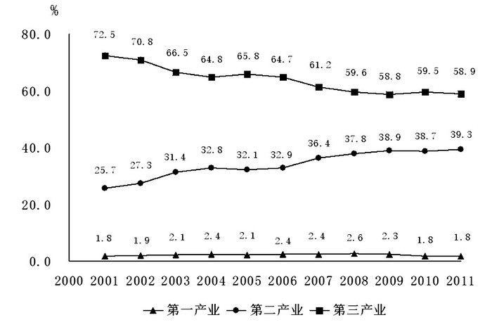

图2：2001—2011年部分行业市场用人需求比重变化

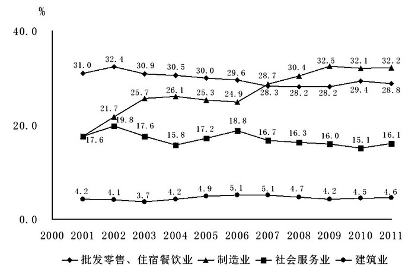

### 第 101 题

2002—2011年，第二产业用人需求比重同比增速超过10%的年份有几个：

A. 1

B. 2

C. 3

D. 4

第 101 题 · 答案与解析

**参考答案（粉笔题库参考内容）**

B

**解析**

根据图1可快速看出，第二产业用人需求比重同比增速超过10%的年份只有2003年和2007年。

故正确答案为B。

### 第 102 题

假设2011年市场用人需求总数是2001年的一半，与2001年相比，2011年4个主要行业用人需求变化量最小的是：

A. 制造业

B. 建筑业

C. 批发零售、住宿餐饮业

D. 社会服务业

第 102 题 · 答案与解析

**参考答案（粉笔题库参考内容）**

A

**解析**

根据题意“2011年市场用人需求总数是2001年的一半”，可设2001年用人需求总数为2，则2011年用人需求总数为1。A项，制造业的用人需求变化量为17.6×2–32.2=3；B项，建筑业的用人需求变化量为4.2×2–4.6=3.8；C项，批发零售、住宿餐饮业用人需求变化量为31.0×2–28.8=33.2；D项，社会服务业用人需求变化量为17.6×2–16.1=19.1。比较四组数据可知，A项制造业用人需求变化量最小，当选。

故正确答案为A。

### 第 103 题

2011年制造业和建筑业占第二产业用人需求的比重为：

A. 36.80%

B. 51.33%

C. 72.19%

D. 93.64%

第 103 题 · 答案与解析

**参考答案（粉笔题库参考内容）**

D

**解析**

2011年第二产业用人总需求一定，由图2可知，2011年制造业和建筑业的用人需求比重为32.2%+4.6%=36.8%，则制造业和建筑业占第二产业用人需求比重为，与D项最接近。

故正确答案为D。

### 第 104 题

2011年4个主要行业用人需求占总用人需求的比重较2001年：

A. 上升11.30个百分点

B. 上升5.32个百分点

C. 下降11.30个百分点

D. 下降5.32个百分点

第 104 题 · 答案与解析

**参考答案（粉笔题库参考内容）**

A

**解析**

2011年4个主要行业用人需求为：32.2%+28.8%+16.1%+4.6%=81.7%，2001年4个主要行业用人需求为31.0%+17.6%+17.6%+4.2%=70.4%，所以2011年比2001年总的比重高81.7%–70.4%=11.3%。

故正确答案为A。

### 第 105 题

下列关于2007-2009年各产业、行业用人需求变化的说法与资料相符的是：

A. 第二产业用人需求占社会总需求比重均高于图中其他年份

B. 制造业与建筑业用人需求变化趋势相反

C. 制造业为第二产业中用人需求比重最高的行业

D. 社会服务业的用人需求比重是图中各行业中下降最快的

第 105 题 · 答案与解析

**参考答案（粉笔题库参考内容）**

C

**解析**

逐项分析，找出说法正确的一项。

A项，第二产业用人需求占社会总需求的比重最高的年份为2011年，错误；

B项，用人需求的变化趋势是指人数的增长或下降，因材料仅给出各行业用人需求的比重，故无法判断行业间的用人需求变化趋势，错误；

C项，在2007-2009年间，制造业市场用人需求占第二产业用人需求比重均高于一半，用人需求比重最高，正确；

D项，2007-2009年建筑业的用人需求比重下降最快，而非社会服务业，错误。

故正确答案为C。

备注：B项，由图表可得2007-2009年建筑业用人需求比重是下降的，但如果2007年用人总数为1000，建筑业即为51，2009年用人总数为10000，建筑业即为420，用人需求的变化趋势实际上也是上升的，故不能直接由比重得出变化趋势。

## 材料 2

（二）根据所给资料，回答第106—110题。

        2011年，我国规模以上电子信息制造业主营业务成本占主营业务收入的比重达到88.7%，比2010年提高0.6个百分点，行业中亏损企业2497个，同比增长36.7%，企业亏损面达16.6%，亏损企业亏损额同比增长52.9%。

2011年我国规模以上电子信息制造业发展状况

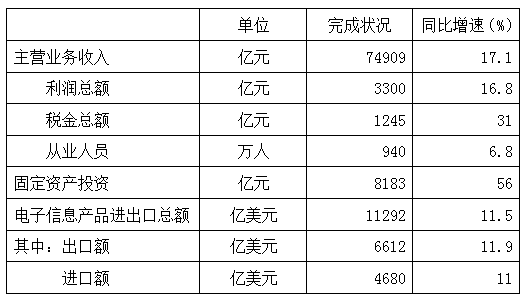

2011年我国规模以上电子信息制造业主要产品产量

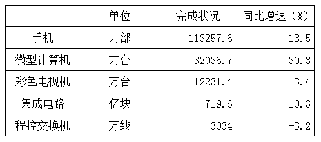

### 第 106 题

2011年我国规模以上电子信息制造业实现主营业务收入比上年增加约多少亿元：

A. 6303

B. 10939

C. 12809

D. 18600

第 106 题 · 答案与解析

**参考答案（粉笔题库参考内容）**

B

**解析**

根据增长量计算公式，亿元。B项最接近。

故正确答案为B。

### 第 107 题

按照2011年产量的同比增长率从低到高排序，以下正确的是：

A. 彩色电视机、微型计算机、手机

B. 彩色电视机、手机、集成电路

C. 手机、微型计算机、集成电路

D. 彩色电视机、集成电路、微型计算机

第 107 题 · 答案与解析

**参考答案（粉笔题库参考内容）**

D

**解析**

由材料可知，彩色电视机的同比增长率为3.4%，微型计算机的同比增长率为30.3%，手机的同比增长率为13.5%，集成电路的同比增长率为10.3%。

故正确答案为D。

### 第 108 题

2011年，我国规模以上电子信息制造企业数量约为多少万家：

A. 1

B. 1.5

C. 2

D. 2.5

第 108 题 · 答案与解析

**参考答案（粉笔题库参考内容）**

B

**解析**

由材料“行业中亏损企业2497个，······企业亏损面达 16.6%”可知，企业数量为家，即数量约为1.5万家。

故正确答案为B。

### 第 109 题

2011年，我国规模以上电子信息制造业人均创造利润约比上年增加：

A. 9%

B. 11%

C. 15%

D. 17%

第 109 题 · 答案与解析

**参考答案（粉笔题库参考内容）**

A

**解析**

根据题干“人均创造利润约比上年增加”和选项为百分数判断本题为平均数的增长率问题。定位表格材料可得分子利润总额增长率a=16.8%，分母从业人员增长率b=6.8%。

代入平均数的增长率公式：。

故正确答案为A。

### 第 110 题

以下说法正确的是：

A. 2011年我国规模以上电子信息制造业整体呈亏损状况

B. 2010年我国规模以上电子信息制造业税金总额超过1千亿元

C. 2011年我国规模以上电子信息制造业主营业务成本在7万亿元以下

D. 2011年我国规模以上电子信息制造业进口额增量略高于出口额

第 110 题 · 答案与解析

**参考答案（粉笔题库参考内容）**

C

**解析**

A项，利润为正，整体为盈利，错误；

B项，2010年税金总额为亿元&lt;1000亿元，错误；

C项，2011年主营业务成本亿元&lt;70000亿元，正确；

D项，根据增长量公式，现期量和增长率大的，增长量就大，比较出口额和进口额的现期量和增长率，明显出口额的增长量要大于进口额增长量，错误。

故正确答案为C。

## 材料 3

（三）根据所给资料，回答第111—115题。

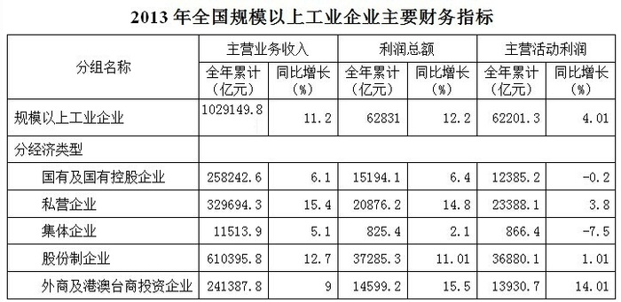

### 第 111 题

2012年全国规模以上工业企业中国有及国有控股企业利润总额是集体企业利润总额的多少倍？

A. 3.0

B. 17.7

C. 18.4

D. 9.7

第 111 题 · 答案与解析

**参考答案（粉笔题库参考内容）**

B

**解析**

查阅表格可知，2013国有及国有控股企业利润总额是15194.1亿元，同比增长6.4%，集体企业利润总额是825.4亿元，同比增长2.1%。数值之间的倍数比较，，前面部分约为，直除得约18.4，然后因为后面乘以一个比1小又很接近1的数，所以计算结果比18.4小一点。

故正确答案为B。

### 第 112 题

2012年全国规模以上工业企业中国有及国有控股企业主营活动利润全年累计多少亿元？

A. 12392.3

B. 12637.9

C. 12410.0

D. 10321.0

第 112 题 · 答案与解析

**参考答案（粉笔题库参考内容）**

C

**解析**

由题意得：亿元。

故正确答案为C。

### 第 113 题

2012年全国规模以上工业企业中私营企业利润总额减去主营活动利润后是多少亿元？

A. 2511.9

B. \-2511.9

C. 4347.0

D. \-4347.0

第 113 题 · 答案与解析

**参考答案（粉笔题库参考内容）**

D

**解析**

由题意得：显然被减数小于减数，得数为负值，排除A、C两项；

B、D两项差距较大，可以大胆估值。因为23388.1的分母较小，20876.2的分母较大，且分母都接近1，小数更小大数更大，所以差值应该大于两分子的差值，排除B项。

故正确答案为D。

### 第 114 题

2013年全国规模以上工业企业中各经济类型的主营活动利润同比增长率从高到低的排列正确的是：

A. 国有及国有控股企业——集体企业——股份制企业——外商及港澳台商投资企业

B. 集体企业——国有及国有控股企业——股份制企业——私营企业

C. 私营企业——股份制企业——国有及国有控股企业——集体企业

D. 集体企业——国有及国有控股企业——私营企业——外商及港澳台商投资企业

第 114 题 · 答案与解析

**参考答案（粉笔题库参考内容）**

C

**解析**

本题主要比较表中的最后一列数据的大小，私营企业为3.8%，股份制企业为1.01%，国有及国有控股企业为–0.2%，集体企业为–7.5%。

故正确答案为C。

### 第 115 题

在下列说法中，共有几个说法与资料相符：

Ⅰ. 2012年规模以上工业企业的利润总额多于主营活动利润

Ⅱ. 2013年国有及国有控股企业的利润总额出现负增长

Ⅲ. 2012年国有及国有控股企业利润总额少于外商及港澳台商投资企业利润总额

A. 0

B. 1

C. 2

D. 3

第 115 题 · 答案与解析

**参考答案（粉笔题库参考内容）**

A

**解析**

I，基期量比较。很显然，现期量相差不大，增长率分别为12.2%和4.01%，增长率大的基期小。所以I错误；

II，直接读数。利润总额是正增长，所以II错误；

III，基期量比较。国有及国有控股企业利润的现期量大，增长率小，基期量大。所以III错误。

故正确答案为A。

## 材料 4

2014年1月份，食品价格同比上涨3.7%，影响居民消费价格总水平同比上涨约1.23个百分点。其中，鲜果价格上涨23.0%，影响居民消费价格总水平上涨约0.44个百分点；液体乳及乳制品价格上涨11.9%，影响居民消费价格总水平上涨约0.17个百分点；水产品价格上涨6.3%，影响居民消费价格总水平上涨约0.16个百分点；粮食价格上涨3.1%，影响居民消费价格总水平上涨约0.09个百分点；鲜菜价格上涨2.1%，影响居民消费价格总水平上涨约0.07个百分点；肉禽及其制品价格上涨0.3%，影响居民消费价格总水平上涨约0.02个百分点（猪肉价格下降4.3%，影响居民消费价格总水平下降约0.15个百分点）；蛋价格下降3.8%，影响居民消费价格总水平下降约0.03个百分点。

        2014年1月份，非食品价格环比上涨0.3%。其中，娱乐教育文化用品及服务、家庭设备用品及维修服务、交通和通信、医疗保健和个人用品、居住价格分别上涨1.0%、0.4%、0.4%、0.3%和0.2%，衣着、烟酒及用品价格分别下降0.5%和0.3%。

### 第 116 题

2014年1月居民消费价格同比涨幅由低到高排列正确的是：

A. 液体乳及乳制品——粮食——鲜菜——蛋

B. 水产品——粮食——鲜菜——肉禽及其制品

C. 肉禽及其制品——鲜菜——水产品——鲜果

D. 粮食——水产品——液体乳及乳制品——鲜菜

第 116 题 · 答案与解析

**参考答案（粉笔题库参考内容）**

C

**解析**

本题属于简单比较类题型，直接从材料当中读数比较即可。因为肉禽及其制品的同比涨幅为0.3%，鲜菜的同比涨幅为2.1%，水产品的同比涨幅为6.3%，鲜果的同比涨幅为23.0%，所以只有C项满足从低到高的排列。

故正确答案为C。

### 第 117 题

在列举的食品类型中，影响居民消费价格总水平同比涨幅跌幅不足0.10个百分点的有几个：

A. 5

B. 4

C. 3

D. 2

第 117 题 · 答案与解析

**参考答案（粉笔题库参考内容）**

B

**解析**

本题属于简单比较类题型，直接从材料当中读数比较即可。一共有粮食、鲜菜、肉禽及其制品、蛋4类食品影响居民消费价格总水平的同比涨幅跌幅不足0.10个百分点。

故正确答案为B。

### 第 118 题

1月份非食品价格环比涨跌幅由高到低排列正确的是：

A. 居住——医疗保健和个人用品——交通和通信——衣着

B. 娱乐教育文化用品及服务——交通和通信——医疗保健和个人用品——衣着

C. 衣着——交通和通信——医疗保健和个人用品——居住

D. 衣着——烟酒及用品——居住——家庭设备用品和维修服务

第 118 题 · 答案与解析

**参考答案（粉笔题库参考内容）**

B

**解析**

定位材料第二段可得：2014年1月份，非食品价格中娱乐教育文化用品及服务、家庭设备用品及维修服务、交通和通信、医疗保健和个人用品、居住价格分别（环比）上涨1.0%、0.4%、0.4%、0.3%和0.2%，衣着、烟酒及用品价格分别（环比）下降0.5%和0.3%。环比涨跌幅比较即环比增长率比较，因1.0%＞0.4%=0.4%＞0.3%＞0.2%＞-0.3%＞-0.5%，观察选项，只有B项符合。

故正确答案为B。

## 材料 5

2014年1月份，烟酒及用品价格同比下降0.7%。其中，酒类价格下降2.0%，烟草价格上涨0.2%。衣着价格同比上涨1.9%。其中，衣着加工服务费价格上涨5.3%，服装价格上涨2.0%，鞋类价格上涨1.5%。家庭设备用品及维修服务价格同比上涨1.5%。其中，家庭服务及加工维修服务价格上涨9.2%，耐用消费品价格上涨0.4%。医疗保健和个人用品价格同比上涨1.1%。其中，中药材及中成药价格上涨4.5%，医疗保健服务价格上涨1.1%，西药价格上涨0.6%，医疗器具及用品价格上涨0.3%。交通和通信价格同比上涨0.2%。其中，车辆使用及维修价格上涨3.8%,车用燃料及零配件价格上涨0.6%,通信工具价格下降5.9%，交通工具价格下降1.1%。娱乐教育文化用品及服务价格同比上涨3.3%。其中，旅游价格上涨14.9%，教育服务价格上涨2.6%，文娱圈价格上涨2.1%，文娱用耐用消费品及服务价格下降3.3%。居住价格同比上涨2.8%。其中，住房租金价格上涨4.6%，建房及装修材料上涨1.7%，水、电、燃料价格上涨1.2%。

### 第 119 题

根据上述资料，价格出现下降的商品具体有多少项：

A. 2

B. 3

C. 4

D. 5

第 119 题 · 答案与解析

**参考答案（粉笔题库参考内容）**

C

**解析**

本题属于简单找数比较类题型，直接从材料当中寻找数据比较即可。其中，酒类价格下降2.0%，通信工具下降5.9%，交通工具下降1.1%，文娱用耐用消费品及服务价格下降3.3%，只有这4类的价格出现了下降。

故正确答案为C。

### 第 120 题

在上述资料中，有几大类商品价格同比上涨超过1.0%：

A. 4

B. 5

C. 6

D. 7

第 120 题 · 答案与解析

**参考答案（粉笔题库参考内容）**

B

**解析**

本题属于简单找数比较类题型，直接从材料当中寻找数据比较即可。由材料可知衣着价格、家庭设备用品及维修服务价格、医疗保健和个人用品价格、娱乐教育文化用品及服务价格、居住价格一共5类商品的价格同比上涨超过了1.0%。

故正确答案为B。

