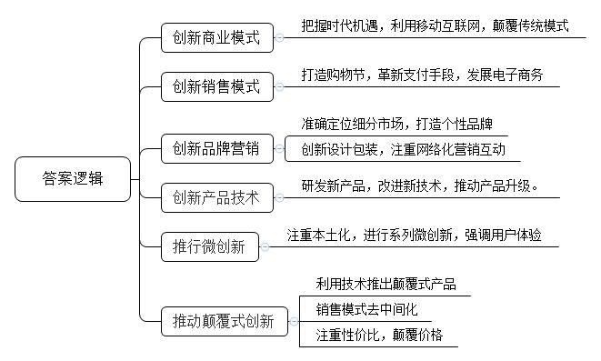
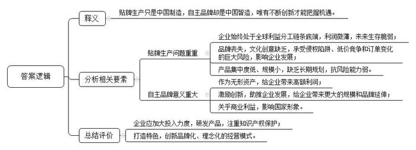
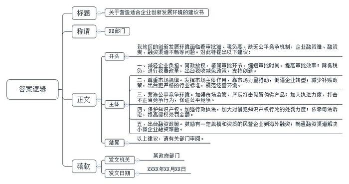
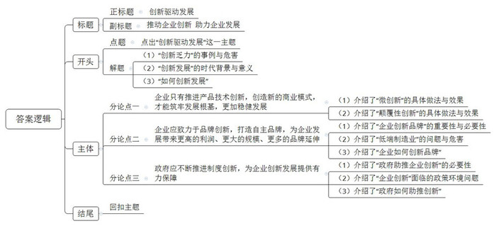

# 2015年山东省公考《申论》题（B卷）

<!-- gwy:overview:start -->
> **山东 · 2015 · 申论 · B类** ｜ 4 题 · 图片 4 处 · 答案随题折叠

导航：[题目](#题目) · [材料 1](#材料-1)
<!-- gwy:overview:end -->

> 候选采集稿。参考答案及解析来自粉笔页面，不代表官方答案或真实高分答卷；来源使用许可与原卷对应关系仍需人工核实。

## 给定材料

### 材料 1

2015年1月26日下午，国务院总理李克强主持召开专家学者和企业界人士座谈会。会上，来自高校、科研单位、金融机构的专家学者对当前经济形势各抒己见，来自互联网、电子信息、创业投资、建筑材料等行业的企业负责人分别就行业发展及经济走势谈了看法。大家认为，在去年复杂严峻的国内外形势下，我国经济实现了7.4%的增长，这是很不容易的。李克强总理说，当前中国经济发展进入新常态，必须按下全面深化改革的“快进键”，用好政府和市场这“两只手”，打造“双引擎”，让传统产业加快升级，新兴生产力加快成长，实现新常态下稳增长与调结构的平衡，使保持中高速增长、迈向中高端水平成为中国经济发展的主旋律。解放和发展生产力，当前就是要促进大众创业、万众创新，把“草根原创”迸发出的新元素、新模式汇聚成驱动经济发展的新动力。李克强总理多次强调企业对于中国经济的重要性，他表示，企业是经济的基本细胞，是市场主体。企业兴则经济兴。实现经济持续稳定增长，向中高端水平迈进，归根到底要靠企业。

创新是人类社会的永恒话题，也是经济社会发展的不熄引擎。中国经济提质增效升级要靠创新。近年来，中国经济之所以能够保持持续发展，主要动力还是来自于改革创新。创新驱动发展。企业是经济结构调整、转型升级的重要主体。

### 材料 2

海尔总裁张瑞敏有句名言：没有成功的企业，只有时代的企业。每一个时代都有不同的机遇，做时代的企业，就要在新的时代创造出新的商业模式。

一台智能手机，就能让互联网移动起来，跟人的绑定程度远远超出了PC互联网时代，这种变化足以颠覆任何一个传统产业。移动互联网成为年轻公司的红利，同时也是颠覆旧格局的力量。一个刚刚创业的网络小公司，获得的关注和估值，就可能超越几十年的传统企业。传统大公司所熟悉的增长动力逐渐消失，传统制造业正在面临互联网的巨大冲击，正在低调而艰难地转型。

技术、产品、生态，乃至于人，在这样一个被新工业时代、移动互联时代裹挟着往前赶，甚至来不及回头的商业环境下，变化来得尖锐又激烈。新常态正在召唤新生态，新生态源于商业模式的颠覆与重生。商业模式的每一次革新都在助推着公司迈上新的竞争台阶。

### 材料 3

“3分钟交易额突破10亿”“38分钟交易额突破一百亿”“第一小时支付宝成功支付6283万笔” ……没错，你看到的这些数据正是2014年在天猫以及淘宝“双十一”中创造的纪录，而这个纪录的创造者就是刚刚在美国上市的阿里巴巴。尽管此前人们普遍对于阿里巴巴天猫以及淘宝打破记录已经做好了足够的心理准备，却依旧被大屏幕迅速滚动的数字所震惊。而电商节也让“光棍们”不再黯然惆怅，而是从凌晨就坐在电脑旁亢奋地盯着自己的购物车，随时准备付款。

从2009年开始，淘宝“双十一”就伴随着中国电子商务的蓬勃发展而成为了全国乃至全世界的焦点。如今，“双十一”也早已经被公认是中国电子商务行业的年度盛事。2014年11月11日凌晨的第一分钟，就有1000万人次上线抢购，一天的销售额近200亿元，“这是传统商业模式想都不敢想的场面。”阿里巴巴集团董事会执行主席马云说。“大爆炸”只属于电子商务，只有电子商务，才能够在短时间里，提供如此众多的品牌商品，接待如此众多疯狂的消费者，中国电子商会会长曲维枝表示：以网络购物为代表的消费方式越来越深入到人们的生活之中，电子商务产业已成为拉动中国消费经济增长的新引擎。

2014年11月底，李克强总理到有着“中国网店第一村”之称的浙江义乌青岩刘村进行考察，他指出，我们对新经济要重新认识、高度重视。新经济不仅仅解放了老的生产力，更主要是创造了新的生产力。我们坚定不移支持电子商务，乃至跨境电子商务的发展。依托互联网经济的发展，可以形成中国经济发展的新动力，新的发动机。

### 材料 4

2012年，在追求高端大气上档次的白酒行业里，诞生了一个有“调调”的、没有历史的白酒品牌——江小白。2013年，当整个白酒行业面临调整，前途迷茫之时，江小白却“火”了，并引发了青春时尚小酒的新风潮。

一直以来，中国白酒品牌喜欢走传统、大气、恢弘的路线，比拼的是谁的历史悠久。各品牌之间的相互跟风、模仿，造成消费者的审美疲劳，给消费者造成一种严肃、刻板的感觉，让年轻人亲近不得。显然，白酒业绩增长乏力，正面临失去年轻消费群体的尴尬。为了能更快地立足，江小白的创始人陶石泉仔细研究了“80后”“90后”的消费习惯。他发现，现在的“80后”更随和一些，愿意在咖啡厅交流，而不是在办公室。其实，这是生活方式的改变。“以前白酒的属性偏应酬、送礼较多，时尚休闲的属性就稍差一些。看到该市场空白，我就决定将来要做的产品只盯准朋友间的休闲市场。别人做高端大气上档次，我们做时尚轻松、休闲幽默。”陶石泉说。

江小白是专门为“80后”“90后”打造的青春小酒品牌。“我是江小白，生活很简单”是这个品牌的个性，也是它传达给消费者一种态度，它不一定适合所有人，却有其固定而稳定的消费群体。陶石泉认为：“在很多企业追求大而全、大而强的发展目标时，我认为‘小而美’才是未来企业发展的方向。相对于大企业，‘小而美’的企业是挖掘小众需求的，品牌更具个性，面对的是细分化的消费市场人群。越是细分化的市场，消费共性越明显，消费者的需求也更加精准。”

为了突显江小白的形象，他们设计了一个卡通形象放在酒瓶上，一个长着大众脸，鼻梁上架着无镜片黑框眼镜，系着英伦风格的黑白格子围巾，身穿休闲西装的帅气小男生。时尚、简单、我行我素，善于卖萌、自嘲，却有着一颗文艺的心。江小白的包装设计，其灵感来自于手机行业：和传统的单纯或陶制，或水晶瓶的酒类包装不同，通体磨砂的“江小白”瓶子外还有一层类似手机保护壳的瓶套，套上不同的图案和“小白语录”，比如“关于明天的事，后天我们就知道了”“每个吃货都有一个勤奋的胃和一张劳模的嘴”。既突出个性，又能轻松表达江小白的独特内涵。这其实是与消费者进行沟通的一种形式——不知道哪句话戳中了你的笑点或者泪点，让你成为忠实的“白粉”。这种独特新颖的时尚外观和纸套上的青春语录，让很多人产生了购买欲望。

江小白目前主要采用网络化营销的方式，通过与消费者之间的直接互动进行品牌传播，硬广投放非常少，广告费用不到产品价格的10%，而传统酒企似乎更钟情于电视广告、户外广告等传统媒介，对网络广告、网络营销一直都不敏感，甚至是排斥。传统酒企的广告费用大概会占到产品价格的20%到30%。而通过微博、微信进行营销，具有成本低、传播广、见效快的优势。网络营销的精髓在于话题营销，而话题营销的精髓在于引发网友共鸣和互动。

为了适应年轻消费者口感的需求，江小白研发团队针对产品进行了大量的研发工作。江小白在口感方面纯净、柔和，还有一点点甜感。据说，江小白有108种时尚的喝法，可以加冰块，可以加冰红茶，可以加绿茶，可以加红牛，甚至可以作为一种调鸡尾酒的基酒……

### 材料 5

据报道，2012年索尼公司亏损额已达64亿美元，这不但创下了索尼公司的亏损新纪录，同时也是索尼公司的第四个亏损年。2012年底，索尼公司有1万名员工被裁。有人认为，创新能力的衰退是造成索尼公司危机的根本原因。

索尼公司创建于二战后的一片废墟之中，自1946年正式成立以来，“技术的索尼公司”品牌形象深入人心，被认为是二战后日本经济高速增长和走向国际化的象征，创造了“索尼公司神话”。1994年推出的PlayStation是索尼公司又一个划时代的电子产品。也正是凭借PlayStation，索尼公司打败了劲敌任天堂和世嘉。然而，此后近20年时间里，索尼公司再没有推出过一个具有颠覆性的电子产品。

随着互联网和移动互联网的兴起，后起之秀“苹果”研发出了iPod，iPhone，iPad等革命性产品，而索尼公司虽然早在1997年就预见了网络时代的到来，却行动缓慢，没能再像以往一样推出颠覆性的产品，甚至没能成为一个合格的跟随者。任何企业都需要不断创新，否则，即使你是行业巨头也会被创新的技术所颠覆！

### 材料 6

一把电钻，一块铁皮，真心热水器的故事从贺晓华单枪匹马“发明”第一台太阳能热水器开始。自1996年创立，真心热水器在竞争惨烈的市场已经屹立18年，甚至还从美的、格力等大品牌中“虎口夺食”，两次站上行业峰顶。由一个农民创立的企业，为何能在中国竞争激烈的热水器行业中成为“长寿”品牌？

真心热水器创立18年来，贺晓华始终在做一件事：发明热水器。他始终坚持对技术的学习与提升，多年来坚持参加重要的行业技术交流会，2002年，在广州一次行业展会上，贺晓华接触到了“空气能热水器”概念。会后回到公司，他立刻成立空气能热水器技术研究小组，并与浙江大学建立空气能科研立项，花费了一年多时间，攻克了空气能热水器的技术难关，并于2004年正式投放市场。

在新一代技术成熟之前，往往需要经历一个阶段的市场培育期。对于初创者而言，这段时期必须“熬”。在熬人气、养市场的几年中，贺晓华不放过空气能热水器上任何一个技术创新的可能。在别的热水器厂家还沉浸在太阳能热水器的繁荣美梦中时，他已经组织研发出了双聚能热水器和GBS空气能热水器。贺晓华把准了沿海地区多台风、太阳能功效时常发挥不出的痛点，将双聚能热水器作为重点销售产品，一举在市场走红；而GBS空气能热水器一经推出，仅通过一年的市场推广，就创造年销5000台、销售额2000余万元的不错业绩。

### 材料 7

作为360公司的董事长和CEO，周鸿祎“微创新”理论正在由小众走向业界主流。360作为微创新的典型案例，其快速的发展速度和颠覆式创新也给业界留下了深刻的印象，周鸿祎认为，“微创新”是最合适创业型企业的方法论和价值观……周鸿祎特别强调用户体验，“微创新的世界观就是用户利益至上，企业应该忘掉技术，微创新，人人都是产品顾问”。

携程CEO梁建章认为，创新有两种形式：一种是“微创新”，即不断分析、研究每一个环节出现的小问题，想出方法加以完善；另一种是“颠覆性创新”，当技术变化特别快的时候，可能要跳出原来的模式做一种新的产品或业务。

在中国，那些跟创新有关的公司身上，无一不闪烁着“微创新”的光芒。腾讯的可怕就在于快速迭代的微创新，百度打败技术巨头谷歌，有着大量适应本土的微创新。VANCL震撼了整个业界，靠的是系列微创新，它充分调动用户投票权，制造了一个又一个冠军产品。招商银行之所以拥有“最具有创新力”的名号，靠的是一种“微”，比如，招行柜台的一颗糖。海底捞以其“变态服务”模式，向传统餐饮业发起挑战，靠的也是微创新……

从当年的微软，苹果到当下最热门的特斯拉，这是对产品的颠覆性创新；从阿里巴巴、淘宝、美团到当下竖起“免佣”大旗要颠覆传统OTA模式的快捷酒店管家，这是业务的颠覆性创新。梁建章认为，这种创新才是推动产业升级的源动力。

就在2014年8月11日，小米副总裁黎万强通过微博宣布小米全球用户达到6000万，公司市值600亿人民币，而这家公司产生才不过4年。关于小米的“颠覆论”不绝于耳，有人说小米用低廉的价格颠覆了手机行业。从小米1到米4，小米手机价格低廉，但是硬件性能却丝毫不比同配置、高价位的手机差。小米的价格几乎接近成本价，打破了以前手机行业利润空间过大的潜规则。不过大家讨论更多的是小米颠覆了传统营销模式。在小米品牌的营销中，小米从不采用大规模投广告的传统方式，而是更注重和用户之间的沟通。雷军深谙互联网的强大的粉丝力量，他的产品研发从互联网需求的广泛征集开始，小米产品的系统升级等也遵从网民的呼声。当产品以及服务的用户体验极大的提升之后，雷军成功的生产出互联网经济下的市场需求产品和品牌，再利用互联网进行分发和销售，利用互联网制造饥饿营销，让小米品牌的口碑进一步扩张，不过也正是小米的这种营销手段的颠覆，让传统的手机品牌开始自危，并且效仿或学习起来。

### 材料 8

在2013年福布斯全球品牌100强中，中国品牌无一上榜。全球最大的品牌咨询公司Interbrand发布的《2013年度全球最有价值品牌年度报告》中，也没有一家中国企业的荣光。

据统计，目前我国拥有自主品牌的外贸企业约占外贸企业总数的20%，自主品牌产品出口仅占出口额11%，没有自主品牌，就意味着在产业链条上，我们依然处于低端，利益饱受冲击。一顶标有“中国制造”帽子，中国人卖给美国人是1美元，但美国人卖给全世界是25美元。一件中国生产的羊毛衫，在广交会上的价格低至0.8美元，而国外贴牌后的售价就达上百美元。品牌的重要性，不仅仅涉及到商业利益，也关系国家形象。前日本首相中曾根康弘说：在国家交往中，索尼是我的左脸，松下是我的右脸。

“中国制造”的一大特点就是贴牌生产，美国爱格瓦咨询公司总裁舒尔茨认为：贴牌不仅意味着低廉的利润，同时也意味着品牌的丧失，以及未来生存的脆弱。严重依赖贴牌生产的中国企业，始终处于全球利益分工链条的最底层，主要依靠出卖原料和人力来赚取微薄的利润，同时，还必须承受侵权陷阱、低价竞争和订单变化带来的巨大风险。商标品牌在企业竞争中具有激励创新、助推发展的巨大作用。一个有价值的品牌可以为企业带来更高的价格、更大的规模和更多的品牌延伸。在企业无形资产中，品牌价值可能占到5%-60%，比如在食品产业，品牌价值比为50%-60%；在航空行业为5%左右，从贴牌生产到打造自主品牌，中国企业势在必行。

### 材料 9

万达集团一直在进行“自我革命”。早在3年前，万达就开始研究连锁儿童娱乐业。万达委托全球5家知名公司，研发了86种儿童体验游乐产品，并全部买断了知识产权。

万达集团董事长王健林认为，中国儿童产业面临着前所未有的发展机遇，儿童产业规模约在1万亿元左右，尽管儿童娱乐行业中不乏一些发展较快的企业,但其现状是，产业集中度较低，企业规模小，抗风险能力弱，缺乏长期规划，文化创意方面较弱。而品牌化和理念化的乐园经营模式，更是目前国内儿童乐园产业所缺乏的。因此，万达宝贝王乐园定位为中国创新型动漫亲子乐园，其主要特点是综合生态，涉及全产业链、直营、动漫主题，创新性亲子体验系统，每个乐园面积在3000-5000平方米之间，主要针对0-8岁亲子家庭，在儿童游戏中融入早教，设置主题摄影、生日派对、亲子餐厅、婴童坊等功能区。2014年，万达宝贝王乐园已在北京、昆明、包头等九个地区的万达广场开业。2015年万达集团计划再开业23家宝贝王乐园，将逐步覆盖全国的万达广场。

### 材料 10

2003年，一位海归博士带着他一直在研发的抗癌药项目回到了中国，在浙江创建了贝达药业。10年后，贝达研发了世界第三例，中国第一例小分子靶向抗癌药“凯美纳”。在贝达药业D董事长看来，对药企而言，创新很重要的环节就是能否通过审批。在前不久的一个医药行业会议上，有人问医药行业的海归们，在创新过程中最困难的是什么？95%的人都会说审批、审批、审批。

“一个新药要上市，要通过好几次审批，从动物试验完成以后，进入临床人体试验，要有批文，每个审批环节都非常重要，没有审批就走不到下一步，但是我们审批时间非常长，得一年、一年半、两年，甚至更长。这样的审批时间对创新是非常不利的。”一个大型制药企业负责人说道。“发达国家的新药审批速度一般比较快，2013年初美国一个公司研发了一个治疗丙型肝炎的药，年底通过审批，2014年就已经实现100亿美元的销售额，而我们的新药有的要经历三年才能上市，能够进医院的不到10%。目前，凯美纳在全国也就进了10%的大医院，进不了医院，医生就不能开处方，只能‘望药兴叹’。”贝达药业D董事长说。

税负较高是创新药企面临的另外一大压力。据D董事长介绍，贝达药业综合税负率超过20%，远比一般企业平均10%要重，在政府加快简政放权步伐的情况下，他坦言：“期望能给我们的民族药企营造一个适合创新的环境！”

### 材料 11

在2014年7月14日国内企业家经济形势座谈会上，格力集团有限公司董事长董明珠说：“很多人觉得经济形势不好，我认为现在最迫切的问题不是给钱，而是企业要协助政府，共同营造一个规范的经营环境。”她还表示，国家此前的家电节能补贴政策容易带来寻租交易空间。只要有公平竞争的环境，企业自己就可以做好！

美的集团董事长方洪波建议：“希望今后国家减少出台一些补贴政策，要尽量靠市场的力量去推动，倒逼企业转型。”东方希望集团董事长刘永行在发言中也表达了同样的观点。“我们不需要政府补贴，我们就希望公平，希望国家有更严格的行业标准限制，让市场发挥主体作用。”

小米公司董事长雷军与京东集团董事长刘强东呼吁：应当加强市场监管，严厉打击假冒伪劣商品，营造公平竞争的市场环境。网络上的假货流行是对网购的最大伤害，政府有关部门对此要加大执法力度，从而保证公平竞争、优胜劣汰，避免出现“劣币驱逐良币”现象。

搜狐公司董事局主席张朝阳建议，对于侵犯知识产权行为的处罚，应当加大力度，他说道：“我们版权保护，很多时候主要依靠政府有关部门的行政执法，今后应该主要依靠司法诉讼维护公平竞争。另外，现在对侵权处罚的金额也比较低，有时只有10万元人民币，惩罚效果不明显。”

有的企业负责人还谈到了企业在“走出去”过程中遇到的困难与问题，希望国家能够出台有关政策，允许有一定规模和资质的民营企业到海外融资，对于民营企业也能给予跨国公司总部资金运营的资质。融资难、融资贵、融资渠道不畅等问题，让许多企业尤其是中小企业叫苦不迭，中国新光控股集团董事长周晓光说：“在浙江地区，众多小微企业的日子非常不好过，身边公司规模较小的企业界朋友这些年都是显得信心不足，最大的问题就是融资难。”

## 题目

### 第 1 题

请你结合“给定资料1-7”，简要概括企业创新成功的主要经验。（15分）

关联材料：材料 1、材料 2、材料 3、材料 4、材料 5、材料 6、材料 7、材料 8、材料 11

作答要求：全面准确，条理清晰，不超过200字。

第 1 题 · 答案与解析

**参考答案（粉笔题库参考内容）**

1.创新商业模式。把握时代机遇，利用移动互联网，颠覆传统模式。

2.创新销售模式。打造购物节，革新支付手段，发展电子商务。

3.创新品牌营销。准确定位细分市场，打造个性品牌；创新设计包装，注重网络化营销互动。

4.创新产品技术。研发新产品，改进新技术，推动产品升级。

5.推行微创新。注重本土化，进行系列微创新，强调用户体验。

6.推动颠覆式创新。利用技术推出颠覆式产品；销售模式去中间化；注重性价比，颠覆价格。

**解析**

**参考答案说明**：本参考答案从“创新商业模式”“创新销售模式”“创新品牌营销”“创新产品技术”“推行微创新”“推动颠覆式创新”等六个方面对企业创新成功的经验进行了分条撰写。各条要点之间在内容上是并列关系，没有交叉。

**考点**：经验启示类

**来源**：2015年山东省公考《申论》题（B卷）

### 第 2 题

请你结合“给定资料8-9”，谈谈对文中划线句子“从贴牌生产到打造自主品牌，中国企业势在必行。”的理解。（20分）

关联材料：材料 8、材料 9

作答要求：全面准确，分析透彻，不超过300字。

第 2 题 · 答案与解析

**参考答案（粉笔题库参考内容）**

这句话说明贴牌生产只是中国制造，自主品牌却是中国智造，唯有不断创新才能把握机遇。

贴牌生产问题重重：1.企业始终处于全球利益分工链条底端，利润微薄，未来生存脆弱；2.品牌丧失，文化创意缺乏，承受侵权陷阱、低价竞争和订单变化的巨大风险，影响企业发展；3.产品集中度低、规模小，缺乏长期规划，抗风险能力弱。

自主品牌意义重大：1.作为无形资产，给企业带来高额利润；2.激励创新，助推企业发展，给企业带来更大的规模和品牌延伸；3.关乎商业利益，影响国家形象。

因此打造自主品牌势在必行：1.企业应加大投入力度，研发产品，注重知识产权保护；2.打造特色，创新品牌化、理念化的经营模式。

**解析**

**参考答案说明**：思路方面，本参考答案按照词句解释题“释义+分析相关要素+总结评价”的一般答题思路展开。内容方面，本参考答案先对划线句子的含义进行了解释；分析相关要素部分从“贴牌生产存在的问题”“打造自主品牌的意义”这两大方面进行了分析；最后总结评价部分给出打造自主品牌的对策。词句表达方面，本参考答案加上了“因此”等连接词来承接上下文。

**考点**：词句解释类

**来源**：2015年山东省公考《申论》题（B卷）

### 第 3 题

假如你是一名政府相关部门的工作人员，请结合“给定资料10-11”，就政府如何更好地营造适合企业创新发展的环境，给上级部门写一份建议书。（25分）

关联材料：材料 1、材料 2、材料 3、材料 4、材料 5、材料 6、材料 7、材料 8、材料 9、材料 10、材料 11

作答要求：

（1）建议明确，具有针对性、可行性；

（2）紧扣材料，重点突出；

（3）结构完整，语言流畅；

（4）不超过500字。

第 3 题 · 答案与解析

**参考答案（粉笔题库参考内容）**

关于营造适合企业创新发展环境的建议书

XX部门：

我地区的创新发展环境面临着审批难、税负高、缺乏公平竞争机制，企业融资难、融资贵、融资渠道不畅等问题。对此特提出以下建议：

一、减轻企业负担。简政放权，精简审批环节，缩短审批时间，提高审批效率；降低税负，进行税费改革，出台税收减免政策，支持创新。

二、尊重市场规律。发挥市场主体作用，靠市场力量推动，倒逼企业转型；减少补贴政策，出台更严格的行业标准，规范经营环境。

三、营造公平竞争环境。加强市场监管，严厉打击假冒伪劣产品；加大执法力度，打击不正当竞争行为，保证公平竞争。

四、保护知识产权。加强行政执法，加大对侵犯知识产权行为的处罚力度；依靠司法诉讼，提高侵权处罚金额。

五、出台融资政策。鼓励有一定规模和资质的民营企业到海外融资；畅通融资渠道解决小微企业融资难题。

以上建议，请有关部门审阅。

某政府部门

XXXX年XX月XX日

**解析**

**参考答案说明：**（1）本题按照公文题的写作格式，写到了“标题+主送机关+正文（开头+主体+结尾）+落款”。（2）正文部分，一方面从内容来看，本参考答案的开头先写到了“企业创新发展存在的问题”；主体部分从“减轻企业负担”“尊重市场规律”“营造公平竞争环境”“保护知识产权”“出台融资政策”这五个方面给出了政府如何营造适合企业创新发展环境的具体建议。另一方面，形式上，本参考答案做到了分段、分条撰写，整体上条理较为清晰。

**考点**：方案类

**来源**：2015年山东省公考《申论》题（B卷）

### 第 4 题

请你结合给定资料，以“创新驱动发展”为题目，自拟副标题，写一篇议论文。（40分）

关联材料：材料 1、材料 2、材料 3、材料 4、材料 5、材料 6、材料 7、材料 8、材料 9、材料 10、材料 11

作答要求：

（1）观点明确，论述深刻；

（2）参考“给定资料”，但不拘泥于“给定资料”；

（3）结构完整，思路清晰；

（4）字数在1000-1200字。

第 4 题 · 答案与解析

**参考答案（粉笔题库参考内容）**

**创新驱动发展**

**——推动企业创新 助力企业发展**

“老路走不通，新路在哪里？”2012年，曾经享负盛名的索尼公司也面临这一问题，连续四年亏损，随之而来的是全球范围的大裁员。究其根由，在于不能及时创新求变。索尼公司只是一个缩影，当下许多中国企业也面临着这一问题。在今天这样一个新工业时代，创新能力不强，已严重影响企业的稳定持续发展。**因此，我们必须紧跟时代，紧紧扭住“创新”的关键元素，加大企业创新力度，助力企业发展腾飞，提升中国企业在世界经济舞台的影响力。**

**这是一个创新的时代，企业只有推进产品技术创新，创造新的商业模式，才能筑牢发展根基，更加稳健发展。**真心热水器的“虎口夺食”、海底捞的“变态服务”、“江小白”的青春语录……无一不是在产品或服务细节上的微创新，利用现代化技术创新推动产品和服务质量升级，让企业在激烈的市场竞争中求生存，谋发展。因此，需要我们积极转变观念，从细节入手，不断分析完善每一个环节，以“微创新”吸引客户兴趣，提升客户体验。同时，要像微软、苹果、阿里巴巴、淘宝那样，在技术迅猛发展的当下，适时进行颠覆性创新，利用移动互联网，跳出传统模式，在新的时代创造出新的商业模式，做时代的企业。

**与此同时，企业应致力于品牌创新，打造自主品牌，为企业发展带来更高的利润、更大的规模、更多的品牌延伸。**企业创新讲究的是独一无二，而不是山寨模仿。因为缺乏自主品牌，我国外贸企业严重依赖贴牌生产，致使利润低廉、品牌丧失、生存脆弱。依靠出卖原料和劳动力来获取利润的生产模式，也始终处于全球利益分工链条的最底端，面临着遭受侵权陷阱、低价竞争和订单变化等多重风险。在品牌创新上依附他人，就如同一个跛脚的巨人，企业是无法阔步前行的。李克强总理号召万众创新，也不是去“偷创意”、“偷技术”，而是要求企业自主创新，打造特色品牌，创新品牌化与理念化的经营模式。

当然，**企业创新也离不开政府的保驾护航，政府需要为企业减负、松绑，激发其创新活力。**

**政府应不断推进制度创新，打造公平、规范、自由的营商环境，为企业创新发展提供有力保障和支撑，让企业前行的道路更加畅通。**创新驱动发展，不仅仅要靠市场这只无形之手，也要通过政府这只有形之手，打造企业创新发展“双引擎”。目前我国企业发展面临着审批难、税负高、融资难、缺乏规范、公平的市场经营环境等问题，因此，政府也要破除影响和制约企业创新的体制机制障碍，简化审批程序，缩短审批时间，减少补贴政策，继续落实落细减税降费政策，营造规范、公平的经营环境，减轻企业负担，助推企业创新发展。

今天，中国企业站在发展的十字路口，是继续守在全球产业价值链条的末端，还是走自己的创新发展之路？答案不言而喻。唯有以创新把握时代机遇、以创新驱动企业发展，我们才能激发出创新型国家的强大动力。

**解析**

**文章分析**

**创新驱动发展**

**——推动企业创新** **助力企业发展**

【**标题的优点：**首先，它严格按照题目要求以“创新驱动发展”为题。其次，补充的副标题凸显了“推动企业创新”这一动机，使文章写作角度更清晰。】

“老路走不通，新路在哪里？”2012年，曾经享负盛名的索尼公司也面临这一问题，（1）连续四年亏损，随之而来的是全球范围的大裁员。究其根由，在于不能及时**创新求变**。索尼公司只是一个缩影，当下许多中国企业也面临着这一问题。（2）在今天这样一个新工业时代，创新能力不强，已严重影响企业的稳定持续发展。**因此，（3）我们必须紧跟时代，紧紧扭住“创新”的关键元素，加大企业创新力度，助力企业发展腾飞，提升中国企业在世界经济舞台的影响力。**

【**开头的优点：**★内容方面。范文的开头是紧扣题目给定的“创新驱动发展”这一标题展开的。首先，**开头开门见山的点出主题，做到了主题明确。其次，对“**创新驱动发展**”这一主题进行了分析阐述，指出了（1）“创新乏力”的事例与危害。（2）“创新发展”的时代背景与意义。（3）“如何创新发展”。**★文字表达方面：使用了“因此”关联词，使语言表达有逻辑性。】

**这是一个创新的时代，企业只有推进产品技术创新，创造新的商业模式，才能筑牢发展根基，更加稳健发展。**真心热水器的“虎口夺食”、海底捞的“变态服务”、“江小白”的青春语录……（1）无一不是在产品或服务细节上的微创新，利用现代化技术创新推动产品和服务质量升级，让企业在激烈的市场竞争中求生存，谋发展。因此，需要我们积极转变观念，从细节入手，不断分析完善每一个环节，以“微创新”吸引客户兴趣，提升客户体验。同时，（2）要像微软、苹果、阿里巴巴、淘宝那样，在技术迅猛发展的当下，适时进行颠覆性创新，利用移动互联网，跳出传统模式，在新的时代创造出新的商业模式，做时代的企业。

【**论述段1的优点：**★观点句：范文的观点句是紧扣“创新驱动发展”这一文章主题提出的。形式上，它在段首处直接写出，位置突出，容易发现。内容上，关键词突出，内容要点明确，可以明显看出它是从“产品技术创新，创新商业模式”入手，指出了“企业如何创新”。★论述内容：（1）介绍了“微创新”的具体做法与效果；（2）介绍了“颠覆性创新”的具体做法与效果。注意：以上几个方面的内容都是紧扣“企业只有推进产品技术创新，创造新的商业模式，才能筑牢发展根基，更加稳健发展”这个观点句进行分析论述的，论述的针对性强，内容层次丰富。最后，在论述方法和论据的选取上做到了讲道理、举例子相结合，做到了丰富多样。】

**与此同时，企业应致力于品牌创新，打造自主品牌，为企业发展带来更高的利润、更大的规模、更多的品牌延伸。**（1）企业创新讲究的是独一无二，而不是山寨模仿。因为缺乏自主品牌，我国外贸企业严重依赖贴牌生产，致使利润低廉、品牌丧失、生存脆弱。（2）依靠出卖原料和劳动力来获取利润的生产模式，也始终处于全球利益分工链条的最底端，面临着遭受侵权陷阱、低价竞争和订单变化等多重风险。在品牌创新上依附他人，就如同一个跛脚的巨人，企业是无法阔步前行的。李克强总理号召万众创新，也不是去“偷创意”、“偷技术”，（3）而是要求企业自主创新，打造特色品牌，创新品牌化与理念化的经营模式。

【**论述段2的优点：**★观点句：范文的观点句是紧扣“创新驱动发展”这一文章主题提出的。形式上，它在段首处直接写出，位置突出，容易发现。内容上，关键词突出，内容要点明确，可以明显看出它是从“品牌创新”入手，指出了“企业如何创新”。★论述内容：（1）介绍了“企业创新品牌”的重要性与必要性；（2）介绍了“低端制造业”的问题与危害；（3）介绍了“企业如何创新品牌”。注意：以上几个方面的内容都是紧扣“企业应致力于品牌创新，打造自主品牌，为企业发展带来更高的利润、更大的规模、更多的品牌延伸”这个观点句进行分析论述的，论述的针对性强，内容层次丰富。最后，在论述方法和论据的选取上做到了讲道理、举例子相结合，做到了丰富多样。】

当然，**企业创新也离不开政府的保驾护航，政府需要为企业减负、松绑，激发其创新活力。**

【**过渡段的优点：**范文过渡段分析了“创新驱动发展”的对策，此外，还要注意过渡段末尾的“政府需要为企业减负、松绑，激发其创新活力”是用来引起下文的过渡句。】

**政府应不断推进制度创新，打造公平、规范、自由的营商环境，为企业创新发展提供有力保障和支撑，让企业前行的道路更加畅通。**（1）创新驱动发展，不仅仅要靠市场这只无形之手，也要通过政府这只有形之手，打造企业创新发展“双引擎”。（2）目前我国企业发展面临着审批难、税负高、融资难、缺乏规范、公平的市场经营环境等问题，因此，（3）政府也要破除影响和制约企业创新的体制机制障碍，简化审批程序，缩短审批时间，减少补贴政策，继续落实落细减税降费政策，营造规范、公平的经营环境，减轻企业负担，助推企业创新发展。

【**论述段3的优点：**★观点句：范文的观点句是紧扣“创新驱动发展”这一文章主题提出的。形式上，它在段首处直接写出，位置突出，容易发现。内容上，关键词突出，内容要点明确，可以明显看出它是从“政府”入手，指出了“如何创新”。★论述内容：（1）介绍了“政府助推企业创新”的必要性；（2）介绍了“企业创新”面临的政策环境问题；（3）介绍了“政府如何助推创新”。注意：以上几个方面的内容都是紧扣“政府应不断推进制度创新，打造公平、规范、自由的营商环境，为企业创新发展提供有力保障和支撑，让企业前行的道路更加畅通”这个观点句进行分析论述的，论述的针对性强，内容层次丰富。最后，在论述方法和论据的选取上做到了讲道理、举例子相结合，做到了丰富多样。】

【**论述段之间的关系**：★内容的内在逻辑：范文的论述段之间是依照“递进”的逻辑展开的。论述段1、2先写了“企业如何创新”，论述段3再写了“政府如何助推创新”。★段与段的外在衔接：论述段2的段首处的“与此同时”，起到了承接论述段1、引出了论述段2的作用。】

今天，中国企业站在发展的十字路口，是继续守在全球产业价值链条的末端，（1）还是走自己的**创新发展**之路？答案不言而喻。（2）唯有以创新把握时代机遇、以创新驱动企业发展，我们才能激发出创新型国家的强大动力。

【**结尾的优点**：范文的结尾回扣了“创新驱动发展”这一主题。（1）再次提到“创新驱动发展”；（2）阐述了深远意义。】

**考点**：文章写作题

**来源**：2015年山东省公考《申论》题（B卷）

