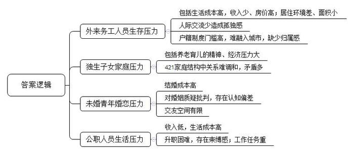
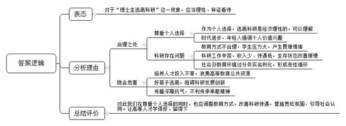
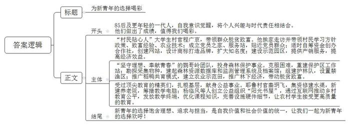
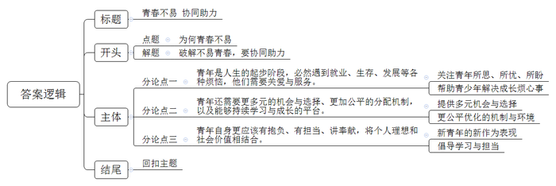

# 2015年山东省公考《申论》题（C卷）

<!-- gwy:overview:start -->
> **山东 · 2015 · 申论 · C类** ｜ 4 题 · 图片 4 处 · 答案随题折叠

导航：[题目](#题目) · [材料 1](#材料-1)
<!-- gwy:overview:end -->

> 候选采集稿。参考答案及解析来自粉笔页面，不代表官方答案或真实高分答卷；来源使用许可与原卷对应关系仍需人工核实。

## 给定材料

### 材料 1

来自安徽合肥的陈军，转业后留在北京做耗材生意，年收入10万元左右。他曾在唐家岭住过4年，唐家岭拆迁后搬到了昌平区史各庄，这里刺鼻的臭气、随处可见的垃圾、横在街边的三轮车，与村外现代化的购物广场形成了巨大反差。陈军住在史各庄一栋“规格较高”的违建出租楼里，楼门进出要刷卡。他的家是一个10平方米左右的房间，一个双人床、打印机和各种打印耗材把屋子填得满满当当。陈军2009年结婚，之前一年，他本想在北京买房。“那时候有了点儿积蓄，想在北京安个家，踏踏实实过日子。”陈军说。2008年，北京燕郊的房价每平方米不到7000元，他犹豫了3个月，没想到一下就涨到了1.1万元。“买不起了，现在干脆就不想这事儿了。”陈军苦笑道。结婚以后，他在老家买了房，老婆和孩子也都留在了那里，想他们的时候，他就打个电话，或者上网视频。“我现在高不成低不就，如果回去还要重新建立人脉关系。而且再过几年缴纳社保的年限就够了，到时北京的退休工资肯定要比合肥高。”陈军说，“我还想再这样坚持几年，看生意能不能有点起色。”其实，在很多同样漂泊在大城市的年轻人看来，陈军并不宽裕的生活已经是一种奢望。

上海南方新村小区内，一间77平方米的公寓，住了14个人，全是附近一家房产中介的业务员，人均面积只有5.5平方米。1993年出生的刘光华，高二辍学后，便在同学建议下，跑到上海做起了房产中介。“坐了17个小时的火车，到上海片刻未歇就直接‘跑盘’。”刘光华说，每天早出晚归，回来只是睡觉，倒也习惯了。平常，刘光华除了客户和工作的同事，基本很少跟其他人有交集。他吐露，“有心事的时候也不知道该和谁说”“有时候看着这座灯火通明的城市，总感觉自己不属于这里”“本想通过自己的努力在上海安个家，但是动辄几百万元的房价让我感觉挺绝望的”。

目前游走在特大城市边缘的群体，根据学历层次，大体可以划分为大学毕业生群体和大专以下学历的青年务工人员，后者多属于新生代农民工，他们大多来自农村或偏远城镇。特大城市集聚的各种优质资源，加上比较公平的发展环境，吸引越来越多这样的年轻人怀揣梦想，离开故乡。但特大城市高企的房价和户籍制度的门槛，又让这些年轻人感到很难在这儿落下脚。

### 材料 2

今年30岁的小张在惠州工作，他和妻子几年前从湖北来到广东，很快就适应了这里的生活，并在事业上有了自己的一片天地。作为家里的独子，他非常牵挂老家的父母。他说，因为老婆也是独女，婚后就一直想着把双方父母接到惠州来一起生活，但因种种原因却一直推迟。现在儿子快两岁了，工作生活的压力也越来越大，可是老人的年龄也越来越大。一方面是养老的精神压力，一方面是养儿的现实生活窘况，上下两代的压力让他疲惫不堪。和小张一样，如今在中国的许多大城市里，独生子女们将不得不面对父母的养老问题。他们不仅有养不起小孩的忧虑，还要直面养不起父母的危机。

今年27岁仍在读研究生的小赵坦言，他的择偶标准只有一条，就是非独生子女。他说，本来家中经济情况就不是很好，自己又一路读书，若找一个独女做伴侣，那势必要面临养四个老人的沉重压力，如今社会压力又如此大，只有两人承担这一切确实不易。除了经济压力外，小赵还透露，若4个老人一起生活，那相互之间的关系也较难调和，恐纷争不断。

据媒体报道，1979年中国有607万个家庭领取了“独生子女证”。如今，30多年过去了，第一代独生子女的父母正迈入老年人行列，中国正全面迎来“421家庭”时代：两个年轻人要承担起赡养4个老人和抚养至少1个孩子的家庭压力。

### 材料 3

中国青少年研究中心、中国人民大学人口与发展研究中心发布的《当代中国青年人口发展状况研究报告》显示，1995年，我国15-29岁青年未婚人口比例为51.54%，15-35岁青年未婚人口比例为38.23%；2000年，15-29、15-35岁青年未婚人口比例分别为59.17%、40.8%；2005年的相应数据则分别上升为65.89%、45.71%。

“现在的结婚成本和几十年前能比吗？”去年刚结婚的小马抱怨，他的父母当年几床婚被、几个暖水瓶就结婚了。他结个婚，算上房子、装修和其他杂七杂八的婚礼支出，花了将近两百万，几乎耗尽了父母一辈子的积蓄。继《喝馄饨》、《挤公交》之后，南京本土音乐人韦伟的又一首新歌《老子不想结婚》在网上火了，唱出了晚婚族的无奈：“拜金女看不上现实男”“要买车子，要养房子，还要准备几克拉的钻石戒指”……众多无房无车无老婆的“三无男人”称这歌曲唱出了他们的心声。

有一项调查显示，大龄未婚现象在企业内普遍存在。其中，IT行业更是有高达25%的员工属于大龄未婚青年。据《上海人口发展报告》显示，“在过去一年内，有着较高文化程度的上海常住人口中，女性初婚晚婚率达到73.59%。”目前，30岁上下的未婚青年在职场上比比皆是。北京和上海两地的单身男女都已突破百万。单身人群数量的激增，原因之一是有的人对婚姻抱有质疑甚至批判的态度；另一个重要原因是交友空间过于有限。在大城市里，社区是陌生人社区，平时接触的人似乎很多，但是真正关系比较密切的人并不多。现代职业的工作性质也使人与外界交流的方式发生了改变，人们更习惯、更青睐数字化的沟通方式，而婚恋是必须与现实空间联系在一起的。所以，在一定程度上造成了大龄青年未婚的比例逐年上升，58.6%的人认为“交际范围太窄”是自己或身边的人至今单身的主要原因。

### 材料 4

钟生入职东莞公务员已经4年了。2011年2月，在家人的支持下买了房，“单价7800元，还算便宜，房子总价90万元，父母出了55万，姐姐掏了10万，加上自己4年全部积蓄5万，最后还贷了20万。房贷需还5年，现在已还了2年半，每月要还4000多元。”钟生说。现在的工资加上公积金也只有8000元，一半都用来还房贷。今年7月，钟生的小宝宝出生了，“妻子现在没有工作，全家都靠我，压力真不小”。

周先生在某机关单位工作已经4年。“4年了，眼看周围同学不断‘强大’起来，自己却在原地踏步。”周先生说，自己仍旧是一个普通职员，升职无望，“但同学们不少都升职加薪了，再这么干下去，何时才能熬出头？我20多岁就可以想象到40岁的生活，未来十年、二十年都是这样，虽然说很稳定，但对于年轻人有时是一种束缚”。

在广州某单位宣传部门工作的刘游，工作勤奋、不善拒绝人，却成为了同事们“推活”的对象。“作为新人，我也不知道怎么去拒绝，但一次帮成了，下次这个事情就还是你的，并渐渐变成了一种理所当然。”她眼前的工作如雪球般越滚越大，“做好是应该的，做不好却要受批评，问题是有些活本来就不应该自己一人单独包了”。

### 材料 5

中科院数学与系统科学研究院程研究员带了五年的学生晓阳即将博士毕业，但他拒绝了老师继续“读博士后”的安排，选择去当一名中学老师。晓阳一直重复着一条理由：“做研究太累，没兴趣，不想做了。”对学生的这个选择，程研究员异常心痛，他认为，这个学生“天生就是做科研的材料”。为此，他在博客上写下了3000多字的长信，最后的结尾是：“现在的我，是又一次‘哀莫大于心死’。”

这封信引发了巨大反响，“博士逃离科研选择去当中学教师”一时间走进了大家的视线，成为热议话题。下面是某网站收集到的各方观点：

北京某著名高校教师H：程研究员是老一代的知识分子，他更重视为国家培养人才，强调奉献精神。晓阳是新一代青年人，更强调个人的价值和兴趣，这应该是时代的进步。而且晓阳表示对科研没有兴趣，只有兴趣作为原始推动力才能在科研方面走得更远。

北京某著名高校教授Z：我们每天都在被人诟病，科研创新能力差，出不了真正有价值的科研成果，解决不了科研难题。可是看看我们的教育现状，过分务实和名利化的社会环境和教育环境让我们陷入了恶性循环，具有潜质的好苗子不断地主动或者被动地逃离。

著名教育和文化学者Y：放弃科研也许跟老师的教育方式有问题有关，学生被逼得太紧或者压力太大。学生去当中学老师，是想换个环境放松自己，或许有一天，他还会发觉学术界的好，回到学术界。

网友A：这些年的人才高消费现象太多了，“大学生竞聘掏粪工”“硕士生争当清洁工”，国家和学校对名牌大学研究生的培养投入不菲，这些人却因为种种原因放弃所学专业，这是对高等教育公共资源的浪费……

网友B：中科院博士逃离科研选择当中学老师，我觉得也是一个经济理性选择。先不说喜欢不喜欢科研，至少，中学老师的收入未必比从事科研少。尤其是对于刚起步的博士来讲，在起步阶段，手里没有项目，天天做的都是很辛苦的工作，而科研本身要求又极高。

网友C：我们现在处在一个全球学术界大浮躁大跃进的年代，这种浮躁的背后，其实是科研人员待遇的普遍低下。待遇低了，那么人们就只好玩各种短平快的招数来改善自己的生存状态。无论是离开学术界去企业，还是留在学术界发大量论文拿奖金，都是如此。

### 材料 6

程广京出生在河南省兰考县一个普通的小村庄，2008年10月大学毕业不久的他顺利通过了组织部门选派大学生村官的考试，后被选聘为兰考县葡萄架乡董庄村党支部副书记。

在他刚上任时，村里工作几乎处于半瘫痪状态。当上村官的第一天，他并不是召集村班子成员一起开会，而是静悄悄的一个人开始挨家挨户进行走访，然后回去写日记做总结。通过走访，他发现该村部分村民存在着思想保守、接受新事物能力不强等问题，这是导致贫困局面的根本原因。接着，程广京开始带领群众学习党在农村的有关方针政策，并从网络上下载先进党支部的致富经验宣传片，特色种植、养殖技术指导片，运用远程教育设备组织群众学习。为了和党员群众打成一片，他还成立了“董庄村党员之家”和“大学生村干部服务站”。

程广京紧抓时机，发挥自己的特长，结合本村实际，自筹资金创办了兰考县佳乐果蔬专业合作社，并担任合作社的理事长和信息联络员。合作社采用“合作社+农户+大学生村官+贫困户”的模式进行运作，实行“种、产、购、销”一条龙服务。在此基础上，他还创建了“兰考县佳乐果蔬种植合作社”网站，以进一步扩大知名度，并设计了自己的商标。如今，董庄村日光温室成了葡萄架乡周边乡镇乃至兰考县的品牌，该示范园区还被确定为“兰考县大学生村干部创业示范园区”。截至2012年，建成日光温室36座，“大棚桃”设施20座，“早西瓜”112亩的绿色示范园区，为群众提供从育苗到销售等环节的一条龙服务，现年产值已达300余万元，共带动20多户贫困户脱贫致富，并吸引了商丘、亳州等地大学生村官前来取经。

2012年，程广京被评为全国十佳大学生村官“村民贴心人”。

### 材料 7

海南鹦哥岭省级自然保护区成立于2004年7月，位于海南岛中南部，面积50464公顷，为海南省陆地面积最大的自然保护区。2007年，27名大学生来到了鹦哥岭，其中有2名博士、4名硕士、21名本科毕业生，他们是由海南省林业局面向全国高校招募来的，目的是要重建鹦哥岭自然保护区工作站。

沉寂多年的鹦哥岭从此热闹起来。一群朝气蓬勃、有专业知识、致力于森林保护事业的大学生创造了奇迹。他们主动放弃大城市的优越生活，从全国各地来到条件艰苦的鹦哥岭，克服缺水少电、气候潮热、交通不便等许许多多的困难，足迹踏遍了鹦哥岭的山山水水，不懈奋斗重建保护区工作站。

经过4年多努力，鹦哥岭自然保护区工作站终于有了自己的“档案馆”。27名大学生完成了鹦哥岭自然保护区的动植物物种的勘探、采集工作，建起了鹦哥岭森林资源数据库和监测管理信息系统及档案馆，记录到维管束植物2197种，其中国家I级保护植物有坡垒、海南苏铁、台湾苏铁、伯乐树4种；国家II级保护植物有25种。记录到脊椎动物431种，其中国家I级保护动物有云豹、蟒蛇、海南山鹧鸪、海南灰孔雀雉4种；国家II级保护动物45种。记录到鹦哥岭树蛙等14种科学新种，还记录到了轮叶三棱栎等26个中国新纪录种，伯乐树等178种海南新记录种。

他们还组建起一支234人的“护林队”，设置了鹦哥岭禁渔区，同时还在鹦哥岭大面积推广“稻鸭共育”模式，建立“农业示范田”，积极推广林下经济，为黎族、苗族百姓脱贫致富做出了积极的贡献。

2012年5月4日，鹦哥岭自然保护区工作站青年团体被授予第十六届“中国青年五四奖章集体”荣誉称号，海南省内掀起了一股向鹦哥岭团队学习的热潮。鹦哥岭团队受邀走进国家林业局、清华大学、北京林业大学、东北林业大学等部门与高校讲述他们“坚守理想、奉献青春”的励志传奇。

### 材料 8

自2010年前后，一些接受过国内外顶尖教育的年轻一代精英们，开始在就业上将目光转向那些“非主流”地带，比如最基层的乡村，以及那些听起来并不高大上但他们却喜欢的职业。

“85后”青年，美国耶鲁大学毕业生秦玥飞已经在湖南衡阳的一个小山村中默默地当了两年的“村官”。在这两年间，秦玥飞为所在的衡山县贺家乡贺家山村募集到了80余万元资金，帮乡亲们修建了灌溉良田的水渠。新建了一所田园风光式的敬老院，还在周边4所学校就读的700多名学生每人筹措了一台平板电脑。秦玥飞因其出色的“政绩”被直选为县人大代表。

这两年，一个由中国年轻人创办、名为“阳光书屋”的公益组织也声名鹊起。这家致力于借助互联网和信息技术改善中国乡村孩子教育不公平的公益组织的多名合伙人都是哈佛、耶鲁等世界级名校的毕业生或在校生：它的联合创始人和执行总监杨临风曾就读于北京四中、伊顿公学，2011年从哈佛大学计算机专业毕业后，先是供职于波士顿咨询公司（BCG），后辞职投身于“阳光书屋”的营运；刘禹琦，从斯坦福大学大三休学，为“阳光书屋”全职工作；朱若辰，杜克大学毕业，高中毕业时就有一颗小行星以他的名字命名；杨歌，高中时获得过北京“市长奖”，耶鲁大学毕业后，继续在芝加哥大学攻读物理博士……

外界也许很难理解，这群出身于优裕家境，接受到顶尖教育的年轻人，选择的不是代表着财富和权力的华尔街、金融行业、世界500强、上市公司，而是中国偏远农村的孩子们的教育。然而，这或许正开启着走向未来的一种新的、规模不大但新潮的社会趋势。越来越多成长于丰裕社会的“85后”们，以及更年轻的一代人的自我意识开始觉醒，开始去选择一种能把个人的小兴趣与这个时代的大责任相契合的生活。

“我们每个人都希望自己好一点，但前提是国家好一些、社会上最弱势群体他们能够好一些。”在谈及为何创办“阳光书屋”时，杨临风说，中国现在的城市化率已超过50%了，未来要达到80%甚至更多，也就是说，还有30%的中国人口要从农村转移到城市去。而目前生活在农村的这些孩子们，将是未来中国变革的一支非常重要的力量，如果他们没有接受良好的教育，没有足够的理解力，没有足够的创造力的话，中国的城市化进程是没有办法进行下去的。所以，他非常关注怎么能在尽量加强整个中国基层教育的基础上，“让这些将来会走入到城市生活中的农村学生也能够站在相同的起跑线上，共同工作，一起把中国建设得更好”。

这群充满着理想的年轻人，在面对中国基层的真实社会情景时，又表现出对现实世界的惊人的理解力。秦玥飞在湖南担任村官后，地方上的一些干部想邀请这位耶鲁毕业的高材生去做有关经济形势的报告，但他婉拒了：“我就是一个很普通的本科毕业生，耶鲁是名校这不错，可一个本科生又懂些什么东西呢？哪有什么胆量和能力来纵论经济形势呢！”

“阳光书屋”的运作模式是，通过免费向农村试点学校的学生们发放平板电脑这个终端设备，将北京四中等名校的教育资源同步“传送”给农村孩子们。在为农村的孩子们提供课件资源时，创办者们最初是想提供帮助农村的孩子们提高“素质教育”的内容，但后来增加了对提高孩子们考试分数有帮助的、更为实用的知识。他们在一些硬件设施细节的处理上也颇为用心，比如，为了适应农村学校电源插座少的现实，他们开发设计了充电箱，能把一个教室内所有的平板电脑放在一起充电。而当初为了注册这家非营利公益组织，杨临风他们跑了整整14个月，“非常的艰苦，每天各种磨”，但很少有人有过怨言。

### 材料 9

某知名人士在大学的一次演讲，引起了很多人的关注。以下是演讲内容节选：

我知道现在很多人在探讨说现在年轻人不容易等等，我非常理解，全社会应该关爱你们，但是，不必溺爱，我想反问的是，有哪一代的青春是容易的呢？这一代的年轻人因为拥有互联网，已经可以使自己所有的压力和委屈展现在世人的面前，让大家听得到你们的委屈……我们那一代，再往上更高的一代，我们哪一代的青春敢拿出来说一说呢？

有很多人说，现在的蚁族很难，漂泊在北京，实在不行就回老家等等。我们那一代人连成为蚁族的条件都不具备，因为我们解决不了户口，没有粮票，必须遣返回原籍，工作都是定向的。人不拥有自由，连痛苦的权利都没有，你们现在起码还拥有痛苦的权利。然而有人说，哎呦，我们现在买不起房子，房价太高了，我们太痛苦了！我们那一代人就没有想过买房子的事，因为这不可能，另外还有一点，谁说二十七八岁的人就可以买得起房子了，谁能在全世界找着二十几岁就可以买得起房子的国家......

我觉得人的一生就是毕业了，住宿舍，然后找个小窝，租房子，两口子慢慢住廉租房、经济适用房，最后有了自己的大房子。很多发达国家的人一般是四十来岁才可能拥有自己比较稳定的住房，或者用贷款要交一辈子。我们就非常性急，但是我们又做不到，因为我们的人口更多。本人是在租了八年的房子之后，才拥有了自己的第一套房子，那时我都32岁了。按理说，我这还算是条件不错的。

季羡林老先生他们年轻的时候去德国，二战发生了，十年回不了家，母亲再也见不着.....那你说，哪一代人的青春容易？没有一代人的青春是容易的！

## 题目

### 第 1 题

某市准备设立面向“80后”“90后”年轻人的心理减压辅导热线，以引导他们正确面对工作、生活中的各种压力和困惑。请你结合“给定材料1-4”，指出该心理热线应该着重关注哪些压力或困惑。（15分）

关联材料：材料 1、材料 2、材料 3、材料 4

作答要求：

要求：概括全面准确，条理清晰，不超过200字。

第 1 题 · 答案与解析

**参考答案（粉笔题库参考内容）**

1.外来务工人员生存压力。包括生活成本高，收入少、房价高；居住环境差、面积小；人际交流少造成孤独感；户籍制度门槛高，难融入城市，缺少归属感。

2.独生子女家庭压力。包括养老育儿的精神、经济压力大；421家庭结构中关系难调和，矛盾多。

3.未婚青年婚恋压力。具体有结婚成本高；对婚姻质疑批判，存在认知偏差；交友空间有限。

4.公职人员生活压力。体现在收入低，生活成本高；升职困难，存在束缚感；工作任务重。

**解析**

**参考答案说明：**本答案从“务工人员生存压力”“独生子女家庭压力”“未婚青年婚恋压力”“公职人员生活压力”这四个方面进行了分条撰写。

### 第 2 题

“给定资料5”中谈到，“博士生逃离科研选择去当中学教师”的现象引发了社会热议。请你参考给定资料，对这一现象进行评析。（20分）

关联材料：材料 5

作答要求：

要求：观点明确，分析透彻，不超过300字。

第 2 题 · 答案与解析

**参考答案（粉笔题库参考内容）**

对于“博士生逃离科研”这一现象，应当理性、辩证看待。首先，作为个人选择，逃离科研是经济理性的，可以理解。时代进步，年轻人强调个人价值兴趣，而科研工作确实存在一些问题：1.教育方式不合理，学生压力大，产生畏难情绪。2.科研工作辛苦，收入少、待遇低，生存状态改善缓慢。3.社会及教育环境过分务实名利化，形成恶性循环。但是，这种现象也伴随着一系列的危害：1.培养人才投入不菲，浪费高等教育公共资源。2.好苗子逃离，阻碍科研发展创新。3.传播浮躁风气，不利传承奉献精神。对此我们在尊重个人选择的同时，也应调整教育方式，改善科研待遇，营造宽松氛围，引导社会认同。让高等人才学得好、留得下。

**解析**

**参考答案说明**：（1）思路方面，本参考答案按照观点现象分析题“表态+分析理由+总结评价”的一般思路展开。（2）内容方面，本参考答案首先对“博士生逃离科研”这一现象表明了态度；接着“分析理由”部分，分别指出了“博士生逃离科研”的合理之处，以及带来的危害；最后提出了如何应对“博士生逃离科研”这一现象的对策。（3）词句表达方面，本参考答案加上了“而”“但是”“对此”等连接词来承接上下文，使上下衔接更顺畅。

### 第 3 题

某报纸制作一版名为“新青年”专栏，请你根据给定材料6-8，以“为新青年的选择喝彩”为题目，为这个专栏写一篇短评。（25分）

关联材料：材料 6、材料 7、材料 8

作答要求：

要求：

（1）观点明确，简明深刻；

（2）紧扣材料，重点突出；

（3）语言流畅，有逻辑性；

（4）不超过500字。

第 3 题 · 答案与解析

**参考答案（粉笔题库参考内容）**

为新青年的选择喝彩

85后及更年轻的一代人，自我意识觉醒，将个人兴趣与时代责任相结合。他们做出了成绩，值得我们喝彩。

“村民贴心人”大学生村官程广京，带领群众脱贫致富。他挨家走访并带领村民学习方针政策、致富经验、农业技术；成立党员之家、服务站，贴近党员群众；适时自筹资金创办合作社，创建网站，设计商标打造品牌，扩大知名度；建设示范园区，提供产销服务，提高经济效益。

“坚守理想、奉献青春”的鹦哥岭团队，投身森林保护事业。克服困难，重建保护区工作站；勘探采集物种，建起森林资源数据库和监测管理系统及档案馆；组建护林队，设置禁渔区；推广稻鸭共育模式，建立农业示范田，推广林下经济，带动脱贫致富。

受过顶尖教育的精英们，扎根基层，献身公益事业。耶鲁村官秦玥飞，集资修建水渠，新建养老院，筹措教学电脑；杨临风等人创立公益组织“阳光书屋”，通过互联网推动乡村教育公平，发放教学终端，优化课程知识，完善设施硬件细节，让农村学生接受更高质量的教育。

新青年的选择饱含理想、追求与担当，是自我价值和社会价值的统一，让我们一起为新青年的选择欢呼！

**解析**

**参考答案说明：**格式方面，本参考答案写到了“标题+正文”。正文部分，一方面从内容来看，围绕着“为新青年的选择喝彩”这一主题，本参考答案先介绍了新青年的选择是将个人兴趣与时代责任相结合；主体部分从“大学生村官程广京”“鹦哥岭团队”“受过顶尖教育的精英们”等新青年代表入手，分析了其选择以及做法。另一方面，形式上，本参考答案做到了分段撰写，整体上条理较为清晰。

### 第 4 题

“给定材料9”结尾写道：“没有一代人的青春是容易的！”请你结合对这句话的理解和思考，联系实际，自拟题目，写一篇议论文。（40分）

关联材料：材料 1、材料 2、材料 3、材料 4、材料 5、材料 6、材料 7、材料 8、材料 9

作答要求：

要求：

（1）观点明确，论述深刻；

（2）参考“给定资料”，但不拘泥于“给定资料”；

（3）结构完整，思路清晰；

（4）字数在1000-1200字。

第 4 题 · 答案与解析

**参考答案（粉笔题库参考内容）**

**青春不易 协同助力**

房价太高、工作压力大、就业好难、人际关系很难处理....这是我们青年一代对青春最常有的感叹。压力无处不在，青春如此不容易。正如白岩松所说：“没有一代人的青春是容易的！”每一代人的青春都有各自的伤痛和迷茫。**青春从来就是不容易的代名词**。青年兴则国家兴，青年强则国家强。正如习近平总书记所说“全社会要做青年朋友的知心人、青年工作的热心人、青年群众的引路人。”

**如何为青年人实现自我、成就自我助力，不仅需要化解他们成长的烦恼，多方助力关心和爱护青年，为他们出彩的人生提供舞台、搭建舞台，更需要广大青年志存高远，迎难而上，敢于奉献。**

**青年是人生的起步阶段，必然遇到就业、生存、发展等各种烦恼，他们需要关爱与服务。**青年人面临多重压力，比如在大城市漂泊不定、生活成本高、工作负担重、生活压力大、晋升难、交友空间有限、恐婚恐育、家庭负担重，凡此种种都需要社会各界的帮助与支撑。正如习近平总书记所指出的：“当代青年遇到了很多我们过去从未遇到过的困难。压力是青年成长的动力，而在青年成长的关键处、要紧时拉一把、帮一下，则可能是青年顶过压力、发展成才的重要支点。”我们要关注青年所思、所忧、所盼，破解他们的所难所困。我们要帮助青年解决好他们在婚恋交友、老人赡养、子女教育等方面的烦心事，努力为青年营造公平友好的环境，让他们感受到关爱就在身边、关怀就在眼前。

**青年还需要更多元的机会与选择、更加公平的分配机制，以及能够持续学习与成长的平台。**青年人对人生往往有无限美好的憧憬，却难免会遇到成长的挫折、创业的失败、人生的抉择。该以何种心态与信念来应对，来迎接挑战，决定了青年未来的路。此时需要我们走进青年的生活、了解青年的状态、倾听青年的心声，同青年零距离接触，面对面交流，更要为他们构建起沟通分享的平台，让他们勇于表达自己的心声，成为青年愿意讲真话、交真心、诉真情的知心朋友。同时，真正为青年人提供服务，满足他们的成长需求，给予他们期待的机会，营造公平的环境，畅通上升的渠道，让他们有机会实现梦想。

**当然，青年自身更应该有抱负、有担当、讲奉献，将个人理想和社会价值相结合。**青年人优势突出，他们充满活力与激情，又富有想象力和无穷的创造力。在扶农帮农中，创建果蔬合作社采用“合作社+农户+大学生村官+贫困户”的模式进行运作，通过互联网，实行“种、产、购、销”一条龙服务；在自然区保护中，优化护林队伍，建立“农业示范田”，推广林下经济与共育模式，用自己所知、所学、所思，实现自我，造福百姓。无论身处何处，无论从事什么职业，只有追求奋斗、甘于奉献的青春才是人生最亮的底色。

尽管没有一代人的青春是容易的，但我们可以协同努力，让这一代的青年人迎接更美好的生活，更美好的未来！

**文章分析**

青春不易 协同助力

【**标题的优点：**首先，范文的标题“青春不易 协同助力”突出了“青春不易”这一主题。其次，形式上，文字表达简洁明快，不拖沓。】

（1）房价太高、工作压力大、就业好难、人际关系很难处理....这是我们青年一代对青春最常有的感叹。压力无处不在，青春如此不容易。正如白岩松所说：“没有一代人的青春是容易的！”每一代人的青春都有各自的伤痛和迷茫。**青春从来就是不容易的代名词**。（2）青年兴则国家兴，青年强则国家强。正如习近平总书记所说“全社会要做青年朋友的知心人、青年工作的热心人、青年群众的引路人。”

【**开头的优点：★内容方面。**范文的开头是紧扣“青春不易”这一主题展开的。首先，开头在段首处点出主题，做到了主题明确。其次，对“青春不易”这一主题进行了分析阐述，指出了（1）题目给定句子“没有一代人的青春是容易的”的含义；（2）如何应对“青春不易”。**★文字表达方面。**引用了名人名言，在句式上采用长短句结合，使语言表达更有节奏感和张力。】

**如何为青年人实现自我、成就自我助力，不仅需要化解他们成长的烦恼，多方助力关心和爱护青年，为他们出彩的人生提供舞台、搭建舞台，更需要广大青年志存高远，迎难而上，敢于奉献。**

【范文过渡段简要说明了帮助青年人的对策方面的内容，此外，还要注意过渡段中关联词“不仅……更……”所引导的内容是用来引出下文的过渡句，起到了承上启下的作用。】

**青年是人生的起步阶段，必然遇到就业、生存、发展等各种烦恼，他们需要关爱与服务。**（1）青年人面临多重压力，比如在大城市漂泊不定、生活成本高、工作负担重、生活压力大、晋升难、交友空间有限、恐婚恐育、家庭负担重，凡此种种都需要（2）社会各界的帮助与支撑。正如习近平总书记所指出的：“当代青年遇到了很多我们过去从未遇到过的困难。压力是青年成长的动力，而在青年成长的关键处、要紧时拉一把、帮一下，则可能是青年顶过压力、发展成才的重要支点。”我们要关注青年所思、所忧、所盼，破解他们的所难所困。我们要帮助青年解决好他们在婚恋交友、老人赡养、子女教育等方面的烦心事，努力为青年营造公平友好的环境，让他们感受到关爱就在身边、关怀就在眼前。

【**论述段****1****的优点：★观点句：**范文的观点句是紧扣“青春不易”这一文章主题提出的。形式上，它在段首处直接写出，位置突出，容易发现。内容上，关键词突出，内容要点明确，可以明显看出它是从“关爱和服务”这个角度入手，指出了如何帮助青年遇到的烦恼。**★论述内容：**（1）介绍了青年人面临的多重压力；（2）介绍了社会各界的帮助和支撑。以上两个方面的内容都是紧扣“青年是人生的起步阶段，必然遇到就业、生存、发展等各种烦恼，他们需要关爱与服务”这个观点句进行分析论述的，论述的针对性强，内容层次丰富。最后，在论述方法上主要采取了讲道理和举例子相结合，做到了丰富多样。】

**青年还需要更多元的机会与选择、更加公平的分配机制，以及能够持续学习与成长的平台。**（1）青年人对人生往往有无限美好的憧憬，却难免会遇到成长的挫折、创业的失败、人生的抉择。该以何种心态与信念来应对，来迎接挑战，决定了青年未来的路。（2）此时需要我们走进青年的生活、了解青年的状态、倾听青年的心声，同青年零距离接触，面对面交流，更要为他们构建起沟通分享的平台，让他们勇于表达自己的心声，成为青年愿意讲真话、交真心、诉真情的知心朋友。同时，（3）真正为青年人提供服务，满足他们的成长需求，给予他们期待的机会，营造公平的环境，畅通上升的渠道，让他们有机会实现梦想。

【**论述段****2****的优点：★观点句：**范文的观点句是紧扣“青春不易”这一文章主题提出的。形式上，它在段首处直接写出，位置突出，容易发现。内容上，关键词突出，内容要点明确，可以明显看出它是从“机会、机制、成长、平台”这个角度入手，指出了如何帮助青年。**★论述内容：**（1）介绍了青年人应对困难心态的重要性；（2）介绍了走进青年、搭建平台方面的对策；（3）介绍了为青年提供服务、机会方面的对策。以上三个方面的内容都是紧扣“青年还需要更多元的机会与选择、更加公平的分配机制，以及能够持续学习与成长的平台”这个观点句进行分析论述的，论述的针对性强，内容层次丰富。最后，在论述方法上采取了讲道理的方式进行展开，做到了论述有力。】

**当然，青年自身更应该有抱负、有担当、讲奉献，将个人理想和社会价值相结合。**（1）青年人优势突出，他们充满活力与激情，又富有想象力和无穷的创造力。在扶农帮农中，创建果蔬合作社采用“合作社+农户+大学生村官+贫困户”的模式进行运作，通过互联网，实行“种、产、购、销”一条龙服务；在自然区保护中，优化护林队伍，建立“农业示范田”，推广林下经济与共育模式，用自己所知、所学、所思，实现自我，造福百姓。（2）无论身处何处，无论从事什么职业，只有追求奋斗、甘于奉献的青春才是人生最亮的底色。

【**论述段****3****的优点：★观点句：**范文的观点句是紧扣“青春不易”这一文章主题提出的。形式上，它在段首处直接写出，位置突出，容易发现。内容上，关键词突出，内容要点明确，可以明显看出它是从“抱负、理想、价值”这个角度入手，指出了青年自身的做法。**★论述内容：**（1）介绍了青年人的优势突出并举例说明；（2）介绍了追求奋斗、甘于奉献的意义。以上两个方面的内容都是紧扣“青年自身更应该有抱负、有担当、讲奉献，将个人理想和社会价值相结合”这个观点句进行分析论述的，论述的针对性强，内容层次丰富。最后，在论述方法上主要采取了讲道理和举例子相结合，做到了丰富多样。】

【**论述段之间的关系：★内容的内在逻辑：**范文的论述段之间是依照递进的逻辑展开的。论述段1与论述段2从国家和社会层面指出如何帮助青年人应对“青春不易”，论述段3从个人自身层面提出青年人应对“青春不易”。**★段与段的外在衔接：**论述段1首处的“青年是……他们需要……”，论述段2首处的“青年还需要……”，论述段3首处的“当然，青年自身更应该……”，通过关联词将三个论述段连接起来。】

（1）尽管没有一代人的青春是容易的，但（2）我们可以协同努力，让这一代的青年人迎接更美好的生活，更美好的未来！

【**结尾的优点：**范文的结尾回扣了“没有一代人的青春是容易的”这一主题。（1）再次提到了“青春”这一主题词；（2）进行了呼吁号召。】

**解析状态：unknown（来源未提供）**

