# 2015年山东省公务员录用考试《行测》题

<!-- gwy:overview:start -->
> **山东 · 2015 · 行测 · 统考** ｜ 120 题 · 图片 175 处 · 答案随题折叠

| 题型模块 | 题量 | 题号 |
| --- | ---: | ---: |
| 言语表达与理解 | 30 | 1–30 |
| 常识判断 | 20 | 31–50 |
| 数量关系 | 15 | 51–65 |
| 判断推理 | 35 | 66–100 |
| 资料分析 | 20 | 101–120 |
| **合计** | **120** | |

导航：[题型与作答说明](#题型与作答说明) · [题目](#题目) · [材料 1](#材料-1)
<!-- gwy:overview:end -->

> 候选采集稿。参考答案及解析来自粉笔页面，不代表官方答案或真实高分答卷；来源使用许可与原卷对应关系仍需人工核实。

## 题型与作答说明

言语表达与理解

（30题）

言语表达与理解

常识判断

（20题）

常识判断

数量关系

（15题）

数量关系

判断推理

（35题）

判断推理

资料分析

（20题）

资料分析

## 题目

### 第 1 题

人类历史进程充分表明，权力最终能否被关进“笼子”，绝非取决于少数人的主观意志而是取决于对权力＿＿＿＿力量的大小。

填入划横线部分最恰当的一项是：

A. 制衡

B. 对抗

C. 约束

D. 规范

第 1 题 · 答案与解析

**参考答案（粉笔题库参考内容）**

A

**解析**

文段在强调把权力关进“笼子”，即强调对统治者权力的运行进行制约和监督，使得统治者在有限的范围内行使权力，所以较为容易排除B、D两项。

对比A、C两项，A项“制衡”意为相互制约使平衡，C项“约束”意为加以限制、管束，由“绝非取决于少数人的主观意志而是······”可知，把权力关进“笼子”取决于多数人的力量，即取决于广大民众对政府权力的制约与平衡，故用在此处“制衡”比“约束”更为恰当。

故正确答案为A。

【文段来源】《深圳特区报》2013年6月《权力不会自觉钻进“笼子”》

### 第 2 题

目前，全球面临的危机大体上分为两类：一类是由市场自己产生因而也能被市场\_\_\_\_\_\_的危机，比如当下的金融危机。另一类是受外在条件的\_\_\_\_\_\_，市场不能解决的危机，比如土地、空气、矿产资源、石油、天然气等，不是随着价格提高就能增加产品供给量、增强资源约束力所导致的危机。这样的危机是真正值得我们长期关注的。

依次填入画横线部分最恰当的一项是：

A. 扩大 限制

B. 消融 干扰

C. 化解 约束

D. 加剧 影响

第 2 题 · 答案与解析

**参考答案（粉笔题库参考内容）**

C

**解析**

第一空，根据“另一类是······市场不能解决的危机”可知，横线处意思是市场能够自己解决危机。C项“化解”意为解除、消除，与“危机”搭配得当且符合文意，保留。A项“扩大”指使范围或规模增大，D项“加剧”指使程度变得更严重，多用于描述恶化趋势，均与文意相悖，排除；B项“消融”意思是融化、消失，与“危机”搭配不当，排除。

第二空，代入验证，C项“约束”含义包括缠缚、束缚、限制、管束等，在文中指主要受外在条件影响，市场不能自己解决，符合语境。

故正确答案为C。

### 第 3 题

科学进步的过程从某种意义上说，就是试错的过程。虽然有时会因科技欠发达而付出惨痛的代价，但若就此止步不前，无异于\_\_\_\_\_\_。

填入画横线部分最恰当的一项是：

A. 讳疾忌医

B. 舍本逐末

C. 一叶障目

D. 因噎废食

第 3 题 · 答案与解析

**参考答案（粉笔题库参考内容）**

D

**解析**

与以“无异于”为标志的解释对应，横线前分句解释横线处所填成语。前文强调“因科技欠发达而付出惨痛的代价”就止步不前，D项“因噎废食”比喻怕出问题，索性不干，当选。

A项“讳疾忌医”指怕人知道有病而不肯医治，比喻掩饰缺点，不愿改正，与文意不符，排除；B项“舍本逐末”指舍弃事物的根本的、主要的部分，而去追求细枝末节，指轻重倒置，与文意不符，排除；C项“一叶障目”比喻被局部的或暂时的现象所迷惑，不能认清事物的全貌或问题的本质，与文意不符，排除。

故正确答案为D。

### 第 4 题

传统是历史大潮冲击下的砥柱，但是它不应该是阻挡潮流的东西，而应有\_\_\_\_\_\_潮流走向的作用。传统在经受历史大潮淘洗的同时，也更新着自己。但是这种更新不是使自身\_\_\_\_\_\_，而是使其精髓愈益凝练，随着历史进展而持续地焕发活力。

依次填入画横线部分最恰当的一项是：

A. 制约 妥协

B. 扭转 改变

C. 引导 消亡

D. 规范 迷失

第 4 题 · 答案与解析

**参考答案（粉笔题库参考内容）**

D

**解析**

第一空，根据“不应该······而应······”可知，横线处与“阻挡”构成反义并列，语义相反，感情色彩也应相反。C项“引导”指带领、引领、启发，D项“规范”指按照规则、标准进行某种行为或活动，也可以体现确保事物的顺利进行和有效执行，均符合文意，且带有积极、正向色彩，保留。A项“制约”指限制、约束，与“阻挡”语义相近，无法构成反义，排除；B项“扭转”指纠正事物的发展方向或改变事物不正常的情况，带有强行改变的意味，一般搭配不好的事物，与文段语境不符，排除。

第二空，根据“不是······而是······”可知，横线处与“换发活力”构成反义并列，语义相反，应体现萎靡、缺少活力之意。D项“迷失”指分辨不清方向、道路，也可表示丧失理智或目标，符合文意，且与前文“走向”对应，当选。C项“消亡”指消失灭亡，程度过重，排除。

故正确答案为D。

### 第 5 题

互联网时代，热点事件层出不穷。“新闻”盖“旧闻”也符合传播规律。“热点”可以变“冷”，但涉事单位的问责处理机制要继续运转并发挥作用。如何运转需按照法律法规和制度运行，而不是根据公众关注度的高低、媒体参与热情的变化而“\_\_\_\_\_\_ ”。

填入画横线最恰当的一项是：

A. 随机应变

B. 急不择途

C. 顾此失彼

D. 八面玲珑

第 5 题 · 答案与解析

**参考答案（粉笔题库参考内容）**

A

**解析**

根据语境，横线处应表示如何运转要按照法律和制度运行，而不是随便跟着某些变化而变化之意。A 项“随机应变”指随着情况的变化灵活机动地应付，符合文意，当选。B项“急不择途”指慌不择路，势急心慌，顾不上选择道路；C项“顾此失彼”指顾了这个，丢了那个，形容不能全面顾及，穷于应付；D项“八面玲珑”指处世圆滑，各方面都不得罪，三项均无“变化”之意，排除。

故正确答案为A。

### 第 6 题

生命，是一树花开，或热烈或寂寞。生命中，总有一些令人唏嘘的空白，有些人让你牵绊，却不是相守；有些东西让你＿＿＿＿＿，却不能拥有；有些错过让你留恋，却终生遗憾。总想寻一处山林，安静生活浅写岁月；总想借一些日子，＿＿＿＿向日葵的温暖，栽种阳光的花瓣。春花秋月，夏萤冬雪，怀一心宁淡，安然度日。经年流转，透过指尖的温度，＿＿＿＿＿岁月静好，这一路走来，你会发现，生活于我们，温暖，一直是一种＿＿＿＿；于生活的海洋中冲浪，云帆尽头，轻回眸，处处是别有洞天。

依次填入画横线部分最恰当的一项是：

A. 羡慕 播种 期许 牵引

B. 向往 播撒 期许 指引

C. 心动 播种 期待 指引

D. 爱慕 播撒 期待 牵引

第 6 题 · 答案与解析

**参考答案（粉笔题库参考内容）**

A

**解析**

散文式文段更需注重文段的意境。第一空与“不能拥有”相反，搭配“有些东西”，可排除D项“爱慕”，“爱慕”意为因喜爱或敬重而倾慕、向往，一般搭配人。

第二空与“栽种阳光的花瓣”形成并列搭配，“播种”与“栽种”的对应更好，排除B项。

第三空“期许”和“期待”均包含期望、希望的语义，不好排除。

第四空区分形近音近词，“牵引”相对于仅仅指出方向的“指引”更多了一种牵扯、一种主动带领的语义。“温暖”更应该是这样一种“牵引”，排除C项。

故正确答案为A。

【文段来源】《生命，是一树花开》

### 第 7 题

免费与管理并不冲突，反而可以\_\_\_\_\_\_。把管理等同于收费，甚至把收费当成管理的目标，免费了就\_\_\_\_\_\_地“不收费不担责”，疏于管理，甚至无人过问，这不仅有违公共管理的价值追求，而且难以将免费的实惠落到实处。

依次填入画横线部分最恰当的一项是：

A. 取长补短 顺理成章

B. 相得益彰 堂而皇之

C. 求同存异 理直气壮

D. 合二为一 冠冕堂皇

第 7 题 · 答案与解析

**参考答案（粉笔题库参考内容）**

B

**解析**

第一空，根据“反而”可知，横线处与前文“并不冲突”构成语义上的递进，表达二者不但不冲突，还可以互相促进之意。A项“取长补短”意为吸取长处来弥补短处，B项“相得益彰”意为互相帮助，互相补充，更能显出各自的好处，均符合文意。C项“求同存异”仅体现共存，并无互相促进之意，排除。D项“合二为一”指二者合为一个整体，文段并无将“免费”和“管理”合为一个整体之意，排除。

第二空，横线后“不收费不担责”“疏于管理”“无人过问”均体现出消极的感情色彩，B项“堂而皇之”形容大模大样，满不在乎，符合文意，当选。A项“顺理成章”意为写文章、办事合乎情理，为褒义词，与文段感情色彩不符，排除。

故正确答案为B。

【文段出处】《人民日报》2012年10月《免费政策呼唤“免费管理学”》

### 第 8 题

对于中国人来说，院落不仅是一个物理的空间，而且是家的核心。有院落的地方，就有我们最真实淳朴的情感与记忆。巷、道、瓦、檐、廊等这些\_\_\_\_\_\_，形成了传统院落独具特色的形式美感和空间氛围。中国人几千年来形成的特有的生活方式、人文情怀，决定了我们对自己栖身的建筑有着自己独特的文明特征识别，而院落就可以将这一特征表达得\_\_\_\_\_\_。

依次填入画横线最恰当的一项是：

A. 设计 一览无余

B. 结构 尽善尽美

C. 元素 淋漓尽致

D. 标志 出神入化

第 8 题 · 答案与解析

**参考答案（粉笔题库参考内容）**

C

**解析**

本题可从第二空入手，横线处与“表达”搭配，C项“淋漓尽致”与“表达”搭配恰当，语义合适，强调表达得非常充分、透彻。A项“一览无余”形容视野广阔，没有阻碍，强调所看到的内容，而文段强调“表达”，排除。B项“尽善尽美”的“尽”指穷尽，指完美到极点，D项“出神入化”指技艺高超达到了绝妙的境界，二者均与“表达”搭配不当，排除。

第一空，代入验证，“巷、道、瓦、檐、廊”是构成院落的独立的成分或部分，C项“元素”符合文意，当选。

故正确答案为C。

### 第 9 题

东汉许慎《说文解字序》说：“仓颉之初作书，盖依类象形。”如果\_\_\_\_\_\_“圣人造书”的神秘观念不论，这种认为书法源于象形的说法是有一定依据的。它指出书法是从现实生活中\_\_\_\_\_\_形体的。但如果认为“象形”就是书法的审美本质，那就失于\_\_\_\_\_\_了。书法是无形与有形、不象形与象形、抽象与具象的统一。

依次填入画横线部分最恰当的一项是：

A. 除却 模仿 形象

B. 摒弃 取得 单一

C. 除去 创造 简单

D. 撇开 获得 片面

第 9 题 · 答案与解析

**参考答案（粉笔题库参考内容）**

D

**解析**

文段第二空为突破口，由“从现实生活中”这一限定的搭配可排除A项中的“模仿”、C项中的“创造”，如果用这两个词应该是“在现实生活中模仿/创造”的。第三空，根据后文“无形与有形、不象形与象形、抽象与具象的统一”的解释可知，前文的说法过于“片面”而非“单一”，故排除B项。以第一空验证，“撇开观念”搭配得当。

故正确答案为D。

### 第 10 题

没有无用的知识，只有还没派上用场的知识。人们往往觉得既然用不上，何必为那些\_\_\_\_\_\_的东西浪费时间。可他们\_\_\_\_\_\_了知识之间的相互联系。知识是关于世间万物的信息，获得一种知识相当于多了一个看世界的角度，从这个角度看过去，一些原有的认识会发生改变，从而又\_\_\_\_\_\_出新的问题和灵感。

依次填入画横线部分最恰当的一项是：

A. 细枝末节 忽略 激发

B. 繁文缛节 掩盖 萌生

C. 零零星星 忘记 诞生

D. 杂乱无章 淡化 迸发

第 10 题 · 答案与解析

**参考答案（粉笔题库参考内容）**

A

**解析**

第一空，“那些东西”指代“知识”，A、C、D三项填入均可搭配，而B项“繁文缛节”指繁琐多余的仪式、礼节，泛指繁琐多余的手续，与文段搭配不当，故排除B项。

第二空，D项“淡化”相对于A项“忽略”、C项“忘记”过于主动，人们并非主动淡化知识之间的联系，故排除D项。

第三空，所填动词搭配两个名词——问题和灵感，相对而言，“激发”相较于“诞生”更为恰当，故排除C项。

故正确答案为A。

### 第 11 题

对微生物进行科学研究，需要超出常规的研究思路与工具。说到工具，很多人肯定会首先想到显微镜。但显微镜只适合观察，如果要进行生化分析的话，琼脂的作用更加重要。如果你去过微生物实验室，你会发现大家最常用的实验工具就是培养皿，里面铺着一层富含营养的琼脂。每一个细菌都能在琼脂表面单独长成一个肉眼可见的菌群。每个菌群里含有成千上万个完全一样的细菌，这在生物学术语里叫做一个“克隆”。因为琼脂是半固态的，细菌的位置被固定住了，无法在菌群之间自由往来，这就等于将一个细菌克隆并扩增到足够大的量，却没有遭受其他细菌的污染，只有这样，科学家们才能对其进行生化分析。

这段文字主要说明：

A. 在微生物研究中显微镜的作用有限

B. 琼脂在生化分析中发挥着重要作用

C. “克隆”技术使生化分析更具操作性

D. 在实验室里科学家是如何进行生化分析的

第 11 题 · 答案与解析

**参考答案（粉笔题库参考内容）**

B

**解析**

文段首先指出关于科学研究的工具人们首先会想到显微镜，接着通过转折词“但”强调琼脂对于生化分析很重要，随后对琼脂在生化分析中发挥的作用进行解释说明。故文段重在强调琼脂对生化分析很重要，对应B项。

A项，文段核心话题为“琼脂”，“显微镜”对应开头话题引入部分，非重点，排除；

C项，“‘克隆’技术”对应文段的解释说明内容，非重点，排除；

D项，“如何进行生化分析”表述不明确，且缺少核心话题“琼脂”，排除。

故正确答案为B。

### 第 12 题

如今，图书信息浩如烟海。表面上看，读者具有无限的自由度，可以在茫茫书海中自由选择。但事实上，他们无形中成了大众媒介的俘虏。大众媒介具有强大的议程设置功能，他们通过图书广告、阅读排行榜、书评人推介、对图书进行定向推送，最后呈现在读者眼前的，往往只是一个狭窄的阅读菜单。在新媒体环境下，这种定向推送就更为稀松平常了。新媒体在某种程度上，就是一个巨型的图书搜索引擎，大家都在利用新媒体这张网捕捞图书，结果收获的多是同质化的东西。即是说，新媒体环境下的阅读很容易沦为“格式化”的阅读：不仅所选择的阅读内容被格式化，甚至连阅读方式、阅读趣味也会被“格式化”。而且这种“格式化”阅读带有很大的隐蔽性，不易被发现。

这段文字意在说明：

A. 大众媒介和新媒体对阅读产生强烈影响

B. 格式化阅读容易使读者形成思维定势

C. 图书市场应为读者提供多元的阅读选择

D. 读者应理性看待媒体推送的阅读菜单

第 12 题 · 答案与解析

**参考答案（粉笔题库参考内容）**

D

**解析**

文段开篇说表面上可以自由选择，之后通过转折“但事实上”提出读者“成了大众媒介的俘虏”的问题，并指出其原因为媒体推送的是“狭窄的阅读菜单”，读者收获的多是“同质化的东西”，然后通过“即是说”再次强调“阅读格式化”的问题，并分析这种阅读方式带来的不良后果。故整个文段均在论述目前“大众媒体”推送的阅读菜单同质化的问题，则选项应针对问题给出对策，对应D项。

A项，文段论述的是“同质化阅读”的问题，“影响”可好可坏，表述不明确，排除；

B项，“形成思维定势”对应后文“阅读方式、阅读趣味也会被‘格式化’”，为不良后果中的内容，非文段重点，排除；

C项，“图书市场”非文段重点，排除。

故正确答案为D。

【文段来源】《文汇读书周报》2013年6月《警惕“格式化”阅读》

### 第 13 题

何谓魔幻现实主义？简单地说就是给现实披上一层光怪陆离的魔幻外衣，但又不损害现实的本相。这是20世纪拉美最重要的小说流派，发轫于30年代，早期主要表现为对美洲印第安人和黑人神话传说的发掘，40年代后演化为对拉美社会现实的深刻反思。通过各种神话原型的显现以展示拉美文化的混杂和社会的畸形。而魔幻现实主义之所以能在拉美生根开花，与这块大陆独特的文明和社会现实密不可分。

接下来极可能介绍的是：

A. 拉美作家如何在作品中体现对民族命运和现实生活的向往

B. 反映拉美社会现实的魔幻现实主义代表作家和作品

C. 拉美文学随着魔幻现实主义的兴盛而呈繁荣局面

D. 拉美文明和社会特点对魔幻现实主义的影响

第 13 题 · 答案与解析

**参考答案（粉笔题库参考内容）**

D

**解析**

接语选择题，应在阅读全文基础上，重点关注文段最后谈论的核心话题。文段前文论述魔幻现实主义在各个年代的发展，尾句论述了魔幻现实主义在拉美生根开花与拉美文明和社会现实的因果关系，围绕文段最后讨论的核心话题，接下来应该详细论述二者之间的因果关系是如何形成的，对应D项。

A项“拉美作家”、B项“作家和作品”、C项“拉美文学······繁荣局面”，均与文段最后讨论的核心话题不一致，排除。

故正确答案为D。

### 第 14 题

处于高速工业化和城市化进程中的中国社会，正面临着能源紧张、交通堵塞、环境污染等许多治理难题，而化解这些难题都将需要一个长期的、艰难的过程。相对而言，食品药品领域的治理则更容易事半功倍。与西方发达国家相比，中国社会现在主要的食药安全风险是人为欺诈掺假造成的风险和来自环境的风险。政府可以通过综合运用行政监管、司法诉讼、经济奖惩、标准建设等多种手段进行治理。

这段文字意在说明：

A. 食药安全治理可能在中短期内取得成效

B. 政府对食药安全的治理能力须全面提升

C. 食药安全治理是个长期复杂的系统工程

D. 应将食药纳入安全治理的综合体系之中

第 14 题 · 答案与解析

**参考答案（粉笔题库参考内容）**

A

**解析**

文段首先提出化解能源紧张、交通堵塞等难题需要长期艰难的过程，接着通过“相对而言”表转折，强调食品药品领域的治理更容易事半功倍，程度词“更”再次强调食品药品领域的治理相对容易，后文对其进行详细的分析。故文段重在强调食品药品领域的治理在短期内可以有所成效，对应A项。

B项：“政府······”对策无中生有，文段并未提及政府的治理能力需要提升，排除；

C项：“长期复杂的系统工程”与文意相悖，排除；

D项：“应将食药纳入······体系之中”对策无中生有，排除。

故正确答案为A。

### 第 15 题

在利益多元、信息网络高度发达的今天，政府的施政离不开公众参与。闭门造车、我行我素，很容易跟公众产生分歧，并不得不面对来自社会舆论、维稳考量甚至上级机关的压力。公众还往往因为对决策缺乏预知和了解而对政府产生不信任感，影响政府公信力。从这个意义上，引入公众参与是政府在施政过程中的必要选择。

这段文字意在说明：

A. 如何维护公众的知情权

B. 公众参与政府施政的必要性

C. 如何保证政府执政的有效性

D. 政府决策过程透明化的重要性

第 15 题 · 答案与解析

**参考答案（粉笔题库参考内容）**

B

**解析**

文段首句表明观点——政府的施政离不开公众参与。随后以反证的形式对观点加以论证，尾句与首句观点呼应——引入公众参与是政府在施政过程中的必要选择。结合选项可知，B项为正确答案。

A项偏离文段重点，文段在讨论政府施政，而非公众知情权的维护问题；C项表述不明确，“如何”这个问题B项和文段已经给出了回答，即“公众参与”；D项未包含公众这一重要主题词，故排除A、C、D三项。

故正确答案为B。

### 第 16 题

长期耐心细致的普法教育活动，确实有助于增强人们对于法律的信心，但与此同时，我们也要看到，纸面上的法律并不能自动保障人们的权利，仅仅通过法制宣传与教育，并不能全面深入地促进人们对于法律的信仰。纸面上的法律条文到底意味着什么，还要依赖法律机构的运作者来表达。换言之，以法官为核心的法律人团队，才是法律最根本的载体；法律人的职业活动，才是活生生的法律；法律人的一言一行，一举一动，无不昭示着法律的真实面目。因此，如果要让社会公众知道法律是什么，与其举行一百场法律讲座，发放一千份宣传资料，还不如严格按照法律精神，进行一次诉讼活动。一次公正的诉讼，尽管亲见亲历者人数有限，但是通过口耳相传，就会形成一种普遍的社会舆论：法律人值得信赖，法律值得信仰。

这段文字意在强调：

A. 普法活动的宣传教育效果逊色于法庭诉讼

B. 法律的精神实质需要公众亲身体会才能感受到

C. 法律条文的意义依赖于法律机构的运作者来表达

D. 法律人的职业活动有助于公众建立法律信仰

第 16 题 · 答案与解析

**参考答案（粉笔题库参考内容）**

D

**解析**

文段首先指出当今普法教育活动并不能全面深入地促进人们对法律的信仰，随后以“换言之”指出法律人的职业活动才能够更好地促进人们对于法律的信仰。后文通过“因此”对全文内容进行总结，即真正的诉讼活动才能够让公众相信法律人值得信赖，法律值得信仰，对应D项。

A项“宣传教育效果逊色于法庭诉讼”，文段重点并非将两者进行对比，而是通过对比强调诉讼能够促进人们的法律信仰，非重点，排除；B项强调“亲身体会”，而文段指出“通过口耳相传”，故表述与文段不符，排除；C项“法律条文的意义”并非文段重点，文段重在强调法律信仰，排除。

故正确答案为D。

【文段出处】《学习时报》2008年2月《法律信仰与法律人的信誉》

### 第 17 题

我国的经济发展用30年走完了发达国家200年的历程，大气污染也因此有了积聚特征，被学界称为“复合型污染”，“复合型污染”就像是人得了综合征，临床症状有许多，细颗粒物（PM2.5)就是症状的综合反映之一。各种病因之间也有千丝万缕的联系——大气中有多种污染物，污染物之间还可以互相转换。这种情况下，如果不摸清所有的病症，盲目地治疗一个症状就可能会加重另一个症状。

这段文字意在：

A. 说明我国大气污染的特点和治理方向

B. 介绍我国环境污染的历史背景和表现

C. 说明控制细颗粒物的重要性和合理手段

D. 介绍大气污染物对环境的综合性影响

第 17 题 · 答案与解析

**参考答案（粉笔题库参考内容）**

A

**解析**

文段首先指出我国的大气污染具有积聚特征，即“复合型污染”，随后详细解释这一特征的具体表现，接下来指出污染物之间可以相互转换，摸不清病症会加重污染，即提出治理我国大气污染必须“摸清所有的病症”——明确方向，故文段重在介绍我国大气污染的特点和治理方向，对应A项。

B项：文段强调“大气污染”的内容，“环境污染”扩大了概念，排除。

C、D两项：C项“控制细颗粒物”、D项“大气污染物”均是“大气污染”的“症状之一”，表述片面，排除。

故正确答案为A。

【文段来源】《中国城市的雾与霾》

### 第 18 题

人类自从脱离了茹毛饮血的蛮荒时代，科技便伴随着我们一直向前。然而，现代科技已强大到令普通人望而生畏的地步。于是，＿＿＿＿＿＿＿＿＿＿。当前，随着人民群众生活的日益丰富多彩，科技的触角已伸入到生活的方方面面，理解科学变得日益重要。小到每日开门七件事，大到参与社会公共事务决策，今天人们科学素养的高低，不仅关乎个体的生活质量，也关乎到国家民族的发展大业。

填入画横线部分最恰当的一句是：

A. 人们对科技与社会发展的关系产生一些误解

B. 了解普通人对科技发展的态度变得十分必要

C. 如何使科技造福于百姓生活备受关注

D. 拉近公众与科学的距离就成为一项社会课题

第 18 题 · 答案与解析

**参考答案（粉笔题库参考内容）**

D

**解析**

语句填空，横线位于文段中间，重点关注与上下文之间的联系。横线之前论述现代科技令普通人望而生畏，换言之，即科技与普通人之间的距离非常遥远。横线之后论及科技的触角伸入到生活的方方面面，即科技与生活的距离被拉近。由此可知，文段重点论述科学、科技与普通人生活之间的关系。

A、B两项较易排除，C项为迷惑项，“造福于百姓”并非文段论述的重点，故排除。

故正确答案为D。

【文段来源】《光明日报》2012年5月《让公众离科学更近》

### 第 19 题

一个民族作为稳定的共同体而存在，维系它的核心是内在的价值认同。文学“虚无”历史，以相对主义的态度从文化源头和根脉处进行拆解，剔除了彰显历史趋向、代表文明进步的文化价值，历史人物和历史事件所体现的政治价值、伦理价值、审美价值，是经过历史积淀和检验所形成的结论，这些结论构成了具有稳定性的价值坐标。一旦这座价值坐标被铲除夷平，也就没有了野蛮与文明、落后与进步的分野，没有了是非之辨、善恶之分、美丑之心，这只能导致文化价值进一步碎片化，造成种种精神乱象，影响民族文化认知的深度和广度。

根据这段文字，下列特征符合文学“虚无”历史现象的是：

A. 学说体系支离破碎

B. 事件阐释生搬硬套

C. 历史评论去价值化

D. 文化认知浅显庸俗

第 19 题 · 答案与解析

**参考答案（粉笔题库参考内容）**

C

**解析**

文段指出文学“虚无”历史会以相对主义态度拆解文化源头和根脉，剔除彰显历史趋向、代表文明进步的文化价值。这表明文学“虚无”历史会去除历史评论中的价值，对应“去价值化”特征。故文学“虚无”历史的一个重要特征是去除历史评论中的价值，对应C项。

A项、B项、D项，均未涉及文段强调的文学“虚无”历史现象的特征，排除。

故正确答案为C。

### 第 20 题

智慧以一定的知识为前提，在人的思考和实践中体现出来，但它本身是不稳定的、非规范性的，表现为某种洞幽烛微、触类旁通、融会贯通、举重若轻的能力。知识可以让人按照已有的方式思考和行动，智慧则使人立足已知探索未知，善于发现问题、提出问题、分析问题，进而自主地创造性解决问题。而哲学思想是人类智慧的结晶。理解已有的哲学、感悟其中闪耀的智慧之光，有助于启迪、催化我们本已有根的智慧。

这段文字的关键词可概括为：

A. 智慧 能力 问题

B. 智慧 知识 哲学

C. 知识 思考 实践

D. 知识 哲学 创造

第 20 题 · 答案与解析

**参考答案（粉笔题库参考内容）**

B

**解析**

文段首句介绍智慧和知识之间的关系，随后继续论述知识和智慧各自的作用，尾句进一步阐述哲学和智慧之间的关系。故文段的关键词为智慧、知识、哲学。

故正确答案为B。

### 第 21 题

法律的权威源自人民的内心拥护和真诚信仰。有了好的法律，没有严格执行，就会形成“破窗效应”，损害法律尊严，动摇法律根基。但是，在强调法治时，不少人却有意无意地将“民”排除在外，津津乐道所谓“法治不是治民，而是治官”。的确，我们谈依法治国、依法执政和依法行政，主要是针对行使权力者而言的，要求切实抓住领导干部这个“关键少数”。然而，无论治国、执政还是行政，都需要公民的配合。公民既需要作为相对人服从相关权力行使的结果，又需要根据法定规定，通过各种途径和形式，参与到“管理国家事务、管理经济和文化事业、管理社会事务”中来，所以，一方面要强调党员干部尤其是领导干部起好模范带头作用，另一方面要坚持走法治群众路线，扎实培育公民守法意识。要让人们切实体会到并铭记在心，公民不履行法定的义务，和行政主体不履行法定职责一样，都是对公共利益和他人合法权益的侵犯；违法或者不当的私人行为应当依法制裁和纠正。

这段文字意在说明：

A. 在遵守既有法律的基础上建立健全政府依法决策机制

B. 法律实施的实效性依赖于公民参与

C. 法律是全体人民总体意识表示的一致

D. 违法或者不当行使权力应当受到制裁和纠正

第 21 题 · 答案与解析

**参考答案（粉笔题库参考内容）**

B

**解析**

文段首句提出法律的权威源自人民的内心拥护和真诚信仰，并强调法制的重要性。随后以“但是”为标志，提出一种现象，即“不少人却有意无意的将‘民’排除在外”，通常情况下“不少人认为、大多数人都认为”的观点都并非作者要表达的真正观点，后文以“然而”为标志引出文段中心观点，即“无论治国、执政还是行政，都需要公民的配合”。后文以大篇幅论述这一观点的正当性。故文段强调的是“公民”在依法治国过程中的重要性。结合选项，B项强调了“公民”的重要作用。

故正确答案为B。

### 第 22 题

库兹涅茨的倒U曲线理论认为：“在经济增长的初期阶段，尽管人们的收入都不减少，但社会收入分配却变得不平等；随着经济的继续增长，收入分配不平等的程度逐渐减轻；经济增长达到更高水平以后，收入分配又变得平等。”这种理论假说在一定程度上符合西方发达国家经济增长的历史实际，但他又指出，重复发达国家以往的模式，以为收入不平等促进了经济增长，欠发达国家强化当前的收入不平等就是必要的，这是一种“危险的类比”。在西方经济发展实践中，解决公平问题不是靠自然而然的过渡，而是通过政府和社会的积极干预，消除工业化和城市化带来的不利影响，提高广大人民群众收入在国家不断增长的收入中所占的比例，对高收入者形成法律和政治压力，从而使得社会收入分配转向公正。

下列说法与这段文字最相符的一项是

A. 经济总量增长不会自发地促进社会收入公平分配

B. 国家通过宏观调控可以有效监督和保证社会公平

C. 发达国家的收入分配模式是遵循效率优先原则的

D. 倒U曲线理论不适于欠发达国家的经济增长模式

第 22 题 · 答案与解析

**参考答案（粉笔题库参考内容）**

B

**解析**

文段围绕“倒U曲线理论”展开论述，先引出话题，再论述这样做不行，最后提出对策。B项，契合文段中心，且表述正确，故本题属于细节主旨化，“宏观调控”对应文段“积极干预”，“有效监督和保证社会公平”对应文段“消除······公正”，当选。

A项，“不会自发地促进”中“不会”表述过于绝对，文段“随着经济······变得平等”说明经济发展过程中会出现收入分配不平等的情况，但发展到一定阶段会促进公平分配，排除。

C项，“效率优先原则”文段未提及，无中生有，排除。

D项，文段“危险的类比”强调不能仅凭经济发展放任收入不平等，无法推出选项“不适于”，只是用倒U曲线理论相当于赌博，要么成功了，发展得很好，要么失败了，发展得不好，不能“一竿子打死”，排除。

故正确答案为B。

【文段出处】《学习时报》2008年3月《用历史的眼光看待收入分配政策变化》

### 第 23 题

周代独特的文明组织方式从文化上看是不区分宗教与道德，不严格区分礼俗与法律，而是以一种包容性很大的礼，达到一种弥散性的文化目标。从政治管理到日常生活，并不被认为是不同质的社会领域，周人并不认为这些领域应遵循不同的法则，而是认为都可以由礼来整合规范，在此意义上，＿＿＿＿＿＿＿＿＿＿。

填入画横线部分最恰当的一句是：

A. 我们甚至不必深究周代的政治制度了

B. 研究礼的形式和各种仪制就尤为重要

C. 礼可以说是一种政教德法合一的体系

D. 可以说华夏文明从一开始就很重礼法

第 23 题 · 答案与解析

**参考答案（粉笔题库参考内容）**

C

**解析**

横线位于文段末尾，且横线前有“在此意义上”，可知所填语句为整个文段的总结。文段首句提出周代的文明组织方式不分宗教与道德、礼俗与法律，包容性很大以达到弥散性的文化目标，接着论述周人的观点，即“礼”可以整合所有的领域。故尾句应该强调“礼”的一种整合作用，对应C项。

A项：偏离文段中心，文段侧重强调“礼”的包容性，排除。

B项：“礼的形式和各种仪制”无中生有，前文并未提及此话题，排除。

D项：“华夏文明”偷换概念，文段仅围绕“周代”阐述，且“重礼法”表述错误，文段强调“礼”的整合作用，排除。

故正确答案为C。

【文段出处】《中国文化概论》

### 第 24 题

①关于世家与学术文化之间的关系，陈寅恪曾有精到论述

②近代亦有“五大文化世家”，如广东新会梁氏、江南钱氏等

③这世代相袭的文化家族，如繁星般遍布中华大地

④早期的文化世家有魏晋时期的王、谢家族，史称“王谢风流”

⑤历史上国人的治学十分看重“家学渊源”

⑥形成一张中国文化发展的版图

将以上6个句子重新排列，语序正确的是：

A. ①⑤②⑥④③

B. ⑤②③①④⑥

C. ⑤①④②③⑥

D. ①④②⑤⑥③

第 24 题 · 答案与解析

**参考答案（粉笔题库参考内容）**

C

**解析**

对比选项，确定首句。①句援引陈寅恪的观点，具体论述世家与学术文化的关联；⑤句提出“家学渊源”这一话题。按照逻辑顺序，应当先引出话题，再介绍具体情况，故⑤句更适合作为首句，排除A、D两项。

观察B、C两项发现，②④两项均包含时间、年代，②句论述“近代”文化世家，④句提及“魏晋时期”早期世家，按照时间顺序，魏晋早于近代，故④句应置于②句之前，排除B项。

故正确答案为C。

### 第 25 题

①初始条件中一个微小的变化，都会对结果造成巨大影响

②弹球初始位置细微的差别以及每次你在拉动弹簧时的力量差异

③弹球游戏就是利用了混沌性

④如果某个系统具有混沌性，那么该系统就该对初始条件具有敏感的依赖性

⑤都会成为改变弹球在桌面弹跳方向的重要原因

⑥你射出的每一个球都会沿着不同路径前进

将以上6个句子重新排列，语序正确的是：

A. ①③⑥②④⑤

B. ②⑥⑤④①③

C. ③⑤②④⑥①

D. ④①③⑥②⑤

第 25 题 · 答案与解析

**参考答案（粉笔题库参考内容）**

D

**解析**

语句排序题，从选项入手。此题难度较大，四个选项首句均不同。通过阅读①、②、③、④句会发现，①、④两句是对“混沌性”这一大理论的介绍，而③、②两句，特别由③句“弹球游戏就是利用了混沌性”可知，③、②两句是介绍“混沌性”这一大理论在弹球游戏中的具体运用，按照普遍理论+具体应用这一常见的文段逻辑开展顺序可知，②、③两句不会是首句，排除B、C两项。并且①、④两句均为大理论的介绍，应该捆绑在一起，且应位于文段前半部分，由此可排除A项。

故正确答案为D。

### 第 26 题

①早期人们在地球上通过光学望远镜观察火星，看到火星上阴影的变化，误以为火星上有河流和植物，甚至还有“火星人”的存在

②长久以来，很多人一直在幻想这个类地行星可以成为地球人移民外星的第一个目的地

③人类最初产生对火星的兴趣几乎全都是出于误解

④火星的两极和中纬度地区有冰盖，地表拥有丰富的氧、硅、金属和组成岩石的各种元素

⑤即使后来证明这些猜想全都是误会，人类仍然对这个近邻怀有浓厚的兴趣

⑥人类希望在未来，火星可以为地球提供各种矿产

将以上6个句子重新排列，语序正确的是：

A. ①②③④⑥⑤

B. ③①⑤④⑥②

C. ①⑤③④②⑥

D. ③⑤②①⑥④

第 26 题 · 答案与解析

**参考答案（粉笔题库参考内容）**

B

**解析**

语句排序题，从选项入手。首先判断首句，对比①、③两句，很明显由③句先引入“人们最初对火星的兴趣出于误解”这一话题，再由①句进一步阐释“这一误解”是什么。故相较之下，③句作首句更符合文段的逻辑开展，排除A、C两项。

对比B、D两项，差别在于③句之后是衔接①还是⑤。如前所述，①句是对“误解”的进一步解释，而⑤句直接阐述“这些猜想”全都是误会，“这些猜想”并未具体解释，指代不清，故不可直接接在③句之后，排除D项。

故正确答案为B。

### 第 27 题

由于蚕丝特有的化学特性使绣品难以在四川潮润的气候下长期保存，所以在四川地区考古发现的绣品极少，无法以考古的方法来追溯蜀绣的起源。但是，蜀绣仍以其他形式留下了吉光片羽。1986年，成都三星堆遗址出土了一件距今约4800年的青铜立人像，该铜人身穿龙纹礼衣，礼衣上有复杂的龙纹、兽纹、变体云雷纹。以当时的纺织工艺水平，这些装饰花纹不可能是纺织机织出来的。由于其纹样的表现手法和1974年在陕西宝鸡出土的西周刺绣残痕一致，所以最有可能是用锁绣法绣制的，这一推断将蜀绣的历史上溯到了与中原夏朝文明同时代的古蜀三星堆文明。

下列说法与原文相符的是：

A. 锁绣法起源于蜀绣

B. 早期的蜀绣大多用于礼衣的制作

C. 青铜立人很可能身穿的是刺绣礼衣

D. 难以通过出土绣品的制作工艺推断其年代

第 27 题 · 答案与解析

**参考答案（粉笔题库参考内容）**

C

**解析**

C 项：根据文段“这些装饰花纹不可能是纺织机织出来的”“其纹样的表现手法和1974年在陕西宝鸡出土的西周刺绣残痕一致”可知，表述正确，当选。

A 项：“起源于蜀绣”文段并未谈及，属于无中生有，排除；

B 项：“大多用于礼衣的制作”文段并未谈及，属于无中生有，文段仅提及出土了一件礼衣，排除；

D 项：“难以……推断其年代”与文意相悖，文段最后明确说明有可能推断蜀绣的年代，排除。

故正确答案为C。

### 第 28 题

如今通过量子力学和广义相对论的描述，人类对于自然界的理解已经远远超越了100年前对于宇宙的机械化的理解。从基本粒子的行为到宇宙的形态，从微观到宏观，现代物理学的这两大支柱，几乎可以解释人们现在所观察到的一切自然现象。＿＿＿＿＿＿，物理学的这两大支柱各自主宰了微观和宏观领域，却彼此难以相容，因此造成了物理学历史上最大的裂缝。尽管无数一流的物理学家试图解决这个难题，但经过了80多年的努力，时至今日，人们对于这个困境还是一筹莫展，不知如何是好。

填入画横线部分最恰当的一句是：

A. 但是事实远没有看上去的那么美

B. 人们在深入研究后意外发现

C. 理想和现实的冲突往往令人啼笑皆非

D. 与其他自然科学的科研经历相似

第 28 题 · 答案与解析

**参考答案（粉笔题库参考内容）**

A

**解析**

本题为语句填空题，横线部分位于文段中间，重点关注其与前后文的衔接。文段首先阐述了量子力学和广义相对论这两大支柱的重要作用，表意积极。横线之后表达此二者“难以相容”，“造成了物理学历史上最大的裂缝”，表意消极。由此可知，横线处语句需承上启下，衔接整个文段。结合选项可知，A 项中“但是”表示转折，“那么美”承接前文两大支柱的重要作用，“事实远没有看上去的那么美”引出后文“难以相容”的现实，填入横线处最为恰当。

B 项，不含转折关联词，且“意外发现”在文段中并未涉及，排除；C 项横线前后均为“现实”，并无理想，排除；D 项，不含转折关联词，且与“其他自然科学”的对比在文中并未体现，也较为突兀，排除。

故正确答案为A。

### 第 29 题

随着经济发展，城市的社会结构正发生深刻变迁。邻里之间原本融洽和谐的关系，因冰冷的钢筋混凝土森林的耸立而逐步瓦解。传统邻里关系虽令人怀想，却未必值得无条件推崇。在某种程度上，以熟悉程度为评判尺度、以交情深浅为处事标准的人际交往方式，与现代社会更注重契约与法制的精神是背道而驰的。在市场意识深入人心的当下，人们的权益意识不断提高，对个人隐私的呵护也日益加强。用一扇门来阻隔外界的纷扰、他人的窥探，具有一定的合理性。客观的说，适应陌生人社会的行事规则，是一个现代城市人必备的素质。

对邻里关系的淡漠，作者持有的态度是：

A. 惋惜，反映了城市化进程中人与人的隔阂

B. 赞成，认为这对斩断中国的人情纽带有着重要的意义

C. 理解，认为这符合现代社会保护隐私、遵循法制的要求

D. 无奈，认为这是城市化进程中不可避免的代价

第 29 题 · 答案与解析

**参考答案（粉笔题库参考内容）**

C

**解析**

考查作者态度的题目，要首先搞清针对什么问题。根据题干可知，此题考查作者“对邻里关系淡漠”的态度。

文段首句介绍当今邻里关系淡漠的现状，随后提出自己的观点，即“传统邻里关系虽令人怀想，却未必值得无条件推崇。”换言之，作者对于当下“淡漠”的邻里关系，并非完全否定的态度，反而较为积极。故可以排除A、D两项。A项为强迷惑项。提醒大家，做题时一定要根据文段内容，不要根据常识或更为常见的一些观点来选择。

对比B、C两项，通过对后文的阅读可知，作者重点强调现代社会“注重契约和法制的精神”，故C项更为恰当。

故正确答案为C。

【文段来源】《适应由熟人社会到陌生社会的转变》

### 第 30 题

我国儿童电影发展的现实境况的确不容乐观：我国每年拍摄40到50部儿童电影。其中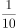质量比较好，但缺少专门的人员或机构进行市场宣传和推广，谈不上院线支持，更谈不上让中小学生知晓，所以能够上映的儿童电影少之又少，即使上映也难逃“影院一日游”。那是不是意味着儿童电影在中国已经穷途末路了？数据表明，我国未成年人数已达3.67亿，这是一个庞大的受众群体。目前的家长多是70后、80后，他们很多人有观影习惯和电影情结，而且随着生活水平的不断提高，看电影越来越成为人们重要的精神需求。因此，带着孩子去看电影也是流行趋势。

这段文字意在说明：

A. 我国儿童电影发展现状十分惨淡

B. 我国儿童电影市场其实大有可为

C. 影片质量成为阻碍电影发展的主要因素

D. 生活水平的提高有助于电影市场的拓展

第 30 题 · 答案与解析

**参考答案（粉笔题库参考内容）**

B

**解析**

文段开篇指出我国儿童电影发展现状不容乐观，存在质量较好的影片缺少宣传推广、难以上映等问题，接着通过设问引出话题，随后用数据表明我国未成年受众群体庞大，且家长有观影习惯和精神需求，带着孩子看电影是流行趋势。故文段围绕儿童电影的发展展开，通过分析受众基础和市场需求，强调儿童电影市场具有发展潜力，对应B项。

A项，对应文段开头描述我国儿童电影发展现实境况的内容，属于问题表述，非重点，排除；

C项，文段强调儿童电影发展的问题是缺少宣传推广等，而非影片质量，该项把文段强调的“宣传推广不足”偷换成“影片质量”，排除；

D项，文段重点围绕儿童电影展开，“电影市场”扩大了范围，未提及文段主题词“儿童电影”，排除。

故正确答案为B。

### 第 31 题

全国人大及其常委会和国务院行使不同的职权，其中全国人大常委会行使的职权是：

A. 批准省、自治区、直辖市的区域划分

B. 决定省、自治区、直辖市的部分地区范围内进入紧急状态

C. 决定同外国缔结的条约和重要协定的批准和废除

D. 审查和批准国民经济和社会发展计划和计划执行情况的报告

第 31 题 · 答案与解析

**参考答案（粉笔题库参考内容）**

C

**解析**

C项正确，我国《宪法》第六十七条规定：“全国人民代表大会常务委员会行使下列职权：……（十四）决定同外国缔结的条约和重要协定的批准和废除……”。A、B两项是国务院行使的职权，D项是全国人民代表大会行使的职权。

故正确答案为C。

### 第 32 题

根据我国《选举法》规定，关于全国和地方各级人民代表大会的代表候选人提名产生，下列说法不正确的是：

A. 选民10人联名推荐

B. 代表5人联名推荐

C. 各政党单独推荐

D. 各人民团体联合推荐

第 32 题 · 答案与解析

**参考答案（粉笔题库参考内容）**

B

**解析**

根据我国《选举法》第二十九条的规定，全国和地方各级人民代表大会的代表候选人，按选区或者选举单位提名产生。各政党、各人民团体，可以联合或者单独推荐代表候选人。选民或者代表，十人以上联名，也可以推荐代表候选人。A、C、D项说法均正确，B项错误。

本题为选非题，故正确答案为B。

### 第 33 题

某毒品案件中的重要证人小张因在诉讼中作证而导致其人身安全面临危险，人民法院、人民检察院和公安机关应当采取的保护措施不包括：

A. 免于其出庭作证

B. 不公开其真实姓名

C. 禁止特定人员与其接触

D. 对其住宅采取专门性保护措施

第 33 题 · 答案与解析

**参考答案（粉笔题库参考内容）**

A

**解析**

我国《刑事诉讼法》第六十四条第一款规定：“对于危害国家安全犯罪、恐怖活动犯罪、黑社会性质的组织犯罪、毒品犯罪等案件，证人、鉴定人、被害人因在诉讼中作证，本人或者其近亲属的人身安全面临危险的，人民法院、人民检察院和公安机关应当采取以下一项或者多项保护措施：（一）不公开真实姓名、住址和工作单位等个人信息；（二）采取不暴露外貌、真实声音等出庭作证措施；（三）禁止特定的人员接触证人、鉴定人、被害人及其近亲属；（四）对人身和住宅采取专门性保护措施；（五）其他必要的保护措施。”本题中，A项免于出庭作证不属于人民法院、人民检察院和公安机关应当对小张采取的保护措施。

本题为选非题，故正确答案为A。

### 第 34 题

下列组织机构的标志与其名称对应正确的是：

A. 东盟

B. 欧盟

C. 世界卫生组织

D. 联合国难民署

第 34 题 · 答案与解析

**参考答案（粉笔题库参考内容）**

B

**解析**

B项是欧洲联盟的标志，对应正确。A项是亚太经济合作组织的标志，C项是联合国难民署的标志，D项是联合国教科文组织的标志。

故正确答案为B。

### 第 35 题

宪法是一个国家的根本大法，具有至高无上的地位，环顾世界各国宪法的产生和发展历程，其又呈现出各自不同的发展轨迹和特点，下列有关世界主要国家的宪法的发展与历史的表述不正确的是：

A. 英国是典型的不成文宪法国家，英国宪法的主体由不同历史时期颁布的宪法性文件构成

B. 法国是资产阶级国家中制宪最多的国家之一，共制定过15部不同的宪法，法国现行宪法为1739年颁布的《雅各宾宪法》

C. 1787年的美国《联邦宪法》是世界上第一部成文宪法，迄今为止已经至少颁布了27个宪法修正案

D. 新中国成立后，我国共颁布了四部宪法，其中现行的为1982年颁布的宪法，该部宪法迄今已经进行了五次修订

第 35 题 · 答案与解析

**参考答案（粉笔题库参考内容）**

B

**解析**

A项正确，英国是典型的不成文宪法国家，英国宪法除包括大量宪法惯例和宪法判例外，还包括各个历史时期颁布的宪法性文件。英国之所以保持不成文宪法，主要取决于英国资产阶级革命的特点以及习惯、历史传统与文化。

B项错误，法国自18世纪资产阶级革命后，随着政治形势和阶级力量的变化，前后共制定过多部宪法。其中，1958年宪法，又称《第五共和国宪法》，是法国现行宪法。《雅各宾宪法》于1793年颁布，是法国第一部比较完整地体现资产阶级政治要求并在一定程度上反映小资产阶级和工人农民利益的宪法，但未付诸实施。

C项正确，1787年的美国《联邦宪法》是世界上第一部成文宪法，也是世界上第一部比较完整的资产阶级成文宪法。它奠定了美国政治制度的法律基础，制定后多年来附有27条修正案，迄今继续生效。

D项正确，中华人民共和国成立后，曾于1954年9月20日、1975年1月17日、1978年3月5日和1982年12月4日通过四个宪法，现行宪法为1982年宪法，并历经1988年、1993年、1999年、2004年、2018年五次修订。

本题为选非题，故正确答案为B。

### 第 36 题

根据《中共中央关于全面推进依法治国若干重大问题的决定》，下列哪些属于重大行政决策的法定程序？

①公众参与②专家论证③风险评估④合法性审查⑤集体讨论

A. ①②③⑤

B. ②③④⑤

C. ①②④⑤

D. ①②③④⑤

第 36 题 · 答案与解析

**参考答案（粉笔题库参考内容）**

D

**解析**

本题考查新思想。

党的十八届四中全会通过了《中共中央关于全面推进依法治国若干重大问题的决定》。该《决定》提出，要把公众参与、专家论证、风险评估、合法性审查、集体讨论决定确定为重大行政决策法定程序，确保决策制度科学、程序正当、过程公开、责任明确。本题中，①②③④⑤均属于重大行政决策的法定程序。

故正确答案为D。

### 第 37 题

下列人物和典故对应不正确的是：

A. 霍去病——封狼居胥

B. 祖逖——闻鸡起舞

C. 韩信——瞒天过海

D. 晋文公——退避三舍

第 37 题 · 答案与解析

**参考答案（粉笔题库参考内容）**

C

**解析**

C项“瞒天过海”对应的人物是薛仁贵，典出《永乐大典·薛仁贵征辽事略》，与薛仁贵设计让唐太宗渡船的故事有关。与韩信对应的典故，著名的有胯下之辱、一饭千金等。

A项正确：西汉骠骑将军霍去病击败匈奴后，积土为坛于狼居胥山，祭天以告成功。见《汉书·霍去病传》。后以“封狼居胥”指建立显赫功绩。

B项正确：闻鸡起舞，典出《晋书·祖逖传》。东晋时期将领祖逖年轻时就很有抱负，每次和好友刘琨谈论时局，总是慷慨激昂，满怀义愤，为了报效国家，他们在半夜一听到鸡鸣，就披衣起床，拔剑练武，刻苦锻炼。后以“闻鸡起舞”比喻志士及时奋发。

D项正确：退避三舍，意思是主动退让九十里。比喻退让和回避，避免冲突。出自《左传·僖公二十三年》：“晋楚治兵，遇于中原，其辟君三舍。”晋文公重耳兑现了他退避三舍的承诺，最终赢得了城濮之战的胜利。

本题为选非题，故正确答案为C。

### 第 38 题

关于下图，下列说法不正确的是：

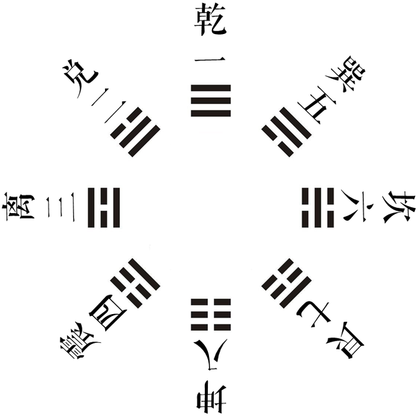

A. 是诸葛亮创造的

B. 《周易》对其有详细阐述

C. 乾清宫的命名与之存在关联

D. “坤”代表“地”和“女性”

第 38 题 · 答案与解析

**参考答案（粉笔题库参考内容）**

A

**解析**

题干中的图片为八卦图。八卦图衍生自我国古代的《河图》与《洛书》，相传最先由伏羲所创，诸葛亮则是杰出地运用了八卦图创设了八卦阵。A项说法错误，B、C、D项均正确。

本题为选非题，故正确答案为A。

### 第 39 题

关于下列诗文中的人物，下列说法不正确的是：

A. 醉翁之意不在酒，在乎山水之间也——“醉翁”是欧阳修

B. 臣本布衣，躬耕于南阳——“臣”是诸葛亮

C. 少陵野老吞声哭——“少陵野老”是杜牧

D. 座中泣下谁最多，江州司马青衫湿——“江州司马”是白居易

第 39 题 · 答案与解析

**参考答案（粉笔题库参考内容）**

C

**解析**

本题考查人文常识。

A项正确，该句出自北宋欧阳修的《醉翁亭记》。欧阳修，字永叔,号醉翁、六一居士。《醉翁亭记》全文贯穿一个“乐”字，一则暗示出一个封建地方长官能“与民同乐”的情怀；二则在寄情山水背后隐藏着难言的苦衷。

B项正确，诗句出自《出师表》，是三国时期蜀汉丞相诸葛亮在北伐中原之前给后主刘禅上书的表文，阐述了北伐的必要性以及对后主刘禅治国寄予的期望，言辞恳切，写出了诸葛亮的一片忠诚之心。

C项错误，诗句出自杜甫的《哀江头》。杜甫，字子美，自号少陵野老，唐代伟大的现实主义诗人，与李白合称“李杜”。杜甫在中国古典诗歌中的影响非常深远，被后人称为“诗圣”，他的诗被称为“诗史”。

D项正确，诗句出自白居易的《琵琶行》，此诗通过对琵琶女高超弹奏技艺和她不幸经历的描述，揭露了封建社会官僚腐败、民生凋敝、人才埋没等不合理现象，表达了诗人对她的深切同情，也抒发了诗人对自己无辜被贬的愤懑之情。“江州司马”是指自己，当时白居易被贬为江州司马。

本题为选非题，故正确答案为C。

### 第 40 题

下列反映公历八月初的农谚是：

A. 处暑动刀镰

B. 小暑不算热

C. 大暑在伏天

D. 立秋忙打靛

第 40 题 · 答案与解析

**参考答案（粉笔题库参考内容）**

D

**解析**

四个选项中的农谚，分别对应处暑、小暑、大暑、立秋四个节气。根据二十四节气的交节时间点，处暑是在公历8月22-24日之间，小暑在公历7月6-8日之间，大暑在公历7月22-24日之间，立秋在公历8月7-9日之间。因此，符合题意的是D项。

故正确答案为D。

### 第 41 题

下列作品的作者所在国家是岛国的是：

A. 《茶花女》

B. 《罗生门》

C. 《复活》

D. 《汤姆叔叔的小屋》

第 41 题 · 答案与解析

**参考答案（粉笔题库参考内容）**

B

**解析**

A项《茶花女》的作者是法国作家亚历山大·小仲马，法国位于欧洲大陆，排除；B项《罗生门》是日本作家芥川龙之介创作的短篇小说集，日本属于东亚岛国，当选；C项《复活》的作者是俄罗斯作家列夫·托尔斯泰，俄罗斯位于欧亚大陆北部，排除；D项《汤姆叔叔的小屋》的作者是美国作家斯托夫人，美国大部分领土位于北美洲大陆，排除。

故正确答案为B。

### 第 42 题

山东是儒家文化的发祥地。下列观点不属于先秦儒家代表人物观点的是：

A. 仁者爱人

B. 五德终始

C. 化性起伪

D. 尽心知天

第 42 题 · 答案与解析

**参考答案（粉笔题库参考内容）**

B

**解析**

B项“五德终始”指金、木、水、火、土所代表的五种德性周而复始的循环运转，是战国时期阴阳家邹衍所提出的历史观，用以解释历史变迁、王朝更替；A项“仁者爱人”出自《孟子·离娄下》；C项“化性起伪”出自《荀子·性恶》；D项“尽心知天”出自《孟子·尽心上》，孟子和荀子均是先秦儒家代表人物。

本题为选非题，故正确答案为B。

### 第 43 题

关于2015年山东省重大基础设施建设规划，下列表述不正确的是：

A. 启动建设济青高速公路扩容项目

B. 加快建设济南至东营等15条高速公路

C. 争取青岛新机场、菏泽机场、聊城机场开工建设

D. 加快济青高铁、鲁南铁路、石济客专、青连城际等9条铁路的建设

第 43 题 · 答案与解析

**参考答案（粉笔题库参考内容）**

D

**解析**

2015年1月，山东省省长郭树清代表山东省人民政府作了《政府工作报告》，提出2015年要继续加强重大基础设施建设，开工建设济青高铁、鲁南快速铁路，加快石济客专、青连城际等8条铁路建设进度；启动建设济青高速公路扩容项目，加快建设济南至东营等15条高速公路；争取青岛新机场、菏泽机场、聊城机场开工建设，基本完成日照机场主体工程。A、B、C三项表述均正确，D项“9条铁路”的表述错误。

本题为选非题，故正确答案为D。

### 第 44 题

中国古人一般是“因名取字”。字和名之间在意义上往往存在相同或相近、相关联、相反等关系，下列人物的名和字之间意义相反的是：

A. 诸葛亮，字孔明

B. 岳飞，字鹏举

C. 苏轼，字子瞻

D. 韩愈，字退之

第 44 题 · 答案与解析

**参考答案（粉笔题库参考内容）**

D

**解析**

D项符合题意，韩愈中的“愈”本义为“病好了”，作副词指“更加”“越发”，作动词表“胜过”“较好”，而“退之”则是“向后”之义，与“愈”意义相反。A项诸葛亮的字“孔明”指“非常明亮”，与其名“亮”意思相近；B项岳飞的字“鹏举”，典出《庄子·内篇·逍遥游》，指北方大海中的鲲化为大鹏鸟，飞上高空，与岳飞的名“飞”相关联；C项苏轼的字“子瞻”，“瞻”指远看，源自《左传》中的“登轼而望之”中的“望”，与其名“轼”相关联。

故正确答案为D。

### 第 45 题

关于交通，下列说法不正确的是：

A. “红眼航空”是航空公司正常安排的夜间飞行航班

B. 我国高速公路限制最高时速一般为110公里

C. 船舶通信方式包括视觉通信、电波通信、卫星通信等

D. 世界上首条正式运营的高速铁路是日本的新干线

第 45 题 · 答案与解析

**参考答案（粉笔题库参考内容）**

B

**解析**

B项说法错误，根据我国《道路交通安全法实施条例》的规定，我国高速公路限制最高时速为120公里。A、C、D三项说法均正确。

本题为选非题，故正确答案为B。

### 第 46 题

下列关于新能源的说法正确的是：

A. 沼气的主要成分与瓦斯相同

B. 核电站是利用核衰变发电

C. 氢气的热值低于汽油

D. 风能的来源与太阳能无关

第 46 题 · 答案与解析

**参考答案（粉笔题库参考内容）**

A

**解析**

A项说法正确，沼气和瓦斯的主要成分都是甲烷。B项错误，核电站主要利用核裂变发电；C项错误，汽油的热值约为46kJ/g，氢气的热值为143kJ/g，约为汽油的3倍；D项错误，风是由空气流动引起的自然现象，风能即是地球表面大量空气流动所产生的动能，而风是太阳辐射热引起的，因此风能的来源与太阳能有关。

故正确答案为A。

### 第 47 题

下列生活现象与大气压强无关的是：

A. 用注射器进行肌肉注射

B. 给钢笔吸取墨水

C. 茶壶上留一个小孔

D. 将吸盘挂衣钩贴在墙上

第 47 题 · 答案与解析

**参考答案（粉笔题库参考内容）**

A

**解析**

A项用注射器进行肌肉注射，是人为用力推动注射器的活塞，使注射器内压强大于人体内压强，从而将注射液压入体内，与大气压强无关。B项是利用大气压把墨水吸到钢笔的墨水囊里，C项茶壶上留小孔是为了保持茶壶内外的气压平衡，D项是利用大气压使吸盘紧贴在墙上，B、C、D三项提及的现象均与大气压强有关。

本题为选非题，故正确答案为A。

### 第 48 题

下列对于作用力的分析正确的是：

A. 推出的铅球在空中受到重力和推力的作用

B. 桨对水的推力是木船前进的动力

C. 丢入池塘的石子没入水中后，在不同深度所受浮力不同

D. 匀速行驶的汽车对放在车上的货物没有静摩擦力作用

第 48 题 · 答案与解析

**参考答案（粉笔题库参考内容）**

D

**解析**

D项分析正确，装载货物的汽车，货物与汽车之间的静摩擦力与汽车的行驶状况有关，汽车加速或减速行驶时，车上货物会受到静摩擦力作用，匀速行驶时，货物则不受静摩擦力作用。A项错误，铅球被推出去后，铅球和手之间的相互作用力消失，即手的推力消失，铅球在空中只受到重力作用；B项错误，木船前进的动力是桨推水时受到的反作用力，也就是水作用于桨的力，而不是桨对水的推力；C项错误，当石子没入水中后，所受的浮力的大小等于它排开的液体受到的重力，与深度无关。

故正确答案为D。

### 第 49 题

关于灭火器的原理和使用方法，下列说法不正确的是：

A. 泡沫灭火器使用时会产生大量的二氧化碳，将燃烧物与空气隔绝

B. 使用干粉灭火器时需要将灭火器倒立，使两种物质混合产生干粉

C. 在使用二氧化碳灭火器时，要将手放在钢瓶的木柄上以防冻伤

D. 电路失火在没切断电源之前不能使用泡沫灭火器灭火

第 49 题 · 答案与解析

**参考答案（粉笔题库参考内容）**

B

**解析**

B项说法不正确，在使用干粉灭火器时，将灭火器倒立，是为了使其中预先储存的干粉松动，不是为了产生干粉。化学泡沫灭火器使用时需要倒立，才是为了使灭火器中的两种化学物品混合发生化学反应，产生灭火的泡沫。A、C、D三项说法均正确。

本题为选非题，故正确答案为B。

### 第 50 题

关于生活常识，下列说法正确的是：

A. 数字电视将数字信号转化为模拟信号

B. 微波炉利用自身的电阻丝发出的热量来加热食物

C. 常压下蒸汽电熨斗喷出的水汽不会超过100℃

D. LED灯的发光原理与白炽灯相同

第 50 题 · 答案与解析

**参考答案（粉笔题库参考内容）**

C

**解析**

C项正确，我们看到的水汽，本质上是悬浮在空气中的小水滴，是液态水，常压下，水的沸点是100℃，液态水的温度不会超过100℃。

A项错误，数字电视是指通过接收数字电视信号来收看电视节目的一种电视类型，将数字电视信号转换成模拟信号的，是数字电视机顶盒，不是数字电视。

B项错误，微波炉主要是利用微波的能量来加热食物。

D项错误，LED灯是利用发光二极管将电能直接转化为光能，白炽灯则是利用灯丝电阻电流的热效应（电能转换为热能），使灯丝温度上升到白炽程度而发光（热能转换为光能）的。

故正确答案为C。

### 第 51 题

某次考试前三道试题的总分值是60分，已知第一题比第二题的分值少4分，第二题比第三题的分值少4分，问第三题的分值是多少分？

A. 18

B. 16

C. 24

D. 22

第 51 题 · 答案与解析

**参考答案（粉笔题库参考内容）**

C

**解析**

设第三题的分值为x，则第二题的分值为x－4，第一题的分值为x－8。三道试题的总分值＝x＋x－4＋x－8＝60，解得x＝24。

故正确答案为C。

### 第 52 题

乒乓球世界杯锦标赛上，中国队、丹麦队、日本队和德国队分在一个小组，每两个队之间都要比赛1场，已知日本队已比赛了1场，德国队已比赛了2场，中国队已比赛了3场，则丹麦队还有几场比赛未比？

A. 0

B. 1

C. 2

D. 3

第 52 题 · 答案与解析

**参考答案（粉笔题库参考内容）**

B

**解析**

因每两个队之间比赛1场，中国队已比赛了3场，则中国队与丹麦、日本、德国三队各比赛1场；日本队仅比赛1场，那么便是和中国队的比赛；德国队比赛了2场，其中一场的对手为中国队，另一场则应为丹麦队。故丹麦队已进行了与中国队、德国队的两场比赛，还有与日本的一场比赛未比。

故正确答案为B。

### 第 53 题

某市制定了峰谷分时电价方案，峰时电价为原电价的110%，谷时电价为原电价的八折，小静家六月用电400度，其中峰时用电210度，谷时用电190度，实行峰谷分时电价调整方案后小静家用电成本为调整前的多少？

A. 95.75%

B. 87.25%

C. 90.5%

D. 85.5%

第 53 题 · 答案与解析

**参考答案（粉笔题库参考内容）**

A

**解析**

赋值调整前的电价为每度10元，则峰时的电价为每度11元，谷时的电价为每度8元。调整前小静家的用电成本为400×10＝4000元，调整后小静家的用电成本为210×11＋190×8＝3830元，故调整后是调整前的(3830÷4000)×100%＝95.75%。

故正确答案为A。

### 第 54 题

某剧场A、B两间影视厅分别坐有观众43人和37人，如果把B厅的人往A厅调动，当A厅满座后，B厅内剩下的人数占B厅容量的，如果将A厅的人往B厅调动，当B厅满座后，A厅内剩下的人数占A厅容量的，问B厅能容纳多少人？

A. 56

B. 54

C. 64

D. 60

第 54 题 · 答案与解析

**参考答案（粉笔题库参考内容）**

C

**解析**

设A厅可容载的人数为a人，B厅可容载的人数为b人。依据题意可列方程组为：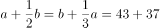，解得a＝48，b＝64。

故正确答案为C。

### 第 55 题

从甲地到乙地111千米，其中有是平路，是上坡路，是下坡路。假定一辆车在平路的速度是20千米/小时，上坡的速度是15千米/小时，下坡的速度是30千米/小时。则该车由甲地到乙地往返一趟的平均速度是多少千米/小时？

A. 19

B. 20

C. 21

D. 22

第 55 题 · 答案与解析

**参考答案（粉笔题库参考内容）**

B

**解析**

在往返过程中总上坡与总下坡的距离相等。根据等距离平均速度公式，往返过程中，上下坡的平均速度为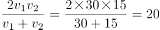千米/小时，与平路的速度相等，故往返全程的平均速度为20千米/小时。

故正确答案为B。

### 第 56 题

某企业前5个月的销售额为全年计划的，6月的销售额为600万，其上半年销售额占全年计划的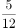，问其下半年平均每个月要实现多少万元的销售额才能完成全年的销售计划？

A. 1600

B. 1800

C. 1200

D. 1400

第 56 题 · 答案与解析

**参考答案（粉笔题库参考内容）**

D

**解析**

根据题意，6月销售额占全年计划的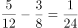，则全年销售额为万元。则下半年每月平均销售额为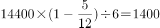万元。

故正确答案为D。

### 第 57 题

某单位从下属的5个科室各抽调了一名工作人员，交流到其他科室，如每个科室只能接收一个人的话，有多少种不同的人员安排方式？

A. 120

B. 78

C. 44

D. 24

第 57 题 · 答案与解析

**参考答案（粉笔题库参考内容）**

C

**解析**

此题为错位重排问题的变形题型，错位重排数公式为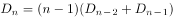。题目为5人的错位重排，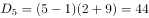种。

故正确答案为C。

【备注】常见的错位重排数为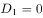，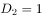，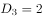，，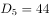。

### 第 58 题

车间领到一批电影票和球票发放给车间工人，电影票是球票数的2倍。如果每个工人发3张球票，则富余2张，如果每个工人发7张电影票，则缺6张，问车间领到多少张球票？

A. 32

B. 30

C. 64

D. 60

第 58 题 · 答案与解析

**参考答案（粉笔题库参考内容）**

A

**解析**

根据题干条件“如果每个工人发3张球票，则富余2张”，可推知球票的数量减2后，可以被3整除，观察选项只有A项符合。

故正确答案为A。

### 第 59 题

一家三口人的属相和生日都相同，父母的岁数之和是儿子的6倍，而儿子尚未满15岁，问妈妈可能多少岁？

A. 30

B. 36

C. 40

D. 42

第 59 题 · 答案与解析

**参考答案（粉笔题库参考内容）**

B

**解析**

设儿子的年龄为x岁，因三人属相均相同，故爸爸的年龄为(x+12a)岁，妈妈的年龄为(x+12b)岁。根据题干条件“父母的岁数之和是儿子的6倍”，则x+12a+x+12b=6x，化简为x = 3(a + b)。依据常识a、b 应均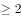，且儿子不满15 岁，则可推知儿子的年龄为3×4=12 岁，妈妈的年龄为12+2×12=36 岁。

故正确答案为B。

### 第 60 题

某次知识竞赛的决赛有3人参加，规则为12道题每题由1人以抢答方式答题，正确得10分，错误扣8分，如果最后所有人得分都是正分，且回答问题最多的人是得分最少的人，那么前两名之间的分差最多为多少分？

A. 8

B. 12

C. 20

D. 40

第 60 题 · 答案与解析

**参考答案（粉笔题库参考内容）**

D

**解析**

因为3人共回答12道题，所以回答问题最多的人至少回答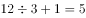道题，而此人的得分最少，且为正分，故可构造为第三名答错2题，答对3题，得分14分。依此，若第二名构造为回答2题且全答对，得分20分，第一名应构造为回答5题且全对，得分50分，这时第一名和第三名都是回答问题最多的人，均回答5道。但是题中说回答问题最多的人得分最少，显然第一名和第三名的得分不可能同时最少，排除。故第二名构造为回答3题且全对，第一名应回答4题且全对，这时候分差为40-30=10分，并无对应选项，排除。

故第三名应构造为回答6题。要让前两名的分差尽可能的大，则应让第二名的分数尽可能的少，且还应高于第三名，故应让第三名的得分尽可能的少。第三名得分相对较少的构造为答错3题，答对3题，得分6分；则第二名只需答对1道题，得分10分，第一名回答5道题且全部答对，得分50分，前两名的分差为50-10=40分。

故正确答案为D。

### 第 61 题

商场里某商品成本上涨了20%，售价只上涨了10%，毛利率（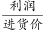）比以前下降了10个百分点。问原来的毛利率是多少？

A. 10%

B. 20%

C. 30%

D. 40%

第 61 题 · 答案与解析

**参考答案（粉笔题库参考内容）**

B

**解析**

赋值商品原来的成本为10，则现在的成本为12，原来的售价为x，则现在的售价为1.1x。根据题意则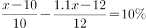，解得x＝12。故原来的毛利率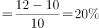

故正确答案为B。

### 第 62 题

亲子班上5对母子坐成一圈，孩子都挨着自己的母亲就坐。问所有孩子均不相邻的概率在以下哪个范围内？

A. 小于5%

B. 5%-10%

C. 10%-15%

D. 大于15%

第 62 题 · 答案与解析

**参考答案（粉笔题库参考内容）**

B

**解析**

对5对母子圆桌排列，共有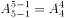种情况。同时每个孩子均可在母亲的左边或右边，即每个孩子均有两种选择，5个孩子共有种情况，故总情况数为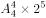；当“所有孩子均不相邻”时，满足的情况为孩子要么都在母亲的左边，要么都在母亲的右边，共2种情况，故满足的情况数为。故所求概率为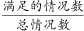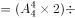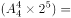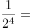6.25%，满足的范围为B项。

故正确答案为B。

### 第 63 题

某学校2012年5月份有在校生15000人，6月份毕业的学生中男女比例为1：X，剩下的学生中男女比例为1：X。9月份新生入校时发现新生的男女比例也是1：X，最终发现9月份在校生总人数比5月份多3000人，其中男生6000人。问5月份在校生中的男生人数为多少人？

A. 5000

B. 6000

C. 9000

D. 3000

第 63 题 · 答案与解析

**参考答案（粉笔题库参考内容）**

A

**解析**

9月份在校生总人数比5月份多3000人，则9月份总人数为15000+3000=18000人，其中男生6000人，则女生有18000-6000=12000人。因几次男女比例都为1：X，9月份男女比例为1：2，则5月份男女之比也为1：2，故5月份男生有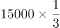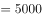人。

故正确答案为A。

### 第 64 题

在直径10米的圆形小广场上放置了7根旗杆，将距离最近的两根旗杆用绳子连起来。问绳子的长度最长可能为多少米？

A. 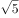

B. 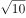

C. 5

D. 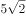

第 64 题 · 答案与解析

**参考答案（粉笔题库参考内容）**

C

**解析**

若让距离最近的两根旗杆的距离尽可能长，则应在圆心设置一根后，其余六根均匀分布在圆形广场的圆周，此时距离最近的两根旗杆的距离尽可能长。构造后发现，旗杆设置的位置即为圆心与内切正六边形的顶点，如下图所示，每两根旗杆的距离即为圆的半径，为5米。

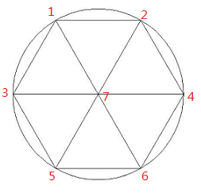

故正确答案为C。

### 第 65 题

甲、乙两人分别从A、B两地同时出发，相向而行。甲的速度是8公里/小时，乙的速度是5公里/小时，甲、乙两人相遇时，距离A、B两地的中点正好1公里。问当甲到达B地后，乙还需要多长时间才能到达A地？

A. 39分钟

B. 31分钟

C. 22分钟

D. 14分钟

第 65 题 · 答案与解析

**参考答案（粉笔题库参考内容）**

A

**解析**

当甲、乙两人相遇时，距离A、B两地的中点正好为1公里，即两人相遇时，甲比乙多走了2公里。而每小时甲比乙多走8-5=3公里，则相遇时，两人走了小时，则A、B两地之间的路程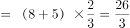公里。故当甲走到B地时，乙距离A地的路程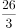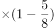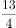公里，则乙还需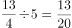小时=39分钟。

故正确答案为A。

### 第 66 题

从所给四个选项中，选择最合适的一个填入问号处，使之呈现一定的规律性。

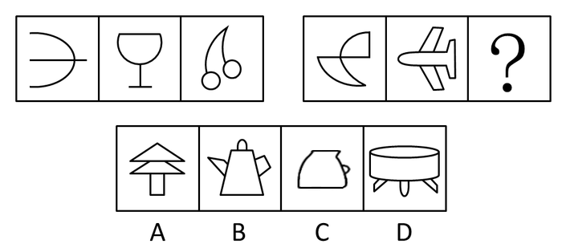

A. A

B. B

C. C

D. D

第 66 题 · 答案与解析

**参考答案（粉笔题库参考内容）**

B

**解析**

题干图形元素组成混乱，考虑数数。观察发现，第一组图形的封闭空间数量分别为0、1、2，第二组图形的封闭空间数量分别为2、3、（？），故应选择一个封闭空间数量为4的图形，只有B项符合。

故正确答案为B。

### 第 67 题

从所给四个选项中，选择最合适的一个填入问号处，使之呈现一定的规律性。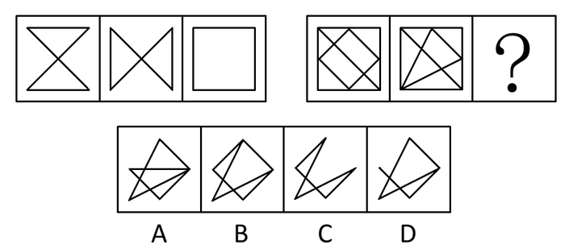

A. A

B. B

C. C

D. D

第 67 题 · 答案与解析

**参考答案（粉笔题库参考内容）**

C

**解析**

题干图形元素组成相似，考虑元素叠加。观察发现，第一组前两幅图形去同存异得到第三幅图形，则第二组应符合此规律。第二组前两幅图形去同存异得到的图形为C项图形。

故正确答案为C。

### 第 68 题

从所给四个选项中，选择最合适的一个填入问号处，使之呈现一定的规律性。

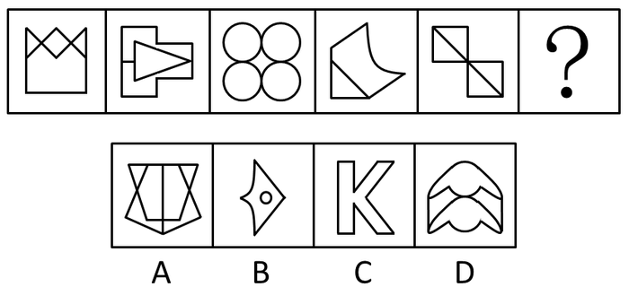

A. A

B. B

C. C

D. D

第 68 题 · 答案与解析

**参考答案（粉笔题库参考内容）**

C

**解析**

题干图形元素组成混乱，数线、数面均无规律。因第三幅图形特点较为显著，为一笔画图形，故可优先排查。观察发现，题干五幅图形均可一笔画成，选项中只有C项可以一笔画成，当选。

故正确答案为C。

### 第 69 题

从所给四个选项中，选择最合适的一个填入问号处，使之呈现一定的规律性。

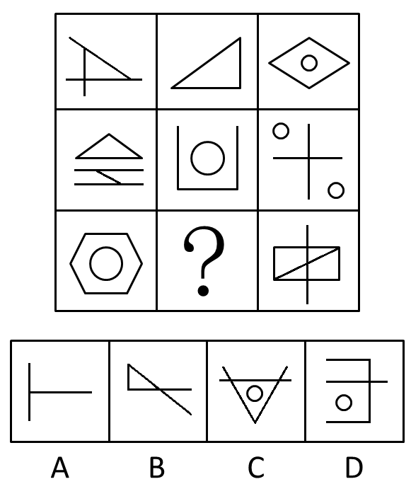

A. A

B. B

C. C

D. D

第 69 题 · 答案与解析

**参考答案（粉笔题库参考内容）**

C

**解析**

题干元素组成混乱，考虑数数，因每个图形均包含一定的封闭空间，优先考查。观察发现，题干图形封闭空间的数量，分别为：

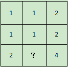

九宫格的每一列，前两个图形的封闭空间之和等于第三个图形的封闭空间数量，故问号处应选择一个封闭空间数为1+1=2的图形，只有C项符合。

故正确答案为C。

### 第 70 题

左边给定的是纸盒外表面的展开图，右边哪一项能由它折叠而成？请把它找出来。

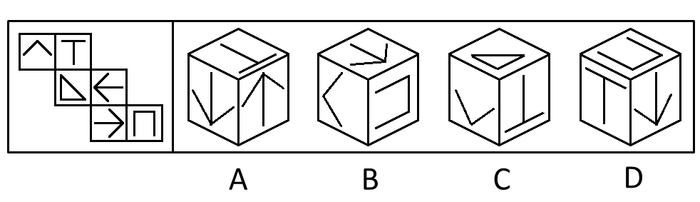

A. A

B. B

C. C

D. D

第 70 题 · 答案与解析

**参考答案（粉笔题库参考内容）**

D

**解析**

用排除法做题。

A项：“T”图形与其中一个箭头图形面为相对面关系，故在纸盒当中，“T”图形不能与两个箭头图形同时出现，排除；

B项：在题干中，“∧”图形的开口处应指向三角形的直角边，而在B项中指向了“”图形的开口处，排除；

C项：在题干中，三角形→“T”图形→“∧”图形的时针顺序为逆时针，而在C项中为顺时针，排除；

D项：与题干图形的位置关系完全吻合，当选。

故正确答案为D。

### 第 71 题

行动公众指的是不仅意识到组织行为引起的共同问题的存在，而且准备或已经采取某种解决问题的行动的公众。

根据上述定义，以下哪项涉及行动公众？

A. 某化工厂污染严重，小李带领附近居民对此进行了抗议

B. 某小区居民领取了某公司免费发放的化妆品

C. 某班学生从广告中得知某文具公司推出了新型文具

D. 多名消费者到厂家了解有关产品的生产情况

第 71 题 · 答案与解析

**参考答案（粉笔题库参考内容）**

A

**解析**

第一步：查找关键词。

定义的关键词为：“意识到组织行为引起的共同问题的存在，而且准备或已经采取某种解决问题的行动的公众”。

第二步：逐一分析选项。

A项：小李意识到污染严重，并已带领居民进行了抗议，满足定义要件。

B项：并没有涉及相关问题的存在，不满足定义要件“意识到组织行为引起的共同问题的存在”。

C项：“得知某文具公司推出了新型文具”不属于引起的共同问题。

D项：没有涉及相关问题的存在，也没有行动的出现，不满足定义要件。

故正确答案为A。

### 第 72 题

非语言沟通是相对于语言沟通而言的，是指通过身体动作、体态、语气语调、空间距离等方式交流信息进行的沟通过程。在沟通中，信息的内容部分往往通过语言来表达，而非语言则作为提供解释内容的框架来表达信息的相关部分。

根据上述定义，下列不属于非语言沟通的是：

A. 交警向驶入路口的车辆打出通行的手势

B. 接受采访时，小丽有意降低语速，显得很自信

C. 废墟下传来了求救者断断续续的敲击声

D. 谈判陷入僵局，双方代表都身体后靠，拉开距离

第 72 题 · 答案与解析

**参考答案（粉笔题库参考内容）**

C

**解析**

第一步：查找关键词。

定义关键词：“通过身体动作、体态、语气语调、空间距离等方式交流信息”。

第二步：逐一排除选项。

A项中“手势”信息满足“通过身体动作、体态、语气语调、空间距离等方式交流信息”，符合定义，排除；

B项中“降低语速”满足“通过身体动作、体态、语气语调、空间距离等方式交流信息”，符合定义，排除；

C项中“敲击声”仅为传递信息的一种方式，并非二者之间的沟通交流，不符合定义，当选；

D项中“身体后靠，拉开距离”，满足“通过身体动作、体态、语气语调、空间距离等方式交流”，符合定义，排除。

本题为选非题，故正确答案为C。

### 第 73 题

手表定律是指一个人有一只表时，可以知道现在是几点钟，而当他同时拥有两只显示时间不一致的表时却无法确定。两只表并不能告诉一个人更准确的时间，反而会使看表的人失去准确判断时间的信心。

根据上述定义，以下选项中所述内容不属于手表定律的是：

A. 在两个显示不同路线的导航系统的指挥下，驾驶员会感到非常慌张

B. 对于一个任务，目标应尽量明确，评价体系应尽量单一具体

C. 一个人走入超市，想买些什么，但是又不是很确定，最后什么也没有买

D. 一个人如果同时选择两种不同的价值观，他的行为很可能会陷于混乱

第 73 题 · 答案与解析

**参考答案（粉笔题库参考内容）**

C

**解析**

第一步：找出定义关键词。

“当一个人有一只表时，可以知道现在是几点钟”、“当同时拥有两只显示时间不一致的表时却无法确定”。（即当人只有一个标准，会很明确地作出判断，而面临两个不同的标准时，无法准确地做出判断）。

第二步：逐一分析选项。

A项：两个显示不同路线的导航系统，好比两只显示时间不一致的表，驾驶员会感到非常慌张，符合“当同时拥有两只显示时间不一致的表时却无法确定”，符合定义，排除；

B项：目标应尽量明确，评价体系应尽量单一具体，好比只有一只显示时间的表，即标准明确，则会有针对性地行动，符合“当一个人有一只表时，可以知道现在是几点钟”，符合定义，排除；

C项：此人什么都没有买是因为犹豫、不知如何选择，而不是因为存在两种不同的标准，不符合“当一个人有一只表时，可以知道现在是几点钟”、“当同时拥有两只显示时间不一致的表时却无法确定”，不符合定义，当选；

D项：两种不同的价值观，好比两只显示时间不一致的表，行为很可能会陷于混乱，符合“当同时拥有两只显示时间不一致的表时却无法确定”，符合定义，排除。

本题为选非题，故正确答案为C。

### 第 74 题

思想库是指从事于力图影响公共政策的多学科研究的独立组织。

根据上述定义，以下属于思想库的是：

A. M研究所是N企业下属的一家研究机构，专门从事N企业战略发展方面的相关研究

B. J省语言研究所在方言研究方面独树一帜，产生不少科研成果，也获得不少科研奖项

C. D研究院是一家民间机构，专门从事气候政策方面的研究，旨在为国家气候政策制定与完善提供咨询报告

D. 刘师爷是晚清绍兴师爷之一，任过几位清廷大员的幕僚，是当时有名的“智囊”人物

第 74 题 · 答案与解析

**参考答案（粉笔题库参考内容）**

C

**解析**

第一步：查找关键词。

定义的关键信息为“独立组织”“力图影响公共政策的多学科研究”。

第二步：逐一分析选项。

A项：“从事N企业战略发展方面的相关研究”与题干“力图影响公共政策的多学科研究”不符，排除。

B项：“在方言研究方面独树一帜”与题干“力图影响公共政策的多学科研究”不符，排除。

C项：“一家民间机构”“旨在为国家气候政策制定与完善提供咨询报告”满足“独立组织”力图影响公共政策的多学科研究。

D项：刘师爷并非一个“独立组织”，排除。

故正确答案为C。

### 第 75 题

逻辑学家伯特兰·罗素有个你我他定理：我坚守原则，你不知变通，他冥顽不灵；我三思而行，你迟疑不决，他反应迟钝；我节俭，你小气，他嗜钱如命；我正在沉思，你在发呆，他整天浑浑噩噩。

根据上述定义，下列符合你我他定理的是：

A. 我是活雷锋，你是好公仆，他是小官僚

B. 我好学上进，你不学无术，他不耻下问

C. 我光明磊落，你宅心仁厚，他故作聪明

D. 我无所畏惧，你趾高气扬，他盛气凌人

第 75 题 · 答案与解析

**参考答案（粉笔题库参考内容）**

D

**解析**

第一步：查找关键词。

“你”“我”“他”的感情色彩分别为：“我”为褒义；“你”稍偏贬义，程度较轻；“他”纯贬义，程度较重。

第二步：逐一排除选项。

A项中“你是好公仆”中的“好公仆”为褒义，与题干感情色彩不符，排除；

B项中“他不耻下问”中的“不耻下问”为褒义，与题干感情色彩不符，排除；

C项中“你宅心仁厚”中的“宅心仁厚”为褒义，与题干感情色彩不符，排除；

D项中“我无所畏惧”为褒义；“你趾高气扬”偏贬义，程度较轻；“他盛气凌人”为贬义，程度较重，符合定义，当选。

故正确答案为D。

### 第 76 题

把一个漂亮的鸟笼挂在房间最显眼的地方，过不了几天，主人必定会做出下面两个选择之一：把鸟笼扔掉，或者买一只鸟回来放在鸟笼里，因为这比无休止地向别人解释和说明挂一个空鸟笼要轻松得多，这就是鸟笼逻辑。并不一定每一个鸟笼里应该装进一只鸟，但可惜的是人们总是受制于惯性思维，不知变通，难以突破常规，逃不出这个逻辑的局限。

根据上述定义，下列没有反映鸟笼逻辑的是：

A. 大多数年轻人都认为结婚要先置办新房

B. 大学毕业生一般都选择先就业再择业，待职业发展成熟后再考虑创业

C. 楚国人想要偷袭宋国，派人先在河里做标记，晚上河水突然上涨，楚国人依然沿着原来的标记渡水，结果淹死了不少兵士

D. 乌鸦为了喝到瓶子里的水，把衔到的小石子放到瓶子里，使没装满水的瓶子里的水位得到上升，最终它喝到了水

第 76 题 · 答案与解析

**参考答案（粉笔题库参考内容）**

D

**解析**

第一步：查找关键词。定义的关键信息为：“人们总是受制于惯性思维，不知变通，难以突破常规”。

第二步：逐一分析选项。

A项：“大多数年轻人都认为结婚要先置办新房”体现出“人们总是受制于惯性思维”，满足定义要件。

B项：“大学毕业生一般都选择先就业再择业，待职业发展成熟后再考虑创业”，同样体现出“人们总是受制于惯性思维，不知变通，难以突破常规”。

C项：“先在河里做标记，晚上河水突然上涨，楚国人依然沿着原来的标记渡水”体现出“人们总是受制于惯性思维，不知变通”。

D项：“为了喝到瓶子里的水，把衔到的小石子放到瓶子里，使没装满水的瓶子里的水位得到上升，最终它喝到了水”体现出变通原则，并未“受制于惯性思维，不知变通”，不满足定义要件。

本题为选非题，故正确答案为D。

### 第 77 题

必要条件指的是两个句子之间的一种关系，如果由甲句子为假，可得出乙句子为假，那么就说甲句子是乙句子的必要条件。

根据上述定义，以下哪项中的前一个句子是后一个句子的必要条件？

A. 首饰柜台的营业员不是大学生，就是漂亮的女孩；首饰柜台的营业员是漂亮女孩

B. 南京景色优美，气候宜人；南京气候宜人

C. 观象台的仪器既有清代的，也有宋元的；观象台的仪器是唐代的

D. 大学教师王菲菲既是博士，又有留学海外的经历；王菲菲可以被评聘为副教授

第 77 题 · 答案与解析

**参考答案（粉笔题库参考内容）**

A

**解析**

第一步：找出定义关键词。

关键词为“如果由甲句子为假，可得出乙句子为假，那么就说甲句子是乙句子的必要条件”。

第二步：逐一分析选项。

A项：如果“首饰柜台的营业员不是大学生，就是漂亮的女孩”为假，即“首饰柜台的营业员不是大学生也不是漂亮女孩”，则可推出“首饰柜台的营业员是漂亮女孩”为假，满足定义要求，故前一个句子是后一个句子的必要条件；

B项：如果“南京景色优美，气候宜人”为假，则可推出“南京景色不优美或气候不宜人”，但并不能推出“南京气候宜人”为假；

C项：“观象台的仪器既有清代的，也有宋元的”为假，则可推出“观象台的仪器没有清代的，或没有宋元的”，但不能推出“观象台的仪器不是唐代的”；

D项：博士、海外留学经历与副教授之间无必然的逻辑联系，排除。

故正确答案为A。

### 第 78 题

市场区隔是指不断地与某一群特定消费者进行对话，了解其特定需求，通过新产品或新服务或新的沟通形式，使消费者从认识到使用产品或服务并回馈相关信息，其作用在于巩固旧市场或发现新市场。

下列最符合上述定义的是：

A. 公司员工条款规定凡内部工作人员购买本公司最新款产品，一律打8折

B. 某大型外贸市场按照食品、服装、日用百货分成三大块消费区域

C. 某时装品牌位于购物中心最显眼的位置，成为许多顾客驻足的第一站

D. 某一线运动品牌不定时进行市场调研，更新产品，受到越来越多年轻人追捧

第 78 题 · 答案与解析

**参考答案（粉笔题库参考内容）**

D

**解析**

第一步：查找关键词。

定义的关键信息为：“与某一群特定消费者进行对话”“了解其特定需求”。

第二步：逐一分析选项。

A项：并不涉及“特定消费者”，且没有“了解其特定需求”，与题干定义要件不符。

B项：按照食品、服装、日用百货分成三大块消费区域，没有体现出对“特定消费者”的针对性，与题干定义要求不符。

C项：位置显眼，与“特定消费者”无关，与题干定义要求不符。

D项：“不定时进行市场调研”“受到越来越多年轻人追捧”，指出对特定消费者——年轻人的针对性，且不定时进行市场调研——了解特定需求，符合定义要件。

故正确答案为D。

### 第 79 题

“第一时间”译自英语的“prime time”，它有两个意思，本义指“电台、电视台等受众最多的时间段”，相当于汉语的“黄金时间”；引申义指“最佳时间或最快并及时的时间”。

下列各项中“第一时间”的用法与上述定义不符合的是：

A. 学生们第一时间学会了基本的网络语

B. 媒体通过网络第一时间报道会议进程

C. 事件发生时，记者积极捕捉第一时间的独家新闻

D. 危急时刻，政府主要负责人要第一时间到达现场

第 79 题 · 答案与解析

**参考答案（粉笔题库参考内容）**

A

**解析**

第一步：查找关键词。

定义关键词：①本义指“电台、电视台等受众最多的时间段”，相当于汉语的“黄金时间”；②引申义指“最佳时间或最快并及时的时间”。

第二步：逐一排除选项。

A项中“第一时间学会了基本的网络语”，与关键词①不符，且仅体现出“快”，并未体现出“及时”，与关键词②也不相符；

B项中“第一时间报道”，体现出“最快并及时的时间”；

C项中“第一时间捕捉新闻”，体现出“最快并及时的时间”；

D项中“第一时间到达现场”，体现出“最快并及时的时间”。

本题为选非题，故正确答案为A。

### 第 80 题

大气污染物分为一次污染物和二次污染物。从污染源排放到大气后，直接污染空气称一次污染物，主要有二氧化硫、一氧化碳、氮氧化物、二氧化氮、颗粒物（飘尘、降尘、油烟等）、氮气及含氧、氮、氯、硫有机化合物以及放射性物质等。二次污染物是由于阳光照射污染物、排入环境中的一次污染物在物理、化学因素或生物的作用下发生变化，或与环境中的其他物质发生反应所形成的物理、化学性状与一次污染物不同的新污染物。

根据上述定义，下列没有提及二次污染物的是：

A. 火山爆发喷出的二氧化硫与大气中的氧结合会形成硫酸雾或硫酸盐气溶胶，引起环境酸化，后者还会通过直接或间接辐射强迫作用影响气候变化

B. 颗粒物质是漂浮在大气中的固体和液体微粒，颗粒物质能散射和吸收阳光，使可见度降低，影响交通，增加汽车与航空事故

C. 工业生产排放出的氮氧化物和乙醛会发生光化学反应生成过氧乙酰硫酸酯，该物质强烈刺激眼睛，会引起呼吸困难、心功能障碍和肺功能衰竭等一系列症状

D. 汽车发动机排放的污染物中的氮氧化物和碳氢化合物，经阳光照射，在大气中形成光化学烟雾，对人类呼吸系统产生极大危害

第 80 题 · 答案与解析

**参考答案（粉笔题库参考内容）**

B

**解析**

第一步：查找关键词。

二次污染定义关键词：①“一次污染物在物理、化学因素或生物的作用下发生变化”；②“或与环境中的其他物质发生反应所形成的物理、化学性状与一次污染物不同的新污染物”。

第二步：逐一排除选项。

A项：形成了新污染物“硫酸雾或硫酸盐气溶胶”，满足定义要件②；

B项：“使可见度降低”，但并未形成新污染物，不满足定义关键词；

C项：形成了新污染物“过氧乙酰硫酸酯”，满足定义要件②；

D项：形成了新污染物“光化学烟雾”，满足定义要件②。

本题为选非题，故正确答案为B。

### 第 81 题

颁奖：领奖

A. 受虐：施虐

B. 成功：失败

C. 盈利：亏损

D. 行贿：受贿

第 81 题 · 答案与解析

**参考答案（粉笔题库参考内容）**

D

**解析**

第一步：判断题干词语间逻辑关系。

颁奖与领奖在时间上存在一定的先后顺序，有颁奖才有领奖，且主体与客体对应。

第二步：判断选项词语间逻辑关系。

A项：有施虐才有受虐，位置与题干相反，排除。

B项：成功与失败并无时间上的先后顺序，二者为并列关系，排除。

C项：盈利与亏损并无时间上的先后顺序，二者为并列关系，排除。

D项：有行贿才有受贿，二者在时间上存在一定的先后顺序，且主、客体对应，与题干逻辑关系相符。

故正确答案为D。

### 第 82 题

耳朵：赫兹

A. 皮肤：温度

B. 鼻子：气味

C. 舌头：味蕾

D. 眼睛：波长

第 82 题 · 答案与解析

**参考答案（粉笔题库参考内容）**

D

**解析**

第一步：判断题干词语间逻辑关系。

耳朵可以识别特定范围内赫兹的声音，其中赫兹为声波频率的一种单位。

第二步：判断选项词语间逻辑关系。

A项：皮肤可以直接感触温度，温度并非一种单位，与题干逻辑关系不对应；

B项：鼻子可以直接感触气味，气味并非一种单位，与题干逻辑关系不对应；

C项：味蕾是舌头上味觉感受器，二者是组成关系，与题干逻辑关系不对应；

D项：眼睛可以识别特定范围内波长的光波，波长是光波的重要特征指标，相比较而言，与原题的逻辑关系较为一致，与题干逻辑关系对应。

故正确答案为D。

### 第 83 题

密码锁：保密

A. 打卡器：考勤

B. 防火墙：黑客

C. 监视器：摄像

D. 微博：手机

第 83 题 · 答案与解析

**参考答案（粉笔题库参考内容）**

A

**解析**

第一步：判断题干词语间逻辑关系。

密码锁的作用是保密，二者之间为功能的对应关系。

第二步：判断选项词语间逻辑关系。

A项：打卡器的作用是考勤，二者之间为功能的对应关系，与题干逻辑关系对应，当选；

B项：防火墙的作用是防护，其功能并非对应黑客，与题干逻辑关系不对应，排除；

C项：监视器的作用是监视，其功能并非对应摄像，与题干逻辑关系不对应，排除；

D项：微博与手机均为名词，二者无功能对应关系，与题干逻辑关系不对应，排除。

故正确答案为A。

### 第 84 题

潮：涨：落

A. 花：蕊：瓣

B. 草：荣：枯

C. 心：悲：喜

D. 水：沸：冰

第 84 题 · 答案与解析

**参考答案（粉笔题库参考内容）**

B

**解析**

第一步：判断题干词语间逻辑关系。

“潮涨”、“潮落”都是“潮”的不同自然周期状态，且二者均为主谓结构。

第二步：判断选项词语间逻辑关系。

A项：花蕊、花瓣都是花的组成部分，和“花”是组成关系，与题干逻辑关系不一致，排除；

B项：草荣、草枯都是“草”的不同自然周期状态，且二者均为主谓结构，与题干逻辑关系一致，当选；

C项：心悲、心喜是两种心理状态，不是“心”的自然周期状态，与题干逻辑关系不一致，排除；

D项：水沸、水冰不是“水”的自然周期状态，与题干逻辑关系不一致，排除。

故正确答案为B。

### 第 85 题

运动：热量：瘦身

A. 压力：倾诉：释放

B. 按摩：疼痛：骨骼

C. 打磨：瑕疵：平滑

D. 检查：纠正：合格

第 85 题 · 答案与解析

**参考答案（粉笔题库参考内容）**

C

**解析**

第一步：判断题干词语间逻辑关系。

运动可以消耗热量，以此达到瘦身的目的。第一项为第二项的解决方式，第三项为第一项的目的。

第二步：判断选项词语间逻辑关系。

A项：压力并非倾诉的解决方式，二者顺序颠倒，排除；

B项：骨骼为名词，与题干词性不同，排除；

C项：打磨可以消除瑕疵，以此达到平滑的目的，逻辑关系与题干对应，当选；

D项：检查并非纠正的解决方式，与题干逻辑关系不符，排除。

故正确答案为C。

### 第 86 题

律师：厨师：职业

A. 大学生:中学生:学校

B. 博士：硕士:学位

C. 作者：记者：学者

D. 飞机：飞船：飞行

第 86 题 · 答案与解析

**参考答案（粉笔题库参考内容）**

B

**解析**

第一步：判断题干词语间逻辑关系。

律师与厨师之间为并列关系，都与职业构成种属关系。

第二步：判断选项词语间逻辑关系。

A项：大学生、中学生与学校之间非种属关系，排除；

B项：博士与硕士为并列关系，都与学位构成种属关系，与题干逻辑关系对应，当选；

C项：作者和记者之间为并列关系，和学者不是种属关系，排除；

D项：飞机、飞船与飞行之间非种属关系，排除。

故正确答案为B。

### 第 87 题

实验员：试管：器具

A. 司机：公交车：交通工具

B. 农民：水稻：作物

C. 职员：电脑：科技

D. 雕塑家：雕塑：艺术品

第 87 题 · 答案与解析

**参考答案（粉笔题库参考内容）**

A

**解析**

第一步：判断题干词语间逻辑关系。

实验员与试管之间为对应关系，试管是实验员的工作工具，试管与器具之间为种属关系，试管是一种器具。

第二步：判断选项词语间逻辑关系。

A项：公交车是司机的工作工具，是交通工具的一种，逻辑关系与题干对应，当选；

B项：水稻并非农民的工作工具，而是农民工作的对象，排除；

C项：电脑与科技之间非种属关系，而是科技工具的一种，排除；

D项：雕塑并非雕塑家的工作工具，而是雕塑家工作的对象，排除。

故正确答案为A。

### 第 88 题

潮汐：月球引力：太阳引力

A. 地震：海啸：火山喷发

B. 车祸：违章驾驶：醉驾

C. 污染：人为活动：尾气排放

D. 泥石流：暴雨：乱砍乱伐

第 88 题 · 答案与解析

**参考答案（粉笔题库参考内容）**

D

**解析**

第一步：判断题干词语间逻辑关系。

潮汐是由于日、月和近地行星对地球引力变化所导致的地球周期性形变及表面流体层的周期性运动。月球引力和太阳引力共同作用会引发潮汐，后两个词共同与第一个词构成因果关系。

第二步：判断选项词语间逻辑关系。

A项：海啸是由海底地震、火山喷发或海底塌陷、滑坡等所激起的海水剧烈波动。地震会导致海啸，第一个词与第二个词构成因果关系，但词语顺序与题干相反，与题干逻辑关系不一致，排除；

B项：违章驾驶和醉驾均可导致车祸的发生，不需两原因共同作用，与题干逻辑关系不一致，排除；

C项：人为活动和尾气排放均可导致污染产生，不需两原因共同作用，与题干逻辑关系不一致，排除；

D项：泥石流是暴雨和乱砍乱伐共同导致的结果，后两个词共同与第一个词构成因果关系，与题干逻辑关系一致，当选。

故正确答案为D。

### 第 89 题

歼击机对于（    ）相当于（    ）对于通信

A. 军事 卫星

B. 空战 手机

C. 客机 探测

D. 雷达 网络

第 89 题 · 答案与解析

**参考答案（粉笔题库参考内容）**

B

**解析**

第一步：判断题干词语间逻辑关系。

题目为间隔型类比题型，首先可采取词性对应的方法排除部分选项，然后代入排除解题。

第二步：判断选项词语间逻辑关系。

A项：歼击机是一种军事工具，但卫星并不一定为一种通信工具，也可能为探测工具，侦查工具，不能够唯一对应，排除；

B项：歼击机的主要功能是用于空战，手机的主要功能是用于通信，与题干逻辑关系一致，当选；

C项：歼击机与客机是并列关系，但后两个词，探测和通信无必然联系，前后逻辑关系不一致，排除 ；

D项：歼击机与雷达之间为并列关系，网络与通信之间为对应关系，排除。

故正确答案为B。

### 第 90 题

版权对于（  ）相当于（  ）对于军衔

A. 作品 军人

B. 权利 上将

C. 著作权 级别

D. 智力 战争

第 90 题 · 答案与解析

**参考答案（粉笔题库参考内容）**

B

**解析**

第一步：判断题干词语间逻辑关系。

题目为间隔型类比题型，需采取代入排除的方法。

第二步：判断选项词语间逻辑关系。

A项：每部作品都应该有与之相对应的版权，每个军人都应该有与之相对应的军衔，但是二者前后顺序反了，并且，版权是一种权利，军人是人，二者逻辑关系不完全一致，排除。

B项：版权属于权利的一种，为种属关系，上将属于军衔的一种，逻辑关系相同，当选。

C项：版权与著作权之间为同一关系，著作权即版权，级别与军衔之间非同一关系，排除。

D项：版权与智力、战争与军衔之间，无明显逻辑关系，排除。

故正确答案为B。

### 第 91 题

对于权力，有人这样主张：有实权干大事，有虚权干实事，没权了干好事。

以下哪项最不可能从上述主张中推出：

A. 没有权，不干好事

B. 没有虚权，不干实事

C. 有权了，干好事

D. 没有实权，不干大事

第 91 题 · 答案与解析

**参考答案（粉笔题库参考内容）**

A

**解析**

第一步：翻译题干。

（1）实权干大事；

（2）虚权干实事；

（3）无权干好事。

第二步：逐一分析选项。

A项：翻译为：无权不干好事，是对条件（3）的肯前，肯前必肯后，可以推出干好事，一定无法推出不干好事，当选；

B项：翻译为：无虚权不干实事，是对条件（2）的否前，否前得不出必然结论，可能推出不干实事，排除；

C项：翻译为：有权干好事，是对条件（3）的否前，否前得不出必然结论，可能推出干好事，排除；

D项：翻译为：无实权不干大事，是对条件（1）的否前，否前得不出必然结论，可能推出不干大事，排除。

本题为选非题，故正确答案为A。

### 第 92 题

某单位员工除了基本工资之外，其收入很大一部分来源于绩效工资。在今年4月份，该单位第一项目组所有员工的绩效工资高于第二组员工的最高绩效工资，但是该单位本月绩效工资最高的员工并不在第一项目组。

由此可以推出：

A. 该单位领导的绩效工资最高

B. 该单位其他项目组有些员工的绩效工资没有第一、第二项目组平均的高

C. 该单位有些员工既不属于第一项目组也不属于第二项目组

D. 第二项目组的平均绩效工资低于单位的平均绩效工资

第 92 题 · 答案与解析

**参考答案（粉笔题库参考内容）**

C

**解析**

题干的逻辑现象为：第一项目组所有员工的绩效工资高于第二组员工的最高绩效工资，但是该单位本月绩效工资最高的员工并不在第一项目组。

A项：题干中并无领导的相关说明，属于无中生有。

B项：题干中并无其他员工的绩效工资的相关说明，属于无中生有。

C项：因为第一项目组所有员工的绩效工资全部高于第二组员工，而最高的员工却不在第一组，故可说明“有些员工既不属于第一项目组也不属于第二项目组”。

D项：题干并无单位平均绩效工资的相关说明，属于无中生有。

故正确答案为C。

### 第 93 题

研究人员设计了这样一个实验。他们从实验鼠体内收集了神经细胞并且将它们植入到家鼠大脑内。实验鼠的寿命大约只有18个月。而家鼠的寿命是它们的两倍。研究人员发现，当家鼠死亡的时候，从实验鼠植入的神经细胞依然存活。

以下哪项可以作为上述实验的结论？

A. 实验鼠的神经细胞比它们所属的生物体的寿命更长

B. 家鼠的神经细胞寿命长于实验鼠的神经细胞寿命

C. 实验鼠的神经细胞寿命长于家鼠的神经细胞寿命

D. 神经细胞可以通过移植而得到无限期的存活

第 93 题 · 答案与解析

**参考答案（粉笔题库参考内容）**

A

**解析**

题干的逻辑现象为：实验鼠的寿命大约只有18个月。而家鼠的寿命是它们的两倍。当家鼠死亡的时候，从实验鼠植入的神经细胞依然存活。

A项：家鼠的寿命是实验鼠的两倍，但是当家鼠死亡时，实验鼠的神经细胞却依然存活，故可说明实验鼠的神经细胞的寿命比其生物体的寿命要长，A项可以推出；

B项、C项：题干中并无家鼠神经细胞的相关说明，不能推出；

D项：“无限期的存活”表述过于绝对，由题干说明不能推出。

故正确答案为A。

### 第 94 题

感冒是自限性疾病，一到两周之后会自愈。如果忍受得了，完全没有必要吃那些缓解症状的感冒药，注意多喝水和休息即可。忍受不了，可吃点缓解症状的感冒药也行，但普通感冒药并不真正治疗感冒。

以下哪项如果为真，能够削弱上述观点？

A. 吃药缓解症状可加速感冒的治愈

B. 感冒会自愈，吃药的作用在于缓解症状

C. 多喝水多休息有利于感冒的自愈

D. 感冒药可缓解咳嗽、鼻涕等症状

第 94 题 · 答案与解析

**参考答案（粉笔题库参考内容）**

A

**解析**

第一步：找出论点和论据。

论点：普通感冒药并不真正治疗感冒。

论据：无明显论据。

第二步：逐一分析选项。

A项：吃药缓解症状可加速感冒的治愈，说明吃感冒药可以促进感冒的治愈，直接削弱论点，当选；

B项：“缓解”与“治愈”非同一概念，且进一步说明“感冒会自愈”，不能削弱，排除；

C项：多喝水有利于感冒的自愈与感冒药能不能治疗感冒无关，无关选项，排除；

D项：强调感冒药确实可以缓解感冒症状，但到底能否治疗感冒没有涉及，不能削弱，排除。

故正确答案为A。

### 第 95 题

小王、小张、小赵、小刘四人讨论比赛四强的甲、乙、丙、丁四个队伍哪个将获得冠军。

小王：“乙是冠军”。

小张：“冠军是丁或丙”。

小赵：“冠军是甲或丁”。

小刘：“甲和丙不是冠军”。

结果出来后，只有两个人的推断是正确的，冠军是：

A. 甲

B. 乙

C. 丙

D. 丁

第 95 题 · 答案与解析

**参考答案（粉笔题库参考内容）**

B

**解析**

第一步：分析题干条件。

小王：乙；

小张：丁 或 丙；

小赵：甲 或 丁；

小刘：-甲 且 -丙。

题干条件没有矛盾关系，也没有反对关系，且冠军唯一，可以考虑代入法。

第二步：逐一代入选项。

代入A项，小王说的为假，小张说的为假，小赵说的为真，小刘说的为假，推断为只有一真，与题干中的条件“只有两个人的推断是正确的”不相符，排除。

代入B项，小王说的为真，小张说的为假，小赵说的为假，小刘说的为真，推断为两真两假，与题干中的条件“只有两个人的推断是正确的”相符，当选。

代入C项，小王说的为假，小张说的为真，小赵说的为假，小刘说的为假，推断为只有一真，与题干中的条件“只有两个人的推断是正确的”不相符，排除。

代入D项，小王说的为假，小张说的为真，小赵说的为真，小刘说的为真，推断为只有一假，与题干中的条件“只有两个人的推断是正确的”不相符，排除。

故正确答案为B。

### 第 96 题

通常情况下，人体内的瘦素和胰岛素能帮人管住嘴巴，一旦吃饱就会发出信号传至大脑，告知人们停止进食。而垃圾食品中含有过量的饱和脂肪，饱和脂肪分子会屏蔽这些停止进食的信号。

由此可以得出：

A. 整体均衡饮食，保持营养全面是维护健康的最关键因素

B. 垃圾食品不仅会导致肥胖，还会诱发其他疾病

C. 垃圾食品中含有的饱和脂肪大大超过其他食品

D. 吃饱的信号传至大脑可避免饮食过度

第 96 题 · 答案与解析

**参考答案（粉笔题库参考内容）**

D

**解析**

题干说明的逻辑现象为：人体内的瘦素和胰岛素能帮人管住嘴巴，一旦吃饱就会发出信号传至大脑，告知人们停止进食。而垃圾食品中含有过量的饱和脂肪，饱和脂肪分子会屏蔽这些停止进食的信号。

A项“整体均衡饮食”“维护健康”在题干中均未提及，不能推出。

B项：“诱发其他疾病”在题干中未提及，不能推出。

C项：垃圾食品中含有的饱和脂肪“大大超过”其他食品，与题干的“过量”并不相符，不能推出。

D项：吃饱的信号传至大脑可避免饮食过度，题干中指出“人体内的瘦素和胰岛素能帮人管住嘴巴，一旦吃饱就会发出信号传至大脑，告知人们停止进食”，语义相符，可以推出。

故正确答案为D。

### 第 97 题

所有来自中国的留学生，都住在校园内；所有住在校园内的学生，都必须参加运动会；有些中国留学生加入了学生会；有些心理学专业的学生也加入了学生会；所有心理学专业的学生都没有参加运动会。

由此不能推出以下哪项结论？

A. 所有中国留学生都参加了运动会

B. 没有一个心理学专业的学生住在校园内

C. 有些中国留学生是学心理学专业的

D. 有些学生会成员没有参加运动会

第 97 题 · 答案与解析

**参考答案（粉笔题库参考内容）**

C

**解析**

题干的逻辑关系为：中国留学生住校参加运动会，心理学学生没有参加运动会。

A项：由第一个推出命题可以推出。

B项：心理学专业学生没有参加运动会非住校，可以推出。

C项：中国留学生参加运动会非心理学专业学生，即中国留学生全部不是心理学专业学生。C项为其矛盾命题，不能推出。

D项：因为心理学专业学生都没有参加运动会，而有些心理专业的学生也加入了学生会，故有些学生会成员没有参加运动会，可以推出。

本题为选非题，故正确答案为C。

### 第 98 题

考古学家对安第斯地区出土的900年到2800年前的人类骨骼进行了研究。从中提取出的某些化学同位素成分，反映出那里的人当时多以玉米为食。“玉米文化”带动了安第斯地区的人口增长，当时爆发的几次大规模战争也与争夺稀缺的适种玉米的土壤有关，战争导致了社会体系不断变革和发展。因此他们得出结论“农业推动了古代安第斯社会的发展”。

以下哪项如果为真，最能质疑上述结论？

A. 安第斯地区的印加文明早在2800年前就经历了几次较大的社会变革

B. 安第斯地区3600年前的人类以沿海打渔为主，直到2800年前左右才逐渐向内陆迁徙

C. 从人类骨骼中提取的另一些化学同位素反映了人们当时也食用马铃薯和豆类

D. 安第斯地区的社会体系拥有中央政府和地方政府，后又衍生出多种社会形态

第 98 题 · 答案与解析

**参考答案（粉笔题库参考内容）**

B

**解析**

第一步：找出论点和论据。

论点：农业推动了古代安第斯社会的发展。

论据：考古学家对安第斯地区出土的900年到2800年前的人类骨骼进行了研究。从中提取出的某些化学同位素成分，反映出那里的人当时多以玉米为食。“玉米文化”带动了安第斯地区的人口增长，当时爆发的几次大规模战争也与争夺稀缺的适种玉米的土壤有关，战争导致了社会体系不断变革和发展。

要质疑题干结论就要指出，并非是农业推动了古代安第斯社会的发展。

第二步：逐一判断选项。

A项：印加文明早在2800年前就经历了几次较大的社会变革，几次大的社会变革是否与农业有关尚未说明，不能够削弱题干结论，排除；

B项：说明2800年前安第斯地区人类是以渔业为主，并非农业，故能削弱题干结论，当选；

C项：从人类骨骼中提取的另一些化学同位素反映了人们当时也食用马铃薯和豆类，削弱的为题干的“玉米”而非“农业”，排除；

D项：“中央政府和地方政府”，与是否是农业推动了安第斯地区的发展无关，不能够削弱题干结论，排除。

故正确答案为B。

### 第 99 题

谷子大约在5000万年前开始从水稻中分化出来，分化之后的基因组结构仍存在明显的共线性。研究人员发现谷子的2号和9号染色体分别由水稻的7号和9号、3号和10号染色体融合而成。同时，他们发现这两次融合事件也发生在高粱的染色体中，由此，研究人员推测这两次染色体融合事件应该发生在高粱从谷子中分化出来之前。

上述推理需要以下哪项作为前提？

A. 高粱从谷子中分化出来发生在谷子从水稻中分化出来之后

B. 高粱与谷子之间的共线性小于高粱和水稻之间的共线性

C. 3号和10号染色体融合之后不大可能再分离开来

D. 谷子由水稻分化出来之后又发生一次染色体融合事件

第 99 题 · 答案与解析

**参考答案（粉笔题库参考内容）**

A

**解析**

第一步：找出论点和论据。

论点：两次染色体融合事件应该发生在高粱从谷子中分化出来之前。

论据：研究人员发现谷子的2号和9号染色体分别由水稻的7号和9号、3号和10号染色体融合而成。同时，他们发现这两次融合事件也发生在高粱的染色体中。

若要题干论证成立，需在时间的设置上做出说明，即必须说明高粱从谷子分化的时间晚于谷子从水稻分化的时间。

第二步：逐一判断选项。

A项：说明高粱从谷子中分化出来发生在谷子从水稻中分化出来之后，是题干必须要补充的前提 ，当选；

B项：高粱与谷子之间的共线性小于高粱和水稻之间的共线性，共线性是由“基因组结构”决定的，而非时间决定，不是题干所必须要补充的前提，排除；

C项：染色体能否继续融合分化，与时间无关，不是题干所必须要补充的前提，排除；

D项：同样未说明时间，不是题干所必须要补充的前提，排除。

故正确答案为A。

### 第 100 题

很多医学者专家提出过量饮用咖啡对健康有害。为验证过量饮用咖啡对心脏的影响，研究人员选取了两组被试者。第一组被试者每天饮用5杯或5杯以上咖啡，第二组被试者从不饮用咖啡。一段时间后发现，第一组被试者中患心脏病的比例明显高于第二组被试者。因此，研究人员得出结论，过量饮用咖啡会增加患心脏病的风险。

以下哪项如果为真，最能质疑上述论证：

A. 研究发现，每日饮用2杯咖啡的人心脏功能未受影响

B. 在研究期间，第一组被试者每日的运动量远远小于第二组被试者

C. 除影响心脏功能外，咖啡中所含的咖啡因还易引发焦虑症

D. 第一组被试者中部分人每日饮用10杯咖啡

第 100 题 · 答案与解析

**参考答案（粉笔题库参考内容）**

B

**解析**

第一步：找出论点和论据。

论点：过量饮用咖啡会增加患心脏病的风险。

论据：第一组被试者每天饮用5杯或5杯以上咖啡，第二组被试者从不饮用咖啡。一段时间后发现，第一组被试者中患心脏病的比例明显高于第二组被试者。

要质疑论证，只需说明过量饮用咖啡并不会增加患心脏病的风险，或者说明是由其他原因导致增加患心脏病的风险，而非饮用咖啡。

第二步：逐一判断选项。

A项中“每日饮用2杯咖啡的人心脏功能未受影响”，不存在过量饮用，且“人心脏功能未受影响”与是否能够增加患心脏病的风险无关，排除；

B项中第一组的运动量远远小于第二组，说明可能是运动量小导致增加患心脏病的风险，说明测试的两组样本不具可比性，当选；

C项中焦虑症并非题干论证的要点，属无关项，排除；

D项中题干的论点在于“饮用过量是否会增加患心脏病”的风险，与数量无关，排除。

故正确答案为B。

## 材料 1

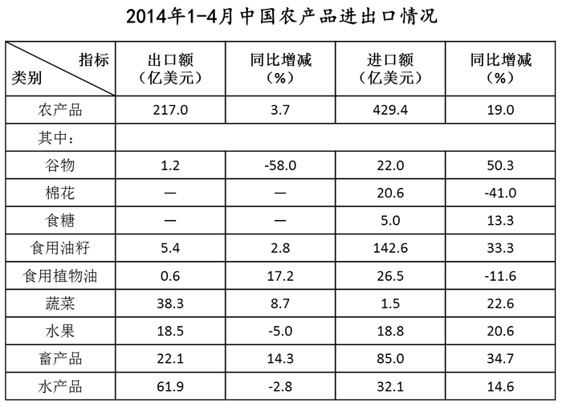

### 第 101 题

2014年1—4月，以下哪种农产品进出口总额占同期农产品进出口总额的比重超过20%？

A. 食用油籽

B. 蔬菜

C. 畜产品

D. 水产品

第 101 题 · 答案与解析

**参考答案（粉笔题库参考内容）**

A

**解析**

根据题干“2014年1—4月······比重超过20%”，可判定此题为现期比重比较问题。所求为占比超过20%，只能是四个选项中进出口总额最大的农产品。定位表格可得，2014年1—4月选项中农产品进出口总额分别为：

A项食用油籽：5.4+142.6=148亿美元；

B项蔬菜：38.3+1.5=39.8亿美元；

C项畜产品：22.1+85.0=107.1亿美元；

D项水产品：61.9+32.1=94亿美元。

A项食用油籽的进出口总额最大，故只有A项所占比重可能超过20%。

故正确答案为A。

### 第 102 题

2013年1—4月，以下农产品进出口贸易额呈现顺差关系的是：

A. 谷物

B. 食用油籽

C. 畜产品

D. 水果

第 102 题 · 答案与解析

**参考答案（粉笔题库参考内容）**

D

**解析**

根据题干“2013年1—4月······进出口贸易额呈现顺差关系”，“顺差”即出口额>进口额，资料所给时间为2014年1—4月，可判定此题为基期比较问题。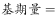，代入表格数据，2013年1—4月选项中农产品进出口贸易额分别为：

A项谷物：出口额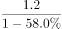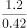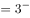亿美元，进口额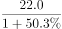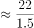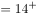亿美元；

B项食用油籽：出口额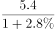亿美元，进口额亿美元；

C项畜产品：出口额亿美元，进口额亿美元；

D项水果：出口额亿美元，进口额亿美元。

满足出口额>进口额，呈现顺差关系的只有D项水果。

故正确答案为D。

### 第 103 题

2014年1—4月，食用植物油进出口总额比上年同期约：

A. 减少了11%

B. 增加了3%

C. 增加了11%

D. 减少了3%

第 103 题 · 答案与解析

**参考答案（粉笔题库参考内容）**

A

**解析**

根据题干“进出口总额比上年同期约”，结合选项均为百分数，进出口总额=进口额+出口额，可判定此题为混合增长率问题。定位表格可得，2014年1—4月，食用植物油的出口额为0.6亿美元，同比增长17.2%，进口额为26.5亿美元，同比增长-11.6%。根据混合增长率结论，居中且偏向基数较大的。观察数据发现，基期出口额远小于基期进口额，对于进出口总额，可几乎忽略不计，因此，2014年1—4月，进出口总额的增长率应非常接近进口额的增长率-11.6%，A项“减少了11%”与之最接近。

故正确答案为A。

### 第 104 题

表中2014年1—4月进口额与出口额都高于上年同期水平的农产品有几类？

A. 2

B. 3

C. 4

D. 5

第 104 题 · 答案与解析

**参考答案（粉笔题库参考内容）**

B

**解析**

“进口额与出口额都高于上年同期水平”，即进口额与出口额的增长率均为正值。定位表格，满足条件的农产品有：食用油籽、蔬菜、畜产品，共3类。

故正确答案为B。

### 第 105 题

关于2014年1—4月农产品进出口贸易，能够从上述资料中推出的是:

A. 超出半数农产品进口额同比增速低于农产品平均增速

B. 食用油籽出口额占总出口额比重高于上年同期

C. 上年同期棉花进口额低于谷物

D. 农产品进出口贸易差高于上年同期

第 105 题 · 答案与解析

**参考答案（粉笔题库参考内容）**

D

**解析**

A项：定位表格，农产品进口额平均增速为19.0%，进口额同比增速低于19.0%的农产品有：棉花、食糖、食用植物油、水产品，共4类，表中所有农产品共9类，，未超过半数，错误。

B项：定位表格，食用油籽出口额同比增长2.8%，农产品总出口额同比增长3.7%，部分增长率2.8%&lt;整体增长率3.7%，根据两期比重结论，判断比重下降，即食用油籽出口额占总出口额比重低于上年同期，错误。

C项：定位表格，2014年1—4月，棉花进口额为20.6亿美元，同比增长-41.0%，谷物进口额为22.0亿美元，同比增长50.3%，代入公式：，上年同期棉花进口额亿美元，谷物进口额亿美元，上年同期棉花进口额高于谷物，错误。

D项：定位表格，2014年1—4月，农产品出口额为217.0亿美元，同比增长3.7%，进口额为429.4亿美元，同比增长19.0%，则进出口贸易差=429.4-217.0=212.4亿美元，上年同期进出口贸易差亿美元，即农产品进出口贸易差高于上年同期，正确。

故正确答案为D。

## 材料 2

### 第 106 题

2009—2012年，城镇私营单位就业人员年平均工资同比增长不到3000元的年份有几个？

A. 0

B. 1

C. 2

D. 3

第 106 题 · 答案与解析

**参考答案（粉笔题库参考内容）**

C

**解析**

根据题干“······同比增长不到3000元的年份有几个”，可判定此题为增长量计算问题。定位统计图可得2009—2012年每年对应的平均工资以及对应的同比增速。代入公式，，满足增长量不到3000元的有：2009年为元，2010年为20759-18199=2560元。

故正确答案为C。

### 第 107 题

如果按照2013年的同比增量计算，城镇私营单位就业人员年平均工资在哪一年超过5万元？

A. 2017年

B. 2018年

C. 2019年

D. 2020年

第 107 题 · 答案与解析

**参考答案（粉笔题库参考内容）**

B

**解析**

根据题干“在哪一年超过5万元”，可判定此题为现期计算问题。定位统计图可得，2013年城镇私营单位就业人员年平均工资的同比增量=32706-28752=3954元，按照2013年同比增量计算，年平均工资达到5万元需要年，即5年，则年平均工资在2018年超过5万元。

故正确答案为B。

### 第 108 题

2013年就业人员平均工资与城镇私营单位就业人员年平均工资最接近的行业，其2012年的平均工资比城镇私营单位：

A. 高300多元

B. 高900多元

C. 低500多元

D. 低600多元

第 108 题 · 答案与解析

**参考答案（粉笔题库参考内容）**

B

**解析**

定位统计图，2013年城镇私营单位就业人员年平均工资为32706元，2012年为28752元，定位表格，2013年就业人员平均工资与32706元最接近的行业是采矿业（33081元），2012年采矿业就业人员平均工资为29684元。2012年采矿业就业人员平均工资比城镇私营单位高29684-28752=932元，即高900多元。

故正确答案为B。

### 第 109 题

以下哪个行业2013年平均工资的同比增速超过15%？

A. 科学研究和技术服务业

B. 农、林、牧、渔业

C. 建筑业

D. 信息传输、软件和信息技术服务业

第 109 题 · 答案与解析

**参考答案（粉笔题库参考内容）**

A

**解析**

根据题干“同比增速超过15%”，可判定本题为一般增长率问题。。代入表格数据，A项科学研究和技术服务业：16.7%。或者可以采用逆向思维：元，实际值42854>42090，因此科学研究和技术服务业的同比增速大于15%。

故正确答案为A。

### 第 110 题

能够从上述资料中推出的是：

A. 表中所有行业2012年的人均月工资都不足3000元

B. 表中只有3个行业2013年的人均工资不在3-4万元的范围

C. 金融业2013年人均工资同比增量低于交通运输、仓储和邮政业

D. 图中平均工资同比增速最快与同比增量最大的年份是同一年

第 110 题 · 答案与解析

**参考答案（粉笔题库参考内容）**

C

**解析**

A项：平均数计算。观察表格，2012年科学研究和技术服务业，信息传输、软件和信息技术服务业的年均工资都大于36000元，月均工资=年均工资÷12，月均工资超过了3000元，并非表中所有行业2012年的人均月工资都不足3000元，错误。

B项：定位表格，2013年的人均工资不在3万-4万元的范围的行业是：农、林、牧、渔业（24645元），住宿和餐饮业（27352元），信息传输、软件和信息技术服务业（44060元），科学研究和技术服务业（42854元），共4个行业，错误。

C项：增长量=现期量–基期量，代入表格数据，2013年金融业人均工资同比增量=37253–32696=4557元，交通运输、仓储和邮政业人均工资同比增量=33141–28159=4982元，金融业同比增量低于交通运输、仓储和邮政业同比增量，正确。

D项：定位统计图，平均工资同比增速最快的是2011年，2011年的同比增量=24556–20759=3797元，2012年的同比增量=28752–24556=4196元，故2011年同比增量并非最大，错误。

故正确答案为C。

## 材料 3

### 第 111 题

与2012年相比，2013年土地供应增加面积最多的是：

A. 工矿仓储用地

B. 商服用地

C. 基础设施等其他用地

D. 住宅用地

第 111 题 · 答案与解析

**参考答案（粉笔题库参考内容）**

D

**解析**

根据题干“增加面积最多”，可判定此题为增长量比较问题。增长量=现期量–基期量，代入统计图数据可得，2013年选项中各项土地供应面积比2012年增加情况如下：

A项工矿仓储用地：21.00-20.72=0.28万公顷；

B项商服用地：6.51-5.09=1.42万公顷；

C项基础设施等其他用地：31.73-33.85=-2.12万公顷；

D项住宅用地：13.81-11.47=2.34万公顷。

增加面积最多的是D项住宅用地。

故正确答案为D。

### 第 112 题

以下几个年份中，国有建设用地供应面积同比增量最多的年份是：

A. 2010年

B. 2011年

C. 2012年

D. 2013年

第 112 题 · 答案与解析

**参考答案（粉笔题库参考内容）**

B

**解析**

根据题干“同比增量最多”，可判定此题为增长量比较问题。增长量=现期量-基期量，国有建设用地供应面积为统计图中四项用地供应面积之和。2011年柱状高度与上年的高度差大于2010年、2012年、2013年，故2011年同比增量最多。

故正确答案为B。

### 第 113 题

2013年工矿仓储用地占国有建设用地供应面积的比重约为：

A. 21.0%

B. 28.7%

C. 33.3%

D. 42.8%

第 113 题 · 答案与解析

**参考答案（粉笔题库参考内容）**

B

**解析**

根据题干“2013年······占······的比重”，可判定此题为现期比重计算问题。定位统计图可得，2013年，工矿仓储用地面积为21.00万公顷，国有建设用地供应面积为6.51+31.73+13.81+21.00=73.05万公顷。比重，最接近B项。

故正确答案为B。

### 第 114 题

以下哪条曲线能正确反映2009-2013年住宅用地面积的变化情况？

A. 

B. 

C. 

D. 

第 114 题 · 答案与解析

**参考答案（粉笔题库参考内容）**

C

**解析**

定位统计图，2009-2013年，住宅用地面积分别为8.15万公顷、11.53万公顷、12.65万公顷、11.47万公顷、13.81万公顷，面积变化情况为：升—升—降—升，观察选项，C项曲线符合条件。

故正确答案为C。

### 第 115 题

能够从上述资料中推出的是：

A. 2009—2013年，商服用地供应量占国有建设用地的比重均低于10%

B. 2010—2013年，基础设施等其他用地面积均高于工矿仓储用地面积

C. 2010年我国国有建设用地供给总面积首次突破45万公顷

D. 2012年基础设施等其他用地面积超过其他3项用地面积之和

第 115 题 · 答案与解析

**参考答案（粉笔题库参考内容）**

A

**解析**

A项：定位统计图，2009-2013年，商服用地供应量分别为2.76万公顷、3.89万公顷、4.26万公顷、5.09万公顷、6.51万公顷，国有建设用地供应量分别为万公顷、万公顷、万公顷、万公顷、万公顷。商服用地供应量占国有建设用地的比重均低于10%，即商服用地供应量&lt;国有建设用地供应量×10%，观察2009-2013年各年份数据，均满足条件，正确。

B项：定位统计图，2010年基础设施等其他用地面积（12.44万公顷）低于工矿仓储用地面积（15.40万公顷），错误。

C项：定位统计图，2010年我国国有建设用地供应总面积=3.89+12.44+11.53+15.40=43.26万公顷，未突破45万公顷，错误。

D项：定位统计图，2012年基础设施等其他用地面积为33.85万公顷，其他3项用地面积之和=5.09+11.47+20.72=37.28万公顷，基础设施等其他用地面积&lt;其他3项用地面积之和，错误。

故正确答案为A。

## 材料 4

2014年1-2月，我国金融市场总体运行平稳。

（一）债券市场发行情况

1月份，债券市场发行债券4041.7亿元，同比减少24.8%，环比减少27.1%。其中，银行间债券市场发行债券3927.9亿元，环比减少19.6%。2月份，债券市场发行债券5880.9亿元，同比增加15.7%。其中，银行间债券市场发行债券5780.5亿元，环比增加47.2%。

1-2月，债券市场累计发行债券同比减少5.1%，其中，银行间债券市场累计发行债券同比减少4.7%。

（二）货币市场运行情况

1月份，货币市场成交总量共计14.4万亿元，同比减少18.6%，环比减少14.5%。其中，同业拆借市场成交2.3万亿元，同比减少40.2%，环比增加2.8%；质押式回购成交11.6万亿元，同比减少14.1%，环比减少16.7%；买断式回购成交5650.3亿元，同比增加30.6%，环比减少26.4%。

1-2月，货币市场成交量共计26.2万亿元，同比减少14.4%。其中，同业拆借市场累计成交4.0万亿元，同比减少39.4%；质押式回购累计成交21.2万亿元，同比减少8.9%；买断式回购累计成交1.0万亿元，同比增加35.1%。

（三）债券市场运行情况

1月份，银行间债券市场现券交易累计成交1.9万亿元，同比减少76.1%，环比减少1.6%。1月末，银行间债券总指数为145.35，环比上升0.98%。交易所国债指数为139.58，较去年12月末上升0.04%。

1-2月，银行间债券市场现券交易累计成交4.0万亿元，同比减少69.6%。

### 第 116 题

2013年12月份银行间债券市场发行债券占债券市场发行总额的比重约为：

A. 97%

B. 99%

C. 62%

D. 88%

第 116 题 · 答案与解析

**参考答案（粉笔题库参考内容）**

D

**解析**

根据题干“2013年12月份······占······的比重”，资料所给时间为2014年1-2月，可判定此题为基期比重计算问题。定位资料（一）第一段，2014年1月份，债券市场发行债券4041.7亿元，环比减少27.1%，其中，银行间债券市场发行债券3927.9亿元，环比减少19.6%。代入公式：基期比重。

故正确答案为D。

### 第 117 题

2013年1-2月银行间债券市场累计发行债券约多少亿元？

A. 9187

B. 9830

C. 10187

D. 11230

第 117 题 · 答案与解析

**参考答案（粉笔题库参考内容）**

C

**解析**

根据题干“2013年1-2月······发行债券约多少亿元”，资料所给时间为2014年1-2月，可判定此题为基期计算问题。定位资料（一）第一、二段，2014年1月份，银行间债券市场发行债券3927.9亿元，2月份，银行间债券市场发行债券5780.5亿元，1-2月，银行间债券市场累计发行债券同比减少4.7%。代入公式：基期量＝10193.4亿元，与C项最为接近。

故正确答案为C。

### 第 118 题

根据2014年1月各类型货币交易成交金额，从高到低排序正确的是：

A. 同业拆借、质押式回购、买断式回购

B. 质押式回购、同业拆借、买断式回购

C. 买断式回购、质押式回购、同业拆借

D. 买断式回购、同业拆借、质押式回购

第 118 题 · 答案与解析

**参考答案（粉笔题库参考内容）**

B

**解析**

定位资料（二）第一段，2014年1月份，同业拆借市场成交2.3万亿元，质押式回购成交11.6万亿元，买断式回购成交5650.3亿元，质押式回购＞同业拆借＞买断式回购，对应B项。

故正确答案为B。

### 第 119 题

2014年2月份，银行间债券市场现券交易累计成交额较上年同期减少了多少万亿元？

A. 3.1

B. 4.1

C. 6.9

D. 7.9

第 119 题 · 答案与解析

**参考答案（粉笔题库参考内容）**

A

**解析**

根据题干“较上年同期减少了多少万亿元”，可判定此题为增长量计算问题。定位资料（三）第一、二段，2014年1月份，银行间债券市场现券交易累计成交1.9万亿元，同比减少76.1%；1-2月，银行间债券市场现券交易累计成交4.0万亿元，同比减少69.6%。

方法一：则2014年2月份，银行间债券市场现券交易累计成交额＝4－1.9＝2.1万亿元；根据公式：基期量，则2013年2月份银行间债券市场现券交易累计成交额万亿元；根据公式：增长量=现期量-基期量，则2014年2月份，银行间债券市场现券交易累计成交额较上年同期减少5.4-2.1=3.3万亿元，最接近A项。

方法二：根据公式：增长量，则1-2月银行间债券市场现券交易累计成交额同比增量万亿元，1月同比增量万亿元。则2014年2月份银行间债券市场现券交易累计成交额同比增量=-9.1-（-6.1）=-3.0万亿元，即较上年同期减少3.0万亿元，最接近A项。

故正确答案为A。

### 第 120 题

下列关于2014年1-2月我国金融市场的描述，能够从上述资料中推出的是：

A. 2013年1月，货币市场成交总量约为12万亿元

B. 2014年1月，同业拆借市场成交额占货币市场成交总量比重低于上月水平

C. 2014年1-2月，同业拆借市场累计成交额同比下降了2万亿元以上

D. 2013年12月，交易所国债指数高于同期银行间债券总指数

第 120 题 · 答案与解析

**参考答案（粉笔题库参考内容）**

C

**解析**

A项：定位资料（二）第一段，2014年1月份，货币市场成交总量共计14.4万亿元，同比减少18.6%，则2013年1月货币市场成交总量万亿元，错误。

B项：定位资料（二）第一段，2014年1月份，货币市场成交总量共计14.4万亿元，环比减少14.5%。其中，同业拆借市场成交2.3万亿元，环比增加2.8%，因此，部分增长率（2.8%）＞整体增长率（–14.5%），根据两期比重结论，判定比重上升，即同业拆借市场成交额占货币市场成交总量比重高于上月水平，错误。

C项：定位资料（二）第二段，2014年1-2月，同业拆借市场累计成交4.0万亿元，同比减少39.4%。代入公式：增长量，即同比下降2万亿元以上，正确。

D项：定位资料（三）第一段，2014年1月末，银行间债券总指数为145.35，环比上升0.98%。交易所国债指数为139.58，较去年12月末上升0.04%。代入公式：基期量，则2013年12月，银行间债券总指数，交易所国债指数，交易所国债指数低于同期银行间债券总指数，错误。

故正确答案为C。

