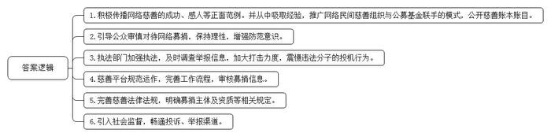
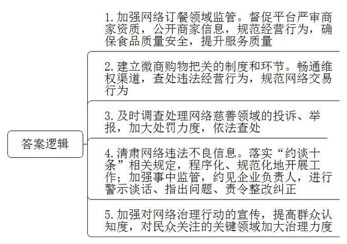
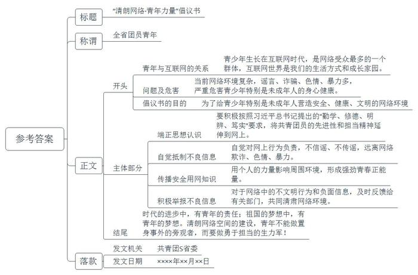
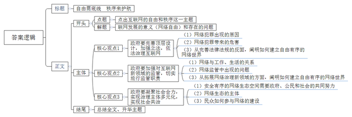

# 2016年山东省公考《申论》题（A卷）

> 候选采集稿。参考答案及解析来自粉笔页面，不代表官方答案或真实高分答卷；来源使用许可与原卷对应关系仍需人工核实。

## 给定材料

### 材料 material-77e36f90548b7d91

近年来，随着互联网的发展，各种名义的网上慈善活动在网络社区风生水起，求助帖、微博微信劝募、淘宝义卖等活动受到人们的极大关注。网络慈善利用互联网无边界、传播广等优势，通过多元主体参与、线上线下联动等方式，聚沙成塔，集腋成裘，最大限度汇聚着社会爱心，凝聚着社会求助力量，传递爱的正能量。

网络慈善有许多成功、感人的范例。例如，贵州、浙江等地民间公益人士发起的“免费午餐”计划通过网络民间慈善组织与公募基金联手的方式，把慈善账本“晒”在阳光下，募集到1000多万元资金，4000多名小学生因此而受益。

然而我们也应清醒看到，利用互联网这一高效便捷的慈善方式尚处于上升成长阶段，在运行过程中存在一些隐患和风险，需要审慎对待。比如，由于网络世界的虚拟性让爱心人士不能直接接触受救助对象，捐助者在网络捐赠时容易陷入“感情用事”的误区。而一些不法分子为了达到个人目的也不惜透支公众的信任和爱心，骗捐诈捐事件时有发生。

2015年6月，知乎网用户“ck铭铭”向网友自称是患有先天性心脏病的22岁女大学生，花光了父母积蓄进行的心脏介入手术却失败了，陷入绝望中，不久，拥有59600粉丝的知乎网大V“童瑶”在回答中鼓励“ck铭铭”，并表示自己也是先天性心脏病患者，愿意为“ck铭铭”提供经济上的帮助，这一回答获得了1.4万个赞。次日，“ck铭铭”公开了自己的支付宝账号，表示“假如我下次手术还能活下来，将来参加工作一定如数归还”。2016年1月14日，多位用户举报知乎网大V“童瑶”与“ck铭铭”疑似“唱双簧”，一位谎称疾病，另一位为其募捐，涉嫌诈骗数百用户捐款15万元。1月19日，在知乎网用“ck铭铭”与“童瑶”两个账号上演双簧苦情戏、骗取网友数十万元捐款的犯罪嫌疑人童某，向其户籍所在地公安局投案自首。

《中国青年报》曾做过的一项调查显示，虽然47.4%的受访者曾通过网络平台参与过捐款，但仅28.5%的受访者信任网络捐款中的慈善组织或募捐个人，62.4%的受访者担忧在网络募捐中存在骗捐诈捐的潜在风险。

网络捐赠的前提是信任，如果信任之墙轰然坍塌，破窗效应不容忽视。通过已发生的骗捐诈捐事件，我们看到，网络捐赠过程中的信任机制格外脆弱，倘若求助者的信息被发现有假，或者是他对待捐款的态度背离常理，就会影响捐助者乃至整个社会对网络慈善的看法。

为了发展慈善事业，弘扬慈善文化，规范慈善活动，保护慈善组织、捐赠人、志愿者、受益人等慈善活动参与者的合法权益，促进社会进步，共享发展成果。2016年3月16日第十二届全国人民代表大会第四次会议通过了《中华人民共和国慈善法》。该法规定，慈善募捐是指慈善组织基于慈善宗旨募集财产的活动；不具有公开募捐资格的组织或者个人基于慈善目的，可以与具有公开募捐资格的慈善组织合作，由该慈善组织开展公开募捐并管理募得款物；任何单位和个人发现慈善组织有违法行为的，可以向民政部门、其他有关部门或者慈善行业组织投诉、举报。民政部门、其他有关部门或者慈善行业组织接到投诉、举报后，应当及时调查处理；自然人、法人或者其他组织假借慈善名义或者假冒慈善组织骗取财产的，由公安机关依法查处。

### 材料 material-92c3b8f5ac1d1ea8

“互联网让世界变成了‘鸡犬之声相闻’的地球村，相隔万里的人们不再‘老死不相往来’”。作为20世纪人类最伟大的发明之一，互联网的问世与发展，不仅引领了社会生产新变革，创造了人类生活新空间，拓展了国家治理新领域，也极大提高了人类认识世界、改造世界的能力，有力推动着社会发展与进步。

中国自接入国际互联网以来，互联网深度融入经济社会发展，深度融入人民生活，深刻改变了中国，截至2015年7月，中国网民数量达6.68亿，网民规模全球第一；网站总数达413.7万余个，域名总数超过2230万个，固定宽带接入端口数达4.07亿，覆盖到全国所有城市、乡镇和93.5%的行政村。中国已经建成全球最大的第四代移动通信网络（4G），4G用户突破2.5亿，成为举世瞩目的网络大国。近年来，随着移动互联网的加速发展，云计算、大数据、物联网等新技术更快融入传统产业以及金融、传媒等领域，互联网改变了传统的生产和生活方式，催生了全新的产品和服务，也给国家治理带来了一系列问题和挑战。互联网是“宝库”还是“魔盒”，取决于国家治理水平和能力。

2015年3月5日，国务院总理李克强在第十二届全国人民代表大会第三次会议上所作的《政府工作报告》中明确提出制定“互联网+”行动计划，“互联网+”概念在《政府工作报告》中首次现身。2015年10月29日，党的十八届五中全会提出：“实施网络强国战略，实施‘互联网+’行动计划，发展分享经济，实施国家大数据战略。”推动“互联网+”，政府要依照融合领域的不同，有所为，有所不为。2015年12月16日，中共中央总书记、国家主席习近平在第二届世界互联网大会开幕式上发表主旨演讲时说，我们的目标，就是要让互联网发展成果惠及13亿多中国人民，更好造福各国人民。中国正是本着这样的主旨发展互联网、治理互联网。

## 题目

### 第 1 题

**请根据“给定资料**4**”，结合相关知识，谈谈应如何化解网络慈善中的信任危机。（15分）**

关联材料：材料 material-77e36f90548b7d91

作答要求：

要求：

（1）观点明确，

（2）分析透彻，

（3）不超过200字。

### 第 2 题

互联网的问世与发展，拓展了国家治理新领域，也给行政执法带来了新的问题和挑战。请结合“给定资料2-6”，简要分析网络治理行动中如何加强行政执法工作。（20分）

关联材料：材料 material-92c3b8f5ac1d1ea8

作答要求：

要求：条理清楚，全面准确，不超过300字。

### 第 3 题

请结合对“给定资料7”中划线句子“清朗网络空间的建设，青年不做置身事外的旁观者，而要做勇于担当的生力军”的理解，以共青团S省委的名义起草一份倡议书。（25分）

关联材料：材料 material-92c3b8f5ac1d1ea8

作答要求：

要求：

（1）内容全面，逻辑清楚；

（2）结构完整，符合倡议书的特点；

（3）文字通顺，有感染力；

（4）不超过500字。

### 第 4 题

请结合对给定资料的理解与思考，以“自由和秩序”为主题，自拟题目，写一篇议论文。（40分）

关联材料：材料 material-92c3b8f5ac1d1ea8

作答要求：

要求：

（1）自选角度，立意明确；

（2）参考“给定资料”，但不拘泥于“给定材料”；

（3）结构严谨，语言流畅；

（4）字数1000—1200字。

## 答案与解析

第 1 题

**参考答案（粉笔题库参考内容）**

1.积极传播网络慈善的成功、感人等正面范例。并从中吸取经验，推广网络民间慈善组织与公募基金联手的模式，公开慈善账本账目。

2.引导公众审慎对待网络募捐，保持理性，增强防范意识。

3.执法部门加强执法，及时调查举报信息，加大打击力度，震慑违法分子的投机行为。

4.慈善平台规范运作，完善工作流程，审核募捐信息。

5.完善慈善法律法规，明确募捐主体及资质等相关规定。

6.引入社会监督，畅通投诉、举报渠道。

**解析**

**参考答案说明：**本答案从“积极传播”“引导公众意识”“加强执法”“慈善平台运作”“完善法律法规”“引入社会监督”这六个方面进行了分条撰写。每条要点之间内容上没有交叉。

**考点**：考点提出对策类

**来源**：来源2016年山东省公考《申论》题（A卷）

粉笔申论页面对本题只提供「解析视频」入口，该入口是会员推广位，页面无视频地址与文字解析。

第 2 题

**参考答案（粉笔题库参考内容）**

1.加强网络订餐领域监管。督促平台严审商家资质，公开商家信息，规范经营行为，确保食品质量安全，提升服务质量。

2.建立微商购物把关的制度和环节。畅通维权渠道，查处违法经营行为，规范网络交易行为。

3.及时调查处理网络慈善领域的投诉、举报，加大处罚力度，依法查处。

4.肃清网络违法不良信息。落实“约谈十条”相关规定，程序化、规范化地开展工作；加强事中监管，约见企业负责人，进行警示谈话、指出问题、责令整改纠正。

5.加强对网络治理行动的宣传，提高群众认知度，对民众关注的关键领域加大治理力度。

**解析**

**考点**：考点提出对策类

**来源**：来源2016年山东省公考《申论》题（A卷）

粉笔申论页面对本题只提供「解析视频」入口，该入口是会员推广位，页面无视频地址与文字解析。

第 3 题

**参考答案（粉笔题库参考内容）**

“清朗网络·青年力量”倡议书

全省团员青年：

青少年生长在互联网时代，是网络受众最多的一个群体，互联网世界是我们的生活方式和成长家园。

但是，当前网络环境复杂，谣言、诈骗、色情、暴力多，严重危害青少年特别是未成年人的身心健康。为了给青少年特别是未成年人营造安全、健康、文明的网络环境，共青团S省委向大家发出如下倡议：

第一，端正思想认识。要积极按照习近平总书记提出的“勤学、修德、明辨、笃实”要求，将共青团员的先进性和担当精神延伸到网上。

第二，自觉抵制不良信息。自觉对网上行为负责，不信谣、不传谣，远离网络欺诈、色情、暴力。

第三，传播安全用网知识。用个人的力量影响周围环境，形成强劲青春正能量。

第四，积极举报不良信息。对于网络中的不文明行为和负面信息，及时反馈给有关部门，共同清肃网络环境。

时代的进步中，有青年的责任；祖国的梦想中，有青年的梦想。清朗网络空间的建设，青年不能做置身事外的旁观者，而要做勇于担当的生力军！

共青团S省委

××××年××月××日

**解析**

**参考答案说明：**（1）格式方面，本参考答案写到了“标题”“称谓”“正文”和“落款”。（2）正文部分，一方面从内容来看，开头部分对青年与互联网的联系、互联网存在的问题对青少年的危害、倡议书的目的等进行了介绍；主体部分从“端正思想认识”“自觉抵制不良信息”“传播安全用网知识”“积极举报不良信息”四个方面对具体做法进行了展开；结尾部分，进行了呼吁号召。另一方面，形式上，本参考答案做到了分段、分条撰写，整体上条理较为清晰。（3）本参考答案能够结合题目要求“文字通顺，有感染力”，在语言表达上使用了排比、感叹号等具有号召性、有感染力的表达。

**考点**：考点宣传类

**来源**：来源2016年山东省公考《申论》题（A卷）

粉笔申论页面对本题只提供「解析视频」入口，该入口是会员推广位，页面无视频地址与文字解析。

第 4 题

**参考答案（粉笔题库参考内容）**

**自由需底线** **秩序来护航**

如果要问二十世纪最具有划时代意义的发明，那一定非互联网莫属。互联网不仅促进了经济社会的飞跃式发展，也改变了人们的生产生活方式，对人们思维方法与认知能力的提升也产生了巨大的激励作用。然而，互联网的世界有“春天”也有“冬天”，有“光明”却也有“黑暗”。当网络谣言肆意横行，当黑客侵袭肆无忌惮，当网络诈欺花样频出，**我们必须用秩序来击退毫无底线的自由，也只有在秩序的基础上，我们才能****让互联网给我们带来更多的方便和快捷，****创造更加辉煌的网络时代**。

**——****建立自由有序的网络世界，首先需要完善顶层设计，加强立法。**

当我们在享受网络便利便捷的同时，由于相关网络法律的缺位，网络犯罪屡禁不止。各种形式的网络色情、暴力、诈骗等犯罪“毒瘤”在这个虚拟空间中蔓延滋生，愈演愈烈，给人类的安全和福祉带来了巨大威胁。网络谣言满天飞，严重干扰着我们对信息真实性的判断与评价。充斥着污言秽语、胡编乱造的跟帖评论，已经极大地影响了网络空间的正常秩序，甚至已经威胁到社会稳定和安全。规范网络空间的行为，离不开互联网法律。政府有关部门应该进一步完善网络相关法律法规，及时制定出台针对网络行为规范的法律条文，用法律来净化网络这片“自由国度”，让法律来保障网络世界更加健康、有序、和谐。

**——****建立自由有序的网络世界，需要与时俱进，加强对新领域的监管、切实履职。**

当前，网络购物、网上订餐、网络慈善等新事物层出不穷，人们的生活与工作与网络密不可分。我们在感叹惊喜的同时，网络监管漏洞和盲区却不容忽视。一方面监管存在一定的滞后性，相关法律法规没有落实执行。另一方面，单靠引导、宣传与教育来解决一些网络问题难以奏效。这要求有关部门要积极拓展网络治理新领域，及时消灭监管盲区。加强监管、严格执法，严厉惩处网络违法行为，坚决守护法律底线。与此同时，积极组织网络专项整治活动，建立长效工作机制。持之以恒，让网络世界的新生事物茁壮成长。

**——****建立自由有序的网络世界，更要凝聚社会合力，实现治理主体多元化。**

网络世界，是开放共享的精神家园。习近平总书记曾强调，“要建设网络良好生态，发挥网络引导舆论、反映民意的作用。”安全有序的网络生态空间，不光需要有政府主导和政策引导，还需要公民和社会的共同努力。网络事业的良好发展，是民众的共同心声。网络生态的主体无疑是“人民”，而青年人是互联网时代受众最多的群体，因此，广大民众要积极参与网络建设，培育公共理性，自觉维护网络秩序。青年人更要以维护网络空间和谐为社会责任，理性发声，传递正能量，充当网络生力军。

人无信不立，“网”无法不安。要营造一个健康有序的网络环境，法律规范不可缺位。要自由自在地畅游网络世界，网民自觉守法不可缺少。只有坚持走法治化之路，依法办网、依法治网，网络世界才能更加多元化、丰富化与立体化，我们也才能终将迎来一个最好的互联网时代。

**解析**

**文章分析**

**自由需底线** **秩序来护航**

【**标题的优点：**首先，范文的标题“自由需底线 秩序来护航”突出了“自由和秩序”这一主题。其次，形式上，文字简洁明快。】

如果要问二十世纪最具有划时代意义的发明，那一定非互联网莫属。（1）互联网不仅促进了经济社会的飞跃式发展，也改变了人们的生产生活方式，对人们思维方法与认知能力的提升也产生了巨大的激励作用。然而，（2）互联网的世界有“春天”也有“冬天”，有“光明”却也有“黑暗”。当网络谣言肆意横行，当黑客侵袭肆无忌惮，当网络诈欺花样频出，（3）**我们****必须用秩序来击退毫无底线的自由****，也只有在秩序的基础上，我们才能****让****互联网给我们带来更多的方便和快捷****，****创造更加辉煌的网络时代**。

【**开头的优点：**内容方面，范文的开头是紧扣“自由和秩序”这一主题展开的。首先，开头开门见山点出主题，做到了主题明确。其次，对“自由和秩序”这一主题进行了分析阐述，指出了（1）“互联网”带来的意义；（2）“互联网”发展中遇到的问题；（3）如何用自由和秩序来促进互联网的发展。】

**——****建立自由有序的网络世界，首先需要完善顶层设计，加强立法。**

（1）当我们在享受网络便利便捷的同时，由于相关网络法律的缺位，网络犯罪屡禁不止。各种形式的网络色情、暴力、诈骗等犯罪“毒瘤”在这个虚拟空间中蔓延滋生，愈演愈烈，（2）给人类的安全和福祉带来了巨大威胁。网络谣言满天飞，严重干扰着我们对信息真实性的判断与评价。充斥着污言秽语、胡编乱造的跟帖评论，已经极大地影响了网络空间的正常秩序，甚至已经威胁到社会稳定和安全。（3）规范网络空间的行为，离不开互联网法律。政府有关部门应该进一步完善网络相关法律法规，及时制定出台针对网络行为规范的法律条文，用法律来净化网络这片“自由国度”，让法律来保障网络世界更加健康、有序、和谐。

【**论述段****1的优点：**★观点句：范文的观点句是紧扣“自由和秩序”这一文章主题提出的。形式上，它在段首处直接写出，位置突出，容易发现。内容上，关键词突出，内容要点明确，可以明显看出它是从“完善顶层设计，加强立法”入手，指出了“如何建立自由有序的网络世界”。★论述内容：介绍了（1）网络犯罪出现的原因；（2）网络犯罪带来的危害；（3）从完善法律法规的反面，阐明如何建立自由有序的网络世界。最后，在论述方法和论据的选取上做到了讲道理、举例子相结合，做到了丰富多样。】

**——****建立自由有序的网络世界，需要与时俱进，加强对新领域的监管、切实履职。**

（1）当前，网络购物、网上订餐、网络慈善等新事物层出不穷，人们的生活与工作与网络密不可分。我们在感叹惊喜的同时，（2）网络监管漏洞和盲区却不容忽视。一方面监管存在一定的滞后性，相关法律法规没有落实执行。另一方面，单靠引导、宣传与教育来解决一些网络问题难以奏效。（3）这要求有关部门要积极拓展网络治理新领域，及时消灭监管盲区。加强监管、严格执法，严厉惩处网络违法行为，坚决守护法律底线。与此同时，积极组织网络专项整治活动，建立长效工作机制。持之以恒，让网络世界的新生事物茁壮成长。

【**论述段****2****的优点：**★观点句：范文的观点句是紧扣“自由和秩序”这一文章主题提出的。形式上，它在段首处直接写出，位置突出，容易发现。内容上，关键词突出，内容要点明确，可以明显看出它是从“与时俱进，加强对新领域的监管、切实履职”入手，指出了“如何建立自由有序的网络世界”。★论述内容：介绍了（1）网络与工作、生活的关系；（2）网络监管中出现的问题；（3）从拓展网络治理新领域的方面，阐明如何建立自由有序的网络世界。最后，在论述方法和论据的选取上做到了讲道理、举例子相结合，做到了丰富多样。】

**——****建立自由有序的网络世界，更要凝聚社会合力，实现治理主体多元化。**

（1）网络世界，是开放共享的精神家园。习近平总书记曾强调，“要建设网络良好生态，发挥网络引导舆论、反映民意的作用。”安全有序的网络生态空间，不光需要有政府主导和政策引导，还需要公民和社会的共同努力。（2）网络事业的良好发展，是民众的共同心声。网络生态的主体无疑是“人民”，而青年人是互联网时代受众最多的群体，因此，（3）广大民众要积极参与网络建设，培育公共理性，自觉维护网络秩序。青年人更要以维护网络空间和谐为社会责任，理性发声，传递正能量，充当网络生力军。

【**论述段****1的优点：**★观点句：范文的观点句是紧扣“自由和秩序”这一文章主题提出的。形式上，它在段首处直接写出，位置突出，容易发现。内容上，关键词突出，内容要点明确，可以明显看出它是从“凝聚社会合力，实现治理主体多元化”入手，指出了“如何建立自由有序的网络世界”。★论述内容：介绍了（1）安全有序的网络生态空间需要政府、公民和社会的共同努力；（2）网络生态的主体；（3）民众如何参与网络的建设。最后，在论述方法和论据的选取上做到了讲道理、举例子相结合，做到了丰富多样。】

（1）人无信不立，“网”无法不安。要营造一个健康有序的网络环境，法律规范不可缺位。要自由自在地畅游网络世界，网民自觉守法不可缺少。（2）只有坚持走法治化之路，依法办网、依法治网，网络世界才能更加多元化、丰富化与立体化，我们也才能终将迎来一个最好的互联网时代。

【**结尾的优点**：范文的结尾回扣了“自由和秩序”这一主题。（1）再次提到“自由和秩序”；（2）阐述了深远意义。】

**考点**：考点文章写作题

**来源**：来源2016年山东省公考《申论》题（A卷）

