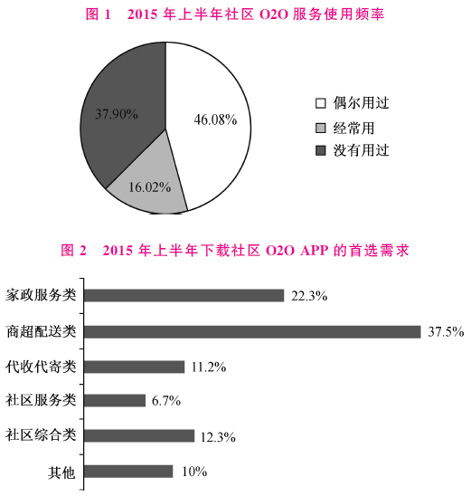
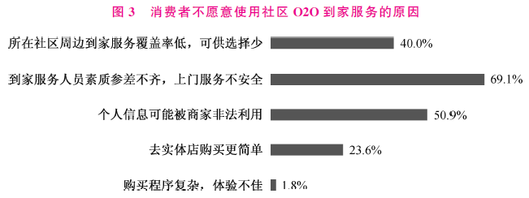
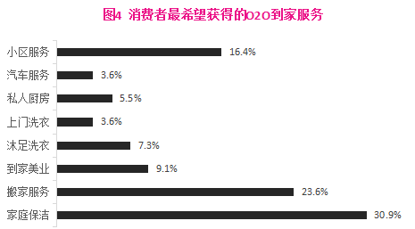
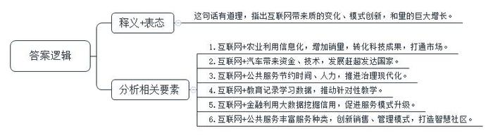
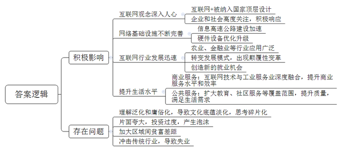
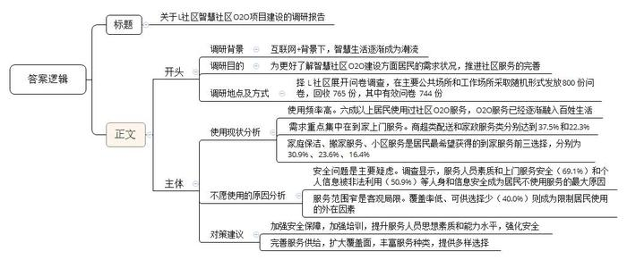
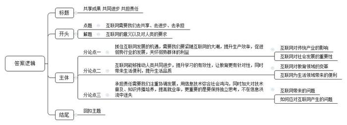

# 2016年山东省公考《申论》题（B卷）

<!-- gwy:overview:start -->
> **山东 · 2016 · 申论 · B类** ｜ 4 题 · 图片 7 处 · 答案随题折叠

导航：[题目](#题目) · [材料 1](#材料-1)
<!-- gwy:overview:end -->

> 候选采集稿。参考答案及解析来自粉笔页面，不代表官方答案或真实高分答卷；来源使用许可与原卷对应关系仍需人工核实。

## 给定材料

### 材料 1

2015年3月5日，李克强总理在第十二届全国人民代表大会第三次会议上所作的《政府工作报告》中明确提出制定“互联网+”行动计划，强调：“新兴产业和新兴业态是竞争高地”。政府工作报告在“推动产业结构迈向中高端”部分提出，制定“互联网+”行动计划，推动移动互联网、云计算、大数据、物联网等与现代制造业结合，促进电子商务、工业互联网和互联网金融健康发展，引导互联网企业拓展国际市场。

多位业内人士在接受记者采访时坦言，这是“互联网+”概念在《政府工作报告》中的首次现身，也是第一次被纳入国家经济的顶层设计，表明国家最高权力机构正式向全国发出“互联网+”的声音。

全国人大代表、腾讯公司董事会主席兼首席执行官马化腾所提的四个建议之一就是“互联网+”。马化腾在听完《政府工作报告》后向记者表示：“‘互联网+’的概念的提出，对全社会、全行业来说，是一个非常大的振奋。”

中关村下一代互联网产业联盟秘书长张建宁在接受上证报记者采访时则提出，“互联网+”的提出具有承前启后的作用。政府此前已经明确提出几大战略性新兴产业，但更多的提法是“培育”，是一个从无到有的过程。近两年，特别是随着移动互联网的加速发展，云计算、大数据、物联网等新技术更快融入传统产业以及金融理财、打车等民生领域。而PC互联网时代升级到移动互联网时代后，互联网技术与两化融合相结合会有更多看点。

### 材料 2

要通过“互联网+”的形式，改变传统的生产和生活方式，开发出全新的产品和服务。有人说，<u>“互联网+”不是要做简单的物理拼盘，而是要创造“聚变效应”和“乘数效应”。</u>这个“聚变效应”和“乘数效应”不是喊出来的，而是用智慧干出来的。

2015年3月初，南开大学“农梦成真”创业团队的“创客”们，来到S省山区帮临县枣农卖枣，就很好地诠释了总理所说的“双创”和“互联网+”的乘数效应。2015年年底，“创客”们通过与枣农沟通，通过互联网、微信平台等渠道发布销售信息，使枣农的供枣信息和顾客的需求信息实现互通······如今，12万份网络、微信订单购买的120万斤红枣让他们忙得不可开交。

上海市奉贤区利用“互联网+农业”打通了市场的“最后一公里”，引入科技生力军实现农业“供给侧”质的飞跃。根据奉贤区政府与上海市农科院、苏宁易购近日签订的战略合作协议，市农科院加强与奉贤农业产业对接，依托科技创新和科技服务人才队伍，以产学研用平台共建为抓手，以新型农业经营实体为承载，大力推动科技与产业融合发展，加速成果转化。而“互联网+农业”则打通了市场的“最后一公里”。上海苏宁将奉贤区特色农副产品纳入苏宁自营采购体系或特色农产品招商体系，推动区内特色农产品销售，并通过苏宁实体门店为区内特色产品提供“线上支付、到店自提”等业务。

博鳌亚洲论坛原秘书长龙永图用“如虎添翼”来形容“互联网+汽车”的美好前景。他说，互联网将为汽车产业添上两个翅膀，让它飞得更高，飞得更远。互联网给汽车经济带来了很多的资金，带来了很多的技术，而且在整个全球汽车产业的竞争中，由于互联网技术的加入，使得我们中国汽车经济可能实现弯道超车，实现赶超，因为在全球的互联网技术和互联网企业方面，中国超过了欧盟，超过了日本，和美国在很多领域上也可以并驾齐驱，这对我们来讲确实是一个很大的优势条件，这种大的格局使得中国的汽车产业在互联网技术的推动下，以更高的速度跟上世界发达国家的水平。

得益于“互联网+智慧景区”的运营模式，龙门石窟景区手机移动端购票订单数在2015年国庆期间急速增长，占比超过20%。游客只需使用手机连接免费的无线网络，扫描二维码，即可完成一键式购票；入口处扫码入园仅需3秒，不用兑换纸质门票。此外，景区内吃、住、行、游、购、娱全部实现线上支付。2015年国庆期间，龙门石窟景区共接待游客28.27万人次，同比增长10.5%。10月1日至5日，龙门石窟微信号粉丝增长近5万，通过微信号推广发布的文化创意产品也成为热销品，获得不错的收益。

移动电子政务作为推进国家治理体系和治理能力现代化的重要工具已在各地广泛应用。武汉交警通过微信服务号可在60秒内完成罚款收取，此项功能全年可以为武汉驾驶员窗口缴罚节省时间达140万小时，节约警力300人。

### 材料 3

在“作业盒子走向山西”的培训会上，汾阳中学副校长王英与“作业盒子”相识。在现场使用时，他会心一笑，“这不就是我要找的互联网产品吗?”

在王英看来，通过互联网进行在线教育不是新鲜事物，他也接触了很多在线互联网的产品和网站。他认为，早期在线教育是典型“教育+互联网”模式，在传统教育基础上嫁接互联网渠道，传统思维占据主导，无论是技术、人才，还是运营管理等都与互联网特质相去甚远，使用场景也不符合老师和学生的实际情况。

“‘作业盒子’吸引我的地方在于它是一个互联网教育的基础性工具，适用范围广，能真正解决老师和学生在教学和学习中的痛点。”

“是时候该变变了。”王英决定通过自己的努力改变互联网在老师和家长心目中的形象，用实际的数据和事实证明互联网对于教育的巨大助力作用。

他选取了一个成绩中等的班级作为试验样本，这个班级同学的所有科目课外作业都是通过“作业盒子”布置，选择题系统就能自动批改，主观题的批改也是在它上面完成的。他将每次月考、期末、期中考试的各科成绩都记录下来，探求在使用互联网工具之后学生的成绩到底有没有提高。

“最开始我心里也没有底，甚至引起了很多老师和家长的异议，特别是对于高三的学生来说，学业压力大，家长害怕鼓励学生使用手机会影响他们的正常学习，分散精力。”

但是经过短短6个月的试验，王英发现学生不仅成绩提高很快，更重要的是通过“作业盒子”自带的学情分析功能，对学生的个体学情以及班级学情有了实时、客观、全面的了解，在教学中实施个性化指导，为多年困扰老师的因材施教突然打开了一扇窗户。学生们通过“作业盒子”提交作业后，就能立刻知道自己的知识点掌握情况如何，这一点在学生中很受欢迎。

### 材料 4

利用大数据“挖掘”信用，申请贷款到账平均耗时5分钟，贷款资金不使用不支付利息，提前还款不收费……浦发银行纯线上运营的小微信贷平台“网贷通”上线短短8个月，已累计授信24.6亿元，累计发放贷款24.1亿元，户均贷款18.9万元。

在“互联网+”时代，金融机构利用“大数据”挖掘“小信用”，破解长期困扰小微企业的融资难、融资贵问题，产生了意想不到的化学反应。

据浦发银行零售业务总监汪素南介绍，浦发银行“网贷通”实现了小微客户融资“全流程在线、全自动化审批、全数据化管理”的服务模式，提高了贷款调查、审查审批和放款的效率，客户从申请到贷款支用只需5分钟，同时运用循环贷款技术，随借随还，符合小微企业“小、频、急”的融资需求，大幅降低了客户融资成本。

专家表示，小微企业融资最大的诉求就是低门槛、高效率，而传统信贷模式高抵押门槛、繁琐的审批流程和实际高成本是小微企业难以承受“融资之痛”。在互联网+大数据的时代，新技术和新模式使得这一难题有了破题的可能。

Z市一家服装制造型企业，因生产季节性原因，需要1000万元、期限为两年的流动资金贷款需求。但企业自身厂房评估结果只有800万元，如办理抵押类产品，显然贷款金额无法满足需求；如分别办理抵押类和信用类贷款产品，审批时间又较长，容易错过服装销售旺季；如选择固定期限一次还本付息类产品，又与其经营特征、成本控制要求等不匹配。建设银行Z市分行通过抽取大数据分析，掌握了企业的生产经营模式与交易习惯，在充分把握风险的前提条件下，及时向客户推荐了小微企业“循环组合贷”产品，以“抵押+信用”的组合担保方式，搭配随借随还、按日计息的网银支用模式，一下子就解决了客户融资需求，大幅节约了企业的资金使用成本。

“这一方式不仅随借随还、按日计息，而且企业通过网银就能操作，不需要一趟趟跑银行，平均能使小微企业的资金使用效率提高30%，综合贷款成本则有望从6%左右降至3%左右。”建设银行Z市分行小企业部负责人刘瀛说。

“大数据就是以申请人交易流水、个人征信等信息为依据，利用大数据技术，实现对申请人的综合信用评价与差异化风险定价，打破了传统金融机构主体资质授信惯例，有效地解决了小微企业融资难题。”卡得万利商业保理（Z市）有限公司总经理康绒说。

“应收账款”是很多小微企业的心病，卡得万利与银联等机构合作，以商户的POS交易流水与各种社会行为数据为基础，基于大数据模型为商户提供应收账款质押融资，不需要其他抵押或担保。目前，卡得万利帮助上万户小微企业累计获得授信约400亿元，笔均融资15万元，最高50万元，最低发生额仅6000元。

记者采访发现，在中央一系列强力措施下，市场资金面趋于宽松，银行间市场利率下行明显，但在小微企业端，贷款利率依然高企，传导机制有待进一步疏通。

“互联网思维和大数据有助提升实体金融可获得性，解决小微融资难等‘最后一公里’的问题。”Z市银监局局长廖岷说，金融机构通过运用互联网技术，对客户的生产生活模式作出新的判断，这为金融机构做普惠金融提供了更多的抓手。

### 材料 5

2014年5月，住房和城乡建设部发布了《智慧社区建设指南（试行）》，明确提出将在国内大规模开展智慧社区的建设。随即，行业内一片风生水起。智慧社区O2O，可以通过互联网将服务、商品、居家、人有机地结合在一起，实现按需所取，按量供应。但这个行业并不像看起来那么简单，它不是一个独立存在的垂直市场，其涉及居民生活半径的衣食住行、吃喝玩乐的所有问题，与各行各业都有密切的相关性，整个行业涉及面十分广泛，涵盖的项目方向非常之多，包括信息、电商、物流、支付、金融、广告、科技、上门、软件、门店、上市、社交、家装、房产、汽车、废品、会所、养老等等。智慧社区O2O的商业模式选择和市场发展前景，尚需要“吃螃蟹者”的创新探索，也需要政府和市场的共同推进。

H市积极开展智慧社区建设，吸引各类社区服务商到小区提供O2O服务。截至2015年11月，全市已发展640家社区服务商，其中纳入到社区服务综合平台中的服务商达到210家，为社区居民提供种类丰富的社区服务。2015年1月至11月共处理服务单11463单，其中家政、维修派工单7405单，咨询服务单4058单；依托社区服务综合平台，开展各类“社区大课堂”课程1600余节，内容包含健康医疗、政策法规、才艺素质、生活窍门、就业培训和专题系列六大类，极大地丰富了社区居民的业余文化生活。

L社区作为H市首批智慧社区O2O建设试点之一，在智慧社区O2O建设方面进行了很多创新性尝试，引起了社会各界的广泛关注。

“菜篮子”工程建设一直是社区开展便民服务的重点。引进移动菜车、开设便民菜店使居民们得到了实实在在的好处。现在，在科技发展的影响下，L社区里菜篮子“搭车”上了互联网，打造了“互联网+社区+农户”的蔬菜直销模式，运用O2O平台，实现线上下单、线下体验的方式买菜。另外，社区与“超市发”联合，开通互联网APP购买渠道，将百姓生活用品送到社区，为居民提供优惠和便利，小区居民朱阿姨说：“我每天都到居委会转转，菜就在那里订好，子女下班去拿，很方便。”

同时L社区积极探索智慧停车项目，该项目利用先进可靠的车牌识别技术、信息技术、网络技术和移动互联网技术，建设智能停车管理服务平台，通过为各社区停车场部署统一智能停车场管理系统，实时获取各停车场运营情况、停车位情况等。

“如果我们把停车场进行联网，那就可以整合成一个‘车位库’，作为车位拥有者，你可以把自己车位的闲置时间出租出去，而作为需求者，你可以通过网络寻找到合适的空闲车位。”智慧停车项目的相关负责人表示，利用网络化技术，动态的车位变化将实时反映在电脑、手机这些终端上，便于社会公众的使用和查询。

最大程度满足居民需求是智慧社区O2O建设的主线。为更好地了解社区居民对智慧社区O2O项目的需求状况，某调查机构在L社区展开问卷调查。本次问卷调查共发放问卷800份，回收765份，其中有效问卷744份。调查问卷在社区的主要公共场所和工作场所采取随机发放形式进行。以下是部分问卷调查的数据列表：

### 材料 6

自李克强总理在《政府工作报告》中提出“互联网+”之后，各界高度关注，各种解读汗牛充栋。但在热闹与喧嚣的同时，很多理解无形中将“互联网+”泛化和庸俗化，将所有的互联网应用都归到“互联网+”这一新概念中，其实质是拿新瓶装旧酒。一个在“互联网+”初兴之际就流行的段子，很能说明问题：披上了“互联网+”的外衣，算命的改叫分析师了，八卦小报改叫自媒体了，忽悠改叫互联网思维了，放高利贷改叫资本运作了。

“现在，互联网正处在一个从不重视到放在神坛之上的过程，很多人觉得互联网就是‘核武器’，可以无往而不胜。这种情况下，确实会有一些泡沫，但还是良性的泡沫。虽然，泡沫会产生一些冗余，但是整个社会的基础设施和生产效率还是在提升的。比如，2000年美国的互联网泡沫就是这样，虽然好多企业倒闭，但是提升了信息高速公路的基础建设，后面美国互联网的发展是要感谢那次泡沫的。同样，这次‘互联网＋’为中国经济的发展留下了深远的影响。但短期看，企业还是要注意，不要自己忽悠自己。”易观国际集团董事长兼CEO于杨说。

于杨认为，从蒸汽机、电力、计算机到今天的互联网，每一次技术革命都会有一个矫枉过正的过程。最先采用先进“武器”的企业取得了好的效果之后，很多人会去追逐，认为是工具本身具有神奇的作用，于是大家从不重视这些先进武器到开始纷纷全面布置，但也会片面夸大工具的作用，战争胜负的最终决定因素并不是武器。互联网产业和“互联网＋行动计划”发展推进过程中，互联网思维、互联网价值、互联网文化、互联网精神的正确培育和科学弘扬，也绝对不能缺席。

### 材料 7

20世纪60年代，加拿大传播学者麦克卢汉说：“媒介技术不仅改变了信息传播方式，还改变了人的社会交往和行为方式，从而推动了社会形态的变革。”20世纪90年代，“普适计算之父”马克·韦泽说：“最高深的技术是那些令人无法察觉的技术，这些技术不停地把它们自己编织进日常生活，直到你无从发现为止。”21世纪初美国互联网教父凯文·凯利说：“技术具有自我增强属性，发展到一定阶段能自我进化，它不断更新和融合，对经济形态，企业组织，社会生活以及思维方式都会产生颠覆式影响。”

随着互联网在全社会范围内介入深度的加深，金融、房地产、医疗、养老、传媒等热门行业都不断呈现出新变化，新态势，互联网进入哪一个传统领域，就势必会对该领域产生深刻影响甚至激发颠覆性的变革。从“云计算”到“物联网”，从“大数据”到“工业4.0”一个个耳熟能详的流行热词背后，蕴藏着互联网给予人类的巨大能量与无穷的想象空间，如同一个硬币有两面，机遇的出现也往往有风险相伴。

针对当前“互联网＋”过热现象，前阿里巴巴副总裁、众海投资创始人鲁众提醒道，在关注“互联网＋”时，不要忽视互联网的另一面——“互联网－”。鲁众说，作为一种技术、一种工具、一种基础设施，互联网本身没有好坏、对错属性。但如果“+”的一面被过度重视，“－”的一面被忽视，就可能导致一些问题的出现，急需引起全社会的充分重视。

——互联网既创造了新的就业机会，也会让一些人失去岗位。这是处于转型期的中国必须面对的挑战之一。为避免出现不必要的麻烦，有关部门应该及早着手，加大跨界融合型人才的培养力度以及做好相关预案疏导等工作。

——互联网可能让穷的地方更穷、富的地方更富。电商时代，互联网去中间化的特点将消费者与厂家直接连在一起，传统批发零售这道防火墙没有了，势必造成产品匮乏的欠发达地区的资金大量流向产品丰富的发达地区。

——互联网让我们的文化底蕴变薄，思考力呈现碎片化，面对海量信息，人们只能快速浏览，过目即忘，几乎没时间静下心来读传统文化的经典作品，更没空进行深入思考，这必然导致传统文化赖以生存、发展的土壤逐渐变薄。

互联网正在给人们的生产、生活、社会生态带来革命性巨变，势不可挡。在首届世界互联网大会上，马云发表演讲说：“我们更相信一点，互联网是人类共同发展的机遇、人类共同进步的希望，也是人类共同需要承担和完善的责任。”

## 题目

### 第 1 题

请结合“给定资料1~5”，谈谈你对文中划线句子“‘互联网+’不是要做简单的物理拼盘，而是要创造‘聚变效应’和‘乘数效应’”的理解。（15分）

关联材料：材料 1、材料 2、材料 3、材料 4、材料 5

作答要求：

要求：观点明确，分析透彻，不超过200字。

第 1 题 · 答案与解析

**参考答案（粉笔题库参考内容）**

这句话有道理，指出互联网带来质的变化、模式创新，和量的巨大增长。

具体表现在：1.互联网+农业利用信息化，增加销量，转化科技成果，打通市场。2.互联网+汽车带来资金、技术，发展赶超发达国家。3.互联网+公共服务节约时间、人力，推进治理现代化。4.互联网+教育记录学习数据，推动针对性教学。5.互联网+金融利用大数据挖掘信用，促进服务模式升级。6.互联网+公共服务丰富服务种类，创新销售、管理模式，打造智慧社区。

**解析**

**参考答案说明：**思路方面，本参考答案按照词句解释题“释义+分析相关要素+总结评价”的一般答题思路展开。内容方面，本参考答案先对“‘互联网+’不是要做简单的物理拼盘，而是要创造‘聚变效应’和‘乘数效应’”进行了表态和解释；“分析相关要素”部分分别分析了“互联网+农业”“互联网+汽车”“互联网+公共服务”“互联网+教育”“互联网+智慧社区”方面的具体表现。

### 第 2 题

请结合给定资料，简要分析我国“互联网+”的发展现状。（20分）

关联材料：材料 1、材料 2、材料 3、材料 4、材料 5、材料 6、材料 7

作答要求：

要求：条理清楚，全面准确，不超过300字。

第 2 题 · 答案与解析

**参考答案（粉笔题库参考内容）**

互联网+产生的积极影响有：1.互联网观念深入人心。互联网+被纳入国家顶层设计，企业和社会高度关注，积极响应。2.网络基础设施不断完善。信息高速公路建设加速，硬件设备优化升级。3.互联网行业发展迅速。在农业、金融业等行业应用广泛，转变发展模式，出现颠覆性变革，同时创造出新的就业机会。4.提升生活水平。商业服务领域，互联网技术与工业服务业深度融合，提升商业服务水平和效率；公共服务领域，扩大教育、社区服务等覆盖范围，提升质量，满足生活需求。

存在问题有：1.理解泛化和庸俗化，导致文化底蕴淡化，思考碎片化。2.片面夸大，投资过度，产生泡沫。3.加大区域间贫富差距。4.冲击传统行业，导致失业。

**解析**

**参考答案说明：**横向上，答案从“互联网+产生的积极影响”和“存在问题”两个大的方面进行了分类撰写。纵向上，“互联网+产生的积极影响”方面又分为“互联网观念深入人心”、“网络基础设施不断完善”、“互联网行业发展迅速”、“提升生活水平”四个方面。“存在问题”方面又分为“理解泛化和庸俗化”、“片面夸大”、“加大区域间贫富差距”、“导致失业”四个方面。各条要点之间在内容上是并列且没有交叉的。

### 第 3 题

请根据“给定资料5”，写一份L社区智慧社区O2O项目建设的调研报告。（25分）

关联材料：材料 5

作答要求：

要求：结构完整，思路清晰，简明具体；不超过500字。

第 3 题 · 答案与解析

**参考答案（粉笔题库参考内容）**

关于L社区智慧社区O2O项目建设的调研报告

互联网+背景下，智慧生活逐渐成为潮流，为更好了解智慧社区O2O建设方面居民的需求状况，推进社区服务的完善，特选择L社区展开问卷调查，在主要公共场所和工作场所采取随机形式发放800份问卷，回收765份，其中有效问卷744份。调研结果如下：

一、使用现状分析。1.使用频率高。调查表明，六成以上居民使用过社区O2O服务，O2O服务已经逐渐融入百姓生活。2.需求重点集中在到家上门服务。商超类配送和家政服务类分别达到37.5%和22.3%；其中，家庭保洁、搬家服务、小区服务是居民最希望获得的到家服务前三选择，分别为30.9%、23.6%、16.4%。

二、不愿使用的原因分析。1.安全问题是主要疑虑。调查显示，服务人员素质和上门服务安全（69.1%）和个人信息被非法利用（50.9%）等人身和信息安全成为居民不使用服务的最大原因。2.服务范围窄是客观局限。覆盖率低、可供选择少（40.0%）则成为限制居民使用的外在因素。

三、对策建议。1.加强安全保障。加强培训，提升服务人员思想素质和能力水平，强化安全。2.完善服务供给，扩大覆盖面，丰富服务种类，提供多样选择。

**解析**

**参考答案说明**：（1）格式方面，本参考答案写到了“标题”“正文”。（2）正文部分，一方面从内容来看，围绕着“L社区智慧社区O2O项目建设”这一主题，本参考答案的开头先写到了“调研目的及基本情况”；主体部分从“使用现状分析”“不愿使用的原因分析”“对策建议”三个方面进行说明。另一方面，形式上，本参考答案做到了分段、分条撰写，整体上条理较为清晰。（3）本参考答案能够结合调研报告的特点，在语言表达上做到了简洁、流畅。

### 第 4 题

“给定资料7”中提到：“互联网是人类共同发展的机遇、人类共同进步的希望，也是人类共同需要承担和完善的责任。”请从对这句话引发的思考说开去，写一篇议论文。（40分）

关联材料：材料 1、材料 2、材料 3、材料 4、材料 5、材料 6、材料 7

作答要求：

要求：

（1）自选角度，自拟题目，见解明确、深刻；

（2）参考“给定资料”，但不拘泥于“给定资料”；

（3）结构严谨，语言流畅；

（4）字数在1000~1200字。

第 4 题 · 答案与解析

**参考答案（粉笔题库参考内容）**

**共享成果** **共同进步** **共担责任**

有人说“互联网是人类共同发展的机遇、人类共同进步的希望，也是人类共同需要承担和完善的责任。”**的确**，**互联网带来机遇，大大提升了生产效率，解决弱势群体难题，推动弱势行业进步；互联网带来进步，让教育更公平，生活更便利；同时互联网也需要责任，解决随之而来的各种问题。**

**抓住互联网发展的机遇，需要****我们要紧随互联网的大潮****，****提升生产效率****，****促进****弱势行业的发展，关怀弱势群体的利益。**互联网是当下生活和生产的最大增量，同时也是最大变量，只有善于抓住机遇，顺势而为，才能在浩荡潮流中成就价值、实现事业。以农业为例，它既是基础性行业，更是弱势行业，引入互联网后，农副产品实现了从线下到线上线下相结合的沟通、销售、采购、招商，一定程度上改变了传统农业周期长、利润薄、销售范围窄的难题，是实现农业现代化发展、提升生产效率、提高农民收入的有力一招，助力乡村振兴。在某种程度上说，互联网是当今社会发展重要的方法论，无论是个人还是企业，只有因时而动、顺势而为，方能成就事业。

**不仅如此，互联网能够推动人类共同进步，提升学习的有效性，让教育更有针对性，同时带来生活便利，提升生活品质。**互联网在很多领域都产生了化学效应，这其中和人类进步最息息相关的当属教育和生活。教育领域中，互联网带来信息化的颠覆性变革，发挥其高效、快捷、方便传播的特点，在中小学生们的学习和生活中发挥着不可替代的重要作用，实现了个性化、有针对、高效便捷、低门槛的教育奇迹。在生活领域，互联网用大数据全方位连接购物、医疗、社区服务等各项公共服务，打造智慧生活、智慧社区，从而提升生活品质。

当然，互联网在高速发展的同时，也带来风险：拉大群体之间的贫富差距，加剧地区间的“马太效应”；增加就业的同时，带来部分群体的失业困境；还有网络庸俗化的冲击，让我们生活碎片化、思考力变差……面对互联网带来的挑战，我们必须担起责任，赋予互联网正能量。

**承担责任需要我们注重协调发展，用信息技术弥合社会鸿沟，同时加大对技术普及、知识传播培养，提高就业率，更重要的是要保持独立思考，不在信息洪流中迷失。**互联网的发展具有颠覆性，它让传统实体经济走向衰落，带来部分人员失业，从而加剧群体之间的贫富差距；同时造成欠发达地区的资金流向产品丰富的发达地区，导致地区间的不平衡。这需要我们尽力做好地区间的平衡，用信息技术弥合社会鸿沟，同时加大对技术人员的培养，提高就业率，让每个人都能享受互联网时代红利。网络的发展还具有开放性，提供海量信息的同时，让各种网络暴力、网络谣言、网络色情、网络诈骗充斥生活。在网络大染缸中，我们要坚定正向的文化价值观，同时利用互联网的高效性、交互性，学习知识，增强自身能力，共同营造风清气正、积极健康的网络空间。

互联网的作用不可忽视，正确认知、合理利用，方为科学之道。让我们拥抱互联网、参与互联网，同时保持清醒，与互联网共同成长进步吧！

**文****章分析**

**共享成果** **共同进步** **共担责任**

【**标题的优点：**首先，范文的标题“共享成果 共同进步 共担责任”突出了“互联网需要我们去共享、去进步、去承担”这一主题。其次，形式上，文字简洁明快。】

有人说“互联网是人类共同发展的机遇、人类共同进步的希望，也是人类共同需要承担和完善的责任。”**的确**，（1）<u><b>互联网带来机遇</b></u>**，大大提升了生产效率，解决弱势群体难题，推动弱势行业进步；**（2）<u><b>互联网带来进步</b></u>**，让教育更公平，生活更便利；**（3）**同时**<u><b>互联网也需要责任</b></u>**，解决随之而来的各种问题。**

【**开头的优点：**★内容方面。范文的开头是紧扣题目给定的“互联网是人类共同发展的机遇、人类共同进步的希望，也是人类共同需要承担和完善的责任”这句话展开的。首先，开头点出主题，做到了主题明确。其次，对“互联网需要我们去共享、去进步、去承担”这一主题进行了分析阐述，指出了（1）“互联网带来机遇”。（2）“互联网带来进步”。（3）“互联网需要责任”。★文字表达方面：使用了“同时”等关联词，使语言表达有逻辑性。】

**抓住互联网发展的机遇，需要****我们要紧随互联网的大潮****，**<u><b>提升生产效率</b></u>**，**<u><b>促进</b></u><u><b>弱势行业的发展</b></u>**，关怀弱势群体的利益。**（1）<u>互联网是当下生活和生产的最大增量</u>，<u>同时也是最大变量</u>，只有善于抓住机遇，顺势而为，才能在浩荡潮流中成就价值、实现事业。（2）<u>以农业为例</u>，它既是基础性行业，更是弱势行业，引入互联网后，农副产品实现了从线下到线上线下相结合的沟通、销售、采购、招商，一定程度上改变了传统农业周期长、利润薄、销售范围窄的难题，是实现农业现代化发展、提升生产效率、提高农民收入的有力一招，助力乡村振兴。在某种程度上说，（3）<u>互联网是当今社会发展重要的方法论</u>，无论是个人还是企业，只有因时而动、顺势而为，方能成就事业。

【**论述段****1****的优点：**★观点句：范文的观点句是紧扣“互联网需要我们去共享、去进步、去承担”这一文章主题提出的。形式上，它在段首处直接写出，位置突出，容易发现。内容上，关键词突出，内容要点明确，可以明显看出它是从“提升生产效率，促进弱势行业的发展”入手，指出了“抓住互联网发展的机遇”。★论述内容：（1）介绍了“互联网在当下生活和生产”的含义；（2）介绍了“互联网对农业发展的意义”；（3）介绍了“互联网对当今社会的意义”。注意：以上几个方面的内容都是紧扣“抓住互联网发展的机遇，需要我们要紧随互联网的大潮，提升生产效率，促进弱势行业的发展，关怀弱势群体的利益”这个观点句进行分析论述的，论述的针对性强，内容层次丰富。最后，在论述方法和论据的选取上做到了讲道理与举例子相结合，做到了丰富多样。】

**不仅如此，互联网能够推动人类共同进步，提升学习的有效性，让教育更有针对性，同时带来生活便利，提升生活品质。**（1）<u>互联网在很多领域都产生了化学效应</u>，这其中和人类进步最息息相关的当属教育和生活。（2）<u>教育领域中</u>，互联网带来信息化的颠覆性变革，发挥其高效、快捷、方便传播的特点，在中小学生们的学习和生活中发挥着不可替代的重要作用，实现了个性化、有针对、高效便捷、低门槛的教育奇迹。（3）<u>在生活领域</u>，互联网用大数据全方位连接购物、医疗、社区服务等各项公共服务，打造智慧生活、智慧社区，从而提升生活品质。

【**论述段****2****的优点：**★观点句：范文的观点句是紧扣“互联网需要我们去共享、去进步、去承担”这一文章主题提出的。形式上，它在段首处直接写出，位置突出，容易发现。内容上，关键词突出，内容要点明确，可以明显看出它是从“提升学习有效性，让教育有针对性，带来生活便利”入手，指出了“互联网能推动人类共同进步”。★论述内容：（1）介绍了“互联网在各领域的作用”；（2）介绍了“互联网在教育领域的意义”；（3）介绍了“互联网在生活领域的意义”。注意：以上几个方面的内容都是紧扣“不仅如此，互联网能够推动人类共同进步，提升学习的有效性，让教育更有针对性，同时带来生活便利，提升生活品质”这个观点句进行分析论述的，论述的针对性强，内容层次丰富。最后，在论述方法和论据的选取上做到了讲道理与举例子相结合，做到了丰富多样。】

当然，互联网在高速发展的同时，也带来风险：拉大群体之间的贫富差距，加剧地区间的“马太效应”；增加就业的同时，带来部分群体的失业困境；还有网络庸俗化的冲击，让我们生活碎片化、思考力变差……面对互联网带来的挑战，我们必须担起责任，赋予互联网正能量。

【**过渡段的优点：**范文过渡段分析了“互联网在发展中存在的问题”。此外，还要注意过渡段末尾的“面对互联网带来的挑战，我们必须担起责任，赋予互联网正能量”是用来引起下文的过渡句。】

**承担责任需要我们注重协调发展，用信息技术弥合社会鸿沟，同时加大对技术普及、知识传播培养，提高就业率，更重要的是要保持独立思考，不在信息洪流中迷失。**（1）<u>互联网的发展具有颠覆性</u>，它让传统实体经济走向衰落，带来部分人员失业，从而加剧群体之间的贫富差距；同时造成欠发达地区的资金流向产品丰富的发达地区，导致地区间的不平衡。（2）这<u>需要我们尽力做好地区间的平衡</u>，用信息技术弥合社会鸿沟，同时加大对技术人员的培养，提高就业率，让每个人都能享受互联网时代红利。（3）<u>网络的</u><u>发展还具有</u><u>开放性</u>，提供海量信息的同时，让各种网络暴力、网络谣言、网络色情、网络诈骗充斥生活。在网络大染缸中，（4）<u>我们要坚定正向的文化价值观</u>，同时利用互联网的高效性、交互性，学习知识，增强自身能力，共同营造风清气正、积极健康的网络空间。

【**论述段****3****的优点：**★观点句：范文的观点句是紧扣“互联网需要我们去共享、去进步、去承担”这一文章主题提出的。形式上，它在段首处直接写出，位置突出，容易发现。内容上，关键词突出，内容要点明确，可以明显看出它是从“注重协调发展，加大技术普及”入手，指出了“互联网能需要我们承担责任”。★论述内容：（1）介绍了“互联网发展对传统经济的影响”；（2）介绍了“用信息技术弥合互联网导致的不平衡”；（3）介绍了“互联网发展具有开放性的特点”；（4）介绍了“坚持正向的文化价值观，促进互联网高效、交互发展”。注意：以上几个方面的内容都是紧扣“承担责任需要我们注重协调发展，用信息技术弥合社会鸿沟，同时加大对技术普及、知识传播培养，提高就业率，更重要的是要保持独立思考，不在信息洪流中迷失”这个观点句进行分析论述的，论述的针对性强，内容层次丰富。最后，在论述方法和论据的选取上做到了讲道理与举例子相结合，做到了丰富多样。】

（1）<u>互联网的作用</u>不可忽视，正确认知、合理利用，方为科学之道。让我们<u>拥抱互联网、参与互联网</u>，（2）同时<u>保持清醒，与互联网共同成长进步吧</u>！

【**结尾的优点**：范文的结尾回扣了“互联网需要我们去共享、去进步、去承担”这一主题。（1）再次提到“互联网的发展”；（2）发出了号召希望。】

**解析状态：unknown（来源未提供）**

