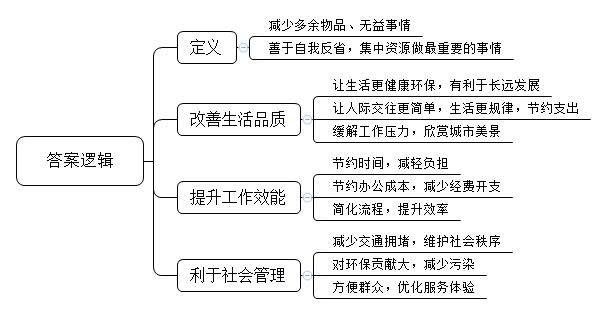
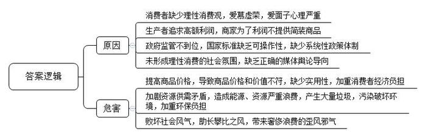
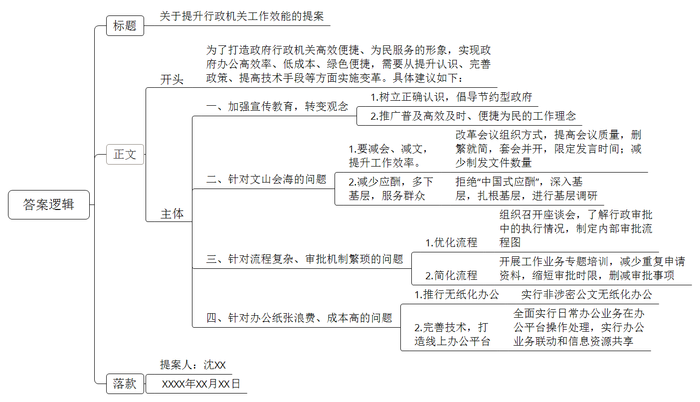
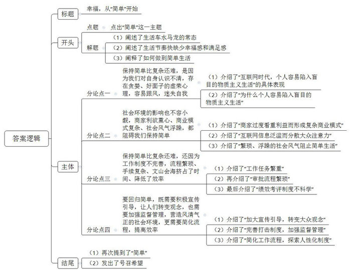

# 2016年山东省公考《申论》题（C卷）

> 候选采集稿。参考答案及解析来自粉笔页面，不代表官方答案或真实高分答卷；来源使用许可与原卷对应关系仍需人工核实。

## 给定材料

### 材料 material-60a0f2493db1d2d8

“最近忙什么呢？”“瞎忙！”成了当下人们见面时的惯用语。互联网上一项1500余人参加的调查显示，52.2%的人表示“太忙了，几乎没时间休息”，56.6%的人会习惯性地问朋友“最近你在忙什么”，38.4%的人表示每天几乎没有休闲时间，32.1%的人表示不知道都忙了些什么，就是觉得没时间。白领汪小姐每天早上8点就到公司，比公司要求的早到了1个小时。她自认为是个勤快人，吃完早点，整理一下办公桌，泡杯茶，刷一下微信、微博，接了几个电话，转眼就是11点了，这才想起来有个重要的报表没完成呢，赶紧急急忙忙地应付了事。小王则是一个刚进入职场不久的年轻人，身为网络达人的他，每天一坐到电脑前，总是先登录QQ、飞信、旺旺等，挨个看完，再刷微信、微博，查邮件，看网购信息、股票行情……忙活一天，几乎没干啥正事，老板指派的活儿都是“抽空”完成的，等到发薪水的时候，发现业绩那部分少得可怜，这才傻了眼。白领小吴因为工作原因需要经常上网，逐渐地越来越依赖网络，每天足不出户挂在网上，年纪轻轻的她在最近一次的体检中竟查出了腰椎间盘突出。

陈女士去年一年的购物总计花费近11万元，从10月1日到12月底就购买了92单商品，其中服装类用品34单、化妆品19单、汽车内饰4单、食品19单、植物2单、卫生纸3单、手机充值卡1单、收纳盒5单、机票3单、礼物2单。但是，仔细数了一下自己购买的所有货品，陈女士发现，其中的两瓶香水、五件T恤、一条裙子、一条牛仔裤等9单货品一直被塞在橱柜里，根本就没动过。不仅如此，陈女士发现，不是必须要买的东西而堆在家里成了摆设的，总价超过了3万元。“每次都忍不住购物，要么是觉得便宜，要么是打折赠送，看着实惠就直接买了。还有朋友推荐的，想着买来试试，结果就越买越多。”陈女士告诉记者，她的丈夫为这类事跟她吵了很多次。

市民老刘最近被电信宽带的“极繁”绕晕了。去续办宽带的时候被优惠升级“100兆”的广告吸引，一问之下却被告知：即使是老客户要升级，也必须办理新套餐，新套餐强制捆绑了一个新手机号码，还可获赠一个免费手机。老刘问：“我有用了很久的手机号，也不想要多余的手机，不换新的行么？”“不行，要优惠升级只有这种选择，否则就要全额支付固话月租、来电显示以及全额宽带的费用”，营业员回答。看着营业厅服务人员拿出计算器噼里啪啦一按，嘴皮飞快地解释不办理套餐是如何如何不划算，老刘听了半天愣是没弄明白各种套餐术语，伸手一摆：“停，太复杂了，按原样续约吧。”再看营业厅内其他套餐，更是种类繁多，眼花缭乱，各种繁复的“自主融合”套餐不是捆绑了手机就是强制消费，不要说用户搞不清楚，营业厅的服务人员也说搞不明白。

### 材料 material-31fe881a17abb69e

包先生的儿子出差回来，大包小包拎了一大摞。一进家门，就迫不及待地拿出了一个大盒子送给他。包先生开始拆那盒包装精美的茶叶：第一层是巨大的纸盒，上面描龙画凤，写意山水，两根带子金光闪闪，扣板上包扎着两块火红的绸缎；打开纸盒，里面是一层厚厚的泡沫板，上面敷着5层绢纸，一幅幅书法作品映入眼帘；泡沫板中央的小小空格中，躺着两个精美的小铁盒，黄缎包扎，包扎绳上紧扣着几颗亮光闪闪的水晶珠；打开铁盒子，是一个棉质布袋，布袋里面是一个锡纸袋，再里面是几包真空包装的塑料袋，打开塑料袋才是茶叶……为了揭开“庐山真面目”，包先生竟花了10分钟，而拆开来的包装物撒满一地。包先生笑儿子没经验：“买茶叶论斤称就可以了，价格实惠多了，何必拎回来一堆美丽垃圾。”可是儿子却说：“我就愿意多花钱，这个包装漂亮、有气派，送亲戚有面子，再说了，商场里也很难找到简装的。”

大肆包装过的商品，一般的变成了高档的，高档的则变成了更高档的，商家通过升级包装，可获得相当可观的利润回报。如某品牌茶叶，散装每斤630元，简装每斤1260元，而精装的每斤要2520元；一家知名品牌白酒专卖店，同等度数同等窖藏年份的白酒，把玻璃瓶包装换成瓷瓶，再加上一个外包装盒，售价就提升了近500元。

在一家大型商场的化妆品柜台，记者发现一个50毫升的磨砂瓶内，大约只有10毫升的BB霜，瓶子的下半部都是空的。据说，如今国内的许多化妆品厂家都爱用这种“障眼法”，卖的就是一个“看相”。在一家礼品柜台，记者指着几种包装豪华的礼品，随意采访了几位促销员问她们是否好卖。她们说，“人靠衣装，佛靠金装，现在很多礼品能卖得出去，靠的就是包装，礼品包装豪华，拎在手上才有气派。送礼的人有面子，收礼的人也有面子。”

专家认为，“兼顾安全经济、功能便利、绿色环保，同时具有一定文化创意”的适度包装，才是精品包装。而在我国，30年来，包装行业正以每年15%的速度递增发展，从“傻大黑粗”到过度豪华，中国的包装行业从一个极端走到了另一个极端。有调查数据称，中国已成为世界上“过度包装”最严重的国家，有些商品甚至已经到了“椟贵于珠”的地步。每年全国城市固体废弃物中，包装物占30%，每年废弃价值达4000亿元，而处理这些“美丽垃圾”的费用更是惊人。我国质检总局和国家标准委曾于2010年发布了限制商品过度包装的国家标准，要求对饮料、酒、糕点、粮食、保健食品、化妆品等外包装“瘦身”。规定食品和化妆品销售包装层数不得多于3层，包装空隙率不得大于60%，包装成本不得超过商品销售价格的15%，但由于缺乏系统的操作层面的体制支撑，这个规定目前只是“纸上谈兵”。“过度包装”已不仅仅是一种经济现象，也是一种社会和文化现象。

反对过度包装，国外有很多成功的经验可循。比如日本商品的包装，注重细节与实用性；对于每家每户垃圾量的限定，特别是对垃圾分类的严格规定，让消费者主动拒绝豪华包装。英国几年前也曾在全国上下掀起了一场关于过度包装问题的热烈讨论，以关心环保问题闻名的《独立报》推出了一项“反包装浪费”活动，要求超市和零售商为各种商品“脱掉多余的外衣”。

### 材料 material-8543b4935091172b

某市政协委员沈先生近年来一直关注并呼吁政府行政机关高效、便捷为民服务的问题，致力于将办公变成一件高效率、低成本、绿色便捷的事情。沈先生认为，这一问题正契合了今天对“建设节约型社会”的倡导，而这一问题的推进，除理念的推广普及外，也需要在政策和技术手段上实现更多的变革及创新。为此，沈先生还打算在“两会”上提交一份提案，向政府有关部门提出自己关于这一问题的建议。

Q市近年来出台了一系列新规定，减会、减文、减应酬，一位局长说，他们局5个局级干部往年腊月里为开会忙得不亦乐乎，今年一下子轻松了许多。去年下半年以来，该市下决心搬文山、填会海，他们改革会议组织方式，提高会议质量，删繁就简，套会并开，并限时发言。记者多次参加市委、市政府的领导会议发现，不管是市委书记还是市长都限定发言20分钟，到点就有人提醒：“发言到时了。”这种限时叫停明显地将会议时间压短了。该市还采取措施制止乱下“文件雨”。到去年底，制发文件同比下降11.5%，召开会议同比下降22%。领导干部带头做到还饭局以本来面目，向“中国式应酬”说“不”，少泡酒桌多下基层。该市市委书记去年下基层调研就在100天以上，而且事先不打招呼，禁止高规格接待，吃饭就在职工食堂。在领导的带动之下，现在除全市性的重大活动外，各类奠基、剪彩、展览、展销、颁奖、校庆、厂庆、开业庆典等礼仪活动，已经很少见到领导的影子。大家一致认为这一系列举措使日常工作简单了很多，工作效率也提高了很多。

据报道，为全力服务中心城区建设，掌握行政审批过程中的真实情况，S市编办组织召开20家企业项目负责人座谈会，了解审批执行情况，组织召开下辖各县市区行政审批制度工作业务专题培训，为县市区对接省市取消、下放和调整审批事项打下基础；特别是针对行政审批体制机制存在的弊端，制定了详细的内部审批流程图，减少重复申请资料，审批时限节约了三成，而H市在过去的6年里将审批事项删减了616项。砍掉了一大批审批事项，不仅大大简化了工作程序，提高了便民服务质量，让老百姓少跑了路，老百姓办事儿更快、更顺了，而且也为市政府的行政减了负。据统计，H市“三公”经费为此减少了1亿多元，老百姓夸赞说，这是一次成功的工作极简，同时也是一次成功的物质极简。

记者从L省公安厅获悉，从去年7月1日起，一个覆盖全省的公安机关办公平台已经投入使用，全面实现了非涉密公文无纸化办公。据统计，该平台推广应用以来，共处理公文6万余份，其中发文2万多份、收文近3万份、传阅文件7800多份、节约纸张170多万张，大大降低了办公成本。目前全省各级公安机关的公文处理、信息交流、会议管理、督查督办等日常办公业务均可在办公平台上操作处理，初步实现了全省公安机关办公业务联动和信息资源共享，极大地方便了日常行政办公工作，提高了工作效率和运行效能，节约了运行成本，也简化了许多不必要的工作程序。

## 题目

### 第 1 题

**请根据给定资料，归纳概括时下逐渐流行的“去繁就简”的生活及工作方式给人们带来的积极影响。（15分）**

关联材料：材料 material-60a0f2493db1d2d8

作答要求：

要求：条理清楚，全面准确，不超过200字。

### 第 2 题

**请结合“给定资料**2**”，联系社会现实，分析我国“过度包装”这一现象比较严重的原因及危害。（20分）**

关联材料：材料 material-31fe881a17abb69e

作答要求：

要求：观点明确，分析透彻，不超过300字。

### 第 3 题

**请根据“给定资料**6**”，围绕“让行政机关工作高效便捷，更好地为民服务”这一主题，以沈先生的名义拟写一份提案。（25分）**

关联材料：材料 material-8543b4935091172b

作答要求：

要求：思路清晰，针对性强，具有可操作性，简明具体，不超过500字。

### 第 4 题

**请结合对给定资料的理解与思考，从分析“保持简单，比复杂还难”这一观点出发，自拟题目，写一篇议论文。（40分）**

关联材料：材料 material-60a0f2493db1d2d8

作答要求：

要求：

（1）自选角度，立意明确；

（2）结合生活和工作实际；

（3）结构严谨，语言流畅；

（4）字数在1000—1200字。

## 答案与解析

第 1 题

**参考答案（粉笔题库参考内容）**

去繁就简就是减少多余物品、无益事情，善于自我反省，集中资源做最重要的事情。其带来的积极影响有：1.改善生活品质。让生活更健康环保，有利于长远发展；让人际交往更简单，生活更规律，节约支出；缓解工作压力，欣赏城市美景。2.提升工作效能。节约时间，减轻负担；节约办公成本，减少经费开支；简化流程，提升效率。3.利于社会管理。减少交通拥堵，维护社会秩序；对环保贡献大，减少污染；方便群众，优化服务体验。

**解析**

**参考答案说明：**（1）本参考答案写到了含义和积极影响两个部分。（2）先对“去繁就简”进行解释，再分别从“改善生活品质”“提升工作效能”“利于社会管理”这三个方面对“去繁就简”的积极影响进行了分条撰写，各条要点之间内容上没有交叉。

**考点**：考点影响类

**来源**：来源2016年山东省公考《申论》题（C卷）

粉笔申论页面对本题只提供「解析视频」入口，该入口是会员推广位，页面无视频地址与文字解析。

第 2 题

**参考答案（粉笔题库参考内容）**

原因：1.消费者缺少理性消费观，爱慕虚荣，爱面子心理严重；2.生产者追求高额利润，商家为了利润不提供简装商品；3.政府监管不到位，国家标准缺乏可操作性，缺少系统性政策体制；4.未形成理性消费的社会氛围，缺乏正确的媒体舆论导向。

危害：1.提高商品价格，导致商品价格和价值不符，缺少实用性，加重消费者经济负担；2.加剧资源供需矛盾，造成能源、资源严重浪费，产生大量垃圾，污染破坏环境，加重环保负担；3.败坏社会风气，助长攀比之风，带来奢侈浪费的歪风邪气。

**解析**

**参考答案说明：**（1）本参考答案写到了原因和危害两个部分。（2）第一部分分别从“消费者”“生产者和商家”“政府”“媒体舆论”这四个方面对“过度包装”这一现象比较严重的原因进行了分条撰写；第二部分分别从“提高商品价格”“加剧资源供需矛盾”“败坏社会风气”这三个方面对“过度包装”产生的危害进行了分条撰写，各条要点之间内容上没有交叉。

**考点**：考点多要素组合类

**来源**：来源2016年山东省公考《申论》题（C卷）

粉笔申论页面对本题只提供「解析视频」入口，该入口是会员推广位，页面无视频地址与文字解析。

第 3 题

**参考答案（粉笔题库参考内容）**

关于提升行政机关工作效能的提案

为了打造政府行政机关高效便捷、为民服务的形象，实现政府办公高效率、低成本、绿色便捷，需要从提升认识、完善政策、提高技术手段等方面实施变革。具体建议如下：

一、加强宣传教育，转变观念。1.树立正确认识，倡导节约型政府。2.推广普及高效及时、便捷为民的工作理念。

二、针对文山会海的问题。1.要减会、减文，提升工作效率。改革会议组织方式，提高会议质量，删繁就简，套会并开，限定发言时间；减少制发文件数量。2.减少应酬，多下基层，服务群众。拒绝“中国式应酬”，深入基层，扎根基层，进行基层调研。

三、针对流程复杂、审批机制繁琐的问题。1.优化流程。组织召开座谈会，了解行政审批中的执行情况，制定内部审批流程图。2.简化流程。开展工作业务专题培训，减少重复申请资料，缩短审批时限，删减审批事项。

四、针对办公纸张浪费、成本高的问题。1.推行无纸化办公。实行非涉密公文无纸化办公。2.完善技术，打造线上办公平台。全面实行日常办公业务在办公平台操作处理，实行办公业务联动和信息资源共享。

提案人：沈XX

XXXX年XX月XX日

**解析**

**参考答案说明：**（1）格式方面，本参考答案写到了“标题”“正文”“落款”。（2）正文部分，一方面从内容来看，围绕着“提升行政机关效能”这一主题，本参考答案的开头部分介绍了提案的目的及提案的总体建议；主体部分分别从“宣传观念”“文山会海”“审批流程”“办公成本”四个方面介绍了如何提升行政机关工作效率的对策。另一方面，形式上，本参考答案做到了分段、分条撰写，整体上条理较为清晰。（3）本参考答案在语言表达上做到了简洁、流畅、通俗易懂，符合“提案”这一文种的语言风格。

**考点**：考点方案类

**来源**：来源2016年山东省公考《申论》题（C卷）

粉笔申论页面对本题只提供「解析视频」入口，该入口是会员推广位，页面无视频地址与文字解析。

第 4 题

**参考答案（粉笔题库参考内容）**

**幸福，从“简单”开始**

科技日新月异，网络改变生活，车水马龙、灯红酒绿已经成为了生活的常态，然而这种生活却并没有带来应有的幸福感和满足感，人们拥有的物品越来越多，得到的却越来越少；生活的节奏越来越快，身边的美景却越来越少。**很多人都想从这****“繁琐”的生活中抽身，专注重点，过上简单却更有意义的生活，但保持简单似乎比复杂还难。**

环顾当下，回归现实，确实保持简单比复杂还难，我们不由得要感叹，是什么阻挡了我们追求“简单”的步伐？

**保持简单比复杂还难，是因为我们对自身认识不清，存在贪婪、好面子的虚荣心理，容易跟风，迷失自我。**互联网时代，个人容易陷入盲目的物质主义生活：微博微信“刷刷刷”刷一天，沉迷于虚拟的世界中，失去时间的同时也耽误了工作；淘宝天猫“买买买”买不停，买回一仓库却再也不用的物品，花钱买气派的包装给亲戚送礼却不重礼物实质等等。这类行为的背后，都是我们对自己没有清醒的认知，对未来没有科学规划，让“简单”离我们越来越远。

**当然，社会环境的影响也不容小觑，商家利欲熏心、商业模式复杂、社会风气浮躁，都阻碍我们保持简单。**部分商家一味地鼓吹气派的包装，甚至于商场里都找不到简装商品，低品质豪包装，利用过度的包装来提价以获得可观利润的商业模式屡见不鲜，另外各类套餐消费、捆绑消费、强制消费也让人眼花缭乱、目不暇接。在互联网+时代下信息泛滥，丰富的资讯、快捷的获取方式时刻可能分散我们的注意力，繁琐、浮躁的社会风气更是严重阻挠着我们追寻“简单”。

**保持简单比复杂还难，还因为工作制度不完善，流程繁琐、手续复杂、文山会海挤占了时间、降低了效率。**纷乱如麻的任务安排常让我们欲哭无泪，各类行政审批事项重复申请、权限不足，乱下“文件雨”的现象此起彼伏，让我们疲于应对，再加上严格的绩效考评制度更让我们只关注数字，忽略了对工作的思考及个人的成长。无用的物品、烦琐的过程让人迷失其中，难以真正的回归到“简单”状态。

**如此，要回归简单，既需要积极宣传引导，让人们转变观念，也需要加强监督管理，营造风清气正的社会环境，更需要简化流程，提高效率。**一方面要通过大众传媒宣传引导个人树立追求美好、简单、规律生活的意识，端正价值观，正确认识到简单生活的本质，有计划、有节制地工作生活，不被外物所扰；另一方面也要出台打击不良商业模式的制度，细化规定，严格执法，畅通监督举报渠道，对违法违规行为坚决发现一起、查处一起、问责一起，绝不姑息，还社会良好风气；最后，保持简单还需要从自身“简化”，优化工作流程，简化审批程序，探索更弹性、人性化的工作制度，试行“远程办公”、“居家工作”等，为极简生活创造条件。

“夫君子之行，非淡泊无以明志，非宁静无以致远。”幸福需要个人从简出发；稳定的社会、繁荣的国家，需要政府从简入手。去繁就简，回归到生活工作的本真，方能在人类梦想之路上越行越远！

**解析**

**文章分析**

**幸福，从“简单”开始**

【**标题的优点：**首先，范文的标题“幸福，从‘简单’开始”突出了“简单”这一主题。其次，形式上，文字简洁明快。】

（1）科技日新月异，网络改变生活，车水马龙、灯红酒绿已经成为了生活的常态，（2）然而这种生活却并没有带来应有的幸福感和满足感，人们拥有的物品越来越多，得到的却越来越少；生活的节奏越来越快，身边的美景却越来越少。（3）**很多人都想从这****“繁琐”的生活中抽身，专注重点，过上简单却更有意义的生活，但保持简单似乎比复杂还难****。**

【**开头的优点：**★内容方面：范文的开头是紧扣“简单”这一主题展开的。首先，开头点出主题，做到了主题明确。其次，对“简单”这一主题进行了分析阐述：（1）阐述了生活车水马龙的常态；（2）阐述了生活节奏快缺少幸福感和满足感；（3）阐释了如何做到简单生活。★文字表达方面：使用了“然而……”“但……”等关联句式，使语言表达有逻辑性。】

环顾当下，回归现实，确实保持简单比复杂还难，我们不由得要感叹，是什么阻挡了我们追求“简单”的步伐？

【**过渡段的优点：**范文过渡段段末尾的“是什么阻挡了我们追求‘简单’的步伐”是用来引起下文的过渡句。】

**保持简单比复杂还难，是因为我们对自身认识不清，存在贪婪、好面子的虚荣心理，容易跟风，迷失自我。**（1）互联网时代，个人容易陷入盲目的物质主义生活：微博微信“刷刷刷”刷一天，沉迷于虚拟的世界中，失去时间的同时也耽误了工作；淘宝天猫“买买买”买不停，买回一仓库却再也不用的物品，花钱买气派的包装给亲戚送礼却不重礼物实质等等。（2）这类行为的背后，都是我们对自己没有清醒的认知，对未来没有科学规划，让“简单”离我们越来越远。

【**观点****1段落的优点：**★观点句：范文的观点句是紧扣“简单”这一文章主题提出的。形式上，它在段首处直接写出，位置突出，容易发现。内容上，要点明确，可以明显看出它是从“自身认识不清”入手，指出了“保持简单比复杂还难”的原因。★论述内容：（1）先介绍了“互联网时代，个人容易陷入盲目的物质主义生活”的具体表现；（2）再介绍了“为什么个人容易陷入盲目的物质主义生活”。注意：以上两个方面的内容都是紧扣“保持简单比复杂还难，是因为我们对自身认识不清，存在贪婪、好面子的虚荣心理，容易跟风，迷失自我”这个观点句进行分析论述的，论述的针对性强，内容层次丰富。最后，在论述方法和论据的选取上以讲道理为主，做到了分析透彻、层次清晰。】

**当然，社会环境的影响也不容小觑，商家利欲熏心、商业模式复杂、社会风气浮躁，都阻碍我们保持简单。**（1）部分商家一味地鼓吹气派的包装，甚至于商场里都找不到简装商品，低品质豪包装，利用过度的包装来提价以获得可观利润的商业模式屡见不鲜，另外各类套餐消费、捆绑消费、强制消费也让人眼花缭乱、目不暇接。（2）在互联网+时代下信息泛滥，丰富的资讯、快捷的获取方式时刻可能分散我们的注意力，（3）繁琐、浮躁的社会风气更是严重阻挠着我们追寻“简单”。

【**观点****2段落的优点：**★观点句：范文的观点句是紧扣“简单”这一文章主题提出的。形式上，它在段首处直接写出，位置突出，容易发现。内容上，要点明确，可以明显看出它是从“社会环境”入手，指出了“保持简单比复杂还难”的原因。★论述内容：（1）先介绍了“商家过度看重利益而形成复杂商业模式”；（2）再介绍了“互联网信息泛滥而分散大众注意力”；（3）最后介绍了“繁琐、浮躁的社会风气阻止简单生活”。注意：以上几个方面的内容都是紧扣“社会环境的影响也不容小觑，商家利欲熏心、商业模式复杂、社会风气浮躁，都阻碍我们保持简单”这个观点句进行分析论述的，论述的针对性强，内容层次丰富。最后，在论述方法和论据的选取上以讲道理为主，做到了分析透彻、层次清晰。】

**保持简单比复杂还难，还因为工作制度不完善，流程繁琐、手续复杂、文山会海挤占了时间、降低了效率。**（1）纷乱如麻的任务安排常让我们欲哭无泪，（2）各类行政审批事项重复申请、权限不足，乱下“文件雨”的现象此起彼伏，让我们疲于应对，（3）再加上严格的绩效考评制度更让我们只关注数字，忽略了对工作的思考及个人的成长。无用的物品、烦琐的过程让人迷失其中，难以真正的回归到“简单”状态。

【**观点****3段落的优点：**★观点句：范文的观点句是紧扣“简单”这一文章主题提出的。形式上，它在段首处直接写出，位置突出，容易发现。内容上，要点明确，可以明显看出它是从“工作制度”入手，指出了“保持简单比复杂还难”的原因。★论述内容：（1）先介绍了“工作任务繁重”；（2）再介绍了“审批流程繁琐”；（3）最后介绍了“绩效考评制度不科学”。注意：以上几个方面的内容都是紧扣“保持简单比复杂还难，还因为工作制度不完善，流程繁琐、手续复杂、文山会海挤占了时间、降低了效率”这个观点句进行分析论述的，论述的针对性强，内容层次丰富。最后，在论述方法和论据的选取上以讲道理为主，做到了分析透彻、层次清晰。】

**如此，要回归简单，既需要积极宣传引导，让人们转变观念，也需要加强监督管理，营造风清气正的社会环境，更需要简化流程，提高效率。**（1）一方面要通过大众传媒宣传引导个人树立追求美好、简单、规律生活的意识，端正价值观，正确认识到简单生活的本质，有计划、有节制地工作生活，不被外物所扰；（2）另一方面也要出台打击不良商业模式的制度，细化规定，严格执法，畅通监督举报渠道，对违法违规行为坚决发现一起、查处一起、问责一起，绝不姑息，还社会良好风气；最后，（3）保持简单还需要从自身“简化”，优化工作流程，简化审批程序，探索更弹性、人性化的工作制度，试行“远程办公”、“居家工作”等，为极简生活创造条件。

【**观点****4段落的优点：**★观点句：范文的观点句是紧扣“简单”这一文章主题提出的。形式上，它在段首处直接写出，位置突出，容易发现。内容上，要点明确，可以明显看出它是从“宣传监督”入手，指出了如何“保持简单比复杂还难”。★论述内容：（1）先介绍了“加大宣传引导，转变大众观念”；（2）再介绍了“完善打击制度，加强监督管理”；（3）最后介绍了“简化工作流程，探索人性化制度”。注意：以上几个方面的内容都是紧扣“要回归简单，既需要积极宣传引导，让人们转变观念，也需要加强监督管理，营造风清气正的社会环境，更需要简化流程，提高效率”这个观点句进行分析论述的，论述的针对性强，内容层次丰富。最后，在论述方法和论据的选取上以讲道理为主，做到了分析透彻、层次清晰。】

【**论述段之间的关系：**★内容的内在逻辑：范文的论述段之间有两层逻辑。第一层，整体上是从“分析”到“对策”的逻辑展开的。第二层，其中观点1、2和观点3又是从“原因”出发，论述段1先写了“自身认识不清”的原因，论述段2再写了“社会环境”的原因，论述段3再写了“工作制度”的原因。★段与段的外在衔接：论述段3的段首处的过渡句“保持简单比复杂还难，还因为……”，起到了承接论述段1、2、引出了论述段3的作用。】

“夫君子之行，非淡泊无以明志，非宁静无以致远。”（1）幸福需要个人**从简**出发；稳定的社会、繁荣的国家，需要政府从简入手。（2）去繁就简，回归到生活工作的本真，方能在人类梦想之路上越行越远！

【**结尾的优点**：范文的结尾回扣了“简单”这一主题。（1）再次提到了“简单”；（2）发出了号召希望。】

**考点**：考点文章写作题

**来源**：来源2016年山东省公考《申论》题（C卷）

粉笔申论页面对本题只提供「解析视频」入口，该入口是会员推广位，页面无视频地址与文字解析。

