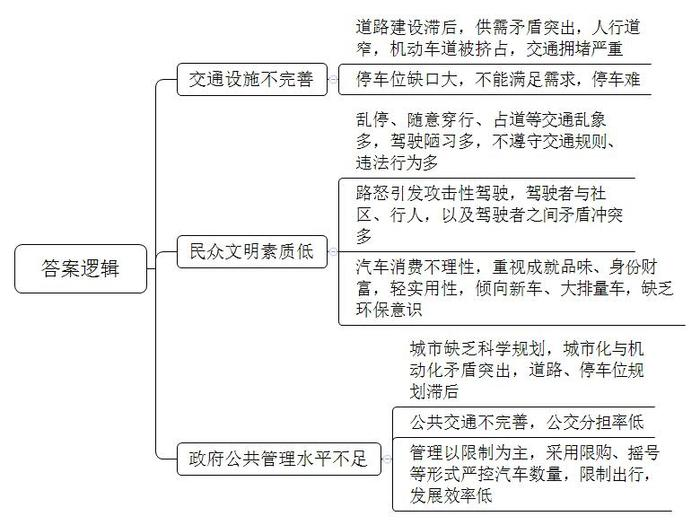
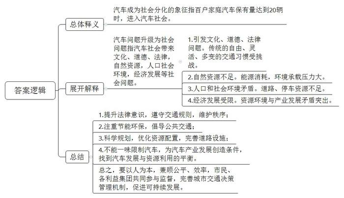
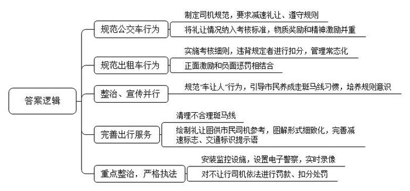
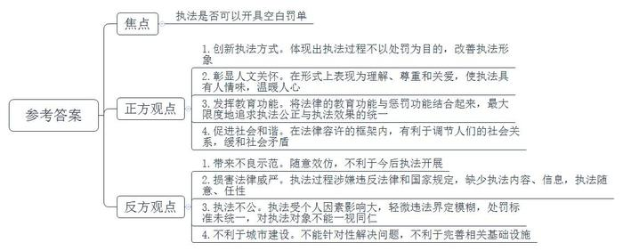
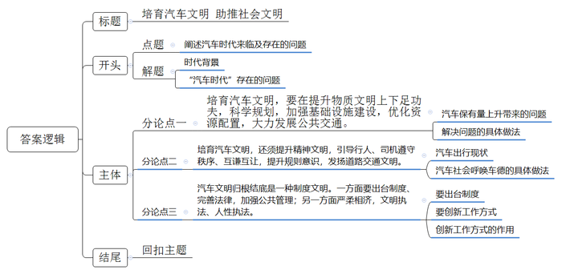

# 2017年山东省公考《申论》题（A卷）

<!-- gwy:overview:start -->
> **山东 · 2017 · 申论 · A类** ｜ 5 题 · 图片 5 处 · 答案随题折叠

导航：[题目](#题目) · [材料 1](#材料-1)
<!-- gwy:overview:end -->

> 候选采集稿。参考答案及解析来自粉笔页面，不代表官方答案或真实高分答卷；来源使用许可与原卷对应关系仍需人工核实。

## 给定材料

### 材料 1

随着我国经济持续快速发展，民众购车需求旺盛，汽车保有量呈快速增长趋势，公安部交管局统计数据显示：截止2016年底，全国汽车保有量达1.94亿辆，汽车驾驶人超过3.1亿人；全国有49个城市的汽车保有量超过百万辆，平均每百户家庭已拥有36辆私家车，成都、深圳、苏州等城市每百户家庭拥有私家车超过70辆，目前汽车保有量还在不断上升，但停车位却不能满足需求，据不完全统计，我国停车位缺口超过5000万个。

2011年新修订的《中华人民共和国道路交通安全法》规定：“醉酒驾驶机动车的，吊销机动车驾驶证，依法追究刑事责任。”2013年1月1日起生效的《机动车驾驶证申领和使用规定》，加强了对违规行为的处罚力度，并改进了驾照制度，“开车玩手机被抓扣2分”“闯红灯交通违法记分将由3分提高到6分”“不挂号牌或挡号牌的一次就将扣光12分”等条款实行，被称为“史上最严交规”，也标志着中国进入更加严厉的交通法规时代。

### 材料 2

中国社科院发布的《中国汽车社会蓝皮书》指出，按照国际标准，当一个国家或地区每百户家庭汽车保有量达到20辆时，通常被看作进入汽车社会，汽车社会是工业社会发展和经济发展到一定阶段，特别是轿车大规模进入家庭后出现的一种社会现象。在汽车社会里，汽车不仅仅是一种交通工具，它更是社会的组成部分，是人的空间属性的扩展和精神的延伸。我国已进入汽车社会，交通出行方式发生了根本转变，也带来了生产和生活方式的一系列变化。汽车影响力已辐射到文化、法律、道德、家庭等各个领域，与自然资源、人口环境、经济发展等相互影响并形成了一定行为规范的社会状态。

进入汽车社会前，中国人经历了长期的自行车阶段，习惯了任意穿行、灵活、多变的交通形态。进入汽车时代后，依然存在随意停车、随意乱穿、不各行其道等交通乱象。我们通常看到的是这番景象：在十字路口，汽车、行人无视交通信号灯，我行我素，红绿灯的警示作用成了“仅供参考”；在交通要道，各种车辆胡乱横行，无提示地随意并线串道，导致事故频发；在环路出入口，众多车辆竞相“加塞儿”，挤作一团，无法按照顺序进出；在胡同小路，车辆沿街随意停放，双向车道变成了单行道，道路上停满车辆，四车道变成了双车道……一系列的不文明交通行为反映出驾驶者的不良驾驶习惯，也折射出当前社会汽车文明的缺乏。

汽车文明是指人类社会进入汽车时代后，所建立起来的一系列文明体系，包括道路设施的完善，民众安全意识的提升，政府公共管理水平的提高等方面。汽车文明的构建需要经历一段时间，美国、德国等都是先完成了城市化过程，而后才是机动化过程，这个过程经历了比较长的时间。而我国在城市化进程还没有完成的时候，机动化就已来临。城市化与机动化的矛盾，突出体现在道路规划上。一些城市缺乏科学规划，道路建设滞后，公交分担率低，道路、停车供需矛盾突出。

中国汽车社会正面临众多困扰，<u>汽车成为社会分化象征，许多汽车问题升级为社会问题</u>，汽车社会的管理目标不是让人不买车、不开车，而是从人本身的角度出发，寻找更公平、更有效率的治本之策，建立包括普通市民在内的、由各利益集团共同参与和监督的城市交通决策及管理机制。

### 材料 3

北京的刘先生，最近通过了驾考，准备购车的他开始犯愁：“买车是租别人的牌照还是上外地牌照呢？如果上一个外地牌照，而交管部门规定部分路段禁止外地牌照车通行，路段一限制，就只能把车停下转乘地铁或公交，地铁或公交附近又很难找到停车位。过去买车差的是钱，现在攒够钱了，买车却难了。”在北京购车上牌照需要摇号，牌照就成了稀缺资源，但是摇号太难了，很多人几十次也未摇到号码，不少人将摇号比作买彩票，摇到号就好比彩票中奖了。北京、天津、上海、杭州、广州等多个城市采取摇号或拍卖等形式控制车辆数量，还有多个省会城市及二、三线城市欲实行这一政策。

在很多人看来，攒够了买车钱，又顺利拿到牌照是件高兴事，但上路后才发现，堵车严重程度超乎想象。交通拥堵，是近年来在全国凸现的“城市病”。市民贾先生说：“自从买了车，起得比以前更早了，从家到单位车程十几公里，顺利的话20分钟就能到，要是赶上了早高峰的拥堵，路上耗1个小时也是常事，为了省时间，早些起床，避开车流高峰。即便如此，堵车仍如家常便饭一般：提前半小时出门去开会，却因为堵车迟到了十几分钟；周末中午约朋友小聚，堵在路上动弹不得；赶上天气不好或是交通事故，开两个多小时也到不了家，对许多有车族而言，堵车已变成堵心。”

考验车主们的不仅是堵车，还有停车。如今，越来越多的朋友们见面第一句话经常是：“车停哪儿了？”市民陈女士说：“三种地方最难停车，一种是商场、商业街区，一种是医院、办事机关等公共单位，还有一种是住宅小区，尤其是老旧小区。在小区，原本挺和谐的邻里关系，因为停车闹得不开心，安地锁、装摄像头、写标语，简直无所不用。”

“开车的时候骂走路的，走路的时候骂开车的。”在一些城市，行走已经变成一件“很危险”的事情。随着中国城市化进程的不断推进，大小城市多是道路越修越宽，人行道越来越窄。而一些城市在窄窄的非机动车道上，又规划了一些停车位来日夜收费，再加上乱停放的机动车，于是，无路可走的行人走上了非机动车道，非机动车走上了机动车道。

### 材料 4

2014年1月11日，四川省成都市一辆高尔夫轿车以急刹车、快速并线等方式，多次别停同向行驶的宝马车；2015年5月3日，成都市一立交桥，一名男司机将一多次并线的女司机逼停后当街殴打；2016年3月14日，长春一名青年男子在某商场门前，下车对前车驾驶室方向辱骂，并猛踢前车车门，让前车驾驶员下车，因前车驾驶员未下车，青年男子上车后，连续猛撞前车，并造成前车并排其他车辆严重受损；2016年6月11日下午，在湖南怀化某小区，一辆小汽车将楼下的进出口处堵得严严实实，车子不但被小区居民吐口水砸鸡蛋，还被人用粉笔留言谴责……

现实中车辆驾驶陋习随处可见：抢黄灯，变道不打转向灯，超速危险驾驶，打着电话“龟速”前进，夜间开着晃眼远光灯，随意乱停车和丢弃车窗垃圾等。有人自私地只考虑自己方便，占用应急通道、消防通道；有人插队成为习惯，遇堵车就抢道加塞；有人易怒崇尚暴力，相互间对峙、追逼甚至打架等“路怒”行为就会出现……

“路怒”，即带着愤怒情绪驾驶机动车，俗称“开斗气车”，又称为“攻击性驾驶”，在交通违法行为上表现为强行变更车道、强行超车、违法抢行、占道行驶和不按规定让行等交通违法行为。社会学专家王教授认为：“路怒”是心疾，既不利于驾驶人的身心健康，又危害他人与自身的人身安全，由此引起的攻击性驾驶行为是严重交通违法行为，有序的汽车文明，不仅要靠宣传、靠自律，更要靠“他律”来规范车辆驾驶行为。

### 材料 5

根据某市场调查公司对60个国家和地区的调查数据，中国人买车（新车加二手车）的兴趣排名第6，而购买新车的兴趣则高居第2。至于中国人买车的原因，排名第一位的是“爱驾驶”，第二位是“个人社会地位的体现”，第三位是“实用”。2015年城市居民家庭的购车价格平均为15.1万，城市消费者在车型选择上更为个性化，自我认同意识越来越强，不仅看重产品与个人形象的相关性，而且外显型消费倾向越来越突出，希望通过新车来彰显自身的成就和品位。

在汽车普及已久的社会中，人们对汽车的兴奋度会大大下降，在调查中，中国消费者和欧美日韩还存在很大差异，欧美日韩对于汽车消费品趋于理性。日韩国家流行的是小排量，欧洲国家除了小排量就是旅行车，也都以家庭实用为主，欧洲人有买车计划的比例远不及中国，即便打算买车，购买二手车的比例也超过了买新车的比例。

目前我国大多数消费者，买车最先考虑的是价格和品牌因素，如果价格相当甚至略高的情况下，选择多是合资车，某自主品牌汽车4S店销售人员说：“如果在基本持平的价格区间面临选择时，消费者基本会毫不犹豫地选择合资品牌。”

汽车研究院李教授指出：汽车作为一种交通工具，基本的作用是给人代步，“实用性”应该排在第一位。在大多数国人心中，车的价格高低对应着一个人财富的多寡，折射出他的赚钱能力、社会影响力、人脉关系等。很多时候，一辆好车的确能给车主带来更高的社会认同和便利，不仅汽车，甚至车牌照都是身份和财富的象征。

### 材料 6

“礼让斑马线”是一项基本礼仪，也是一项基本规则，既是文明范畴，又属于法律范畴。汽车文明的一个重要内涵是以人为本，强者礼让弱者、汽车礼让行人是行为基准。这一文明规则也以法律条文的形式得到固化，《道路交通安全法》对机动车如何通过人行横道有明确细致的规定，《机动车驾驶证申领和使用规定》更是制定了严厉惩戒措施：“驾驶机动车行经人行横道，不按规定减速、停车、避让行人的，一次记3分。”现实中我们经常看到，车辆行经斑马线时毫不减速，甚至一路鸣笛、加速通过。在商场、超市附近等人流密集区域的斑马线，行人与车辆你争我抢、险情频出。近年来，发生在各地的一次次“斑马线惨案”，让行人生命线不时成为夺命线。“礼让斑马线”还远未形成大众化的自觉自律。

H市“礼让斑马线”已成为了一种常态，成为当地文明的一道风景线，无论是在主城区还是在景区，当行人或自行车走在斑马线上时，行驶中的机动车均会习惯性地在斑马线外停下来，等待对方通过。据交通管理部门的统计，目前市区主要道路上斑马线前的礼让率已经达到93.91%。

H市的“礼让斑马线”最早从公交车开始，在2007年，H市公交集团就制定了《公交营运司机五条规范》，其中明确规定“行经人行横道时减速礼让”，要求全体司机必须遵守并体现在工作中。公交集团还制定了《营运司机星级评定指导意见》，将斑马线礼让情况纳入司机考核标准，通过物质奖励和精神激励双管齐下，有效推动了安全行车、文明礼让工作的落实。

在公交车的带领下，2009年，H市内出租车也加入到“礼让斑马线”的行动中。2010年《H市客运出租汽车单车考核细则》实施，规定出租车在斑马线前不减速、未停车让行、未避让的，一次扣10分。推行过程中，通过评优等正面激励和负面的惩罚措施，让“礼让斑马线”常态化。

推广“礼让斑马线”过程中，2009年发生的机动车斑马线撞人致死的案件触动了当地民众，交警部门推出多项交通整治行动和系列宣传，积极规范“车让人”行为，并引导市民养成过马路走斑马线习惯，让“礼让斑马线”更深入人心。

为让司机了解到斑马线前什么时候该让，应该怎么让？2011年4月，交警部门还专门绘制了多张“斑马线前礼让图”供市民及司机参考，通过图解形式细致化，用以规范礼让标准。同时清理不合理的斑马线354条，并完善了一批减速标志及“请主动避让行人”“请快速通过”等交通标示提示语。在法律执行层面，交警在市区27个斑马线前现场摄像，对“斑马线前不让行”现象进行重点整治。2014年推出了新举措，在无信号灯斑马线前设置电子警察，对未礼让斑马线的机动车进行实时录像，作为处罚依据。对不让行的司机，交警部门依据相关法规对司机进行罚款及扣分的处罚。

2016年3月1日起，《H市文明行为促进条例》正式施行，斑马线“礼让行人”首次被写入了地方法规，“礼让行人”从最开始的文明倡导升格为地方法规条款。

### 材料 7

S市潘先生的女儿突然发高烧并引发肺炎，住进了该市儿童医院。他开车送孩子到医院后，转来转去也找不到停车位，情急之下将车停在了医院外的路边。当天上午10点多，他下楼发现车已经被贴了罚单。潘先生很快将车挪到了医院正在施工的一处工地旁，并留下来一张字条：“警察叔叔，孩子在儿童医院住院，医院里停车场没有位置了，没办法停到这里，请不要贴我，碍事我就移车，谢谢了。”在纸条下方，潘先生留下了自己的手机号。等潘先生中午下楼看车时，车窗上多了一张贴条，纸条上写着这样一行字：“祝早日康复，以后尽量按位停车”，落款为“S市xx大队宣”，并画上了一张笑脸。看到这张字条，潘先生十分感动，“看到这个的确很意外，这个交警执法真的很人性化，让人心里暖暖的！自己以后保证会按位停车。”当时执勤交警表示：潘先生当时已经被贴了一张罚单，后来挪了车才发现有了这张字条，孩子生病家长肯定着急，从人性化执法角度，我们不能“雪上加霜”。

这两张纸条上传网络后引发了热议。不少网友非常赞许交警的暖心行为，但也有人指出：“既然车主已经被贴了罚单，没有必要再挪车”，并且质疑：“违法停车留纸条就可以免于惩罚，如果都效仿这种方式，以后这种情况如何处理？”

外地的汪先生到T市旅游时，将车随意停放在景区路段内，离开时发现私家车上被贴了一张“空白罚单”，上面并没有写明扣分或者罚款的事宜，而是留下交警的手写字：“前面有停车场，下次注意”。汪先生对交警人性化执法很感动，拍照并配文发在了自己朋友圈。空白罚单被大量转发传播后，引发了众多网友的热议，有人点赞，也有人提出疑问。

网友A：这是我见过的“最美罚单”，给人感觉很温暖。

网友B：这种罚单方式不错，给违停者贴了罚单，却没有处罚，个人觉得还是很有人情味的，体现了执法过程中不是仅以处罚为目的，是工作方式上的一种创新……

网友C：轻微的违法也是违法，既然违法了那就应该处罚，这种“空白罚单”只见罚单不见罚款，是否涉嫌违反国家的有关规定？

网友D：轻微违法如何界定？处罚的标准如何统一？这些应有具体规定，如果仅凭交警的个人认定，受个人因素影响太大。

网友E：罚单，只能按照法律规定进行填写或告知。“空白罚单”，既没有填写任何执法内容，也没有留下任何执法信息，在一张正式罚单的空白处写上了一句“温馨提示”，实在是太随意、太任性了、太不维护法律的威严。

网友F：对外地车相对宽容，却对本地车严厉，人性化执法应该不分外地本地，一视同仁，统一标准。如果考虑外地司机不熟悉道路情况，就应该提前进行各种线路指示和提醒，比如做个“前面有停车场”的标牌。

T市交警：人性化执法，将法律的教育功能与惩罚功能结合起来，最大限度地追求执法公正与执法效果的统一，体现了执法过程中的人文关怀，在形式上表现为理解、尊重和关爱。在法律容许的框架内，有利于调节人们的社会关系，促进社会和谐。

### 材料 8

J市举行了一场以“汽车社会与汽车文明建设”为主题的座谈会。

主持人：我国已经进入汽车社会，但并没有建立相应的汽车文明，在这样一个汽车社会里，我们应该提倡哪些“汽车文明”？

嘉宾甲：在发达国家占用应急车道、与行人抢路的情况少，很重要的一个原因是社会舆论对这些不文明行为的包容度比较低。如果你开车不让人，周围人会觉得你很野蛮，看不起你，而我们刚刚进入汽车社会，很多情况和行为都是新的，对什么应该包容、什么必须谴责，从社会角度来看还没有形成共识，也缺乏相关文明级别的标准。

嘉宾乙：我们经常看到，有的路口前面明明已经堵死了，后面的车也不管不顾，只要是绿灯就往前开，结果堵在交叉路口的中央，把四个方向全部堵死。文明驾驶就不应该抢绿灯，走到路口，绿灯虽然亮着，但前面车已经堵住了，就别走了，这样，横向来车就能顺畅通行。类似的例子很多，我们每个人应该从自身做起，践行“汽车文明”。

嘉宾丙：车越来越多，文明素养不能跟着一起提高，路只会越来越堵。践行汽车文明，一是要遵守规则，二是要有公德心，三是要有系统的观念。整个社会是个系统，个体是系统的一个组成部分，过度地考虑自己而不考虑别人，就会把系统正常的循环给破坏，自己也无法避免受到影响。

嘉宾丁：文明的交通环境是由行人、机动车、非机动车组成的。现在对机动车违法好处理，可对非机动车和行人的违法处理，就要难得多。很多非机动车驾驶员和行人，对遵守交通法规这一要求都是不屑一顾。道路交通文明是基础的道德建设之一，交通文明的建立绝非一夕之功。

……

交通运输管理干部学院张教授：文明习惯的养成离不开文明土壤的培育，国家的文明依赖全体公民，是个人文明的总和。汽车可以提高交通速度，汽车更应该提高公民意识增强的速度，提高社会文明建设的速度。交通“红绿灯”，是一盏城市文明的“照明灯”，<u>汽车文明是否“一路绿灯”，关系到社会文明的进程。</u>

## 题目

### 第 1 题

根据给定材料1-5，概括我国进入汽车社会后面临的主要困扰。（15分）

关联材料：材料 1、材料 2、材料 3、材料 4、材料 5

作答要求：

要求：全面、准确，有条理，不超过300字。

第 1 题 · 答案与解析

**参考答案（粉笔题库参考内容）**

一、交通设施不完善。1.道路建设滞后，供需矛盾突出，人行道窄，机动车道被挤占，交通拥堵严重；2.停车位缺口大，不能满足需求，停车难。

二、民众文明素质低。1.乱停、随意穿行、占道等交通乱象多，驾驶陋习多，不遵守交通规则、违法行为多；2.路怒引发攻击性驾驶，驾驶者与社区、行人，以及驾驶者之间矛盾冲突多；3.汽车消费不理性，重视成就、品味、身份、财富，轻实用性，倾向新车、大排量车，缺乏环保意识。

三、政府公共管理水平不足。1.城市缺乏科学规划，城市化与机动化矛盾突出，道路、停车位规划滞后；2.公共交通不完善，公交分担率低；3.管理以限制为主，采用限购、摇号等形式严控汽车数量，限制出行，发展效率低。

**解析**

**参考答案说明：**本参考答案宏观上先从“交通设施不完善”“民众文明素质低”“政府公共管理水平不足”三个角度展开。在“交通设施不完善”方面，又从“道路建设”“车位缺口”等两个方面进行了分条撰写。各条要点之间在内容上相互并列，没有交叉。在“民众文明素质低”方面，又从“交通乱象”“驾驶者矛盾冲突”“汽车消费不理性”等三个方面进行了分条撰写。各条要点之间在内容上相互并列，没有交叉。在“政府公共管理水平不足”方面，又从“城市缺乏科学规划”“公共交通不完善”“管理以限制为主”等三个方面进行了分条撰写。各条要点之间在内容上相互并列，没有交叉。

**考点**：问题类

**来源**：2017年山东省公考《申论》题（A卷）

### 第 2 题

**给定资料2在概述汽车社会面临困扰时提到，“汽车成为社会分化象征，许多汽车问题升级为社会问题”，根据给定资料，应如何理解这句话？（15分）**

关联材料：材料 2

作答要求：

要求：理解全面、准确，条理清晰，不超过350字。

第 2 题 · 答案与解析

**参考答案（粉笔题库参考内容）**

汽车成为社会分化的象征指百户家庭汽车保有量达到20辆时，进入汽车社会。

汽车问题升级为社会问题指汽车社会带来文化、道德、法律，自然资源，人口社会环境，经济发展等社会问题。具体有：1.引发文化、道德、法律问题。传统的自由、灵活、多变的交通习惯受挑战。2.自然资源不足。能源消耗，环境承载压力大。3.人口和社会环境矛盾。道路、停车资源不足。4.经济发展受限。资源环境与产业发展矛盾突出。

我们应该：1.提升法律意识，遵守交通规则，维护秩序；2.注重节能环保，倡导公共交通；3.科学规划，优化资源配置，完善道路设施；4.不能一味限制汽车，为汽车产业发展创造条件，找到汽车发展与资源利用的平衡。总之，要以人为本，兼顾公平、效率，市民、各利益集团共同参与监督，完善城市交通决策管理机制，促进可持续发展。

**解析**

**参考答案说明：**思路方面，本参考答案按照词句解释题“总体释义+展开解释+总结”的一般答题思路展开。内容方面，本参考答案先对“汽车成为社会分化象征”的含义进行了总体释义，接着展开解释了“汽车问题升级为社会问题”具体表现，最后进行了总结。词句表达上，本参考答案加上了“具体有”“我们应该”等连接词来承接上下文。

**考点**：词句解释类

**来源**：2017年山东省公考《申论》题（A卷）

### 第 3 题

根据给定资料6，总结H市推行“礼让斑马线”的主要经验。（15分）

关联材料：材料 6

作答要求：

要求：准确全面、条理清楚，不超过250字。

第 3 题 · 答案与解析

**参考答案（粉笔题库参考内容）**

一、规范公交车行为。制定司机规范，要求减速礼让、遵守规则；将礼让情况纳入考核标准，物质奖励和精神激励并重。

二、规范出租车行为。实施考核细则，违背规定者进行扣分，管理常态化；正面激励和负面惩罚相结合。

三、整治、宣传并行。规范“车让人”行为，引导市民养成走斑马线习惯，培养规则意识。

四、完善出行服务。清理不合理斑马线；绘制礼让图供市民司机参考，图解形式细致化，完善减速标志、交通标识提示语。

五、重点整治，严格执法。安装监控设施，设置电子警察，实时录像；对不让行司机依法进行罚款、扣分处罚。

**解析**

**参考答案说明：**本参考答案从“规范公交车行为”“规范出租车行为”“整治、宣传并行”“完善出行服务”“重点整治，严格执法”等五个方面进行了分条撰写。各条答案要点之间在内容上相互并列，没有交叉。

**考点**：经验启示类

**来源**：2017年山东省公考《申论》题（A卷）

### 第 4 题

**给定资料7中，“空白罚单”等人性化执法行为引起了社会讨论，请分析指出讨论的焦点及正反方主要观点。（15分）**

关联材料：材料 7

作答要求：

要求：分析透彻，观点明确，不超过350字。

第 4 题 · 答案与解析

**参考答案（粉笔题库参考内容）**

讨论的焦点为：执法是否可以开具空白罚单。

正方观点：1.创新执法方式。体现出执法过程不以处罚为目的，改善执法形象；2.彰显人文关怀。在形式上表现为理解、尊重和关爱，使执法具有人情味，温暖人心；3.发挥教育功能。将法律的教育功能与惩罚功能结合起来，最大限度地追求执法公正与执法效果的统一；4.促进社会和谐。在法律容许的框架内，有利于调节人们的社会关系，缓和社会矛盾。

反方观点：1.带来不良示范。随意效仿，不利于今后执法开展。2.损害法律威严。执法过程涉嫌违反法律和国家规定，缺少执法内容、信息，执法随意、任性。3.执法不公。执法受个人因素影响大，轻微违法界定模糊，处罚标准未统一，对执法对象不能一视同仁。4.不利于城市建设。不能针对性解决问题，不利于完善相关基础设施。

**解析**

**参考答案说明：**本参考答案思路上从“讨论焦点”“正方观点”“反方观点”入手，分成了三段。此外，“讨论焦点”与“正反方观点”之间是“总-分”关系。

**考点**：焦点阐释类

**来源**：2017年山东省公考《申论》题（A卷）

### 第 5 题

**资料8中提到“汽车文明是否‘一路绿灯’，关系到社会文明的进程。”请根据你对这句话的理解，结合给定资料联系实际，自选角度，自拟题目，写一篇议论文。（40分）**

关联材料：材料 1、材料 2、材料 3、材料 4、材料 5、材料 6、材料 7、材料 8

作答要求：

要求：

（1）观点明确，分析具体，条例清楚，语言流畅；

（2）参考给定资料“给定资料”，但不拘泥于“给定资料”；

（3）总字数1000-1200字。

第 5 题 · 答案与解析

**参考答案（粉笔题库参考内容）**

**培育汽车文明 助推社会文明**

经济飞速发展，我们奔跑着从自行车时代迈入了汽车时代，快的让人惊叹、诧异、欣喜。然而，当人们沉醉于汽车带来的便捷时，却忽略了对“汽车文明”的关注。“中国式”过马路、“中国式”开车，每天都在上演，交通拥堵成为许多城市不得不面对的“城市病”。汽车保有量与品牌档次都上去了，但是汽车文明却未能与其同步，此情此景迫切呼唤更加进步的汽车文明。

文明驾驶、文明出行、文明交通，不仅关系个人，也关系每一个家庭的幸福，社会文明的程度。可以说，汽车文明是物质文明、精神文明、制度文明的综合体现。

**培育汽车文明，要在提升物质文明上下足功夫，科学规划，加强基础设施建设，优化资源配置，大力发展公共交通。**汽车保有量的持续上升带来一系列问题：车多路窄、道路拥堵，泊位奇缺……各地“城市病”凸显，暴露了城市规划短视、交通方式单一的顽疾。为此，一方面应加大投入，完善道路硬件建设，优化布局，道路、泊位规划上预留足够空间，发展立体交通；另一方面，提高公交分担率，根据市民出行需求，完善交通线路布局，增加公车投放，扩大公交覆盖面，增设班次频率，缩短等车时间，完美衔接私人交通，为市民提供良好体验。

**培育汽车文明，还须提升精神文明，引导行人、司机遵守秩序、互谦互让，提升规则意识，发扬道路交通文明。**汽车出行，本应带来便捷、舒心，但乱停、乱放、占用应急车道、抢道加塞等屡见不鲜，驾驶者与行人，以及驾驶者之间矛盾频发，更有甚者路怒、辱骂、追逼、大打出手……此时，汽车给我们带来的只是低效、低速和闹心。“欲修其身者，先正其心”，汽车社会时代迫切呼唤“车德”。一方面，应推动普法学习，增强交通安全意识，遵法律，守规则，培育规范、文明行车理念。另一方面，从驾驶人自身角度出发，应加强个人素养、自我约束，做到谦让出行、文明礼让。

汽车文明的成长和成熟，光靠驾驶人的自律还不够，还需要他律，需要政府的主动引领、科学管理。

**汽车文明归根结底是一种制度文明。一方面要出台制度、完善法律，加强公共管理；另一方面严柔相济，文明执法、人性执法。**涵养汽车文明，还须制度和规则作为支撑，政府要提升公共管理水平，完善、细化法律法规，严格执法，加大违法成本，让交通参与者认识到守法责任。此外，还要创新工作方式，不以处罚为目的，而是将法律的教育功能与惩罚功能相结合。近年来，出现的“贴卖萌罚单”“抄写交规”“看警示片”等有温度的执法方式，既纠正了一些人的违法行为，也带给大家尊重、理解和关爱。

建设汽车文明社会是一项系统工程，关系到每一个人、每一个家庭的平安和幸福。需要全社会的共同努力，让汽车文明引领社会文明，让我们的社会更文明、更和谐！

**解析**

**文章分析**

**培育汽车文明 助推社会文明**

【**标题的优点**：首先，范文的标题“培育汽车文明 助推社会文明”突出了“汽车文明”这一主题。其次，形式上，采取对仗形式，工整简洁。】

（1）<u>经济飞速发展</u>，<u>我们奔跑着从自行车时代迈入了汽车时代</u>，快的让人惊叹、诧异、欣喜。然而，当人们沉醉于<u>汽车带来的便捷</u>时，却<u>忽略了对“汽车文明”的关注</u>。（2）<u>“中国式”过马路</u>、<u>“中国式”开车</u>，每天都在上演，<u>交通拥堵成为许多城市不得不面对的“城市病”</u>。<u>汽车保有量与品牌档次</u>都上去了，但是<u>汽车文明却未能与其同步</u>，此情此景迫切呼唤更加进步的汽车文明。

【**开头的优点：**★内容方面。范文的开头是紧扣题目给定的“汽车文明是否‘一路绿灯’，关系到社会文明的进程。”这句话展开的。首先，开头**即点出主题，做到了主题明确。其次，对“汽车文明”这一主题进行了分析阐述，指出了（1）“时代背景”。（2）“汽车时代”存在的问题。**注意以上两个方面的阐述在逻辑上有先后顺序：先写“背景”，再写“必要性、紧迫性”。★文字表达方面：长短句配合使用，使语言表达有节奏感。】

文明驾驶、文明出行、文明交通，不仅关系个人，也关系每一个家庭的幸福，社会文明的程度。可以说，汽车文明是物质文明、精神文明、制度文明的综合体现。

【**过渡段的优点：**范文过渡段分析了“汽车文明”的重要性，此外，还要注意过渡段末尾的“汽车文明是物质文明、精神文明、制度文明的综合体现”是用来引起下文的过渡句。】

**培育汽车文明，要在提升物质文明上下足功夫，科学规划，加强基础设施建设，优化资源配置，大力发展公共交通。**（1）<u>汽车保有量的持续上升带来一系列问题</u>：<u>车多路窄</u>、<u>道路拥堵</u>，<u>泊位奇缺</u>……各地“城市病”凸显，<u>暴露了城市规划短视</u>、<u>交通方式单一</u>的顽疾。（2）为此，一方面<u>应加大投入</u>，<u>完善道路硬件建设</u>，<u>优化布局</u>，<u>道路</u>、<u>泊位规划上预留足够空间</u>，<u>发展立体交通</u>；另一方面，<u>提高公交分担率</u>，<u>根据市民出行需求</u>，<u>完善交通线路布局</u>，<u>增加公车投放</u>，<u>扩大公交覆盖面，增设班次频率</u>，<u>缩短等车时间</u>，<u>完美衔接私人交通</u>，<u>为市民提供良好体验</u>。

【**论述段1的优点：**★观点句：范文的观点句是紧扣“汽车文明”这一文章主题提出的。形式上，它以单独段落的形式直接写出，位置突出，容易发现。内容上，关键词突出，内容要点明确，可以明显看出它是从“物质文明”的角度阐述“如何培育汽车文明”。★论述内容：（1）介绍了“汽车保有量上升带来的问题”；（2）介绍了“解决问题的具体做法”。注意：以上两个方面的内容都是紧扣“培育汽车文明，要在提升物质文明上下足功夫，科学规划，加强基础设施建设，优化资源配置，大力发展公共交通”这个观点句进行分析论述的，论述的针对性强，内容层次丰富。最后，在论述方法和论据的选取上做到了讲道理、举例子相结合，让论述内容丰富多样。】

**培育汽车文明，还须提升精神文明，引导行人、司机遵守秩序、互谦互让，提升规则意识，发扬道路交通文明。**（1）<u>汽车出行</u>，<u>本应带来便捷、舒心</u>，但乱停、乱放、占用应急车道、抢道加塞等屡见不鲜，驾驶者与行人，以及驾驶者之间矛盾频发，更有甚者路怒、辱骂、追逼、大打出手……此时，<u>汽车给我们带来的只是低效</u>、<u>低速和闹心</u>。（2）“欲修其身者，先正其心”，汽车社会时代迫切呼唤“车德”。一方面，<u>应推动普法学习</u>，<u>增强交通安全意识</u>，<u>遵法律</u>，<u>守规则</u>，<u>培育规范</u>、<u>文明行车理念</u>。另一方面，<u>从驾驶人自身角度出发</u>，<u>应加强个人素养</u>、<u>自我约束</u>，<u>做到谦让出行</u>、<u>文明礼让</u>。

【**论述段2的优点：**★观点句：范文的观点句是紧扣“汽车文明”这一文章主题提出的。形式上，它以单独段落的形式直接写出，位置突出，容易发现。内容上，关键词突出，内容要点明确，可以明显看出它是从“精神文明”的角度阐述“如何培育汽车文明”。★论述内容：（1）介绍了“汽车出行现状”；（2）介绍了“汽车社会呼唤车德的具体做法”。注意：以上两个方面的内容都是紧扣“培育汽车文明，还须提升精神文明，引导行人、司机遵守秩序、互谦互让，提升规则意识，发扬道路交通文明”这个观点句进行分析论述的，论述的针对性强，内容层次丰富。最后，在论述方法和论据的选取上做到了讲道理、举例子相结合，让论述内容丰富多样。】

汽车文明的成长和成熟，光靠驾驶人的自律还不够，还需要他律，需要政府的主动引领、科学管理。

**汽车文明归根结底是一种制度文明。一方面要出台制度、完善法律，加强公共管理；另一方面严柔相济，文明执法、人性执法。**（1）涵养汽车文明，<u>还须制度和规则作为支撑</u>，<u>政府要提升公共管理水平</u>，<u>完善</u>、<u>细化法律法规</u>，<u>严格执法</u>，<u>加大违法成本</u>，<u>让交通参与者认识到守法责任</u>。（2）此外，<u>还要创新工作方式</u>，<u>不以处罚为目的</u>，<u>而是将法律的教育功能与惩罚功能相结合</u>。（3）近年来，出现的“贴卖萌罚单”“抄写交规”“看警示片”等<u>有温度的执法方式</u>，<u>既纠正了一些人的违法行为</u>，<u>也带给大家尊重</u>、<u>理解和关爱</u>。

【**论述段3的优点：**★观点句：范文的观点句是紧扣“汽车文明”这一文章主题提出的。形式上，它以单独段落的形式直接写出，位置突出，容易发现。内容上，关键词突出，内容要点明确，可以明显看出它是从“制度文明”的角度阐述“如何培育汽车文明”。★论述内容：（1）介绍了“要出台制度”；（2）介绍了“要创新工作方式”；（3）介绍了“创新工作方式的作用”。注意：以上三个方面的内容都是紧扣“汽车文明归根结底是一种制度文明”这个观点句进行分析论述的，论述的针对性强，内容层次丰富。最后，在论述方法和论据的选取上做到了讲道理、举例子相结合，让论述内容丰富多样。】

【**论述段之间的关系**：★内容的内在逻辑：范文的论述段之间是依照“并列”的逻辑展开的。论述段1先写了“物质文明”，论述段2再写了“精神文明”，论述段3接着写了“制度文明”。★段与段的外在衔接：论述段2的段首处的过渡句“培育汽车文明，还须提升精神文明”，起到了承接论述段1、引出了论述段2的作用。论述段3的段首处的过渡句“汽车文明归根结底是一种制度文明”，起到了承接论述段2、引出了论述段3的作用。】

（1）<u>建设汽车文明社会是一项系统工程</u>，<u>关系到每一个人</u>、<u>每一个家庭的平安和幸福</u>。需要<u>全社会的共同努力</u>，让汽车文明引领社会文明，让我们的社会更文明、更和谐！

【**结尾的优点：**范文的结尾回扣了“汽车文明”这一主题。（1）指出了建设汽车文明的重要性。（2）提出了展望，阐述了深远意义。】

**考点**：文章写作题

**来源**：2017年山东省公考《申论》题（A卷）

