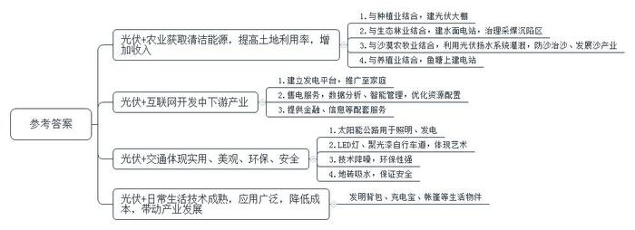
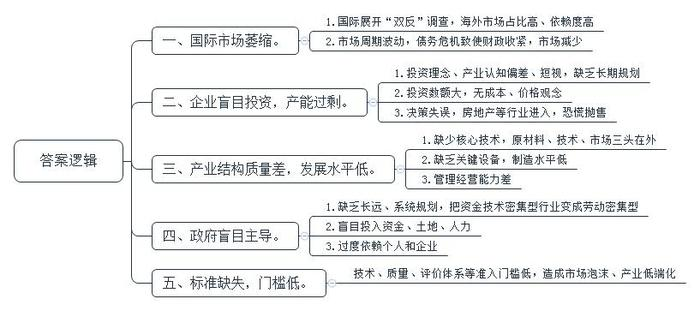
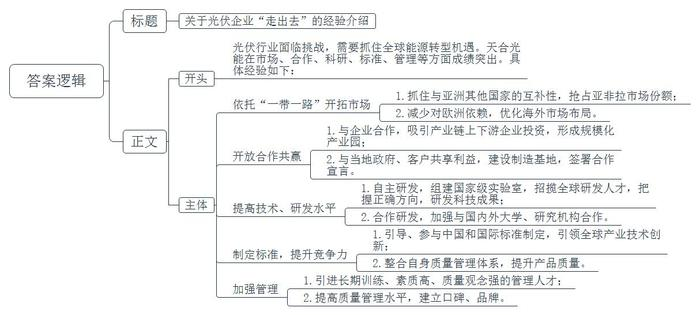
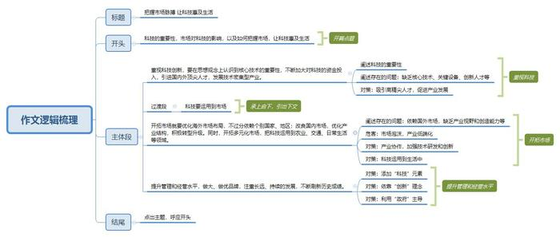

# 2017年山东省公考《申论》题（B卷）

<!-- gwy:overview:start -->
> **山东 · 2017 · 申论 · B类** ｜ 4 题 · 图片 4 处 · 答案随题折叠

导航：[题目](#题目) · [材料 1](#材料-1)
<!-- gwy:overview:end -->

> 候选采集稿。参考答案及解析来自粉笔页面，不代表官方答案或真实高分答卷；来源使用许可与原卷对应关系仍需人工核实。

## 给定材料

### 材料 1

地球上的绝大部分能量，都是太阳能转化的，煤炭、石油、粮食，没有太阳就不存在。在现代科技的帮助下，还能把太阳能直接转化为电能，这就需要太阳能光伏发电系统，简称光伏。太阳能清洁能源是将太阳的光能转换成为其他形式的热能、电能、化学能，能源转换过程中不产生其他有害的气体或固体废料，是一种环保、安全、无污染的新型能源。中国是世界上最大的光伏市场，连续8年成为全球最大的光伏电池生产国。2016年，中国光伏发电量已经达到662亿度左右，随着我国光伏利用市场的不断扩大以及模式的创新，“光伏+”已成为一个新的投资热点。光伏产业也好，各个企业也好，急需这个发展模式，也急需加强合作，实现共赢，跨界合作将是未来光伏发展的一个方向。

2016年5月17日，由中国改革报《能源发展》周刊主办的“首届中国‘光伏+’创新发展论坛”举行，国家能源局新能源和可再生能源司副司长表示，实践证明，光伏可以无处不在，也是可以广泛应用的。“光伏+”势必是各种技术的融合，光伏只有和其他技术、产业相结合，才能提供更多的市场价值，他认为，光伏可以和很多领域结合，结合起来又有更多的应用方式。“来自市场方面的创新非常重要，虽然常说<u>科技是第一推动力，但有了市场，科技才有用武之地。</u>‘光伏+’正是市场引导发展的模式，各种创新的发展都是在拓展市场空间，无论是跟农业、林业，还是学校、医院、交通等众多方面的结合，都是找到了一个新领域，开发了一个新的市场空间。”

### 材料 2

当下我国正处于传统农业步入现代农业的转型阶段，这个阶段的农业发展与现代化工业、新兴技术以及信息紧密相连。光伏与农业跨界融合迎来了少有的发展机遇，“光伏农业”成为现代农业发展的一种新模式。

在青岛市大信镇，有一片占地500亩的光伏农业园区，每个大棚上面都铺设了太阳能电池板。上面发电，下面种植，发电种植两不误。村民孙某拥有10多亩农田，过去主要种花生、玉米、小麦，一年的收入最多有2-3万元。光伏农业园区建成后，孙某的部分农田被园区租用，他每年都能获得土地租金收益，他自己还承包了园区里的3个光伏大棚，获得额外的收益，年收入从原先的2-3万元翻番至7、8万元。建设光伏发电站需要占用大片土地，而我国中东部地区土地资源极其珍贵，像这样建光伏农业大棚，把光伏发电与农业生产结合起来，不仅获取了清洁环保的新能源，还提高了土地利用率，而且像这样种植蔬菜、蘑菇、茶叶、名贵药材等高价值作物，也增加了当地农民的收入。

煤炭的大量开采导致地表塌陷，采煤沉陷对生态环境和水文地质环境造成了严重的影响。采煤区地势较低，往往处于积水沉积的状态，水面光伏电站这种新型利用方式，将光伏电站与采煤沉陷区水面的综合治理相结合，探索林光互补一体化发展模式，可以促进生态治理，实现环境与经济效益的双赢。这种模式在一定程度上降低了企业在林地建设光伏电站的成本，对采煤沉陷区治理和生态建设起到了示范作用。目前已在天镇县和南郊区实施了样板工程，并取得积极成效。国家发展改革委能源研究所的相关专家认为，张家口、大同等地的成功经验为规范我国光伏发电用地，明晰林业用地使用条件和使用标准提供了重要参考样本，同时还为我国光伏发电在荒山、荒地综合利用以及生态林业等方面发挥综合效益提供了推广经验。

毛乌素沙漠南缘牛玉琴治沙基地从2009年开始陆续采用多套光伏扬水系统进行灌溉，原先一眼望不见边的沙漠，如今是一眼望不到头的树林，“沙进人退”变成了“人进沙退”。在治沙基地，一组组太阳能电池板整齐排布在眼前，旁边的蓄水箱和灌溉设备正常地运行着，光伏扬水系统抽出的水源源不断地流淌出来，顺着管道和沟渠以及其它的节水灌溉设备流向一片片茂密的林地和菜田，滋润着这片干涸的土地。正常日照情况下，这几套系统能满足2000亩土地的用水需求，通过实际观测显示，系统提水种植的200亩苜蓿用来养羊，羊粪可用来生产沼气及肥田种菜，真正做到了以农养牧、以牧养林的“种植养殖林业”一体的绿色循环经济，开创了防沙治沙及发展沙产业的新模式。6年来，光伏扬水系统灌溉区域草木成活率提高了32%，用水量仅需以前的四分之一，肥料用量仅需以前的三分之一。此外每月还可以节省电费及其它相关费用五千多元，光伏扬水系统所取得的效益、效果都非常理想。

在松江区五厍茹塘养殖基地，波光粼粼的鱼塘水面上，数百个多晶硅光伏面板在阳光的照射下闪闪发光。据了解，该光伏发电系统工程占地800平方米，预计每年可发电7.8万千瓦时。上海松江区保留了传统的江南水乡风貌，区内有大量水产养殖基地，也为“渔光互补”光伏发电提供了发展空间。松江供电公司技术人员介绍说：通过立体支架，一面面光伏面板“飘浮”在水面上，鱼塘转身就成了光伏发电站。盛夏时节，鱼塘通风较好，蒸发的水汽能带走光伏面板部分热量，提高发电效率。光伏面板又能给鱼塘遮阳，对水产养殖有辅助作用。上可发电，下可养鱼，为河网密布地区综合发展新能源产业开辟了一条新路。

### 材料 3

在新华社整整工作20年的资深记者林某，44岁辞职创业，选择的是光伏生意。电阳国际作为他创业的实践主体，被定位为一家互联网公司，通过电网建设，大数据分析等手段，重点服务的是国内尚待开发的光伏产业中下游，即电站、电网建设及服务，还有售电。电阳的赢利预期主要在发电、售电和电商平台上。“目前应用最为广泛的分布式光伏发电系统的国内市场，光伏业上游比较发达，中游、下游缺失，中游没有一个独立的发电站公司，下游的配电和售电端，还有信息、金融、法律等服务，几乎都是零状态。我们就要在这个领域发力。”林某表示，互联网在此中正扮演了连接、大数据分析、智能化管理的角色，可以提供线路间最优化的电力供给方案，避免了供应不稳定等短板。除此之外，下游的售电、产品销售等，线上平台更有用武之地。林某说道：“我们正在建设一个‘信用平台’，该平台除了商品交易外，还有融合金融等服务。我们这个平台主要解决信息不对称问题，自主撮合交易。希望经过一段时间运行，能够让每个企业的资信状况有直接的展现，同时评定出不同级别的用户，就像淘宝有几钻和几星的区别。”

掏出智能手机，就能看到自家今天用了多少电，发电卖了多少钱。中电云商光伏易平台2013年成立，是国内首个光伏O2O电商企业，被评为“中国太阳能光伏行业年度最佳互联网+企业”，这是对云商引领“互联网+光伏”的一种肯定。从微信端进入中电云商的微信商城，点开网上计算器，输入“南京”，立刻跳出南京电网电价、国家和地方的发电补贴标准、年均有效发电时间等信息，再输入屋顶面积，如100平方米，系统立即算出投资总额14万元，成本收回周期7.17周年，25年总收益35.8万元。查询成功案例、咨询优惠活动，都可以在指尖的点点戳戳中完成。

对于光伏电站架上百姓屋顶，中电云商走了一条颠覆式的路，未开一家实体店，全靠官方网站、微信商城、天猫等互联网平台推广。中电云商总经理刘某介绍：“短短一年多时间，全国已有1000多户家庭在使用我们的产品，这在国内同行中是走得最快的。南京市一半的居民屋顶光伏发电系统是我们做的。”

### 材料 4

早在2014年10月，荷兰就已经修建了世界上第一条太阳能公路，这条公路的表面有一层1厘米厚的钢化玻璃，看起来整个路面都是透明的，玻璃底下安装着太阳能电池板。太阳能电池板所发电能可供路灯、交通灯、路标等使用。而在荷兰北部布拉班特省，有一条“星空之路”，这是一条使用了太阳能供电的LED及聚光漆自行车道，让人们晚上也可以安全地骑行，这也是科技与艺术的完美结合。同时，荷兰的研究人员还开发出一种新技术：如果你的家正好在马路旁边，难免会受到噪音困扰，这时可以将太阳能采集技术融入噪音屏障，可谓是一箭双雕。这种太阳能噪音屏障（SONOB）不仅实用，设计上也充满艺术感，可以说是为公路增色不少。

美国爱达荷州则开发了一种新型的光伏地砖，可以应用在道路和停车场中。它内置加热元件，通过太阳能吸收能量供电，表面的空洞设计甚至还能够吸走雨水，很好地解决了在雪地开车的危险性问题。世界上第一个全国性高速公路电动汽车充电站网络，2011年9月在英国投入使用，在英国，这种免费使用的太阳能充电站已经现身12个高速路服务区，同时还有18个服务区的免费充电站将投入使用。这一举措意味着电动汽车将第一次能够行驶到英国的任何地方。充电站网络由Ecotricity环境能源公司负责建设，公司创始人表示：“统计数据显示，电动汽车在城镇行驶时并不需要中途充电，真正需要充电的是城市间的高速公路。”

### 材料 5

太阳能充电宝不用接电源，太阳能背包可随时给小电器充电，带太阳能面板的帐篷不用怕户外没电源……越来越多的太阳能光伏小物件进入到市民的日常生活。

近日，有市民向武汉某报询问，不知武汉哪里有卖太阳能背包的。刘女士告诉记者，她曾在电商平台上购买过一个太阳能背包，花费了770元。“背包上装有太阳能电池板，包内有USB接口，只要有太阳，就可以边走边给手机充电。”在汉口新华路附近的一家知名户外用品店里，记者找到了太阳能充电宝，售价百元上下。工作人员称，太阳能生活设备今年才上市，像背包、帐篷等还没到货，只有充电宝便宜，也较小，比较好卖，在阳光下大约5个小时可以将5000毫安的充电宝充满。

随后，记者又在其他电商平台上以“太阳能”“充电”等关键词进行搜索，发现了太阳能充电宝、太阳能露营灯、太阳能背包、太阳能帐篷等多种日常生活用品。技术成熟催生更多应用，小型太阳能产品进入市民生活，在技术上已经没有障碍。湖北省太阳能协会秘书长曹先生告诉记者，“小型的太阳能设备确实可以在市民的日常生活中发挥作用，太阳能设备技术已经成熟，成本下降，部分商家开始挖掘它们在市民日常生活里的市场。”业内人士介绍，与田园、景区的太阳能光伏发电设备相比，应用在小型生活用品中的太阳能技术相对更加简单，这种产品也可以让太阳能设备更趋生活化。

### 材料 6

2011年，美国展开对中国光伏产品“双反”（反补贴、反倾销）调查以来，欧盟亦提速对中国光伏产品的“双反”，中国光伏企业进入首个漫长而沉重的冬天。全球光伏主要消费市场在欧洲，并以德国、意大利、西班牙等国为主，其中德国和意大利占据50%以上市场份额。而中国光伏产品出口量约占到全球的90%。其中，中国光伏生产企业所使用的原材料大部分由欧美进口，与此同时，中国光伏产业90%以上的产品出口依靠欧洲市场。前几年欧洲光伏安装规模一直保持高位增长，出于周期性的必然回落，及欧债危机造成欧洲各国政府不得不收紧财政的影响，光伏市场急速萎缩。2011年10月份，中国的光伏企业有三分之一处在停产和半停产状态，50家企业已经出局。半年报显示，中国在美上市光伏企业几乎集体陷入亏损，其中，尚德电力亏损2.6亿美元、蔡维LDK亏损8800万美元、中电光伏亏损1700万美元、韩华新能源亏损1100万美元。

2007年以来，全球光伏行业的高收益与高增长，点燃了国内光伏厂商的投资热情。2008年、2009年、2010年光伏的市场需求增速分别高达20%、70%、110%，从中国光伏一大集聚地——无锡的情况看，很多企业把光伏作为一个投资项目而非持续经营的产业在做。对他们而言，光伏产业是像服装业一样的加工制造业，只不过生产线更贵一点。金融危机前欧美市场好，生产光伏组件赚钱容易，大批企业从原来的纺织等主业转行进入。除了大批纺织企业外，还有房地产、代工企业也大举杀入光伏行业。2011年，全球光伏需求量20GW，但中国光伏行业的产能已接近40GW。市场状况甫一突变，这些习惯快进快出的企业就开始抛货，而且根本没有成本和价格观念，任何价格都抛，由此造成了恐慌，组件价格也随之出现更快速地下跌。

多数中国的光伏企业“原材料、技术、市场三头在外”，不过是寄生在欧美市场之上的中国车间，热衷于赚取快钱。大干快上的背后，令人忧虑的是新能源行业的增长质量，专家指出，这一“双反”裁决直接使中国企业丧失了价格优势，中国企业的核心技术、关键设备甚至原材料都来自国外，这一弱点被人牢牢抓住。别人深刻了解中国企业无法克服这一弱点，因此，“一反一个准”。反观美国的第一太阳能公司（First Solar），每年的盈利水平是我国在美国上市光伏企业盈利的总和。它的股价居高不下，受到资本市场追捧，这和它的技术创新能力、制造水平和下游电站管理经营能力是分不开的。

在中国，以风电、光伏为代表的新能源行业真正起步是在2005年。同在这一年，中国出台了《可再生能源法》，召开了全国风电建设会议，地方风电项目开始遍地开花，在热情的地方政府的鼓励甚至主导下，中国淘金客们以加工制造业的思路发展风电和光伏产业，让一个原本资金技术密集型的行业，演变成了依靠组装加工的劳动密集型行业。各地政府纷纷投钱、投地、投人，为新能源造势，充当“重要推手”。各地关于“太阳能产业规划”的政策及文件汗牛充栋。比如无锡光伏企业“尚德电力”的成功与无锡地方政府从资本到政策的杠杆效应直接相关，《中国企业家》在当时即为尚德董事长施正荣命名为“首富，政府造”。当年，无锡市一位副市长曾声称：“谁把施博士放走了，市委和市政府将追究其责任。”不过数年，尚德就成了无锡的城市名片，影响并融入其城市精神。一位分析师表示：“没有什么门槛，有钱买设备就可以上。”其实无论光伏还是风电，无论其市场在国外还是国内，其更多是面向未来的产业，“是一个长跑项目”。放任其投资与扩张，同时忽视建立相应的技术标准、质量标准、评价体系等准入门槛，不仅制造出庞大的市场泡沫，也使这一新兴产业陷入低端化泥潭。

### 材料 7

2011年以来，整个光伏行业进入了最困难的调整整合期，过去几年间经历了很多的挑战，也遭受了很多质疑，尽管经历3-4年的挑战或洗牌后，走出了低谷，进入了持续发展的轨道，但是这一轮光伏行业的洗牌还没有结束。2015年3月，经国务院授权，国家发展改革委、外交部、商务部三部委联合发布推动共建“一带一路”的愿景与行动，其中明确提出促进沿线国家加强在新能源等新兴产业领域的深入合作。2016年第九届亚洲太阳能论坛上，国家能源局局长表示，中国与亚洲其他国家具有很强的互补性，因此亚洲各国应加强区域合作，抓住全球新一轮能源转型的机遇，中国光伏企业也应更多地“走出去”。在“一带一路”战略的推进中，中国将把能源基础设施建设作为重点内容，在太阳能领域展开全面合作。光伏行业专家赵某表示，“‘一带一路’沿线国家光伏产业处于起步阶段，市场需求量也在快速增长，这也给中国光伏企业去产能化带来机会。同时，‘一带一路’战略也促进了中国光伏企业海外布局的步伐，对规避欧盟光伏‘双反’有一定效果。”

天合光能董事长兼首席执行官高某2015年的行程大都和南亚、东南亚有关，在2014全球十大光伏制造商榜单上，有6家是中国企业，天合光能上升至第一位。2015年5月16日，高某出席印度总理莫迪与中国工商业界领袖的会见，并同印度Welspun公司首席执行官签署了合作谅解备忘录，双方合作拟在印度建设1GW电池、1GW组件制造基地，并吸引产业链上下游企业投资，形成规模化的光伏产业园。此举受到了印度从国家领导人到合作企业的欢迎。高某表示，“印度这个产业园不是简单封闭的，而是开放型的，不是仅包括当地企业，而是在全球范围内进行资源配置，配套企业也不一定是常州天合光伏产业园的企业，也可以有新的企业进来。谁有这个竞争力、谁有发展意愿、谁有合作共赢的理念我们就欢迎谁，这样的话不仅是给园区的企业，也给最后的客户和当地的政府带来好处。”同时，光伏产业链上各企业代表阿特斯、新日光、阳光电源、江苏爱康、信义光伏、苏州中来光伏等一同签署了“光伏产业国际合作宣言”，表示愿意携手共进，一起开拓海外市场，抱团共赢。此外，天合光能集团泰国工厂投产仪式于3月28日在罗勇府安美德工业园举行，在泰中两国各方面的支持下，天合光能自2015年4月4日奠基到2015年12月30日具备生产能力只用了241天。此外，天合光能、越南投资的新的太阳能项目也已落地，并实现量产。目前，天合光能已在南美、非洲、中东、亚太等市场站稳脚跟，市场份额名列前茅。

“天合光能还组建了国家重点实验室，吸引全球创新人才，引进来自于全球顶尖的光伏专家进入我们的技术委员会，不仅包括中国，还有美国、德国的一些顶级专家都是我们学术委员会的委员，这些专家让我们把握到正确的研发方向，并研发出世界一流的科技成果。我们除了自行研发，招揽全球研发人才以外，还和中科院、中山大学、南京大学、南开大学以及国外的大学、研究机构开展合作，一起研发。”高某表示，到2016年，天合12次创造功率、转换效率的世界纪录，引导和参与了53项中国和国际标准的制定，成为全球产业技术创新的引领者。2015年1月，天合光能获得了由权威认证机构德国莱茵TÜV颁发的2014年“莱茵之星光伏组件奖”，天合光能在产品质量上以“达到德国优秀公司水平”为目标，整合了一套天合ISO900+的质量管理体系。高某表示，“依靠创新，我们在危机中面对挑战构建出了自身新的竞争力，危机过后我们的水平得到了大幅度的提升。”高某介绍说，“我们用德国公司的人做我的质量管理人员，用美国公司的人做我的商务全球管理人员。他们接受了长期训练，素质高，质量观念非常强，带领天合光能一下子达到了国际一流的质量管理水平。随之而来的是好质量又促成了客户的良好口碑，品牌也建立起来了。”

### 材料 8

2015年12月，国家能源局研究起草了《太阳能利用“十三五”发展规划（征求意见稿）》，“绿色发展”首次成为“十三五”时期甚至更长远发展的指导理念，能源发展肩负重任。规划指出，目前，传统能源生产和消费对生态环境损害严重，引发一系列生态环境问题，粗放利用煤炭产生的二氧化硫、氮氧化物及烟尘等污染物对大气环境产生了巨大损害，保持能源持续健康发展挑战巨大。“十三五”期间，在大气污染治理及气候变化谈判的双重压力下，清洁能源替代速度将会不断加快，为太阳能发展提供了外生动力。全面建设小康社会、大气治理和节能减排目标的提出，广大人民群众对清洁热能需求的日益提高，为太阳能供热采暖、工农业供热应用等领域提供了广阔的市场空间。中国单位GDP所消耗的能源与过去相比，更多的是绿色的、低碳的能源。风电成为我国第三大电源，光伏发电呈现更快的发展势头，中国经济的增长质量已不同于过去，正在向绿色增长转型。

56岁的戴荣龙独自坐在锅炉房角落里，手上的香烟已快燃尽。老人是浙江湖州市昱诚木业公司的锅炉工，烧锅炉已经整整11年。他告诉记者：“用不了几天，这口锅炉就要熄火了，我也要下岗了。”导致戴荣龙下岗的直接原因，是湖州近年来推广的新的能源消费模式——“以电代煤”，湖州近年来深入挖掘清洁能源的供给潜力，屋顶光伏、汽车光伏等清洁能源已深入到生活的方方面面，点亮了绿色电能的循环“低碳路”。电能占终端能源消费的比重持续增加，区域能源结构、产业转型升级、社会节能减排明显得到优化和改善。

近年来，江苏盐城市秉承绿色发展先进理念，充分利用占江苏70%风电、50%光伏资源优势，大力发展清洁能源，推动能源结构与产业结构同步优化升级，成为生态立市、绿色发展的新主角。能源结构的调整，引领和带动了全市产业结构优化升级，而生态环境随着产业结构的转型升级得到大幅改善，这两年空气质量一直保持全省最好，“盐城好空气”正成为盐城市绿色发展的响亮名片和城市综合实力的象征。

作为全球清洁能源领域里的重要高层论坛，第七届清洁能源部长级会议和“创新使命”部长级会议于2016年6月1日—2日在美国旧金山召开。习近平向会议致贺信，他在信中强调，中国将贯彻创新、协调、绿色、开放、共享的发展理念，大力发展清洁能源，构建低碳能源体系，推动全球可持续发展。习近平强调发展清洁能源再一次彰显中国走绿色发展道路的决心。

## 题目

### 第 1 题

根据给定资料12345，概括“光伏+”创新应用的主要表现。（15分）

关联材料：材料 1、材料 2、材料 3、材料 4、材料 5

作答要求：

要求：概括准确、内容全面、表述清晰，不超过300字。

第 1 题 · 答案与解析

**参考答案（粉笔题库参考内容）**

一、光伏+农业获取清洁能源，提高土地利用率，增加收入。1.与种植业结合，建光伏大棚；2.与生态林业结合，建水面电站，治理采煤沉陷区；3.与沙漠农牧业结合，利用光伏扬水系统灌溉，防沙治沙、发展沙产业；4.与养殖业结合，鱼塘上建电站。

二、光伏+互联网开发中下游产业。1.建立发电平台，推广至家庭；2.售电服务，数据分析、智能管理，优化资源配置；3.提供金融、信息等配套服务。

三、光伏+交通体现实用、美观、环保、安全。1.太阳能公路用于照明、发电；2.LED灯、聚光漆自行车道，体现艺术；3.技术降噪，环保性强；4.地砖吸水，保证安全。

四、光伏+日常生活技术成熟，应用广泛，降低成本，带动产业发展。发明背包、充电宝、帐篷等生活物件。

**解析**

**参考答案说明：**本参考答案宏观上先从“光伏+农业”“光伏+互联网”“光伏+交通”“光伏+日常生活”四个角度展开。在“光伏+农业”方面，又从“种植业”“生态林业”“沙漠农牧业”“养殖业”等四个方面进行了分条撰写。各条要点之间在内容上相互并列，没有交叉。在“光伏+互联网”方面，又从“发电平台”“资源配置”“配套服务”等三个方面进行了分条撰写。各条要点之间在内容上相互并列，没有交叉。在“光伏+交通”方面，又从“太阳能公路”“自行车道”“技术降噪”“地砖吸水”等四个方面进行了分条撰写。各条要点之间在内容上相互并列，没有交叉。在“光伏+日常生活”方面，从“生活物件”方面进行了撰写。

**考点**：概括措施类

**来源**：2017年山东省公考《申论》题（B卷）

### 第 2 题

给定资料6介绍了2011年光伏发展经历首个行业危机的情况，请分析危机产生的原因。（20分）

关联材料：材料 6

作答要求：

要求：分析深入、全面、表述条理清楚，不超过300字。

第 2 题 · 答案与解析

**参考答案（粉笔题库参考内容）**

一、国际市场萎缩。1.国际展开“双反”调查，海外市场占比高、依赖度高；2.市场周期波动，债务危机致使财政收紧，市场减少。

二、企业盲目投资，产能过剩。1.投资理念、产业认知偏差、短视，缺乏长期规划；2.投资数额大，无成本、价格观念；3.决策失误，房地产等行业进入，恐慌抛售。

三、产业结构质量差，发展水平低。1.缺少核心技术，原材料、技术、市场三头在外；2.缺乏关键设备，制造水平低；3.管理经营能力差。

四、政府盲目主导。1.缺乏长远、系统规划，把资金技术密集型行业变成劳动密集型；2.盲目投入资金、土地、人力；3.过度依赖个人和企业。

五、标准缺失，门槛低。技术、质量、评价体系等准入门槛低，造成市场泡沫、产业低端化。

**解析**

**参考答案说明：**本参考答案宏观上先从“国际市场萎缩”“企业盲目投资”“产业结构质量差”“政府盲目主导”“标准缺失”五个角度展开。在“国际市场萎缩”方面，又从“海外市场占比高”“市场周期波动”等两个方面进行了分条撰写。各条要点之间在内容上相互并列，没有交叉。在“企业盲目投资”方面，又从“投资理念偏差”“投资数额大”“决策失误”等三个方面进行了分条撰写。各条要点之间在内容上相互并列，没有交叉。在“产业结构质量差”方面，又从“缺少核心技术”“缺乏关键设备”“管理经营能力差”等三个方面进行了分条撰写。各条要点之间在内容上相互并列，没有交叉。在“政府盲目主导”方面，又从“缺乏规划”“盲目投入”“过度依赖”等三个方面进行了分条撰写。各条要点之间在内容上相互并列，没有交叉。在“标准缺失”方面，从“准入门槛低”的角度进行了撰写。

**考点**：原因类

**来源**：2017年山东省公考《申论》题（B卷）

### 第 3 题

**根据给定资料**7**，以“天合光能”的经验为例，以提纲的形式写一份关于“光伏企业‘走出去’”的经验介绍材料，供有关政府部门参考。（25分）**

关联材料：材料 7

作答要求：

要求：

1.根据给定资料，总结经验；

2.分条表述；

3.内容准确、全面、有条理；

4.不超过400字。

第 3 题 · 答案与解析

**参考答案（粉笔题库参考内容）**

关于光伏企业“走出去”的经验介绍

光伏行业面临挑战，需要抓住全球能源转型机遇。天合光能在市场、合作、科研、标准、管理等方面成绩突出。

具体经验如下：一、依托“一带一路”开拓市场。1.抓住与亚洲其他国家的互补性，抢占亚非拉市场份额；2.减少对欧洲依赖，优化海外市场布局。

二、开放合作共赢。1.与企业合作，吸引产业链上下游企业投资，形成规模化产业园；2.与当地政府、客户共享利益，建设制造基地，签署合作宣言。

三、提高技术、研发水平。1.自主研发，组建国家级实验室，招揽全球研发人才，把握正确方向，研发科技成果；2.合作研发，加强与国内外大学、研究机构合作。

四、制定标准，提升竞争力。1.引导、参与中国和国际标准制定，引领全球产业技术创新；2.整合自身质量管理体系，提升产品质量。

五、加强管理。1.引进长期训练、素质高、质量观念强的管理人才；2.提高质量管理水平，建立口碑、品牌。

**解析**

**参考答案说明：**（1）格式方面，本参考答案写到了“标题”和“正文”。（2）正文部分，一方面，从内容来看，围绕着“光伏企业‘走出去’”这一主题，本参考答案的开头先写到了“光伏行业发展的背景”；主体部分从“‘一带一路’开拓市场”“开放合作共赢”“提高技术、研发水平”“制定标准”“加强管理”等五个方面给出了具体的经验。另一方面，形式上，本参考答案做到了分段、分条撰写，整体上条理较为清晰。

**考点**：总结类

**来源**：2017年山东省公考《申论》题（B卷）

### 第 4 题

**给定资料**1**中划线句子提到“科技是第一推动力，但有了市场，科技才有用武之地。”请结合对这句话的理解，参考给定资料，联系实际，自拟题目，写一篇议论文。（40分）**

关联材料：材料 1、材料 2、材料 3、材料 4、材料 5、材料 6、材料 7、材料 8

作答要求：

要求：

（1）立意明确，有思想性；

（2）参考给定资料，但不拘泥于给定资料；

（3）语言流畅；

（4）总字数1000-1200字。

第 4 题 · 答案与解析

**参考答案（粉笔题库参考内容）**

**把握市场脉搏 让科技惠及生活**

人类发展的历史告诉我们，科学技术一旦渗透和作用于生产过程中，便成为现实的、直接的生产力。邓小平同志指出，“科技是第一生产力”，科学技术可以推动经济的发展，社会的进步，是各行各业持续发展的动力源泉。作为高新技术、绿色能源的光伏产业，科技先行，市场也为其提供了充足的发展空间，推动了人类节能环保事业的发展。因此，**我们要重视科技，研发核心技术；开拓海外市场，培育国内市场，提升管理和经营水平**。

**重视科技创新，要在思想观念上认识到核心技术的重要性，不断加大对科技的资金投入，引进国内外顶尖人才，发展技术密集型产业。**拥有核心技术是一个企业乃至一个国家的核心竞争力，否则中国将变成欧美市场上的一个组装车间，处处掣肘。正如美国政府近期加大对中国企业的打压力度，对华为等企业进行制裁，让我们看到了危机。但由于我国缺乏核心技术、关键设备、创新人才，部分高新企业“原材料、技术、市场三头在外”。因此，政府应该加大补贴，吸引企业投资；通过“千人计划”等优惠政策吸引高精尖人才，促进高新产业发展，利民利国。

当然，无数事实表明，只有让新科技走出实验室，走向市场，才能发挥科研价值，提升企业收益，惠及民生福祉。

**开拓市场就要优化****海外市场布局，不过分依赖个别国家、地区；改良国内市场，优化产业结构，积极转型升级。同时，开拓多元化市场，****把科技运用到农业、交通、日常生活等领域。**以光伏为例，过分依赖国外市场，无视市场周期性萎缩和“双反”调查，缺乏产业视野和创造能力……凡此种种，不仅制造出庞大的市场泡沫，也使光伏这一新兴科技产业陷入低端化泥潭。因此，企业一方面要加强产业协作以整合全球市场的优质资源，着眼于现实需求加强技术研发和创新，改造落后产业，优化升级转型期产业；另一方面要让科技产品在生活中落地生花。正如短途代步的庞大市场，让共享单车行业迅速壮大；稳定的智能手机保有市场，让移动支付成为随处可见的生活场景。

**提升管理和经营水平，做大、做优品牌，注重长远、持续的发展，不断刷新历史成绩。**在添加“科技”元素的基础上，不断提升管理经营水平，注重产品质量和品牌效益，才能让产品、企业走的更远；在依靠“创新”的理念下，引进素质高、质量观念强的管理人才，提高管理水平，建立良好的口碑，打造世界知名品牌；在利用“有形的手”的主导下，各市场主体以市场需求为导向，在公平竞争的有序环境中，让“中国科技”煜煜生辉。

吸水之木，勿忘根本。为了更好地贯彻创新、协调、绿色、开放、共享的发展理念，为了实现经济的转型升级，在发展的历史上留下浓墨重彩的一笔，我们要坚持让科技创新借助市场之力，把握市场脉搏，广泛惠及生活！

**文章分析**

**把握市场脉搏 让科技惠及生活**

【**标题的优点**：首先，范文的标题“把握市场脉搏 让科技惠及生活”突出了主题词“科技”和“市场”。其次，形式上，文字简洁明快。】

人类发展的历史告诉我们，（1）<u>科学技术一旦渗透和作用于生产过程中</u>，<u>便成为现实的</u>、<u>直接的生产力</u>。邓小平同志指出，“科技是第一生产力”，<u>科学技术可以推动经济的发展</u>，<u>社会的进步</u>，<u>是各行各业持续发展的动力源泉</u>。（2）作为高新技术、绿色能源的光伏产业，科技先行，<u>市场也为其提供了充足的发展空间</u>，<u>推动了人类节能环保事业的发展</u>。（3）因此，<u><b>我们要重视科技</b></u>**，**<u><b>研发核心技术</b></u>**；**<u><b>开拓海外市场</b></u>**，**<u><b>培育国内市场</b></u>**，**<u><b>提升管理和经营水平</b></u>。

【**开头的优点：**★内容方面：范文的开头是紧扣题目给定的“科技是第一推动力，但有了市场，科技才有用武之地。”这句话展开的。首先，开头即点出主题，做到了主题明确。其次，**对主题词“****科技****”“市场”进行了分析阐述，指出了（****1****）“科技的重要性”。（****2****）“市场对科技的影响”。（****3****）“如何把握市场，让科技惠及生活”。**注意以上三个方面的阐述在逻辑上有先后顺序：先写“重要性”，再写“对策”。★文字表达方面：使用了关联词“因此”，使语言表达有逻辑性。】

**重视科技创新，要在思想观念上认识到核心技术的重要性，不断加大对科技的资金投入，引进国内外顶尖人才，发展技术密集型产业。**（1）<u>拥有核心技术是一个企业乃至一个国家的核心竞争力</u>，否则中国将变成欧美市场上的一个组装车间，处处掣肘。正如美国政府近期加大对中国企业的打压力度，对华为等企业进行制裁，让我们看到了危机。（2）<u>但由于我国缺乏核心技术</u>、<u>关键设备</u>、<u>创新人才</u>，部分高新企业“原材料、技术、市场三头在外”。（3）因此，<u>政府应该加大补贴</u>，<u>吸引企业投资</u>；<u>通过</u><u>“</u><u>千人计划</u><u>”</u><u>等优惠政策吸引高精尖人才</u>，<u>促进高新产业发展</u>，<u>利民利国</u>。

【**论述段****1****的优点：**★观点句：范文的观点句是紧扣主题词“科技”和“市场”提出的。形式上，它以单独段落的形式直接写出，位置突出，容易发现。内容上，关键词突出，内容要点明确，可以明显看出它是从“科技”的角度阐述“要科技创新”。★论述内容：（1）介绍了“科技的重要性”；（2）介绍了“我国科技发展存在的问题”；（3）介绍了“具体对策”。注意：以上三个方面的内容都是紧扣“重视科技创新，要在思想观念上认识到核心技术的重要性，不断加大对科技的资金投入，引进国内外顶尖人才，发展技术密集型产业”这个观点句进行分析论述的，论述的针对性强，内容层次丰富。最后，在论述方法和论据的选取上做到了讲道理、举例子相结合，让论述内容丰富多样。】

当然，无数事实表明，只有让新科技走出实验室，走向市场，<u>才能发挥科研价值</u>，<u>提升企业收益，惠及民生福祉</u>。

**开拓市场就要优化****海外市场布局，不过分依赖个别国家、地区；改良国内市场，优化产业结构，积极转型升级。同时，开拓多元化市场，****把科技运用到农业、交通、日常生活等领域。**（1）以光伏为例，<u>过分依赖国外市场</u>，<u>无视市场周期性萎缩和</u><u>“</u><u>双反</u><u>”</u><u>调查</u>，<u>缺乏产业视野和创造能力</u>……凡此种种，（2）<u>不仅制造出庞大的市场泡沫</u>，也使光伏这一<u>新兴科技产业陷入低端化泥潭</u>。（3）因此，<u>企业一方面要加强产业协作以整合全球市场的优质资源</u>，<u>着眼于现实需求加强技术研发和创新</u>，<u>改造落后产业</u>，<u>优化升级转型期产业</u>；<u>另一方面要让科技产品在生活中落地生花</u>。正如短途代步的庞大市场，让共享单车行业迅速壮大；稳定的智能手机保有市场，让移动支付成为随处可见的生活场景。

【**论述段****2****的优点：**★观点句：范文的观点句是紧扣主题词“科技”和“市场”提出的。形式上，它以单独段落的形式直接写出，位置突出，容易发现。内容上，关键词突出，内容要点明确，可以明显看出它是从“市场”的角度阐述“要开拓市场”。★论述内容：（1）介绍了“存在的问题”；（2）介绍了“缺乏科技创新对市场的危害”；（3）介绍了“具体对策”。注意：以上三个方面的内容都是紧扣“开拓市场就要优化海外市场布局，不过分依赖个别国家、地区；改良国内市场，优化产业结构，积极转型升级。同时，开拓多元化市场，把科技运用到农业、交通、日常生活等领域”这个观点句进行分析论述的，论述的针对性强，内容层次丰富。最后，在论述方法和论据的选取上做到了讲道理、举例子相结合，让论述内容丰富多样。】

**提升管理和经营水平，做大、做优品牌，注重长远、持续的发展，不断刷新历史成绩。**（1）<u>在添加</u><u>“</u><u>科技</u><u>”</u><u>元素的基础上</u>，<u>不断提升管理经营水平</u>，<u>注重产品质量和品牌效益</u>，才能让产品、企业走的更远；（2）<u>在依靠</u><u>“</u><u>创新</u><u>”</u><u>的理念下</u>，<u>引进素质高</u>、<u>质量观念强的管理人才</u>，<u>提高管理水平</u>，<u>建立良好的口碑</u>，<u>打造世界知名品牌</u>；（3）<u>在利用</u><u>“</u><u>有形的手</u><u>”</u><u>的主导下</u>，<u>各市场主体以市场需求为导向</u>，在<u>公平竞争的有序环境</u>中，让“中国科技”煜煜生辉。

【**论述段****3****的优点：**★观点句：范文的观点句是紧扣主题词“科技”和“市场”提出的。形式上，它以单独段落的形式直接写出，位置突出，容易发现。内容上，关键词突出，内容要点明确，可以明显看出它是从“对策”的角度阐述“要提升管理和经营水平”。★论述内容：（1）介绍了“要添加科技元素”；（2）介绍了“要依靠创新理念”；（3）介绍了“要利用政府主导”。注意：以上三个方面的内容都是紧扣“提升管理和经营水平，做大、做优品牌，注重长远、持续的发展，不断刷新历史成绩”这个观点句进行分析论述的，论述的针对性强，内容层次丰富。最后，在论述方法和论据的选取上做到了讲道理、举例子相结合，让论述内容丰富多样。】

【**论述段之间的关系**：★内容的内在逻辑：范文的论述段之间是依照“并列”的逻辑展开的。论述段1先写了“重视科技创新”，论述段2再写了“要开拓市场”，论述段3接着写了“企业的具体对策”。★段与段的外在衔接：论述段2的段首过渡句“开拓市场就要优化海外市场布局”，起到了承接论述段1、引出了论述段2的作用。论述段3的段首处的过渡句“提升管理和经营水平”，起到了承接论述段2、引出了论述段3的作用。】

吸水之木，勿忘根本。为了更好地贯彻创新、协调、绿色、开放、共享的发展理念，为了实现经济的转型升级，在发展的历史上留下浓墨重彩的一笔，<u>我们要坚持让科技创新借助市场之力</u>，<u>把握市场脉搏</u>，<u>广泛惠及生活</u>！

【**结尾的优点：**范文的结尾回扣了主题。指出了要借助市场之力创新科技，并提出了展望，阐述了深远意义。】

**解析状态：unknown（来源未提供）**

**考点**：文章写作题

**来源**：2017年山东省公考《申论》题（B卷）

