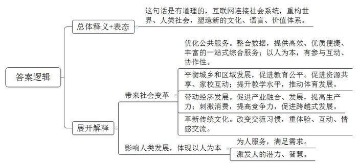
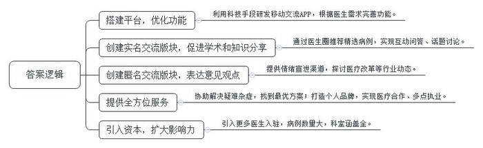
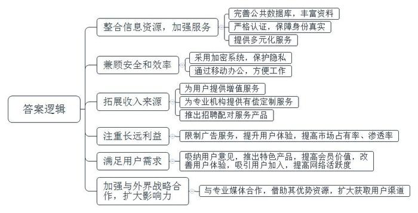
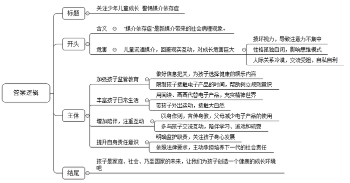
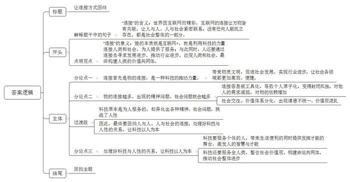

# 2017年山东省公考《申论》题（C卷）

> 候选采集稿。参考答案及解析来自粉笔页面，不代表官方答案或真实高分答卷；来源使用许可与原卷对应关系仍需人工核实。

## 给定材料

### 材料 material-6a10e4b8b2faeb28

“连接”，又称联接，指事物互相衔接。“连接”成为热词，源于互联网信息技术以独特的勾连方式，将原本散落在世界各个角落的、不同肤色、不同信仰的人连接起来，构成网络社会。因“连接”而产生的各种社会系统，重构世界、重构人类社会，导致人类社会进入了一个全新的人机信息勾连的社会新纪元。互联网连接过去、现在和未来，影响范围越来越大。成长于互联网蓬勃发展时期的“90后”，他们有自己的文化、语言和价值体系，他们的成长由互联网全程参与，他们相信一切都是相互连接的，不光是人与人相连接，世间万物都是相互连接的。万物之间的“连接”使互联网成为当前社会变革的驱动力，进而影响人类未来发展的方式。

H市“爱城市”网是全国第一个基于政府开放数据搭建的公共服务平台，也是国内首个智慧城市开放平台，它以市民需求为中心提供更优质、更便捷的服务。该网站设置了“政府服务”“生活服务”“城市声音”“应用中心”“专题服务”五大板块，可为市民提供一站式的综合服务。在公共服务数据的基础上，该网站运用云计算、大数据、物联网、移动互联网等新一代信息技术，以人为本，强调用户的参与性和互动、协作，使市民像在购物网站上买东西一样，方便快捷地获取政务、公共、社会的各种在线服务，内容涉及与市民生活息息相关的便民信息、教育培训、公共事业、交通出行、社区服务、医疗卫生、旅游环境、社会保障等领域。智慧城市服务体系帮助政府机关以及传统服务行业将原有的服务功能和商业模式“移植”到云端，连接了生活的方方面面，改变了人们传统的生活方式。

S县广坪镇八一中心小学，一个边远山区的小学校园，已实现无线网络全覆盖，师生的活动情况可以实时呈现在校园各处的大屏幕上；老师们教学教研碰到难题可随时通过互联网远程与省内外专家互动交流；所有班级都能利用QQ群空间发送作业、进行学习交流，还能让家长及时掌握学生的在校学习情况。学校刚开始没有专业的足球教练，通过互联网下载视频资源开展足球课教学，学校男女足球队在全县比赛中都进入前三名，后来被教育部命名为全国首批青少年“校园足球特色学校”。该校的罗校长说：“是互联网让山区的教育和城镇站在了同一起跑线上，我们农村的孩子也同样享受到了信息化带来的好处！”

在相对偏远落后的地区，互联网的连接能够让信息自由流通、方便获取，让偏远地区在经济、文化、教育等各个方面发生彻底改变。互联网作为基础设施，像水和电一样融入生活、融入各个领域，带来生产力的大幅提升，让各个行业焕发生机。对于中国来说，互联网的连接作用是中国持续发展的重要动力之一。国家已出台了“互联网+”行动计划以及《中国制造2025》，这些都将把实现“中国梦”带入全新的数字时代，让移动互联网、云计算、大数据、物联网与现代制造相结合，创造新的消费需求，刺激社会经济的发展，提高中国经济的竞争力，促进中国经济的跨越式发展。

在互联网的连接下，人们愿意让传统习惯呈现出现代色彩，连最古老的传统——发红包都被“互联网+”了。微信红包这种电子创新方式在2014年一经推出即受到年轻人的热捧，2015年8月20日七夕这一天，微信红包的收发总量达到14.27亿次，突破了2015年除夕10亿次的峰值。微信红包充分考虑到了“人”的体验和感受，既有游戏性又有互动性，拉近了与亲朋好友的距离，增进了情感交流。

越来越多的人意识到，互联网络连接的最终目的并非仅取得技术上的成就，而是要触达互联网背后的“人”。“以人为本”“以人为中心”的价值观才是互联网创新发展的本质所在。尤其是移动互联网的发展，让每个人和所有接触到的服务都发生了可直接实时的连接，使得技术、设备、商业的创新最终都指向人，一切需求都是基于“人”的需求，并在网上延伸、辐射到所有的领域，最大限度地发挥所有人的潜力与智慧来获得共赢。在技术的驱动下，“连接一切”将让人们更灵活地参与到个性化产品制造和服务中去，未来会大有不同。

### 材料 material-db8e15b59d31c384

医生群体有很多的社交需求，如何能在碎片化时间里进行有效的学术交流，了解除学术刊物、科室及院内研讨之外的案例？如何不依托于医院就可建立个人品牌，便捷地开展医疗合作、多点执业？如何在专业领域实现及时的信息交流，甚至工作之余的情绪输出？由于医生工作的特殊性，医生群体的垂直社交应用要求更具针对性。实现医生群体的社交连接成为“医联”的出发点。

“医联”是一款专属于医生群体使用的社交App（移动平台）。用户全为实名认证的职业医生，医生们可以在此进行跨时空的病例分享、学术讨论、临床交流和医疗合作咨询。它提供了医学问答、图说病例、匿名社交和医生圈的功能。与美国同类平台不同，“医联”在社交平台基础上，基于国内医生群体的现实需求进行了相应调整，划分为实名交流和匿名交流两大部分。

在实名交流版块，实名注册的医生可以按科室添加感兴趣的医生为好友，建立自己的“医生圈”社交关系网，在“医生圈”里推荐精选病例、互动问答或话题讨论。而“深夜病房”是每天0：00-2：00开放的匿名交流版块，任何医生都可以随意吐槽和输出情绪，后来开放时间调整为晚上7点到次日早上7点，这个时间段恰好是值夜班医生的上班时间。在这个安全可靠的倾诉平台，他们敞开心扉，诉说从医遇到的种种困扰，彼此温暖治愈，或共同探讨医疗政策改革等行业动态，为医生群体发出真实的声音。

创办“医联”的初心，就是做一个医生的全方位服务平台。从纯粹的医生社交做起，不断衍生出更多服务医生的内容。创始人王博士讲述了一个案例：有天晚上，一个湖南三甲医院的医生在“医联”平台上求助一个疑难病症的治疗方案，在接下来的一周时间内，来自全国10个城市、20家医院的8个医学教授、十几位专家参与这个病例讨论，最终给出了一个最优的治疗方案。这让他十分自豪。

目前，“医联”拥有20万入驻医生、60万病例，涵盖了48个科室、109个细分科室。2015年9月“医联”被马化腾和马云同时相中，以4000万美元刷新了该年健康医疗创业领域B轮的融资记录。目前国内的医生垂直社区还处于起步阶段，但在国外，医生垂直社区早已百家争鸣，掀起了投资热潮。

### 材料 material-714b78a0836674c7

如今，电脑、手机等媒介，尤其是智能手机，作为社会信息交流系统，几乎连接了人们的方方面面，改变着人们的学习、工作方式及日常生活，它在带来丰富、精彩的精神文化生活的同时，也带来了一些消极影响。“媒介依存症”就是一种由新媒介带来的社会病理现象，其中包括过度沉湎于媒介接触而不能自拔、满足于与媒介中的虚拟社会互动而回避现实的社会互动等表现。对媒介的过分依赖，会导致人际关系的冷漠，这不仅影响着人们必要的交流，还让人变得自私自利，以自我为中心，进而形成孤独自闭的社会性格。

有媒体曾报道了一个家庭聚会故事：爷爷召集儿孙吃饭。儿孙们却在饭桌上玩手机，被冷落的爷爷一怒之下摔盘离席。这个故事引发了网民的热烈讨论，网友普遍认为，对智能手机的过度依赖，已经对个人生活和社会交往产生了不良影响。现实生活中，时时可见地铁上、公交车内大部分人紧盯着手机屏幕，餐厅里人与人邻座近在咫尺，却各自手机玩个不停，心如远隔天涯。浙江大学社会学系M老师认为，曾经被视为电脑独有的“网瘾”已蔓延到手机上，智能手机的影响可能会超过电脑，一些缺乏自制力的人会更加严重地沉溺于虚拟世界中。

有一定自控力、判断力的成年人尚且摆脱不了手机的诱惑，又怎能指望儿童能自控呢？如今不少孩子在手机、电脑等新媒介的陪伴下日渐“孤岛化”，缺少玩伴、缺少交流，习惯于自娱自乐，整天抱着手机，性格越加内向孤僻……当今少年儿童的“媒介依存症”现象让人忧虑。

某市晚报记者随机采访了30位年轻父母，发现多数孩子都存在“媒介依存症”。市民秦先生的女儿茜茜今年9岁，用iPad玩游戏、下载APP，甚至逛淘宝都非常娴熟。茜茜说：“从我记事起，妈妈就给我买了iPad，教我玩游戏、看视频，现在iPad的功能我都摸熟了，每天放学回家只要写完作业妈妈都让我玩，我现在已经离不开它了。”秦先生对女儿玩iPad一事并不在意，他说：“父母身体不好，女儿是我和妻子带大的，我们每天上班都很忙，下班一回到家就想休息，所以女儿5岁时就给她买了iPad，让她自己坐在一边玩，我们就可以多休息一会。”

养孩子实在需要耗费太多心力、体力，于是希望“喘息”片刻的父母便借助电视、iPad、手机等媒介工具转移孩子的注意力，让孩子自己玩。殊不知长此以往，孩子不仅视力受损，还会导致其注意力不易集中、性情孤僻、思维模式受影响等症状，最终出现尼尔·波兹曼所描述的“童年的消逝”现象。

## 题目

### 第 1 题

**给定资料**1**中画线句子提到“万物之间的‘连接’使互联网成为当前社会变革的驱动力，进而影响人类未来发展的方式。”请根据给定资料**1**，分析指出这句话的含义。（15分）**

关联材料：material-6a10e4b8b2faeb28

作答要求：

要求：观点明确，条理清晰，语言简洁；不超过250字。

### 第 2 题

**1.分析“医联”如何实现了医生群体的社交需求？（10分）**

关联材料：material-db8e15b59d31c384

作答要求：

要求：分析透彻，表达准确，条理清晰；不超过200字。

### 第 3 题

**2.总结美国最大医生在线社交平台Doximity的主要成功经验。（15分）**

关联材料：material-db8e15b59d31c384

作答要求：

要求：内容全面、准确，有条理；不超过250字。

### 第 4 题

近期，某市准备发起一次宣传活动，倡议广大家长“关注少年儿童健康成长，警惕少年儿童媒介依存症”。请你根据给定资料4-5，拟写一份倡议书的内容提纲。（20分）

关联材料：material-714b78a0836674c7

作答要求：

要求：

(1)提纲挈领，

(2)条理清楚，

(3)有针对性；

(4)不超过400字。

### 第 5 题

**英国诗人约翰**·**多恩说：“****没有人是一座孤岛，可以自全，每个人都是大陆的一片，整体的一部分。****”请结合你对这句诗的理解，以“连接”为切入点，联系实际及给定资料，自拟题目，写一篇议论文。（40分）**

关联材料：material-6a10e4b8b2faeb28

作答要求：

要求：立意高远，主题明确；思路清晰，语言流畅；联系实际，不拘泥于给定资料；总字数1000-1200字。

## 答案与解析

第 1 题

**参考答案（粉笔题库参考内容）**

这句话是有道理的，互联网连接社会系统，重构世界、人类社会，塑造新的文化、语言、价值体系。

带来社会变革：1.优化公共服务。整合数据，提供高效、优质便捷、丰富的一站式综合服务；以人为本，有参与互动、协作性。2.平衡城乡和区域发展，促进教育公平。促进资源共享、家校互动；提升教学水平，推动体育发展。3.带动经济发展。促进产业融合、发展，提高生产力；刺激消费，提高竞争力，促进跨越式发展。4.革新传统文化。改变交流习惯，重体验、互动、情感交流。

影响人类发展，体现以人为本：为人服务，满足需求；激发人的潜力、智慧。

**解析**

**参考答案说明**：思路方面，本参考答案按照词句理解题“总体释义+展开解释+总结”的一般答题思路展开。内容方面，本参考答案先对画线句子的含义进行了总体解释，并针对该说法表明了态度，满足“观点明确”这一要求；展开解释部分从“带来社会变革”“影响人类发展，体现以人为本”两方面指出了“互联网”产生的意义。此外，形式上，本参考答案做到了分段、分条撰写，整体上条理较为清晰。

**考点**：考点词句解释类

**来源**：来源2017年山东省公考《申论》题（C卷）

粉笔申论页面对本题只提供「解析视频」入口，该入口是会员推广位，页面无视频地址与文字解析。

第 2 题

**参考答案（粉笔题库参考内容）**

1.搭建平台，优化功能。利用科技手段研发移动交流APP，根据医生需求完善功能。

2.创建实名交流版块，促进学术和知识分享。通过医生圈推荐精选病例，实现互动问答、话题讨论。

3.创建匿名交流版块，表达意见观点。提供情绪宣泄渠道，探讨医疗改革等行业动态。

4.提供全方位服务。协助解决疑难杂症，找到最优方案；打造个人品牌，实现医疗合作、多点执业。

5.引入资本，扩大影响力。引入更多医生入驻，病例数量大，科室涵盖全。

**解析**

**参考答案说明**：本参考答案从“搭建平台，优化功能”“创建实名交流版块，促进学术和知识分享”“创建匿名交流版块，表达意见观点”“提供全方位服务”“引入资本，扩大影响力”五个方面对“医联”的具体做法进行了分条撰写，各条要点在内容上相互并列，没有交叉。

**考点**：考点提出对策类

粉笔申论页面对本题只提供「解析视频」入口，该入口是会员推广位，页面无视频地址与文字解析。

第 3 题

**参考答案（粉笔题库参考内容）**

1.整合信息资源，加强服务。完善公共数据库，丰富资料；严格认证，保障身份真实；提供多元化服务。

2.兼顾安全和效率。采用加密系统，保护隐私；通过移动办公，方便工作。

3.拓展收入来源。为用户提供增值服务；为专业机构提供有偿定制服务；推出招聘配对服务产品。

4.注重长远利益。限制广告服务，提升用户体验，提高市场占有率、渗透率。

5.满足用户需求。吸纳用户意见，推出特色产品，提高会员价值，改善用户体验，吸引用户加入，提高网络活跃度。

6.加强与外界战略合作，扩大影响力。与专业媒体合作，借助其优势资源，扩大获取用户渠道。

**解析**

**参考答案说明**：本参考答案从“整合信息资源，加强服务”“兼顾安全和效率”“拓展收入来源”“注重长远利益”“满足用户需求”“加强与外界战略合作，扩大影响力”六个方面对“Doximity的成功经验”进行了分条撰写，各条要点在内容上相互并列，没有交叉。

**考点**：考点提出对策类

第 4 题

**参考答案（粉笔题库参考内容）**

关注少年儿童成长 警惕媒介依存症

“媒介依存症”是新媒介带来的社会病理现象。当下，一些儿童沉湎媒介，回避现实互动，对成长危害巨大。不仅损坏视力，导致注意力不集中；性格孤独自闭，影响思维模式，还会导致人际关系冷漠，交流受阻，自私自利。因此，我们向家长们倡议：

一、加强孩子监管教育。做好信息把关，为孩子选择健康的娱乐内容；限制孩子接触电子产品的时间，帮助树立规则意识。

二、丰富孩子日常生活。用阅读、画画代替电子产品，充实精神世界；带孩子外出运动，接触大自然。

三、增加陪伴，注重互动。以身作则，言传身教，父母减少电子产品的使用；多与孩子交流互动，陪伴学习、游戏和玩耍。

四、提升自身责任意识。明确监护职责，关注孩子身心发展；依照法律要求，主动承担培养下一代的社会责任。

孩子是家庭、社会、乃至国家的未来，让我们为孩子创造一个健康的成长环境吧！

**解析**

**参考答案说明：**（1）本题不要求格式，但保险起见，本参考答案写到了“标题”。（2）正文部分，一方面从内容来看，围绕着“关注少年儿童成长，警惕媒介依存症”这一主题，开头先写到了“媒介依存症的含义及危害”；主体部分从“加强孩子监管教育”“丰富孩子日常生活”“增加陪伴，注重互动”“提升自身责任意识”四个方面给出了具体的建议；结尾部分进行了呼吁号召。另一方面，形式上，本参考答案做到了分段、分条撰写，整体上条理较为清晰。

**考点**：考点宣传类

**来源**：来源2017年山东省公考《申论》题（C卷）

粉笔申论页面对本题只提供「解析视频」入口，该入口是会员推广位，页面无视频地址与文字解析。

第 5 题

**参考答案（粉笔题库参考内容）**

**让连接方式回归**

世界因互联网而精彩，互联网的连接让万物皆有关联，让人与人、人与社会紧密联系，没有任何人能孤立存在，都是社会整体的一部分。正如英国诗人约翰·多恩说：“没有人是一座孤岛，可以自全，每个人都是大陆的一片，整体的一部分。”**其实****，连接的本质就是互联网****+，就是利用科技的力量****连接人类****和社会，****为人提供了服务；与此同时，人还要通过连接去寻求发展进步，推动行业进步，****改变人类****和****社会，****最终****构建人类的价值共同体。**

**连接****首先是物的连接，****是一种****科技****的****推动力量。它能****带来****物质文明，****促进****社会发展，****实现****行业进步****，****让****社会****各领域都更加高效、便捷。**在“互联网+”时代，科技促进了连接，让科技能够更好的服务于人。连接，通过数据搭建服务平台，丰富人的文化需求，促进了经济腾飞，推动了教育公平发展，让每个家庭与社会的关系更加密切，更让国与国之间实现了多重合作与发展。应该说，在物质文明时代，因为连接的存在，让各个领域都朝着更加便利的方向迈进：当偏远山村搭上电商“顺风车”，城乡产业互通之路就此打开；当居民看病与远程医疗网络“邂逅”，实现优质医疗资源共享便不再困难……这种种连接改变着人们的生活，更让实现一个宜居社会未来可期。

**当然，物****的连接****越多****，出现的精神问题、社会问题就会越多。****一方面****，****连接容易被工具化，导致个人****原子化****，****变得****封闭孤独，****对****他人的需求减弱，****对物****的****依赖****增加****；另一方面，****社会****交往、价值体系****分化****，出现道德****不统一、****价值观混乱。**从“低头族”对媒介的依赖，到年轻人“报复性熬夜”，人们对于媒介的依赖程度呈现出空前的规模，精神世界逐渐变得空虚、匮乏。更恐怖的是，互联网充斥着个人主义和利己主义，逐渐破坏人们之间联系的纽带，导致人际关系的冷漠，价值体系的分化、崩溃，削弱了原有的社会整合功能。

**科技原本是为人服务的，却异化出各种精神****、社会问题****，挑战了人性。因此****，最终****要回归****人与人、人与社会****的****连接****，处理好****科技与人性的关系****，让****科技以人为本。**

**科技要服务个****体的****人****，****带来生活****便利的同时****提供发挥****才能的舞台，激发人的智慧与才能****；****科技还要服务全人类，整合社会价值观，构建命运共同体****，****推动****社会****整体进步。**科技只有为人服务，才能真正体现连接的价值。在微博、微信、各类网络直播平台中，多元化的信息传播使人与人之间建立超越时间、空间的实时连接。人们在享受科技进步给生活带来的便利的同时，也在网络上施展各自的才华。应该说，科技为人服务的初衷从未改变，比如AI产业的发展、机器人产业的崛起、无人机技术的应用……当科技的服务范围辐射整个社会，乃至全人类，其价值的发挥必然更加让人惊艳。

科技进步给社会进步带来机遇和挑战，移动互联网无处不在，无所不能，连接人与人，人与社会，甚至连接万物。人与人、人与社会、科技与人性，三者互联互通，要充分整合利用现有互联网资源，迎接挑战，把握机遇，共同建设美好的现代精神家园。【1167字】

**解析**

**文章分析**

**让连接方式回归**

【**标题的优点**：首先，范文的标题“让连接方式回归”突出了“连接”这一主题。其次，形式上，文字简洁明快。】

（1）世界因互联网而精彩，互联网的连接让万物皆有关联，让人与人、人与社会紧密联系，没有任何人能孤立存在，都是社会整体的一部分。正如英国诗人约翰·多恩说：“没有人是一座孤岛，可以自全，每个人都是大陆的一片，整体的一部分。”（2）**其实****，****连接的本质就是互联网****+****，****就是利用科技的力量****连接人类****和社会****，****为人提供了服务****；与此同时，****人还要通过连接去寻求发展进步****，****推动行业进步****，****改变人类****和****社会****，****最终****构建人类的价值共同体****。**

【**开头的优点：**★内容方面：范文的开头是紧扣题目给定的“没有人是一座孤岛，可以自全，每个人都是大陆的一片，整体的一部分”这句话展开的。首先，开头第一句话即点出主题，做到了主题明确。其次，对“连接”这一主题进行了分析阐述，指出了（1）“连接”的含义；（2）“连接”的意义。★文字表达方面：长短句配合使用，使语言表达有节奏感。】

**连接****首先是物的连接，****是一种****科技****的****推动力量。**（1）**它能****带来****物质文明****，****促进****社会发展****，****实现****行业进步****，****让****社会****各领域都更加高效****、****便捷****。**（2）在“互联网+”时代，科技促进了连接，让科技能够更好的服务于人。连接，通过数据搭建服务平台，丰富人的文化需求，促进了经济腾飞，推动了教育公平发展，让每个家庭与社会的关系更加密切，更让国与国之间实现了多重合作与发展。（3）应该说，在物质文明时代，因为连接的存在，让各个领域都朝着更加便利的方向迈进：当偏远山村搭上电商“顺风车”，城乡产业互通之路就此打开；当居民看病与远程医疗网络“邂逅”，实现优质医疗资源共享便不再困难……这种种连接改变着人们的生活，更让实现一个宜居社会未来可期。

【**论述段****1的优点：**★观点句：范文的观点句是紧扣“连接”这一文章主题提出的。形式上，它以单独段落的形式直接写出，位置突出，容易发现。内容上，关键词突出，内容要点明确，可以明显看出它是从“意义”的角度阐述“连接”。★论述内容：（1）介绍了“连接带来物质文明”；（2）介绍了“科技促进连接和社会发展”；（3）介绍了“物质文明时代的连接及作用”。注意：以上三个方面的内容都是紧扣“连接首先是物的连接，是一种科技的推动力量”这个观点句进行分析论述的，论述的针对性强，内容层次丰富。最后，在论述方法和论据的选取上做到了讲道理、举例子相结合，让论述内容丰富多样。】

**当然，物****的连接****越多****，出现的精神问题、社会问题就会越多。****（****1）一方面****，****连接容易被工具化，导致个人****原子化****，****变得****封闭孤独****，****对****他人的需求减弱****，****对物****的****依赖****增加****；****（****2）****另一方面，****社会****交往****、****价值体系****分化****，****出现道德****不统一****、****价值观混乱****。**从“低头族”对媒介的依赖，到年轻人“报复性熬夜”，人们对于媒介的依赖程度呈现出空前的规模，精神世界逐渐变得空虚、匮乏。更恐怖的是，互联网充斥着个人主义和利己主义，逐渐破坏人们之间联系的纽带，导致人际关系的冷漠，价值体系的分化、崩溃，削弱了原有的社会整合功能。

【**论述段****2****的优点：**★观点句：范文的观点句是紧扣“连接”这一文章主题提出的。形式上，它以单独段落的形式直接写出，位置突出，容易发现。内容上，关键词突出，内容要点明确，可以明显看出它是从“问题危害”的角度阐述“连接”。★论述内容：（1）介绍了“连接带来的个人精神问题”；（2）介绍了“连接带来的社会问题”。注意：以上两个方面的内容都是紧扣“物的连接越多，出现的精神问题、社会问题就会越多”这个观点句进行分析论述的，论述的针对性强，内容层次丰富。最后，在论述方法和论据的选取上做到了讲道理、举例子相结合，让论述内容丰富多样。】

**科技原本是为人服务的****，****却异化出各种精神****、****社会问题****，****挑战了人性****。因此****，****最终****要回归****人与人****、****人与社会****的****连接****，****处理好****科技与人性的关系****，****让****科技以人为本****。**

**（****1）****科技要服务个****体的****人****，****带来生活****便利的同时****提供发挥****才能的舞台****，****激发人的智慧与才能****；（****2）****科技还要服务全人类****，****整合社会价值观****，****构建命运共同体****，****推动****社会****整体进步****。**科技只有为人服务，才能真正体现连接的价值。在微博、微信、各类网络直播平台中，多元化的信息传播使人与人之间建立超越时间、空间的实时连接。人们在享受科技进步给生活带来的便利的同时，也在网络上施展各自的才华。应该说，科技为人服务的初衷从未改变，比如AI产业的发展、机器人产业的崛起、无人机技术的应用……当科技的服务范围辐射整个社会，乃至全人类，其价值的发挥必然更加让人惊艳。

【**论述段****3****的优点：**★观点句：范文的观点句是紧扣“连接”这一文章主题提出的。形式上，它以单独段落的形式直接写出，位置突出，容易发现。内容上，关键词突出，内容要点明确，可以明显看出它是从“对策”的角度阐述“连接”。★论述内容：（1）介绍了“科技要服务个体的人”；（2）介绍了“科技要服务全人类”。注意：以上两个方面的内容都是紧扣“最终要回归人与人、人与社会的连接，处理好科技与人性的关系，让科技以人为本”这个观点句进行分析论述的，论述的针对性强，内容层次丰富。最后，在论述方法和论据的选取上做到了讲道理、举例子相结合，让论述内容丰富多样。】

【**论述段之间的关系**：★内容的内在逻辑：范文的论述段之间是依照“并列”的逻辑展开的。论述段1先写了“科技促进连接”，论述段2再写了“连接带来个人问题和社会问题”，论述段3接着写了“连接要以人为本”。★段与段的外在衔接：论述段2的段首处的过渡句“当然，物的连接越多，出现的精神问题、社会问题就会越多”，起到了承接论述段1、引出了论述段2的作用。论述段3的段首处的过渡句“科技原本是为人服务的，却异化出各种精神、社会问题，挑战了人性”，起到了承接论述段2、引出了论述段3的作用。】

（1）科技进步给社会进步带来机遇和挑战，移动互联网无处不在，无所不能，连接人与人，人与社会，甚至连接万物。（2）人与人、人与社会、科技与人性，三者互联互通，要充分整合利用现有互联网资源，迎接挑战，把握机遇，共同建设美好的现代精神家园。

【**结尾的优点：**范文的结尾回扣了“连接”这一主题。（1）指出了互联网连接万物。（2）提出了展望，阐述了深远意义。】

  

**考点**：考点文章写作题

**来源**：来源2017年山东省公考《申论》题（C卷）

