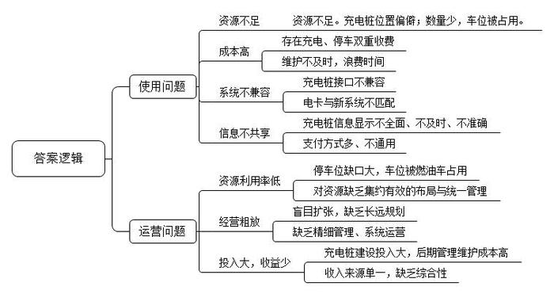
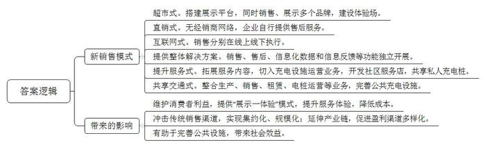
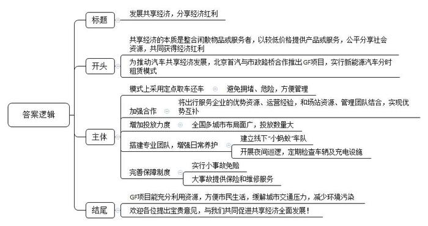
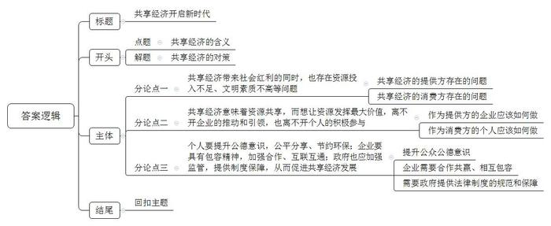

# 2018年山东省公考《申论》题（A卷）

<!-- gwy:overview:start -->
> **山东 · 2018 · 申论 · A类** ｜ 4 题 · 图片 4 处 · 答案随题折叠

导航：[题目](#题目) · [材料 1](#材料-1)
<!-- gwy:overview:end -->

> 候选采集稿。参考答案及解析来自粉笔页面，不代表官方答案或真实高分答卷；来源使用许可与原卷对应关系仍需人工核实。

## 给定材料

### 材料 1

2014年5月24日，习近平总书记在上海汽车集团考察时指出，发展新能源汽车是我国从汽车大国迈向汽车强国的必由之路，要加大研发力度，认真研究市场，用好用活政策，开发适应各种需求的产品，使之成为一个强劲的增长点。

近年来，我国新能源汽车产业规模持续扩大，政策稳步推进。2018年1月在北京召开的中国电动汽车百人会论坛上，工信部部长苗圩表示，2017年我国新能源汽车产量79.4万辆，销量77.7万辆，产量占比达到汽车总产量的2.7%，连续三年居世界首位。在2018年两会“部长通道”上接受记者采访时，苗圩部长表示，我国计划2020年新能源汽车占比要达到10%。

新能源汽车主要包括燃料电池电动汽车、混合助力汽车、氢能源动力汽车、纯电动汽车（包括太阳能汽车）、其他新能源汽车等各类型产品。同传统燃油汽车相比，新能源汽车能有效降低能耗、减少环境污染。新能源汽车发展已经成为全球共识。从世界范围来看，各国均将发展电动车、替代燃油车作为重要政策。

历史经验证明，产品技术重大变革往往意味着产品、产业价值体系的重塑。新能源汽车已在技术上颠覆了传统汽车模式，全球汽车行业正在经历一场全面而深刻的变革，以电动化、智能化、网联化为代表的新技术力量正在为新能源汽车行业打开新一轮跨越式发展的空间，从配套设施到产品服务乃至到整个商业模式，都在快速升级迭代中不断创造着新的价值。

### 材料 2

从技术发展成熟程度和中国国情来看，纯电动汽车是大力推广的发展方向，而混合动力汽车暂时作为大面积充电网络还没建立起来之前的过渡形式存在。目前市场上新能源汽车主要指纯电动车和混合动力汽车。

电动汽车的发展带动了充电基础设施的发展。根据国务院2015年发布的《关于加快电动汽车充电基础设施建设的指导意见》，到2020年中国要基本建成适度超前、车桩相随、智能高效的充电基础设施体系，满足超过500万辆电动汽车的充电需求。

一般而言，一辆电动汽车需要2.5个充电桩配套才能满足续航要求。目前，国内电动汽车的充电网络主要由三部分组成：一是家庭充电，一般由纯电动车的车主和车企安装；二是目的地充电，一般是在酒店、餐馆、写字楼、商场、社区、学校等地区，由车企或物业提供车位并安装；三是公共充电站，主要解决主干路网上的充电问题。

某报记者对公共充电桩的使用和运行情况进行了调查。

作为一种找桩、充电、结算的辅助工具，充电APP越来越受到电动汽车使用者的欢迎。大多数充电APP的找桩界面是一张地图，上面布满了密密麻麻的颜色标识。这些标识可能是充电运营商的标志，也可能是充电桩当前的运营状态，或是充电桩个数。

记者根据“e充网”充电桩APP上显示的信息，来到了某购物中心地下B4停车场了解充电桩的建设和使用情况。询问多位停车场工作人员后，才在一个偏僻角落里找到了6个国家电网设置的公共快充充电桩。记者发现，有一辆正在充电的车辆，还有两辆汽车在等待，另外5个充电车位都被汽油车占用，虽然在充电桩车位的墙上贴有“非电动汽车禁止停放”的字样。停车场工作人员表示，“我们之前在这些车位前面都是用栏杆拦起来，但是有的电动车车主充完电也不把栏杆放回去，燃油车车主看见哪有车位就往哪停了。”一位等待充电的电动汽车车主抱怨说：“我买电动车是为环保做贡献，为什么不能享有停车位优先权，为什么收了充电费还要再收停车费？”

记者查询“e充网”APP充电桩信息，上面显示这6个快充充电桩中有3个空闲。但记者发现，只有2个可以正常使用，一个正在被使用的充电桩并未在APP中显示充电状态，另一个可用充电桩车位被燃油车占据。其余4个中，2个显示“绝缘故障、暂停服务”，2个屏幕则是黑屏，触摸无反应。问到原因时，停车场工作人员表示并不知情。“我昨天看还有3个啊，你要不打打电话问问，我们不管这个。”同样的问题也出现在另一个停车场。记者拨打了“e充网”客服电话，对方称：“之前有定期维修，差不多一周2-3次。但因为最近在忙其他工作，没顾上。”

电动汽车车主王先生表示，买车时并不知道其他厂家的公共充电桩不能给我的车子充电。“‘许继充电桩’还属于国家电网呢，但我的车子充不上，‘小易’和‘星星’这两个充电企业的充电桩能充。”王先生说，“是否能充电要一个个试了才知道，现在不同牌子的充电桩太多了。充电桩还有接口兼容性问题，有时电动车在充电途中会‘迷之断电’，充了好一会儿回来再看，车子的电量根本不见涨。”

在金融街购物中心充电的车主南先生向记者讲述了他的一次充电经历：南先生拿着国家电网的卡来充电时，发现卡与系统不匹配。他到该区国家电网咨询，前台服务人员才告知，国家电网的充电桩更新了系统，原来的卡不能用，需要办理新卡才能使用充电桩。办完新卡回来后，他再次插卡登录，被告知新卡被锁死，他只能再次返回营业厅，前台工作人员分析，可能是新系统和新卡还有部分数据未上传成功，导致新卡被锁，而处理这个故障需要2到7个工作日。

### 材料 3

为了方便找到充电桩，W下载了17个充电桩APP。一次在找某区域的一个充电站的时候，这17个APP上都没有显示，后来发现，实际位置与APP上显示的位置相差了2公里多。“由于车子没电了，最后1公里我们推车过去的，让人十分崩溃。”W十分感慨，“充电桩信息共享怎么就这么难呢?”

“找到了充电桩却不能使用。”大多数电动汽车车主反馈，根据充电APP提供的信息到达目的地后，显示“空闲”的充电桩已经“不空闲”了，有时还会发现充电桩是故障桩不能使用，或者处于离网状态，还有些充电站点是专用站不对外开放等，充电APP不能及时准确反映这些信息。

运营商不同，各个充电桩使用的充电支付方式也不一样。不同运营商的充电桩，有的需要用电卡，有的则是微信支付；有的是人工服务，也有的是自助支付，相互之间很难实现通用。电动车主黄先生说：“你能想象，身上带着好几张充电储值卡，手机里用来找桩、支付的APP占了满满一屏，每天却要花6小时在找桩充电上，是什么心情么?”记者调查发现，现在各家APP平台的态度相对开放，都会尝试接入同行的充电桩位置数据。但迄今为止，仍然没有一家公司整合所有充电桩运营商的数据。

### 材料 4

电动汽车车主抱怨连天，充电桩企业则有苦难言。截至2017年5月，我国投入使用的电动汽车公共充电桩数量超过16.1万个，但实际使用率只有10%。而按成本核算，充电桩利用率要达到30%以上，充电桩运营企业才能实现盈利。

“充电桩利用率低的首要原因是电动车充电车位被燃油车抢占。这背后的问题是大城市停车难的问题，尤其是北京等一线城市，停车位存在巨大缺口，若是把安装充电桩的车位租下来，又势必增加充电桩运营企业的投入成本。”这意味着燃油车的停车位缺口没有解决之前，电动车车主就无法避免与传统燃油车车主争抢停车位的情况。

按照一些车主的看法，停车场的物业把这事管起来不就好了么。但实际上，物业公司与停车场保安等管理人员对管理充电桩态度冷淡。“最开始我们跟物业打交道，大家还是摸索着来，但后来看明白这是桩有利可图的大生意，物业也开始提条件，希望从中分成。有些新项目，物业公司上来就明确提出要提成多少。但问题是，充电桩企业都没法从充电业务中挣到钱。”C坦言：“包括物业在内的各种资源拥有者，越在后期越会成为影响我们充电桩运营商的不稳定因素，我们建设了很多桩，但之后却发现，当你固定资产投入越多的时候，你在这个场地上的话语权反而会越弱。”

某充电行业人士表示：“现阶段充电桩运营商都在忙着扩张业务版图，都明白还没到赚钱的时候，占据市场份额才是第一位的。”国家电网内部人士也曾对媒体坦言：目前国家电网建成的公共充电站大多是“体验式”开放，严重亏损。

当前，建设一座交流充电桩（包括线缆和土地使用）的成本至少在万元以上，直流快充桩的成本则在6万元以上。这还只是前期的一次性投入，充电桩运营商的主要成本在建桩之后的管理和维护。目前充电桩运营商的收入主要来源于收取电动汽车充电服务费。2014年7月国务院办公厅公布的《关于加快新能源汽车推广应用的指导意见》提出，充电桩运营商可向电动汽车用户收取电费和充电服务费。2020年前，对电动汽车充电服务费实行政府指导价管理。按照目前的收费标准，一根充电桩的成本回收至少需要五年的时间。

经过测算，如果每个直流桩利用次数为每天8次，那么这座桩才能实现盈亏平衡。现实的情况是，很多桩并未达到8次/天的日用频次。鉴于现有的充电桩的低利用率，充电服务费对于运营商来说又是杯水车薪，这也意味着不少充电桩运营商依然是亏损运营。

尽管眼下困难与问题不少，但不少充电桩行业人士还是相当看好充电桩这门大生意的未来。据业内人士透露，政府已经在着手解决，推动统一平台的建设。“充电桩行业存在的车、地、电、桩、网五个方面的问题都需要解决。”某能源公司总裁S表示，“充电桩行业的发展，需要车企、用户与桩企等各方进行集约化、有效性的布局。如果充电桩运营公司能够盈利，物业提成自然有着落。又或者行业里出现强势的第三方平台，负责去跟物业谈停车位管理和提成，保证电动汽车的车位甚至停车费减免，应该都不成问题。”国家电网能源研究院高级工程师何先生说：“由于充电基础设施市场具有典型的‘网络经济’特点，未来市场格局将逐步由当前的‘散、乱、小’走向赢家通吃的少数几家大型平台运营商主导、大量中小型运营商依附大平台的产业生态格局。”

张姓业内人士认为，随着互联网的发展，充电桩的商业价值不仅体现在充电业务上，还包括以充电桩为入口的广告、保险、金融、售车等增值服务以及汽车工业大数据等。“未来盈利点确实不止在充电业务。但这一切都有一个大前提，就是新能源汽车的发展能够如期进行。”

### 材料 5

根据中国汽车工业协会统计，2017年1-8月，新能源汽车产销34.6万辆和32万辆，同比增长33.5%和30.2%，其中电动汽车累计产销28.4万辆和26万辆，同比增长45.4%和43.5%。与电动汽车整体销量增长相反的是，品牌授权经营的传统经销商（4S店）单店销量却一落千丈。“2015年我们店开业时销售火爆，日订单量曾多达156单，月销量超过300辆，现在，月销量能超过30辆的4S店都已经很少了。”北京某电动汽车销售服务有限公司副总经理Z坦言。

在Z看来，导致这一局面形成的原因有：一方面，市面上可供选择的电动汽车品牌与车型越来越多，竞争日趋激烈；另一方面，经销商布点也日益密集。以北京地区为例，每年电动汽车市场容量51000辆左右，这意味着进入市场的电动汽车品牌越多，每家经销商分得的蛋糕就越小，所以很多盈利能力差的经销商很难支撑下去；再者，以前消费者买一辆新能源汽车要排队等一两个月，消费者在拿到购车指标后，一次进店成交率一度超过50%。而现在消费者往往要货比三家，多次进店比较后才会购买；最后，2015年每辆新能源汽车的销售利润至少在7000-8000元，现在整车销售几乎没有盈利空间。

全国工商联汽车经销商商会新能源汽车分会会长L分析说，国家明确规定包括电池、电机、电控在内的新能源汽车核心“三电”质保期不低于8年或12万公里，这意味着新能源汽车售后维修只剩下悬挂、空调、刹车系统等简单部件，可是维修保养所需的车间设备和人员技师却几乎一个都不能少，因而很多经销商在新能源汽车的售后上是赔钱的。

### 材料 6

由于新能源汽车基本不需要一些日常的维修和保养，因此未来经销商的发展模式会从原来的“销售-维修”向“展示-体验”转变。目前，电动汽车的销售大致有四种模式：一种是传统经销商的4S店模式；另一种是超市式的，一个超市里有多个品牌的电动汽车同时销售；第三种是直销式的，没有经销商网络且由电动汽车企业自己提供售后服务，比如电动汽车巨头特斯拉就是这种模式；还有一种是将电动汽车销售分成两部分，分别在线上和线下执行。更超前的做法甚至将新能源汽车销售分成四部分，每项功能独立开展，分别负责销售、售后、信息化数据和信息反馈，这种模式通常被用作大客户的整体解决方案。

新版《汽车销售管理办法》的出台，打破了以往以品牌授权为核心的4S店销售模式的独占性。据业内专家介绍，目前涉足电动汽车销售的主要有三股力量，即传统燃油车生产企业、全新的新能源汽车生产企业和互联网造车公司。为此，以销售传统燃油车为主的经销商压力凸显，电动汽车成为其实现转型升级的重要机遇。如国内最早进入新能源汽车领域的传统燃油车经销商——庞大集团，2015年开始在北京五方桥建立“新能源电动汽车一条街”，将庞大集团代理的所有新能源汽车品牌都集中到一条街，并在五方桥庞大汽车园区建设“新能源电动车体验场”，以更好地方便广大市民体验和选购新能源汽车。

万帮新能源经销商则借助众筹模式从新能源汽车销售切入到充电设施运营业务，“车桩并举”地推动企业向更高层次滚动发展。

联合电动汽车跨界进入汽车销售行业，率先采用“汽车超市”销售模式，此后在社区服务店以及在私人充电桩共享上不断突破创新。

北汽新能源从2014年开始探索新能源汽车的共享交通问题。2017年，与优步（Uber）合作成立“北京出行”，目前主营业务主要是服务北京市市委市政府公共出行的分时租赁项目。“对我们来说，我们既是一个汽车生产商，又是一个汽车销售服务商，还是汽车共享分时租赁的运营商，也是充电桩的运营商，专门致力于北京市公共充电设施的建设。”北汽新能源销售公司副总经理何先生说。

### 材料 7

汽车分时租赁是运营商在一些站点投放汽车，用户可以在车辆无人值守的状态下进行自由取还，并且借助移动客户端完成费用的支付。目前我国用于分时租赁的汽车主要是电动汽车。电动汽车分时租赁有助于解决城市拥堵、停车难、环境污染等问题，是未来汽车应用一个非常好的发展方向。在电动汽车的分时租赁方面比较有代表性的两个模式是自由还车模式和定点取车还车模式。

自由还车模式，即取车还车都不受网点限制，平台运营更多的是依靠算法进行需求匹配。这有点类似于现在单车项目中的无桩模式，优点很明显，技术加持之下，能够对出行的动态需求进行最大效率的匹配，而缺点则是，汽车停放影响市容管理，而且调度成本不可控。

定点取车还车模式需要定点取车，定点还车，特点是运营覆盖面积的大小更多地取决于网点的覆盖度，以及投入车辆的多少。但这一模式有着明显的缺点，除了用地成本高之外，对于用户动态需求的匹配也不是很好。比如在非用车高峰期，如果这个网点无人用车，它很可能会是满车位状态，就无法匹配到远端的停车需求，也就会丧失掉这个订单，而越是无法匹配这种出行需求，就越会造成各个网点的满车位状态持续下去，造成车辆利用率不高。这种方式的优点则是有利于市容管理。

2017年1月6日下午，北京首汽（集团）股份有限公司（以下简称首汽集团）与北京市政路桥股份有限公司（以下简称市政路桥股份）战略合作签约仪式在首汽集团大厦举行。双方就“进一步推动汽车共享经济发展，落实新能源汽车分时租赁业务，打造适合北京的新能源汽车分时租赁模式”达成战略合作，共同推动首汽集团旗下新能源汽车分时租赁项目GF的发展。

GF项目采用的是定点取车定点还车模式。GF首席运营官表示，“我觉得自由还车这种模式目前还不太适合北京，或者停车场非常紧张的一些城市。不造成拥堵，不造成危险因素，不造成不便利，我觉得这是一个约束性的经营行为，是一个负责任的经营行为。”

市政路桥股份隶属于北京市政路桥集团有限公司，旗下拥有二三环和郊区的高架桥以及通勤的高速公路出入口等300多个空置场站资源以及经验丰富的基础设施建设、养护、运营管理团队。首汽集团则拥有全国最大出行服务运营企业的优势资源和运营经验。首汽集团的控股公司首旅集团旗下在全国拥有的酒店、旅游业等资源成为GF跨城市运营的连接点。目前GF在全国已经布局了北京、上海、厦门、青岛等城市。如果交通管理部门对电动车牌照支持的力度允许，现有布点可以投放5000-8000辆电动汽车。

汽车的大宗消费品属性使其维护成本更难以控制。对于日常的车辆运行维护保养，GF借助市政路桥股份的团队人员和经验，建立了线下“小蚂蚁”车队，采取夜间巡逻的方式，对车辆进行维护、保养、清洗，包括定期检查车辆的状况以及充电设施的管理维护。针对车辆使用过程中的剐蹭伤痕，GF的做法是，在提醒用户用车义务的同时，引入一些保障制度，例如推出了10元的“不计免赔服务”；对于一些小剐蹭造成的1500元以下损失，免去用户个人承担费用部分。大型事故则需要走商业保险和运营保险的渠道，同时需要汽车维修等售后力量的支撑。GF首席运营官认为，“首汽最擅长的就是售后服务，而单纯的互联网公司可能这个没有那个没有，很难实现好的客户体验。”

两大企业集团达成战略合作，将全方面缓解新能源汽车分时租赁中停车场地、车辆充电、车辆运维调度等问题，为市民提供新能源汽车随取随还随用的便利。同时，也缓解了北京城区交通压力，减少因尾气等造成的城市污染，提供市民多样化出行方式选择，也为市场提供了共享经济的新范本。

### 材料 8

共享经济的本质是整合闲散物品或服务者，让它们以较低的价格提供产品或服务。对于供给方来说，通过在特定时间内让渡物品的使用权或提供服务，来获得一定的金钱回报；对需求方而言，不直接拥有物品的所有权，而是通过租、借等共享的方式使用物品。共享经济强调的是人们公平地享有社会资源，各自以不同的方式付出和受益，共同获得经济红利。某杂志发行人D认为，“人人为我，我为人人”应该是共享经济的一个比较准确的概括。<u>共享经济意味着资源的共享，也意味着文明的共担。</u>

## 题目

### 第 1 题

**根据“给定资料**2**\-**4**”，概括当前我国电动汽车充电桩在使用和运营过程中存在的主要问题。（15分）**

关联材料：材料 2、材料 3、材料 4

作答要求：

要求：全面、准确、有条理，不超过250个字。

第 1 题 · 答案与解析

**参考答案（粉笔题库参考内容）**

一、使用的问题有：1.资源不足。充电桩位置偏僻；数量少，车位被占用。2.成本高。存在充电、停车双重收费；维护不及时，浪费时间。3.系统不兼容。充电桩接口不兼容；电卡与新系统不匹配。4.信息不共享。充电桩信息显示不全面、不及时、不准确；支付方式多、不通用。

二、运营的问题有：1.资源利用率低。停车位缺口大，车位被燃油车占用；对资源缺乏集约有效的布局与统一管理。2.经营粗放。盲目扩张，缺乏长远规划；缺乏精细管理、系统运营。3.投入大，收益少。充电桩建设投入大，后期管理维护成本高；收入来源单一，缺乏综合性。

**解析**

**参考答案说明：**本参考答案思路上从“使用的问题”“运营的问题”这两大方面入手，进行相关问题的展开。其中，“使用问题”主要从“资源不足”“成本高”“系统不兼容”“信息不共享”这四个方面进行说明；“运营问题”主要从“资源利用率低”“经营粗放”“投入大、收益少”这三个方面进行说明。此外，各条的要点之间是并列关系，内容之间不存在重复、交叉。

**考点**：问题类

**来源**：2018年山东省公考《申论》题（A卷）

### 第 2 题

**根据“给定资料**5**\-**6**”，分析电动汽车销售模式的变化及其给电动汽车市场带来的影响。（****20****分）**

关联材料：材料 5、材料 6

作答要求：

要求：内容全面、分析透彻、条理清晰，不超过300字。

第 2 题 · 答案与解析

**参考答案（粉笔题库参考内容）**

一、新销售模式有：1.超市式。搭建展示平台，同时销售、展示多个品牌，建设体验场。2.直销式。无经销商网络，企业自行提供售后服务。3.互联网式。销售分别在线上线下执行。4.提供整体解决方案。销售、售后、信息化数据和信息反馈等功能独立开展。5.提升服务式。拓展服务内容，切入充电设施运营业务，开发社区服务店，共享私人充电桩。6.共享交通式。整合生产、销售、租赁、电桩运营等业务，完善公共充电设施。

二、带来的影响有：1.维护消费者利益，提供“展示—体验”模式，提升服务体验，降低成本。2.冲击传统销售渠道，实现集约化、规模化；延伸产业链，促进盈利渠道多样化。3.有助于完善公共设施，带来社会效益。

**解析**

**参考答案说明：**答案按照“销售模式”和“影响”可以分成两大条。其中，“销售模式”还包括“超市式”“直销式”“互联网式”“提供整体解决方案”“提升服务式”“共享交通式”这6种新销售模式；“影响”要素可分成对“消费者”“生产销售”“社会”这三个方面的影响进行撰写。且每条要点之间内容上没有交叉。

**考点**：多要素组合类

**来源**：2018年山东省公考《申论》题（A卷）

### 第 3 题

**假如你是GF项目的工作人员，近期要参加一次“共享经济”经验交流会，会议将把GF项目作为“共享经济”的范本向与会人员做介绍，请你根据“给定资料**7**\-**8**”，撰写一份发言稿提纲。（25分）**

关联材料：材料 1、材料 2、材料 3、材料 4、材料 5、材料 6、材料 7、材料 8

作答要求：

要求：内容全面、表达准确、条理清晰，不超过450字。

第 3 题 · 答案与解析

**参考答案（粉笔题库参考内容）**

发展共享经济，分享经济红利

共享经济的本质是整合闲散物品或服务者，以较低价格提供产品或服务，公平分享社会资源，共同获得经济红利。为推动汽车共享经济发展，北京首汽与市政路桥合作推出GF项目，实行新能源汽车分时租赁模式。

其经验主要有：一、模式上采用定点取车还车，能避免拥堵、危险，方便管理。二、加强合作，将出行服务企业的优势资源、运营经验，和场站资源、管理团队结合，实现优势互补。三、增加投放力度，全国多城市布局面广，投放数量大。四、搭建专业团队，增强日常养护，建立线下“小蚂蚁”车队，开展夜间巡逻，定期检查车辆及充电设施。五、完善保障制度，实行小事故免赔，大事故提供保险和维修服务。

GF项目能充分利用资源，方便市民生活，缓解城市交通压力，减少环境污染。欢迎各位提出宝贵意见，与我们共同促进共享经济全面发展!

**解析**

**参考答案说明：**本题正文分别按照开头（简单叙述铺垫，引出主体内容）、主体（主要答“共享经济的经验”）、结尾（总结评价以及呼吁号召）的结构展开。

**考点**：总结类

**来源**：2018年山东省公考《申论》题（A卷）

### 第 4 题

**“给定资料**8**”中划线句子提到，“共享经济意味着资源的共享，也意味着文明的共担。”结合你对这句话的思考，参考给定资料，联系实际，自拟题目，写一篇文章。（40分）**

关联材料：材料 1、材料 2、材料 3、材料 4、材料 5、材料 6、材料 7、材料 8

作答要求：

要求：

（1）观点明确，立意深刻；

（2）思路清晰，语言流畅；

（3）结合“给定资料”，但不拘泥于“给定资料”；

（4）总字数1000～1200字。

第 4 题 · 答案与解析

**参考答案（粉笔题库参考内容）**

**共享经济开启新时代**

共享经济与传统的“占有型经济”有别，强调“享用”而非“占有”，以“物尽其用”为旨归，意在促使供给方把某段时间内暂时闲置的物品、设施、服务等以较低的成本、价格让渡给需求方享用。这一过程，不仅意味着“物”的共享，更对参与共享的人及相关主体的契约精神、协作意识等文明素养提出了要求。近几年，得益于互联网技术的成熟，以及政府的鼓励和支持，共享经济在我国快速兴起。

**共享经济带来社会红利的同时，也存在资源投入不足、文明素质不高等问题。**一方面，作为资源的供给方，一些企业和个人囿于传统思维的固化，不愿承担共享经济带来的成本投入和运行风险，不敢、不想投身共享经济的洪流。另一方面，作为共享经济的重要参与者，一些个人存在着思想素质不高的问题，随意破坏共享资源，陷入“公地悲剧”的怪圈。要想更好推动共享经济的发展，还需多方发力，多措并举，形成合力。

**共享经济意味着资源共享，而想让资源发挥最大价值，离不开企业的推动和引领，也离不开个人的积极参与。**企业要因时而动，顺势而为，主动寻求合作，投入人力、物力、财力、技术资源，搭建共享经济的平台，如近几年兴起的共享单车、共享汽车、共享充电宝、共享房屋……都是共享经济的生动实践。在企业搭台的同时，个人也需积极参与。要想让共享经济实现长远运行和发展，个人不能仅仅只是共享经济的享受者，更应该是资源的供给者。共享经济的本质是整合闲散物品以及服务者，这些物品和服务的来源其实就是我们每一个人，唯有共建方能共享，这也充分验证了“人人为我，我为人人”的朴素真理。

我们也应看到，近些年兴起的共享经济在发展的过程中也遭遇了各种各样的阻碍，甚至有人说共享经济是国民素质的“照妖镜”。因此，不仅要共建共享，更要文明共担。

**所以，个人要提升公德意识，公平分享、节约环保；企业要具有包容精神，加强合作、互联互通；政府也应加强监管，提供制度保障，从而促进共享经济发展**。如今，随处可见的共享物品被故意损坏、共享单车乱停乱放等问题显示着公众公德意识缺失，呼唤着公众素养的提升。此外，企业在发展的过程中不能以扰乱城市秩序，占用公共资源为代价，必须担负起应尽的社会责任。并且，企业也需合作共赢、相互包容。诸如共享充电桩、共享单车等新业态需要相关企业共同商量选址、合理设置停车地点，形成发展合力，优化用户体验，提升资源利用的效率。最后，共享经济还在某种程度上承担了一定社会公共服务的功能，能满足民众需求，促进社会公平，因此还需要法律制度的规范和保障，让共享经济能够在法治的框架中健康有序地运行。

共享经济一方面能挖掘存量资源，形成新的生产力，对我国经济供给侧改革和转型升级具有最重要意义；另一方面，其蕴含的公平精神、节约理念，对国际经济合作也有启发意义。可见，唯有顺从共享，共建文明，才能把握新机遇，迎接新挑战，开启新时代！

**文章分析**

**共享经济开启新时代**

【**标题的优点：**首先，范文的标题“共享经济开启新时代”突出了“共享经济”这一主题。其次，形式上，文字简洁明快有力，不拖沓。】

共享经济与传统的“占有型经济”有别，（1）<u>强调</u><u>“享用”而非“占有”</u>，<u>以</u><u>“物尽其用”为旨归</u>，<u>意在促使供给方把某段时间内暂时闲置的物品</u>、<u>设施</u>、<u>服务等以较低的成本</u>、<u>价格让渡给需求方享用</u>。这一过程，不仅意味着“<u>物</u>”<u>的共享</u>，<u>更对参与共享的人及相关主体的契约精神</u>、<u>协作意识等文明素养提出了要求</u>。近几年，（2）<u>得益于互联网技术的成熟</u>，<u>以及政府的鼓励和支持</u>，<u>共享经济在我国快速兴起</u>。

【**开头的优点：****★内容方面。**范文的开头是紧扣“共享经济”这一主题展开的。首先，开头在段首处点出主题，做到了主题明确。其次，对“共享经济”这一主题进行了分析阐述，指出了（1）共享经济的含义；（2）促进共享经济发展的对策。**★文字表达方面：**使用了“近几年……”引入时间概念，使内容更有说服力。】

**共享经济带来社会红利的同时，也存在资源投入不足、文明素质不高等问题。**一方面，（1）<u>作为资源的供给方</u>，<u>一些企业和个人囿于传统思维的固化</u>，<u>不愿承担共享经济带来的成本投入和运行风险</u>，<u>不敢</u>、<u>不想投身共享经济的洪流</u>。另一方面，（2）<u>作为共享经济的重要参与者</u>，<u>一些个人存在着思想素质不高的问题</u>，<u>随意破坏共享资源</u>，<u>陷入</u><u>“公地悲剧”的怪圈</u>。（3）<u>要想更好推动共享经济的发展</u>，<u>还需多方发力</u>，<u>多措并举</u>，<u>形成合力</u>。

【**论述段****1的优点：★观点句：**范文的观点句是紧扣“共享经济”这一文章主题提出的。形式上，它在段首处直接写出，位置突出，容易发现。内容上，关键词突出，要点明确，可以明显看出它是从“资源投入”“文明素质”这两个角度入手，指出了“共享经济”的问题。**★论述内容：**（1）介绍了由于企业和个人不参与共享经济造成资源投入不足；（2）介绍了由于个人素质不高造成资源破坏严重；（3）介绍了解决这些问题的建议——多方发力，多措并举。以上三个方面的内容都是紧扣“共享经济带来社会红利的同时，也存在资源投入不足、文明素质不高等问题”这个观点句进行分析论述的，论述的针对性强，内容层次丰富、角度多样。**★文字表达方面：**使用了“一方面……另一方面……”等词，使语言表达有逻辑性。】

**共享经济意味着资源共享，而想让资源发挥最大价值，离不开企业的推动和引领，也离不开个人的积极参与。**（1）<u>企业要因时而动</u>，<u>顺势而为</u>，<u>主动寻求合作</u>，<u>投入人力</u>、<u>物力</u>、<u>财力</u>、<u>技术资源</u>，<u>搭建共享经济的平台</u>，如近几年兴起的共享单车、共享汽车、共享充电宝、共享房屋……都是共享经济的生动实践。在企业搭台的同时，个人也需积极参与。要想让共享经济实现长远运行和发展，（2）<u>个人不能仅仅只是共享经济的享受者</u>，<u>更应该是资源的供给者</u>。共享经济的本质是整合闲散物品以及服务者，<u>这些物品和服务的来源其实就是我们每一个人</u>，<u>唯有共建方能共享</u>，<u>这也充分验证了</u><u>“人人为我，我为人人”的朴素真理</u>。

【**论述段****2****的优点：****★观点句：**范文的观点句是紧扣“共享经济”这一文章主题提出的。形式上，它在段首处直接写出，位置突出，容易发现。内容上，关键词突出，要点明确，可以明显看出它是从“企业”“个人”这两个主体入手，提出了发挥“共享经济”价值的对策。**★论述内容：**（1）介绍了“企业推动和引领”共享经济的具体对策；（2）介绍了“个人的积极参与”的具体对策。以上两个方面的内容都是紧扣“共享经济意味着资源共享，而想让资源发挥最大价值，离不开企业的推动和引领，也离不开个人的积极参与”这个观点句进行分析论述的，论述的针对性强，内容层次丰富、思路清晰。最后，在论述方法上主要采取了讲道理和举例子相结合，做到了丰富多样。】

我们也应看到，近些年兴起的共享经济在发展的过程中也遭遇了各种各样的阻碍，甚至有人说共享经济是国民素质的“照妖镜”。因此，不仅要共建共享，更要文明共担。

【**过渡段****的优点：**范文过渡段分析了“共享经济”与“文明共担”之间的关系，从而引起下文。】

**所以，个人要提升公德意识，公平分享、节约环保；企业要具有包容精神，加强合作、互联互通；政府也应加强监管，提供制度保障，从而促进共享经济发展**。如今，随处可见的共享物品被故意损坏、共享单车乱停乱放等问题显示着（1）<u>公众公德意识缺失</u>，<u>呼唤着公众素养的提升</u>。此外，（2）<u>企业在发展的过程中不能以扰乱城市秩序</u>，<u>占用公共资源为代价</u>，<u>必须担负起应尽的社会责任</u>。并且，<u>企业也需合作共赢</u>、<u>相互包容</u>。诸如共享充电桩、共享单车等新业态需要相关企业共同商量选址、合理设置停车地点，形成发展合力，优化用户体验，提升资源利用的效率。最后，（3）<u>共享经济还在某种程度上承担了一定社会公共服务的功能</u>，<u>能满足民众需求</u>，<u>促进社会公平</u>，<u>因此还需要法律制度的规范和保障</u>，<u>让共享经济能够在法治的框架中健康有序地运行</u>。

【**论述段****3****的优点：****★观点句：**范文的观点句是紧扣“共享经济”这一文章主题提出的。形式上，它在段首处直接写出，位置突出，容易发现。内容上，关键词突出，要点明确，可以明显看出它是从“个人”“企业”“政府”这三个主体入手，提出了实现“文明共担”应采取的对策。**★论述内容：**（1）介绍了通过“个人公德意识”实现“文明共担”；（2）介绍了通过“企业合作共赢”实现“文明共担”；（3）介绍了通过“政府公共服务”实现“文明共担”。以上三个方面的内容都是紧扣“个人要提升公德意识，公平分享、节约环保；企业要具有包容精神，加强合作、互联互通；政府也应加强监管，提供制度保障，从而促进共享经济发展”这个观点句进行分析论述的，论述的针对性强，内容层次丰富、思路清晰。最后，在论述方法上主要采取了讲道理和举例子相结合，做到了丰富多样。】

【**论述段之间的关系：****★内容的内在逻辑：**范文的论述段之间是依照顺承逻辑展开的。论述段1先写了“共享经济发展中存在的问题”，论述段2又写了“针对共享经济存在的问题，企业和个人应采取的对策”，论述段3再写了“如何通过联系政府、企业、个人，实现文明共担”。**★段与段的外在衔接：**论述段1段首处的“提出问题”和论述段2段首处的“解决问题”，起到了承接论述段1、引出了论述段2的作用；论述段3段首处的“所以……”，起到了承接过渡段，引出论述段3的作用。】

共享经济一方面能挖掘存量资源，形成新的生产力，（1）<u>对我国经济供给侧改革和转型升级具有最重要意义</u>；另一方面，其蕴含的公平精神、节约理念，（2）<u>对国际经济合作也有启发意义</u>。可见，（3）<u>唯有顺从共享</u>，<u>共建文明</u>，<u>才能把握新机遇</u>，<u>迎接新挑战</u>，<u>开启新时代</u>！

【**结尾的优点：**范文的结尾回扣了“共享经济”这一主题。（1）提到了“共享经济”对国内的意义；（2）提到了“共享经济”对国际的意义；（3）进行了呼吁号召。】

**解析状态：unknown（来源未提供）**

**考点**：文章写作题

**来源**：2018年山东省公考《申论》题（A卷）

