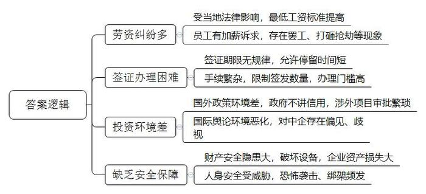
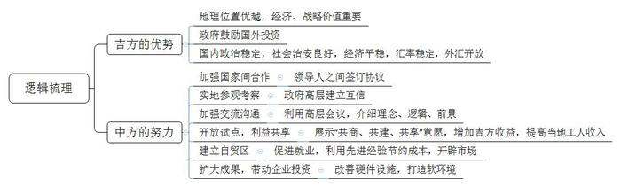
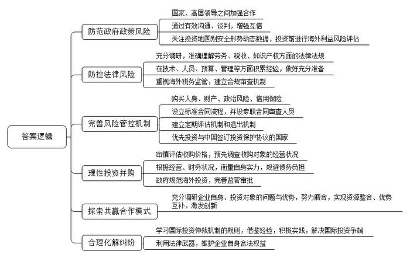
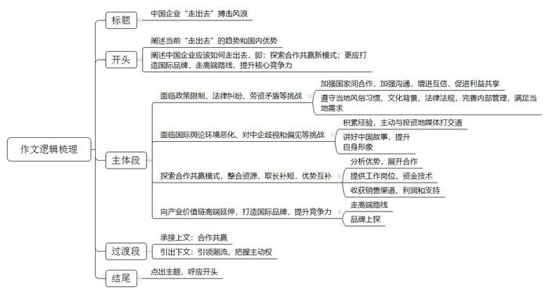

# 2018年山东省公考《申论》题（B卷）

<!-- gwy:overview:start -->
> **山东 · 2018 · 申论 · B类** ｜ 4 题 · 图片 4 处 · 答案随题折叠

导航：[题目](#题目) · [材料 1](#材料-1)
<!-- gwy:overview:end -->

> 候选采集稿。参考答案及解析来自粉笔页面，不代表官方答案或真实高分答卷；来源使用许可与原卷对应关系仍需人工核实。

## 给定材料

### 材料 1

《中国企业全球化报告（2017）》蓝皮书指出：“中国企业对外投资持续增长，但井喷式增长逐步放缓；跨国并购成为中国企业主要投资方式；对外投资主体继续多元化发展；企业对外投资‘软实力’竞争意识大幅提升，有意打造‘世界品牌’，向全球价值链高端延伸；‘一带一路’共建呈‘梯队式’发展，能源和基建等国企率先互补东道国经济需要，民营科技企业逐步成为‘一带一路’新力量……”整体来看，中国企业对外直接投资流量连续10年实现增长，2016年达1701.1亿美元，是2006年的8倍。中国企业对外投资处于“黄金期”。

以改革开放为大背景的“走出去”战略，见证了无数中国企业的海外打拼。回看一代代中国企业“走出去”的轨迹，能给我们带来诸多启示。过去，中国处在全球产业链底端，只能依靠人口红利和生产劳动密集型产品来获得比较优势，通过在国内生产然后销往世界，实现稳定盈利。虽然中国经济经过几十年发展已积累一定资本，但较之发达国家，我们虽劳动力相对富裕，资本方面却不占优势。依靠劳动密集型起家的一大批中国企业，在发达国家投资屡屡碰壁后，最终认识到这一点，因此不再跟发达国家硬碰硬。最初碰壁的这些中国企业，基本可以归为第一代“走出去”的企业。汲取教训后，中国企业到海外投资时，开始首选一些欠发达国家，比如东南亚、中东和非洲的一些国家。这样，中国企业除了具备资本和技术方面的比较优势外，还能借助那些欠发达国家的人口红利。在那之后“走出去”的第二代中国企业，获得了较第一代相对不同的境遇。年轻一辈的企业，比如百度、阿里巴巴和腾讯等，它们在初创时就引入了海外资本，因而具有资本成本优势；在发展中，又借助国家经济转型升级契机，从产业链的底端爬到中端的较佳位置，继而积累了“走出去”后与海外同行业者竞争的优势。时至今日，同前两代“走出去”的中国企业更为不同的“第三代”企业正在崛起，并且逐渐开始了“走出去”的尝试，比如共享单车企业。因为国外尚且缺乏同类企业，因此西方国家的一些城市都欢迎它们去投资和发展。

站在中国经济现实体量以及国际经济格局变化的今天，当我们回望历代中国企业“走出去”的轨迹时，应能得到这样的启示：中国经济的发展正在给中国企业“走出去”创造越来越好的机会，我们的企业则应总结过往的经验教训，及时找到比较优势，不断创造“走出去”的新局面。

### 材料 2

“我们工厂被砸了，东西都被抢了，请帮帮我们！”刚刚经历工厂被打砸洗劫的中国籍员工何女士对某报记者说。据何女士表示，她来缅甸故都仰光一间中资服装工厂工作已经一年多，2017年2月22日晚上，工厂的外部监控全部被砸坏，23日早7点左右，约300名罢工工人冲进工厂，打砸设备，之后又到中国员工宿舍打砸抢劫。何女士讲，她的两个行李箱被抢走，箱内有人民币2500元和一些珠宝首饰。厂方人员26日进入厂房巡视后告诉记者，厂内已无罢工人员，但设备遭到严重破坏，变压器也受到破坏，尚不清楚何时能够恢复生产。

其实，该中资服装工厂的冲击事件已经发酵多时，之前已经罢工过两次。根据缅甸政府公布的最低工资标准，自2015年9月1日起，缅甸在全国境内实行每日3600缅元（约合2.8美元）的最低工资标准。自此，缅甸各地尤其是仰光工厂的老板和工人之间爆发的劳资矛盾纠纷，几乎已经是家常便饭，尤其是依赖订单生存的成衣行业。一方面是员工要求涨薪的诉求，另一方面却是企业主难以为继的生意，导致目前在缅甸的中国服装企业举步维艰。为了解决这一矛盾，在缅甸的中国企业只能采取增加自动化设备以及裁员的方式。这样一来，看似从表面上解决了矛盾，但却埋下了更深层次的隐患。

### 材料 3

上海海立集团于2008年开始在印度开拓市场，承诺空调压缩机在印销量达到100万台就在印度投资开厂，结果仅用五年就兑现了承诺。现在，印度市场每年销售450万台空调压缩机，上海海立占据35%的份额。在印度市场已耕耘了十多年的上海海立集团沈建芳认为，投资印度的棘手挑战在于印度的商务签证给予的期限没有规律，允许停留的时间很短。沈建芳说：“最长期限仅为3个月，也就是3个月得回来一次，人员不稳定不利于企业在当地的长期发展。”而且，办理签证的手续非常繁杂。这一点也得到了众多商人的认同，“我接触到的企业家最担心的就是签证问题。如果投资后，人员过不去，还能做什么？”

中亚国家实行严格的签证和居留制度，如乌兹别克斯坦对我国所有类别的护照均要求签证。哈萨克斯坦对国外劳务实行严格限制，外国人在哈取得劳动就业许可和居留许可较困难，这直接影响了一些中国企业正常经营工作，如阿拉木图规模最大的“公主”中餐馆有近200个座位，2016年仅拿到2个厨师劳动就业许可证。哈国不仅申办获取引入外国劳动力许可证的程序十分繁琐，而且许可证的数量还有限制。目前，哈国对外国员工申请劳动许可的规定仍旧是阻碍外国投资的主要壁垒之一。土库曼斯坦是中亚五国中最难拿到签证和劳动许可的国家，严格控制向外国人发签证邀请比例，一般中企实际上几乎拿不到签证和劳动许可。乌、塔、吉三国对外国劳动力在该国就业有具体限制规定。现在中国人办签证实际上没有简化，似乎比过去更难。中企人员难以“走出去”，投资岂不是撂到了戈壁滩？

### 材料 4

2015年3月初，斯里兰卡新任政府叫停了一系列涉外项目，其中包括中资企业投资建设的科伦坡港口城一期项目，斯方此举的依据是工程“缺少相关审批手续”。这一项目是在斯里兰卡前铁腕总统马欣达·拉贾帕克萨的领导下开始建设的，是中国在斯里兰卡数个海港和基建项目中最大的，投资金额为14亿美元。2015年1月斯里兰卡新政府上台后，一系列涉外项目被叫停并重新评估。一名内阁成员当时表示，斯里兰卡政府要对35个项目进行审查，这些项目之前都没有经过竞标程序，政府认为这些项目对斯里兰卡的战后重建非常重要，所以有必要重新评估。而其中28个项目的出资方正是中国。港口城项目被叫停使中交公司每天蒙受38万美元的直接经济损失，同时使中斯互利合作遭遇“寒潮”。有经济分析人士指出，叫停港口城项目不仅使中国的公司蒙受巨大经济损失，而且严重挫伤外商对斯投资信心，外资流入随之大幅减少。

从法国的葡萄园，到乌克兰的土地，再到澳大利亚的牧场，近年来中国公司和企业家纷纷走出国门，在海外置地。最近，一家“身份不详”的中国企业绕过监管机构，在法国“粮仓”安德尔省高价购地，引来法媒议论纷纷。法国媒体称，外国人用这种手段购买大片土地，在法国还是首次出现，一些法国人担心食品安全、乡村稳定发展受到威胁。德国华人投资顾问周先生对《环球时报》表示，“在德国买地常常会遇到许多障碍”，比如议会出于各种原因投票拒绝；媒体也对中企存在偏见，认为中企买地后会带来环保、失业等问题。而像美国或欧盟企业就没有这方面的问题，甚至中东国家企业在德买地也比中国方便。

在澳大利亚也很明显。去年澳政府加强对向中国出售农田交易的审查，规定对中资企业出售1500万澳元或以上的农田交易都需要审批，而来自日韩美的投资者在收购11亿澳元以下的土地时都不需要审批。中国人民大学农业与农村发展学院教授仇焕广对《环球时报》说，本世纪初中国企业刚刚开始海外购买土地时，国际舆论环境还相对比较宽松。2010年之后，中国农业企业“走出去”的国际舆论环境日益恶化，有关中国“资源掠夺论”的言论屡屡出现，一些国家纷纷出台对中国农业投资不利、甚至带有歧视的政策。

### 材料 5

2015年11月20日，中国铁建国际集团公司三位高管在马里遭遇恐怖袭击，不幸遇难，再次向近年来加快“走出去”的中国企业警示风险。

从近十年来的公开信息中，通过梳理中国企业员工、经营者在境外的遇袭情况，发现中国铁建在马里的遇害人员级别最高，极为罕见。在非洲西部地区的喀麦隆、尼日利亚、加纳，近年来中国企业员工遇袭事件也频频发生。该地区近年来暴力冲突不断，几起恶性绑架事件都发生在这三个国家，而且这些遇袭事件带有团伙性质，主要针对中国在当地的工厂。

阿富汗、伊拉克、叙利亚、也门，这些频繁与“武装冲突”联系在一起的国家至今仍没有走出阴影。恐怖主义更是使安全问题越“燃”越烈。在利比亚撤侨事件中，惊慌失措的中国企业承受了超过210亿美元的惨重损失。境外中资企业的安全威胁已经近在咫尺，海外华人从过去的无辜受害者，已升级为现在恐怖分子袭击的直接目标。

### 材料 6

吉布提位于非洲东北部亚丁湾西岸，面对红海南大门的曼德海峡，地处欧、亚、非三大洲的交通要冲，被西方称为“石油通道上的哨兵”，经济价值和战略价值非常重要。凭借着优越的地理位置，吉布提政府提出，致力于将本国打造成为东非地区航运中心、物流中心、商贸金融中心，争取成为“非洲香港、新加坡第二”。为此，吉布提政府鼓励外国投资，对外资持开放的态度。

2012年开始，招商局集团多次考察吉布提的相关情况。当时，该国并不是国际投资热点。招商局集团经过深入调研，认为吉布提优越的地理位置能够迅速覆盖“东南非共同市场”超越4亿的消费群体，使得20个成员国无缝连接，意味着巨大的市场机遇。同时，其政治稳定，社会治安良好，经济发展平稳，汇率稳定，外汇开放，是一个不错的投资选择。

2013年12月，招商局集团与吉布提港有限公司合作投资吉布提港，招商局集团持股23.5%。2015年12月，中国国家主席习近平在约翰内斯堡会见吉布提总统盖莱时提到，双方应拓宽物流、商贸、经济特区、铁路、港口等领域的互利合作。

项目之初，尽管双方高层已建立了良好的互信，但由于代表吉方的法国律师团队对招商局集团并无深入了解，因此对集团的发展理念和创新的商业模式还存有较大顾虑，在谈判的推进过程中颇显敏感与疑惑。为了让吉布提政府与港口方更深入地了解集团的理念和思路，招商局集团特意将双方初期磋商谈判的地点设在深圳，邀请吉布提总统和自贸区管理局主席到深圳参观，用蛇口的实际成果讲解招商局集团发展的理念，细剖“前港-中区-后城”为核心的“蛇口模式”。据悉，吉布提总统参观完蛇口后指出，吉布提与当年的蛇口具有极其相似的区位优势，也很有希望将吉布提由一个贫穷落后的小国逐步打造为区域航运中心、物流与贸易中心和金融中心，建设成为“东非的蛇口”。从港口到自贸区再到港区开发，吉布提在一步一步扩大自己的经济半径，像极了当年中国深圳蛇口区的发展之路，而吉布提方面确实在有意识复制中国蛇口的成功。吉布提港口与自贸区管理局主席哈迪表示，“中国招商局集团实施的创新模式成功地把蛇口从一个小渔村变成了中心枢纽，引入招商局集团是看中其经验与全球化知识，把我们的港口和城市融入全球贸易路线是我们的目标。”

同时，招商局集团分管领导亲自挂帅，想方设法利用各种国际会议、高层互访、董事会议等可与吉方碰面的机会，与吉方高层讲理念、讲逻辑、讲前景，而不是讲具体商业条款的细节。在香港、深圳、北京、广州、吉布提甚至到伦敦，都有双方真诚的讨论和热烈的交流。在寻得理念认可的同时，招商局集团始终展示“共商、共建、共享”的意愿。2016年，吉布提港货物吞吐量和老港经常性利润分别相当于招商局集团入股前的160%和284%。我方只持有23.5%的股份，吉方作为大股东是增长的最大受益者。另外，当地工人收入也在稳步提高，过去四年工资总额每年增长约8%。

在层层努力下，吉布提政府最终同意将港口周边最宝贵的岸线资源和土地资源与招商局集团合作开发，于是有了后来的自贸区项目。2015年初，招商局集团与吉方正式签署了“吉布提自贸区项目合作框架协议”，2017年1月自贸区一期工程正式动工，预计年底可正式对外招商。吉布提港口与自贸区管理局主席阿布巴克尔说，自贸区将直接和间接带动就业岗位1.5万个，对于这个人口不足百万的国家来说，这一数字令人振奋。与中国的合作是典型的合作共赢。中国的先进管理经验，有助于节约成本，开辟市场，为吉布提赢得了前所未有的商机。

此外，面对企业由于担心发展中国家的基础设施和商业软环境比较差，而不愿意去投资的情况，招商局集团也为此提供了平台：一方面是硬件设施的改善，比如港口、公路、产业园区的建设；另一方面是软环境的打造，在特殊区域里实施特殊政策，与国际接轨，分别在集团内部与外部形成雁形结构抱团出海的模式。到目前为止，在吉布提项目上，招商局集团自身已经有五个业务板块的公司参与进来，其中招商局集团港口控股有限公司作为领头雁，主导整个项目。收购后，招商局集团港口总部后台与前方派驻人员密切配合，在商务、建设、运营、财务等方面全方位支持，全面提升吉布提港管理水平。在吉布提项目上，除了招商局集团内部形成雁形出海的态势，不少中资公司也从中获益。多哈雷多功能港口项目合同总额为5.8亿美元，由中国进出口银行提供优惠贷款。中建港务建设有限公司和中建八局负责港口施工，上海振华提供“中国制造”的大型港口设备。自贸区项目则由中国建筑和中土集团负责基建。

### 材料 7

F机构近日发布《2016-2017年度中国企业“走出去”调研报告》，以下是报告节选内容：

从“走出去”的风险分布看，企业在“走出去”过程中，尽职调查成本较高或信息收集较困难的区域是非洲和中亚、西亚。40%左右受访者提及在境外投资项目中遇到“东道国法律不健全”“东道国政府腐败、政策不稳定、行政效率低”等政治风险，尤其以撒哈拉以南的非洲政治风险最高；44%的受访者表示在海外投资中遇到过政府审查。其中，有超过四分之一的被访者提及企业曾遭遇反商业贿赂、反腐败调查、环保审查及反垄断审查，地域以北美，南亚、东南亚，中亚、西亚居多；36%的受访者表示企业在境外投资项目中遭遇“本地化”要求，以中亚、西亚居多；市场风险则在非洲、中亚、西亚较为显著；16.8%的受访者表示企业在境外投资项目中遭遇群体性劳动纠纷，南亚、东南亚提及率超四成；34%的受访者表示企业在境外投资项目中遭遇税务争议，南亚、东南亚、撒哈拉以南的非洲、北美风险较高；21%的受访者表示在境外投资项目中遭遇知识产权争议，以南亚、东南亚、北美、西欧居多。因此，“走出去”第一步的海外利益风险评估非常重要，与此同时投资地国别安全形势的动态数据也至关重要。

从企业税务争议结果看，受访者中有52个企业对税务争议进行了具体阐述。其中46个企业未能充分调研、准确理解东道国的税收法律法规；39个企业缺乏经验，面对税收争议时，在技术、人员、预算、管理等方面准备不足；37个企业未能与当地政府和税务机构进行有效沟通和谈判；36个企业对海外项目的税务监管不予重视、未建立合规审查机制。此外，只有49%的企业购买保险，如人身、财产保险、政治风险保险、信用保险；46%的企业设立标准合同流程，并设专职合同审查人员；43%的企业建立财务和金融上的风险控制机制，如金融风险预判机制以防范汇率风险，财务预警机制加快资金回收等；43%的企业设立项目定期评估机制和退出机制；仅有34%的企业选择已经与中国签订投资保护协议的东道国进行投资。

从2014年起，中国财团对国外体育俱乐部产生浓厚兴趣。2014年7月，合力万盛国际体育发展公司以800万欧元的价格购买了荷兰海牙俱乐部100%的股权。2015年9月，万达以4500万欧元的价格购买了马德里竞技20%的股权。而海外体育并购案异常火热的时间段出现在2016年，从1月至8月共有10宗入股或收购宣告，其中手笔最大的是中欧体育投资管理长兴有限公司以5.2亿欧元的价格购买了意大利AC米兰俱乐部99.93%的股权；其次是苏宁以2.7亿欧元的价格购买了国际米兰70%的股权。据不完全统计，自2014年至今，至少有15家海外足球俱乐部的股权被中国资本收购，总耗费资金超过150亿元人民币。海外足球俱乐部很少有经营状况良好的，且大多数都处于亏损状态，甚至濒临倒闭。从2016年年底开始，商务部、发改委、外汇管理局、央行多部门要求5000万美元及以上的转移出境业务须获得特别批准。2017年2月21日的国新办新闻发布会上，时任商务部部长高虎城就提到，在对外投资快速增长的背景下，部分企业开展非主业、非理性的大额对外投资，盲目投资房地产、酒店、影城、娱乐业、体育俱乐部等领域，存在着较大的风险隐患。2016年11月初，万达集团宣布10亿美元收购美国好莱坞电视制作公司Dick Clark Productions。但在2017年初，在线娱乐新闻网站The Wrap引述匿名消息人士报道，中国房地产和娱乐巨擘—大连万达集团以10亿美元收购美国Dick Clark Productions Inc（DCP集团）的交易已经破裂。The Wrap表示，收购破裂的主因是中国政府方面的监管批准问题。

2016年，中国企业进行了2500亿美元的海外收购交易。在海外并购越是凶猛的中企，其背负的债务负担越重，其中包括：万达、复星、海航集团、中联重科、安邦保险、罗森内里等公司。其中，中联重科债务是EBITDA（利息折旧摊销前收入）的83倍；复星集团截至2015年6月，其债务总额是自身EBITDA的55.7倍；中国远洋控股集团负债总额达到企业自身EBITDA的41.5倍；中粮集团下属子公司中粮国际债务总额相当于其自身EBITDA的52倍；光明食品债务总额是自身EBITDA的24倍。

中国台湾的富士康科技集团与日本夏普公司的“联姻”显然是一个典型的成功案例。据了解，日本夏普公司长期在液晶显示、净离子群等领域拥有强大技术优势，然而，由于近年来在投资方向、创新活力、商业运作等方面乏善可陈，优势尽失。对此，富士康经过充分调研后敏锐地发现，自身在产品设计、制造工艺、成本管控及优化整个垂直供应链等方面的优势，恰好可以与处于低谷的夏普实现资源整合与优势互补，因此便积极寻求与夏普“联姻”并对其进行注资。经过双方不懈的努力与磨合之后，夏普强势回归中国市场并在“6·18”电商节一举夺得大屏电视销售冠军，富士康也借此形成了一个“日本并购、大陆设厂、本地化供货、全球化移植”的共赢新模式。

根据联合国贸发会议（UNCTAD）投资争端解决统计，2016年，投资者依据国际投资协定起诉东道国的已知仲裁案件共计62件，累计达到767件。该案件数低于2015年的历史最高纪录（74件），但高于此前十年的平均数（49件），仍然处于增长态势。同时，从被诉东道国的分布上看，东欧和中亚国家占31%，南美国家占17%，西欧国家占15%，中东和北非国家占11%，南亚、东亚和太平洋国家占8%，北美三国、中美和加勒比及撒哈拉以南非洲国家各占6%。“一带一路”沿线国家占比超过一半。从公开的数据来看，除国际投资争端解决中心（ICSID）于2014年受理的北京城建集团公司诉也门政府案外，中国企业通过国际投资仲裁机制解决与东道国之间的海外工程承包投资争议的案例少之又少，说明中国企业运用国际投资仲裁机制的经验和实践仍不充分。

### 材料 8

随着经济实力的增长，中国企业“走出去”投资、在全球布局已成为常态。然而，随着一些国家和地区反全球化的声音不断出现，各种不确定因素增加，一部分企业家开始犹豫还要不要继续“走出去”。习近平总书记在世界经济论坛2017年年会开幕式上的主旨演讲中说，“甘瓜抱苦蒂，美枣生荆棘。”经济全球化确实带来了新问题，但我们不能就此把经济全球化一棍子打死，而是要适应和引领好经济全球化，消解经济全球化的负面影响，让它更好地惠及每个国家、每个民族。曾经，中国对经济全球化也有过疑虑，对加入世界贸易组织也有过忐忑。但是，融入世界经济是历史大方向，中国经济要发展，就要敢于到世界市场的汪洋大海中去游泳，如果永远不敢到大海中去经风雨、见世面，总有一天会在大海中溺水而亡。所以，中国勇敢迈向了世界市场。在这个过程中，我们呛过水，遇到过漩涡，遇到过风浪，但我们在游泳中学会了游泳。这是正确的战略抉择。

从长远来看，经济全球化的总体趋势并没有变。目前中国企业“走出去”面临的形势，和17年前加入WTO时完全不一样。过去，我们开启“两个市场、两种资源”，在某种程度上是对全球化的回应，如今中国企业无论到海外建厂、投资并购，还是搞品牌合作、购买专利，更多是主动拥抱全球化。无论潮流如何，对中国企业而言，一切才刚刚开始，“走出去”仍是大势所趋，不用犹豫。

“走出去”是为了抢抓机遇，不能等待命运的垂青。一遇到风浪就退回到港湾中去，那是永远不能到达彼岸的。中国企业扬帆出海，需要慢慢练就迎击风浪的经验和能力。中国企业不可能总在风平浪静时“走出去”，而注定只能“在深海里练就游泳能力”，在一次次的弄潮中成长。正如习近平总书记所讲，人类历史告诉我们，有问题不可怕，可怕的是不敢直面问题，找不到解决问题的思路。面对经济全球化带来的机遇和挑战，正确的选择是，充分利用一切机遇，合作应对一切挑战，引导好经济全球化走向。

经过40年的改革开放，中国形成了日益成熟的市场机制、稳定的投资环境，这不仅为境外企业到中国投资提供了机遇，也为中国企业“走出去”建立了稳定的大后方。在中国经济转型升级之际，中国企业抓住时机走向国际舞台，在硬碰硬、真较量中不断完善自我，形成更合理的布局，才能打开一片新天地，找到发展新动能。

## 题目

### 第 1 题

**根据“给定资料2\-5”，概括当前我国企业在“走出去”中遇到的主要问题。（15分）**

关联材料：材料 1、材料 2、材料 3、材料 4、材料 5、材料 6、材料 7、材料 8

作答要求：

要求：全面，准确，有条理，不超过200字。

第 1 题 · 答案与解析

**参考答案（粉笔题库参考内容）**

一、劳资纠纷多。受当地法律影响，最低工资标准提高；员工有加薪诉求，存在罢工、打砸抢劫等现象。

二、签证办理困难。签证期限无规律，允许停留时间短；手续繁杂，限制签发数量，办理门槛高。

三、投资环境差。国外政策环境差，政府不讲信用，涉外项目审批繁琐；国际舆论环境恶化，对中企存在偏见、歧视。

四、缺乏安全保障。财产安全隐患大，破坏设备，企业资产损失大；人身安全受威胁，恐怖袭击、绑架频发。

**解析**

**参考答案说明：**本参考答案思路上从“劳资纠纷多”“签证办理困难”“投资环境差”“缺乏安全保障”这四方面入手，进行问题的展开。此外，各条的要点之间是并列关系，内容之间不存在重复、交叉。

**考点**：问题类

**来源**：2018年山东省公考《申论》题（B卷）

### 第 2 题

**根据“给定资料6”，分析吉布提国际自贸区项目（落地）成功的原因。（20分）**

关联材料：材料 1、材料 2、材料 3、材料 4、材料 5、材料 6、材料 7、材料 8

作答要求：

要求：分析全面、透彻，有条理；不超过250字。

第 2 题 · 答案与解析

**参考答案（粉笔题库参考内容）**

一、吉方的优势：1.地理位置优越，经济、战略价值重要；2.政府鼓励国外投资；3.国内政治稳定，社会治安良好，经济平稳，汇率稳定，外汇开放。

二、中方的努力：1.加强国家间合作，领导人之间签订协议；2.实地参观考察，政府高层建立互信；3.加强交流沟通，利用高层会议，介绍理念、逻辑、前景；4.开放试点，利益共享，展示“共商、共建、共享”意愿，增加吉方收益，提高当地工人收入；5.建立自贸区，促进就业，利用先进经验节约成本，开辟市场；6.扩大成果，带动企业投资，改善硬件设施，打造软环境。

**解析**

**参考答案说明：**本参考答案思路上从“吉方的优势”“中方的努力”这两方面入手，对成功的原因进行展开。此外，各条的要点之间是并列关系，内容之间不存在重复、交叉。

**考点**：原因类

**来源**：2018年山东省公考《申论》题（B卷）

### 第 3 题

**根据“给定资料7”，对我国企业更好地“走出去”提出对策建议。（25分）**

关联材料：材料 7

作答要求：

要求：合理可行、有针对性，条理清晰；不超过450字。

第 3 题 · 答案与解析

**参考答案（粉笔题库参考内容）**

一、防范政府政策风险。国家、高层领导之间加强合作；通过有效沟通、谈判，增强互信；关注投资地国别安全形势动态数据，投资前进行海外利益风险评估。

二、防控法律风险。充分调研，准确理解劳务、税收、知识产权方面的法律法规；在技术、人员、预算、管理等方面积累经验，做好充分准备；重视海外税务监管，建立合规审查机制。

三、完善风险管控机制。购买人身、财产、政治风险、信用保险；设立标准合同流程，并设专职合同审查人员；建立定期评估机制和退出机制；优先投资与中国签订投资保护协议的国家。

四、理性投资并购。审慎评估收购价格，预先调查收购对象的经营状况；根据经营、财务状况，衡量自身实力，规避债务负担；政府规范海外投资，完善监管审批。

五、探索共赢合作模式。充分调研企业自身、投资对象的问题与优势，努力磨合，实现资源整合、优势互补，激发创新。

六、合理化解纠纷。学习国际投资仲裁机制的规则，借鉴经验，积极实践，解决国际投资争端；利用法律武器，维护企业自身合法权益。

**解析**

**参考答案说明：**本参考答案思路上从“防范政府政策风险”“防控法律风险”“完善风险管控机制”“理性投资并购”“探索共赢合作模式”“合理化解纠纷”这六方面入手，进行对策建议的展开。此外，各条的要点之间是并列关系，内容之间不存在重复、交叉。

**考点**：提出对策类

**来源**：2018年山东省公考《申论》题（B卷）

### 第 4 题

**“给定资料8”中划线句子提到，“中国企业不可能总在风平浪静时‘走出去’，而注定只能‘在深海里练就游泳能力’，在一次次的弄潮中成长”。请围绕对这句话的思考，参考给定资料，联系实际，自选角度，自拟题目，写一篇文章。（40分）**

关联材料：材料 1、材料 2、材料 3、材料 4、材料 5、材料 6、材料 7、材料 8

作答要求：

要求：

（1）观点明确，立意深刻；

（2）思路清晰，语言流畅；

（3）参考“给定资料”，但不拘泥于“给定资料”；

（4）总字数1000～1200字。

第 4 题 · 答案与解析

**参考答案（粉笔题库参考内容）**

**中国企业“走出去”搏击风浪**

当前，经济全球化不可逆转，成为全新发展趋势。企业走出国门，不仅有利于实现国际间资源整合、优势互补，还能促进互利合作，创新合作模式。可喜的是，我国日益成熟的市场机制、稳定的投资环境，为中国企业建立了稳定的后方。因此，**中国企业应顺应潮流，主动“走出去”，迎接新挑战，探索合作共赢新模式；更应打造国际品牌，走高端路线，提升核心竞争力，走得更远，行得更稳。**

**然而，走出去面临投资地政策限制、法律纠纷、劳资矛盾等问题。中国企业须充分调研，准确理解当地法律法规，科学管控风险，合理化解纠纷。**中国企业走出去面临重重阻力，如印度、哈萨克斯坦等国家对外来务工限制严苛，包括工作签证申请难、严控签发数量、审批手续繁琐等。对此，应加强国家间合作，加强沟通，增进互信，促进利益共享。此外，一些中国企业，对当地情况不了解，经营活动引发当地居民反感。因此，须主动遵守当地风俗习惯、文化背景、法律法规，完善内部管理，满足当地需求。

**另一方面，走出去还面临国际舆论环境恶化、对中企歧视和偏见等问题。中国企业须积累经验，主动与投资地媒体打交道，讲好中国故事，提升自身形象。**承建越南第一条城铁的中铁六局，发生伤亡事故，引起舆论风波。对此，中铁六局主动与媒体沟通，引导正确信息，降低了公司损失。此外，猎豹、茄子快传等移动应用，能够顺利进入印度市场，也离不开“出海”之前与当地媒体的积极沟通。因此，要想走出去，需要积累经验，借助海外媒体，做好形象宣传。

**中国企业要更多的走出去，需要探索合作共赢模式，整合资源，取长补短，优势互补。**在走出去的过程中，只要能找到合作的契合点，必能求同存异，实现互利共赢。正如华为，利用技术创新优势，与ABB、博世等企业合作，共同构建适配各行业客户需求的解决方案。在走出去的战略中，一方面，华为为各国提供了众多的工作岗位、资金技术；另一方面，华为也收获了销售渠道、利润和支持，这正是合作共赢的最好体现。

当然仅仅找到共赢模式还不够，我们的企业“走出去”必然会像华为一样面临诸多刁难，因此，还需要从参与竞争、迎合市场到引领潮流，才能把握全球化过程中的主动权。

**中国企业要更好的走出去，还需要借助“一带一路”的东风，向产业价值链高端延伸，打造国际品牌，提升竞争力。**长期以来我国企业往往处于产业链的中低端，虽然物美价廉但品牌影响力低，而外国企业却拿出相同品质的产品攫取高额利润。现如今，我国民营汽车品牌中，首屈一指的是吉利汽车。吉利汽车通过收购国外技术先进的汽车品牌，吸收转化技术，推陈出新，不断推动品牌上探，如今无论是销量还是利润都在自主品牌中占据第一的位置。

中国企业要从“走进去”到“走出去”，从“走得稳”到“走得好”，就要紧跟时代步伐，抓住机遇，迎接挑战，为“走出去”开辟一片新天地。

**文章分析**

**中国企业“走出去”搏击风浪**

【**标题的优点：**首先，范文的标题“中国企业‘走出去’搏击风浪”突出了“企业走出去”这一主题。其次，形式上，文字简洁明快有力，不拖沓。】

当前，（1）<u>经济全球化不可逆转</u>，<u>成为全新发展趋势</u>。（2）<u>企业走出国门</u>，<u>不仅有利于实现国际间资源整合</u>、<u>优势互补</u>，<u>还能促进互利合作</u>，<u>创新合作模式</u>。可喜的是，（3）<u>我国日益成熟的市场机制</u>、<u>稳定的投资环境</u>，<u>为中国企业建立了稳定的后方</u>。因此，（4）**中国企业应顺应潮流****，****主动****“****走出去****”，****迎接新挑战****，****探索合作共赢新模式****；****更应打造国际品牌****，****走高端路线****，****提升核心竞争力****，****走得更远****，****行得更稳****。**

【**开头的优点：★内容方面。**范文的开头是紧扣“企业走出去”这一主题展开的。首先，开头在段首处点出主题，做到了主题明确。其次，对“企业走出去”这一主题进行了分析阐述，指出了（1）企业走出去的背景；（2）企业走出去的意义；（3）企业走出去的客观条件；（4）企业走出去的整体性对策。**★文字表达方面：**使用了“不仅……还能……”“因此……”等关联词，使语言表达有逻辑性。】

**然而，（1）****走出去面临投资地政策限制****、****法律纠纷****、****劳资矛盾等问题****。中国企业须充分调研，准确理解当地法律法规，科学管控风险，合理化解纠纷。**中国企业走出去面临重重阻力，如印度、哈萨克斯坦等国家对外来务工限制严苛，包括工作签证申请难、严控签发数量、审批手续繁琐等。对此，（2）<u>应加强国家间合作</u>，<u>加强沟通</u>，<u>增进互信</u>，<u>促进利益共享</u>。此外，一些中国企业，（3）<u>对当地情况不了解</u>，<u>经营活动引发当地居民反感</u>。因此，（4）<u>须主动遵守当地风俗习惯</u>、<u>文化背景</u>、<u>法律法规</u>，<u>完善内部管理</u>，<u>满足当地需求</u>。

【**论述段1的优点：★观点句：**范文的观点句是紧扣“企业走出去”这一文章主题提出的。形式上，它在段首处直接写出，位置突出，容易发现。内容上，关键词突出，内容要点明确，可以明显看出它是从“充分调研”“理解当地法律”“管控风险”这三个角度入手，指出了“企业走出去”的对策。**★论述内容：**（1）介绍了企业走出去面临的阻力——投资地政策限制、法律纠纷、劳资矛盾方面；（2）介绍了企业走出去的对策——加强合作、沟通方面；（3）介绍了企业走出去面临的阻力——不了解情况方面；（4）介绍了企业走出去的对策——遵守当地风俗习惯、文化背景方面。以上四个方面的内容都是紧扣“中国企业须充分调研，准确理解当地法律法规，科学管控风险，合理化解纠纷”这个观点句进行分析论述的，论述的针对性强，内容层次丰富。最后，在论述方法上主要采取了讲道理和举例子相结合，做到了丰富多样。】

**另一方面，（1）****走出去还面临国际舆论环境恶化****、****对中企歧视和偏见等问题****。中国企业须积累经验，主动与投资地媒体打交道，讲好中国故事，提升自身形象。**承建越南第一条城铁的中铁六局，发生伤亡事故，引起舆论风波。对此，中铁六局主动与媒体沟通，引导正确信息，降低了公司损失。此外，猎豹、茄子快传等移动应用，能够顺利进入印度市场，也离不开“出海”之前与当地媒体的积极沟通。因此，（2）<u>要想走出去</u>，<u>需要积累经验</u>，<u>借助海外媒体</u>，<u>做好形象宣传</u>。

【**论述段2的优点：★观点句：**范文的观点句是紧扣“企业走出去”这一文章主题提出的。形式上，它在段首处直接写出，位置突出，容易发现。内容上，关键词突出，内容要点明确，可以明显看出它是从“与投资地媒体打交道”“提升中国形象”这两个角度入手，指出了“企业走出去”的对策。**★论述内容：**（1）介绍了企业走出去面临的阻力——舆论环境恶化、遭遇歧视和偏见方面；（2）介绍了企业走出去的对策——借助海外媒体、做好形象宣传方面。以上两个方面的内容都是紧扣“中国企业须积累经验，主动与投资地媒体打交道，讲好中国故事，提升自身形象”这个观点句进行分析论述的，论述的针对性强，内容层次丰富。最后，在论述方法上主要采取了讲道理和举例子相结合，做到了丰富多样。】

**中国企业要更多的走出去，需要探索合作共赢模式，整合资源，取长补短，优势互补。**（1）<u>在走出去的过程中</u>，<u>只要能找到合作的契合点</u>，<u>必能求同存异</u>，<u>实现互利共赢</u>。正如华为，利用技术创新优势，与ABB、博世等企业合作，共同构建适配各行业客户需求的解决方案。在走出去的战略中，一方面，华为为各国提供了众多的工作岗位、资金技术；另一方面，华为也收获了销售渠道、利润和支持，这正是合作共赢的最好体现。

当然仅仅找到共赢模式还不够，我们的企业“走出去”必然会像华为一样面临诸多刁难，因此，（2）<u>还需要从参与竞争</u>、<u>迎合市场到引领潮流</u>，<u>才能把握全球化过程中的主动权</u>。

【**论述段3的优点：★观点句：**范文的观点句是紧扣“企业走出去”这一文章主题提出的。形式上，它在段首处直接写出，位置突出，容易发现。内容上，关键词突出，内容要点明确，可以明显看出它是从“探索合作共赢模式”“整合资源”这两个角度入手，指出了“企业走出去”的对策。**★论述内容：**（1）介绍了企业走出去的对策——找到合作契合点方面；（2）介绍了企业走出去的对策——引领潮流方面。以上两个方面的内容都是紧扣“中国企业要更多的走出去，需要探索合作共赢模式，整合资源，取长补短，优势互补”这个观点句进行分析论述的，论述的针对性强，内容层次丰富。最后，在论述方法上主要采取了讲道理和举例子相结合，做到了丰富多样。】

**中国企业要更好的走出去，还需要借助“一带一路”的东风，向产业价值链高端延伸，打造国际品牌，提升竞争力。**（1）<u>长期以来我国企业往往处于产业链的中低端</u>，<u>虽然物美价廉但品牌影响力低</u>，<u>而外国企业却拿出相同品质的产品攫取高额利润</u>。现如今，我国民营汽车品牌中，首屈一指的是吉利汽车。（2）<u>吉利汽车通过收购国外技术先进的汽车品牌</u>，<u>吸收转化技术</u>，<u>推陈出新</u>，<u>不断推动品牌上探</u>，<u>如今无论是销量还是利润都在自主品牌中占据第一的位置</u>。

【**论述段4的优点：★观点句：**范文的观点句是紧扣“企业走出去”这一文章主题提出的。形式上，它在段首处直接写出，位置突出，容易发现。内容上，关键词突出，内容要点明确，可以明显看出它是从“向产业价值链高端延伸”“打造品牌”“提升竞争力”这三个角度入手，指出了“企业走出去”的对策。**★论述内容：**（1）介绍了企业走出去的历史；（2）介绍了企业走出去的对策——收购外国品牌、吸收转化技术方面。以上两个方面的内容都是紧扣“中国企业要更好的走出去，还需要借助‘一带一路’的东风，向产业价值链高端延伸，打造国际品牌，提升竞争力”这个观点句进行分析论述的，论述的针对性强，内容层次丰富。最后，在论述方法上主要采取了讲道理和举例子相结合，做到了丰富多样。】

【**论述段之间的关系：★内容的内在逻辑：**范文的论述段之间是依照并列逻辑展开的。论述段1先写了企业走出去在“调研”“合规”等层面的对策，论述段2又写了企业走出去在“公关”层面的对策，论述段3再写了企业走出去在“合作”层面的对策，论述段4还写了企业走出去在“技术”“品牌”层面的对策。**★段与段的外在衔接：**论述段1段首处的“然而”，起到了承接开头段、引出了论述段1的作用；论述段2段首处的“另一方面”，起到了承接论述段1、引出了论述段2的作用。】

中国（1）<u>企业</u>要从“走进去”到“<u>走出去</u>”，从“走得稳”到“走得好”，（2）<u>就要紧跟时代步伐</u>，<u>抓住机遇</u>，<u>迎接挑战</u>，为“走出去”开辟一片新天地。

【**结尾的优点：**范文的结尾回扣了“企业走出去”这一主题。（1）再次提到了“企业走出去”；（2）阐述了对策。】

**解析状态：unknown（来源未提供）**

**考点**：文章写作题

**来源**：2018年山东省公考《申论》题（B卷）

