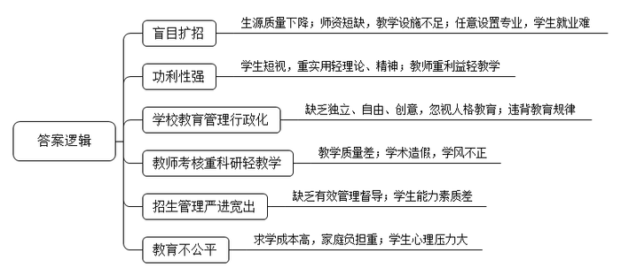
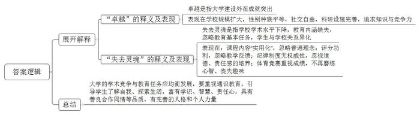
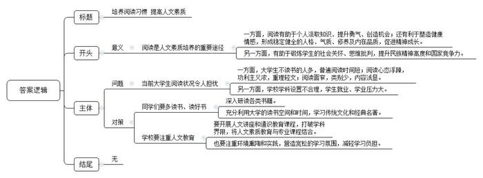
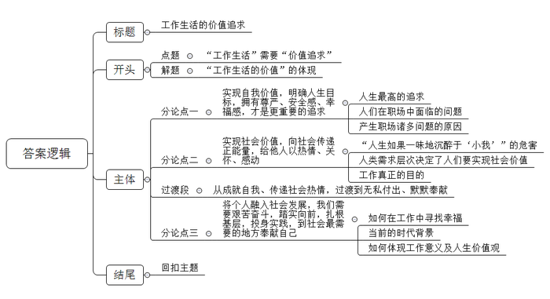

# 2018年山东省公考《申论》题（C卷）

<!-- gwy:overview:start -->
> **山东 · 2018 · 申论 · C类** ｜ 4 题 · 图片 4 处 · 答案随题折叠

导航：[题目](#题目) · [材料 1](#材料-1)
<!-- gwy:overview:end -->

> 候选采集稿。参考答案及解析来自粉笔页面，不代表官方答案或真实高分答卷；来源使用许可与原卷对应关系仍需人工核实。

## 给定材料

### 材料 1

2017年12月29日晚，武汉华中科技大学教学楼五楼二中教室正在进行一场人文讲座，刘教授关于“诗和远方”“历史唯物主义与浪漫主义”等人生意义的哲学思考不时引发学生们的热烈掌声。自1994年以来，这样的讲座已经在华中科技大学举行了2200多期，直接参与并受益的听众达数十万人。原华中科技大学校长、中国科学院院士杨叔子是人文讲座的最初倡导者，率先在理工科高校中举起人文素质教育大旗，在全国教育界形成独树一帜的人文“景观”，得到社会各界广泛赞誉和认可。

杨院士在接受记者专访时，谈了他对当代大学教育的看法。记者问：“有人觉得人文讲座对理工科学生的就业帮助不大，您怎么看？”杨院士说：“我觉得张口闭口‘有用没用’的人，太短视！有个毕业生到浙江一家高科技企业应聘，因为知识面很宽，他的复试成绩很好。他把原因归结为人文讲座听得多，他在校期间一共听了400多场讲座。我举这个例子是想告诉同学们不要太短视了。其实，有时候无形的东西才是最有用的。‘科学技术是第一生产力’没有错。没有金属的发现，就没有农业革命；没有蒸汽机的发明，就没有工业革命；没有电磁现象的发现，不可能有第二次工业革命。但是谁发现、谁发明的？人！人靠什么支持？精神！老子有一句话：‘有之以为利，无之以为用。’‘有’可以理解为科学技术，‘无’则是精神力量。现在我带的博士还必须背诵《老子》《论语》，很多人问这有什么用。我认为，作为一个中国人，这些知识终究是有用的，因为人还是要有点精神生活的。”记者又问：“就业毕竟是现实的，谁也不想输在这个起跑线上。为了就业，一些学生明显地重‘术’而薄‘道’。您怎么看？”杨院士回答说：“什么才算是好工作？哪有绝对标准，只是不同的价值取向而已。这个问题其实就是，大学究竟是要帮助学生找个好工作，还是要把学生培养成有高度社会责任感的好公民。”

### 材料 2

改革开放以来，我国的大学教育取得了巨大成就，为社会主义现代化建设事业提供了强有力的人才支持和知识贡献。大学建成了一批国家级科研基地，取得了一系列重大科研成果，为经济建设解决了一批带有全局性的重大关键技术问题，科技成果转化和推广应用取得明显成效，成为推动科技进步的重要力量。经过几十年的高速发展，我国的在校大学生规模已位居世界第一，大学教育由精英化进入了大众化阶段，每年都有大量的毕业生由大学输往社会。随着越来越多的大学生无法顺利找到理想的与专业对口的工作，大学生找工作成为社会上热议的话题，也引发了大学校长和专家学者的思考。目前，在某知名网络教育频道组织的一次大学教育论坛上，针对大学教育如何更好地适应经济社会的需求，一些大学校长、专家学者和热心网友纷纷发表意见。

A校长说：我是研究机器人的，希望机器越来越像人，但作为校长，我担心把人培养得像机器。我观察过学校的毕业生，发现一个蹊跷的现象：一些留校的学生最初很有创意，待了几年后，就没什么想法了；送到国外，又发展很快。我不禁思考：现在的大学到底怎么了？

B学者说：有些大学不顾自身条件盲目扩招，生源质量下降。有的学校教师队伍呈现结构性短缺，教学用房紧张，教学仪器设备老化，难以保证正常教学的需要。不仅如此，有些分明是在水产研究、地质研究上有专长的学校也大量开设金融、管理等热门专业。这些违背教学规律，强调应用性和功利性而盲目扩招、任意设置专业的做法，使大学教育质量明升实降，也造成同一领域毕业生的就业大撞车，人为制造了就业难度。

C教学副院长说：现在的大学不再是纯粹做学问的象牙塔了。随着市场经济的发展，市场化因素影响到大学的各个角落。很多学生上学的目的就是为了毕业后能找到一个很不错的工作，取得较好的回报，很多学生在选择课程时，大都选择实用性很强的，对于理论性较强、缺乏实践应用的学科则不感兴趣。而一些老师为了追求自己的利益，在本校教授课程的同时还到校外做兼职，有时为了校外工作不惜耽误学生的正常上课。大学生的价值取向发生了偏离，不是围绕人的幸福和快乐而上大学，也不是为了让人类更好地可持续发展而上大学，而是为了票子、车子、房子。

D校长说：现在大学行政化的教育管理体制对大学实现学术自由、教育独立和人格本位有所限制。从学校设立、办学定位、领导的选择到招生标准、招生名额、课程设置、教材内容，再到教育资源的分配、教师科研课题的确定、成果评奖、教师职称评定等，行政的控制和干预无所不在。教育没有了独立性，难以按自身规律去发展。

E老师说：一些高校对教师的考核指标中，科研项目、论文占了70%以上，而教学任务占比不到30%，出现了本末倒置的现象。这种重科研轻教学的考核制度使老师们为了生计和前途，忙于跑课题、写论文、拉科研经费，不能安心教学。教授们不愿给本科生上课，年轻教师对教学也敷衍了事，沿袭传统的填鸭式教学方法，使学生培养质量大打折扣。为完成科研任务，拼凑论文或是将一篇论文分成几篇发表的情形时有发生，甚至还出现剽窃、抄袭等学术造假现象，败坏了大学的学风。

F网友说：现在大学的招生、培养还是“严进宽出”，只要考进了大学，四年以后绝大多数都能毕业。这使得无数挤过高考独木桥的大学生，失控于大学宽松而闲散的环境，而高校又缺乏一套行之有效的管理机制，或者训而不督，或者督而不导。对专业课的忽视和对现实的追求，直接导致学生上大学与拿文凭挂钩、与学知识脱钩。一些毕业生动手能力差、创新能力差、心理素质差，很难承受工作中遇到的困难，无法适应社会的需求。

G网友说：大学教育不能产业化，大学教育不是可资开发的产业，而应该是有待扩展的公共事业。现在越来越高的学费，加上日益高涨的生活成本，不仅增加了家庭负担，也在一定程度上影响了教育的公平性。虽然一些贫困学生可以通过申请补助或贷款等方式入学，但更有许多学生在花费了巨额费用之后，在现实的经济压力与前途渺茫的心理压力下，对理想前途做了毫不迟疑的庸俗化理解——“理想钱途”，并最终把找一份高薪工作当成人生的最大目标。

H校长说：大学教育不仅要传授知识、培养技能，更要培养学生的人格、品性、能力和责任感。大学不应该仅仅是帮助学生找个好工作，还应该把学生培养成富有社会责任感的成年人。教育最根本的任务是提高国民素质，如果把教育和就业简单等同起来，就太功利了，这是不科学也是不全面的。

### 材料 3

美国一些知名的研究型大学吸引了来自世界各地的优秀学生。几十年来，在服务社会的过程中，这些研究型大学一直是发明和创造的源泉。能够到这些知名的大学读书，被视为无上荣幸的事情。大学里研究与教学的结合，让那些最杰出的专家与最有前途的学生面对面接触，教师与学生所取得的卓越成就一年比一年突出。无数家长认为，被这些知名学校录取，就是对孩子成就的认可；进入这样的学府，未来美好的前程就有了保证。

这些名校的许多老校友经常感叹，如今大学发生了沧桑巨变——与当年他们就读大学时相比，学校规模更大了，有更多的女学生和少数族裔学生进入了大学课堂；大学生的社交变得更加随意了；有更多新的实验室和研究中心拔地而起，但大学的学术水平却下降了。事实上这些古老学院确实发生了深刻的变化——旧的学校机构保留下来了，但其内涵已经发生了变化：课程改革不断适应学术发展和社会需要，内容比以前更丰富了，但课程已不再围绕那些普遍认同的理念来设计；教授们依旧给学生们打分，但这些分数已演变为学生进入研究生院的资格，而不是教师向学生提供的教学反馈；纪律制度已变为可以辩论的“小小法庭”，而不再是进行道德教育、帮助年轻人成长、培养具有责任感公民的途径；就连校际体育比赛似乎也违背了原先锻炼学生心智的初衷，都由专业运动员参加，没有趣味可言。

美国哈佛大学哈佛学院前院长哈瑞·刘易斯教授认为，作为知识的创造者和存贮地，这些美国名校是成功的，但它们忘记了本科教育的基本任务是帮助人成长，让学生了解自我、探索自己生活的远大目标，毕业时成为一个富有学识、智慧、能为自己的生活和社会承担责任的成年人。现在学术追求竞争替代了大学的教育任务，殊不知这两者不应该厚此薄彼。在这些大学领导的演讲稿中，不乏关于“世界问题”“知识探索”“勤勉工作”与“成功”之类的词句，却鲜有看到个人力量、完善的人格、善良、合作、同情、如何把眼前的世界建设得更美好等言辞。学校越出名，就越强调在教师、学生和经费市场上的竞争力。学生与学校的关系，正逐渐演变为消费者与出售昂贵商品和服务的卖主之间的关系。

18岁到22岁是年轻人在人生发展道路上的特殊阶段，这个年龄正好是培养责任感的阶段，他们已经能够成熟地从独立的生活、新的知识和富有挑战性的观念中获取力量和灵感。大学正是他们开始认识自我，发现生活意义和目标的关键场所。大学教育不仅仅是数据、公式、法则、名字和地点的传授，教育也不仅仅是课堂教学。教育学家说，通识教育就是当你接受了教育，又把当初学到的内容忘记后，最后还剩下的东西。如果以此为标准，我们应该如何评价如今大学生所接受的教育呢？哈瑞·刘易斯教授说：<u>“这些大学是在追求失去灵魂的卓越。”</u>

### 材料 4

人文素质是指人们在人文方面所具有的综合品质或达到的发展程度，其形成主要有赖于后天的人文教育。华中科技大学原校长李培根院士说，人文素质教育不能仅靠人文讲座和人文通识教育课程，专业教育中也应该体现。通过人文知识的阅读传授、环境熏陶以及自身的实践，锻炼学生的社会关怀、思维批判以及健康情感，将人类优秀的文化成果转化为人格、气质、修养，成为人相对稳定的内在品质。

阅读是人们汲取知识、获取智慧的基本方法，也是人文素质培养的重要途径。全国政协常委、中国教育学会副会长Z教授说，一个人的精神发育史就是一个人的阅读史，一个民族的精神高度取决于这个民族的阅读水平。阅读，对个体的精神成长至关重要，一个人的精神成长并不完全依靠基因和遗传，而与后天的阅读息息相关。每个人的阅读水平，构成了一个民族的阅读高度，决定着一个民族的精神高度和国家的竞争力。Z教授曾给儿子写过一封信，说大学是读书的天堂，鼓励孩子要珍惜大学提供的读书空间和时间，多读好书，多读名著经典，学会阅读，学会从书籍里认识周围世界和认识自己，学会思考，从而提高自己的人文素质，使自己得到全面发展。央视《朗读者》制作人董卿说：“阅读是为了让我们遇到一个更好的自己。”阅读能让人更好地活在当下，并且内心坚强，勇敢面对挑战。香港著名企业家李嘉诚说：“我十二岁开始做学徒，还不到十五岁就挑起了一家人的生活担子，再没有受到正规的教育，但我非常清楚，只有努力工作和求取知识，才是我唯一的出路。我有一点钱就去买书，记在脑子里，才去再换一本。直到今天，每天晚上睡觉之前，我一定要看书。知识并不决定你一生有财富增加，但是你的机会更多了，你创造机会，才是最好的途径。”

某大学的一份调研报告显示，当前大学生阅读状况令人担忧，每天读书2小时以上的学生仅占8.7%，1小时以下的高达70.4%，而不读书不看报的也大有人在。调查还显示，大学生读书存在功利主义过浓、重理轻文的现象，导致大学生人文素质缺乏。一名大学生这样说：“这是个方便面时代。我们平时无休止地‘啃’着单词，眼里跳跃的是数字符号，心里想的是如何快速成功。剩下的时间只够用来看这样一些书——它们有一个共同点：像方便面一样实用、快速、方便。”即使是阅读文科书籍，也主要集中在流行小说类，而哲学、文化、历史、艺术等经典书籍则少有人问津。现在大学文理科间互不搭界，许多理科生认为文学修养与专业距离很远；大学生就业、考研压力大，英语学习负担重，希望学些马上能用的课程，这些因素都影响了他们对传统文化和经典名著的学习，影响了他们人文素质的提高。

### 材料 5

现代社会，人终其一生离不开一份工作，人们靠它养家糊口，正如一位哲人所说：没有便很痛苦，拥有便很辛苦。工作并不只是为了金钱和生计，它还关系到人的自我价值和尊严，所以，长期失业会使人丧失灵魂，没有工作的人会很痛苦。而有了工作的人会整天忙碌，因工作产生的困扰也会源源不断出现。人们每天早晨努力睁开困乏的双眼挣扎着去上班；到了工作单位跑前跑后，为在职场中不被淘汰而展开激烈博弈；面对拥挤的交通现状，不得不做好每天上下班挤车的心理准备；为了完成工作，不断加班，不断与疲劳鏖战……日复一日，年复一年，重复着这样的工作节奏，只有这样，银行账户才能够出现令自己满意的数字，而这个数字却只短暂显示一下就因各种原因消失了，这给人们造成了巨大的压力和不安全感。

也有职场人士认为，工作并不是只为了实现自我价值，还为了获得一种顺利度过人生时光的安全感。人们从小认为工作本身就是生活的最终目标，当大人问孩子梦想是什么时，他们并不是问“你要成为有怎样个性与价值观的人”，而是“你想要做什么工作”，如此多次被问“你长大后想做什么”，这个长大后想做的工作便成了人们努力的目标。可是由于并不知道为什么要追求这个目标，所以人们在职场中感受到的并不是快乐和满足，相反，更多的是不安和疲劳。围绕“你认为工作最重要的目的是什么”展开的调查显示，排在第一位的是“为了获得幸福感”，排在第四位的是“金钱”。如果把提问方式改为“当前促使你想参加工作的动机是什么”，说不定“金钱”会排在第一位。人们希望能够从目前的工作中获得幸福，那么能让人们获得幸福的工作在哪里？

很多时候，人们在忙忙碌碌的工作中，逐渐地迷失了自己的初心和方向，一些原本清晰的人生目标也开始渐渐变得模糊。<u>在我们的工作生活中，什么才是真正重要的东西？</u>

### 材料 6

某市大型市场旁有一家名叫“热情土豆”的土豆炸货店。走进店内，像个嘻哈歌手般戴着头巾的青年用洪亮的声音迎接每一位顾客，小小的店里最引人注目的是“以热情回报热情”的海报。仔细观察，店员们的制服也与众不同，每个人的蓝色衬衫上都印着彰显个性的文字。店长小金背后写着“伟大的人做什么都会成功”，他忙着收拾餐桌、迎接客人；背后写着“土豆先生”的店员正一刻不停地切土豆、炸土豆；在他旁边倒着啤酒，身穿“是买土豆，还是和我一起”的店员也忙得团团转。这群年轻生意人在这个小小的店里卖着炸土豆，传递着热情，增添了活力。

小金说：“说到为什么创建‘热情土豆’，我只是单纯地想和朋友们一起做事，一起吃喝，一起好好生活。”他们并不只是为了收益，还想创建一个让人们都过得更好的世界。他们的成功并非一蹴而就。创业初期因为资金不足，店内的装修都是自己动手；一天干15小时以上的工作。熬过这样艰难的生活之后，他们明白了：生意场和人生都是一局棋，生意场就是人生棋局的缩影。不断重复的喜怒哀乐就是它的全部。再艰难都不会放弃自己的使命，同样，再怎么困难也不能放弃自己的事业。

以创业为梦想的年轻人正在增加。在他们梦想的未来中，生意并不是全部。小金喝着美味的咖啡，谈到他对工作的看法：“对我来说工作就是感动。做生意带给人们感动的同时，我自己也收获了感动，为什么这样说呢？我可以用辛苦挣来的钱给家人买好吃的，和女朋友一起旅行，这是感动。能和一起奋斗的朋友们聚餐也是感动，我们事业的成功能给身边的人带去正能量，这也让我感动。我的成功能影响到其他年轻人更加积极创业，这是向社会传递的感动。即使微不足道，我也要思考如何给身边的人带去感动，这很重要。对我而言，能给人们带去感动的方法就是工作，而这种工作就是我的事业，没有不努力的道理。”

### 材料 7

被村民亲切称为“耶鲁哥”的秦玥飞，怀着改变中国农村的热望，2011年来到湖南省衡山县白云村，走上了一条进基层、当村官的实干路。2015年他和留学生同学联合发起了黑土麦田公益“乡村创客计划”，号召了30余名和他一样热爱脚下泥泞的优秀创客，共同致力于服务乡村、服务中国。他们毕业于清华大学、中国人民大学、复旦大学、美国加州大学洛杉矶分校等知名高校，把青春留在了中国农村基层，让乡村生活一天天变得更美好，他们的理想和情怀也在一步步地实现。他们用泥泞磨砺青春，让自己的人生焕发出与众不同的光彩。

从耶鲁大学毕业的秦玥飞选择了一条别人眼中“大材小用”的道路，引发了一些人的质疑，有人说他“打坏了一手人生赢家的好牌”，也有人怀疑他为沽名钓誉在“作秀”。面对这些质疑，他坦然地说：“年轻人都想成功，但是成功不可能在一夜之间就发生，它必须要脚踏实地、一步一步地去做才能够实现。农村这样一个广阔的天地，我能够做的事情非常多。”他在农村一呆就是6年，做了许多实事：筑渠、修路、装路灯、建养老院、成立合作社，通过创业帮助当地贫困户脱贫致富。他在做村官的这条路上最大化地实现了自己的人生价值，他才是随心而动、让人生更自由的典范。

世界百强企业日本京瓷的创始人稻盛和夫认为，理想的职业会带来安全感和稳定感。他从一个平凡的公司职员最终变成日本最优秀的企业家，秘诀正是“学会享受工作”。他说：“只有了解了工作在人生中的重要价值，才能够发现生活的真正意义。如果你对到底为什么而工作的答案感到好奇，那么请记住，现在你所做的工作正是对你自身的一种历练，磨练你的内心，从而激励你去挖掘生活的价值和意义。”

## 题目

### 第 1 题

**根据“给定资料1\-2”，概括当前我国大学教育发展过程中存在的主要问题。（15分）**

关联材料：材料 1、材料 2

作答要求：全面、准确、有条理，不超过200字。

第 1 题 · 答案与解析

**参考答案（粉笔题库参考内容）**

一、盲目扩招。生源质量下降；师资短缺，教学设施不足；任意设置专业，学生就业难。

二、功利性强。学生短视，重实用轻理论、精神；教师重利益轻教学。

三、学校教育管理行政化。缺乏独立、自由、创意，忽视人格教育；违背教育规律。

四、教师考核重科研轻教学。教学质量差；学术造假，学风不正。

五、招生管理严进宽出。缺乏有效管理督导；学生能力素质差。

六、教育不公平。求学成本高，家庭负担重；学生心理压力大。

**解析**

**参考答案说明：**本参考答案思路上从“盲目扩招”“功利性强”“学校教育管理行政化”“教师考核重科研轻教学”“招生管理严进宽出”“教育不公平”等六个方面入手，对“我国大学教育发展过程中”的问题展开了说明。此外，各条的要点之间是并列关系，内容之间不存在重复、交叉。

**考点**：问题类

**来源**：2018年山东省公考《申论》题（C卷）

### 第 2 题

**“给定资料3”中划线句子提到，“****这些大学是在追求失去灵魂的卓越****”。请谈谈你对这句话的理解。（20分）**

关联材料：材料 3

作答要求：理解准确，分析透彻，条理清晰，不超过250字。

第 2 题 · 答案与解析

**参考答案（粉笔题库参考内容）**

1.卓越是指大学建设外在成就突出。表现在学校规模扩大，性别种族平等，社交自由，科研设施完善，追求知识与竞争力。

2.失去灵魂是指学校学术水平下降，教育内涵缺失，忽略教育基本任务，学生与学校关系异化。表现在：课程内容“实用化”，忽略普遍理念；评分功利，忽略教学反馈；纪律制度无权威性，忽视道德、责任感的培养；体育竞赛重视成绩，不再磨练心智、丧失趣味。

3.大学的学术竞争与教育任务应均衡发展，要重视通识教育，引导学生了解自我、探索生活，富有学识、智慧、责任心，具有善良合作同情等品质，有完善的人格和个人力量。

**解析**

**参考答案说明**：本参考答案先展开解释了“卓越”的含义以及表现，接着展开解释了“失去灵魂”的含义以及表现，最后进行了总结。同时，分条分段撰写，条理清晰。

**考点**：词句解释类

**来源**：2018年山东省公考《申论》题（C卷）

### 第 3 题

**S团省委学校部将在省内各高校开展以提高大学生人文素质为目的的读书月活动，假设你是该部的负责人，将在M大学读书月活动启动仪式上发表讲话，请结合“给定资料4”草拟一份讲话提纲。（25分）**

关联材料：材料 4

作答要求：内容全面、符合实际，目的明确，逻辑清晰，不超过400字。

第 3 题 · 答案与解析

**参考答案（粉笔题库参考内容）**

培养阅读习惯 提高人文素质

阅读是人文素养培养的重要途径。一方面，阅读有助于个人汲取知识、提升勇气、创造机会；还有利于塑造健康情感，形成稳定健全的人格、气质、修养及内在品质，促进精神成长。另一方面，有助于锻炼学生的社会关怀、思维批判，提升民族精神高度和国家竞争力。

然而，当前大学生阅读状况令人担忧：一方面，大学生不读书的人多，普遍阅读时间短；阅读心态浮躁，功利主义浓，重理轻文；阅读面窄，类别少，内容浅显。另一方面，学校学科设置不合理，学生就业、学业压力大。

因此我们倡导：一、同学们要多读书、读好书，深入研读各类书籍。充分利用大学的读书空间和时间，学习传统文化和经典名著。二、学校要注重人文教育。要开展人文讲座和通识教育课程，打破学科界限，将人文素质教育与专业课程结合；也要注重环境熏陶和实践，营造宽松的学习氛围，减轻学习负担。

**解析**

**参考答案说明：**（1）本题主要写到了格式和正文两部分。其中正文分别按照开头（主要写到了阅读的重要意义，一方面是对个人的意义，另一方面是对集体的意义）、主体（主要写到了阅读存在的问题以及改善阅读现状的对策）的结构展开。（2）为了体现公文题的逻辑性，还加上了“一方面……另一方面”“然而”等连接词承接上下文。

**考点**：宣传类

**来源**：2018年山东省公考《申论》题（C卷）

### 第 4 题

**进一步思考“给定资料5”中划线句子“****在我们的工作生活中，什么才是真正重要的东西****”，参考给定资料，联系实际，自选角度，自拟题目，写一篇文章。（40分）**

关联材料：材料 1、材料 2、材料 3、材料 4、材料 5、材料 6、材料 7

作答要求：

（1）观点明确，立意深刻；

（2）思路清晰，语言流畅；

（3）结合“给定资料”，但不拘泥于“给定资料”；

（4）字数1000～1200字。

第 4 题 · 答案与解析

**参考答案（粉笔题库参考内容）**

**工作生活的价值追求**

罗曼罗兰曾说过：“生活最沉重的负担不是工作，而是无聊。”而现实生活中，多少人正在承受着“无聊”带来的巨大压力、疲劳和不安全感，迷失了初心和方向。殊不知，**在我们的工作和生活中，永葆初心的价值追求才是明确的方向。**其实，工作生活的价值是有层次、有梯度的：从满足自我生存需求，到展示个人价值、实现人生目标；从增添社会活力，传递热情与正能量，到帮助他人、奉献社会。

**诚然，大部分人的工作生活是为了自我生存、获得财富。但事实上，实现自我价值，明确人生目标，拥有尊严、安全感、幸福感，才是更重要的追求。**曾经，有人将物质视为人生最高追求，但秉持着这样的动机，在职场中不仅感受不到快乐和满足，更对未来产生迷茫。殊不知，问题根源就在于没有领会到生活的真谛不仅仅在于物质的追逐，更在于精神的充实，进而拥有一种尊严、一份满足，这才是我们应该追求的“美好”。

**除了实现自我价值，更应实现社会价值，向社会传递正能量，给他人以热情、关怀、感动。**人生如果一味地沉醉于“小我”，必然会限于某种自私、狭隘之中，逐渐迷失自我。就如同马斯洛的需求层次理论所认为的那样，人类需求从低到高分别是：生理需求、安全需求、社交需求、尊重需求和自我实现需求。正如阿里巴巴的企业文化，就是“成就他人，也在成就自己。”阿里的一位员工说，他在跑业务的时候，每次见客户，一定会带点小礼品，因为要耽误别人时间，我们付出了，即使到最后生意没做成，大家还能做朋友。可见，工作的目的并不仅仅在于完成业绩，而在于关注他人、关爱社会。

**社会是一个大家庭，除了成就自我、传递社会热情的人，还有一些人在无私付出、默默奉献，用他们微弱力量，为世界增添光彩。**

**工作生活的最高价值在于将个人融入社会发展，我们需要艰苦奋斗，踏实向前，扎根基层，投身实践，到社会最需要的地方奉献自己。**幸福是奋斗出来的，任何工作都离不开艰辛的努力，坚忍不拔、百折不挠的品质。“西部计划”的志愿者们将青春献给西部，励志用自己的智慧与汗水改善西部环境；云南白发书记李忠凯用忙碌与日夜奔走诠释了一个基层工作者的奉献；守岛人王继才，与妻子以海岛为家，与孤独相伴，扎根海岛，家国一体……这是一个奋斗担当、心怀天下的时代，只有在平凡岗位奉献、付出，才能将工作的意义、人生的价值体现的淋漓尽致。

新时代蕴藏着巨大机遇，置身于伟大新时代，我们每个人都能在平凡的岗位上收获幸福和快乐，为人生涂上了最美的底色。我们每个人都要立足岗位，诚实劳动、勤勉工作，在奋斗和奉献中实现自己的人生价值，收获幸福人生，实现更好的自己。

**解析**

**文章分析**

**工作生活的价值追求**

【**标题的优点：**一方面，范文的标题“工作生活的价值追求”突出了“工作生活的价值”这一主题。另一方面，形式上，文字简洁明快。】

罗曼罗兰曾说过：“生活最沉重的负担不是工作，而是无聊。”（1）<u>而现实生活中</u>，<u>多少人正在承受着“无聊”带来的巨大压力、疲劳和不安全感</u>，<u>迷失了初心和方向</u>。殊不知，**在我们的工作和生活中，永葆初心的价值追求才是明确的方向。**其实，（2）<u>工作生活的价值是有层次、有梯度的</u>：<u>从满足自我生存需求，到展示个人价值、实现人生目标</u>；<u>从增添社会活力，传递热情与正能量，到帮助他人、奉献社会</u>。

【**开头的优点：★内容方面：**范文的开头是紧扣“工作生活的价值”这一主题展开的**。首先，开头第三句话点出主题，做到了主题明确。其次，对“**工作生活的价值**”这一主题进行了分析阐述，介绍了（1）**当前人们在工作中存在的问题**；（2）**工作生活“价值”的体现**。**注意以上两个方面的阐述在文字表达方面：使用了“而”“其实”这两个关联词，使语言表达有逻辑性，此外长短句配合使用，使语言表达有节奏感。】

**诚然，大部分人的工作生活是为了自我生存、获得财富。但事实上，实现自我价值，明确人生目标，拥有尊严、安全感、幸福感，才是更重要的追求。**曾经，（1）<u>有人将物质视为人生最高追求</u>，但（2）<u>秉持着这样的动机</u>，<u>在职场中不仅感受不到快乐和满足</u>，<u>更对未来产生迷茫</u>。殊不知，（3）问题根源就在于<u>没有领会到生活的真谛不仅仅在于物质的追逐</u>，<u>更在于精神的充实</u>，<u>进而拥有一种尊严、一份满足</u>，这才是我们应该追求的“美好”。

【**论述段1的优点：**★观点句：范文的观点句是紧扣“工作生活的价值”这一文章主题提出的。形式上，它在段首处直接写出，位置突出，容易发现。内容上，关键词突出，内容要点明确，可以明显看出它是从“尊严、幸福感、安全感、人生目标”等入手，指出了“实现自我价值”。★论述内容：（1）介绍了人生最高的追求；（2）介绍了人们在职场中面临的问题；（3）介绍了产生职场诸多问题的原因。注意：以上三个方面的内容都是紧扣“实现自我价值，明确人生目标，拥有尊严、安全感、幸福感，才是更重要的追求”这个观点句进行分析论述的，论述的针对性强，内容层次丰富。并且这三个方面的论述是有内在逻辑顺序的，先讲“追求的内容”，然后讲了“产生的问题”，最后分析“问题产生的原因”。在论述方法上采用了讲道理的方式进行展开，做到了论述有力。】

**除了实现自我价值，更应实现社会价值，向社会传递正能量，给他人以热情、关怀、感动。**人生如果一味地沉醉于“小我”，（1）<u>必然会限于某种自私、狭隘之中</u>，<u>逐渐迷失自我</u>。就如同马斯洛的需求层次理论所认为的那样，人类需求从低到高分别是：（2）<u>生理需求、安全需求、社交需求、尊重需求和自我实现需求</u>。正如阿里巴巴的企业文化，就是“成就他人，也在成就自己。”阿里的一位员工说，他在跑业务的时候，每次见客户，一定会带点小礼品，因为要耽误别人时间，我们付出了，即使到最后生意没做成，大家还能做朋友。可见，（3）<u>工作的目的并不仅仅在于完成业绩</u>，<u>而在于关注他人、关爱社会</u>。

【**论述段2的优点：**★观点句：范文的观点句是紧扣“工作生活的价值”这一文章主题提出的。形式上，它在段首处直接写出，位置突出，容易发现。内容上，关键词突出，内容要点明确，可以明显看出它是从“传递正能量、热情、关怀、感动”等入手，指出了“实现社会价值”。★论述内容：（1）介绍了“人生如果一味地沉醉于‘小我’”的危害；（2）介绍了“人类需求层次决定了人们要实现社会价值”；（3）介绍了工作真正的目的。注意：以上三个方面的内容都是紧扣“实现社会价值，向社会传递正能量，给他人以热情、关怀、感动”这个观点句进行分析论述的，论述的针对性强，内容层次丰富。并且这三个方面的论述是有内在逻辑顺序的，先讲“‘小我’的危害”，然后分析“人们实现社会价值的原因”，最后讲“工作真正的目的”。在论述方法上采用了举例子，做到了丰富多样。】

**社会是一个大家庭，除了成就自我、传递社会热情的人，还有一些人在无私付出、默默奉献，用他们微弱力量，为世界增添光彩。**

【**过渡段的优点：**范文过渡段分析了“工作生活的价值”的含义等方面等的内容，其中关联词“除了……还有……”是用来引起下文的过渡句。】

**工作生活的最高价值在于将个人融入社会发展，我们需要艰苦奋斗，踏实向前，扎根基层，投身实践，到社会最需要的地方奉献自己。**（1）<u>幸福是奋斗出来的</u>，<u>任何工作都离不开艰辛的努力</u>，<u>坚忍不拔、百折不挠的品质</u>。（2）“西部计划”的志愿者们将青春献给西部，励志用自己的智慧与汗水改善西部环境；云南白发书记李忠凯用忙碌与日夜奔走诠释了一个基层工作者的奉献；守岛人王继才，与妻子以海岛为家，与孤独相伴，扎根海岛，家国一体……<u>这是一个奋斗担当、心怀天下的时代</u>，（3）<u>只有在平凡岗位奉献、付出</u>，<u>才能将工作的意义、人生的价值体现的淋漓尽致</u>。

【**论述段3的优点：**★观点句：范文的观点句是紧扣“工作生活的价值”这一文章主题提出的。形式上，它在段首处直接写出，位置突出，容易发现。内容上，关键词突出，内容要点明确，可以明显看出它是从“艰苦奋斗、踏实向前、扎根基层、投身实践”等入手，指出了“如何实现工作生活的最高价值”。★论述内容：（1）介绍了如何在工作中寻找幸福；（2）介绍了当前的时代背景；（3）介绍了如何体现工作意义及人生价值观。注意：以上三个方面的内容都是紧扣“工作生活的最高价值在于将个人融入社会发展，我们需要艰苦奋斗，踏实向前，扎根基层，投身实践，到社会最需要的地方奉献自己”这个观点句进行分析论述的，论述的针对性强，内容层次丰富。在论述方法采用了举例子，做到了丰富多样。】

新时代蕴藏着巨大机遇，置身于伟大新时代，我们每个人都能在平凡的岗位上收获幸福和快乐，为人生涂上了最美的底色。我们每个人都要立足岗位，诚实劳动、勤勉工作，在奋斗和奉献中实现自己的人生价值，收获幸福人生，实现更好的自己。

【**结尾的优点**：范文的结尾回扣了“工作生活的价值”这一主题。（1）再次提到了“实现人生价值的重要性”；（2）阐述了“实现人生价值”的深远意义。】

**考点**：文章写作题

**来源**：2018年山东省公考《申论》题（C卷）

