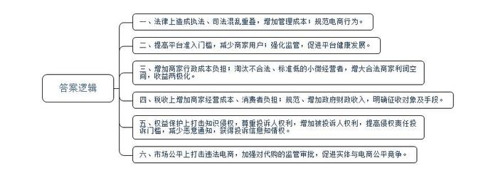
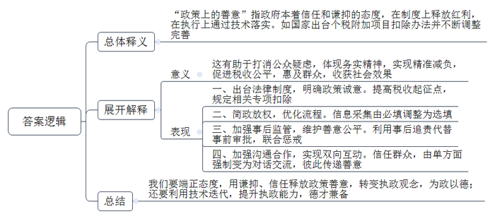
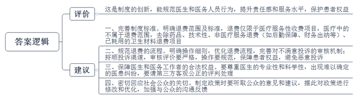
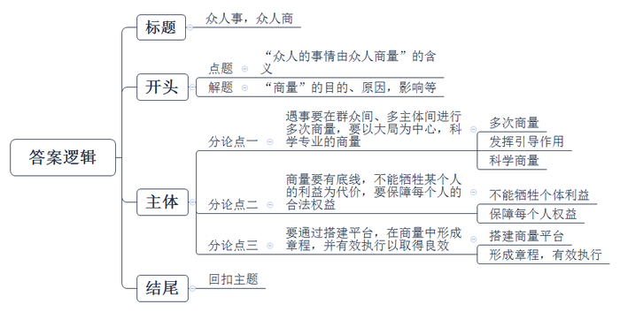

# 2019年公务员多省联考《申论》题（山东A卷）

<!-- gwy:overview:start -->
> **山东 · 2019 · 申论 · A类** ｜ 4 题 · 图片 4 处 · 答案随题折叠

导航：[题目](#题目) · [材料 1](#材料-1)
<!-- gwy:overview:end -->

> 候选采集稿。参考答案及解析来自粉笔页面，不代表官方答案或真实高分答卷；来源使用许可与原卷对应关系仍需人工核实。

## 给定材料

### 材料 1

《电子商务法》的立法过程可能是40年来中国法律界最为艰难的一次博弈。从提出到最终的定稿，经历了五年光阴，四轮审核。

2018年8月16日举行的电商法四审稿立法征求意见会议上，与腾讯、网易、京东等企业仅派出研究人员参加不同，阿里的表态非常暧昧，阿里巴巴董事局主席马云亲自到场发言，“电商法立法并不成熟。”他觉得电商法应该具有国际性、前瞻性，应当“能够增添促进电商发展的内容”。言下之意，电商法不应该成为电商的紧箍咒。

学界也有反对意见，有法学教授提出，现有的法律资源已经足以抑制电商领域中的恶意行为，《电子商务法》的出台会造成执法、司法的混乱重叠，增加管理成本，对电商本身也有阻碍作用。

此次公布的电商法，最大的焦点在于电商平台内的经营者须取得营业执照。不论是淘宝上挂有皇冠钻石标志的大网店，还是朋友圈里的小代购，目前的它们都有了一个共同的名字：电子商务经营者。

对于小卖家而言，取得营业执照无疑增添了不小的成本。以前只用在网络上上传几张证件、填写几个表格的事情，现在须办好营业执照才能经营，否则甚至无法通过平台的注册审核。

电商法将营业执照明文规定在法律中并不难理解，这也是部分平台目前的做法。在淘宝店铺中，店主的违规多了，流量和推荐就会变少，活动参与权限就降低。通过提高门槛的方式强化监管，可能会导致暂时的商家用户减少，一定程度上增加现有店铺的行政成本负担。但监管的方式向着“合法者有红利”转变后，跃过监管门槛的商家可以共享小微经营者离场之后的利润空间。

但从另一个侧面看，电商法对于已经完成流量和粉丝积累的大型卖家和网红卖家也是个利好。在互联网行业的审核机制下，任何准入标准的微小提高，都会导致大量的无法满足标准的玩家出局，但是总的流量几乎很少变化。如此一来，流量和粉丝就会逐渐汇聚到依法合规的经营者，进一步造成电商领域的“穷者越穷、富者越富”的局面。这就是电商领域的二八定律和赢者通吃逻辑。

对电商要怎么收税？这是继营业执照后最受人们关注的议题。电子商务经营者们担心税收加大自己的经营成本，吃瓜群众们则担心以后买买买是不是要加税。

其实不必如此担心，所有的命运早已标明了价格，就算没有《电子商务法》，税务部门照样有《税法》包揽一切，所有的电商卖家也都应当缴纳企业所得税、营业税等一切税款。另外，就算是国家真的以征税为目的要求平台共享数据，现行税法规定的共享数据系统也完全够用。

金税三期系统，将全面打通个人身份证+银行账号+公司，一个重要的变化就是，以后收税的依据不会按照开票多少，而是按照流水多少来执行。

可能有人会问，税务局怎么会知道我的流水？这么想就太幼稚了，只要是通过银行系统间的打款，都会留有记录，除非你是用现金交易，否则税务部门想查你的账，实在太简单了。

但目前电商法对于税收的部分只有原则性的规定，没有明确的要求。可以理解成有一个缓冲期。

《电子商务法》在税法之外，又重新规定了工商登记和平台数据共享这两个义务，工商登记解决了征收对象问题，数据共享解决了征收手段问题。只要一声令下，电子商务这块庞大的税基就将成为支撑起财政收入的一大发力点。

从淘宝到拼多多，以打击“山寨”为中心的反侵权和知识产权保护的战争就没有停止过。之前的《侵权责任法》对电商领域的知识产权保护早有规定，实际上是有法可依的。但从新出台的电商法来看，知识产权的侵权案例中权利人的权利和《侵权责任法》中的规定相差无几，但是被投诉人的权利明显增多了。

其一，侵权责任投诉的门槛高了。电商法明确了投诉人的举证义务，在《侵权责任法》的基础上，要求投诉者须自证受害，“通知应当包括构成侵权的初步证据”。

其二，恶意通知必将减少。之前的《侵权责任法》对于恶意通知的法律后果并没有明确。虽然《反不正当竞争法》也适用恶意投诉的行为，但也不是明确的规定。如今《电子商务法》的明确规定，更是明确了“恶意”情形下要“加倍赔偿”。这也给了那些职业差评师们一个鲜明的警告：认定恶意通知，流程越来越简单，后果越来越严重了。

其三，被投诉人有了对投诉信息的知情权。《电子商务法》明确规定，“电子商务平台经营者接到通知后，应当及时采取必要措施，并将该通知转送平台内经营者”。如果淘宝网今后依法执行的话，那么卖家们想要知道投诉人的投诉信息，就是一个完全合法的行为。

代购还能活得下去吗？代购可以分成两种：一种是单打独斗的人肉代购，一种是成规模的跨境电商，如淘宝、京东等平台的大型代购店和电商平台自营的海外代购。在电商法的跨境电商新规之下，两者所承担的监管成本相差悬殊。

以跨境电商领域的消费主力化妆品来看，由于监管对实体店产品备案的抽查更为严格，不少进口产品的上架周期往往要大大高于电商。在电商法出台之前，跨境电商不仅有价格优势，还能避免因为监管带来的产品上架门槛。如今，不论是电商还是实体店，在进口化妆品的售卖中又站在了同一起跑线。

根据化妆品财经媒体《化妆品财经在线》的消息，某化妆品跨境电商高管透露，不少自营电商的进口商品几乎没有备案，特别是一些需要特证的产品。“如美白、防晒类产品在国外不需要特证的，而中国市场的备案时长往往需要约8个月到1年。如果按照《电子商务法》规定，此类产品未来在电商平台也一律不允许被销售。”

这无异于给了大型化妆品代购店和化妆品自营电商一记暴击。无数的盈利机会，将在8个月到1年的漫漫审批等待的过程中溜走。

### 材料 2

继上调个税起征点后，备受关注的《个人所得税专项附加扣除暂行办法》随新个税法于2019年1月1日起正式施行。其中，住房租金专项附加扣除规定，纳税人在主要工作城市没有自有住房而发生的住房租金支出，可以按照相关标准进行800元/月到1500元/月不等的定额扣除。

此前，很多网友在社交媒体上反映，自己向房东索要其身份信息，但遭到拒绝，房东以提交信息后可能被征税为由，规劝租客不要申报个税租金扣除，甚至有房东还表示如果进行扣除就要租客退房。

业内人士认为，此前由于租客填报租房个税抵扣需要征得房东同意，而房东顾虑到身份信息泄露、可能会被追溯补缴房屋租赁税费等原因，变相提出“涨租”要求，引发了房东与租客之间的博弈。一边是个税可能抵扣几十块，另一边是房租可能上涨几百块，权衡之下，很多租客被迫选择不再申报租金支出扣除，无法享受到国家发放的个税减税红包。

说“给租客减税是为了向房东征税”，这当然是对政策的曲解。倘若该项政策原本就是带着收房租税的目的而来，那么从理性思维看，房东和租客博弈的最终结果只能是放弃这一优惠，而这可能会导致政策被架空。这恐怕是各方都不愿看到的事情。

因此，不断有地方税务部门表示，目前不会将租客申报的信息作为向房东征税的依据，税务总局也并未要求各地税务部门对房屋租金收入进行强制缴税。饶是如此，仍不足以完全打消公众疑虑。道理很简单，如果信息已经采集，那么追缴的主动权就掌握在税务部门手中——至于何时追缴似乎就是时机问题了。

租客与房东的个税抵扣博弈可以告一段落了。1月20日，“个人所得税”APP更新。在最新版本个税APP中，住房租赁信息下，已经不再强制要求填写出租方信息。记者登录最新版本个人所得税APP发现，在住房租赁信息填写中，当出租方类型选择为“自然人”时，出租人姓名和出租人身份证号码变为“选填”状态；当出租方类型选择为“组织”时，出租单位名称也变为“选填”状态。而此前，上述项目均需填写方可申报。

这意味着房东不必担心出租信息泄露而被追溯租赁税费，租客也不必忧心因申报房租抵扣而“得不偿失”了。正是在这层意义上，此次个人所得税APP更新把“必填”修改为“选填”，虽然并非一种“表态式回应”，却也同样有力，让人放心。通过技术迭代，从信息采集源头就彻底打消公众的疑虑，表现出抵扣政策的诚意，这样的更新体现了相关部门的务实精神，值得肯定。

新华社表示，个人所得税APP近日更新，不再强制要求填写出租人信息，这让租客和房主终于可以放下“减税”“补税”之争。个税扣除是减轻税负的惠民举措，推出来就要不打折扣地落实。税务部门发现问题及时调整，不因其它因素羁绊而使好政策“卡壳”“悬空”，把好事办好做实，这样的改进既贴心更暖心，必须赞。

有网友质疑，如果不填房东信息，如何证明真假呢？的确，信息采集项目减少，会给税务部门辨别申报项目真伪带来一定程度的困难，但这并不意味着税务部门就无计可施。据报道，专项附加扣除相关证明资料要保存五年，一旦查实利用虚假信息避税，将会被记入纳税人信用记录，有关部门将实施联合惩戒。

这实际上是用事后追责来代替事前繁琐的“清白自证”，也是税务部门为纳税人授予的“信用”。在技术的加持下，让信用承担更多沟通成本，避免过量信息收集产生的风险和摩擦。这既是国家行政部门简政放权的需要，也是税收“谦抑性”的体现。

说到底，交税虽是义务，但也是个人、企业和国家之间的一种“合作”；“强制性”是税收的特点之一，却并非全貌。尤其是此次个税专项抵扣，其政策上的善意原本很明朗。这样的政策“红包”不该因为过量的信息采集，让纳税人“想收而不敢收”。

也因此，此番周折也并非全然无益。精准减负、税收公平是一项动态化的系统工程，个人所得税APP还会不断更新，如何在不断完善信息的同时避免在公众层面产生“不良传导”，此次的事件也是难得的一堂课。这提醒我们，用技术迭代回应民众期待，用谦抑、信任释放政策善意，才能让好的政策收获更好的社会效果。

### 材料 3

2018年11月16日，G市卫生部门初步拟定了《G市医疗机构“不满意就退费”工作实施方案（试行）》的征求意见稿，向社会各界广泛征求意见。这份草拟征求意见稿规定：患者在接受诊疗服务过程中，对就医环节中的某一项服务若有不满意的，可向院方进行投诉，并按相关规定申请退费。经医院核实确定无误后，即可退还当日该医疗服务项目的服务性费用。当然，退费范围仅限于文件所列医疗服务性收费项目，医疗技术性项目（如手术费等)、医疗技术治疗效果及已耗用的卫生材料费不属于退费范围之内。

《G市医疗机构“不满意就退费”工作实施方案（试行）》的征求意见稿的部分内容

（一）门诊服务参考项目

1.对导诊或收费员的挂号服务不满意的，按10元/次退还服务费。

2.对门诊医生诊疗服务不满意的，退还当日当次门诊医生“挂号费”及“诊疗费”。

3.对门诊收费员收费服务不满意的，按10元/次退还服务费。

4.对门诊药房工作人员服务不满意的，退还当日当次“药品费”的50%。

5.对检验科工作人员化验服务不满意的，退还当日当次“化验费”的50%。

6.对影像科工作人员CT、DR服务不满意的，退还当日当次“放射费”的50%。

7.对功能科工作人员彩超、心电图、纤支镜、胃镜、喉镜、肺功能等服务不满意的，可退还当日当次“检查费”的50%。

8.对门诊护士注射等治疗服务不满意的，按50元/次退还服务费。

9.对急诊科院前急救服务不满意的，按30元/次退还当日当次“院前急救费”。

10.对行政职能科室工作人员提供的相关服务及后勤保障（门卫、保洁、食堂等）服务不满意的，按10元/次退还服务费。

（二）住院服务参考项目

1.对入出院处办理入出院及住院费服务不满意的，按20元/次予以退费。

2.对医保出院结算服务不满意的，按20元/次予以退费。

3.对住院医生诊疗服务不满意的，退还当日“诊疗费”。

4.对住院护士日常护理服务不满意的，退还当日“护理费”。

5.对住院药房工作人员服务不满意的，退还当日“药品费”的50%。

6.对检验科工作人员住院化验服务不满意的，退还当日“化验费”的50%。

7.对影像科工作人员住院CT、DR服务不满意的，退还当日“放射费”的50%。

8.对功能科工作人员住院彩超、心电图、纤支镜、胃镜、喉镜、肺功能等服务不满意的，退还当日当次“检查费”的50%。

9.对行政职能科室工作人员提供的相关服务不满意的，按20元/次予以退费。

10.对住院期间门卫、食堂、保洁人员提供的安保、保洁等服务不满意的，按20元/次予以退费。

……

该征求意见稿一发布，立即在社会上引起了广泛热议。有人认为，“医疗不满意就退费”这样的方案，无疑就是给医疗工作者一定的压力，有助于促进医生自省、自律，提高工作质量，有助于倒逼医疗工作者改进服务态度，提高服务水平；但也有人认为，医疗服务是专业性极强的服务行业，“不满意就退费”是把患者的医学知识设定为超过专业医生，可以评价医生的专业技术水平了，可操作性不强，而且很容易引发新的医患冲突，甚至引发消费者的道德风险。还有人提出，如果说“不满意可退费”，那么“不满意”的标准又是什么？强调医疗服务本身是一个多元、复合的议题，其内容包括“能力评价”“态度评价”“效果评价”等等，很难简单地做出满意或不满意的评价。

### 材料 4

曲水亭街，是N市城区的民俗一条街，一年到头人多车多，一天到晚挤得满满当当。住在此地的居民，进出不便；在此经营的商户，抱怨顾客无处停车而影响收益；来体验当地文化的游客，觉得像看车展，乘兴而来，败兴而归。回首没装道闸时的情形，曲水亭街杂乱无章，怨声载道。

各方都不满意，怎么办？

“正好市里在试点协商民主，要不我们也试试？”曲水亭社区党委高书记琢磨，把利益相关方叫到一块商量，制定个大家都能接受的章程。

谁承想，头一次开会就吵起架来，意见针锋相对，大家不欢而散。总结教训，高书记发现，光注意了商量，忽视了引导，“少了‘和事佬’的角色，话就说不到一块去。”

再协商，社区党委顶了上去，组织各方连开9次会。

到底安不安道闸？商户代表说：不能安，车进不来影响生意。有车居民代表说：不能安，回家不方便。无车居民代表说：要安，不让车进来，社区会安静一些，不然老鸣笛影响休息……

“大家敞开心扉，把意见都摆出来。”高书记说，在社区党委的引导下，各方意见慢慢地磨，尖锐的棱角越磨越平滑，最终融合到一块。

方案改了六七次，各方终于达成一致意见：曲水亭街不再允许外来车辆入内；有车居民配备蓝牙设备进出；经营业户不配蓝牙设备，社区在附近开设免费停车场。

经过这次协商，高书记摸着了门道：要引导，也要掌握好分寸。这一点，N市也做了特别提醒——各基层党组织“统揽而不包揽”，负责掌控协商进度和方向，不干预协商过程，真正让群众自己来决策。

如今，道闸横亘在街口已两年有余，街坊邻居早已习以为常。“有道闸拦着挺好，街上比以前清爽干净，秩序也好多了。”更关键的是，前后两次经历，让居民和商户看到了对比。装道闸前，一次公厕失火，消防车堵在街口进不来，只能干着急；装上道闸后，一棵大树在风雨天被吹倒在路中间，园林抢修车迅速赶来清理，一点都没耽误居民出行。

参与了几次辖区内社区的协商议事会，大明湖街道办事处赵主任也有收获。“每个社区、每件事都不一样，协商的形式也不尽相同，关键是要通过充分的讨论达成好的结果。”

按照“大事大议，小事小议，急事立议”的原则，N市结合不同村(社区)的议事习惯，灵活利用民主恳谈会、阳光议事日、会议协商、串门协商、决策听证、民主评议等形式和渠道，引导群众养成遇事协商的习惯，用群众自己选择的方式进行协商。

很多专业性较强的事项，基层群众协商起来确有局限性。比如安装道闸，不仅涉及居民出行，还可能影响周边交通。针对此类问题，N市邀请相关领域的专家学者、专业人士、第三方机构等参与评估论证，鼓励社会组织和专业人员参与社区协商民主。

从不成熟到驾轻就熟，在N市的社区、乡村，有事多协商、遇事多协商、做事多协商，渐成群众处理自己事务的有效形式。

N市委主要负责人在调研中发现，有的问题并不易达成共识，有的问题需要反复协商才能达成共识，有的问题到最后也形成不了共识，只能暂时搁置或另想他法。“协商民主不是以牺牲某一方利益为代价来维护另一方利益，不能单纯地以少数服从多数来决策，而是应该尽量照顾到每一个人的利益。”

“一方面要着力培养市民的契约精神，另一方面要强化协商民主的约束力。”赵主任说。为了更好让协商结果落地生根，N市明确协商事项取得一致意见后，要以村规民约、会议决议、计划方案等形式固定下来，以此增强其约束性和执行力。

随着协商民主在城市乡村广泛实施，基层社会治理成效渐显。N市信访局的统计数据显示：2017年，N市群众到省集体访下降20%左右，信访总量由原来的全省第一名降至第五名。

2018年，N市政协与市日报社、市电视台、新媒体联合创建了“商量”平台，主题就是“有事好商量，N市政协邀您来商量”。市政协邀请政协委员、专家学者、各界群众和有关部门，在搭建的“商量”平台上，就关系人民群众切身利益的现实问题，选择小切口、关注度高的题目真诚商量，增进共识。开展“商量”中，组织委员、专家深入基层开展体验式调研，与群众在社区、市场、路口、公园等现场开展多场次的商量，再采取圆桌会议方式，组织委员、专家、群众与有关部门开展集中商量，让各方意见往来交锋，观点相互碰撞，促进多向沟通协商和多方互动交流。媒体对此全程跟踪报道，特别是最后一次圆桌会议集中商量时，全程录播。参加“商量”的各部门也高度重视，对“商量”中提出的意见建议积极回应，立说立行，认真落实。

“商量”开展以来，在社会上产生了良好的反响，社会关注度非常高，在N市电视台创下了同期节目收视率的最高点，每次都收到群众意见建议千余条，还有群众撰写评论文章，认为“商量”是有温度的传声筒、暖民心的民意通道、接地气的协商平台。N市委要求市政协进一步完善“商量”平台，并作为N市贯彻党的十九大精神、推进协商民主建设的具体措施，写进了市委文件。

### 材料 5

“商量”，交换意见、商讨之意。早在三国时期王弼对于《易·兑》的注中第一次出现——“商，商量载制之谓也。”商量，历来是科学决策的重要手段。老一辈革命家也多次强调过在决策中“商量”的重要性。毛泽东同志说过：“国家各方面的关系都要协商”，“我们政府的性格，你们也都摸熟了，是跟人民商量办事的”，“可以叫它是个商量政府”。周恩来同志说过：“新民主主义的议事精神不在于最后的表决，主要是在于事前的协商和反复的讨论”……

俗话说：众人拾柴火焰高。习近平总书记在庆祝中国人民政治协商会议成立65周年大会上发表重要讲话强调：“在中国社会主义制度下，<u>有事好商量，众人的事情由众人商量，找到全社会意愿和要求的最大公约数。</u>涉及人民利益的事情，要在人民内部商量好怎么办，不商量或者商量不够，要想把事情办成办好是很难的。我们要坚持有事多商量，遇事多商量，做事多商量，商量得越多越深入越好。涉及全国各族人民利益的事情，要在全体人民和全社会中广泛商量；涉及一个地方人民群众利益的事情，要在这个地方的人民群众中广泛商量；涉及一部分群众利益、特定群众利益的事情，要在这部分群众中广泛商量；涉及基层群众利益的事情，要在基层群众中广泛商量。”

当前，改革已进入攻坚期、深水区，触及到深层次矛盾和重大利益调整，一些地方改革久议不决、一些部门改革决而难行、一些领域改革行而难破等情况屡见不鲜。改革本身就是利益格局的调整，处于攻坚期、深水区的改革，涉及社会各阶层、各群体，所以制定政策时需细细考量、慎重决定，要重视倾听不同的声音，找到“最大公约数”，形成最大合力。

## 题目

### 第 1 题

**根据“给定资料**1**”，概括《电子商务法》带来的影响。(15分)**

关联材料：材料 1

作答要求：

要求：全面、准确、有条理；不超过250字。

第 1 题 · 答案与解析

**参考答案（粉笔题库参考内容）**

一、法律上造成执法、司法混乱重叠，增加管理成本；规范电商行为。

二、提高平台准入门槛，减少商家用户；强化监管，促进平台健康发展。

三、增加商家行政成本负担；淘汰不合法、标准低的小微经营者，增大合法商家利润空间，收益两极化。

四、税收上增加商家经营成本、消费者负担；规范、增加政府财政收入，明确征收对象及手段。

五、权益保护上打击知识侵权，尊重投诉人权利，增加被投诉人权利，提高侵权责任投诉门槛，减少恶意通知，获得投诉信息知情权。

六、市场公平上打击违法电商，加强对代购的监管审批，促进实体与电商公平竞争。

**解析**

**参考答案说明：**答案从“法律上”“监管上”“成本上”“税收上”“权益保护上”“市场公平上”等不同方面的影响进行了分条撰写。各条要点之间在内容上是并列关系，没有交叉。

### 第 2 题

**根据“给定资料**2**”，谈谈你对“政策上的善意”的理解。（20分）**

关联材料：材料 2

作答要求：

要求：理解准确，分析透彻，条理清晰；不超过300字。

第 2 题 · 答案与解析

**参考答案（粉笔题库参考内容）**

“政策上的善意”指政府本着信任和谦抑的态度，在制度上释放红利，在执行上通过技术落实。如国家出台个税附加项目扣除办法并不断调整完善。

这有助于打消公众疑虑，体现务实精神，实现精准减负，促进税收公平，惠及群众，收获社会效果。具体表现在：一、出台法律制度，明确政策诚意。提高税收起征点，规定相关专项扣除。二、简政放权，优化流程。信息采集由必填调整为选填。三、加强事后监管，维护善意公平。利用事后追责代替事前审批，联合惩戒。四、加强沟通合作，实现双向互动。信任群众，由单方面强制变为对话交流，彼此传递善意。

我们要端正态度，用谦抑、信任释放政策善意，转变执政观念，为政以德；还要利用技术迭代，提升执政能力，德才兼备。

**解析**

**参考答案说明：**思路方面，本参考答案按照词句解释题“总体释义+展开解释+总结”的一般答题思路展开。内容方面，本参考答案先对“政策上的善意”的含义进行了解释；“展开解释”部分先分析了政策释放善意后带来的意义，接着分析了政策本身、流程、监管、合作沟通等各方面体现出的善意；最后进行了总结。词句表达方面，本答案加上了“这有助于”等连接词来承接上下文。

### 第 3 题

**根据“给定资料**3**”，针对《G市医疗机构“不满意就退费”工作实施方案（试行****）****》的具体内容及社会上的相关争议，请向G市卫生部门提出你对此方案的意见和建议。（25分）**

关联材料：材料 3

作答要求：

要求：观点明确，思路清晰，概括性强，合理可行；不超过400字。

第 3 题 · 答案与解析

**参考答案（粉笔题库参考内容）**

这是制度的创新，能规范医生和医务人员行为，提升责任感和服务水平，保护患者权益。

建议：一、完善制度标准。明确退费范围及标准，退费仅限于医疗服务性收费项目，医疗中的不属于退费范围，去除药品、技术性、非医疗服务退费（如后勤保障、财务出纳等）、已耗用的卫生材料退费项目。二、规范退费的流程。明确操作细则，优化退费流程，完善对不满意投诉的审核机制；捋顺投诉渠道，审核评价要严格，操作要规范，保障患者权益，避免恶意投诉。三、保障医生和医务工作者的合法权益。要尊重医生的专业性和科学性，出现难以确定的医患纠纷，要请第三方客观公正的评判处理。四、密切回应社会公众的关切。制定政策时要听取公众的意见和建议，据此对政策进行修改和优化，加强与公众的沟通反馈。

**解析**

**参考答案说明：**从宏观来看，答案从“评价”“建议”等不同的要素进行了分条撰写。从微观来看，答案从“完善制度标准”“规范退费流程”“保障医生和医务工作者合法权益”“回应社会关切”等不同方面撰写了建议。各条要点之间在内容上是并列关系，没有交叉。

### 第 4 题

**进一步思考“给定资料**5**”中划线句子“****有事好商量，众人的事情由众人商量，找到全社会意愿和要求的最大公约数****”，参考给定资料，自选角度，自拟题目，写一篇文章。（40分）**

关联材料：材料 1、材料 2、材料 3、材料 4、材料 5

作答要求：

要求：

（1）观点明确，立意深刻；

（2）思路清晰，语言流畅；

（3）结合“给定资料”，但不拘泥于“给定资料”；

（4）字数1000～1200字。

第 4 题 · 答案与解析

**参考答案（粉笔题库参考内容）**

**众人事，众人商**

社会主义事业是亿万人民的事业，“众人事，众人商”是要围绕涉及群众切身利益的实际问题，在群众之间、党群之间、干群之间、特定群众之间沟通、商议公共性的事务；“找到全社会意愿和要求的最大公约数”意在表明商量要从实现个人利益到顾全大众利益，并顾及到特定个体合理合法的权益，制定出众人满意的解决事情的方案，最终通过科学、民主决策的指引，在公共利益上达成共识。

同时电商等新兴事物的出现，社会矛盾多样化的驱使，个人利益与社会利益波澜的推动……导致现今社会涌现出一些决而难行、行而难破的问题，催生“商量”。那么如何才能商量到位，商量出结果，商量出顺民意、得民心的政策？

**遇事要在群众间、多主体间进行多次商量，要以大局为中心，科学专业的商量****。**多商量是人民民主的真谛，不管是涉及全体人民，还是地方群众，亦或是涉及一部分特定群众利益的事情，都要在不同的范围内，不同的主体中进行多次商量，才能集民智、汇民意、达民心；同时商量要以大局为中心，在商议中发挥引导的作用，“和事佬”的态度，提升群众的参与意识，实现真正的民主集中，这方面，我们可以借鉴“网格化管理”模式，学习“朝阳群众”的参与激情，吸收“村民说事”的经验。好商量是科学、专业的体现，当面对专业性较强的事项，基层群众难以有效协商的时候，政府部门可出面邀请专家学者、社会组织或第三方机构等来参与协商，让好政策在商量中稳步推进。

**商量要有底线，不能牺牲某个人的利益为代价，要保障每个人的合法权益。**“商量”不是牺牲，不是单纯维护某一方的利益，也不能仅仅依靠少数服从多数来决策，而是要发挥社会各方面的作用，激发全社会的活力，共同商量，商量出照顾到个体合法权益的政策，最终做到能够保障个人利益的这一“单数”，做到包容性更强，体现公共利益的“复数”。医患矛盾中，不但要照顾到“弱势”的患者，也要顾及看似“强势”的医生；个人所得税APP的信息填写要照顾到“房东”与“租客”双方的利益，体现政策善意；电商法的出台不仅让淘宝有皇冠钻石的大网店有营业执照，更照顾到小店铺，甚至朋友圈小代购的利益。

**要通过搭建平台，在商量中形成章程，并有效执行以取得良效。**每个社区、每个事情都不一样，涉及的协商主体也各不相同，协商意见取得一致以后也会有不同的执行办法，此时“商量”平台就显得尤为重要。各个利益主体能够面对面“盘膝而坐”，共同商谈，各级部门对商量中提出的意见积极回应，立说立行，增强协商结果的约束力和执行力，意见一致的决策可以以会议决议、计划方案等形式固定，实现解决矛盾、解决困难的目标。就如曲水亭街，作为试点协商民主的“领头羊”，抱着试试的心态，让利益主体共同商量，建立闸拦，让街道变得清爽、干净、有秩序。

协商民主，商量办事是好政策制定的前提，是民众生活更加美好的保证，是社会发展的“牵引机”、“助推器”，帮助我们找到全社会意愿的最大公约数，画出民心民愿的最大同心圆！

**文章分析**

**众人事，众人商**

【**标题的优点：**首先，范文的标题“众人事，众人商”突出了“众人的事情由众人商量”这一主题。其次，形式上，文字简洁明快有力，不拖沓。】

社会主义事业是亿万人民的事业，（1）“<u>众人事</u>，<u>众人商</u>”<u>是要围绕涉及群众切身利益的实际问题</u>，<u>在群众之间</u>、<u>党群之间</u>、<u>干群之间</u>、<u>特定群众之间沟通</u>、<u>商议公共性的事务</u>；（2）“<u>找到全社会意愿和要求的最大公约数</u>”<u>意在表明商量要从实现个人利益到顾全大众利益</u>，并<u>顾及到特定个体合理合法的权益</u>，<u>制定出众人满意的解决事情的方案</u>，<u>最终通过科学</u>、<u>民主决策的指引</u>，<u>在公共利益上达成共识</u>。

同时（3）<u>电商等新兴事物的出现</u>，<u>社会矛盾多样化的驱使</u>，<u>个人利益与社会利益波澜的推动</u>……<u>导致现今社会涌现出一些决而难行</u>、<u>行而难破的问题</u>，<u>催生</u>“<u>商量</u>”。那么如何才能商量到位，商量出结果，商量出顺民意、得民心的政策？

【**开头的优点：★内容方面：**范文的开头是紧扣“众人的事情由众人商量”这一主题展开的。首先，开头在段首处点出主题，做到了主题明确。其次，对“众人的事情由众人商量”这一主题进行了分析阐述，指出了（1）“众人的事情由众人商量”的含义；（2）“众人的事情由众人商量”的目的；（3）“众人的事情由众人商量”的原因。**★文字表达方面：**使用了“并……”“最终……”“同时……”等关联词，使语言表达有逻辑性。】

**遇事要在群众间、多主体间进行多次商量，要以大局为中心，科学专业的商量****。**（1）<u>多商量是人民民主的真谛</u>，不管是<u>涉及全体人民</u>，还是<u>地方群众</u>，亦或是<u>涉及一部分特定群众利益的事情</u>，<u>都要在不同的范围内</u>，<u>不同的主体中进行多次商量</u>，才能<u>集民智</u>、<u>汇民意</u>、<u>达民心</u>；同时（2）<u>商量要以大局为中心</u>，在商议中<u>发挥引导的作用</u>，“<u>和事佬</u>”<u>的态度</u>，<u>提升群众的参与意识</u>，<u>实现真正的民主集中</u>，这方面，我们可以借鉴“网格化管理”模式，学习“朝阳群众”的参与激情，吸收“村民说事”的经验。（3）<u>好商量是科学</u>、<u>专业的体现</u>，当面对<u>专业性较强的事项</u>，基层群众<u>难以有效协商的时候</u>，政府部门可出面<u>邀请专家学者</u>、<u>社会组织或第三方机构等来参与协商</u>，<u>让好政策在商量中稳步推进</u>。

【**论述段****1****的优点：★观点句：**范文的观点句是紧扣“众人的事情由众人商量”这一文章主题提出的。形式上，它在段首处直接写出，位置突出，容易发现。内容上，关键词突出，内容要点明确，可以明显看出它是从“多次商量”“科学商量”这两个角度入手，指出了“众人的事情由众人商量”的对策。**★论述内容：**（1）介绍了众人的事情由众人商量在“多次商量”层面的对策；（2）介绍了众人的事情由众人商量在“发挥引导作用”层面的对策；（3）介绍了众人的事情由众人商量在“科学商量”层面的对策。以上三个方面的内容都是紧扣“遇事要在群众间、多主体间进行多次商量，要以大局为中心，科学专业的商量”这个观点句进行分析论述的，论述的针对性强，内容层次丰富。最后，在论述方法上主要采取了讲道理和举例子相结合，做到了丰富多样。】

**商量要有底线，不能牺牲某个人的利益为代价，要保障每个人的合法权益。**（1）“<u>商量</u>”<u>不是牺牲</u>，<u>不是单纯维护某一方的利益</u>，也<u>不能仅仅依靠少数服从多数来决策</u>，而是要（2）<u>发挥社会各方面的作用</u>，<u>激发全社会的活力</u>，<u>共同商量</u>，<u>商量出照顾到个体合法权益的政策</u>，最终<u>做到能够保障个人利益的这一</u>“<u>单数</u>”，做到<u>包容性更强</u>，<u>体现公共利益的</u>“<u>复数</u>”。医患矛盾中，不但要照顾到“弱势”的患者，也要顾及看似“强势”的医生；个人所得税APP的信息填写要照顾到“房东”与“租客”双方的利益，体现政策善意；电商法的出台不仅让淘宝有皇冠钻石的大网店有营业执照，更照顾到小店铺，甚至朋友圈小代购的利益。

【**论述段****2****的优点：★观点句：**范文的观点句是紧扣“众人的事情由众人商量”这一文章主题提出的。形式上，它在段首处直接写出，位置突出，容易发现。内容上，关键词突出，内容要点明确，可以明显看出它是从“商量的底线”这个角度入手，指出了“众人的事情由众人商量”的对策。**★论述内容：**（1）介绍了不能牺牲个体利益；（2）介绍了众人的事情由众人商量在“保障每个人权益”层面的对策。以上两个方面的内容都是紧扣“商量要有底线，不能牺牲某个人的利益为代价，要保障每个人的合法权益”这个观点句进行分析论述的，论述的针对性强，内容层次丰富。最后，在论述方法上主要采取了讲道理和举例子相结合，做到了丰富多样。】

**要通过搭建平台，在商量中形成章程，并有效执行以取得良效。**（1）<u>每个社区</u>、<u>每个事情都不一样</u>，涉及的<u>协商主体也各不相同</u>，<u>协商意见取得一致以后也会有不同的执行办法</u>，此时“商量”平台就显得尤为重要。各个（2）<u>利益主体能够面对面</u>“<u>盘膝而坐</u>”，<u>共同商谈</u>，<u>各级部门对商量中提出的意见积极回应</u>，立说立行，<u>增强协商结果的约束力和执行力</u>，<u>意见一致的决策可以以会议决议</u>、<u>计划方案等形式固定</u>，<u>实现解决矛盾</u>、<u>解决困难的目标</u>。就如曲水亭街，作为试点协商民主的“领头羊”，抱着试试的心态，让利益主体共同商量，建立闸拦，让街道变得清爽、干净、有秩序。

【**论述段****3****的优点：★观点句：**范文的观点句是紧扣“众人的事情由众人商量”这一文章主题提出的。形式上，它在段首处直接写出，位置突出，容易发现。内容上，关键词突出，内容要点明确，可以明显看出它是从“搭建平台，形成章程”“有效执行”这两个角度入手，指出了“众人的事情由众人商量”的对策。**★论述内容：**（1）介绍了搭建商量平台的必要性；（2）介绍了众人的事情由众人商量在“形成章程，有效执行”层面的对策。以上两个方面的内容都是紧扣“要通过搭建平台，在商量中形成章程，并有效执行以取得良效”这个观点句进行分析论述的，论述的针对性强，内容层次丰富。最后，在论述方法上主要采取了讲道理和举例子相结合，做到了丰富多样。】

【**论述段之间的关系：★内容的内在逻辑：**范文的论述段之间是依照并列逻辑展开的。论述段1先写了多次商量、科学商量方面的对策，论述段2再写了商量的底线方面的对策，论述段3接着写了搭建平台、形成章程，有效执行方面的对策。】

（1）<u>协商民主</u>，商量办事是（2）<u>好政策制定的前提</u>，是<u>民众生活更加美好的保证</u>，是<u>社会发展的</u>“<u>牵引机</u>”、“<u>助推器</u>”，帮助我们<u>找到全社会意愿的最大公约数</u>，<u>画出民心民愿的最大同心圆</u>！

【**结尾的优点：**范文的结尾回扣了“众人的事情由众人商量”这一主题。（1）再次提到了“众人的事情由众人商量”的同义表述“协商民主”；（2）指出了“众人的事情由众人商量”的深远意义。】

**解析状态：unknown（来源未提供）**

