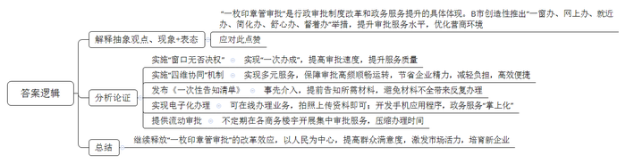
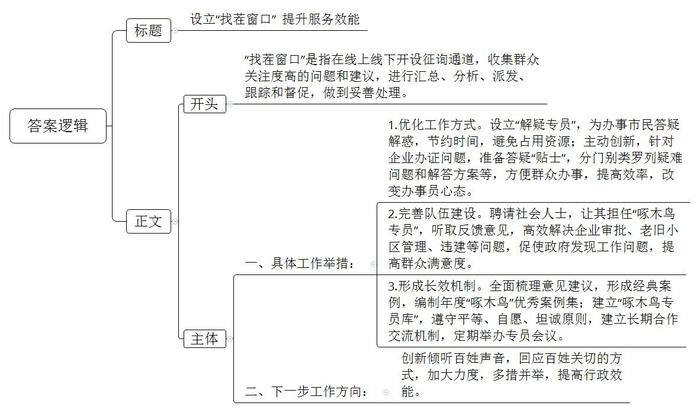
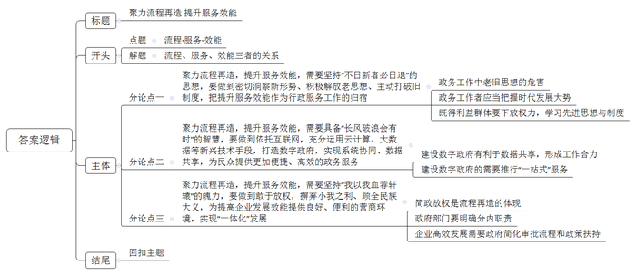

# 2020年山东省公考《申论》题（A卷）

> 候选采集稿。参考答案及解析来自粉笔页面，不代表官方答案或真实高分答卷；来源使用许可与原卷对应关系仍需人工核实。

## 给定材料

### 材料 material-e2e1a95b27e53716

行政审批制度改革和政务服务提升，是助力一个城市高质量发展的重要因素。近年来，B市行政审批服务坚持以人民为中心的发展思想，制定了“1234+N”的三年工作计划，即“一年基础规范、两年创新提升、三年品牌突破”的工作思路，实施创新发展、标准规范、协同推进和智慧引领四大战略，努力实现“省内领先、国内一流”的目标。

2018年底，B市相对集中行政许可权改革推出关键举措，市行政审批局挂牌成立，陆续承接27个部门的262项行政审批服务事项。2019年4月，市行政审批局正式办理划转业务，开启“一枚印章管审批”政务服务新模式。同年9月，B市出台《关于推进制度创新加快流程再造 实现“在B市全办成”的实施意见》，创造性推出了“一窗办、网上办、就近办、简化办、舒心办、督着办”的服务举措，成为该市提升审批服务水平、优化营商环境的行动纲领。围绕“在B市全办成”服务品牌建设，B市实施“窗口无否决权”，努力实现“一次办成”，全力营造“审批有速度、服务有温度”的政务服务环境。与此同时，创新实施内部业务、横向部门、纵向层级和社会多元主体的“四维协同”机制，逐步完善适应改革要求的行政审批服务新机制，变审批服务“一家办理”为“多元服务”，为审批服务高频顺畅运转提供了有力保障。在这里，办件人体验着“车间流水线”式的审批服务，感受着窗口人员亲人般的问候；在这里，“一枚印章管审批”，让企业能够腾出更多精力，轻装上阵；在这里，办件人有事就办，高效便捷。

为进一步推进工作，B市行政审批局工作人员采用事先介入的办法，在官网上提前发布《一次性告知清单》，让群众清清楚楚知道需要准备的资料有哪些。资料准备好后，申请人可直接在线办理相关事项，所需资料可拍照上传提交。资料上传后，行政审批局通过内部“流水线”式的方式进行审核，审完一证出一证。在踏勘环节，该局组织审批一科、二科“联合跑”，大幅提升工作效率。除“网上办”，还推出了“流动审批”，不定期在辖区各商务楼宇开展集中审批服务，企业从递交资料到办结发证平均不到1小时，针对市民，该局开发了手机应用程序，将与市民生活相关的213个政务服务事项“掌上化”，实现了办理审批的“触手可及”。“现在政府行政审批效率真是高”，许多办事群众由衷为行政审批局的工作点起了赞。

Q公司是一家专门从事商业装修工程的装饰公司，该公司承接的某购物中心装修装饰工程施工许可证是首张加盖“B市行政审批局”公章的施工许可证。公司负责人对B市相对集中行政许可权改革带来的便利深有体会：“过去，公司办理一个项目的施工许可，往往要跑好几个部门，走好几道程序，交好几套材料，有时材料不全，还得来回反复，所有程序跑下来，会耽误不少工期，影响工程进度，没想到这次正好赶上政策改革，现在只需要根据行政审批局网上列举的材料清单，通过网上一次性提交，行政审批局在线核验就可以了，连窗口都不用跑了，核验通过后，行政审批局会通过快递将施工许可证邮寄给我们，这比以前省下不少时间，真是太方便了！”

B市通过审批“瘦身”、权力下放、清单公开等一系列举措，为顺利开展事项划转、实现“一枚印章管审批”，优化提升服务等奠定了坚实基础。该市行政审批局挂牌运行一年多来，共受理审批服务事项21万余件，按时办结率100%，群众满意度排名连续位居前列。B市市场活力持续迸发，累计培育国家级高新技术企业超700家，上市企业11家，成为省内的产业大区和创新强区，市场主体增速居全省第一。

### 材料 material-cf6c621d7ceec1e2

2019年初，Z市新区行政服务大厅在全市率先开设线上线下“找茬窗口”征询通道，邀请市民、企业来给政府工作找问题出主意，通过“找茬窗口”收集群众关注度高的问题和建议，并对收集到的意见建议进行汇总、分析、派发、跟踪和督促，做到群众有所呼政府有所应，经过两个多月，新区通过“找茬窗口”共收集企业和市民意见建议234条，目前均已妥善处理。

过去，企业和个人来办事，遇到不确定的问题都要到办事窗口进行咨询，有时候只是为了确认一个小问题，往往要在办事窗口排很长的队伍，浪费了办事人的时间，也占用了中心受理业务的资源。办事人在“找茬窗口”反映该问题后，新区行政服务大厅迅速响应并设立了专门的“解疑专员”，为办事市民答疑解难。后来又主动求变，针对咨询最多的企业办证的各种问题，准备好一份份答疑“贴士”。这些“贴士”分门别类地按照企业设立、变更、注销等诉求，将办理过程中可能遇到的疑难问题和解答方案，办事需准备的材料一一罗列清楚，大大方便了群众办事。“找茬窗口”办事员小王在接受采访时，开心地说道：“群众和企业上门来‘找茬’，刚提出问题，答案就交到他们手上了……新区行政服务大厅的‘找茬窗口’，解决的不仅是办事的效率，还改变了我们政府工作人员的心态。”

政府邀请市民、企业来“找茬”，会不会只是一场“秀”？带着这个疑问，某公司的负责人朱女士来到新区行政服务大厅小王所在的窗口，在窗口前，她说出了自己的困惑：“餐饮企业办理餐饮许可证和营业执照时，往往需要重复提交不动产权证、租赁合同、股东信息等材料，这对企业来说不仅仅是多交几份复印件，而且审批和办证时间延长，让企业错过了开业的最好时机。新区的行政办事窗口在物理上已经打通了，是否可以进一步实现信息的共享呢？”

让她没想到的是，一周后，她就得到了反馈。相关部门回复她说，新区已经与市公众网管理中心和市不动产登记局进行了沟通，在新区行政服务大厅设置查询打印终端，根据市不动产登记局许可，开放相关房产登记信息的查询打印服务，避免企业重复跑腿。同时，新区将合理优化相关审批流程，探索其它房产信息证明材料的简化举措，进一步提升企业满意度。 鉴于朱女士提出的宝贵意见，新区决定邀请朱女士为政府“啄木鸟专员”。所谓“啄木鸟专员”，就是政府为更好地发现自身工作中存在的问题，从各行各业中聘请的为政府“找茬”的社会人士。朱女士说，自己看到了政府的诚意，今后愿意当好“啄木鸟”，继续为政府“找茬”。同为“啄木鸟专员”的何先生，聚焦老旧小区，解决了某老旧小区的卫生环境差、安全隐患多等问题，而且还针对老城区部分小区无物业管理问题提交了调研报告，得到了圆满解决；新聘任的“啄木鸟专员”费先生替群众反映的违建问题，两天内就解决了……

新区行政服务中心这一好的做法，迅速在全市得到了推广。每年年底由市行政服务中心对当年受理的线上线下的意见建议进行全面梳理，形成经典案例，编制年度“啄木鸟”优秀案例集。市行政服务中心还建立了“啄木鸟专员库”，在平等、自愿、坦诚的基础上，与“啄木鸟专员”建立长期合作交流机制，定期举办专员会议，从社会、市场和企业的视角提出意见建议。Z市市委书记指出：“在政府服务和城市管理工作中，地方党委和政府怎么听到百姓声音，如何回应百姓关切是要创新和探索的。改革无止境，今后，我们还将加大力度，多措并举，进一步提高政府的行政效能。”

## 题目

### 第 1 题

**请根据****“给定资料**1**”，谈谈你对B市“一枚印章管审批”的认识。（20分）**

关联材料：material-e2e1a95b27e53716

作答要求：

要求：观点明确，认识深刻，思路清晰；不超过350字。

### 第 2 题

**省政府对****Z市设立“找茬窗口”等举措高度重视，要求该市提交一份工作报告。请根据“给定资料**2**”，写一份报告提纲。(30分)**

关联材料：material-cf6c621d7ceec1e2

作答要求：

要求：要点完整，内容具体，条理清晰；不超过450字。

### 第 3 题

**请根据****“给定资料**3**”，以“流程·服务·效能”为主题，自选角度，自拟题目，写一篇文章。(50分)**

关联材料：material-e2e1a95b27e53716

作答要求：

要求：

（1）观点明确，立意深刻；

（2）思路清晰，语言流畅；

（3）参考给定资料，但不拘泥于给定资料；

（4）字数1000字左右。

## 答案与解析

第 1 题

**参考答案（粉笔题库参考内容）**

“一枚印章管审批”是行政审批制度改革和政务服务提升的具体体现。B市创造性推出“一窗办、网上办、就近办、简化办、舒心办、督着办”举措，提升审批服务水平，优化营商环境。应对此点赞。

具体做法有：1.实施“窗口无否决权”。实现“一次办成”，提高审批速度，提升服务质量。2.实施“四维协同”机制。实现多元服务，保障审批高频顺畅运转，节省企业精力，减轻负担，高效便捷。3.发布《一次性告知清单》。事先介入，提前告知所需材料，避免材料不全带来反复办理。4.实现电子化办理。可在线办理业务，拍照上传资料即可；开发手机应用程序，政务服务“掌上化”。5.提供流动审批。不定期在各商务楼宇开展集中审批服务，压缩办理时间。

因此，我们应继续释放“一枚印章管审批”的改革效应，以人民为中心，提高群众满意度，激发市场活力，培育新企业。

**解析**

**参考答案说明：**思路方面，本参考答案按照观点现象分析题“解释抽象观点、现象+表态+分析论证+总结”的一般答题思路展开。内容方面，本参考答案首先解释了“一枚印章管审批”的含义并表明了态度；接着，“分析论证”部分介绍了“一枚印章管审批”模式的具体做法；最后，“总结”部分对该模式未来的发展进行了总结。词句表达方面，本参考答案加上了“因此”等连接词来承接上下文。

**考点**：考点观点现象分析类

**来源**：来源2020年山东省公考《申论》题（A卷）

粉笔申论页面对本题只提供「解析视频」入口，该入口是会员推广位，页面无视频地址与文字解析。

第 2 题

**参考答案（粉笔题库参考内容）**

设立“找茬窗口” 提升服务效能

“找茬窗口”是指在线上线下开设征询通道，收集群众关注度高的问题和建议，进行汇总、分析、派发、跟踪和督促，做到妥善处理。

一、具体工作举措：

1.优化工作方式。设立“解疑专员”，为办事市民答疑解惑，节约时间，避免占用资源；主动创新，针对企业办证问题，准备答疑“贴士”，分门别类罗列疑难问题和解答方案等，方便群众办事，提高效率，改变办事员心态。

2.完善队伍建设。聘请社会人士，让其担任“啄木鸟专员”，听取反馈意见，高效解决企业审批、老旧小区管理、违建等问题，促使政府发现工作问题，提高群众满意度。

3.形成长效机制。全面梳理意见建议，形成经典案例，编制年度“啄木鸟”优秀案例集；建立“啄木鸟专员库”，遵守平等、自愿、坦诚原则，建立长期合作交流机制，定期举办专员会议。

二、下一步工作方向：创新倾听百姓声音，回应百姓关切的方式，加大力度，多措并举，提高行政效能。

**解析**

**参考答案说明：**（1）本题要求写一份考察报告提纲，不必考虑格式，只写正文即可，但为了保险起见，建议加上标题。（2）本参考答案的内容方面，围绕着“找茬窗口”这一主题，开头先介绍了什么是“找茬窗口”；主体部分从“具体工作举措”和“下一步工作方向”两个方面进行介绍，此外，针对“具体工作措施”，分别从“优化工作方式”“完善队伍建设”“形成长效机制”三个方面进行了具体展开。形式方面，本参考答案做到了分段、分条撰写，整体上条理较为清晰。

**考点**：考点总结类

**来源**：来源2020年山东省公考《申论》题（A卷）

粉笔申论页面对本题只提供「解析视频」入口，该入口是会员推广位，页面无视频地址与文字解析。

第 3 题

**参考答案（粉笔题库参考内容）**

**聚力流程再造 提升服务效能**

治国有常，利民为本。要成为一个为人民谋福祉、做群众贴心人的政府，就必须把做好政务服务工作当做要务。一方面，政府部门应当精简审批环节，优化工作流程，为公众提供便捷通道；另一方面，还要改善服务态度，提高服务质量，为百姓和企业提供满意服务。**只有流程的事、服务的事做好，才能让政务工作发挥最大效能，让人民享受最大便利**。

经过多年努力，行政制度改革取得了显著的成绩，但是流程繁琐、质量不高、效果不好等实际问题仍频现报端。究其缘由，既因为政府工作过程中制度设置不尽合理，导致工作流程存在诸多梗阻；也因为部分官员“官本位”的思想严重，导致工作效率低下。为此，**政府必须再造服务流程，提升服务效能**。

**聚力流程再造，提升服务效能，需要坚持****“不日新者必日退”的思想，要做到密切洞察新形势、积极解放老思想、主动打破旧制度，把提升服务效能作为行政服务工作的归宿。**文化+旅游、城镇化+旅游、IP+产业……如果仍然以老旧思想服务于这些新兴的经济形态，那么它们必然会因为繁冗又漫长的流程而贻误最佳发展时期。对于政务工作者而言，把握时代发展的脉搏、抛弃陈旧的思想尤为重要，这需要敢于放弃手中的特权，主动下放手中的权力，聚焦思想与制度中的沉疴，学习先进的政治思想，引入前沿的流程制度，为群众提供便利的办事途径，为企业打造优良的营商环境。

**聚力流程再造，提升服务效能，需要具备****“****长****风破浪会有时****”的智慧，要做到依托互联网，充分运用云计算、大数据等新兴技术手段，打造数字政府，实现系统协同、数据共享，为民众提供更加便捷、高效的政务服务。**数字政府的建设，在协同配合的基础上，能够有效破解信息孤岛、数据烟囱等问题，实现上下贯通，资源共享，形成工作合力。同时，进一步助力政府推行“不见面”审批，“一站式”办结等服务模式，是政府落实“一次办好”、深化“放管服”的重要举措，在某种意义上讲是保障流程再造顺利推进的基础性工作。

**聚力流程再造，提升服务效能，需要坚持****“我以我血荐轩辕”的魄力，要做到敢于放权，摒弃小我之利、顾全民族大义，为提高企业发展效能提供良好、便利的营商环境，实现“一体化”发展。**流程再造是最大限度的简政放权，每一道程序的砍切，每一项审批的取消，都是对部门利益的调整。为了避免个别部门对权力永不言弃的“韧劲”，为了防止出现敲不破的“旋转门”，明确部门职责是当务之急。企业的高效发展更是“惧怕”某些政府行为上的推诿扯皮，思想上“手中握权，心中无民”的错误价值观。只有放权，减少因层级审批、人员多乱而造成的协调成本，同时通过出台专项扶持政策，才能为民为企提供最大优惠与福利。

面对全球疫情的残酷考验，世界经济动荡的巨大压力，2020年注定艰辛、坎坷与不易。而行政审批制度的改革正是政务工作中的一把利剑，让我们以全新的工作思路、严谨的工作态度、科学的工作手段聚力服务流程的再造，让服务效能惠群众、惠企业、惠中华！

**解析**

**文章分析：**

**聚力流程再造 提升服务效能**

【**标题的优点：**首先，范文的标题“聚力流程再造 提升服务效能”突出了“流程·服务·效能”这一主题。其次，它在形式上采用对称式结构，阐释了流程、服务与效能的关系。】

治国有常，利民为本。要成为一个为人民谋福祉、做群众贴心人的政府，就必须把做好政务服务工作当做要务。（1）一方面，政府部门应当精简审批环节，优化工作流程，为公众提供便捷通道；（2）另一方面，还要改善服务态度，提高服务质量，为百姓和企业提供满意服务。（3）**只有流程的事、服务的事做好，才能让政务工作发挥最大效能****，****让人民享受最大便利****。**

【**开头的优点：**★内容方面：范文的开头是紧扣“流程·服务·效能”这一主题展开的。首先，开头较为精炼地点出了主题，做到了主题明确。其次，对“流程·服务·效能”这一主题进行了分析阐述：（1）先指出了“政务工作要精简流程”；（2）接着指出了“政务工作要提供良好的服务”；（3）最后指出了“流程、服务与效能之间的关系”。★文字表达方面：使用了“只有……才……”等关联句式，使语言表达有逻辑性。】

经过多年努力，行政制度改革取得了显著的成绩，但是流程繁琐、质量不高、效果不好等实际问题仍频现报端。究其缘由，既因为政府工作过程中制度设置不尽合理，导致工作流程存在诸多梗阻；也因为部分官员“官本位”的思想严重，导致工作效率低下。为此，**政府必须再造服务流程，提升服务效能。**

【**过渡段的优点：**范文过渡段分析了“当前行政制度改革中存在的问题、原因”。此外，还要注意过渡段末尾的“政府必须再造服务流程，提升服务效能”是用来引起下文的过渡句。】

**聚力流程再造，提升服务效能，需要坚持****“不日新者必日退”的思想，要做到密切洞察新形势、积极解放老思想、主动打破旧制度，把提升服务效能作为行政服务工作的归宿。**（1）文化+旅游、城镇化+旅游、IP+产业……如果仍然以老旧思想服务于这些新兴的经济形态，那么它们必然会因为繁冗又漫长的流程而贻误最佳发展时期。（2）对于政务工作者而言，把握时代发展的脉搏、抛弃陈旧的思想尤为重要，（3）这需要敢于放弃手中的特权，主动下放手中的权力，聚焦思想与制度中的沉疴，学习先进的政治思想，引入前沿的流程制度，为群众提供便利的办事途径，为企业打造优良的营商环境。

【**论述段****1的优点：**★观点句：范文的观点句是紧扣“流程·服务·效能”这一文章主题提出的。形式上，它在段首处直接写出，位置突出，容易被发现；内容上，关键词突出，内容要点明确，可以明显看出它是从“转变思想观念，创新工作制度”这一角度入手，指出再造服务流程、提升服务效能的具体措施。★论述内容：本段主要围绕“流程·服务·效能”这一主题进行分析阐述，指出了：（1）政务工作中老旧思想的危害；（2）政务工作者应当把握时代发展大势；（3）既得利益群体要下放权力，学习先进思想与制度。注意：以上三个方面的内容都是紧扣观点句“聚力流程再造，提升服务效能，需要坚持‘不日新者必日退’的思想，要做到密切洞察新形势、积极解放老思想、主动打破旧制度，把提升服务效能作为行政服务工作的归宿”进行分析论述的，针对性强、内容层次丰富。】

**聚力流程再造，提升服务效能，需要具备****“****长****风破浪会有时****”的智慧，要做到依托互联网，充分运用云计算、大数据等新兴技术手段，打造数字政府，实现系统协同、数据共享，为民众提供更加便捷、高效的政务服务。**（1）数字政府的建设，在协同配合的基础上，能够有效破解信息孤岛、数据烟囱等问题，实现上下贯通，资源共享，形成工作合力。（2）同时，进一步助力政府推行“不见面”审批，“一站式”办结等服务模式，是政府落实“一次办好”、深化“放管服”的重要举措，在某种意义上讲是保障流程再造顺利推进的基础性工作。

【**论述段****2的优点：**★观点句：范文的观点句是紧扣“流程·服务·效能”这一文章主题提出的。形式上，它在段首处直接写出，位置突出，容易被发现；内容上，关键词突出，内容要点明确，可以明显看出它是从“建设数字政府”这一角度入手，指出再造服务流程、提升服务效能的具体措施。★论述内容：本段主要围绕“流程·服务·效能”这一主题进行分析阐述，指出了：（1）建设数字政府有利于数据共享，形成工作合力；（2）建设数字政府需要推行“一站式”服务。注意：以上两个方面的内容都是紧扣观点句“聚力流程再造，提升服务效能，需要具备‘长风破浪会有时’的智慧，要做到依托互联网，充分运用云计算、大数据等新兴技术手段，打造数字政府，实现系统协同、数据共享，为民众提供更加便捷、高效的政务服务”进行分析论述的，针对性强、内容层次丰富。】

**聚力流程再造，提升服务效能，需要坚持****“我以我血荐轩辕”的魄力，要做到敢于放权，摒弃小我之利、顾全民族大义，为提高企业发展效能提供良好、便利的营商环境，实现“一体化”发展。**（1）流程再造是最大限度的简政放权，每一道程序的砍切，每一项审批的取消，都是对部门利益的调整。（2）为了避免个别部门对权力永不言弃的“韧劲”，为了防止出现敲不破的“旋转门”，明确部门职责是当务之急。（3）企业的高效发展更是“惧怕”某些政府行为上的推诿扯皮，思想上“手中握权，心中无民”的错误价值观。只有放权，减少因层级审批、人员多乱而造成的协调成本，同时通过出台专项扶持政策，才能为民为企提供最大优惠与福利。

【**论述段****3的优点：**★观点句：范文的观点句是紧扣“流程·服务·效能”这一文章主题提出的。形式上，它在段首处直接写出，位置突出，容易被发现；内容上，关键词突出，内容要点明确，可以明显看出它是从“为企业提供良好的营商环境”这一角度入手，指出再造服务流程、提升服务效能的具体措施。★论述内容：本段主要围绕“流程·服务·效能”这一主题进行分析阐述，指出了：（1）简政放权是流程再造的体现；（2）政府部门要明确分内职责；（3）企业高效发展需要政府简化审批流程和政策扶持。注意：以上三个方面的内容都是紧扣观点句“聚力流程再造，提升服务效能，需要坚持‘我以我血荐轩辕’的魄力，要做到敢于放权，摒弃小我之利、顾全民族大义，为提高企业发展效能提供良好、便利的营商环境，实现‘一体化’发展”进行分析论述的，针对性强、内容层次丰富。】

面对全球疫情的残酷考验，世界经济动荡的巨大压力，2020年注定艰辛、坎坷与不易。而行政审批制度的改革正是政务工作中的一把利剑，让我们以全新的工作思路、严谨的工作态度、科学的工作手段聚力服务流程的再造，让服务效能惠群众、惠企业、惠中华！

【**结尾的优点**：结尾结合当前社会形势，回扣了“流程·服务·效能”这个主题词，语言精悍，不拖沓。】

**考点**：考点文章写作题

**来源**：来源2020年山东省公考《申论》题（A卷）

粉笔申论页面对本题只提供「解析视频」入口，该入口是会员推广位，页面无视频地址与文字解析。

