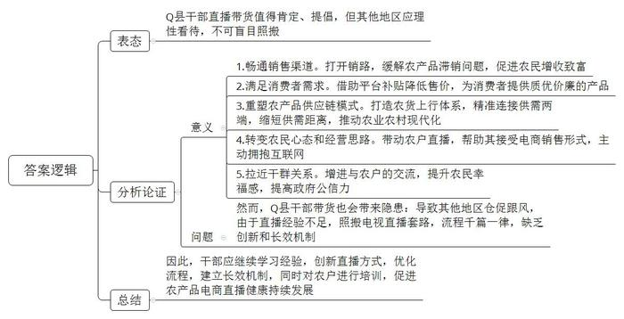
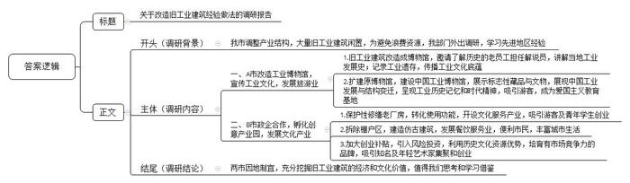
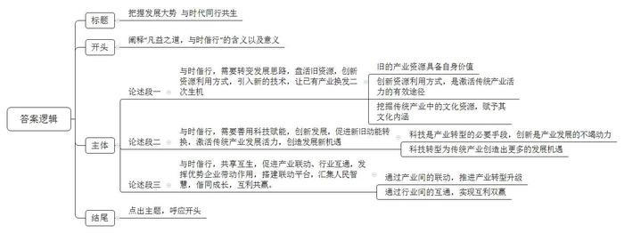

# 2020年山东省公考《申论》题（B卷）

> 候选采集稿。参考答案及解析来自粉笔页面，不代表官方答案或真实高分答卷；来源使用许可与原卷对应关系仍需人工核实。

## 给定材料

### 材料 material-b02b250221e62a77

过去，我国绝大多数农产品都是通过批发商进行销售的。受新冠肺炎疫情影响，大量农产品线下销售渠道受阻，出现滞销情况。不少地方干部纷纷选择网络直播带货的方式，为本地产品代言，帮助当地农民打开销路。

Q县自古以来就盛产柑橘，拳头产品是椪柑，有“亚洲宽皮橘之王”的美誉。2020年2月19日晚9点，某电商平台的助农直播间里来了一位特殊的主播，Q县唐县长出现在镜头前，给全国网友当了一回“客服”。他手上拿着半个剥开的椪柑，从Q县柑橘种植史开始娓娓讲起。Q县柑橘生产要追溯到1400多年前，最早记载于北魏郦道元的《水经注》中。到1984年，当地的椪柑种植面积已经跃居全国首位。元旦至春节前后是椪柑的最佳食用期。由于汁多味浓、肉质脆嫩，椪柑的价格比当地其他柑橘品种高出五成左右，不仅销往北京上海等一线城市，还远销俄罗斯、加拿大等国家。

“我们热心助农的唐县长好棒”“县长亲自上阵，为了抗击疫情帮扶农民也是拼了”......手机屏幕上，不断滚动着全国各地网友的评价，唐县长与网友一一互动并热情回答问题：“一箱毛重10斤，盒子6两”“椪柑好保存，阴凉通风处1个月，冰箱冷藏2个月”“原价29元一箱，今天特价17.9元”......

直播活动上线不到两个小时，直播间观看人数就达到了53.26万，原定的2万件10斤装椪柑很快卖完，随后又紧急补货1万件，观看直播的消费者可以通过手机应用程序首页焦点图、限时秒杀等入口，以及搜索“助农”“爱心助农”“农货”等关键词直达助农专区，以平台补贴后的最优惠价格购买产地直发的助农产品。

这次活动得到了电商平台的专项补贴，椪柑在平台上的售价低至每斤1.79元，“不能让果农一年的辛苦白费，也要让消费者吃上质优价廉的水果”，该电商平台一位工作人员表示，“过去，传统的电商平台在农村实现了‘工业品下乡’这一功能，而我们新电商平台打造了中国农货的上行体系，重塑了农产品供应链模式，将大大助力中国农业农村现代化的进程。”

在唐县长的带动下，Q县各乡镇纷纷跟进，大杨村党支部王书记尝试通过短视频平台参与“战疫助农”活动，帮助村民销售农产品。“我经常下户，也愿意走市场，发现特色农产品好销售，我们身边已经有不少种植大户、特色产业户开始利用微信、淘宝这些电子商务平台销售产品，形势逼着我们必须这样去做了。”王书记一边对记者说，一边走进一户村民家，仔细询问近期的收成如何。该村民高兴地说：“我们村民有什么困难，都找党支部，这次网上直播，我家卖的钱最多，多亏了党支部帮我们搞销售。”

“农户每次虽然卖不了多少钱，但是他们特别开心，幸福感也特别强。而且，我发现自从帮农民卖东西后，更拉近了我们的关系，我们有一个专门的微信群，每天群里的内容就是谁家有什么产品多少斤，以什么方式交给村两委，等等”，王书记说，“现在，村民对我们这种销售方式都非常认可，我们也会尽快加大努力让村民持续增收致富。下一步，我们想对有网上销售意向的农户进行培训，带动农户把手机也当作生产工具，不仅会种植，还会做电商。”

一位近期协助干部开展公益直播的电商人士则带有疑惑地说，有的县直播仓促上马，只能聘请当地文化传媒公司策划。这些公司缺少电商直播经验，公益直播照搬电视直播套路，县长直播流程千篇一律。也有基层干部担忧，如果不重视创新和长效机制，不少直播账号就会最终沦为“僵尸号”。

网络新媒体研究专家指出：“互联网可以抹平信息差，快速精准地连接供需两端，而移动互联网电商更是能够通过拼团购物、万人团秒杀、直播等新玩法，进一步缩短供需的距离。”唐县长也认为：“经过这次合作，不少果农尝到了新电商的甜头，心态和经营上逐渐从依赖批发商转变为主动出击，开始拥抱移动互联网。”

### 材料 material-d87fa58a2f7721d3

某地产业结构调整，大量失去功能的旧工业建筑处于闲置状态，将其进行拆除必然会对“资源”造成严重浪费。旧城改造办公室指派小王一行外出调研，学习先进地区的经验做法。

在A市，小王一行走进了高30米、最长距离超100米、红砖砌筑成的铸造厂大型厂房，经过密密麻麻的塔林管线，看到一座冲天炉立在其中。小王得知，在2007年，冲天炉浇铸完最后一个鼓风机壳，铸造厂整体搬迁，留下了服役半个多世纪的厂房和设备。所在地的区委区政府经过反复调研论证，决定将铸造厂的一车间改造成铸造博物馆。

在家待业的厂宣传骨干栾师傅，接受区里邀请，重新回到了这熟悉的地方，成为博物馆的一名解说员。他深情地向调研团介绍了悬挂在博物馆通史馆展厅中的一枚直径2米的国徽：“在1950年9月，铸造厂的全体工人怀着激动的心情承接了铸造新中国第一枚金属国徽的任务。尽管当时生产条件艰难，从模具制作到浇铸成型全凭工人们手工操作……历经千辛万苦，他们终于提前20天圆满完成了金属国徽的铸造任务。次年5月1日，凝结着工人心血、智慧和爱国深情的第一枚金属国徽悬挂在了天安门城楼上。如今，这枚国徽虽历经几十年的风雨，依旧熠熠生辉。”

现在，在原铸造博物馆基础上扩建而成的中国工业博物馆，属于4A级景区，有5个常设展馆和冶金机械展区，馆藏我国第一根无缝钢管、第一台1.2万吨水压机、第一个铸造用机械手等1.5万件藏品，定级文物300余件。馆内展出的历史上一个又一个“中国第一”，浓缩了中国工业的发展与结构变迁，呈现着A市百年的工业记忆，蕴含着整整一个时代的精神。该博物馆已成为全国爱国主义教育基地，每年吸引着30多万海内外游客，平均每天大约有1000人参观。

“工业展览要有浓厚的工业文化氛围”，某文化公司杨经理说，“我曾用10年时间、5000张照片记录A市的工业遗存，就是为了留住A市这座大工业城市的时代记忆。很多50后、60后来参观时激动万分，他们能感受到曾经的辉煌。像我这样生长在工人家庭的孩子，对工业文化有发自肺腑的执着和热爱。然而，更多的80后、90后和00后，没有工业文化成长氛围，这就需要加大工业文化的宣传力度，让更多的年轻人了解到A市工业文化的底蕴。”

在B市，小王一行来到位于这里的“晨光1865创意产业园”。行走在园区，看到青砖墙面上保留着光绪年间建的“炎铜厂”“卷铜厂”“木厂大楼”的招牌，另一边的外秦淮河则将目光带向古老的城墙。若不是路边停靠的车辆提示所处的时代，小王恍惚间不知今夕何夕了。

熟知此地历史的老宋是“晨光1865创意园”的老员工。他介绍说，2007年，经所在地区政府和晨光集团的共同打造，原军工项目搬迁、腾空的老厂房开始保护性修缮、滨河风光带上棚户区拆除，新中国建筑界的一些“泰斗”级人物也为滨河风光带上几栋新建的仿民国建筑出谋划策。这些位于园区外围的仿民国建筑，如今主要用作餐饮酒店，进一步便利了市民，丰富了城市生活。

老宋还介绍说，在旧址改造中，“晨光1865创意园”还将园区成片的近现代厂房转化使用功能，开设了新媒体、摄影、影视等工作室以及茶艺馆、艺术教育中心、咖啡馆等。由于位置优越，环境宜人，大批市民和游客来这里游玩参观，这吸引了不少青年学生前来创业。政府加大了创业补贴，同时联系引入风险投资，培育出不少具有市场竞争力的品牌，成为远近闻名的产业孵化园。

“晨光1865创意园”利用历史文化资源优势，在文化传承和文化保护方面打造出了品牌。在走访中，看到一位老人迎面走来，老宋介绍说：“这位是林散之的长子，他的工作室也在园区里。他之所以来到这里，就是考虑到不少艺术家在这里租工作室，便于相互交流，互通信息。”

位于“晨光1865创意园”的“羽空间”是相对较早来到此处的，“羽空间”的主人韩某是陈大羽的后人。1912年出生的陈大羽早年就读于上海美术专科学校，后拜齐白石为师，专攻大写意花鸟画，1958年开始任南京艺术学院美术系教授。“羽空间”顾名思义有纪念陈大羽之意。走进“羽空间”，高挑的工厂空间被改造分隔为2层，楼下为画廊空间，楼上为办公区域。

春节将近，韩某正在写“福”字，画室里一派过年的气氛，她搁下笔和小王从过年写“福”字的传统聊起了“晨光1865创意园”对传统文化保护上的支持。说到“羽空间”，她说：“我们是从北京搬来的，相比起来，这里安静了许多。我们的空间除展览陈大羽先生的作品外，也吸引了一些年轻艺术家来进行文化创业。”

### 材料 material-c50ab995ace59f08

中国共产党有一个非常优秀的传统，也是中国共产党的巨大优势，就是始终坚持用与时俱进的理论指导实践。习近平总书记在庆祝改革开放40周年大会上指出：“40年来，我们始终坚持解放思想、实事求是、与时俱进、求真务实，坚持马克思主义指导地位不动摇，坚持科学社会主义基本原则不动摇。勇敢推进理论创新、实践创新、制度创新、文化创新以及各方面创新，不断赋予中国特色社会主义以鲜明的实践特色、理论特色、民族特色、时代特色，形成了中国特色社会主义道路、理论、制度、文化，以不可辩驳的事实彰显了科学社会主义的鲜活生命力，社会主义的伟大旗帜始终在中国大地上高高飘扬！”

我国经济发展进入新常态后，虽然经济增长速度从高速增长转为中高速增长，但经济发展方式从规模速度型粗放增长转向质量效率型集约增长，经济结构从增量扩能为主转向调整存量、做优增量并举的深度调整，经济增长点从传统增长点转向新的增长点，因此，我们仍处于可以大有作为的重要战略机遇期。

当前，国际产业竞争日趋激烈，核心竞争力不足、资源环境约束强化、要素成本上升等矛盾日益突出，尤其是一场突如其来的新冠肺炎疫情，对我国经济社会发展产生了较大影响。在统筹推进新冠肺炎疫情防控和经济社会发展工作部署会议上，习近平总书记强调，越是在这个时候，越要用全面、辩证、长远的眼光看待我国发展，越要增强信心、坚定信心。

## 题目

### 第 1 题

**请根据****“给定资料**2**”，谈谈你对Q县干部直播带货的认识。（20分****）**

关联材料：material-b02b250221e62a77

作答要求：

要求：观点明确，分析全面，条理清晰；不超过350字。

### 第 2 题

**假如你是小王，请根据****“给定资料**3**”，就所调研区域的经验做法写一篇调研报告提纲。(30分)**

关联材料：material-d87fa58a2f7721d3

作答要求：

要求：概括全面，思路清晰，表达准确；不超过450字。

### 第 3 题

**请结合全部给定资料，进一步思考****“给定资料4”中的划线句子“凡益之道，与时偕行”，自选角度，自拟题目，写一篇文章。(50分)**

关联材料：material-c50ab995ace59f08

作答要求：

要求：

（1）主题明确，结构完整，条理清楚，语言流畅；

（2）参考给定资料，但不拘泥于给定资料；

（3）字数1000字左右。

## 答案与解析

第 1 题

**参考答案（粉笔题库参考内容）**

Q县干部直播带货值得肯定、提倡，但其他地区应理性看待，不可盲目照搬。

一方面直播带货可以：1.畅通销售渠道。打开销路，缓解农产品滞销问题，促进农民增收致富。2.满足消费者需求。借助平台补贴降低售价，为消费者提供质优价廉的产品。3.重塑农产品供应链模式。打造农货上行体系，精准连接供需两端，缩短供需距离，推动农业农村现代化。4.转变农民心态和经营思路。带动农户直播，帮助其接受电商销售形式，主动拥抱互联网。5.拉近干群关系。增进与农户的交流，提升农民幸福感，提高政府公信力。

然而，Q县干部带货也会带来隐患：导致其他地区仓促跟风，由于直播经验不足，照搬电视直播套路，流程千篇一律，缺乏创新和长效机制。

因此，干部应继续学习经验，创新直播方式，优化流程，建立长效机制，同时对农户进行培训，促进农产品电商直播健康持续发展。

**解析**

**参考答案说明：**思路方面，本参考答案按照观点现象分析题“解释抽象的观点、现象+表态+分析论证+总结”的答题思路展开。内容方面，本参考答案对“Q县干部直播带货的行为”进行了表态；“分析论证”部分先分析了“干部直播带货”的意义，接着分析了“Q县干部直播带货”的问题；最后进行了总结。词句表达方面，本参考答案加上了“然而”“因此”等连接词来承接上下文。

**考点**：考点观点现象分析类

**来源**：来源2020年山东省公考《申论》题（B卷）

粉笔申论页面对本题只提供「解析视频」入口，该入口是会员推广位，页面无视频地址与文字解析。

第 2 题

**参考答案（粉笔题库参考内容）**

关于改造旧工业建筑经验做法的调研报告

调研背景：我市调整产业结构，大量旧工业建筑闲置，为避免浪费资源，我部门外出调研，学习先进地区经验。

调研内容：一、A市改造工业博物馆，宣传工业文化，发展旅游业。1.旧工业建筑改造成博物馆，邀请了解历史的老员工担任解说员，讲解当地工业发展史；记录工业遗存，传播工业文化底蕴。2.扩建原博物馆，建设中国工业博物馆，展示标志性藏品与文物，展现中国工业发展与结构变迁，呈现工业历史记忆和时代精神，吸引游客，成为爱国主义教育基地。

二、B市政企合作，孵化创意产业园，发展文化产业。1.保护性修缮老厂房，转化使用功能，开设文化服务产业，吸引游客及青年学生创业。2.拆除棚户区，建造仿古建筑，发展餐饮服务业，便利市民，丰富城市生活。3.加大创业补贴，引入风险投资，利用历史文化资源优势，培育有市场竞争力的品牌，吸引知名及年轻艺术家集聚和创业。

调研结论：两市因地制宜，充分挖掘旧工业建筑的经济和文化价值，值得我们思考和学习借鉴。

**解析**

**参考答案说明**：（1）格式方面，本参考答案写到了“标题”“正文”两个部分。（2）正文部分，一方面从内容上来看，围绕“改造旧工业建筑”这一主题，本参考答案的开头先写到了调研背景；主体部分从“A市改造工业博物馆，宣传工业文化，发展旅游业”和“B市政企合作，孵化创意产业园，发展文化产业”两个方面介绍了调研内容，分别指出了A市和B市的改造经验；结尾部分对A、B两市的经验进行了总结，得出了调研结论。另一方面，形式上，本参考答案做到了分段、分条撰写，整体上条理较为清晰。

**考点**：考点总结类

**来源**：来源2020年山东省公考《申论》题（B卷）

粉笔申论页面对本题只提供「解析视频」入口，该入口是会员推广位，页面无视频地址与文字解析。

第 3 题

**参考答案（粉笔题库参考内容）**

**把握发展大势** **与时代同行共生**

**“凡益之道，与时偕行”。**一句话道出了在时代大潮中的发展之道，更道出了对“顺势而为，利益共享”发展方向的深刻展望。我们深知，一切事物处于运动变化中，世界就是顺应着趋势构成的，时代潮流不可阻挡。**当前，国际产业竞争激烈、资源环境约束、新冠疫情等对我国经济社会发展产生较大影响。**在这样的局势下，我们是时候需要**变通趋时，把握时机，做出适于时代需要的判断和选择了。**

**与时偕行，需要转变发展思路，盘活旧资源，创新资源利用方式，引入新的技术，让已有产业****焕****发二次生机。**旧的产业资源经过了时代的洗礼，蕴含着时代的记忆，这些如同一笔笔沉睡的财富，自有它的价值。随着社会发展格局的改变，传统产业的原有生产模式早已不适应当下的发展趋势，也不能适应当下的发展环境，创新资源利用方式，是激活传统产业活力的有效途径。在工业领域，我们需要让传统工业搭乘转型快车，挖掘其文化资源，赋予其文化内涵。把旧的工业建筑改造为产业孵化园，或将旧的工业建筑改为文化场馆。以“旧”改“新”，让现有的产业资源更具发展能力。

**与时偕行，需要善用科技赋能，创新发展，促进****新旧动能****转换，激活传统产业发展活力，创造发展新机遇。**当前，全球范围内新一轮科技革命和产业变革蓬勃兴起，科技是产业转型的必要手段，创新是产业发展的不竭动力。在农业领域，因为“互联网+”的介入，以及直播带货的兴起，成功打造了一大批专业的“新农人”。农业生产活动从此开启智能化之旅，农民们告别了“面朝黄土背朝天”的时代，纷纷干起了带有科技含量的“新农活”。科技转型不是颠覆传统，而是为传统产业创造出更多的发展机遇。

**当然，变通趋时，把握时机，需要转变思路、创新发展。同时，也需要遵循规律、共享互生，整合资源为己所用，只有这样才能顺应时代发展需要，助力国家成长。**

**与时偕行，共享互生，促进产业联动、行业互通，发挥优势企业带动作用，搭建联动平台，汇集人民智慧，偕同成长，互利共赢。**滴滴出行与31家汽车企业成立“洪流联盟”，这不仅是惠及更多企业的平台，对整个产业的新能源化、智能化、共享化发展都具有里程碑意义。海尔集团用工业的思路赋能农业，融合农民智慧，联动工业、农业、旅游业、医疗物资等行业，不仅自己抓住机会、获得增值，更赋能其他企业，促成整个行业的转型升级。天下事物之间的利益都是共享互生的，在我国新旧动能转换的关键时期，正需要这种行业、产业间的互联互通，从而达到“1+1＞2”的效果。

**习近平总书记强调，越是在这个时候，越要用全面、辩证、长远的眼光看待我国发展。只有顺应历史潮流，积极应变，主动求变，共享互生**，才能始终立于时代潮头，这是历史发展的深刻结论。接下来，相信只要我们以奋斗者的姿态，紧随时代，就终将走出一个与人民共享增益的美好未来！

**解析**

**文章分析**

**把握发展大势** **与时代同行共生**

【**标题的优点：**标题中含有“与时代同行”这一主题词，使文章主题更突出、清晰。】

**“凡益之道，与时偕行”。**（1）一句话道出了在时代大潮中的发展之道，更道出了对“顺势而为，利益共享”发展方向的深刻展望。我们深知，一切事物处于运动变化中，世界就是顺应着趋势构成的，时代潮流不可阻挡。（2）**当前，****国际产业竞争激烈、资源环境约束、新冠疫情等对我国经济社会发展产生较大影响****。**（3）在这样的局势下，我们是时候需要**变通趋时****，把握时机，****做出适于时代需要的判断和选择****了。**

【**开头的优点：**★内容方面。范文的开头是紧扣题目给定句子“凡益之道，与时偕行”这一主题展开的。首先，指出这句话的重要意义；其次，点出了当下产业发展面临的问题；最后，引出论点，即指明需要变通趋时，把握时机，做出适于时代需要的判断和选择，为后文的分论点作铺垫。★文字表达方面。使用了“道出了”“更道出了”“我们深知”等连接词，使语言表达有逻辑性。】

**与时偕行，需要转变发展思路，盘活旧资源，创新资源利用方式，引入新的技术，让已有产业焕发二次生机。****（****1****）**旧的产业资源经过了时代的洗礼，蕴含着时代的记忆，这些如同一笔笔沉睡的财富，自有它的价值。（2）随着社会发展格局的改变，传统产业的原有生产模式早已不适应当下的发展趋势，也不能适应当下的发展环境，（3）创新资源利用方式，是激活传统产业活力的有效途径。在工业领域，我们需要让传统工业搭乘转型快车，挖掘其文化资源，赋予其文化内涵。把旧的工业建筑改造为产业孵化园，或将旧的工业建筑改为文化场馆。以“旧”改“新”，让现有的产业资源更具发展能力。

【**论述段****1的优点：**★观点句：范文的观点句是紧扣“凡益之道，与时偕行”这一文章主题提出的。形式上，它在段首处直接写出，位置突出，容易发现。内容上，关键词突出，内容要点明确，可以明显看出它侧重于“转变发展思路，盘活旧资源”。★论述内容：（1）指出旧资源的价值；（2）指出传统产业模式需要转变的必要性；（3）如何发展传统产业。注意：以上三个方面层次清晰，论述的针对性强。在论述方法上主要采用了讲道理、举例子相结合的方式。】

**与时偕行，需要善用科技赋能，创新发展，促进新****旧****动能转换，激活传统产业发展活力，创造发展新机遇。**（1）当前，全球范围内新一轮科技革命和产业变革蓬勃兴起，科技是产业转型的必要手段，创新是产业发展的不竭动力。（2）在农业领域，因为“互联网+”的介入，以及直播带货的兴起，成功打造了一大批专业的“新农人”。农业生产活动从此开启智能化之旅，农民们告别了“面朝黄土背朝天”的时代，纷纷干起了带有科技含量的“新农活”。科技转型不是颠覆传统，而是为传统产业创造出更多的发展机遇。

【**论述段****2的优点：**★观点句：范文的观点句是紧扣“凡益之道，与时偕行”这一文章主题提出的。形式上，它在段首处直接写出，位置突出，容易发现。内容上，关键词突出，内容要点明确，可以明显看出它是从“善用科技赋能，创新发展”出发。★论述内容：（1）科技、创新的重要意义；（2）再结合农业现代化的发展佐证科技对促进传统产业转型的作用。注意：以上两个方面的内容都是紧扣观点句进行分析论述的，论述的针对性强，内容层次丰富。】

**当然，变通趋时，把握时机，需要转变思路、创新发展。同时，也需要遵循规律、共享互生，整合资源为己所用，只有这样才能顺应时代发展需要，助力国家成长。**

【**过渡段的优点：**过渡段旨在指出把握时机除了需要转变思路和创新发展，更需要整合资源，进而引出下文。】

**与时偕行，共享互生，促进产业联动、行业互通，发挥优势企业带动作用，搭建联动平台，汇集人民智慧，偕同成长，互利共赢。**（1）滴滴出行与31家汽车企业成立“洪流联盟”，这不仅是惠及更多企业的平台，对整个产业的新能源化、智能化、共享化发展都具有里程碑意义。海尔集团用工业的思路赋能农业，融合农民智慧，联动工业、农业、旅游业、医疗物资等行业，不仅自己抓住机会、获得增值，更赋能其他企业，促成整个行业的转型升级。（2）天下事物之间的利益都是共享互生的，在我国新旧动能转换的关键时期，正需要这种行业、产业间的互联互通，从而达到“1+1＞2”的效果。

【**论述段****3的优点：**★观点句：范文的观点句是紧扣“凡益之道，与时偕行”这一文章主题提出的。形式上，它在段首处直接写出，位置突出，容易发现。内容上，关键词突出，内容要点明确，可以明显看出它是从“促进产业联动、行业互通”入手。★论述内容：（1）举例介绍产业联动的好处。（2）举例介绍行业联通的重要意义。注意：以上两个方面的内容都是紧扣观点句进行分析论述的，论述的针对性强，内容层次丰富。在论述方法上采用了讲道理、举例子相结合，做到了丰富多样。】

【**论述段之间的关系：**★内容的内在逻辑：论述段1从转变思路层面论证如何激活旧产业，论述段2从科技创新层面论证如何激活旧产业，论述段3从资源整合层面论证如何实现互利共赢。三个论述段相互并列，逻辑清晰。】

**习近平总书记强调，越是在这个时候，越要用全面、辩证、长远的眼光看待我国发展。只有顺应历史潮流，积极应变，主动求变，共享互生**，才能始终立于时代潮头，这是历史发展的深刻结论。接下来，相信只要我们以奋斗者的姿态，紧随时代，就终将走出一个与人民共享增益的美好未来！

【**结尾的优点**：范文的结尾回扣了“凡益之道，与时偕行”这个主题词，语言精悍，不拖沓。】

**考点**：考点文章写作题

**来源**：来源2020年山东省公考《申论》题（B卷）

粉笔申论页面对本题只提供「解析视频」入口，该入口是会员推广位，页面无视频地址与文字解析。

