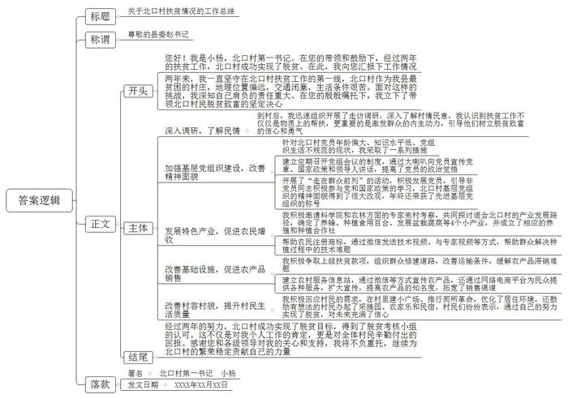

# 2020年山东省普通选调生考试《申论》题（网友回忆版）

<!-- gwy:overview:start -->
> **山东 · 2020 · 申论 · 普通选调生** ｜ 2 题 · 图片 1 处 · 答案随题折叠

导航：[题目](#题目) · [材料 1](#材料-1)
<!-- gwy:overview:end -->

> 候选采集稿。参考答案及解析来自粉笔页面，不代表官方答案或真实高分答卷；来源使用许可与原卷对应关系仍需人工核实。

## 给定材料

### 材料 1

“我和我的祖国一刻也不能分割，无论我走到哪里都流出一首赞歌……”《我和我的祖国》这部电影热播，电影中选取了中华人民共和国成立前的故事、中国第一颗原子弹爆炸成功的故事、中国女排在洛杉矶奥运会夺得冠军、香港回归祖国怀抱的故事、北京奥运会开幕式门票的故事等，讲述新中国成立70周年经典历史瞬间下，普通百姓与共和国息息相关密不可分的动人故事，勾起了广大人民群众满满的家国情怀和历史回忆。新中国成立70年是不断奋斗的70年，是不断向上攀登的70年，我们今天伟大成就是一代人一代人不断奋斗的结果。

### 材料 2

2017年4月27日，已经获得国外某知名大学终身教职的Z教授，结束了他的最后一次课，他已在国外待了15年，其中任教7年。这期间他不是没有徘徊过，犹豫过……“我从哪里来？”这个问题时常浮现在他的脑海里。2016年天宫2号发射成功，他的很多同学坐在天宫2号发射指挥室里，而他却只能通过不断刷新朋友圈，了解天宫2号的情况。这是一种长期漂泊在外的感觉。“再不回去就没有机会啦！”他说，他已经找到了问题的答案。“现在我回国已经参与到了国家重大工程项目当中，在其中我体会到了很强的成就感，这在国外是无法想象的。”

2008年中共中央办公厅转发《中央人才工作协调小组关于实施海外高层次人才引进计划的意见》，要求各地区各部门围绕国家发展战略，进一步解放思想，完善体制机制，健全政策措施，以更宽的眼界、更宽的思路和更宽的胸襟做好海外高层次人才引进工作。各省、市县，科研机构，企业，高校，非政府组织纷纷出台了人才引进计划，很多专门人才引进的机构成立，有些高层次人才联络机构，直接开到了美国知识人才比较密集的华尔街。

为了留住高层次人才，中央和地方政府出台了很多措施，帮助他们解决户口问题、子女入学问题、住房问题等。而且近几年中国的科研环境有了很大的提升，2018年我国的科研经费投入为1.96779万亿元，2016年我国的科研经费投入为15676.7亿元，增长了近三分之一，我国成为了科研经费投入仅次于美国的第二大国。四川成都的“天眼”工程，安徽的、广东东莞的、北京的，一大批重大的工程项目已经落成或正在建设当中。更重要的是近几年随着我国经济的高速发展，国内已经形成了广阔的市场，为很多海外归国人员提供广阔的舞台，让他们所掌握的高技术得以施展，他们已经在环保、科技等方面作出了卓有成效的贡献，很多公司如雨后春笋般地在我国建立。

海外归国人才不断增多，人才的集聚效应也日益凸显。我国的科研水平和能力不断提高。中国量子通信领航人，潘建伟组建了量子“梦之队”，使我国的量子物理学研究走在了世界前列。海外归国人员不仅提升了我国的科研水平，还带来了先进的管理理念。北京科学院创新了管理方式，实现了科研人员的自主管理，为我国的科研机构改革，提供了可以借鉴的经验。很多国际学术性的会议在我国召开，我们国家的专家学者参与到了国际规则的制定中，为世界的发展提出了“中国方案”。

“中国从来没有像现在一样，关心人才，留住人才，使用人才。”欧美同学会会长王丕君说，海外归国人才应该抓住时代发展的大契机，在中华民族伟大复兴道路上续写辉煌。

### 材料 3

时间长河奔流不息，青春的血脉一脉相承，不论是在科研一线，还是田间地头，青春从来没有缺席……两年前刚刚毕业的小杨，响应党和国家的号召，毅然决然地投入到了我国的扶贫工作当中去，她选择了去当地最贫困的北口村担任第一书记，临行前县委赵书记，给予了她殷殷的嘱托，“北口村是我们县最贫困的村庄，该村地理位置偏远，交通闭塞，生活条件差，历任好几位第一书记的工作都没有起色，现在属于扶贫工作的关键期，你一定要做出一点成绩，带领北口村民脱贫致富。”

小杨很快投入到了工作当中，她首先在村里走访调研。很多村民对她不解，说：“这个小丫头来到村里，东蹿西跑也不为村里干实事。”有些村民甚至直接向她要钱，还表示说：“不是说我们要什么，政府就给什么吗？”对于群众的这些诉求，小杨婉言拒绝了。经过一段时间的调研之后。小杨觉得扶贫先扶志，一定要克服群众们的等靠要的思想，她决定先从基层党组织开始，帮助群众脱贫。

北口村党员年龄普遍偏大，知识水平比较低，党组织生活也时有时无。小杨首先在村里建立起来了经常开党组会议的制度，通过定期召开学习会议，小杨通过大喇叭的方式，向党员去宣传党章、国家的最新的政策和党的领导人的讲话等，她还开展了“走在群众前列”的活动，经过她的努力，北口村基层党组织的精神面貌有了很大的改观。目前该村已经发展了两位正式党员和三位预备党员，很多非党员同志也积极主动参与到党和国家政策的学习当中，北口村基层党组织改变了涣散的局面，在年终还获得了先进基层党组织的称号。

小杨通过上级党组织邀请科学院专家来北口村实地考察，还邀请母校农林方面的专家和同学来共同参与讨论北口村的产业发展问题，目前北口村已经形成了养蜂，种植食用百合，发展盆栽蔬菜等4个小产业，成立了养殖合作社和种植合作社。帮助当地农民注册商标，小杨把养殖的技术编辑成小视频，通过微信的方式发送给民众，还经常背着电脑在田间地头，通过与专家视频的方式，帮助群众解决种植过程当中的技术性难题。

小杨通过现代通信技术，建立农村服务信息站，通过微信、抖音等方式宣传当地农产品，还通过网络电商平台为民众提供各种服务，扩大宣传，引来了很多的经销商来本地洽谈业务。小杨还积极研究当地的扶贫政策，向上级申请扶贫款项，组织群众修建道路，为当地农产品的销售，改善配套设施。当地农产品的滞销问题得到了很大的改善。

大家的生活水平提高了，想法就多了。有些村民向小杨反映，希望村里建小广场方便大家健身，希望村里的居住环境得到进一步的改善。小杨迅速回应了大家的需求，在村里建小广场，推行厕所革命，优化村里环境，现在村庄像小花园一样，很多有想法的村民，办起了采摘园，开起了农家乐和民宿。很多群众欣喜地说，“没想到可以通过自己的努力实现脱贫，感觉未来很有奔头。”

年终，脱贫考核小组通过了北口村脱贫的申请，北口村成功实现了脱贫。赵书记肯定了小杨的工作，让她回去，把两年来的工作经验写成报告，并做好未来一年的工作规划，巩固好脱贫成果。

### 材料 4

（习总书记在庆祝五四运动100周年大会上的讲话）五四运动以来的100年，是中国青年一代又一代接续奋斗、凯歌前行的100年，是中国青年用青春之我创造青春之中国、青春之民族的100年。

100年来，中国青年满怀对祖国和人民的赤子之心，积极投身党领导的革命、建设、改革伟大事业，为人民战斗、为祖国献身、为幸福生活奋斗，把最美好的青春献给祖国和人民，谱写了一曲又一曲壮丽的青春之歌。

## 题目

### 第 1 题

**根据给定资料2，概括归国潮的原因及其影响。（15分）**

关联材料：材料 2

作答要求：全面、准确、有条理，不超过300字。

第 1 题 · 答案与解析

**参考答案（粉笔题库参考内容）**

原因：1.高度的情感认同。海外高层次人才对祖国的认同感和归属感增强，愿为祖国发展贡献力量。2.人才引进政策完善。国家发展战略驱动，各级政府和机构出台人才引进计划，政府出台多项政策，解决人才户口等生活难题。3.科研环境提升。科研经费投入加大，科研设施不断完善，科研条件持续提升。4.发展前景广阔。经济高速发展，国内市场广阔，为海外高层次人才提供了更广阔的发展空间。

影响：1.提升科研水平。人才增多，人才集聚效应凸显，推动我国的科研水平和能力不断提高。2.推动科研机构改革。带来先进的高新技术和管理理念，为科研机构创新管理方式等提供可借鉴经验。3.提高国际话语权。参与国际规则制定，提出更多具有中国特色的解决方案。

**解析状态：unknown（来源未提供）**

### 第 2 题

**结合“给定资料3”，假如你是小杨，请你写一份给县委赵书记的工作总结。（45分）**

关联材料：材料 1、材料 2、材料 3、材料 4

作答要求：定位准确，结构完整，内容全面，1000字左右。

第 2 题 · 答案与解析

**参考答案（粉笔题库参考内容）**

关于北口村扶贫情况的工作总结

尊敬的县委赵书记：

您好！我是小杨，北口村第一书记。在您的带领和鼓励下，经过两年的扶贫工作，北口村成功实现了脱贫。在此，我向您汇报下工作情况。

两年来，我一直坚守在北口村扶贫工作的第一线，北口村作为我县最贫困的村庄，地理位置偏远，交通闭塞，生活条件艰苦。面对这样的挑战，我深知自己肩负的责任重大。在您的殷殷嘱托下，我立下了带领北口村民脱贫致富的坚定决心。

一、深入调研，了解民情。到村后，我迅速组织开展了走访调研，深入了解村情民意，我认识到扶贫工作不仅仅是物质上的帮扶，更重要的是激发群众的内生动力，引导他们树立脱贫致富的信心和勇气。

二、加强基层党组织建设，改善精神面貌。针对北口村党员年龄偏大、知识水平低、党组织生活不规范的现状，我采取了一系列措施。首先，建立定期召开党组会议的制度，通过大喇叭向党员宣传党章、国家政策和领导人讲话，提高了党员的政治觉悟。其次，开展了“走在群众前列”的活动，积极发展党员，引导非党员同志积极参与党和国家政策的学习，北口村基层党组织的精神面貌得到了很大改观，年终还荣获了先进基层党组织的称号。

三、发展特色产业，促进农民增收。我积极邀请科学院和农林方面的专家来村考察，共同探讨适合北口村的产业发展路径，确定了养蜂、种植食用百合、发展盆栽蔬菜等4个小产业，并成立了相应的养殖和种植合作社。同时，帮助农民注册商标，通过微信发送技术视频、与专家视频等方式，帮助群众解决种植过程中的技术难题。

四、改善基础设施，促进农产品销售。我积极争取上级扶贫款项，组织群众修建道路，改善运输条件，缓解农产品滞销难题。同时，建立农村服务信息站，通过微信等方式宣传农产品，还通过网络电商平台为民众提供各种服务，扩大宣传，提高农产品的知名度，拓宽了销售渠道。

五、改善村容村貌，提升村民生活质量。我积极回应村民的需求，在村里建小广场、推行厕所革命，优化了居住环境，还鼓励有想法的村民办起了采摘园、农家乐和民宿。村民们纷纷表示，通过自己的努力实现了脱贫，对未来充满了信心。

经过两年的努力，北口村成功实现了脱贫目标，得到了脱贫考核小组的认可。这不仅是对我个人工作的肯定，更是对全体村民辛勤付出的回报。感谢您和各级领导对我的关心和支持，我将不负重托，继续为北口村的繁荣稳定贡献自己的力量。

北口村第一书记 小杨

XXXX年XX月XX日

**解析**

**参考答案说明：**（1）格式方面，本参考答案写到了“标题”“称谓”“正文”“落款”四个部分。（2）正文部分，一方面从内容上来看，围绕“北口村扶贫”这一主题，本参考答案的开头先介绍了北口村的基本情况等，主体部分从“深入调研，了解民情”“加强基层党组织建设，改善精神面貌”“发展特色产业，促进农民增收”“改善基础设施，促进农产品销售”“改善村容村貌，提升村民生活质量”这五个方面介绍了具体的做法，最后结尾部分进行了总结，并表达了感谢。另一方面，形式上，本参考答案做到了分段、分条撰写，整体上条理较为清晰。

