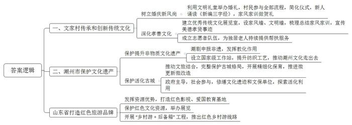
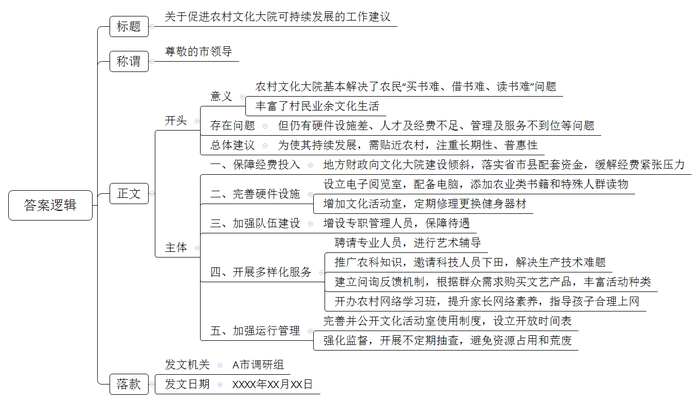
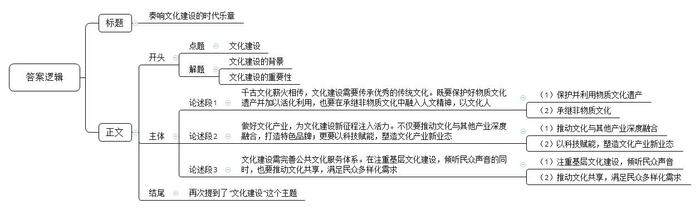

# 2021年山东省公考《申论》题（A卷）

<!-- gwy:overview:start -->
> **山东 · 2021 · 申论 · A类** ｜ 3 题 · 图片 3 处 · 答案随题折叠

导航：[题目](#题目) · [材料 1](#材料-1)
<!-- gwy:overview:end -->

> 候选采集稿。参考答案及解析来自粉笔页面，不代表官方答案或真实高分答卷；来源使用许可与原卷对应关系仍需人工核实。

## 给定材料

### 材料 1

文家村是一个有着历史悠久文化和文明传统的古老村庄，该村庄先后被命名为“全国美丽乡村”“生态文化旅游示范村”“中华优秀传统文化传承发展示范村”，入选首批全国村级“乡风文明建设”优秀典型案例。10月28日一大早，村“文明礼堂”迎来了开放使用后第一对在此举办婚礼的新人，村干部当司仪，村支书当证婚人，志愿者当“忙客”，村文艺队当演员，家风牌匾当贺礼……这场简约而不失浪漫的“中式婚礼”，虽然没有奢华隆重的仪式，却多了不少义务服务的志愿者，更收获了全村数百名乡亲的祝福。“重仁德，讲孝贤，新风尚，比学赶……”婚礼上，一对新人背诵起村里自创的《新编三字经》。村民们说，这《新编三字经》村子里的男女老少都能背。对新人来说，现场背诵更是婚礼上的“既定程序”。婚礼现场，接过村干部递上的“家和万事兴，百善孝为先”家风牌匾和“家训”后，新郎福生动情地说：“一直想办一场简单而有意义的婚礼，这种婚庆新风尚应该在我们年轻人中传递下去。”

文家村建起了“优秀传统文化展览室”，专门设立“家风墙”，梳理总结了17个姓氏家族的家风家训。很多村民主动把家训悬挂于屋子的醒目位置，作为他们自觉遵守的行为准则。“几乎每天都有游人慕名而来，感受村风民情，体验我们村的优良传统。”村支书温桐指着站在“‘孝和之村’文明墙”前的游人们说，文明镜框里镶嵌的一个个美德、孝贤故事，吸引了游客们纷纷驻足观看。84岁的独居老人李成田早晨醒来最期待的事，就是能见到“专职服务队”里的“小兄弟”温桐。“别管雨天还是雪天，小温天天早晨来看我，忙里忙外。”李成田夸个不停。老人的儿子常年在外打工，老伴儿去世后，李成田因年长无人照料，被列入文家村“相约黎明”服务对象名单。温桐则是“相约黎明”志愿者队伍中的一员。他们之间有个约定：每天清晨7点半到老人家中，帮老人拾掇家务，陪老人聊聊天。“我们村是有名的孝和之村，通过类似‘相约黎明’的活动，让孝善文化在新时代进一步深化和升华。”温桐说。

### 材料 2

穿过潮州古城东门，就来到了跨韩江而立的广济桥，作为世界上最早的启闭式桥梁，自南宋始建以来，广济桥历经千年风雨，成为见证潮汕文化传承发展的活化石。桥头树下，几位老人管弦锣鼓齐鸣，其中一位老人的唱腔婉转悠扬，颇为动人，他们演奏和演唱的正是潮剧。潮剧，又名潮州戏，是用潮州话演唱的一个古老地方戏曲剧种，于2006年入选国家第一批非物质文化遗产保护名录。在潮汕文化中，潮剧所起的“成教化，助人伦”的作用，几乎是其他艺术门类难以比拟的，这也是潮剧在后代均能深入民心的原因之一。不少潮剧里的角色故事成为家教中被引以为鉴的最佳例子，滋养潮汕人的人文精神。潮州市近年来积极以文塑城，以文兴旅，文旅结合，使千年古城焕发出全新活力。目前，潮州三山一水护城廓的古城格局依然完整，而且保留有720多条古街巷，潮州正以绣花功夫推进古城保育，活化实施微更新微改造，潮州市文化广电旅游体育局伍局长说。

通过政府主导，社会参与的方式，潮州市鼓励社会力量和民间资本参与文物保护与修复，启动海阳县儒学宫、唐伯元旧居等139处文化遗迹，31处文保单位修缮工程，积极探索文保单位活化利用工作，实现从老房子向新平台转变。此外，在传统工艺与非遗传承中，潮州市也积极行动，让潮州文化走出去，设立了广东省首个国家级工作站——中国纺织工业联合会驻潮州传统工艺工作站，带动以潮州刺绣为主的纺织类传统工艺整体性提升。

### 材料 3

在沂南县，曾涌现出“沂蒙红嫂”明德英、“沂蒙母亲”王换于、“火线桥队长”李桂芳等一批英模人物。近年来，沂南县发挥红色文化资源富集的优势，在当地的常庄片区，集中打造了红嫂家乡旅游区暨沂蒙红色影视基地，建设了多处纪念场馆和爱国主义教育基地。“到沂南感悟红色风景”，已成为山东响亮的旅游口号和品牌。如今在山东，对红色文化资源的保护，正在有力助推旅游产业的发展，为乡亲们带来可观的经济收益，在威海市，为发掘当地丰富的文化旅游资源，发挥本地革命文化优良传统，当地政府将天福山革命遗址、马石山抗日战斗遗址等辟建为革命历史发展馆，对胶东育儿所原址民房进行修缮和布展，举办以乳娘精神为主题的红色文化展览。胶东育儿所原址附近的居民张艳翠，家里种了一片苹果园，“以前苹果采摘的季节总犯愁，卖不出去，现在周边的游客多了，‘十一’假期卖出去几千斤。”张艳翠的“好收成”，一定程度上得益于山东开展的“乡村游+后备箱”工程，威海市文化和旅游局推出了多条红色乡村游线路，配合自驾游行动的开展，促进了农民增收。

### 材料 4

“你看，手机扫码后，将镜头对准空荡荡的古典戏台，屏幕上就会出现虚拟的表演场景，一会儿我上去和‘演员'合影的时候，你记得给我录像啊。”在长三角文博会J省展区，小李兴奋地对同伴说。11月21日，第二届长三角国际文化产业博览会开幕，J省搭建的5G大运河沉浸式体验馆让观众仿佛身临其境，成为第二届长三角文博会最受欢迎的“打卡地”和社交媒体的“网红”。在综合发展区，现场工作人员介绍说：“作为大运河的发源地，J省以大运河国家文化公园重点建设区建设为牵引，不断放大大运河IP的产业带动作用，着力打造高显示度的文化标识和亮丽的文化名片。以‘大运河国家文化公园’为主题，展示了《中国运河志》、运河美术长卷、大运河国家文化公园Logo系列文创产品、大运河文化旅游发展基金、运河宴、运河老字号企业等内容让观众深刻感受到文化与其它产业融合发展带来的澎湃动能。”

占地560平方米的数字文化产业板块，给现场观众以巨大的震撼，大学生小李感慨道：“利用云计算、大数据、人工智能、5G等先进技术手段，展区展示了有线家庭沉浸式体验中心、智能乐器等高端文化装备制造等文化产业新业态、新模式，还有我们年轻人熟悉的游戏电竞。数字科技真是给文化插上了翅膀，新文化业态也给我们带来新的生活体验。”谈起5G大运河沉浸式体验馆带来的震撼体验，J省展团负责人自豪地说：“我省文化产业整体亮相长三角文博会，综合发展、创意生活、影视传媒等六大展区，全方位展示了我省文化产业发展的风貌。近年来，我省文化产业增加值总量、规模以上企业数量连续多年位居全国第二位，以数字赋能文化与其它产业的深度融合，加快培育文化产业新业态。到2022年，我省将基本建成现代化产业体系和市场体系，全省文化产业增加值占GDP比重达6%，成为文化产业高质量发展先行区。”

### 材料 5

A市各地的文化大院都已经建起来了，经过几年的发展，作用发挥的如何？近日，该市成立调研组奔赴基层，就农村文化大院运行情况进行了专题调研。

C区文化和旅游局张副局长：建设基层文化服务中心的初衷是打通政府提供公共文化服务的“最后一公里”，到2019年底，全区农村文化大院（或农家书屋）的拥有数量为500余家。总的来看，经过几年的建设和不断推进，农村基层文化工作发生了巨大变化，基本解决了农民“买书难、借书难、读书难”问题，文化大院硬件和软件建设都有了长足进步。

东街村退休工人王大娘：我今年65岁了，孩子们都在外地工作，在家闲来无事时，经常到文化活动室跟同伴打牌。有时候也去图书室借阅养生保健方面的图书，或者跟秧歌队队员一起扭扭秧歌。老人们自发组建了老年票友会，经常聚在一块唱唱京剧、吕剧，我们还参加过市里的比赛呢！如果有专业艺术院团的人给我们辅导一下那就更好了，我们的水平也就上去了。

郑旺村青年村民张军：在村里的文化大院，可以通过电脑登录省新农村网上图书馆，查询相关信息，我是种植花卉的，在家门口的“农家书屋”查不到书本资料时，只要往村里的电子阅览室跑一趟就能查到，非常方便。

大姜村村民刘新：文化大院外的健身器材都“缺胳膊少腿”根本就没法进行体育锻炼，就那么几间文化活动室，还不让去，大队里管着，大队里有事可以去，他们开会可以去。

大姜村委会李主任：我们村的文化大院曾是省、市重点推广对象，可是由于专职管理员的待遇无法解决，一般是村“两委”干部值班时兼任文化大院管理员，平常没补助没收入，也就没什么积极性靠在这项工作上，村里青壮年都外出务工了，只剩下了老人、孩子还有一些残障、病人，他们文化程度有限，有的根本就不认字，对图书也没啥需求意愿。

大黄村村民王坤：你看看我们村的电子阅览室，桌面上都落满厚灰了。有的电脑都让镇政府拉去了，这里成空壳了，有检查的就弄来，没检查的就都弄回去了，刚启用时，文化活动室都是正常开放的，但后来就渐渐的闲置下来了，就开过几回，即便开也没有专人负责。

宋村村民安玉：文化大院应该成为农业科技的传播中心，农民最需要农业科技，应该借文化大院推广各类农业科学知识。同时，多邀请科技人员下到田间，解决农民生产中遇到的技术难题，另外，还应该在文化大院多办一些演出、图书展销、电影放映等，现在演出的节目总是村里那几样，大家早就看够了。

Z镇财政所黄所长：基层公共文化场所难以为继的根本原因还是经费问题。现在的资金来源是国家拨款，省市县配套，但一般配套资金都不到位，钱都用到了重要的地方，比如基建领域。文化大院工作的任务在区县，从书屋选点、图书配送、管理员培训、读书用书工作指导、各种活动开展到督查、考核等，都需要县区文化和旅游局投入大量的人力、物力。但是截至目前，大部分县区文化和旅游局都没有这笔经费的支出，村级农家书屋管理经费紧张的问题更为突出。

Z镇基层干部郑华：我们镇现在主要是通过政府向社会力量购买文艺演出，政府从“划桨”转向“掌舵”，但在购买文艺演出时也存在“一买了之”的情况。群众“点菜”到底“点什么”“怎么点”的问题还没有真正解决，文化大院提供的文艺产品离真正满足群众口味还有一定差距。

某高校农业与农村发展学院刘院长：农村文化大院出现“空壳”现象是个很严重的问题。文化大院作为最基层文化阵地，它的荒废导致农村这个文化阵地就被其它的占领了。现在农村青少年上网成瘾的问题非常严重。孩子上网的很多，大多数都在打游戏，荒废了学习，在农村地区，许多父母的互联网知识不如子女，对子女的上网活动难以有效监控。我们可以借助文化大院开办一些农村网络学习班，通过培训提升农村家长的网络素养，有效指导和帮助孩子合理上网。

市委党校汪教授：基层文化服务阵地的建设十分必要，关键是建成了以后效能怎么发挥。效能发挥好，就是实实在在的阵地，效能发挥的不好，可能就成了一个摆设。文化大院要真正嵌入农村文化生活环境，要注重长期性、普惠性效果。

### 材料 6

“如果有天堂，那应该是图书馆的模样。”这是博尔赫斯的名言，可以阅读的地方很多，但图书馆所承载的平等、开放、共享的理念，使其成为特别宝贵的公共空间。“图书馆一直在变化，不变的是服务大众的社会角色。在知识与信息社会里，图书馆更要扮演文化动力引擎的角色，要教会大众如何更好地利用知识与信息，同时，图书馆免费向公众开放，是城市永远为市民保留的知识绿洲。”国际图书馆协会联合会主席格洛莉亚说，“图书馆的实体空间是独有的，对于未来的城市生活将会越来越重要。”S市图书馆东馆设立了不同功能的主题馆，以阅读人群划分，包含青少年阅读区、无障碍阅读区和为年长人群设计的乐龄阅读区，让图书馆服务覆盖全体市民；以阅读目的划分，法律、音乐、艺术、前沿科技、健康生活等都拥有主题馆。东馆还在独立研究空间、研讨空间、培训教室等配备专业馆员，为科研、创业、决策人群提供以图情一体化为特色的知识服务，服务于市民的终身学习。

对此，格洛莉亚说：“这是很有远见的设计，图书馆当然不可能实现所有功能，但我们要追求的就是倾听大众的声音，倾听他们需要什么，最好的图书馆可以提供给读者一切想要的信息。”S市图书馆东馆毗邻该市市民中心，面向世纪公园，与周边的科技馆、东方艺术中心、文化展览馆、博物馆东馆等共同组成具有国际影响力的文化集聚区。“这是一个以阅读为核心、面向所有人的复合型文化中心，我们以建成具有创新性、导向性、带动性、科学性的智能服务网络为目标，成立公共文化服务体系智库、公共图书馆理事会、文化馆理事会等组织，成为公共文化服务体系不可或缺的一环，这里将成为S市的文化地标和智慧灯塔、市民的阅读天堂和精神家园。”S市图书馆陈馆长介绍说。

### 材料 7

今年9月，习近平总书记到“中国V谷”马栏山视频文创产业园考察。“谋划‘十四五’规划，要高度重视发展文化产业，总书记还表扬湖南文创很有特色，听得大家热血沸腾。”回顾当时场景，长沙市委常委、宣传部部长陈刚依然难掩激动。总书记特别提到，文化和科技融合，既催生了新的文化业态、延伸了文化产业链，又集聚了大量创新人才，是朝阳产业，大有前途。站在新的时代“风口”，依托于在国内外声名卓著的“广电湘军”，马栏山汇聚了4家主板上市公司、云集了3000多家文创企业的马栏山视频文创产业园以数字视频创意为龙头，成了互联网企业青睐的宝地。从昔日长沙最大的城中村，蜕变成今朝的视频文创产业园，“马栏山速度”令人惊叹。省委、省政府提出“北有中关村、南有马栏山”的愿景：目的就是以湖湘文化为根基、以数字视频为特色、以“文化+”“互联网+”为手段，把马栏山打造成领先全国、具有全球竞争力的媒体融合新地标。今年7月，由国家广播电视总局发展研究中心编制的《中国（长沙）马栏山视频文创产业园产业发展规划》正式出台。按照规划，预计通过5年左右的建设，园区年产值将达千亿元。

现场聆听习近平总书记的讲话后，马栏山视频文创产业园党工委书记邹犇淼信心满满，他说，园区将继续推动以新技术、新业态、新产业、新模式为主要特征的新经济蓬勃发展，用“马栏山实践”讲好中国故事。

### 材料 8

曾几何时，一说到文化，总给人以风花雪月、悠然逍遥的印象，先贤有云：行有余力，则以学文。时至今日，我们不得不说：<u>时代变了，文化不再是后台的配角，已经成长为台前的主力。</u>党的十九届五中全会审议通过《中共中央关于制定国民经济和社会发展第十四个五年规划和二〇三五年远景目标的建议》，明确提出了到2035年建成文化强国的战略目标，为我国今后文化发展谋篇布局、擘画蓝图。站在“两个一百年”奋斗目标的历史交汇点上，新时代中国特色社会主义文化建设即将开启新的征程。越是接近实现中华民族伟大复兴的目标，就越要重视文化的价值，越要加强文化建设，不断铸就中华文化新辉煌，让更多有新时代特色的文化扛鼎之作，在中国文化的广阔星空中绽放光芒，为我们攻坚克难、砥砺前行提供坚强的思想保证、强大的精神力量和丰润的道德滋养。

## 题目

### 第 1 题

**请结合“给定资料1\-3”，总结概括部分地区在保护和发展地方特色文化方面的成功做法。（20分）**

关联材料：材料 1、材料 2、材料 3

作答要求：

要求：准确、全面、有条理、不超过350字。

第 1 题 · 答案与解析

**参考答案（粉笔题库参考内容）**

一、文家村传承和创新传统文化：1.树立婚庆新风尚。利用文明礼堂举办婚礼，村民参与全部流程，简化仪式，新人诵读《新编三字经》，家风家训做贺礼。2.深化孝善文化。建立优秀传统文化展览室，设家风墙、文明墙，梳理总结家风家训，宣传美德孝贤事迹；成立志愿者队伍，为独居老人持续提供帮扶服务。

二、潮州市保护文化遗产：1.保护提升非物质文化遗产。潮剧申报非遗，发挥教化作用；设立国家级工作站，提升纺织工艺，推动潮州文化走出去。2.保护活化古城。推动文旅结合，完整保护古城格局，开展精细化保育，推进微更新微改造；政府主导，社会参与，修缮文化遗迹和文保单位，探索活化利用。

三、山东省打造红色旅游品牌：发挥资源优势，打造红色影视、爱国教育基地；保护红色文化资源，举办展览；开展“乡村游+后备箱”工程，推出红色乡村游线路。

**解析**

**参考答案说明**：本参考答案首先按照“文家村”“潮州市”“山东省”三个方面进行分类；其次分别从“传承和创新传统文化”“保护文化遗产”“打造红色旅游品牌”三个整体做法方面进行分条撰写；最后在“传承和创新传统文化”的方面，分别从“树立婚庆新风尚”和“深化孝善文化”两个方面分条撰写；在“保护文化遗产”方面分别从“保护提升非物质文化遗产”和“保护活化古城”两个方面分条撰写；各条要点在内容上是并列且无交叉的。

**考点**：概括措施类

**来源**：2021年山东省公考《申论》题（A卷）

### 第 2 题

**假如你是A市调研组成员，请结合“给定资料5”，撰写一份《关于促进农村文化大院可持续发展的工作建议》，供市领导参阅。（30分）**

关联材料：材料 5

作答要求：

要求：结构完整，条理清晰，措施得当，要素全面，不超过500字。

第 2 题 · 答案与解析

**参考答案（粉笔题库参考内容）**

关于促进农村文化大院可持续发展的工作建议

尊敬的市领导：

农村文化大院基本解决了农民“买书难、借书难、读书难”问题，丰富了村民业余文化生活。但仍有硬件设施差、人才及经费不足、管理及服务不到位等问题。为使其持续发展，需贴近农村，注重长期性、普惠性。建议有：

一、保障经费投入。地方财政向文化大院建设倾斜，落实省市县配套资金，缓解经费紧张压力。二、完善硬件设施。设立电子阅览室，配备电脑，添加农业类书籍和特殊人群读物；增加文化活动室，定期修理更换健身器材。三、加强队伍建设。增设专职管理人员，保障待遇。四、开展多样化服务。聘请专业人员，进行艺术辅导；推广农科知识，邀请科技人员下田，解决生产技术难题；建立问询反馈机制，根据群众需求购买文艺产品，丰富活动种类；开办农村网络学习班，提升家长网络素养，指导孩子合理上网。五、加强运行管理。完善并公开文化活动室使用制度，设立开放时间表；强化监督，开展不定期抽查，避免资源占用和荒废。

A市调研组

XXXX年XX月XX日

**解析**

**参考答案说明**：（1）格式方面，本参考答案写到了“标题”“称谓”“正文”“落款”四个部分。（2）正文部分，一方面从内容上来看，围绕“农村文化大院”这一主题，本参考答案的开头先写到了“农村文化大院的意义、问题等”；主体部分从“保障经费投入”“完善硬件设施”“加强队伍建设”“开展多样化服务”“加强运行管理”等几个方面给出了具体的对策。另一方面，形式上，本参考答案做到了分段、分条撰写，整体上条理较为清晰。

**考点**：方案类

**来源**：2021年山东省公考《申论》题（A卷）

### 第 3 题

**请根据对“给定资料8”中划线句子“时代变了，文化不再是后台的配角，已经成长为台前的主力”的理解，结合全部给定资料，自选角度，自拟题目，写一篇文章。（50分）**

关联材料：材料 1、材料 2、材料 3、材料 4、材料 5、材料 6、材料 7、材料 8

作答要求：

要求：

（1）观点明确，见解深刻；

（2）参考“给定资料”，但不拘泥于“给定资料”；

（3）逻辑清晰，语言流畅；

（4）字数在1000字左右。

第 3 题 · 答案与解析

**参考答案（粉笔题库参考内容）**

**奏响文化建设的时代乐章**

文化是一个国家和民族的灵魂。习近平总书记指出：“要坚持中国特色社会主义文化发展道路，激发全民族文化创新创造活力，建设社会主义文化强国。”站在“两个一百年”奋斗目标的历史交汇点上，更应加强文化建设，传承优秀传统文化，以科技赋能助推文化产业化融合发展，同时推动文化走向民众，实现文化成果共享。

**千古文化薪火相传，文化建设需要传承优秀的传统文化。既要保护好物质文化遗产并加以活化利用，也要在承继非物质文化中融入人文精神，以文化人。**传统文化是人类历史中的瑰宝，当继往开来、传承发展。潮州古城的保护、海阳县遗迹的修缮，不仅保留了古城古味的历史印记，更在活化利用中深入挖掘其价值功能与精神内核，让古城焕发全新活力。同时，为了更好地发挥传统文化的价值和作用，也要在表演艺术、传统习俗等文化形式中加入一点“人文”色彩，使中华民族最基本的文化基因与当代文化相适应、与现代社会相协调，更好地塑造个人，引导社会。

**做好文化产业，为文化建设新征程注入活力。不仅要推动文化与其他产业深度融合，打造特色品牌；更要以科技赋能，塑造文化产业新业态。**文化绝不能停留在冷冰冰的文物遗迹或是束之高阁的历史故事，而应积极拥抱产业化浪潮，与其他产业融合发展。正如山东省建设革命历史发展馆，在传承红色革命精神的同时也带动了乡村旅游业等多元产业的协同并进。同时，从故宫淘宝利用互联网社交缔造故宫文化IP，到马栏山视频文创产业园打造特色数字视频讲述中国故事，站在“文化+”和“互联网+”的时代风口，唯有为文化插上数字科技的翅膀，方能实现文化产业真正的突破与长远发展。

在传承优秀传统文化、发展文化产业的基础上，更应坚持以人为本的核心目标和最终立足点，实现文化建设成果由民众共享。

**文化建设需完善公共文化服务体系。在注重基层文化建设，倾听民众声音的同时，也要推动文化共享，满足民众多样化需求。**我国是农业人口大国，农村人口的文化素质决定了整个国家的文明水平。近年来农村文化大院在提升自身文艺表演宣传能力的同时，也采用了先进的社会采购理念，倾听百姓的心声需求，让文艺百花绽放神州大地。与此同时，城市公共文化服务综合体建设也稳步推进，正如城市多功能图书馆，俨然已成为城市的文化地标和智慧灯塔，丰富的图书和安静的环境，为市民搭建了阅读思考的精神家园。

参天之木，必有其根；怀山之水，必有其源。根之所系，脉之所维，这个根脉就是文化，而文化建设正是认识、了解这个根脉的工具。悠久历史长河里的文化遗珠，如同洪荒烈火淬炼出的精金，亘古风霜琢磨过的美玉，做好文化建设将为弘扬中华优秀传统文化，增强文化自信提供坚强支撑。

**文章分析**

**奏响文化建设的时代乐章**

【**标题优点：**首先，范文的标题突出了“文化建设”这一主题。其次，形式上，文字简洁明快。】

（1）<u>文化是一个国家和民族的灵魂</u>。习近平总书记指出：“要坚持中国特色社会主义文化发展道路，激发全民族文化创新创造活力，建设社会主义文化强国。”（2）站在“两个一百年”奋斗目标的历史交汇点上，<u>更应加强文化建设</u>，<u>传承优秀传统文化</u>，<u>以科技赋能助推文化产业化融合发展</u>，<u>同时推动文化走向民众</u>，<u>实现文化成果共享</u>。

【**开头的优点：**★内容方面。范文的开头是紧扣“文化建设”这一主题展开的。首先，开头点出主题，做到了主题明确。其次，对“文化建设”这一主题进行了分析阐述：（1）先指出了“文化”的重要性；（2）最后指出了本文的总论点。★文字表达方面。使用了“更”“同时”等连接词，使语言表达有逻辑性。 】

**千古文化薪火相传，文化建设需要传承优秀的传统文化。既要保护好物质文化遗产并加以活化利用，也要在承继非物质文化中融入人文精神，以文化人。**传统文化是人类历史中的瑰宝，当继往开来、传承发展。（1）潮州古城的保护、海阳县遗迹的修缮，不仅<u>保留了古城古味的历史印记</u>，更<u>在活化利用中深入挖掘其价值功能与精神内核</u>，让古城焕发全新活力。（2）同时，为了更好地发挥传统文化的价值和作用，也要在表演艺术、传统习俗等文化形式中<u>加入一点“人文”色彩</u>，使中华民族最基本的文化基因与当代文化相适应、与现代社会相协调，更好地塑造个人，引导社会。

【**论述段1的优点：**★观点句：范文的观点句是紧扣“文化建设”这一文章主题提出的。形式上，它在段首处直接写出，位置突出，容易发现。内容上，关键词突出，内容要点明确，可以明显看出它是从“传承传统文化”入手，指出了如何进行“文化建设”。★论述内容：（1）先介绍了“要保护好物质文化遗产，并活化利用”；（2）再介绍了“在继承非物质文化中融入人文色彩”。注意：以上两个方面层次清晰，论述的针对性强。在论述方法上主要采用了举例子的方式。】

**做好文化产业，为文化建设新征程注入活力。不仅要推动文化与其他产业深度融合，打造特色品牌；更要以科技赋能，塑造文化产业新业态。**（1）文化绝不能停留在冷冰冰的文物遗迹或是束之高阁的历史故事，而<u>应积极拥抱产业化浪潮</u>，<u>与其他产业融合发展</u>。正如山东省建设革命历史发展馆，在传承红色革命精神的同时也带动了乡村旅游业等多元产业的协同并进。（2）同时，从故宫淘宝<u>利用互联网社交缔造故宫文化IP</u>，到马栏山视频文创产业园<u>打造特色数字视频</u>讲述中国故事，站在“文化+”和“互联网+”的时代风口，<u>唯有为文化插上数字科技的翅膀</u>，方能实现文化产业真正的突破与长远发展。

【**论述段2的优点：**★观点句：范文的观点句是紧扣“文化建设”这一文章主题提出的。形式上，它在段首处直接写出，位置突出，容易发现。内容上，关键词突出，内容要点明确，可以明显看出它是从“做好文化产业”入手，指出了如何进行“文化建设”。★论述内容：（1）先介绍了“推动文化与其他产业融合发展”；（2）再介绍了“以科技赋能，塑造文化产业新业态”。注意：以上两个方面层次清晰，论述的针对性强。在论述方法上主要采用了举例子的方式。】

在传承优秀传统文化、发展文化产业的基础上，更应坚持以人为本的核心目标和最终立足点，实现文化建设成果由民众共享。

【**过渡段的优点：**过渡段旨在从“传承优秀传统文化、发展文化产业”引申到“文化建设成果由民众共享”，起到了承接上文、引出下文的作用。】

**文化建设需完善公共文化服务体系。在注重基层文化建设，倾听民众声音的同时，也要推动文化共享，满足民众多样化需求。**我国是农业人口大国，农村人口的文化素质决定了整个国家的文明水平。（1）近年来农村文化大院在提升自身文艺表演宣传能力的同时，也采用了先进的社会采购理念，<u>倾听百姓的心声需求</u>，让文艺百花绽放神州大地。（2）与此同时，<u>城市公共文化服务综合体建设</u>也稳步推进，正如城市多功能图书馆，俨然已成为城市的文化地标和智慧灯塔，丰富的图书和安静的环境，为市民搭建了阅读思考的精神家园。

【**论述段3的优点：**★观点句：范文的观点句是紧扣“文化建设”这一文章主题提出的。形式上，它在段首处直接写出，位置突出，容易发现。内容上，关键词突出，内容要点明确，可以明显看出它是从“完善公共文化服务体系”入手，指出了如何进行“文化建设”。★论述内容：（1）先介绍了“注重基层文化建设”；（2）再介绍了“推动文化共享”。注意：以上两个方面层次清晰，论述的针对性强。在论述方法上主要采用了举例子的方式。】

【**论述段之间的关系：**★内容的内在逻辑：范文论述段1、论述段2、论述段3分别从“传承传统文化”“做好文化产业”“完善公共文化服务体系”这三方面，指出了如何进行“文化建设”。★段与段的外在衔接：过渡段起到了承接上文、引出下文的作用。】

参天之木，必有其根；怀山之水，必有其源。根之所系，脉之所维，这个根脉就是文化，而文化建设正是认识、了解这个根脉的工具。悠久历史长河里的文化遗珠，如同洪荒烈火淬炼出的精金，亘古风霜琢磨过的美玉，做好文化建设将为弘扬中华优秀传统文化，增强文化自信提供坚强支撑。

【**结尾的优点**：范文的结尾回扣了“文化建设”这个主题，并发出呼吁号召，语言精悍，情感真挚。】

**解析状态：unknown（来源未提供）**

**考点**：文章写作题

**来源**：2021年山东省公考《申论》题（A卷）

