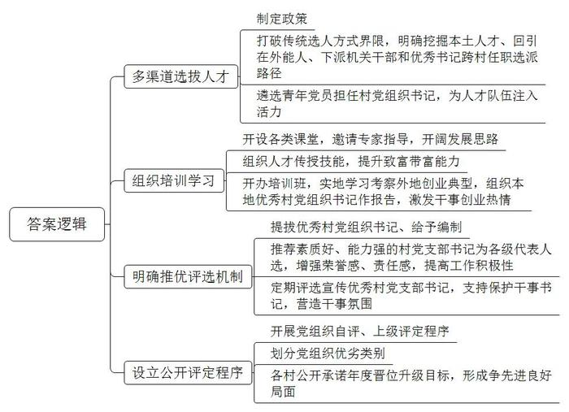
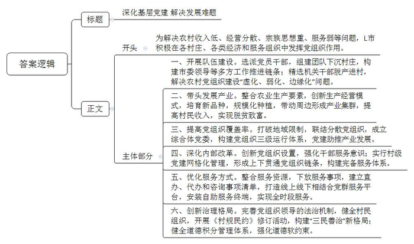
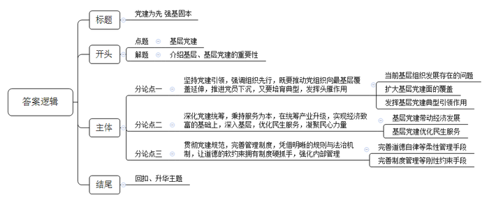

# 2021年山东省公考《申论》题（B卷）

> 候选采集稿。参考答案及解析来自粉笔页面，不代表官方答案或真实高分答卷；来源使用许可与原卷对应关系仍需人工核实。

## 给定材料

### 材料 material-922921b784765b37

2009年，D县武胜桥镇玉皇庙村流转全村所有土地，成立了玉皇农业科技有限公司，但由于缺少懂现代农业的专业人才，公司连年亏损。2013年，D县县委提前谋划村“两委”班子，特别是注重选出政治素质好、群众口碑好、带富能力强、服务意识强的村党组织书记。县委组织部牵头实施“优秀人才回乡计划”，中国科学院昆明植物研究所植物学博士、中国农业大学作物学博士后关志洁作为目标人选，2014年10月回乡接任该村党支部书记。深谙新型农业生产的关志洁，充分发挥专业优势，带领群众走现代农业发展道路。2019年，玉皇农业科技有限公司已形成集特色种养、农产品加工贮运、休闲农业和乡村旅游于一体的综合性产业，年销售收入突破1000万元。

雁飞千里靠头雁，实践证明，选好一个人，就能带好一班人、建好一个村。2019年底，D县县委着手实施“头雁工程”制定《关于从机关企事业单位和社会优秀人才中选派村（社区）党组织书记的实施办法（试行）》，打破传统村为界限的选人方式，明确“本土人才”挖掘一批、“在外能人”回引一批、机关干部下派一批、优秀书记跨村任职一批4条路径。首批从县乡机关和社会优秀人才中，遴选56名年龄在45岁以下、大专以上学历的党员，到村担任党组织书记，为全县村党组织书记队伍注入了活力。任职半年，这56名村党组织书记的工作初见成效，领办合作社32个，引进项目41个，初步转化后进村29个，为群众办实事670余件。

在带领玉皇庙村发展壮大村集体经济的探索中，关志洁感受到部分村“两委”干部带富能力不强，发展特色思路不开阔，创新创造、先行先试勇气不足，存在小富即满的心理，还有的村干部存在“守家度日”的思想，缺乏担当精神，没有发展村集体经济的长远规划。针对这些问题，在关志洁的建议下，武胜桥镇党委把提升村“两委”干部致富带富能力作为基层党建工作与乡村振兴相融合的突破口，开办“乡村振兴大讲堂”，先后邀请百余名省内外知名专家学者，采取集中授课、现场考察、对接合作等形式，定期到镇里传经送宝。

县委组织部及时总结推广武胜桥镇的做法，根据全县村“两委”干部的实际情况，开设三类课堂：对于缺乏发展思路的，邀请农业、发改、文旅、商务等方面专家开设“发展课堂”送思路；对于缺乏致富技能的，组织农技、养殖、林业、电商等方面人才开设“技能课堂”传技能；对于缺乏进取精神的，开设“榜样课堂”鼓士气，组织他们实地学习考察外地创业典型，组织本地优秀村党组织书记作报告，激发干事创业热情。县委组织部先后分14期对村“两委”成员进行集中轮训，组织村党支部书记先后到山东临沂、山西贾家庄、浙江湖州、江苏苏州等地培训学习，参训人员近5000余人次。陈屯村党支部陈书记在参加全县组织的村党支部书记发展集体经济培训班后，带领村“两委”成员到河北等地考察村集体产业发展项目，流转土地500余亩，引进麦古金银花种植项目。在村党支部的引领下，麦古公司采取“示范基地+公司+联营种植农户”的运作模式，建成金银花育苗基地120亩、种植基地360亩，年村集体增收5万元。

近年来，D县有两名村党组织书记被提拔进入乡镇领导班子，4名村党组织书记成为乡镇公务员，5名村党组织书记进入乡镇事业编。县里还积极推荐政治素质好、参政议政能力强的村党支部书记为各级党代会代表、人大代表、政协委员人选，切实增强荣誉感和责任感，提高工作积极性和主动性。此外，该县还定期评选和宣传优秀村党支部书记，支持、保护敢干事、能干事、干成事的村党支部书记，大力营造干事创业的浓厚氛围。

为解决工作指导“一刀切”、工作考核“一锅煮”等问题，扩大“头雁工程”效应，D县通过农村党组织自评、上级党组织评定等程序，把全县406个村（社区）党组织分为“好、中、差”三类，各农村党组织及村党组织书记公开承诺年度晋位升级目标，形成先进更先进、一般争先进、后进赶先进的良好局面。目前，该县涌现出了接续奋斗再谋新篇的玉皇庙村，做大新产业、壮大集体经济带民富的陈屯村，党建引领、革新图强“后进”变“样板”的于屯村，村干部干在实处为群众、党员同德同心开新局的宋庄村，还有选对一个“领头雁”、全村一年大改变的白店村等先进典型。

### 材料 material-0344eb9fb97c94fa

2017年以来，L市开展了“强基固本村村行”活动，选派3000名党员干部组成了12个大队、72个中队、861个工作组，分赴全市12处镇街的861个村庄，确保镇街、村庄全覆盖，构建起市委领导、大队推进、党委配合、中队联络、工作组指导、党支部落实的工作推进链条。同时，又精选了107名机关干部，脱产进驻107个后进村，着力解决农村党组织建设中存在的“虚化、弱化、边缘化”等问题。

沟东村曾是L市典型后进村。2014年以前，沟东村集体年收入为零，村民年收入不到5000元；2014年以后，沟东村贫困户全部脱贫，村集体年收入12万元。“俺村能有今天，是党支部领路领得好。”说起沟东村的“致富密码”，村民王良深有感触，“党支部带领全村种葡萄，大伙儿都富裕起来了，像我这样的贫困户一年也能收入3万元。看到沟东村好了，周边四个村也加入我们，一块儿发展葡萄产业。”

“传统的小农户分散经营方式制约了农村经济持续发展。农村基层党组织必须提高统筹资源能力，以产业为纽带，有效整合区域内各类要素和发展资源，加快调整农村生产关系，更好地促进生产力的发展。”L市日庄镇党委书记说。

现在的沟东新村由沟东、徐家寨、青峰岭、南埠、玉池5个自然村组成，其中有4个曾是省定贫困村，在党总支的统领作用下，整合了5个村庄的土地、资产、人才等生产要素，创新“党总支+合作社+农业公司+农户”模式，延伸培育“阳光玫瑰”“玫瑰香”等8个葡萄品种，发展无核葡萄基地1200亩，辐射带动周边村庄形成6000余亩的无核葡萄产业集群。

如今，沟东新村人均收入增至20800元，成为国家乡村旅游重点扶持村、全国乡村治理示范村。

随着新型农业经营主体和各类服务组织的大量涌现，仅靠农民或普通合作组织，难以实现小农户与大市场的有效对接。L市本着利于党组织发挥作用、便于党员参加活动、加快农业产业发展的原则，加大了在各类经济和服务组织中建立党组织的力度。2018年3月，L市山后人家田园综合体创业园成立了该市第一家田园综合体党委——沽河街道山后人家综合体党委，由山后人家党支部、山后韭菜合作社党支部等3个党支部构成，构建了“街道党工委—综合体党委—党支部”三级运行体系。田园综合体党委打破了地域限制，将原本分散的党组织联结为紧密的党建共同体，形成了条块结合、上下联动、层层落实的工作格局，实现了以党建推动休闲农业、休闲旅游、休闲文化的集群发展。“在党委领导下，我们的农业旅游越来越好，旺季时每天五六十辆大巴拉着几千人到我们这里体验田园之乐。”山后人家田园综合体创业园负责人介绍说。

“有的村庄宗派思想严重，有的村庄服务意识淡薄……”有着15年基层工作经历的L市河头店镇党委书记说，“要真正把基层群众服务好，必须深化改革，建好村级党组织班子。”为强化基层干部的“三农”服务意识，L市改革创新党组织设置，把861个自然村的党组织调整为142个新村党组织，同时，织密农村基层区域化党建服务“互联网”，形成“镇党委—村党组织—网格党支部—党员中心户”的组织链条，构建起完备的农村基层党组织服务体系。

在L市各个村庄，一张张看不见的网格已被划定，所有涉及基层公共服务、公共管理、公共安全的事项，统一纳入网格服务管理内容，实现了乡村服务“上面千条线、下面一张网”。每名网格员只负责30-50户，他们既熟悉每户村民的情况，又了解各项惠民政策，为民服务代理开展得有声有色。

在L市望城街道后塔党群服务中心，手机扫码后，望城街道南望城村村民王玲打开智能储存柜，拿到了已经办好的养老保险手册。

“当前，农村各类服务资源和力量相对分散，这与群众日益增长的多元化服务需求不符，我们就整合了各类资源，将适合农村党群服务中心和村庄党群服务站承接的服务事项全面下放，建立直办、代办和咨询事项清单，打造一门式办理、一站式服务、线上线下结合的党群服务平台。”该市行政审批服务局局长说，他们还在新村党群服务中心安装了自助服务终端，可实现24小时全时段服务。

如今，L市在全市各村庄完善了党组织领导的法治机制，健全了协商议事会、红白理事会、道德评议会，集中开展《村规民约》修订活动，构建起民事民议、民事民办、民事民管的“三民善治”新格局。“我们还通过健全道德积分管理体系，从农民群众最关心、最迫切的身边事入手，将村庄重要事务量化为积分指标，使道德的软约束有了硬抓手，用‘小积分’解决大问题。”L市市委常委、宣传部长说。

## 题目

### 第 1 题

**请根据****“****给定资料**1**”****，总结概括****D****县实施****“****头雁工程****”****的主要举措****。****（****20****分）**

关联材料：material-922921b784765b37

作答要求：

要求：全面、准确、有条理；不超过350字。

### 第 2 题

**省里拟于近期召开基层党建工作经验交流座谈会，****L****市将作为先进典型在会上发言，请根据****“****给定资料**3**”****撰写一份发言提纲。（****30****分）**

关联材料：material-0344eb9fb97c94fa

作答要求：

要求：概括准确，内容全面，条理清晰；不超过500字。

### 第 3 题

**请根据对****“****给定资料**5**”****中划线句子****“****治国犹如栽树，本根不摇则枝叶茂荣****”****的理解，结合全部给定资料，自选角度，自拟题目，写一篇文章。（****50****分）**

关联材料：material-922921b784765b37

作答要求：

要求：

（1）观点明确，见解深刻；

（2）参考给定资料，但不拘泥于给定资料；

（3）思路清晰，语言流畅；

（4）字数1000字左右。

## 答案与解析

第 1 题

**参考答案（粉笔题库参考内容）**

1.多渠道选拔人才。制定政策，打破传统选人方式界限，明确挖掘本土人才、回引在外能人、下派机关干部和优秀书记跨村任职选派路径，遴选青年党员担任村党组织书记，为人才队伍注入活力。

2.组织培训学习。开设各类课堂，邀请专家指导，开阔发展思路；组织人才传授技能，提升致富带富能力；开办培训班，实地学习考察外地创业典型，组织本地优秀村党组织书记作报告，激发干事创业热情。

3.明确推优评选机制。提拔优秀村党组织书记、给予编制，推荐素质好、能力强的村党支部书记为各级代表人选，增强荣誉感、责任感，提高工作积极性；定期评选宣传优秀村党支部书记，支持保护干事书记，营造干事氛围。

4.设立公开评定程序。开展党组织自评、上级评定程序，划分党组织优劣类别，各村公开承诺年度晋位升级目标，形成争先进良好局面。

**解析**

**参考答案说明：**答案从“多渠道选拔人才”、“组织培训学习”、“明确推优评选机制”、“设立公开评定程序”等四个方面对D县实施“头雁工程”的主要举措进行了分条撰写。各条要点之间在内容上是并列关系，没有交叉。

**考点**：考点概括措施类

**来源**：来源2021年山东省公考《申论》题（B卷）

粉笔申论页面对本题只提供「解析视频」入口，该入口是会员推广位，页面无视频地址与文字解析。

第 2 题

**参考答案（粉笔题库参考内容）**

深化基层党建 解决发展难题

工作背景：为解决农村收入低、经营分散、宗族思想重、服务弱等问题，L市积极在各村庄、各类经济和服务组织中发挥党组织作用。

经验介绍：

一、开展队伍建设。选派党员干部，组建团队下沉村庄，构建市委领导等多方工作推进链条；精选机关干部脱产进村，解决农村党组织建设“虚化、弱化、边缘化”问题。

二、带头发展产业。整合农业生产要素，创新生产经营模式，培育新品种，规模化种植，带动周边形成产业集群，提高村民收入，实现脱贫致富。

三、提高党组织覆盖率。打破地域限制，联结分散党组织，成立综合体党委，构建党组织三级运行体系，党建助推产业发展。

四、深化内部改革。创新党组织设置，强化干部服务意识；实行村级党建网格化管理，形成上下贯通党组织链条，构建完备服务体系。

五、优化服务方式。整合服务资源，下放服务事项，建立直办、代办和咨询事项清单，打造线上线下相结合党群服务平台，安装自助服务终端，实现全时段服务。

六、创新治理格局。完善党组织领导的法治机制，健全村民组织，开展《村规民约》修订活动，构建“三民善治”新格局；健全道德积分管理体系，强化道德软约束。

**解析**

**参考答案说明：**（1）本题正文分别按照开头（工作的背景、目的等）、主体部分（由于是“经验交流座谈会”，主体部分主要是经验介绍）的结构展开。（2）主体部分从“开展队伍建设”“带头发展产业”“提高党组织覆盖率”“深化内部改革”“优化服务方式”“创新治理格局”等六个方面对基层党建的经验进行了分条撰写。

  

**考点**：考点总结类

**来源**：来源2021年山东省公考《申论》题（B卷）

粉笔申论页面对本题只提供「解析视频」入口，该入口是会员推广位，页面无视频地址与文字解析。

第 3 题

**参考答案（粉笔题库参考内容）**

**党建为先** **强基固本**

欲筑室者，先治其基。诚然，基层作为国家治理的最末端，服务群众的最前沿，是国家治理的基础和重心，是故强基固本方能国势兴盛。在我们致力提升基层治理水平的当下，更要坚持党建引领，通过强调组织先行、秉持服务为本、完善管理制度，才能将党的政治优势、组织优势和群众工作优势转化为治理优势，把党的力量和主张传递到“神经末梢”，走好基层治理的“最后一公里”。

**坚持党建引领，强调组织先行，既要推动党组织向最基层覆盖延伸，推进党员下沉，又要培育典型，发挥头雁作用。**当前基层组织发展存在“散、多、小”的难题，使得人、财、物等资源始终难以汇聚。通过基层党组联建的管理模式创新，以组织联动带动产业、治理、人才协同发展，彰显基层力量之变。“雁飞千里靠头雁”，基层党建发展既需要组织架构搭建从而实现群雁集聚，更离不开作为领头雁的先锋人才。菏泽玉皇庙村正是通过聚集人才并开展针对性的培育养成工作，才让先进典型为其致富带富提供可能，更为基层培育人才提供样本，真正实现“群雁”齐飞、“头雁”领航的美好愿景。

**深化党建统筹，秉持服务为本，在统筹产业升级，实现经济致富的基础上，深入基层，优化民生服务，凝聚民心力量。**天地之大，黎元为先。在拥有组织领导、要素聚集的基础上，提高统筹资源的能力，通过加快生产关系、生产力的发展，充分发挥党组织在集体经济发展中的带头作用，从而帮助实现群众收入提升，满足群众基础物质需求。此外，在人民日益增长的美好生活需要中，更需要党员干部深入群众、问需于民，研判群众潜在需要，借助现代互联网手段实现一站式全流程服务与智能化服务，顺势而为，满足群众多元化需求，实现民生跟着民声走。

**贯彻党建规范，完善管理制度，凭借明晰的规则与法治机制，让道德的软约束拥有制度硬抓手，强化内部管理。**“无规矩不成方圆”，长期以来，我们都强调让党员干部自觉培养高尚的道德情操、敢想敢干的创新意识，但光靠意识的弘扬与监管往往会出现“思想失之于怠、落实失之于虚、监督失之于软”等问题。因此，通过规范的程序建立健全各项评议会，量化道德考评指标，对工作实效有明确考核机制，才能让道德约束有制度作为底线保障，才能长期有效地赓续红色基因、砥砺奋进之志。

国欲兴其势，必先固其本。正如习近平总书记强调的，推进国家治理体系和治理能力现代化，社区治理只能加强、不能削弱，维持基层有效治理一直是党和政府念兹在兹之举。当下，我们更应牢固树立大抓基层的鲜明导向，推进基层建设的全面进步、全面过硬，实现基层党建管思想、把方向、聚合力、固根基。

**解析**

**文章分析**

**党建为先** **强基固本**

【**标题的优点：**首先，范文的标题突出了“基层党建”这一主题。其次，形式上，将主题分成两个半句表达出来，使标题更加新颖、简洁。】

欲筑室者，先治其基。诚然，（1）基层作为国家治理的最末端，服务群众的最前沿，是国家治理的基础和重心，是故强基固本方能国势兴盛。（2）在我们致力提升基层治理水平的当下，更要坚持党建引领，通过强调组织先行、秉持服务为本、完善管理制度，才能将党的政治优势、组织优势和群众工作优势转化为治理优势，把党的力量和主张传递到“神经末梢”，走好基层治理的“最后一公里”。

【**开头的优点：**★内容方面：范文的开头是紧扣“基层党建”这一主题展开的。首先，开头点出主题，做到了主题明确。其次，对“基层党建”这一主题进行了分析阐述，指出了（1）基层的重要性；（2）基层党建的重要性。★文字表达方面：长短句配合使用，使语言表达有节奏感。】

**坚持党建引领，强调组织先行，既要推动党组织向最基层覆盖延伸，推进党员下沉，又要培育典型，发挥头雁作用。**（1）当前基层组织发展存在“散、多、小”的难题，使得人、财、物等资源始终难以汇聚。（2）通过基层党组联建的管理模式创新，以组织联动带动产业、治理、人才协同发展，彰显基层力量之变。（3）“雁飞千里靠头雁”，基层党建发展既需要组织架构搭建从而实现群雁集聚，更离不开作为领头雁的先锋人才。菏泽玉皇庙村正是通过聚集人才并开展针对性的培育养成工作，才让先进典型为其致富带富提供可能，更为基层培育人才提供样本，真正实现“群雁”齐飞、“头雁”领航的美好愿景。

【**论述段****1****的优点：**★观点句：范文的观点句是紧扣“基层党建”这一文章主题提出的。形式上，它在段首处直接写出，位置突出，容易发现。内容上，关键词突出，内容要点明确，可以明显看出它是从“基层党组织建设”入手，指出了“发挥党建引领作用，完善基层党建”。★论述内容：（1）先介绍了“当前基层组织发展存在的问题”；（2）接着介绍了“扩大基层党建面的覆盖”；（3）最后介绍了“发挥基层党建典型引领作用”。注意：以上三个方面层次清晰，论述的针对性强。在论述方法和论据的选取上采用了讲道理、举例子相结合，论述内容比较丰富多样。】

**深化党建统筹，秉持服务为本，在统筹产业升级，实现经济致富的基础上，深入基层，优化民生服务，凝聚民心力量。**（1）天地之大，黎元为先。在拥有组织领导、要素聚集的基础上，提高统筹资源的能力，通过加快生产关系、生产力的发展，充分发挥党组织在集体经济发展中的带头作用，从而帮助实现群众收入提升，满足群众基础物质需求。此外，（2）在人民日益增长的美好生活需要中，更需要党员干部深入群众、问需于民，研判群众潜在需要，借助现代互联网手段实现一站式全流程服务与智能化服务，顺势而为，满足群众多元化需求，实现民生跟着民声走。

【**论述段****2****的优点：**★观点句：范文的观点句是紧扣“基层党建”这一文章主题提出的。形式上，它在段首处直接写出，位置突出，容易发现。内容上，关键词突出，内容要点明确，可以明显看出它是从“优化服务”入手，指出了“深化党建统筹功能，完善基层党建”。★论述内容：（1）先介绍了“基层党建带动经济发展”；（2）接着介绍了“基层党建优化民生服务”。注意：以上两个方面层次清晰，论述的针对性强。在论述方法上主要采用了讲道理的方式，论述比较深刻、清晰。】

**贯彻党建规范，完善管理制度，凭借明晰的规则与法治机制，让道德的软约束拥有制度硬抓手，强化内部管理。**（1）“无规矩不成方圆”，长期以来，我们都强调让党员干部自觉培养高尚的道德情操、敢想敢干的创新意识，但光靠意识的弘扬与监管往往会出现“思想失之于怠、落实失之于虚、监督失之于软”等问题。因此，（2）通过规范的程序建立健全各项评议会，量化道德考评指标，对工作实效有明确考核机制，才能让道德约束有制度作为底线保障，才能长期有效地赓续红色基因、砥砺奋进之志。

【**论述段****3****的优点：**★观点句：范文的观点句是紧扣“基层党建”这一文章主题提出的。形式上，它在段首处直接写出，位置突出，容易发现。内容上，关键词突出，内容要点明确，可以明显看出它是从“完善管理制度”入手，指出了“贯彻党建规范，强化内部管理”。★论述内容：（1）先介绍了“完善道德自律等柔性管理手段”；（2）接着介绍了“完善制度管理等刚性约束手段”。注意：以上两个方面层次清晰，论述的针对性强。在论述方法上主要采用了讲道理的方式，论述比较深刻、清晰。】

【**论述段之间的关系：**范文的论述段之间依照“并列”的逻辑展开的。论述段1先写了“加强基层党组织建设”，论述段2再写了“优化民生服务”，论述段3接着写了“完善管理制度”。三个论述段的逻辑清晰、层次分明。】

国欲兴其势，必先固其本。正如习近平总书记强调的，推进国家治理体系和治理能力现代化，社区治理只能加强、不能削弱，维持基层有效治理一直是党和政府念兹在兹之举。当下，我们更应牢固树立大抓基层的鲜明导向，推进基层建设的全面进步、全面过硬，实现基层党建管思想、把方向、聚合力、固根基。

【**结尾的优点**：范文的结尾回扣了“基层党建”这一主题。再次指出要加强基层党建，促进基层有效治理，推进国家治理体系和治理能力现代化。做到了观点突出，论证完整。】

**考点**：考点文章写作题

**来源**：来源2021年山东省公考《申论》题（B卷）

粉笔申论页面对本题只提供「解析视频」入口，该入口是会员推广位，页面无视频地址与文字解析。

