# 2021 山东省公务员录用考试 行测（统考）

> 行测 · 90 题 · 山东 2021

## 第 1 题　qid 2741640 · 新思想

下列表述没有体现习近平生态文明思想的是：

- **A**. “宁要绿水青山，不要金山银山”，绝不以牺牲环境为代价去换取一时的经济增长
- **B**. “先发展，后治理”，在经济欠发达、生态环境良好的地区坚持发展优先、保护为主的方针
- **C**. “山水林田湖草是一个生命共同体”，坚持综合治理，对自然生态空间进行统一确权登记
- **D**. “环境就是民生”，发展经济是为了民生，保护生态环境同样也是为了民生

## 第 2 题　qid 2741643 · 地理国情

“十三五”时期，山东省在对外开放、区域协调发展、基础设施建设等方面取得显著成就。下列相关表述错误的是：

- **A**. 构建了“一群两心三圈”的区域发展总体格局
- **B**. “齐鲁号”欧亚班列已将西向运行最远端延伸到波兰
- **C**. 省内高速公路通车里程突破7200公里，重回全国第一方阵
- **D**. 打造“山水圣人”中华文化枢轴，建设尼山世界儒学中心

## 第 3 题　qid 2741646 · 经济常识

下列经济状况与国家的应对措施对应正确的是：

- **A**. 通货膨胀——增发专项基建国债
- **B**. 通货紧缩——增加税收
- **C**. 经济下行——实行赤字财政
- **D**. 经济过热——降低再贴现率

## 第 4 题　qid 2741655 · 法律常识

下列行为符合我国法律规定的是（    ）。

- **A**. 甲面包食品有限公司在其生产的面包外包装上使用“哈哈娃”标识
- **B**. 乙酒店向送乘客到酒店就餐的出租车司机发送餐券作为奖励，因金额较小，不在公司账面上详细记录
- **C**. 经丙百货公司同意，某快递公司在丙公司官网上插入其快递服务链接
- **D**. 丁超市举办购物抽奖活动，某副经理小张未购物却获得一等奖

## 第 5 题　qid 2741657 · 人文常识

下列哪一诗句的主题与其他三项不同？

- **A**. 南有乔木，不可休思。汉有游女，不可求思
- **B**. 呦呦鹿鸣，食野之苹。我有嘉宾，鼓瑟吹笙
- **C**. 野有蔓草，零露漙兮。有美一人，清扬婉兮
- **D**. 风雨如晦，鸡鸣不已。既见君子，云胡不喜

## 第 6 题　qid 2741638 · 法律常识

小王和小张系工友，因琐事发生纠纷后互殴，小王将小张打成轻伤，公安机关立案后双方达成和解协议，小张也表示了谅解，下列说法错误的是：

- **A**. 人民检察院可以作出不起诉的决定
- **B**. 公安机关可以向人民检察院提出从宽处理的建议
- **C**. 人民检察院可以向人民法院提出从宽处罚的建议
- **D**. 公安机关可以撤销刑事立案并作出行政处罚的决定

## 第 7 题　qid 2741644 · 人文常识

下图中①代表金砖国家，③代表联合国安理会常任理事国，则关于②所代表的国家说法正确的是：

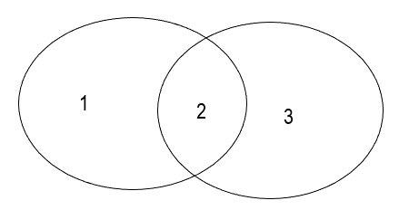

- **A**. 领土接壤
- **B**. 官方语言相同
- **C**. 属于同一大洲
- **D**. 同属四大文明古国

## 第 8 题　qid 2741651 · 人文常识

发热是临床上常见的症状。关于发热，下列说法正确的是：

- **A**. 
体温超过说明病人已经发热

- **B**. 
一定程度的发热可使人体免疫功能增强

- **C**. 
手术后就发热说明病人发生了伤口感染

- **D**. 
病人发热后没有食欲主要因为唾液淀粉酶失去活性

## 第 9 题　qid 2741652 · 人文常识

宋徽宗酷爱书法和绘画，以下哪幅画他不可能鉴赏过?

- **A**. 《富春山居图》
- **B**. 《步辇图》
- **C**. 《千里江山图》
- **D**. 《簪花仕女图》

## 第 10 题　qid 2741656 · 科技常识

下列鉴别物质的方法错误的是（    ）。

- **A**. 用肥皂水鉴别硬水与软水
- **B**. 用稀硫酸鉴别锌片与铜片
- **C**. 用酚酞试液鉴别纯碱与烧碱
- **D**. 用燃着的木条鉴别氧气与二氧化碳

## 第 11 题　qid 2741681 · 逻辑填空

促进技术创新、产业升级，实现经济高质量发展，离不开人才的        作用，但是，有的地方并没有认真思考自身实际条件对吸引人才、发挥人才积极作用的影响，恨不得引进一批人才后立刻就让当地经济社会发生翻天覆地的变化，在引进人才工作上出现            的问题。
依次填入画横线部分最恰当的一项是：

- **A**. 引导 拔苗助长
- **B**. 辅助 一拥而上
- **C**. 支撑 急功近利
- **D**. 推动 因噎废食

## 第 12 题　qid 2741686 · 逻辑填空

一把剪刀、一个镊子、一支毛笔、一碗糨糊、一盏台灯······在图书馆的古籍中心，古籍修复师们年复一年重复着手中的工作。在需要修复的珍贵古籍面前，他们始终            。
填入画横线部分最恰当的一项是：

- **A**. 不苟言笑
- **B**. 如履薄冰
- **C**. 精益求精
- **D**. 视若珍宝

## 第 13 题　qid 2741688 · 逻辑填空

侦探小说的长久流行，部分原因是读者对世理人情中的阴暗面            的好奇心。安宁与平静只是一种表象，只要稍微留心，便能觉察到看似            的日常中处处有大大小小的危机。平凡生活的危机就是侦探小说最广泛和丰富的素材来源。
依次填入画横线部分最恰当的一项是：

- **A**. 与生俱来 悠然自得
- **B**. 历久弥新 百无聊赖
- **C**. 自然而然 波澜不惊
- **D**. 经久不衰 一成不变

## 第 14 题　qid 2741691 · 逻辑填空

一项新的研究表明，包括狩猎和徒步旅行在内的人类活动正在促使世界各地的哺乳动物在夜间变得更加        ，表现出夜行性增强的趋势。因为只有在这个时候它们才不太可能碰到人类，这种转变所造成的后果尚不清楚，但科学家怀疑，这可能会        到一些动物种群的生存。
依次填入画横线部分最恰当的一项是：

- **A**. 敏感 影响
- **B**. 亢奋 侵犯
- **C**. 活跃 威胁
- **D**. 冲动 妨碍

## 第 15 题　qid 2741742 · 逻辑填空

戏曲电影是丰富人们精神文化生活的重要方式，更是用新的科技手段传播中华传统文艺             的措施。但我们要把握电影环境的新变化，找准戏曲电影的        观众，培育更适宜其生存发展的优质土壤，只要根据新的社会环境对症下药，戏曲电影的第二春不久定会到来。
依次填入画横线部分最恰当的一项是：

- **A**. 有的放矢 潜在
- **B**. 行之有效 目标
- **C**. 独具匠心 特定
- **D**. 得天独厚 新兴

## 第 16 题　qid 2741689 · 逻辑填空

街头艺术是一座开放的城市重要的一部分。一方面，街头艺术是城市的品味和气质，它比鳞次栉比的高楼大厦更温润人心。另一方面，文艺应让所有人都能够        ，街头也应该成为表现艺术的“基层”。我们的文化自信、主旋律和正能量，不仅仅表达在严谨的大舞台，亦可以展现在        的小天地。
依次填入画横线部分最恰当的一项是：

- **A**. 认同 自由
- **B**. 欣赏 活泼
- **C**. 理解 随意
- **D**. 接触 温馨

## 第 17 题　qid 2741693 · 逻辑填空

在互联网已经进入下半场的背景下，技术成为驱动企业发展的        ，人工智能不仅是下一代信息技术的核心和焦点，也是最有可能改变人类生活的技术。当前，不少企业尤其是行业龙头企业已经在着手进行研发、应用人工智能，想在这一次的科技革命中抢占先机，从而        拥有新的核心竞争力，        自己的行业地位。
依次填入画横线部分最恰当的一项是：

- **A**. 关键 持续 树立
- **B**. 支柱 真正 打造
- **C**. 动力 迅速 维护
- **D**. 引擎 率先 巩固

## 第 18 题　qid 2741694 · 逻辑填空

文学研究一直离不开两个维度：一个倾向于艺术的、内部结构的审美研究；另一个倾向于社会的、外部关系的意义揭示。两者原本可以            ，互为补充，但在不同时代，由于对文学本体的追问，以及文学的主体性和文学的社会价值性上思考不同，使两者关系变得复杂，甚至紧张和        。
依次填入画横线部分最恰当的一项是：

- **A**. 珠联璧合 僵持
- **B**. 相得益彰 对立
- **C**. 互通有无 尖锐
- **D**. 并行不悖 冲突

## 第 19 题　qid 2741745 · 逻辑填空

当前，以数字化的知识和信息作为关键生产要素的数字经济蓬勃发展，新技术、新业态、新模式            。各国纷纷将发展数字经济作为推动实体经济提质增效、        核心竞争力的重要举措，推动数字经济取得的创新成果        于实体经济各个领域，围绕新一轮科技和产业制高点展开积极竞合。
依次填入画横线部分最恰当的一项是：

- **A**. 层出不穷 重塑 融合
- **B**. 乏善可陈 形成 应用
- **C**. 方兴未艾 提升 实践
- **D**. 纷至沓来 培育 落实

## 第 20 题　qid 2741695 · 逻辑填空

所谓“做对的事情”，就是要把握        ，清晰利弊，在做事之前要仔细考虑，分析判断，着眼于长远，理清            ，找出关键点。而“把事情做对”则将关注重点引向了        ，强调做事情方法要正确，二者缺一不可。
依次填入画横线部分最恰当的一项是：

- **A**. 原则 是非曲直 源头
- **B**. 方向 来龙去脉 过程
- **C**. 规律 轻重缓急 结果
- **D**. 趋势 千头万绪 目的

## 第 21 题　qid 2741709 · 片段阅读

或许是农业文明的缘故，中国人的衣食住用里，一直透着对自然的敏感。漆器是最典型的一种。这些器物，小至盘碗碟盒、大至桌椅箱柜，几乎可以覆盖我们日常生活的所有方面，可见漆器的巨大包容性，可以含纳不同品类的事物。漆器上雕饰的图案，除了山水人物，出现最多的当是各种花卉，让我们在吃穿住用间，视野可以穿越纷杂的俗世，与山林田野相通。在故宫博物院所藏17707件漆器里，几乎找不出几件上面没有花卉图案的漆器，即使以龙螭鸟禽、亭台殿阁为主题，也一样是花团锦簇。所以，在这些漆器上，花卉几乎是通用的语言。
这段文字意在说明：

- **A**. 花卉是传统漆器重要的创作主题
- **B**. 农业文明对中国人衣食住用有深刻的影响
- **C**. 漆器有助于了解中国古人的日常生活
- **D**. 漆器作为装饰品反映了创作者的审美情趣

## 第 22 题　qid 2741711 · 片段阅读

彩色摄影是饱含缤纷色彩的造型语言，黑白摄影是经典的、表达独特艺术思考的视觉化工具，它们之间不存在哪个更好、表现力更强的问题。无论是使用经验，还是作品所呈现的视觉效果，这两者都是完全不同的事物。今天的黑白摄影，即使不再是摄影艺术性和技术性的代表，也并不是什么过时的事物。黑白摄影仍具有自身独特的语言和能力，发挥着自己的特色，展现着新的可能，依然是解决、分析、阐述艺术问题的方法手段和需要研究探索的课题。
这段文字意在说明，黑白摄影：

- **A**. 与彩色摄影不具有可比性
- **B**. 在当今语境下仍有较高的艺术价值
- **C**. 需要与时俱进不断发展
- **D**. 自身具有独特的艺术评价标准

## 第 23 题　qid 2741713 · 语句表达

随着越来越多的国家投入到军用机器人的研究与开发中去，世界已在不知不觉中滑进了一场机器人军备竞赛，毋庸置疑，军事机器人相比于士兵，在功能、体能、效能方面具有极大优势。它可以同时承担多项复杂任务，作战更加持久，在程序设定完成后能够高效精准地达成目标，失误率较低，特别是完全自主机器人，与人类战士相比，具有持续作战时间长、反应能力快、生存能力强等优势，将会进一步增加战争的强度。然而                      ：参战的自主机器人到底是不是战斗员？又应当承担何种战争责任？
填入画横线部分最恰当的一项是：

- **A**. 自主机器人在战争中的角色引人深思
- **B**. 机器人参战可以重塑未来战争的图景
- **C**. 机器人军备竞赛的发展前景尚不明朗
- **D**. 有关战争责任的伦理问题也随之出现

## 第 24 题　qid 2741714 · 片段阅读

研制超材料就是按照特定的规则组合，搭配出不同电磁响应属性的人工复合材料。这些材料的属性除由材料本身决定外，还与其结构的形状、尺寸、排列和组合方式等紧密相关。通过改变超材料关键位置的结构和尺寸，人们就可以像搭积木一般实现对光波、雷达波、无线电波、声波乃至地震波的任意弯曲和精细“裁减”。比如，研究人员借助超材料薄层能让光线绕过物体的属性，开始研究使物体无影无踪的“隐身斗篷”。
这段文字主要介绍了超材料的（    ）。

- **A**. 研制原理
- **B**. 应用领域
- **C**. 分类标准
- **D**. 设计意图

## 第 25 题　qid 2741715 · 语句表达

早期人们对质量的认识并不清晰，质量管理专家给出的质量定义也不统一，比较有代表性的定义是“质量是产品符合规定要求的程度”，这是从生产角度来定义的质量，即强调产品要达到规定要求或标准。20世纪60年代美国质量管理专家提出，质量是产品的适应性，强调产品要适合用户的使用需要，任何产品如果不能满足顾客需要，不管它多么符合产品标准，也不是好的质量，这是人们首次从用户的角度认识和定义质量。                        ，这是质量观的一次重大转变。
填入画横线部分最恰当的一项是：

- **A**. 从满足生产需求转变到供给需求
- **B**. 从对产品的保量要求转变到保质要求
- **C**. 从强调产品转变到强调服务
- **D**. 从关注生产方转变到关注需求方

## 第 26 题　qid 2741719 · 片段阅读

日前，被称为“互联网原住民”的年轻人正在成为影视剧等文化产品的消费主体，他们的喜好左右着市场方向和创作方向。从积极的方面来说，这有利于文创产品供应和需求之间形成有效对接，以需求拉动生产，激活市场潜力，但另一方面，过度依赖市场需求也可能导致创作方的中长期迷失。新一代年轻人兴趣多元，关注力持续度不高，由此构成的市场需求很多情况下并不具备中长期生命力，创作者和制作方如果一味跟进年轻人多变的兴趣，难免顾此失彼、陷入被动。因此，创作者和制作方更应该仔细研究这些兴趣背后的社会基础和真实有效的需求。
这段文字着重指出文创产业存在的哪一问题？

- **A**. 盲目迎合受众喜好
- **B**. 缺乏中长期规划
- **C**. 产品供应能力不足
- **D**. 内容和形式缺乏创新

## 第 27 题　qid 2741720 · 片段阅读

当人脑在发育阶段接触到视觉刺激，也就是通过眼睛看到外界事物时，视皮层上的神经元会被激活，也就是说这些神经元会对不同的图像特征如颜色、形状、亮度、朝向、距离等进行加工。如果人正处于视觉功能的发育关键期，而视觉神经元未被充分激活，未来在看到某些图像特征时就不会产生反应或反应比较弱，导致看不见或看不清。
这段文字最适合作为下列哪个观点的论据？

- **A**. 人体的不同机能存在着不同的发育关键期
- **B**. 人体功能发育不充分有可能造成终生影响
- **C**. 图像特征对视皮层神经元的激活至关重要
- **D**. 错过发育关键期有可能丧失部分人体机能

## 第 28 题　qid 2741721 · 语句表达

①故宫中共有铁、铜、鎏金铜大缸308口，这些都是明清两代为防火而设置的储水缸
②作为明清两代的皇宫，故宫一直注重防火
③同时，金水河也是故宫自古以来的消防水源
④目前，这些古代流传下来的防火传统仍然适用
⑤“冬凿冰、夏注水、春除草、秋清叶”是故宫的防火传统
⑥每口缸大约可储水3000升，时刻保持满盈状态
将以上6个句子重新排列，语序正确的是：

- **A**. ②①⑥⑤④③
- **B**. ⑤①⑥②③④
- **C**. ⑤④②①⑥③
- **D**. ②⑤①⑥③④

## 第 29 题　qid 2741723 · 片段阅读

距今200万~100万年前，在类人猿向现代智人进化期间，人类祖先的大脑就进化出了支持合作的功能，以支持狩猎活动。这使人类祖先前额皮层里的记忆与思考中心变得比其他灵长类动物的更发达。随着群体变得比个体更强大，大脑不断进化出管理更大群体的能力，群体之间的竞争就变得比个体之间的竞争更重要，同时拥有更多合作性个体的群体发展得更好，这一进化使得利他意识、伦理观、良知和尊严意识发展起来。
这段文字意在说明：

- **A**. 人类祖先的狩猎活动离不开群体的合作
- **B**. 大脑在群体生活中的进化可以激发美德
- **C**. 大脑的构造会因生活方式的变化而演化
- **D**. 群体发展取决于拥有合作性个体的数量

## 第 30 题　qid 2741738 · 片段阅读

南朝文学批评家钟嵘在《诗品》中评论晋人刘琨的作品“善为凄戾之词，自有清拔之气。琨既体良才，又罹厄运，故善叙丧乱，多感恨之词”。这是用刘琨罹逢厄运的经历，来解释其诗作何以多感慨悲愤之词。当代的文学评论家更是自觉地运用这种方法考察作品。某位研究清末小说《孽海花》的学者曾说，要理解这部作品，就要“知人论世”，有必要探索曾朴的生活、思想历程与创作过程。可知，“知人论世”是他研究《孽海花》的重要方法。
这段文字意在说明：

- **A**. “知人论世”历来是重要的文学研究方法
- **B**. 作家的经历会对作品产生深刻的影响
- **C**. “知人论世”被奉为古代作品研究的圭臬
- **D**. 当代学者继承了中国古人的文学研究模式

## 第 31 题　qid 2578978 · 片段阅读

唐代是中国园艺起步的时代。唐以前不管是皇家园林还是寻常百姓，栽培树木草本多以实用为主。而到了唐代，人们栽培植物逐渐向观赏性发展，果实不堪食用的海棠便因此开始得到重视。到了宋代，海棠成为园林观赏植物中的明星，宋人常以海棠牡丹并论，在宋代花鸟画中便有以海棠为题的古画留传。而宋代之后，海棠已然是中国传统的名花，历代都不少见。中国人喜欢海棠，于是中国古典园林中的海棠植于庭院，正是应了“金玉满堂”的谐音。
这段文字主要介绍了：

- **A**. 中国古典园艺史的发展脉络
- **B**. 海棠在中国古典园艺史上的地位变迁
- **C**. 海棠作为中国古典园林栽培植物的文化象征
- **D**. 中国古典园林发展后期的主要特征

## 第 32 题　qid 2741724 · 片段阅读

在游戏的世界里，人们不用承担现实生活中同样行为造成的后果，游戏输了可以点击“再来一次”一键复活。因此游戏提供了一种低成本低风险的自我实现方式。当个体在现实生活中受挫，游戏可以成为一种短暂的对现实世界的逃避。在游戏里建立社交关系，不断升级，提供了持续的挑战和个体存在的意义。
最适合做这段文字标题的是：

- **A**. 游戏成瘾，如何解决
- **B**. 游戏社交：安全无负担
- **C**. 现实越受挫，游戏越成瘾
- **D**. 游戏：另一种“自我实现”

## 第 33 题　qid 2741727 · 片段阅读

随着我国科技对经济社会发展贡献率的增大，以及科技介入生活程度的加深，普通人与科技的关系也变得更加密切。科普走进生活，越来越成为人们的普遍期待。而这又对科普创新提出了更高的要求。科普创新当然首先是要及时更新科普的理念和内容，把日新月异的科技发展成果通俗易懂地告诉民众。同时，它也意味着科普形式和手段的创新。增添文艺的元素，则是其题中应有之义。                    。老一辈科学工作者十分善于借用文学艺术的力量。例如，当我们翻阅竺可桢先生《说飓风》《说云》等科普文章时，就会被其准确而又生动的文字所折服。
填入画横部分最恰当的一项是：

- **A**. 人们对科普作品文艺性的期待越来越高
- **B**. 文学艺术是推动科普创新的重要驱动力
- **C**. 事实上，科普本身就具有文学性
- **D**. 如何兼顾科普内容和形式的创新是当务之急

## 第 34 题　qid 2741730 · 片段阅读

对于古希腊人来说，各种形式和内容的比赛活动无所不在，凡是有竞赛的地方就有规则的存在。体育比赛有严格和严密的竞赛规则，裁判员在赛场上依据规则来进行判罚，只有如此才能产生没有任何争议的优胜者。这些活动的背后，如何用好的规则引导竞争，规范竞争，使人向善，使社会更为公正，是古希腊思想家们热衷探讨的话题。
这段文字意在说明：

- **A**. 古希腊人强调竞争中规则的重要性
- **B**. 公平是古希腊思想家们持续关注的话题
- **C**. 遵守规则是古希腊体育比赛的核心理念
- **D**. 严密的规则才能实现社会的公正

## 第 35 题　qid 2578979 · 片段阅读

研究发现，地震前岩石中氡值会有明显变化，就此可对地壳活动作出研判。氡观测是国际上普遍认可的地震监测手段之一，氡值是我国地震观测台网中最重要的测项之一。地震行业氡观测仪主要采用固体氡源进行校准，但固体氡源属于受国家严格监管的放射类源，由于存在运输不便等问题，氡观测仪无法实现全国统一校准。由于监测仪器标准不统一，A地区测出的氡气含量100Bq/L可能跟B地区测出的50Bq/L是一回事。这样的话，测出的数据就没有意义。因此，                    。
填入画横部分最恰当的一项是：

- **A**. 氡观测仪器难以在全国范围内广泛应用
- **B**. 地震监测手段需丰富和多元化
- **C**. 地震行业亟须统一氡观测仪器的标准
- **D**. 在不同地区应采用不同的地震监测

## 第 36 题　qid 2741634 · 数学运算

甲地在乙地的正东方，在丙地的正南方。甲乙之间距离为2.1千米。小张从甲地骑车直线前往丙地，回程时以相同速度直线前往乙地再直线返回甲地，回程时的路程比去程长。问甲丙之间的距离在以下哪个范围内？

- **A**. 不到5千米
- **B**. 在5~6千米之间
- **C**. 在6~7千米之间
- **D**. 超过7千米

## 第 37 题　qid 2741641 · 数学运算

甲、乙、丙三人投资成立一家公司，初期共投入700万元。公司估值上涨时三人进行了二期投资，甲投入了与其初期投资相同的金额，乙投入了其初期投资金额的2倍，丙投入了其初期投资金额的，二期总投入刚好也是700万元，此时甲、乙、丙三人的持股比例为5：14：16，那么初期投资乙比甲投入：

- **A**. 多100万元
- **B**. 多50万元
- **C**. 少100万元
- **D**. 少50万元

## 第 38 题　qid 2741654 · 数学运算

进入某比赛四强的选手通过抽签方式随机分成2组进行半决赛，已知小王在面对任何对手时获胜的概率都是，小张在面对任何对手时获胜的概率都是。问小王和小张均在半决赛中获胜的概率为：

- **A**. 
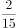

- **B**. 

- **C**. 
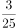

- **D**. 

## 第 39 题　qid 2741659 · 数学运算

一个正方形跑道如下图所示。甲从A出发沿顺时针方向匀速跑步，其到达AB中点时，之前一直在A保持静止状态的乙也出发，沿顺时针方向以与甲相同的速度跑步。问以下哪个坐标图最能准确地描述跑步时间（横轴T值）和甲、乙之间直线距离（纵轴L值）之间的关系？

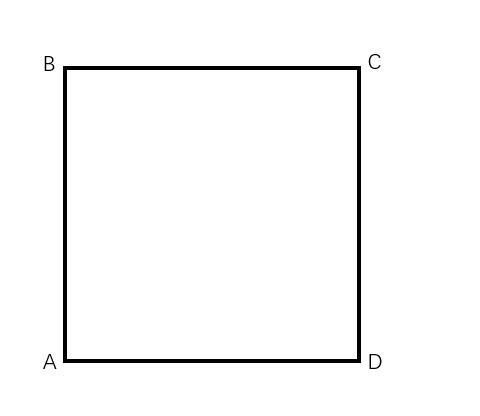

- **A**. 
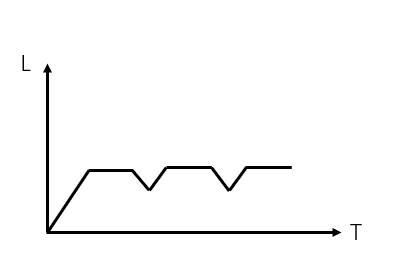

- **B**. 
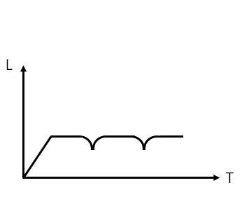

- **C**. 
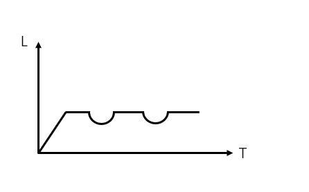

- **D**. 
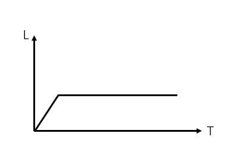

## 第 40 题　qid 2741664 · 数学运算

千克甲盐水和千克乙盐水中的含盐量相同。将千克乙盐水与千克甲盐水混合，并蒸发掉千克水之后，得到的溶液浓度是乙盐水的倍。问乙盐水的浓度是甲盐水的多少倍？

- **A**. 
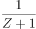

- **B**. 
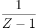

- **C**. 
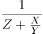

- **D**. 
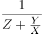

## 第 41 题　qid 2741662 · 数学运算

某围场的形状为边长100米的等边三角形，在场地正中修建一座信号塔，塔顶安装有效覆盖半径为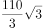米的信号发射器。如要信号覆盖整个围场的地面，则信号塔的高度最高为多少米？

- **A**. 
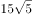

- **B**. 
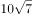

- **C**. 
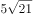

- **D**. 
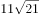

## 第 42 题　qid 2741663 · 数学运算

某种商品有小箱和大箱两种包装，一大箱这种商品有400件，张和王同时开始制造这种商品，制造一小箱和一大箱这种商品后，张比王多做50件。如果王此时的效率提高，并与张再共同制造一大箱这种商品，则王制造的总件数比张多50件。问一小箱这种商品有多少件？

- **A**. 50
- **B**. 100
- **C**. 150
- **D**. 200

## 第 43 题　qid 2741665 · 数学运算

某种商品第一天原价销售，第二天开始每天的销售价格比上一天下降原价的。在最后一天前，每天的销量比上一天提高。最后一天的销量与第三天相同。总共6天全部卖完。如果这种商品的成本为原价的，问销售这种商品的总利润是总成本的：

- **A**. 
不到

- **B**. 
之间

- **C**. 
之间

- **D**. 
以上

## 第 44 题　qid 2741666 · 数学运算

将15名实习生名额随机分配给12个部门，每个部门至少分配1人。问有部门获取的名额是3的概率是有部门获取的名额是4的概率的多少倍？

- **A**. 5.5
- **B**. 6
- **C**. 11
- **D**. 1

## 第 45 题　qid 2741667 · 数学运算

将5个相同的圆锥体零件表面涂上红、黄、蓝三种颜色。要求同一个零件的底面只能用一种颜色，同一个零件的斜面也只能用一种颜色，且5个零件的颜色彼此不完全相同，问总共有多少种不同的涂色方式？

- **A**. 84
- **B**. 126
- **C**. 172
- **D**. 180

## 第 46 题　qid 2741620 · 图形推理

从所给的四个选项中，选择最合适的一个填入问号处，使之呈现一定的规律性：

- **A**. A
- **B**. B
- **C**. C
- **D**. D

## 第 47 题　qid 2741623 · 图形推理

从所给的四个选项中，选择最合适的一个填入问号处，使之呈现一定的规律性：

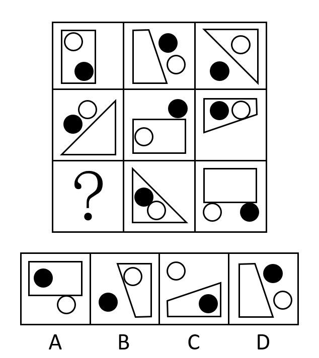

- **A**. A
- **B**. B
- **C**. C
- **D**. D

## 第 48 题　qid 2741626 · 图形推理

左图为给定的立体图形，将其从任一面剖开，右边哪一项不可能是该立体图形的截面？

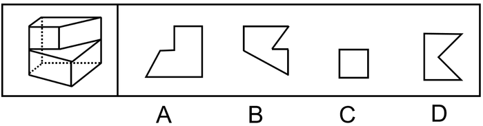

- **A**. A
- **B**. B
- **C**. C
- **D**. D

## 第 49 题　qid 2741630 · 图形推理

左图是给定的立体图形，下面选项哪个是该立体图形的外表面展开图？

- **A**. A
- **B**. B
- **C**. C
- **D**. D

## 第 50 题　qid 2741632 · 图形推理

把下面的六个图形分为两类，使每一类图形都有各自的共同特征或规律，分类正确的一项是：

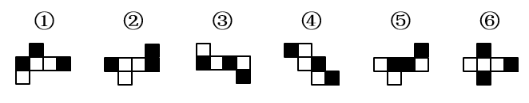

- **A**. ①③④，②⑤⑥
- **B**. ①③⑤，②④⑥
- **C**. ①②⑤，③④⑥
- **D**. ①④⑥，②③⑤

## 第 51 题　qid 2741726 · 定义判断

见微知著是指见到一点儿苗头，就能知道它的发展趋向或问题的实质。下列最能体现见微知著的是：

- **A**. 见一叶落而知秋之将至。
- **B**. 千里之堤，毁于蚁穴。
- **C**. 岁寒，然后知松柏之后凋也。
- **D**. 路遥知马力，日久见人心。

## 第 52 题　qid 2741729 · 定义判断

一个论证是一组陈述，其中的一个或多个陈述（即前提）被用来为另外一个陈述（即结论）提供支持的理由。
根据上述定义，下列属于论证的是：

- **A**. 食物的基因改造存在风险。基因改造过程中，会把意料之外的改变引入到为人类提供食物的生物DNA中，这些改变对于消费者来说可能是有害的。
- **B**. 我们相信我们的公司能为我们的客户提供最好的产品，我们相信我们的产品一定比我们竞争对手的好。
- **C**. 1648~1789年是欧洲主要君主国之间激烈竞争的年代之一，强国之间战争频繁，期间法国成为最重要的国家，在权力之间的平衡阻止了法国的扩张。
- **D**. 不管位置如何，固体都保持各自的形状和体积，液体则占有一定的体积，但其形状与盛装容器的形状有关。

## 第 53 题　qid 2741732 · 定义判断

衬托是为了突出主要事物，用类似的事物或反面的、有差别的事物作陪衬的一种修辞方法。对比是指用相反或相似的两种事物互相比照，以共同表现某种思想或意境的一种修辞方法。二者的区别在于衬托是以次要事物为陪衬来突出主要事物，而对比中体现的两种事物不分主次。
根据上述定义，下列同时使用了上述两种修辞方法的是：

- **A**. 朱门酒肉臭，路有冻死骨。
- **B**. 桃花潭水深千尺，不及汪伦送我情。
- **C**. 蝉噪林逾静，鸟鸣山更幽。
- **D**. 千里黄云白日曛，北风吹雁雪纷纷。

## 第 54 题　qid 2741737 · 定义判断

类比论证是根据两个对象在某些属性上的相同或相似，推论两者在其他属性上也有相同或相似。其逻辑形式为：对象A具有a、b、c、d的属性。对象B具有a、b、c的属性。所以对象B具有d的属性。
根据上述定义，下列属于类比论证的是：

- **A**. 陶渊明不为五斗米折腰，李白不摧眉折腰事权贵······这说明有志气的人都不以高官厚禄为荣。
- **B**. 光和声都具有直线传播、折射、反射等现象，所以光和声一样，也具有波动性。
- **C**. 与一些工作不负责任、拈轻怕重的人相比，白求恩同志对工作极端负责，对同志、对人民极端热情，这说明白求恩同志具有毫不利己，专门利人的伟大精神。
- **D**. 银与铜都是金属，都具有导电性，但是银的电阻率更低，因此银比铜更适宜做导电材料。

## 第 55 题　qid 2741740 · 定义判断

比例原则是指行政机关实施行政行为应兼顾行政目标的实现和适当性手段的选择，保障公共利益和相对人权益的均衡，如为实现行政目标可能对相对人权益造成某种不利影响时，应将这种不利影响限制在尽可能小的范围和限度内，保持二者处于适度的比例。
根据上述定义，行政机关的下列行为最符合比例原则的是：

- **A**. 夫妻二人在家中发生口角，吵闹声较大，公安机关以扰乱公共秩序为由对二人处以罚款500元的处罚。
- **B**. 交通运输局交通执法员黄某在查处车辆超载的过程中，殴打超载冲卡企图逃逸的司机。
- **C**. 规划局批准某公司建造九层商业楼，该公司私自加盖至十二层，规划局认定为违章建筑，要求其把楼房全部拆除。
- **D**. 市政府计划建设化工项目，论证后认为该项目会对附近的国家级风景区和居民生活区造成严重污染，遂将该项目叫停。

## 第 56 题　qid 2741617 · 类比推理

桂：广西

- **A**. 皖：江西
- **B**. 杜鹃花：映山红
- **C**. 河流：湖泊
- **D**. 西红柿：圣女果

## 第 57 题　qid 2741619 · 类比推理

水生动物：卵生动物

- **A**. 腔肠动物：软体动物
- **B**. 甲壳纲动物：节肢动物
- **C**. 飞行动物：哺乳动物
- **D**. 脊椎动物：无脊椎动物

## 第 58 题　qid 2741622 · 类比推理

诗：赋：词

- **A**. 纸：丝绸：竹简
- **B**. 昆曲：戏剧：京剧
- **C**. 油画：水墨画：工笔画
- **D**. 甲骨文：隶书：楷书

## 第 59 题　qid 2741625 · 类比推理

油田：钻探：石油

- **A**. 房产：交易：证书
- **B**. 车站：驾驶：乘客
- **C**. 渔场：捕捞：海鲜
- **D**. 灯塔：搭建：轮船

## 第 60 题　qid 2741629 · 类比推理

铁：铜：镁

- **A**. 棒球：排球：台球
- **B**. 高跟鞋：高帮鞋：增高鞋
- **C**. 高筋粉：米粉：面粉
- **D**. 羊肉：牛肉：腊肉

## 第 61 题　qid 2741624 · 类比推理

策划：编排：直播

- **A**. 测试：上线：研发
- **B**. 育苗：移栽：收割
- **C**. 学车：年检：考证
- **D**. 选房：入住：装修

## 第 62 题　qid 2741627 · 类比推理

老鹰：树枝：天空

- **A**. 蜜蜂：蜂箱：花丛
- **B**. 蟒蛇：山涧：森林
- **C**. 蚊子：沟渠：野外
- **D**. 鲈鱼：江河：海洋

## 第 63 题　qid 2741631 · 类比推理

粘土：陶瓷杯：器具

- **A**. 门窗：房屋：财产
- **B**. 蚕丝：旗袍：服饰
- **C**. 纸张：扉页：图书
- **D**. 牛肉：肉馅：饺子

## 第 64 题　qid 2741633 · 类比推理

天然气：气体：燃料

- **A**. 读后感：感想：散文
- **B**. 量角器：圆规：文具
- **C**. 金银花：花卉：中药
- **D**. 互联网：网络：网站

## 第 65 题　qid 2741636 · 类比推理

食品：蔬菜：绿色食品

- **A**. 电影：历史片：科幻片
- **B**. 中国：海口市：海南省
- **C**. 地图：交通图：单色地图
- **D**. 孔雀：绿孔雀：蓝孔雀

## 第 66 题　qid 2741733 · 逻辑判断

运动会长跑成绩公布后，小张说：“我的排名在前五名，小夏的名次不好，小王是最后过终点的。”小夏说：“我的长跑成绩一直都在这个水平，我紧跟着小王的后面跑过终点。”小王说：“小张和小夏的成绩都比我好。”三个人中最多一个人说假话。
据此，可以推出：

- **A**. 小张说了假话
- **B**. 小夏说了假话
- **C**. 小王说了假话
- **D**. 三人都没说假话

## 第 67 题　qid 2741735 · 逻辑判断

不用“管住嘴，迈开腿”就能成功瘦身，大概是很多人的梦想。然而一边吃的很饱一边掉体重却成了宇航员们的噩梦，因为这会使宇航员损失骨骼和肌肉，还会影响心血管系统的正常运作。宇航员总是表示已经吃饱了，然而与此同时，他们的体重却减轻了，为什么宇航员摄入的食物不够？一位航空研究所人员提出，这是因为食物在失重环境下不会像地球上一样老实待在胃里，它们在胃里漂动，撑开胃部，会更快给大脑送去“你已经吃饱了，别再吃了”的信号。
以下哪项如果为真，最能驳斥这个研究员的解释？

- **A**. 宇航员必须坚持每周六天的高强度锻炼，否则低重力环境会让肌肉萎缩，但这也意味着他们会消耗更多的热量
- **B**. 吃饭习惯于细嚼慢咽的人，通常在摄入过多的食物之前，大脑就会接受到饱胀感，从而减低食欲，避免进食过多
- **C**. 实验证明，在失重情况下，胃壁本身的张力并不会受到太大影响，胃的内部压力也没有太大变化
- **D**. 太空食物通常不需要太多咀嚼，研究显示，咀嚼次数越多，口腔活动会刺激体内消化和吸收活动更加活跃，热量消耗也越多

## 第 68 题　qid 2741739 · 逻辑判断

环境与生活方式能使基因表达发生改变，但不涉及DNA序列的变化，研究人员发现，喝茶也能让人发生这种变化，但其作用仅限于女性。研究结果显示，经常喝茶的女性的确也出现了基因表达改变的现象，并且不少变异的基因与癌症和雌激素水平有关。
以下哪项如果为真，最能支持上述结论？

- **A**. 不饮茶的女性较少出现基因表达改变的情况
- **B**. 女性经常喝茶能减少炎症的发生
- **C**. 常饮茶和常饮咖啡的女性雌激素水平有较大差异
- **D**. 女性和男性体内含有的激素水平不同

## 第 69 题　qid 2741741 · 逻辑判断

某国针对本国本科毕业生的调查数据显示，该国的大多数本科毕业生为工学类，也有一部分本科毕业生为人文社科类，在这些毕业生中，大多数在毕业时就已经就业，只有少部分未就业。
由此一定可以推出的是：

- **A**. 大多数工学类本科毕业生在毕业时已就业
- **B**. 有些人文社科类本科毕业生在毕业时未就业
- **C**. 有些工学类本科毕业生在毕业时已就业
- **D**. 有些人文社科类毕业生在毕业时已就业

## 第 70 题　qid 2741743 · 逻辑判断

日常生活中，摄像头几乎与我们如影随形。不同部门、单位甚至个人都安装了摄像头，出现了人们所到之处几乎处处都有摄像头的乱象。有专家指出，“摄像头乱象”的出现，主要原因是与视频监控系统管理相关的法律法规不健全、不完善，体现在使用主体的权限、设备的规格、监控人员的资质及素质要求、监控资料及数据的复制、传播等方面。因此，完善与视频监控系统管理相关的法律法规即可以解决“摄像头乱象”。
以下哪项如果为真，最能削弱上述结论？

- **A**. 在使用和管理方面，还存在视频监控资料未经合法程序即被复制、传播的现象
- **B**. 在解决其他社会问题上，法律法规的完善并没有起到立竿见影的作用
- **C**. 一些人对公共空间和个人空间的认识不清也是“摄像头乱象”产生的原因
- **D**. 视频监控系统的技术标准在行业内部已基本达成共识

## 第 71 题　qid 2741725 · 逻辑判断

F、G、H、J四个人是大学同学，他们都参加了研究生考试，但最后只有一个人考上了研究生。而其余三人分别成为了作曲家、高中老师和公务员。在研究生考试复习期间，有一天他们坐在一起预测大家将来的生活，F说：G肯定不会成为作曲家；G说：H肯定可以考上研究生；H说：J不会成为公务员；J预测他自己将来会娶一名外国妻子。可是他们的预测中只有一个是正确的，且预测正确的那个人考上了研究生。
据此可以推断出以下哪项是错误的？

- **A**. J并未娶外国人为妻
- **B**. F考上了研究生
- **C**. G成为了高中老师
- **D**. H成为了公务员

## 第 72 题　qid 2578997 · 逻辑判断

研究人员对1728名抑郁症患者以及7199名非抑郁症患者进行了检查，结果显示，在这些抑郁症患者中，有65%的人患有复发性抑郁症。研究发现，患有复发性抑郁症的患者大脑中的海马体明显小很多。研究人员据此得出结论，海马体缩小是复发性抑郁症的原因。
以下哪项如果为真，最能削弱上述结论？

- **A**. 轻度抑郁症患者的海马体未出现缩小的现象
- **B**. 存在认知障碍的中老年人的海马体也会缩小
- **C**. 复发性抑郁症患者普遍伴有注意力不集中的现象
- **D**. 社交越少，患精神类疾病时间越长，其海马体萎缩越严重

## 第 73 题　qid 2741728 · 逻辑判断

在成功的道路上，所有捷径都是弯路，所有弯路都是必经之路。因此，依附强者并不是成功道路上的捷径。
补充以下哪项作为前提，可以使上述结论成立？

- **A**. 所有捷径都是必经之路
- **B**. 依附强者不是必经之路
- **C**. 所有弯路都不是捷径
- **D**. 依附强者都是弯路

## 第 74 题　qid 2741731 · 逻辑判断

一项最新研究表明，火星表面可能包含着一种叫做高氯酸镁的有毒化合物，它在紫外线下能够摧毁细菌。在实验室里，研究人员将枯草杆菌放置在短波紫外线辐射下，其状况类似于火星表面。他们发现，在此状况下，高氯酸镁具有强杀菌性，使得枯草杆菌短短几分钟之内就失去生存能力。研究人员认为，这表明火星不适宜生命存活。
以下哪项如果为真，最能加强上述论证？

- **A**. 枯草杆菌是太空飞船中常见的细菌
- **B**. 地球自然界土壤中高氯酸镁的含量很低
- **C**. 高氯酸镁对生物体的皮肤、粘膜和上呼吸道有刺激作用，危害健康
- **D**. 火星表面的氧化铁和过氧化氢与高氯酸镁结合后杀菌性能增强十倍

## 第 75 题　qid 2741734 · 逻辑判断

今年入夏以来，全球持续出现高温天气。对于高温天气产生的原因，一种观点认为，入夏以来，高温天气的出现是由全球气候变暖造成的。在全球气候变暖的大背景下，高温这样的灾害性天气会有增多的趋势。反对者则认为高温天气的出现并不一定是由全球气候变暖造成的，而是与大气环流特征的变化相关。大气环流特征的变化会导致多种极端天气频繁地发生，包括高温天气。
以下哪项如果为真，最能支持第一种观点？

- **A**. 全球气候变暖是由大气环流特征变化导致的
- **B**. 高温天气是暖气团控制下的温度较高的炎热天气
- **C**. 全球气候变暖通过改变大气环流特征来改变高温等极端天气事件的强度和发生频率
- **D**. 气象学家们认为，造成持续高温天气的原因很复杂，既有直接原因，也有间接原因

## 材料 1

根据所给材料，回答76~80题。

        2019年，我国电信业务收入累计完成金额1.31万亿元，固定通信业务收入完成4161亿元，同比增长，在电信业务收入中所占比重较上年提高2.6个百分点；移动通信业务实现收入8942亿元，同比减少。2014~2019年，全国移动电话4G及非4G基站数变化情况如下图所示：

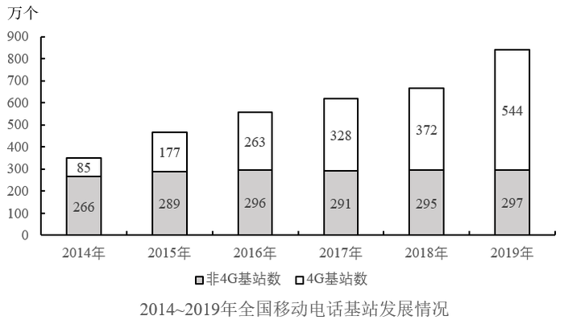

### 第 76 题　qid 2741706 · 综合

2019年电信业务收入比2018年：

- **A**. 增加了不到1000亿元
- **B**. 增加了1000亿元以上
- **C**. 减少了不到1000亿元
- **D**. 减少了1000亿元以上

### 第 77 题　qid 2741707 · 增长

2015~2019年，移动电话基站总量同比增速最快的年份是：

- **A**. 2015年
- **B**. 2016年
- **C**. 2017年
- **D**. 2019年

### 第 78 题　qid 2741708 · 综合

2014~2019年，4G基站数占移动电话基站总量一半以上的年份有几个？

- **A**. 1
- **B**. 2
- **C**. 3
- **D**. 4

### 第 79 题　qid 2741710 · 增长

假设4G基站数保持2019年同比增量不变，且由于5G技术的快速普及，2020年开始每年非4G基站同比增量均为300万个。问哪一年4G基站数占移动电话基站总量的比重将下降到以下？

- **A**. 2021
- **B**. 2022
- **C**. 2023
- **D**. 2024

### 第 80 题　qid 2741712 · 综合

能够从上述资料中推出的是：

- **A**. 2019年移动通信业务收入占电信业务收入的比重同比下降了2.9个百分点
- **B**. 2019年固定通信业务收入同比增长了400多亿元
- **C**. 2015~2019年间，非4G基站数量逐年递增
- **D**. 2015~2019年间，4G基站数同比增速和增量最大的年份不是同一个

## 材料 2

        2019年，全国棉花产量588.9万吨，比上年减少21.3万吨。其中，新疆棉花产量500.2万吨，比上年减少10.8万吨；全国棉花种植面积为3339.2千公顷，比上年减少15.2千公顷。新疆的棉花种植面积比上年增加49.2千公顷。长江流域棉花种植面积比上年减少32.4千公顷，同比下降。黄河流域棉花种植面积比上年减少28.1千公顷，同比下降。

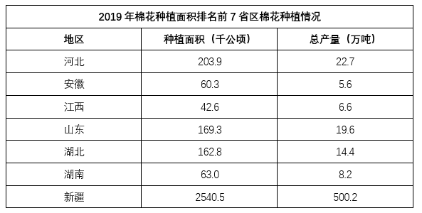

### 第 81 题　qid 2741672 · 比重

2019年新疆棉花产量占全国总产量的比重比上年：

- **A**. 上升了不到5个百分点
- **B**. 上升了5个百分点以上
- **C**. 下降了不到5个百分点
- **D**. 下降了5个百分点以上

### 第 82 题　qid 2741673 · 综合

2018年除新疆外，全国其他地区棉花种植总面积在以下哪个范围内？

- **A**. 不到700千公顷
- **B**. 700-800千公顷之间
- **C**. 800-900千公顷之间
- **D**. 900千公顷以上

### 第 83 题　qid 2741676 · 综合

2018年长江流域棉花种植面积约是黄河流域棉花种植面积的多少倍？

- **A**. 0.5
- **B**. 0.8
- **C**. 1.2
- **D**. 2.1

### 第 84 题　qid 2741677 · 综合

2019年棉花种植面积排名前7的省区中，棉花单产超过1吨/公顷的省区有几个？

- **A**. 5
- **B**. 4
- **C**. 3
- **D**. 2

### 第 85 题　qid 2741684 · 综合

能够从上述材料中推出的是：

- **A**. 
2019年全国棉花产量降幅超过

- **B**. 
2019年除新疆、长江流域和黄河流域外，其余地区棉花种植面积同比下降

- **C**. 
2019年新疆棉花单产高于2018年水平

- **D**. 
2019年棉花种植面积排名前7的省区，棉花产量占全国总产量的-之间

## 材料 3

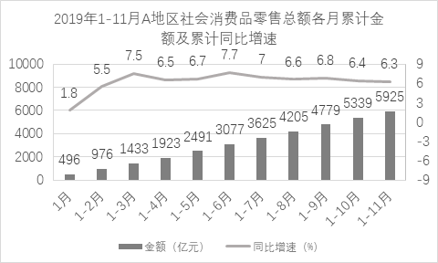

### 第 86 题　qid 2741671 · 增长

2019年A地区住宿和餐饮业社会消费品零售额同比增量约占社会消费品零售总额同比增量的？

- **A**. 

- **B**. 

- **C**. 

- **D**. 

### 第 87 题　qid 2741675 · 综合

2019年上半年，A地区社会消费品零售总额超过500亿元的月份有几个？

- **A**. 2
- **B**. 3
- **C**. 4
- **D**. 5

### 第 88 题　qid 2741678 · 增长

2019年12月，A地区社会消费品零售总额同比增速约为？

- **A**. 

- **B**. 

- **C**. 

- **D**. 

### 第 89 题　qid 2741682 · 增长

将2019年2-4季度按A地区社会消费品零售总额环比增速从低到高排列，以下正确的是：

- **A**. 3季度，2季度，4季度
- **B**. 2季度，3季度，4季度
- **C**. 4季度，3季度，2季度
- **D**. 3季度，4季度，2季度

### 第 90 题　qid 2741683 · 综合

关于A地区社会消费品零售总额情况，能够从上述资料中推出的是：

- **A**. 2019年批发和零售业月均社会消费品零售总额超过500亿元
- **B**. 2019年4季度社会消费品零售总额同比增速高于全年增速
- **C**. 2019年2季度各月社会消费品零售总额环比增量逐月递增
- **D**. 2018年2月社会消费品零售总额低于上月水平

## 答案与解析

第 1 题

**答案**：B

**官方解析**

本题考查政治常识。
A项正确，2013年9月7日，习近平总书记在哈萨克斯坦纳扎尔巴耶夫大学发表演讲并回答学生们提出的问题，在谈到环境保护问题时他指出：“我们既要绿水青山，也要金山银山。宁要绿水青山，不要金山银山，而且绿水青山就是金山银山”。要尊重自然、顺应自然，绝不以牺牲环境为代价去换取一时的经济增长。
B项错误，习近平总书记提出了“生态兴则文明兴，生态衰则文明衰”这一重要论断。实践证明先污染后治理的老路是行不通的，发展不能以牺牲环境为代价，因此“先发展，后治理”的理论不符合习近平总书记的生态文明思想。
C项正确，2018年5月18日，习近平总书记在全国生态环境保护大会上的讲话中指出：“山水林田湖草是生命共同体，要统筹兼顾、整体施策、多措并举，全方位、全地域、全过程开展生态文明建设”。2013年，党的十八届三中全会审议通过了《中共中央关于全面深化改革若干重大问题的决定》。《决定》提出，健全自然资源资产产权制度和用途管制制度。对水流、森林、山岭、草原、荒地、滩涂等自然生态空间进行统一确权登记，形成归属清晰、权责明确、监管有效的自然资源资产产权制度。
D项正确，2015年3月6日，习近平在参加全国两会江西代表团审议时指出：“环境就是民生，青山就是美丽，蓝天也是幸福”。保护生态环境就是保护生产力，改善生态环境就是发展生产力。发展经济和保护环境都是为了民生。
本题为选非题，故正确答案为B。

---

第 2 题

**答案**：B

**官方解析**

本题考查政治常识。
A项正确，2020年山东省印发的《贯彻落实〈中共中央、国务院关于建立更加有效的区域协调发展新机制的意见〉的实施方案》提出，构建“一群两心三圈”的区域发展格局。“一群”即打造具有全球影响力的山东半岛城市群；“两心”即支持济南、青岛建设成为国家中心城市；“三圈”即推进省会、胶东、鲁南三大经济圈区域一体化发展。
B项错误，2020年11月12日，由山东高速集团统筹运营的“齐鲁号”欧亚班列（济南－荷兰芬洛）首班顺利开行。该班列装载服饰、箱包等货品，由济南南站发出，经二连浩特出境，预计18天后到达荷兰芬洛。本次班列的发运，标志着“齐鲁号”已将西向运行最远端延伸到荷兰，为山东省及周边地区外贸企业开拓荷兰市场搭建起一条便捷、高效的物流大通道。
C项正确，2020年11月26日，京沪高速莱芜至临沂（鲁苏界）段改扩建项目、济南绕城高速二环线东环段、岚山至罗庄高速公路、潍日高速潍坊连接线正式建成通车，创山东省高速公路同日建成通车数量和里程之最。上述项目建成通车后，山东高速公路通车里程达到7204公里，重回全国第一方阵。
D项正确，2019年8月25日，由教育部、山东省人民政府和相关教育研究机构牵头筹建的“尼山世界儒学中心”在孔子诞生地山东曲阜尼山揭牌成立，标志着全球儒学研究实体平台的诞生。2020年6月8日，山东省政府新闻办召开的发布会上，提出要“以文旅合作为切入点，加快济南、泰安、曲阜三地文旅合作，联合各市打造‘山水圣人’中华文化枢轴”。
本题为选非题，故正确答案为B。

---

第 3 题

**答案**：C

**官方解析**

本题考查经济常识。
A项错误，国债可以分为建设性国债和减少货币供应量的国债。建设性国债是指政府发行国债所得用于基础建设，增发建设性国债会导致市场上的货币供应量变多。减少货币供应量的国债是指政府发行国债所得不流向市场，增发减少货币供应量的国债会导致市场上的货币量减少。因此，发生通货膨胀时，应该减发建设性国债，即减发专项基建国债。
B项错误，税收增加，市场上的货币量会流向政府，市场中流通的货币总量减少，会加剧通货紧缩。
C项正确，财政赤字是指财政支出超过财政收入。实行赤字财政会导致政府增加支出，市场上的货币供应量增多，有利于拉动经济增长，抵制经济下行。
D项错误，再贴现率是指商业银行到中央银行兑换未到期的票据时，中央银行将利息先行扣除所使用的利率。降低再贴现率会增加市场上的货币供应量，不利于缓解经济过热。
故正确答案为C。

---

第 4 题

**答案**：C

**官方解析**

本题考查法律常识。
A项错误，根据《反不正当竞争法》第六条规定：“经营者不得实施下列混淆行为，引人误认为是他人商品或者与他人存在特定联系：（一）擅自使用与他人有一定影响的商品名称、包装、装潢等相同或者近似的标识；（二）擅自使用他人有一定影响的企业名称（包括简称、字号等）、社会组织名称（包括简称等）、姓名（包括笔名、艺名、译名等）；（三）擅自使用他人有一定影响的域名主体部分、网站名称、网页等；（四）其他足以引人误认为是他人商品或者与他人存在特定联系的混淆行为。”本案中，甲面包食品有限公司在其生产的面包外包装上使用“哈哈娃”标识，构成擅自使用与他人有一定影响的商品名称近似的标识的违法行为。
B项错误，根据《反不正当竞争法》第七条规定：“经营者不得采用财物或者其他手段贿赂下列单位或者个人，以谋取交易机会或者竞争优势：（一）交易相对方的工作人员；（二）受交易相对方委托办理相关事务的单位或者个人；（三）利用职权或者影响力影响交易的单位或者个人。经营者在交易活动中，可以以明示方式向交易相对方支付折扣，或者向中间人支付佣金。经营者向交易相对方支付折扣、向中间人支付佣金的，应当如实入账。接受折扣、佣金的经营者也应当如实入账······”酒店向出租车司机发送餐券应当如实入账。
C项正确，根据《反不正当竞争法》第十二条规定：“经营者利用网络从事生产经营活动，应当遵守本法的各项规定。经营者不得利用技术手段，通过影响用户选择或者其他方式，实施下列妨碍、破坏其他经营者合法提供的网络产品或者服务正常运行的行为：（一）未经其他经营者同意，在其合法提供的网络产品或者服务中，插入链接、强制进行目标跳转；（二）误导、欺骗、强迫用户修改、关闭、卸载其他经营者合法提供的网络产品或者服务；（三）恶意对其他经营者合法提供的网络产品或者服务实施不兼容；（四）其他妨碍、破坏其他经营者合法提供的网络产品或者服务正常运行的行为。”快递公司在丙公司官网上插入服务链接得到了丙公司的同意，故快递公司与丙公司的约定有效。
D项错误，根据《反不正当竞争法》第十条规定：“经营者进行有奖销售不得存在下列情形：······（二）采用谎称有奖或者故意让内定人员中奖的欺骗方式进行有奖销售······”本案中，丁超市故意让未购物的副经理中奖，构成违法行为。
故正确答案为C。

---

第 5 题

**答案**：B

**官方解析**

本题考查人文常识。
A项，“南有乔木，不可休思。汉有游女，不可求思”出自《国风·周南·汉广》，意为南有大树枝叶高，树下行人休憩少。汉江有个漫游女，想要追求只徒劳。这首诗是男子追求女子而不能得的情歌，写的是爱情。
B项，“呦呦鹿鸣，食野之苹。我有嘉宾，鼓瑟吹笙”出自曹操的《短歌行》，意为一群鹿儿呦呦欢鸣，在那原野悠然自得的啃食艾蒿。一旦四方贤才光临舍下，我将奏瑟吹笙宴请宾客。表示了曹操渴求贤才的愿望。
C项，“野有蔓草，零露漙兮。有美一人，清扬婉兮”出自《国风·郑风·野有蔓草》，意为野草蔓蔓连成片，草上露珠亮闪闪。有位美女路上走，眉清目秀美又艳。表现了浪漫而自由的爱情。
D项，“风雨如晦，鸡鸣不已。既见君子，云胡不喜”出自《诗经·郑风·风雨》，意为风吹雨打天地昏，雄鸡啼叫声不停。既然已见到意中人，心中怎能不欢喜。表现了见到意中人喜出望外之情。
综上，B项主题与其他三项不同。
故正确答案为B。

---

第 6 题

**答案**：D

**官方解析**

本题考查法律常识。
A、B、C三项均正确，根据《刑事诉讼法》第二百九十条规定：“对于达成和解协议的案件，公安机关可以向人民检察院提出从宽处理的建议。人民检察院可以向人民法院提出从宽处罚的建议；对于犯罪情节轻微，不需要判处刑罚的，可以作出不起诉的决定。人民法院可以依法对被告人从宽处罚。”
D项错误，根据《刑事诉讼法》第一百一十二条规定：“人民法院、人民检察院或者公安机关对于报案、控告、举报和自首的材料，应当按照管辖范围，迅速进行审查，认为有犯罪事实需要追究刑事责任的时候，应当立案；认为没有犯罪事实，或者犯罪事实显著轻微，不需要追究刑事责任的时候，不予立案，并且将不立案的原因通知控告人······”。根据我国刑事诉讼法的规定，刑事案件不同于民事案件，需要案件撤销的，应当是人民检察院撤销立案。
本题为选非题，故正确答案为D。

---

第 7 题

**答案**：A

**官方解析**

本题考查地理国情。
金砖国家包括巴西、俄罗斯、印度、中国、南非。联合国安理会常任理事国包括中国、俄罗斯、英国、法国、美国。因此，既属于金砖国家又属于联合国常任理事国的是中国和俄罗斯。
A项正确，中国陆地边界长达2.28万公里，东邻朝鲜，北邻蒙古，东北邻俄罗斯，西北邻哈萨克斯坦、吉尔吉斯斯坦、塔吉克斯坦，西和西南与阿富汗、巴基斯坦、印度、尼泊尔、不丹等国家接壤，南与缅甸、老挝、越南相连。东部和东南部同韩国、日本、菲律宾、文莱、马来西亚、印度尼西亚隔海相望。因此，中国与俄罗斯领土接壤。
B项错误，中国的官方语言是汉语（通用普通话）；俄罗斯的官方语言为俄语。
C项错误，中国位于亚洲东部，太平洋西岸，陆地面积约960万平方千米，国土面积位于世界第三；俄罗斯位于欧亚大陆北部，地跨欧亚两大洲，是世界上面积最大的国家，俄罗斯被认为是属于欧洲。
D项错误，四大文明古国分别是中国、古巴比伦、古埃及、古印度。因此，俄罗斯不属于四大文明古国。
故正确答案为A。

---

第 8 题

**答案**：B

**官方解析**

本题考查科技常识。

A项错误，正常情况下，人的体温会保持在，因为人体有自带的体温调节系统。以口腔温度为标准，可将发烧程度分为：低烧，体温为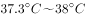；中等烧，体温为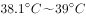；高烧，体温为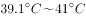；超高烧，体温为以上。但要注意，有时体温升高不一定都是疾病引起的，某些情况可有生理性体温升高，如剧烈运动、月经前期及妊娠期，进入高温环境或热水浴等均可使体温较平时略高，但这些可以通过自身调节很快恢复正常。

B项正确，一定程度的发热时，人体内的免疫细胞和免疫因子的活性提高了，当体温在时，机体免疫活动非常活跃，在某种程度上增强了身体的免疫力。

C项错误，术后一些患者会出现发热症状，但只有一小部分是由于感染引起。非感染性发热如输血引起的发热反应、部分药物引起的发热反应等一般在术后24-48小时内出现，且体温左右。感染性发热往往体温较高（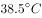），多在术后第3天以后才开始出现连续发热。

D项错误，人身体内的消化是由酶控制的，酶的活性直接影响人的新陈代谢。人体在发热时，体温升高，消化酶（唾液淀粉酶为消化酶的一种）活性降低，表现为食欲减退。因此，唾液淀粉酶是活性降低，而非失去活性。

故正确答案为B。

---

第 9 题

**答案**：A

**官方解析**

本题考查人文常识。
宋徽宗即赵佶，号宣和主人，宋朝第八位皇帝（1100年2月23日-1126年1月18日在位），书画家。
A项错误，《富春山居图》是元代画家黄公望于1350年创作的纸本水墨画，是中国十大传世名画之一。因此，宋徽宗不可能鉴赏过《富春山居图》。
B项正确，《步辇图》是唐朝画家阎立本的名作之一，是中国十大传世名画之一。
C项正确，《千里江山图》是北宋王希孟创作的绢本设色画。
D项正确，《簪花仕女图》传为唐代周昉绘制的一幅粗绢本设色画。
本题为选非题，故正确答案为A。

---

第 10 题

**答案**：C

**官方解析**

本题考查科技常识。

A项正确，硬水，是指含有较多可溶性钙镁化合物的水。软水指的是不含或含较少可溶性钙镁化合物的水。肥皂的主要成分是硬脂酸钠(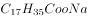)，在水中硬脂酸钠被水电离，形成硬脂酸根离子和钠离子。硬脂酸根离子会和镁离子和钙离子结合生成硬脂酸镁和硬脂酸钙，硬脂酸镁和硬脂酸钙都是不溶于水的沉淀。因此，如果是将肥皂投入到硬水中，会出现有沉淀的现象；如果是将肥皂投入到软水中，不会出现有沉淀的现象，水是纯净透明的。

B项正确，锌片可以和稀硫酸反应生成氢气，而铜片不行，因此，把锌片放入稀硫酸中会产生大量的气泡，锌片不断溶解，而铜片不会产生反应。

C项错误，纯碱即碳酸钠，是一种无机化合物，分子式为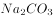。烧碱即氢氧化钠，无机化合物，化学式。酚酞是一种有机化合物，分子式为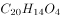，其特性是在酸性和中性溶液中为无色，在碱性溶液中为紫红色。纯碱和烧碱都可以使酚酞变红，因此不能用酚酞试液鉴别纯碱与烧碱。可以用稀盐酸来进行鉴别，纯碱与盐酸反应生成二氧化碳，会产生气泡，烧碱与盐酸反应则无明显现象。

D项正确，氧气具有助燃性，能使燃着的木条燃烧更旺，二氧化碳不具有助燃性，能使燃着的木条熄灭。

本题为选非题，故正确答案为C。

---

第 11 题

**答案**：C

**官方解析**

本题可从第二空入手，根据“有的地方并没有认真思考······引进一批人才后立刻就让当地经济社会发生翻天覆地的变化”可知，横线处表达一些地方在引进人才时不考虑实际情况，急于让人才发挥作用、实现变化之意。C项“急功近利”指急于求成，贪图眼前的成效和利益。对应当地引进人才时急于让其发挥作用，符合文意，保留。A项“拔苗助长”指把苗拔起来，帮助其成长。比喻违反事物的发展规律，急于求成，最后事与愿违。文段并非表示要帮助“人才”成长之意，排除；B项“一拥而上”形容周围的人同时向一个目标猛挤过去，D项“因噎废食”比喻要做的事情由于出了点小毛病或怕出问题就索性不去干，均与文意不符，排除。
第一空，代入验证，“离不开人才的支撑作用”，指人才对实现经济高质量发展起到重要作用，符合文意且搭配恰当，当选。
故正确答案为C。
【文段出处】江西日报《县域引才须避免四个误区》

---

第 12 题

**答案**：B

**官方解析**

由横线前“珍贵古籍”可知，横线处填入的成语需体现古籍修复师们在修复珍贵古籍时的状态，B项“如履薄冰”比喻行事极为谨慎，存有戒心，填入横线处可体现他们在修复珍贵古籍时始终是小心谨慎的，符合文意，当选。A项“不苟言笑”指不随便说笑，形容态度庄重严肃，常用于形容人的神情状态，他们在修复古籍时不需要一直表情严肃，与文意不符，排除；C项“精益求精”比喻已经很好了，还要求更好，文段并没有体现出他们在修复工作中已经做得很好了，与文意不符，排除；D项“视若珍宝”形容十分珍爱，将其当成无价之宝，填入横线处可表示他们对古籍的珍爱程度，但体现不出他们修复古籍时的状态，与文意不符，且搭配不当，常用搭配应该是“他们始终对其视若珍宝”，排除。
故正确答案为B。
【文段出处】《河南古籍保护十年路：沉睡的“宝贝”亟待唤醒》

---

第 13 题

**答案**：D

**官方解析**

第一空，搭配“好奇心”，且根据“侦探小说的长久流行，部分原因是读者对······的好奇心”可知， 读者对于世理人情中的阴暗面存在着‘长久’的好奇心。B 项“历久弥新”指经历长久的时间而更加鲜活，D 项“经久不衰”形容某事或某人经历很长时间仍旧保持较高的旺盛状态，均符合文意，保留。A 项“与生俱来”指从一生下来就有，C项“自然而然”指不经外力作用而如此，均与“长久”无关，排除。
第二空，根据“安宁与平静”、“平凡生活”可知，横线处所在句子说明表面平凡的生活背后有大大小小的危机，横线处要体现生活平凡、平常之意。D项“一成不变”指一经形成不再改变，符合文意，当选；B项“百无聊赖”指思想情感没有依托，精神极度空虚无聊，与文意不符，排除。
故正确答案为D。
【文段出处】品略图书馆《平凡生活的危机》

---

第 14 题

**答案**：C

**官方解析**

第一空，根据“表现出夜行性增强的趋势”“它们才不太可能碰到人类”等解释性内容可知，横线处应表达哺乳动物在夜间活动得更加频繁之意。B项“亢奋”指极度兴奋，C项“活跃”指行动积极活泼，均可体现哺乳动物活动得更加频繁，符合文意，保留。A项“敏感”指生理上或心理上对外界事物反应很快，与“活动频繁”之意不符，排除；D项“冲动”指不能理智地控制自己的行为，无法对应“不太可能碰到人类”这一原因解释，排除。
第二空，搭配“生存”，横线前“这”指代前文哺乳动物习性的“转变”，体现出对“动物种群”的影响。C项“威胁”指使遭遇危险，与“生存”为常见搭配，当选。B项“侵犯”指非法干涉，多搭配“权利、权益等”，正确搭配为“侵犯生存环境”，无法与“生存”直接搭配，排除。
故正确答案为C。
【文段出处】《人类活动让动物拥抱黑夜》

---

第 15 题

**答案**：B

**官方解析**

第一空，横线处搭配“措施”， A项“有的放矢”指说话或做事有明确的目的，B项“行之有效”指实行起来有成效，均与“措施”搭配恰当，保留。C项“独具匠心”指具有与众不同的巧妙的构思，多形容一件产品或作品的独特性和创造性，与“措施”搭配不当，排除；D项“得天独厚”意为独具特殊的优越条件，常搭配“优势”等，与“措施”搭配不当，排除。
第二空，横线处搭配“找准”，A项“潜在”即存在于事物内部尚未显露出来的部分，无法准确找到，故与“找准”搭配不当，排除；B项“目标”即有明确、准确的目的，与前文“找准”搭配恰当，当选。
故正确答案为B。
【文段出处】《戏曲电影应有新的运营思路》

---

第 16 题

**答案**：B

**官方解析**

第一空，由横线后“也”以及“基层”可知，横线处应表达文艺应让所有人“靠近”之意，B项“欣赏”、D项“接触”填入均可表达文艺应让所有人“靠近”之意，保留；A项“认同”指体认与模仿他人或团体之态度行为，使其成为个人人格一个部分的心理历程，与文意不符，排除；C项“理解”指了解、明白，与“基层”对应不当，排除。
第二空，根据横线前后的“大舞台”和“小天地”可知，横线处应与“严谨”语义相反，体现出不严肃、不谨慎之意，B项“活泼”指自然生动而不呆板，与文意相符，当选；D项“温馨”意为温暖、体贴，不能与“严谨”形成相反的语义，排除。
故正确答案为B。
【文段出处】《开放都市容得下持证的街头艺人》

---

第 17 题

**答案**：D

**官方解析**

第一空，根据“驱动”可知，横线处应体现技术“推动”企业发展之意，C项“动力”、D项“引擎”均可体现“推动”之意，保留。A项“关键”、B项“支柱”均强调“重要”之意，而非“推动”，与文意不符，排除。
第二空，根据“抢占先机”以及“从而”可知，横线处应体现“领先”之意，D项“率先”，可体现“领先”之意，符合文意，保留。C项“迅速”强调“速度快”，无法体现“领先”之意，排除。
第三空，代入验证，“巩固行业地位”搭配恰当，当选。
故正确答案为D。
【文段出处】人民网《无人配送或改变高额人力成本困境》

---

第 18 题

**答案**：B

**官方解析**

第一空，横线处成语与“互为补充”形成并列关系，应体现出文学研究的两个维度之间相互补充配合。对比选项，B项“相得益彰”指两个人或两件事物互相配合，双方的能力和作用更能显示出来，与文意相符，保留。A项“珠联璧合”比喻杰出的人才或美好的事物结合在一起，文段未提及两个维度结合成一种，与文意不符，排除；C项“互通有无”指拿出自己多余的东西给对方并与之进行交换，以得到自己所缺少的东西，搭配主体为人或具体事物而不是文学研究维度，例如“两国人民互通有无”“古老的丝绸之路上经贸交往互通有无”，故搭配不当，排除；D项“并行不悖”指同时进行，不相冲突，未体现出双方补充配合的关系，与文意不符，排除。
第二空，代入验证，B项“对立”是指两种事物或两种力量之间敌对、互相抵触。文段提及两个维度的关系复杂，并通过“甚至”提出二者紧张对立的关系，环环相扣，语义逐渐加重，符合文意，当选。
故正确答案为B。
【文段出处】光明网《文学社会学视野里的明清诗文》

---

第 19 题

**答案**：A

**官方解析**

第一空，由“数字经济蓬勃发展”可知，横线处表达“新技术、新业态、新模式”不断出现之意，且呈现一种积极发展的良好态势。A项“层出不穷”形容事物连续出现，没有穷尽；C项“方兴未艾”形容事物正在蓬勃发展，一时不会终止；D项“纷至沓来”形容连续不断地到来，均符合语境，保留。B项“乏善可陈”指说不出有什么优点，没有什么好称道的，感情色彩与文段不符，排除。
第二空，搭配“核心竞争力”，三者均可，保留。
第三空，搭配“创新成果”，A项“融合”指不同的事物合为一体，用于此处，可体现为“创新成果”与“实体经济各个领域”间的结合，语境相符，搭配得当，当选。C项“实践”与“成果”搭配不当，排除；D项“落实”多搭配“方针、行动等”，与“成果”搭配不当，且通常表述为“落实到······”而非“落实于······”，排除。
故正确答案为A。
【文段出处】《全球数字经济十大发展趋势》

---

第 20 题

**答案**：B

**官方解析**

第一空，横线处所填词语对应“着眼于长远”，应体现“做对的事情”要形成一种长远的、发展的眼光，B项“把握方向”、C项“把握规律”、D项“把握趋势”，均符合文意，保留。A项“原则”指说话或行事所依据的法则或标准，“把握原则”仅可体现现有准则，与“着眼于长远”无关，排除。
第二空，根据“在做事之前要仔细考虑，分析判断，着眼于长远”可知，横线处所填成语应体现对事情进行全面、宏观地分析。B项“来龙去脉”比喻人、物的来历或事情的前因后果，放入文中可体现对事情分析全面，符合文意，保留。C项“轻重缓急”指事情有次要的、主要的、缓办的、急办的区别，文段未体现“轻重”“缓急”，而是强调对事情要分析全面，排除。D项“千头万绪”形容事物繁杂，头绪很多，“理清千头万绪”侧重体现事情很复杂，文段并无此意，而是强调做事要分析全面，眼光长远，以保证所做的事情一直是对的，排除。
第三空，代入验证，B项“过程”指事情进行或事物发展所经过的程序，后文“做事情方法要正确”能体现做事情时应使用正确的方法，体现过程，符合文意，当选。
此外，本题“做对的事情”与“把事情做对”是两个不同方面。“做对的事情”，就是要把握方向，着眼于长远，侧重于强调“未来”；“把事情做对”重点关注过程，侧重于“当下”，前后呼应得当，B项当选。
故正确答案为B。
【文段出处】《做领导者之前先做有效的追随者》

---

第 21 题

**答案**：A

**官方解析**

文段首先通过程度词“最”引出“漆器”这一话题，接下来介绍漆器的包容性、漆器上的图案，并指出图案中出现最多的是各种花卉，而后论述故宫博物馆里花卉图案的漆器非常普遍。尾句通过“所以”总结全文，故文段意在强调“花卉”几乎是漆器的通用语言，对应A项。
B项，对应文段首句内容，非重点，且文段没有体现“深刻的影响”，无中生有，排除；
C项，缺少主题词“花卉”，且文段没有体现可以通过漆器了解中国古人的日常生活，无中生有，排除；
D项，缺少主题词“花卉”，且文段没有提及“创作者的审美情趣”，无中生有，排除。
故正确答案为A。
【文段出处】《故宫的古物之美》

---

第 22 题

**答案**：B

**官方解析**

文段开篇通过彩色摄影与黑白摄影之间的对比，引出“黑白摄影”这一话题。接下来引出观点，表明当今的黑白摄影虽然不是技术性等的代表，但依然不过时，换言之，当今的黑白摄影依然是具有价值的。后文通过“具有自身独特的语言和能力”“发挥着自己的特色”“展现着新的可能”“依然是解决······问题的方法手段”等对黑白摄影当今价值进行解释说明。故整个文段意在强调黑白摄影在当今的价值，对应B项。
A项，文段论述彩色摄影与黑白摄影是不同事物，不存在对比，“不具有可比性”与文意相悖，排除；
C项，文段并未提到黑白摄影存在的问题，“需要与时俱进不断发展”为无关对策，排除；
D项，“艺术评价标准”文段未提及，无中生有，排除。
故正确答案为B。
【文段出处】《当代影像艺术创作中的黑白摄影》

---

第 23 题

**答案**：D

**官方解析**

横线位于文段尾句，前面出现“然而”，所填内容需要与前文构成转折关系，且由横线后的标点符号“：”可知，横线后是对空缺处的解释说明。前文首先指出世界不知不觉进入机器人军备竞赛的背景。接着介绍了军事机器人相比士兵存在的优势，通过程度词“特别是”强调完全自主机器人与人类战士相比的优势及作用。尾句冒号后强调自主机器人是不是战斗员和应承担何种责任两个问题。结合转折词“然而”可知，横线处应与前文语义相反，横线处应该体现出问题的存在，且该问题与自主机器人在战争中的责任问题有关，“伦理问题”是对后文“角色”“责任”的概括表述，对应D项。
A项，“角色”只是后文问题其中之一，表述片面，且“角色引人深思”并未体现消极感情色彩，排除；
B项，“机器人”概念扩大，应是“自主机器人”，且“重塑未来战争的图景”表述积极，不能与转折词“然而”形成前后语义相反，排除；
C项，“发展前景”文段并未论述，无中生有，且根据“参战的自主机器人到底是不是战斗员？又应当承担何种战争责任？”可知，文段已给出具体问题，“尚不明朗”表述不明确，排除。
故正确答案为D。
【文段出处】《谁在作战——军事AI正在走向未来战场》

---

第 24 题

**答案**：A

**官方解析**

文段开篇指出研制超材料的做法，并介绍这些材料的属性，接下来用对策标志词“通过”指出利用这一做法“改变超材料关键位置的结构和尺寸”就可以实现“对光波、雷达波、无线电波、声波乃至地震波的任意弯曲和精细‘裁减’”这些目的，尾句通过“比如”举例论证，故整个文段旨在强调让超材料发挥作用的方法，即研发原理，对应A项。
B项“应用领域”、C项“分类标准”，均无中生有，排除；
D项“设计意图”对应“对光波、雷达波、无线电波、声波乃至地震波的任意弯曲和精细‘裁减’”，非重点，排除。
故正确答案为A。
【文段出处】《超材料：会改写未来战争吗？》

---

第 25 题

**答案**：D

**官方解析**

横线位于文段结尾，是对前文的总结。前文首先指出早期人们对质量认识不清晰，专家是从生产角度定义质量，强调产品要达到规定要求或标准。接着指出20世纪60年代美国专家提出产品要适合用户的需求，即从用户角度认识和定义质量。由此可知，横线前主要强调人们对质量的定义从生产方的角度转向用户需求的角度，即“从关注生产方转变到关注需求方”，对应D项。
A项，偷换概念，“供给需求”是产品的供给方的需求，而文段说的是“从用户的角度认识和定义质量”，是关注用户的需求，排除；
B项，“保量要求”无中生有，排除；
C项，文段说的是“适合用户的使用需要”“从用户的角度认识和定义质量”，即关注需求方，选项中的“服务”只是用户需求中的一个方面，范围缩小，排除。
故正确答案为D。
【文段出处】《质量观是质量管理创新的原动力》

---

第 26 题

**答案**：A

**官方解析**

文段开篇指出年轻人的喜好左右着文化产品市场的方向，紧接着从积极层面分析其作用，可以激活市场潜力，而后通过转折词“但”引出问题，过度依赖市场需求会导致创作方的中长期迷失，后文针对迷失的原因进行详细论述，尾句通过结论词“因此”，总结全文并提出对策，创作者和制作方应仔细研究真实的需求。由于题干问的是文段的主要问题，故正确答案应为问题的同义替换，即过度依赖市场需求，对应A项。
B项，“缺乏中长期规划”对应文段提出问题后的具体解释部分，非重点，排除；
C项，“产品供应能力”文段并未提及，无中生有，排除；
D项，“缺乏创新”文段并未提及，无中生有，排除。
故正确答案为A。
【文段出处】光明日报《讨好年轻观众不能只是噱头》

---

第 27 题

**答案**：D

**官方解析**

文段开篇提出视觉刺激的工作原理，即人脑在发育阶段时，视觉刺激能激活视皮层上的神经元，被激活的神经元会对不同的图像特征进行加工。后文从反面强调，如果在视觉功能的发育关键期，视觉神经元未被充分激活，未来在视觉功能上可能存在一定程度的问题或丧失。通过提问方式可知，文段要作为论据来支持论点，故文段支持的论点为发育关键期的重要性，对应D项。
A项，文中只提到一种人体机能，无法作为“人体的不同机能”的论据，排除；
B项，“造成终生影响”中的“终生”表述程度过重，排除；
C项，“图像特征”并非文段重点，文段支持的论点是发育关键期的重要性，偏离文段核心话题，排除。
故正确答案为D。
【文段出处】《北大心理学教授方方：过度识字影响学龄前儿童的想象力》

---

第 28 题

**答案**：D

**官方解析**

根据选项判断首句。②句介绍故宫一直非常注重防火，引出话题，⑤句介绍故宫的防火传统，对比②⑤两句可知，应先介绍故宫注重防火这一话题，再介绍故宫的防火传统，故②句在⑤句之前，排除B、C两项。
观察句子，③句中含有“同时”，说明③句前的内容也应对故宫使用的消防水源进行介绍，①⑥两句共同介绍了故宫为防火而设置的储水缸，故①⑥两句和③句可构成捆绑，D项当选。而⑤④两句共同介绍了故宫的防火传统，无法与③句中消防水源这一话题进行捆绑，排除A项。
故正确答案为D。
【文段出处】《600岁故宫如何防火？》

---

第 29 题

**答案**：B

**官方解析**

文段开篇提出人类祖先的大脑进化出支持合作的功能来支持狩猎活动，而后通过指代词“这”强调这一进化使得人类大脑中记忆与思考中心更发达，紧接着进一步指出随着群体更强大，群体之间竞争、合作更重要，大脑也随之进化出管理更大群体的能力，文段最后通过指代词“这”指代前文大脑进化，重点强调最终演变出“利他意识、伦理观、良知和尊严意识”这些美德，对应B项。
A项，“狩猎活动离不开群体的合作”对应文段尾句结论之前，非文段重点，排除；
C项，“大脑的构造”“生活方式的变化”文段均未提及，无中生有，排除；
D项，“拥有合作性个体的数量”文段未提及，无中生有，排除。
故正确答案为B。
【文段出处】《原则》

---

第 30 题

**答案**：A

**官方解析**

文段先指出文学批评家钟嵘在《诗品》中用刘琨的个人经历来解释其作品为何多感慨悲愤之词，紧接着指出当代文学评论家也运用结合人生经历这种方法考察作品，然后列举了某位学者在研究《孽海花》时也采用“知人论世”的方法，通过探索作者曾朴的生活、思想历程与创作过程来理解这部作品，故文段重点强调“知人论世”自古都是文学研究的重要方法，文段的核心话题为“知人论世”的文学研究方法，对应A项。
B项，未提及文段论述的核心话题“知人论世”的文学研究方法，排除；
C项，“被奉为古代作品研究的圭臬”表述片面，当代的文学评论家也运用这种方法研究作品，且“圭臬”表述过于绝对，排除；
D项，“文学研究模式”表述不明确，且“继承”并未提及，无中生有，排除。
故正确答案为A。
【文段出处】中华读书报《也谈“知人论世”》

---

第 31 题

**答案**：B

**官方解析**

文段开篇指出唐以前栽培树木草本多以实用为主；到了唐代，栽培植物逐渐向观赏性发展，海棠因此开始得到重视；宋代，海棠成为园林观赏植物中的明星；宋代之后，海棠已然是中国传统的名花，深受后世喜爱。最后指出于园林庭院中种植海棠，呼应金玉满堂的谐音。故文段按照时间顺序，介绍了海棠在我国古典园艺史上的地位变迁，对应B项。
A、D两项，文段围绕“海棠”这一核心话题展开论述，选项缺少主题词，排除；
C项，文段侧重强调了“海棠”在我国古典园艺中的地位变化，而非“文化象征”，排除。
故正确答案为B。
【文段出处】《海棠依旧》

---

第 32 题

**答案**：D

**官方解析**

文段开篇提出观点，在游戏的世界可以“一键复活”，其提供了一种自我实现方式。随后通过“个体在现实生活中受挫后，在游戏中可以逃避现实并且找到自己存在的意义”进行举例，进一步论证前文观点，即“游戏”提供了一种自我实现方式，对应D项。
A项，文段未提及解决游戏成瘾的方法，“如何解决”，无中生有，排除；
B项，“社交”对应尾句内容，非重点，且“无负担”表述过于绝对，排除；
C项，“越受挫”，“越成瘾”，文段并未提及，无中生有，排除。
故正确答案为D。
【文段出处】搜狐网《游戏成瘾被列为精神障碍 DSM-5提出9条诊断标准》

---

第 33 题

**答案**：C

**官方解析**

横线位于文段中间，需要结合上下文进行分析。前文首先指出科技与普通人的关系越来越密切，人们期待科普走进生活，进而对科普创新提出更高的要求，随后针对科普创新提出具体对策，即“增添文艺的元素”。横线后的内容指出我国已经有老一辈的科学家在做科普工作时运用了文学艺术的力量，并举例进行论证。那么横线处填入的内容应体现科普中运用了文学艺术的意思，对应C项。
A项，与后文对应不恰当，后文没有体现“期待越来越高”，排除；
B项，“重要驱动力”与后文对应不恰当，后文没有体现出文学艺术是如何推动科普创新的，排除；
D项，“如何兼顾科普内容和形式的创新”表述不明确，前文已经论述了可以通过增添文艺元素的方式进行创新，排除。
故正确答案为C。
【文段出处】《科普不妨用用“文艺梗”》

---

第 34 题

**答案**：A

**官方解析**

文段首句指出规则在古希腊竞赛中的普遍性，紧接着通过“只有······才”强调规则对体育比赛的重要性，尾句通过“这些”指代前文的体育比赛，引出结论，强调古希腊思想家们热衷探讨如何用规则引导和规范竞争，故文段重在说明古希腊人看中竞争中的规则性，对应A项。
B项，偏离文段核心话题，文段重在强调古希腊人眼中“规则”对“竞争”的重要性，排除；
C项，“体育比赛”对应尾句前的内容，为非重点，排除；
D项，偏离文段核心话题，文段重在强调古希腊人眼中“规则”对“竞争”的重要性，且“社会的公正”表述片面，排除。
故正确答案为A。
【文段出处】《“尚争”与“崇让”：古代希腊和古代中国的竞争观念比较》

---

第 35 题

**答案**：C

**官方解析**

文段开篇指出氡观测是受人们认可的地震监测手段，后指出地震行业氡观测仪主要采用固体氡源进行校准，但由于存在运输不便等问题，氡观测仪无法实现全国统一校准，即标准不统一。但如果氡观测仪器标准不统一，测出的数据就没有意义。故为了保证地震数据的有效性，应当统一氡观测仪器的标准，对应C项。
A项，文段侧重强调“氡观测仪无法实现全国统一校准”，未提及“氡观测仪器”难以在全国应用，排除；
B、D两项，文段侧重强调“氡观测仪无法实现全国统一校准”，B项“地震监测手段需丰富和多元化”和D项“在不同地区应采用不同的地震监测”均与前文侧重点无关，排除。
故正确答案为C。
【文段出处】《有了校准平台，氡观测仪预测地震更准》

---

第 36 题

**答案**：D

**官方解析**

设去程路程甲、丙之间距离为3x千米，回程路程为丙乙甲，比去程多为4x千米，则乙、丙之间距离为4x-2.1千米，甲、乙、丙之间位置如图所示：

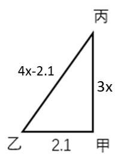

根据直角三角形勾股定理可列方程为：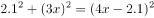，解得x=2.4，3x=7.2。

故正确答案为D。

---

第 37 题

**答案**：A

**官方解析**

设甲、乙、丙初期投资额分别为、、万元。根据题意可得，公司估值上涨，则甲持股金额为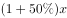，二期投资万元，此时甲持股金额为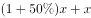，其他两人同理，可得投资金额与持股比例如下表所示：

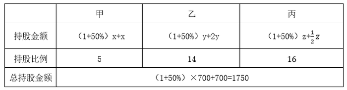

根据题意可列式：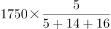，解得；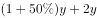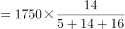，解得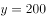，则初期乙投资额初期甲投资额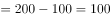万元，即多100万元。

故正确答案为A。

---

第 38 题

**答案**：D

**官方解析**

根据题意设四个要比赛的为小王、小张、甲、乙。小王、小张半决赛均获胜，则小王，小张在半决赛不能相遇。小王在三个对手中不能与小张相遇，概率为。

接下来只需要让小王和小张分别战胜对手即可。小王战胜任何对手的概率为60%，即；小张战胜任何对手的概率为40%，即。

综上，两人半决赛均获胜的概率为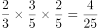。

故正确答案为D。

---

第 39 题

**答案**：C

**官方解析**

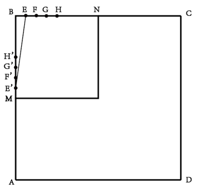

如图所示，令AB中点为M。

赋值正方形的边长为16，甲、乙的速度均为1。分情况讨论如下：

①当时，即甲从A向中点M运动，甲乙之间的距离即甲走的距离，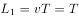，此段距离为匀速变化的直线；

②当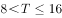时，即甲从M到B的过程中，甲乙之间的距离为：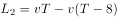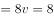，此段距离不变；

③当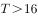时，即甲从B点继续运动，用描点法枚举可得：

当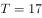时，甲到达E点，乙到达E’点，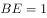，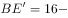，根据勾股定理：；

同理，当时，甲到达F点，乙到达F’点，，，根据勾股定理：；

当时，甲到达G点，乙到达G’点，，，根据勾股定理：；

当时，甲到达H点，乙到达H’点，，，根据勾股定理：；

观察可得，当时，随着越来越大，甲乙之间的距离越来越小，且下降速度逐渐变缓，排除A、B、D三项。

故正确答案为C。

---

第 40 题

**答案**：B

**官方解析**

由题意可知本题为浓度问题，设甲盐水的浓度为，乙盐水的浓度为。将千克乙盐水与千克甲盐水混合，并蒸发掉千克水之后，根据公式“浓度”得到混合后溶液浓度为，根据“得到的溶液浓度是乙盐水的倍”，可得，，解得，即乙盐水的浓度是甲盐水的倍。

故正确答案为B。

---

第 41 题

**答案**：B

**官方解析**

如图所示，为边长为100米的等边三角形围场，中心O点为信号塔位置，连接OA、OB、OC，O为正三角形的中心，所以O点到顶点的距离为三角形高的，的高米，则有OAOBOC米。OT为信号塔高，连接AT、BT、CT，因为为等边三角形，因此ATBTCT。因为信号发射器的覆盖半径为米，因此若想使信号覆盖整个围场的地面，则T点到三角形顶点的最远距离为米，即ATBTCT米。在直角三角形中，CT米，OC米，根据勾股定理，OT米。

故正确答案为B。

---

第 42 题

**答案**：C

**官方解析**

设一小箱商品有件，制造一个小箱和一个大箱这种商品后，张做了件，王做了件，根据题意可列方程组：······①；······②，解得，，根据时间一定，工作总量和工作效率成正比，可得。之后王的效率提高，为，通过王两次制造的总件数比张多50件，可知王和张共同完成一大箱这种商品时，王比张多制造件，设王和张共同完成一大箱这种商品所需的时间为，则根据题意可列方程组：······③；······④，解得，故一小箱这种商品有150件。

故正确答案为C。

---

第 43 题

**答案**：B

**官方解析**

赋值该商品的原价为10元，第一天的销量为1件。根据题意，每天单价下降元；每天销量变为前一天的2倍；“成本为原价的”，则每件的成本为元。根据题意可得表格如下：

综上，这6天的总利润为元，总成本为单件成本总销量元。则销售这种商品的总利润是总成本的，在之间。

故正确答案为B。

---

第 44 题

**答案**：C

**官方解析**

只考虑每个部门分到的人的数额，当有部门获取的名额是3人时，即先给12个部门各分配一人，再从12个部门中挑选2个，分别再分配2人和1人，即满足有部门获取的名额是3，情况数为种；当有部门获取的名额是4人时，即先给12个部门各分配一人，再将剩下3人分配到同一部门，即可满足有部门获取的名额是4，情况数为种；则所求倍数（有部门获取的名额是3的概率）（有部门获取的名额是4的概率）倍。

故正确答案为C。

---

第 45 题

**答案**：B

**官方解析**

同一个零件的底面只能用同一种颜色，则底面有3种涂色方式；同一个零件的斜面也只能用一种颜色，则斜面有3种涂色方式，则每一个圆锥体的涂色方式有种。5个零件的颜色彼此不完全相同，则需要在9种涂色方式中选出5种，故有种涂色方式。

故正确答案为B。

备注：本题“彼此不完全相同”中“彼此”指的是任意两个圆锥体，即任意两个圆锥体颜色不完全相同，也就是说5个圆锥体颜色各不相同，否则本题无正确答案。

---

第 46 题

**答案**：A

**官方解析**

元素组成不同，且无明显属性规律，优先考虑数量规律。观察发现，题干图形均有圆，并且线条将圆明显分割成多个面，故考虑圆内面数量。题干图形圆内面数量从左到右依次为1、2、3、4、5，故“？”处圆内面数量应为6，A项圆内面数量为6，B项圆内面数量为5，C项圆内面数量为9，D项圆内面数量为2，只有A项符合规律。
故正确答案为A。

---

第 47 题

**答案**：B

**官方解析**

元素组成相似，优先考虑样式规律。九宫格优先看横行，观察发现，第一行，由长方形、梯形、三角形和黑白点组成，且每行黑白点的位置有三种，都在图形内、都在图形外、白点在图形内黑点在图形外；第二行验证符合此规律；第三行应用此规律，后两幅图形出现了三角形和长方形，则“？”处应有梯形，排除A项；继续观察，后两幅图的黑白点位置分别为都在图形内、都在图形外，则“？”处白点应在图形内黑点应在图形外，排除C、D两项。

故正确答案为B。

---

第 48 题

**答案**：D

**官方解析**

A项：如图所示可切出，排除；

B项：如图所示可切出，排除；

C项：如图所示可切出，排除；

D项：无法切出，当选。

本题为选非题，故正确答案为D。

---

第 49 题

**答案**：C

**官方解析**

本题为空间重构题。观察选项，主要区别在于左下角的小矩形和右下角的矩形位置不同。

 

回到原图中观察G面（从正面看到的七边形面），如上图，在其面上以凸出的三角底边为起点，顺时针分别标出序号1、2、3，边3对应相邻矩形面的短边，而在A、D项中边3对应的是矩形的长边,如下图，排除A、D项；

  

再次观察题干立体图形，边1对应的是H面（最左侧的面），H面与其相邻的较大的长矩形面F（立体图中标阴影的面）有一条等长且完全重合的公共边4，对比B、C项，C选项中两个面的公共边等长且完全重合，而B选项中两个面的公共边不完全重合，排除B项。

 

故正确答案为C。

---

第 50 题

**答案**：C

**官方解析**

本题为分组分类题目。观察题干图形发现，题干图形均为正六面体展开图，且出现小黑块。继续观察图形特征发现，图①②⑤中的小黑块互为相邻面，图③④⑥中的小黑块其中两个组成一组相对面，故①②⑤分为一组，③④⑥分为一组。
故正确答案为C。

---

第 51 题

**答案**：A

**官方解析**

第一步：找出定义关键词。
“见到一点儿苗头”、“知道它的发展趋向或问题的实质”。
第二步：逐一分析选项。
A项：意思是从一片树叶的凋落，知道秋天的到来，符合“见到一点儿苗头”、“知道它的发展趋向或问题的实质”，符合定义，当选；
B项：意思是千里长的大堤，往往因蚂蚁（白蚁）洞穴而崩溃，不符合“见到一点儿苗头”、“知道它的发展趋向或问题的实质”，不符合定义，排除；
C项：意思是到了每年天气最冷的时候，就知道其他植物都凋零，只有松柏挺拔、不落，不符合“见到一点儿苗头”、“知道它的发展趋向或问题的实质”，不符合定义，排除；
D项：意思是路途遥远，才可以知道马的力气的大小，不符合“见到一点儿苗头”、“知道它的发展趋向或问题的实质”，不符合定义，排除。
故正确答案为A。

---

第 52 题

**答案**：A

**官方解析**

第一步：找出定义关键词。
“一组陈述，其中的一个或多个陈述（即前提）”、“被用来为另外一个陈述（即结论）提供支持的理由”。
第二步：逐一分析选项。
A项：基因改造过程中意料之外的改变可能对消费者有害，此前提可用来证明食物的基因改造存在风险，符合“一组陈述，其中的一个或多个陈述（即前提）”，也符合“被用来为另外一个陈述（即结论）提供支持的理由”，符合定义，当选；
B项：相信我们的公司能为我们的客户提供最好的产品，相信我们的产品比竞争对手的好，两个陈述互相无法提供支持，不符合“被用来为另外一个陈述（即结论）提供支持的理由”，不符合定义，排除；
C项：该项中关于1648~1789年间的历史只是对客观事实的陈述，几个陈述句中不存在结论句，不符合“被用来为另外一个陈述（即结论）提供支持的理由”，不符合定义，排除；
D项：固体保持自己的形状，液体占有一定体积，陈述之间无法互相支持，不符合“被用来为另外一个陈述（即结论）提供支持的理由”，不符合定义，排除。
故正确答案为A。

---

第 53 题

**答案**：C

**官方解析**

第一步：找出定义关键词。
衬托：“用类似的事物或反面的、有差别的事物作陪衬”、“次要事物为陪衬来突出主要事物”；
对比：“相反或相似的两种事物互相比照”、“共同表现某种思想或意境”、“两种事物不分主次”。
第二步：逐一分析选项。
A项：“朱门酒肉臭，路有冻死骨”的意思是富贵人家门前飘出酒肉的味道，穷人们却在街头因冻饿而死，将封建统治集团的穷奢极欲、醉生梦死，与劳动人民的被奴役、被掠夺、冻死路旁的悲惨状况作了鲜明的对照，符合“相反或相似的两种事物互相比照”，也符合“两种事物不分主次”，符合“对比”的定义，不符合“衬托”的定义，排除；
B项：“桃花潭水深千尺，不及汪伦送我情”的意思是桃花潭水即使深至千尺，也比不上汪伦送我之情，用桃花潭的水深“衬托”出作者与汪伦的友情更深，有主有次，符合“衬托”的定义，但不符合“对比”的定义，排除；
C项：“蝉噪林逾静，鸟鸣山更幽”的意思是蝉噪阵阵，林间愈见寂静，鸟鸣声声，山中更觉幽深。静为主，动为次，运用以动显静的手法来渲染山林的幽静，使用了“衬托”的手法；将蝉鸣与鸟鸣、林静与山幽这些相似的事物进行对照，不分主次，使用了“对比”的手法，同时满足“衬托”和“对比”两种修辞手法，当选；
D项：“千里黄云白日曛，北风吹雁雪纷纷”的意思是千里黄云遮天蔽日，天气阴沉，北风送走雁群又吹来纷扬大雪，使用了夸张的手法，不符合“衬托”的定义，也不符合“对比”的定义，排除。
故正确答案为C。

---

第 54 题

**答案**：B

**官方解析**

第一步：找出定义关键词。
“根据两个对象在某些属性上的相同或相似”、“推论两者在其他属性上也有相同或相似”。
第二步：逐一分析选项。
A项：该项说的是二人都有志气，但没有体现出二人在其他方面也有共性，不符合“根据两个对象在某些属性上的相同或相似”、“推论两者在其他属性上也有相同或相似”，不符合定义，排除；
B项：该项根据光和声都具有直线传播、折射、反射等现象，推出光和声一样，也具有波动性，符合“根据两个对象在某些属性上的相同或相似”、“推论两者在其他属性上也有相同或相似”，符合定义，当选；
C项：该项说的是白求恩与不负责任的人有什么区别，而不是共性，不符合“根据两个对象在某些属性上的相同或相似”，不符合定义，排除；
D项：该项根据银和铜电阻率的区别，得出银更适宜做导电材料，是根据二者的区别，得出谁更适合，不符合“根据两个对象在某些属性上的相同或相似”、“推论两者在其他属性上也有相同或相似”，不符合定义，排除。
故正确答案为B。

---

第 55 题

**答案**：D

**官方解析**

第一步：找出定义关键词。
“行政机关实施行政行为”、“兼顾行政目标的实现和适当性手段的选择”、“保障公共利益和相对人权益的均衡”。
第二步：逐一分析选项。
A项：公安机关对在家发生口角的夫妻以扰乱公共秩序为由处罚500元，该处罚相对较重，不符合“兼顾行政目标的实现和适当性手段的选择”、“保障公共利益和相对人权益的均衡”，不符合定义，排除；
B项：执法员黄某殴打超载冲卡企图逃逸的司机，不属于正常的执法方式，不符合“兼顾行政目标的实现和适当性手段的选择”、“保障公共利益和相对人权益的均衡”，不符合定义，排除；
C项：该公司加盖的部分楼层属于违章建筑，但要求拆除的是整栋楼房，不符合“兼顾行政目标的实现和适当性手段的选择”、“保障公共利益和相对人权益的均衡”，不符合定义，排除；
D项：市政府叫停会造成严重污染的化工项目，符合“兼顾行政目标的实现和适当性手段的选择”、“保障公共利益和相对人权益的均衡”，符合定义，当选。
故正确答案为D。

---

第 56 题

**答案**：B

**官方解析**

第一步：判断题干词语间逻辑关系。
桂是广西的简称，二者为全同关系。
第二步：判断选项词语间逻辑关系。
A项：皖是安徽的简称，与江西不是全同关系，与题干逻辑关系不一致，排除；
B项：映山红是杜鹃花的别名，二者为全同关系，与题干逻辑关系一致，当选；
C项：河流与湖泊是两种不同的水体，二者为并列关系，与题干逻辑关系不一致，排除；
D项：圣女果指小西红柿，是西红柿的一种，二者为种属关系，与题干逻辑关系不一致，排除。
故正确答案为B。

---

第 57 题

**答案**：C

**官方解析**

第一步：判断题干词语间逻辑关系。
有的水生动物是卵生动物，有的水生动物不是卵生动物，有的卵生动物是水生动物，有的卵生动物不是水生动物，二者为交叉关系。
第二步：判断选项词语间逻辑关系。
A项：腔肠动物和软体动物都是无脊椎动物的一种，二者为并列关系，与题干逻辑关系不一致，排除；
B项：甲壳纲动物是节肢动物门中的一个亚门，故甲壳纲动物是节肢动物的一种，二者为种属关系，与题干逻辑关系不一致，排除；
C项：有的飞行动物是哺乳动物，有的飞行动物不是哺乳动物，有的哺乳动物是飞行动物，有的哺乳动物不是飞行动物，二者为交叉关系，与题干逻辑关系一致，当选；
D项：脊椎动物是指有脊椎骨的动物，无脊椎动物是背侧没有脊椎骨的动物，二者为并列关系，与题干逻辑关系不一致，排除。
故正确答案为C。

---

第 58 题

**答案**：D

**官方解析**

第一步：判断题干词语间逻辑关系。
诗、赋、词均属于中国传统文学体裁，三者为并列关系，且三者出现顺序从早到晚。
第二步：判断选项词语间逻辑关系。
A项：纸、丝绸和竹简是我国古今文字的载体，但纸的发明时间晚于丝绸和竹简，与题干逻辑关系不一致，排除；
B项：昆曲又称昆剧，与京剧是并列关系；昆曲和京剧都属于我国戏剧的剧种，二者与戏剧是种属关系，与题干逻辑关系不一致，排除；
C项：油画是以快干性的植物油为颜料作画的画种，水墨画即中国画，是由水和墨调配成墨色作画的画种，二者为并列关系；工笔画是工整细致的一类画法，水墨、浅绛、青绿、金碧、界画等艺术形式均可表现工笔画，因此工笔画和水墨画是交叉关系，与题干逻辑关系不一致，排除；
D项：甲骨文、隶书和楷书均属于中国古代文字形体，三者为并列关系，且三者出现顺序从早到晚，与题干逻辑关系一致，当选。
故正确答案为D。

---

第 59 题

**答案**：C

**官方解析**

第一步：判断题干词语间逻辑关系。
钻探与石油构成动宾关系，油田是钻探石油的场所，油田与钻探石油构成场所对应关系。
第二步：判断选项词语间逻辑关系。
A项：房产交易证书，证书是房产进行交易的凭证，与题干逻辑关系不一致，排除；
B项：驾驶与乘客不构成动宾关系，与题干逻辑关系不一致，排除；
C项：捕捞与海鲜构成动宾关系，渔场是捕捞海鲜的场所，渔场与捕捞海鲜构成场所对应关系，与题干逻辑关系一致，当选；
D项：搭建轮船构成动宾关系，但灯塔不是搭建轮船的场所，与题干逻辑关系不一致，排除。
故正确答案为C。

---

第 60 题

**答案**：A

**官方解析**

第一步：判断题干词语间逻辑关系。
铁、铜、镁是三种金属元素，三者是并列关系中的反对关系。
第二步：判断选项词语间逻辑关系。
A项：棒球、排球、台球是三种运动，三者是并列关系中的反对关系，与题干逻辑关系一致，当选；
B项：有的增高鞋是高帮鞋，有的增高鞋不是高帮鞋，有的高帮鞋是增高鞋，有的高帮鞋不是增高鞋，二者是交叉关系，与题干逻辑关系不一致，排除；
C项：高筋粉是面粉，二者是种属关系，米粉与面粉为并列关系，与题干逻辑关系不一致，排除；
D项：羊肉和牛肉是并列关系，腊肉指肉经腌制后再经过烘烤（或日光下曝晒）的过程所制成的加工品，羊肉、牛肉是制作腊肉的原材料，与题干逻辑关系不一致，排除。
故正确答案为A。

---

第 61 题

**答案**：B

**官方解析**

第一步：判断题干词语间逻辑关系。
先策划，再编排，最后直播，三者为时间先后顺序的对应关系。
第二步：判断选项词语间逻辑关系。
A项：先测试后上线，但是研发应该在测试和上线之前，与题干逻辑关系不一致，排除；
B项：先育苗，再移栽，最后收割，三者为时间先后顺序的对应关系，与题干逻辑关系一致，当选；
C项：先学车后考证，但是年检一般是在考证之后，与题干逻辑关系不一致，排除；
D项：先选房，再装修，最后入住，装修应该在入住之前发生，与题干逻辑关系不一致，排除。
故正确答案为B。

---

第 62 题

**答案**：A

**官方解析**

第一步：判断题干词语间逻辑关系。
老鹰在树枝上休息，老鹰在天空中飞翔，前后均是动物与地点的对应关系，并且第二个词是休息状态对应的地点，第三个词是忙碌状态对应的地点。
第二步：判断选项词语间逻辑关系。
A项：蜜蜂在蜂箱中休息，蜜蜂在花丛中飞翔，前后均是动物与地点的对应关系，并且第二个词是休息状态对应的地点，第三个词是忙碌状态对应的地点，与题干逻辑关系一致，当选；
B项：蟒蛇与山涧和森林也均能组成动物与地点的对应关系，但是在这两个地点中，蟒蛇没有明显的休息和忙碌的两种状态区分，与题干逻辑关系不一致，排除；
C项：蚊子与沟渠和野外也均能组成动物与地点的对应关系，但是在这两个地点中，蚊子没有明显的休息和忙碌的两种状态区分，与题干逻辑关系不一致，排除；
D项：鲈鱼与江河和海洋也均能组成动物与地点的对应关系，但是在这两个地点中，鲈鱼没有明显的休息和忙碌的两种状态区分，与题干逻辑关系不一致，排除。
故正确答案为A。

---

第 63 题

**答案**：B

**官方解析**

第一步：判断题干词语间逻辑关系。
粘土是制作陶瓷杯的原材料，二者为原材料的对应关系；陶瓷杯是一种器具，二者为种属关系。
第二步：判断选项词语间逻辑关系。
A项：门窗是房屋的组成部分，二者为组成关系，与题干逻辑关系不一致，排除；
B项：蚕丝是制作旗袍的原材料，二者为原材料的对应关系；旗袍是一种服饰，二者为种属关系，与题干逻辑关系一致，当选；
C项：纸张是制作图书的原材料，二者为原材料的对应关系；扉页是图书的组成部分，二者为组成关系，与题干逻辑关系不一致，排除；
D项：牛肉是制作肉馅的原材料，二者为原材料的对应关系；肉馅是饺子的组成部分，二者为组成关系，与题干逻辑关系不一致，排除。
故正确答案为B。

---

第 64 题

**答案**：C

**官方解析**

第一步：判断题干词语间逻辑关系。
天然气是一种气体，故天然气与气体为种属关系；天然气是一种燃料，故天然气与燃料为种属关系；有的气体是燃料，有的气体不是燃料，有的燃料是气体，有的燃料不是气体，故气体和燃料为交叉关系。
第二步：判断选项词语间逻辑关系。
A项：读后感是感想的一种，二者为种属关系，但是有的读后感是散文，有的读后感不是散文，有的散文是读后感，有的散文不是读后感，故读后感和散文是交叉关系，与题干逻辑关系不一致，排除；
B项：量角器与圆规都是文具的一种，故量角器与圆规为并列关系，量角器与文具为种属关系，圆规与文具也为种属关系，与题干逻辑关系不一致，排除；
C项：金银花是一种花卉，故金银花与花卉为种属关系；金银花是一种中药，故金银花与中药为种属关系；有的花卉是中药，有的花卉不是中药，有的中药是花卉，有的中药不是花卉，故花卉和中药为交叉关系，与题干逻辑关系一致，当选；
D项：互联网是网络的一种，构成种属关系，但是互联网和网站之间并无此关系，与题干逻辑关系不一致，排除。
故正确答案为C。

---

第 65 题

**答案**：C

**官方解析**

第一步：判断题干词语间逻辑关系。
蔬菜是食品的一种，二者为种属关系；绿色食品是指产自优良生态环境、按照绿色食品标准生产、实行全程质量控制并获得绿色食品标志使用权的安全、优质食用农产品及相关产品，绿色食品是食品的一种，二者为种属关系；有的蔬菜是绿色食品，有的蔬菜不是绿色食品，有的绿色食品是蔬菜，有的绿色食品不是蔬菜，二者为交叉关系。
第二步：判断选项词语间逻辑关系。
A项：有的电影是历史片，有的电影不是历史片，有的历史片是电影，有的历史片不是电影，二者为交叉关系，与题干逻辑关系不一致，排除；
B项：海口市是海南省的省会，是海南省的组成部分，二者为组成关系；海南省是中国的一个省份，是中国的组成部分，二者为组成关系，与题干逻辑关系不一致，排除；
C项：交通图是地图的一种，二者为种属关系；单色地图是地图的一种，二者为种属关系；有的交通图是单色地图，有的交通图不是单色地图，有的单色地图是交通图，有的单色地图不是交通图，二者为交叉关系，与题干逻辑关系一致，当选；
D项：孔雀从颜色可以分成三种，分别是蓝孔雀、绿孔雀和变种白孔雀，绿孔雀和蓝孔雀都是孔雀的一种，二者为并列关系，与题干逻辑关系不一致，排除。
故正确答案为C。

---

第 66 题

**答案**：B

**官方解析**

第一步：找关系。
小张：我的排名在前五名，小夏的名次不好，小王是最后过终点的；
小夏：我的长跑成绩一直都在这个水平，我紧跟着小王的后面跑过终点；
小王：小张和小夏的成绩都比我好；
小张和小夏说的话不可能同时为真，根据题干“三个人中最多一个人说假话”可知，小张和小夏说的话为一真一假。
第二步：看其余。
根据小张和小夏说的话一真一假可知，小王说的“小张和小夏的成绩都比我好”为真，即小张和小夏在小王的前面过终点，所以小夏所说“我紧跟着小王的后面跑过终点”为假话。
故正确答案为B。

---

第 67 题

**答案**：C

**官方解析**

第一步：找出论点和论据。
论点：因为食物在失重环境下不会像地球上一样老实待在胃里，它们在胃里漂动，撑开胃部，会更快给大脑送去“你已经吃饱了，别再吃了”的信号。
论据：无。
本题只有论点，没有论据，优先考虑否定论点进行削弱，即食物在失重环境下不会在胃里漂动，撑开胃部，给大脑送去“你已经吃饱了，别再吃了”的信号。
第二步：逐一分析选项。
A项：该项讨论的是宇航员必须坚持高强度锻炼，也因此消耗更多的热量，而论点讨论的是食物在失重环境下在胃里漂动，撑开胃部，给大脑送去“你已经吃饱了，别再吃了”的信号，坚持锻炼消耗热量与食物在失重环境下在胃里的情况无关，二者话题不一致，无法削弱，排除；
B项：该项讨论的是吃饭细嚼慢咽的人容易产生饱胀感，从而减低食欲，避免进食过多，而论点讨论的是食物在失重环境下在胃里漂动，撑开胃部，给大脑送去“你已经吃饱了，别再吃了”的信号，细嚼慢咽减低食欲与食物在失重环境下在胃里的情况无关，二者话题不一致，无法削弱，排除；
C项：该项说明在失重情况下，胃壁本身的张力并不会受到太大影响，胃的内部压力也没有太大变化，即食物在失重环境下不会在胃里漂动，撑开胃部，否定论点，可以削弱，当选；
D项：该项讨论的是咀嚼次数越多，热量消耗也越多，而论点讨论的是食物在失重环境下在胃里漂动，撑开胃部，给大脑送去“你已经吃饱了，别再吃了”的信号，二者话题不一致，无法削弱，排除。
故正确答案为C。

---

第 68 题

**答案**：A

**官方解析**

第一步：找出论点和论据。
论点：喝茶也能让人基因表达发生改变，但其作用仅限于女性。
论据：经常喝茶的女性的确也出现了基因表达改变的现象，并且不少变异的基因与癌症和雌激素水平有关。
本题的论点是说喝茶会使女性的基因表达发生改变，论据是说经常喝茶的女性发生基因表达改变的现象，且不少变异的基因与癌症和雌激素水平有关。论点和论据均在讨论女性喝茶与基因表达改变的关系，话题一致，加强优先考虑补充论据，即解释原因和举例子。
第二步：逐一分析选项。
A项：该项指出不饮茶的女性较少出现基因表达改变的情况，补充了反面论证，补充论据，可以加强，当选；
B项：该项指出女性经常喝茶能减少炎症的发生，但减少炎症与基因表达改变无关，话题不一致，无法加强，排除；
C项：该项指出经常饮茶和饮咖啡的女性雌激素水平有较大差异，但题干并没有比较饮茶和饮咖啡的关系，话题不一致，无法加强，排除；
D项：该项指出女性和男性体内含有的激素水平不同，题干并没有比较女性和男性激素水平的差异，话题不一致，无法加强，排除。
故正确答案为A。

---

第 69 题

**答案**：C

**官方解析**

第一步：翻译题干。
①大多数（＞50％）本科毕业生是工学类；
②一部分本科毕业生是人文社科类；
③大多数（＞50％）本科毕业生在毕业时已经就业；
④少部分本科毕业生在毕业时未就业。
（注：逻辑上“大多数”的含义是大于50％）
第二步：逐一分析选项。
A项：涉及到“工学类”和“已就业”的是条件①和③，通过“大多数A是B，大多数A是C”可以得到“有的B是C”，结合条件①和③，可以得到“有的工学类毕业生在毕业时已经就业”，但是因为“有的”无法推出“大多数”，所以无法通过“有的工学类毕业生在毕业时已经就业”得到“大多数工学类毕业生在毕业时已经就业”，所以该项无法推出，排除；
B项：涉及到“人文社科类”和“未就业”的是条件②和④，通过“有的A是B，有的A是C”无法得到“有的B是C”，所以该项无法推出，排除；
C项：涉及到“工学类”和“已就业”的是条件①和③，通过“大多数A是B，大多数A是C”可以得到“有的B是C”，结合条件①和③，可以得到“有的工学类毕业生在毕业时已经就业”，可以推出，当选。
D项：涉及到“人文社科类”和“已就业”的是条件②和③，因为“大多数”可以推出“有的”，所以条件③可以推出“有的本科毕业生在毕业时已经就业”，通过“有的A是B，有的A是C”无法得到“有的B是C”，所以该项无法推出，排除。
故正确答案为C。

---

第 70 题

**答案**：C

**官方解析**

第一步：找出论点和论据。
论点：完善与视频监控系统管理相关的法律法规即可以解决“摄像头乱象”。
论据：“摄像头乱象”的出现，主要原因是与视频监控系统管理相关的法律法规不健全、不完善，体现在使用主体的权限、设备的规格、监控人员的资质及素质要求、监控资料及数据的复制、传播等方面。
本题的论点和论据都在讨论“摄像头乱象”和相关法律法规之间的关系，二者话题一致，优先考虑削弱论点，即完善与视频监控系统管理相关的法律法规不能解决“摄像头乱象”。
第二步：逐一分析选项。
A项：该项指出存在视频监控资料未经合法程序被复制、传播的现象，这与论点讨论的是否可以解决“摄像头乱象”无关，排除；
B项：该项指出在解决其他社会问题上，完善法律法规不能起到立竿见影的作用，而论点说的是“摄像头乱象”的问题，话题不一致，无法削弱，排除；
C项：该项指出一些人对公共空间和个人空间的认识不清也是“摄像头乱象”产生的原因，但完善相关法律法规不能解决“对公共空间和个人空间的认识不清”这一问题，证明了即使完善相关的法律法规也不能彻底解决“摄像头乱象”的问题，削弱论点，当选；
D项：该项指出视频监控系统的技术标准在行业内部已基本达成共识，但论点说的是完善相关法律法规是否能解决“摄像头乱象”的问题，话题不一致，无法削弱，排除。
故正确答案为C。

---

第 71 题

**答案**：D

**官方解析**

第一步：分析题干条件。
F：G肯定不会成为作曲家；
G：H肯定可以考上研究生；
H：J不会成为公务员；
J：J将来会娶一名外国妻子。
第二步：根据题干条件进行推理。
条件为“他们的预测中只有一个是正确的，且预测正确的那个人考上了研究生”，所以先从研究生入手。“H肯定可以考上研究生”涉及研究生，假设“H肯定可以考上研究生”为真，则与“预测正确的那个人考上了研究生”矛盾，所以H没有考上研究生，即G的预测是错误的，则G也没有考上研究生，那么H的预测也是错误的，所以J成为了公务员。因此，考上研究生的是F，则F的预测是正确的，G、H、J的预测均是错误的，即G不是作曲家，J是公务员，J没有娶外国妻子，可以推出G是高中老师，H是作曲家，即A、B、C三项均正确，D项错误。
本题为选非题，故正确答案为D。

---

第 72 题

**答案**：D

**官方解析**

第一步：找出论点和论据。
论点：海马体缩小是复发性抑郁症的原因。
论据：患有复发性抑郁症的患者大脑中的海马体明显小很多。
本题论点和论据都是在讨论“海马体大小”与“复发性抑郁症”之间的关系，论点和论据话题一致，且论点中存在因果关系，削弱优先考虑因果倒置和他因削弱。
第二步：逐一分析选项。
A项：该项说明“轻度抑郁症”患者海马体的情况，而论点讨论的是“复发性抑郁症”患者海马体的情况，“轻度抑郁症”与“复发性抑郁症”并不完全一样，不明确选项，无法削弱，排除；
B项：该项说明“认知障碍”的中老年人海马体也会缩小，而论点讨论的对象是“复发性抑郁症”患者，“认知障碍”与“复发性抑郁症”并不完全一样，二者讨论的对象不一致，无法削弱，排除；
C项：该项说明复发性抑郁症患者存在一些症状，是在讨论患上复发性抑郁症后有哪些具体表现，而论点讨论的是复发性抑郁症的得病原因，二者讨论的话题不一致，无法削弱，排除；
D项：社交少、患精神疾病时间长会导致海马体萎缩，题干中复发性抑郁症是精神类疾病，所以复发性抑郁症是海马体萎缩的原因，将论点中的因果关系进行了颠倒，因果倒置，当选。
故正确答案为D。

---

第 73 题

**答案**：B

**官方解析**

第一步：找出论点和论据。

论点：依附强者并不是成功道路上的捷径。

论据：在成功的道路上，所有捷径都是弯路，所有弯路都是必经之路。

本题的论点可翻译为“依附强者捷径”，论据可翻译为“捷径弯路，弯路必经之路”，即“捷径弯路必经之路”，要想使上述结论成立，可以在“依附强者与弯路”或“依附强者与必经之路”之间建立联系来进行搭桥。

第二步：逐一分析选项。

A项：论点讨论的是依附强者并不是成功道路上的捷径，该项指出所有捷径都是必经之路，没有提及与依附强者的关系，不是结论成立的前提，排除；

B项：论点讨论的是依附强者并不是成功道路上的捷径，该项指出依附强者不是必经之路，是对论据的否后，否后推否前，可以得到“依附强者捷径”，在“依附强者与必经之路”之间建立了联系，是结论成立的前提，当选；

C项：论点讨论的是依附强者并不是成功道路上的捷径，该项指出所有弯路都不是捷径，没有提及与依附强者的关系，不是结论成立的前提，排除；

D项：论点讨论的是依附强者并不是成功道路上的捷径，该项指出依附强者都是弯路，是对论据的肯后，得不到“依附强者捷径”，不是结论成立的前提，排除。

故正确答案为B。

---

第 74 题

**答案**：D

**官方解析**

第一步：找出论点和论据。
论点：火星不适宜生命存活。
论据：火星表面可能包含着一种叫做高氯酸镁的有毒化合物，它在紫外线下能够摧毁细菌。在实验室里，研究人员将枯草杆菌放置在短波紫外线辐射下，其状况类似于火星表面。他们发现，在此状况下，高氯酸镁具有强杀菌性，使得枯草杆菌短短几分钟之内就失去生存能力。
本题论点与论据均在讨论火星因为高氯酸镁的存在而不适宜生命存活，二者话题一致，加强可以考虑补充论据。
第二步：逐一分析选项。
A项：该项描述的是太空飞船中的情况，与题干论点讨论的话题无关，无法加强，排除；
B项：该项描述的是地球上的情况，与题干论点讨论的话题无关，无法加强，排除；
C项：该项表明高氯酸镁会危害健康，但是健康与生命存活的关系不明确，是不明确选项，排除；
D项：该项表明在一定条件下高氯酸镁的杀菌性会增强，说明火星的环境确实不适宜生命的存活，补充论据，可以加强，当选。
故正确答案为D。

---

第 75 题

**答案**：C

**官方解析**

第一步：找出论点和论据。
论点：本题要求支持第一种观点，先找到第一种观点，即入夏以来，高温天气的出现是由全球气候变暖造成的。
论据：在全球气候变暖的大背景下，高温这样的灾害性天气会有增多的趋势。
本题论点和论据都在强调高温天气和全球气候变暖的关系，话题一致，因此优先考虑补充论据的方式进行加强。且本题中“第一种观点”和“第二种观点”在“打架”，因此如果能反驳第二种观点，即说明大气环流特征的变化不会导致高温天气的出现，也可以起到支持第一种观点的效果。
第二步：逐一分析选项。
A项：该项说的是大气环流特征变化导致全球气候变暖，说明大气环流特征变化确实会导致高温天气的出现，而论点说的是全球气候变暖导致高温天气的出现，削弱论点，无法加强，排除；
B项：该项解释了高温天气的具体内容，与论点讨论的全球气候变暖导致高温天气的出现无关，无法加强，排除；
C项：该项说的是全球气候变暖通过改变大气环流特征来影响高温天气，解释了全球气候变暖影响高温天气的内在机理，说明全球气候变暖是导致高温天气出现的根本原因，可以加强，当选；
D项：该项说的是造成持续高温天气的原因既有直接原因，也有间接原因，但不明确全球气候变暖是否为高温天气出现的原因，无法加强，排除。
故正确答案为C。

---

第 76 题

**答案**：A

**官方解析**

根据题干“2019年······比2018年”，结合选项“增加/减少单位”，可判定本题为增长量计算问题。定位文字材料可得：2019年，我国电信业务收入累计完成金额1.31万亿元，固定通信业务收入完成4161亿元，同比增长，移动通信业务实现收入8942亿元，同比减少。根据“电信业务收入固定通信业务收入移动通信业务收入”，则电信业务收入增长量固定通信业务收入增长量移动通信业务收入增长量。根据公式：增长量，可得所求亿元，即增加了不到1000亿元。

故正确答案为A。

---

第 77 题

**答案**：A

**官方解析**

根据题干“2015~2019年，移动电话基站总量同比增速最快的年份”，可判定本题为一般增长率比较问题。定位图形材料可得2014~2019年移动电话基站总量分别为：

2014年：万个；

2015年：万个；

2016年：万个；

2017年：万个；

2018年：万个；

2019年：万个。

代入公式：增长率，可得：

2015年：；

2016年：；

2017年：；

2019年：。

比较可知，2015~2019年，移动电话基站总量同比增速最快的年份是2015年。

故正确答案为A。

---

第 78 题

**答案**：C

**官方解析**

根据题干“2014~2019年······占······总量一半以上······”，可判定本题为现期比重计算问题。定位图形材料可得：移动电话基站总量，因此，整理公式后可得：4G基站数非4G基站数。代入数据，符合要求的年份有：2017年（），2018年（），2019年（），共3个年份。

故正确答案为C。

---

第 79 题

**答案**：A

**官方解析**

根据题干“假设······保持2019年同比增量不变······哪一年······比重将下降到以下”，结合选项时间为2021~2024年，可判定本题为现期追赶计算问题。定位图形材料可知，2018年4G基站数为372万个；2019年4G基站数及非4G基站数分别为544万个、297万个。根据现期量，则4G基站数，移动电话基站总量=。故，解得，向上取整，，所以需经过2年，即在年实现4G基站数占比下降到以下。

故正确答案为A。

---

第 80 题

**答案**：D

**官方解析**

A项：定位文字材料，可知2019年我国固定通信业务收入在电信业务收入中所占比重较上年提高2.6个百分点。根据电信业务收入固定通信业务收入移动通信业务收入，则移动通信业务收入占电信业务收入的比重应同比下降2.6个百分点，错误；

B项：定位文字材料，可知2019年我国固定通信业务收入完成4161亿元，同比增长。根据增长量亿元亿元，错误；

C项：定位图形材料，可得2015~2019年非4G基站数量分别为289万个、296万个、291万个、295万个、297万个，其中2017年（291万个）2016年（296万个），并非逐年递增，错误；

D项：定位图形材料，可得2014~2019年4G基站数的具体数值。根据增长量和柱状图的高度差，可得2019年的增长量最大。根据增长率，可直接比较，

2015年：；

2016年：；

2017年：；

2018年：；

2019年：。

可以看出，增长率最大的年份为2015年。故2015~2019年间，4G基站数同比增速和增量最大的年份不是同一个，正确。

故正确答案为D。

---

第 81 题

**答案**：A

**官方解析**

根据题干“2019年······占······比重比上年”，结合选项“上升/下降百分点”，判定本题为两期比重问题。

方法一：定位文字材料第一段：2019年，全国棉花产量588.9万吨，比上年减少21.3万吨。其中，新疆棉花产量500.2万吨，比上年减少10.8万吨。可得2019年新疆棉花产量占全国总产量的比重，2018年该比重，则2019年新疆棉花产量占全国总产量的比重比上年增长，即上升了1.2个百分点，对应A项。

方法二：定位文字材料第一段：2019年，全国棉花产量588.9万吨（），比上年减少21.3万吨。其中，新疆棉花产量500.2万吨（），比上年减少10.8万吨。根据公式：，可得2019年新疆棉花产量同比增长率（）；2019年全国棉花产量同比增长率（）。根据两期比重比较方法，（）＞（），则比重上升，上升的幅度小于个百分点，对应A项。

故正确答案为A。

---

第 82 题

**答案**：C

**官方解析**

根据题干“2018年······其他地区棉花种植总面积······”，结合材料时间是2019年，可判定本题为基期计算问题。定位文字材料可知：（2019年）全国棉花种植面积3339.2千公顷，比上年减少15.2千公顷；新疆的棉花种植面积比上年增加49.2千公顷。定位表格材料可知：2019年新疆的棉花种植面积是2540.5千公顷。2018年全国棉花种植面积千公顷；2018年新疆棉花种植面积千公顷；则2018年除新疆外，全国其他地区棉花种植总面积千公顷。只有C项符合。

故正确答案为C。

---

第 83 题

**答案**：B

**官方解析**

根据题干“2018年······是······多少倍”，结合材料已知2019年相关数据，可判定本题为基期倍数计算问题。定位文字材料可知：（2019年）长江流域棉花种植面积比上年减少32.4千公顷，同比下降，黄河流域棉花种植面积比上年减少28.1千公顷，同比下降。根据公式：增长率可得：基期量，因此2018年长江流域棉花种植面积；同理，2018年黄河流域棉花种植面积，所求倍数为。

故正确答案为B。

---

第 84 题

**答案**：A

**官方解析**

根据题干“2019年······棉花单产超过1吨/公顷”，且材料时间是2019年，可判定本题为现期平均数问题。定位表格材料，根据公式：可知，只需吨/公顷即可，则2019年棉花种植面积排名前7的省区棉花单产情况如下：

河北：吨/公顷；

安徽：吨/公顷；

江西：吨/公顷；

山东：吨/公顷；

湖北：吨/公顷；

湖南：吨/公顷；

新疆：吨/公顷。

因此棉花单产超过1吨/公顷的省区分别是河北、江西、山东、湖南和新疆，共5个。

故正确答案为A。

---

第 85 题

**答案**：B

**官方解析**

A项：定位文字材料可得：2019年，全国棉花产量588.9万吨，比上年减少21.3万吨。故2019年全国棉花产量增长率，降幅为，小于，错误；

B项：定位文字材料可得：2019年，全国棉花种植面积比上年减少15.2千公顷；新疆的棉花种植面积比上年增加49.2千公顷，长江流域比上年减少32.4千公顷，黄河流域比上年减少28.1千公顷。根据“全国增长量新疆增长量长江流域增长量黄河流域增长量其他地区增长量”可得：其他地区增长量，解得其他地区增长量为-3.9千公顷，即棉花种植面积同比下降，正确；

C项：定位文字材料可得：2019年，新疆棉花产量500.2万吨，比上年减少10.8万吨；新疆的棉花种植面积比上年增加49.2千公顷。定位表格材料可得：2019年，新疆棉花种植面积2540.5千公顷。单产即单位面积产量，2019年为，2018年为，前者分子小且分母大，故2019年2018年，即单产低于2018年水平，错误；

D项：定位文字材料可得：2019年，全国棉花产量588.9万吨。定位表格材料可得：2019年棉花种植面积排名前7的省区的棉花产量。故所求比重，并非-之间，错误。

故正确答案为B。

---

第 86 题

**答案**：B

**官方解析**

根据题干“2019年A地区······约占······的”，结合选项为百分数，材料所给时间为2019年，可判定本题为现期比重计算问题。定位统计表材料可得，2019年A地区社会消费品零售总额6582.85亿元，同比增长；住宿和餐饮业社会消费品零售额828.11亿元，同比增长。则2019年A地区社会消费品零售总额同比增量为亿元，住宿和餐饮业社会消费品零售额同比增量为亿元，所求比重为，对应B项。

故正确答案为B。

---

第 87 题

**答案**：A

**官方解析**

定位统计图材料可得，2019年1-6月A地区社会消费品零售总额各月累计金额，由此可得：1月份为496亿元，2月份为亿元，3月份为亿元，4月份为亿元，5月份为亿元，6月份为亿元。超过500亿元的有5月份、6月份，共计2个月份。

故正确答案为A。

---

第 88 题

**答案**：C

**官方解析**

根据题干“2019年12月······同比增速约为”，结合材料中给出了2019年1-12月和1-11月的同比增速，可判定本题为混合增长率问题。定位统计表材料可得：2019年1-12月A地区社会消费品零售总额累计全额为6582.85亿元，同比增速为；定位统计图材料可得：2019年1-11月A地区社会消费品零售总额累计全额为5925亿元，同比增速为。

根据线段法（如下图所示），设2019年12月A地区社会消费品零售总额同比增速为，根据“距离与量成反比”可列式：，解得，与C项最接近。

故正确答案为C。

---

第 89 题

**答案**：D

**官方解析**

根据题干“将2019年2-4季度······环比增速从低到高排列”，可判定本题为一般增长率问题。定位材料可得，2019年A地区社会消费品零售总额分别是：1-3月为1433亿元，1-6月为3077亿元，1-9月为4779亿元，1-12月为6582.85亿元。则2019年A地区各季度的社会消费品零售总额分别是：1季度为1433亿元，2季度为亿元，3季度为亿元，4季度为亿元。根据公式：增长率，则2-4季度的增长率分别为：

2季度：；

3季度：；

4季度：，即2019年2-4季度按A地区社会消费品零售总额环比增速从低到高排列，顺序为3季度4季度2季度。

故正确答案为D。

---

第 90 题

**答案**：D

**官方解析**

A项：定位统计表材料，2019年批发和零售业社会消费品零售总额为5754.74亿元，则平均每月的零售总额亿元，错误；

B项：定位统计图和统计表材料，2019年1-9月（前三季度）的社会消费品零售总额同比增速为，全年的同比增速为。根据混合增长率“居中但不中”可得：4季度同比增速全年同比增速（）＜前三季度同比增速（），即第4季度同比增速低于全年增速，错误；

C项：根据本篇第2题计算过程可得：2019年3-6月社会消费品零售总额分别为457亿元、490亿元、568亿元、586亿元。则4月环比增量亿元；5月环比增量亿元；6月环比增量亿元，环比增量非逐月递增，错误；

D项：2018年2月社会消费品零售总额2018年1~2月2018年1月，2018年1月。选项意为，则。后者分子大、分母小，为大分数。前者小于后者，正确。

故正确答案为D。

---

