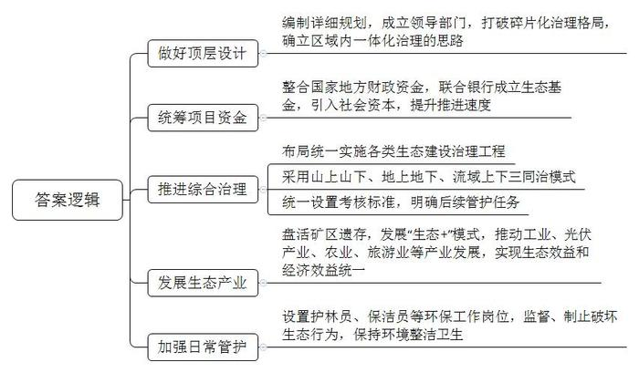
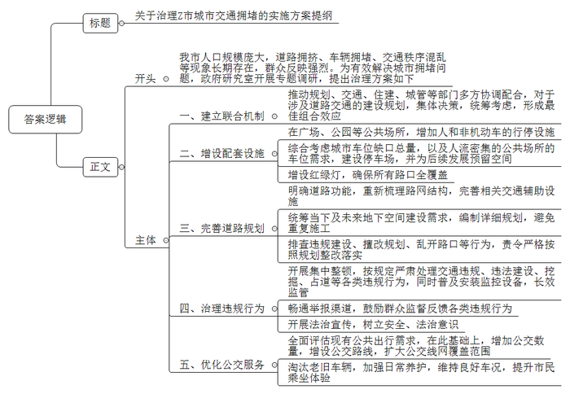
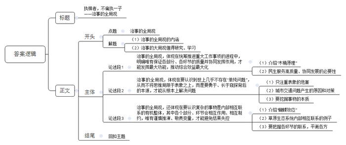

# 2022年山东省公考《申论》题（A卷）

> 候选采集稿。参考答案及解析来自粉笔页面，不代表官方答案或真实高分答卷；来源使用许可与原卷对应关系仍需人工核实。

## 给定材料

### 材料 material-068ac467d2eb44ce

说起过去的环境，X县甲村村民谢立新用“晴天一身土，雨天一身泥”来形容。X县有着丰富的稀土资源，自20世纪70年代末开始进行稀土开采。由于当时生产工艺落后和环保意识缺失，植被破坏、水土流失、水体污染、土地沙化，次生地质灾害频发，遗留下面积巨大的“生态伤疤”。

2018年，X县实施了废弃矿山综合治理和生态修复工程，编制《X县山水林田湖草项目修建性详细规划》，并专门成立山水林田湖草项目办公室，投资约9.55亿元，对14平方公里的废弃矿山进行全面治理修复。在项目推进上，坚持“抱团攻坚”，打破原来山水林田湖草“碎片化”治理格局，推进区域内“山、水、林、田、湖、草、路、景、村”一体化治理。统筹各类项目资金，在山水林田湖草生态保护修复资金拨付到位的基础上，整合国家生态功能区转移支付、东江上下游横向生态补偿、低质低效林改造等各类财政资金7.11亿元；由县财政出资，联合银行，筹措资金成立生态基金，积极引入社会投资2.44亿元，确保项目加速推进。

X县改变以往“管山不治水，治水不管山，种树不种草”的单一修复模式，针对区域内的生态问题，布局统一实施水环境保护与整治、矿山环境修复、水土流失治理、生态系统与生物多样性保护、土地整治与土壤改良等五大类生态建设和治理工程。山水林田湖草项目办王主任表示：“在治理实践中，我们创新性采用了‘三同治’模式：山上山下同治，在山上实施边坡修复、沉沙排水、植被复绿等治理措施，在山下填筑沟壑，兴建生态挡墙、截排水沟，消除矿山崩岗、滑坡等地质灾害隐患，控制水土流失；地上地下同治，地上通过客土置换、增施有机肥等措施改良土壤，平整后平面用作光伏发电或油茶等经济作物种植，坡面采取穴播、喷播等多种形式恢复植被，地下采用截水墙、高压旋喷桩等工艺，将地下污染水体引流到地面的生态水塘、人工湿地进行污染治理；流域上下同治，在上游稳沙固土、恢复植被，减少稀土尾沙、水质氨氮等源头污染，在下游建设梯级人工湿地、水终端处理设施等水质综合治理系统，实现水质末端控制和全流域稳定有效治理。同时，对所有项目统一设置了水质、水土流失控制、植被覆盖率、土壤养分及理化性质等4项考核标准，对所有施工单位明确了四年的后续管护任务。”

在推进山水林田湖草综合治理与生态修复的同时，X县积极探索生态发展之路，促进生态产品价值实现。发展“生态+工业”，利用治理后的7000亩存量工矿废弃地建设工业园区，解决工业用地紧张的难题，实现“变废为园”；实施“生态+光伏”，通过引进社会资本，在石排村、上甲村等治理区建设总装机容量35兆瓦的光伏发电站，实现“变荒为电”；推进“生态+扶贫”，综合开发矿区周边土地，建设高标准农田1800多亩，利用矿区修复土地种植油茶等经济作物5600多亩，既改善了生态环境，又促进了农民增收，实现了“变沙为油”；开展“生态+旅游”，将修复治理区与青龙岩旅游风景区连为一体，新建自行车赛道14.5千米、步行道1.2千米，统筹推进矿山遗迹、科普体验、自行车赛道等文旅项目建设，发展生态旅游、体育健身等产业，促进生态效益和经济效益的统一，逐步实现“变景为财”。

经过几年的努力，X县让“废弃矿山”重现了“绿水青山”。

在家种植了500株百香果的谢立新嗅到商机，打算扩大果园规模，增加果树品种，发展生态农业，搭上乡村旅游的快车。“吃生态饭才是长久饭。”谢立新深有感触地说。

为守住绿水青山，县里增加了护林员岗位数量，我就是其中一个。张书祥说：“以前我们还得制止滥砍滥伐，现在这种现象几乎没有了，环境也变美了，不少人周末到山林里徒步、爬山。”

“村里旅游发展起来了，岗位就多了，我们也不需要外出打工啦。”黄国庚和妻子都当起了林道和旅游公路的保洁员，日子越过越好。

### 材料 material-db05344a83ead093

Z市是一个拥有近千万人口的大城市，存在着道路拥挤、车辆拥堵、交通秩序混乱的现象，交通“治堵”成了一大难题。虽然近年来Z市投入巨资新建了环线高架路，拓宽改造了主城区几条道路，以期缓解交通压力，但目前“拥堵”问题依然严重，群众反映强烈。近日，Z市政府研究室牵头组织有关部门，邀请部分人大代表、政协委员、群众代表，对该市交通拥堵问题进行了专题调研。在汇总调研情况时，大家发表了自己的看法。

交警支队赵副队长：近年来我市机动车数量增长速度过快，车流量日益增大，为缓解交通拥堵问题，交警部门做出了许多努力，实施了不少应对办法，但受部门职能、管理层级、事权划分等诸多客观因素制约，“治堵”成效不大。作为管理城市道路交通秩序的主要职能部门，我们责无旁贷。但“治堵”是一项系统工程，涉及规划、交通、住建、城管等多个部门，需要各方协调配合。建造人行天桥、立交桥、道路及停车区域等，只有统筹考虑，才能形成最佳组合效应。例如，北环立交桥的匝道设计与周边地形、道路衔接不够好，下桥口与交通信号灯距离过短，且路口无左转限制，造成行驶车辆下桥即堵路，且桥上桥下路段同时拥堵。

自然资源和规划局王副局长：最近几年市政建设发生了日新月异的变化，建成了一些地标性建筑物，极大改善了城市形象。但与此同时也带来一些问题，突出表现为一些广场、公园大部分处在主干道附近，成为新的交通发生源，却没有配套的交通辅助设施。比如市民广场除了一个地下停车场外，几乎没有考虑人和非机动车的行停问题。目前对停车场的建设与管理，缺少统一规划，各业主单位自行其是。一些交通道路功能不清，路网结构不合理，缺少必要的隔离措施，人行道的设计也不合理，等等。根据国家标准，每100辆汽车需要停车泊位35~45个。按照我市的车辆数量计算，至少需要20万个停车泊位。然而目前全市仅有停车泊位13.8万个，缺口近7万个。管理部门迫不得已在道路上设立了大量的临时停车位，这些临时停车位占用了大量的道路资源，影响了正常的交通秩序。

人大代表金先生：城市道路规划也有许多问题亟待解决。某些道路规划滞后于城市建设发展，重复施工，拉链马路现象依然存在，对道路造成破坏的同时，严重影响正常的生活，有些建设单位违规建设、擅改规划、乱开路口，导致车流互动交叉，存在安全隐患。

政协委员孙女士：有些市民安全意识和法治观念淡薄，交通公德意识差，一些机动车违章现象突出，随意抢道、占道、掉头和停车。在没有交警管理、没有红绿灯的路口，各种车辆争相抢行，部分司机违规驾驶，占用公交车道，部分电动车、自行车和行人肆意穿行。一些人流量很大的道路没有设置人行道、地下通道或者人行天桥，很多行人常常行走在非机动车道上，自行车和电动车则大都行驶在机动车道上，挤压了公交车行驶空间，造成交通拥堵。

群众小王：现在私家车越来越多，很多小区和商务楼宇预留的车位远远不够，一些车主只好将车辆停在街道上，交警部门对随意占道停车监管不严，导致乱停车。我们小区私家车随意占用人行道、机动车道，甚至消防通道的现象相当严重。每天最大的问题就是出入小区难，碰上点事故，整条道路就全“堵死”了，上班迟到也成了常事。

交通委综合处李处长：近几年，市政府对公共交通越来越重视，全市公交网格已基本形成，但距离科学高效的要求，还存在较大的差距，公共交通承担居民出行的比例仍较低，2021年达到35%，远低于发达国家城市水平。居民出行多使用摩托车、电动车、自行车以及私家车，形成复杂的交通流。机动车与非机动车之间交通事故频发，又导致交通堵塞加重和疏导困难。目前，我市公共交通存在数量不足、车况落后、路线少等问题，缓解城市交通压力的功能尚不明显。

城管执法局丁局长：目前在城区一些学校、医院、景点等重点区域，存在流动经营、非法经营，未经许可违法建设道路，擅自挖掘占用城市道路等影响交通通行的突出问题，急需整治。

### 材料 material-486e88e4299c3aba

陈阵：黄羊真是可怜，狼太可恶了。滥杀无辜，把别人的命都不当命。

毕利格：不对，黄羊才是草原上的祸害。它们把草都吃没了。草原也有生命，是大命，所有其他的都是靠大命才生存的小命。

陈阵：可是黄羊要那么可恶，您刚才干嘛还把那活的黄羊放走？

毕利格：这次狼杀的黄羊太多了，我们需要保留足够的黄羊，让它们明年吃。要不然，狼没了猎物，就会攻击我们的羊群了。

……

——电影《狼图腾》

对人来说，草原上最宝贵的是草。有了草，牧民才能养牛、放马、牧羊；有了牛、马、羊，牧民才能在草原上生存。草还是许多野生物种赖以生存的食物，如黄羊、野兔、旱獭和老鼠，但它们却被草原人称为“草原四害”。

黄羊是最能吃草的动物，通常一群有上千只，吃起草来，抵得上许多牲畜。野兔、旱獭和老鼠不仅很能吃草，还能到处打洞，极富破坏力。牛、马、羊踩进洞里，很容易别伤腿，特别是马，如果马蹄崴进洞里，就容易别折腿，骨折的马就没用了，只能杀掉。

这时，狼就成了牧民的帮手。狼被很多土生土长的草原人视为草原的“守护神”，因为它们会猎杀黄羊、野兔、旱獭和老鼠，使“草原四害”大量减少，不至于对草原造成很严重的破坏，从而间接守护了草原的生态平衡。这样草原上的草就可以长得很好，牧民就可以继续在这里养牛、放马、牧羊，安然地生活。

可一到冬天，厚厚的积雪覆盖了草原，野兔、旱獭和老鼠就躲在洞里不出来。狼缺少了食物，只好把主意打到牧民养的牛、马、羊身上，经常在半夜袭击牛群、马群和羊群，咬死或咬伤牛、马和羊，把自己喂饱。有些遭受损失的牧民，以为把狼消灭干净就能过上安稳无忧的日子，于是疯狂地猎杀狼，可现实真如他们所愿吗？

草原上，先是野兔因为失去天敌，繁殖过快，发生了兔灾，它们跟羊抢草吃，还到处打洞。后来又发生獭灾，它们的数量呈几倍增长，把大量的草弄到洞里保暖过冬，蚊子钻进旱獭洞里，数量也呈几倍增长，结果又造成蚊灾，很多马因为被蚊子吸干血倒下了……这一切，只是灾难的开始。

没有了狼的威胁，人们的生活变得安逸、清闲起来，原来白天放牧、晚上看圈的生活方式改变了，富余的时间也变得多了起来，草原人口逐渐增加，单靠放牧已不足以养活自己，人们就开始开辟草原上的土地来耕种，以养活更多人。但草原土层薄，冬天风又大，土地很快就会沙化。草原人为了生存，只好不断地开荒，以至于后来沙化的草原越来越多……

## 题目

### 第 1 题

**请根据给定资料**2**，概括X县根治“生态伤疤”的经验。（20分）**

关联材料：material-068ac467d2eb44ce

作答要求：

要求：准确、全面、有条理，不超过300字。

### 第 2 题

**假如你是Z市政府研究室工作人员，请根据给定资料**3**，起草一份治理城市交通拥堵的实施方案提纲。（30分）**

关联材料：material-db05344a83ead093

作答要求：

要求：结构完整，条理清晰，措施得当，要素全面，不超过600字。

### 第 3 题

**请结合全部给定资料，以“大凡治事，必需通观全局”为主题，自拟题目，写一篇文章。（50分）**

关联材料：material-486e88e4299c3aba

作答要求：

要求：

（1）观点明确，见解深刻；

（2）参考“给定资料”，但不拘泥于“给定资料”；

（3）逻辑清晰，语言流畅；

（4）1000字左右。

## 答案与解析

第 1 题

**参考答案（粉笔题库参考内容）**

1.做好顶层设计。编制详细规划，成立领导部门，打破碎片化治理格局，确立区域内一体化治理的思路。

2.统筹项目资金。整合国家地方财政资金，联合银行成立生态基金，引入社会资本，提升推进速度。

3.推进综合治理。布局统一实施各类生态建设治理工程；采用山上山下、地上地下、流域上下三同治模式；统一设置考核标准，明确后续管护任务。

4.发展生态产业。盘活矿区遗存，发展“生态+”模式，推动工业、光伏产业、农业、旅游业等产业发展，实现生态效益和经济效益统一。

5.加强日常管护。设置护林员、保洁员等环保工作岗位，监督、制止破坏生态行为，保持环境整洁卫生。

**解析**

**参考答案说明**：本参考答案从“做好顶层设计”“统筹项目资金”“推进综合治理”“发展生态产业”“加强日常管护”五个方面展开，各条答案要点之间在内容上相互并列，没有交叉。

  

**考点**：考点经验启示类

**来源**：来源2022年山东省公考《申论》题（A卷）

粉笔申论页面对本题只提供「解析视频」入口，该入口是会员推广位，页面无视频地址与文字解析。

第 2 题

**参考答案（粉笔题库参考内容）**

关于治理Z市城市交通拥堵的实施方案提纲

背景：我市人口规模庞大，道路拥挤、车辆拥堵、交通秩序混乱等现象长期存在，群众反映强烈。为有效解决城市拥堵问题，政府研究室开展专题调研，提出治理方案如下：

实施方案：

一、建立联合机制。推动规划、交通、住建、城管等部门多方协调配合，对于涉及道路交通的建设规划，集体决策，统筹考虑，形成最佳组合效应。

二、增设配套设施。在广场、公园等公共场所，增加人和非机动车的行停设施；综合考虑城市车位缺口总量，以及人流密集的公共场所的车位需求，建设停车场，并为后续发展预留空间；增设红绿灯，确保所有路口全覆盖。

三、完善道路规划。明确道路功能，重新梳理路网结构，完善相关交通辅助设施；统筹当下及未来地下空间建设需求，编制详细规划，避免重复施工；排查违规建设、擅改规划、乱开路口等行为，责令严格按照规划整改落实。

四、治理违规行为。开展集中整顿，按规定严肃处理交通违规、违法建设、挖掘、占道等各类违规行为，同时普及安装监控设备，长效监管；畅通举报渠道，鼓励群众监督反馈各类违规行为；开展法治宣传，树立安全、法治意识。

五、优化公交服务。全面评估现有公共出行需求，在此基础上，增加公交数量，增设公交路线，扩大公交线网覆盖范围；淘汰老旧车辆，加强日常养护，维持良好车况，提升市民乘坐体验。

**解析**

**参考答案说明：**（1）本题要求写一份提纲，不需要考虑格式，只写正文即可，但为了保险起见，建议加上标题。（2）正文部分，一方面从内容来看，围绕着“治理城市交通拥堵”这一主题，本参考答案的开头先写到了“治理城市交通拥堵的背景”；接着主体从“建立联合机制”“增设配套设施”“完善道路规划”“治理违规行为”“优化公交服务”等五个方面给出了具体的对策。另一方面，形式上，本参考答案做到了分段、分条撰写，整体上条理较为清晰。

**考点**：考点方案类

**来源**：来源2022年山东省公考《申论》题（A卷）

粉笔申论页面对本题只提供「解析视频」入口，该入口是会员推广位，页面无视频地址与文字解析。

第 3 题

**参考答案（粉笔题库参考内容）**

**执棋者，不偏执一子**

**——治事的全局观**

清代学者钱泳在《履园丛话》中曾提及“大凡治事，必需通观全局”，习总书记也曾强调“要善于观大势、谋大局”，这都在传递一种“治事的全局观”。所谓治事的全局观，既包括推进事物各要素协同发展的视野，也包括不执迷于表象、窥探本源的通透，还包括敬畏变量、不盲目不武断的审慎。在我们国家、社会的治理进程中，任何重大决策背后，无处不体现着这种大局观，它值得我们深入研究、学习、借鉴。

**治事的全局观，****体现在统筹推进重大工作事项的进程中，明确唯有保证各部分、各环节的质量并协同发挥作用，才能发挥最大功能，推动综合效益最大化。**就像我们所熟知的“木桶原理”，若干木板构成的木桶，其盛水容量取决于最短的那块板，而不是取决于最长的那块板。又如在民生服务提供中，住房、教育、医疗、养老等诸多领域的服务质量和数量，都与民生福祉水平息息相关，如若某一方面的服务不能够满足当下的迫切需求，那么群众的幸福感和满足感便会大打折扣，民生福祉达到新水平的发展目标便只能是“空中楼阁”。

**治事的全局观****，****体现在要认识到世上几乎不存在****“单纯问题”，从而不将思维局限于表象之上，而是要勇于、长于窥探背后的本源，才能从根本上解决问题。**俗语有言“头痛医头，脚痛医脚”，启示我们如若不对症下药，只医治疼痛的部位，不追究病根，疾病便无法痊愈。正如当下城市交通治理中，道路“蜘蛛网”“僵尸车”等问题仅仅是“城市病”的表征，其本质是因为城市的规划没有跟上扩张的步伐，因此政府在治理过程中应该将提升城市规划的科学性和前瞻性作为核心发力点，才能根治交通拥堵。可见，想要在治事中达到“见微知著，一叶知秋”的境界，化解核心矛盾，就必须对表象深入挖掘和分析，追本溯源，理解事物表象之下的本质。

**治事的全局观****，还体现在要认识****复杂的****事物是****内部相互联系的有机整体，其中各个部分、环节会相互作用、相互制约，唯有谨慎推演、敬畏变量，才能避免结果失控。**气象学家提出的“蝴蝶效应”告诉我们，一只南美洲热带雨林中的蝴蝶，扇动几下翅膀，便可能引起大洋彼岸的一场龙卷风。例如在由狼、羊、植被等各个物种构成的草原生态系统中，如果牧民只认为狼群会危害其财产安全，对狼群与其他物种之间的关系视而不见，过度猎杀狼群，那么必然会致使羊群过量，侵蚀草原植被，对生态环境造成不可逆的损失。因此，只有把握系统中各个环节间的联系，才能避免陷入片面分析、主观判断等误区，维持复杂系统的平衡，推动长远发展。

不谋全局者，不足谋一域。治事观全局，既要统筹兼顾，通力协作，也要透过现象看本质，还需把握联系，平衡各方。唯有如此，才能实现不断发展，在危机中育先机、于变局中开新局。

**解析**

**文章分析**

**执棋者，不偏执一子**

**——治事的全局观**

【**标题的优点：**内容上，范文的主标题采用了比喻的修辞手法，副标题突出了“大凡治事，必需通观全局”这一主题。形式上，采用了主副搭配的结构，使标题更加生动、饱满、有吸引力。】

清代学者钱泳在《履园丛话》中曾提及“大凡治事，必需通观全局”，习总书记也曾强调“要善于观大势、谋大局”，这都在传递一种“治事的全局观”。（1）所谓治事的全局观，既包括推进事物各要素协同发展的视野，也包括不执迷于表象、窥探本源的通透，还包括敬畏变量、不盲目不武断的审慎。（2）在我们国家、社会的治理进程中，任何重大决策背后，无处不体现着这种大局观，它值得我们深入研究、学习、借鉴。

【**开头的优点：**★内容方面：范文的开头是紧扣题目给定的“大凡治事，必需通观全局”这一主题展开的。首先，开头第一句话点出主题，做到了主题明确。其次，对“大凡治事，必需通观全局”这一主题进行了分析阐述，指出了（1）治事的全局观的内涵；（2）治事的大局观值得研究、学习。★文字表达方面：使用了“既”“也”“还”等关联词，使语言表达有逻辑性。】

**治事的全局观，体现在统筹推进重大工作事项的进程中，明确唯有保证各部分、各环节的质量并协同发挥作用，才能发挥最大功能，推动综合效益最大化。**（1）就像我们所熟知的“木桶原理”，若干木板构成的木桶，其盛水容量取决于最短的那块板，而不是取决于最长的那块板。（2）又如在民生服务提供中，住房、教育、医疗、养老等诸多领域的服务质量和数量，都与民生福祉水平息息相关，如若某一方面的服务不能够满足当下的迫切需求，那么群众的幸福感和满足感便会大打折扣，民生福祉达到新水平的发展目标便只能是“空中楼阁”。

【**论述段****1的优点：**★观点句：范文的观点句是紧扣“大凡治事，必需通观全局”这一文章主题提出的。形式上，它在段首处直接写出，位置突出，容易发现。内容上，关键词突出，内容要点明确，可以明显看出它是从“推进各项工作协同发展”入手，指出了“治事的全局观的体现及意义”。★论述内容：（1）先介绍了“木桶原理”；（2）再介绍了民生服务高质量、协同发展的必要性。注意：以上两个方面层次清晰，论述的针对性强。在论述方法上主要采用了讲道理的方式，做到了见解深刻。】

**治事的全局观，体现在要认识到世上几乎不存在****“单纯问题”，从而不将思维局限于表象之上，而是要勇于、长于窥探背后的本源，才能从根本上解决问题。**（1）俗语有言“头痛医头，脚痛医脚”，启示我们如若不对症下药，只医治疼痛的部位，不追究病根，疾病便无法痊愈。（2）正如当下城市交通治理中，道路“蜘蛛网”“僵尸车”等问题仅仅是“城市病”的表征，其本质是因为城市的规划没有跟上扩张的步伐，因此政府在治理过程中应该将提升城市规划的科学性和前瞻性作为核心发力点，才能根治交通拥堵。可见，（3）想要在治事中达到“见微知著，一叶知秋”的境界，化解核心矛盾，就必须对表象深入挖掘和分析，追本溯源，理解事物表象之下的本质。

【**论述段****2的优点：**★观点句：范文的观点句是紧扣“大凡治事，必需通观全局”这一文章主题提出的。形式上，它在段首处直接写出，位置突出，容易发现。内容上，关键词突出，内容要点明确，可以明显看出它是从“透过现象看本质”入手，指出了“治事的全局观的体现及意义”。★论述内容：（1）先介绍了只注重表象的危害；（2）再介绍了城市交通问题产生的原因和对策；（3）最后介绍了要挖掘事物的本质。注意：以上三个方面层次清晰，论述的针对性强。在论述方法和论据的选取上采用了讲道理、举例子相结合，做到了论证充分。】

**治事的全局观，还体现在要认识复杂的事物是内部相互联系的有机整体，其中各个部分、环节会相互作用、相互制约，唯有谨慎推演、敬畏变量，才能避免结果失控。**（1）气象学家提出的“蝴蝶效应”告诉我们，一只南美洲热带雨林中的蝴蝶，扇动几下翅膀，便可能引起大洋彼岸的一场龙卷风。（2）例如在由狼、羊、植被等各个物种构成的草原生态系统中，如果牧民只认为狼群会危害其财产安全，对狼群与其他物种之间的关系视而不见，过度猎杀狼群，那么必然会致使羊群过量，侵蚀草原植被，对生态环境造成不可逆的损失。（3）因此，只有把握系统中各个环节间的联系，才能避免陷入片面分析、主观判断等误区，维持复杂系统的平衡，推动长远发展。

【**论述段****3的优点：**★观点句：范文的观点句是紧扣“大凡治事，必需通观全局”这一文章主题提出的。形式上，它在段首处直接写出，位置突出，容易发现。内容上，关键词突出，内容要点明确，可以明显看出它是从“把握事物的内部联系”入手，指出了“治事的全局观的体现及意义”。★论述内容：（1）先介绍了“蝴蝶效应”；（2）再介绍了草原生态系统内部相互联系的例子；（3）最后介绍了要把握各环节的联系，平衡各方。注意：以上三个方面层次清晰，论述的针对性强。在论述方法和论据的选取上采用了讲道理、举例子相结合，做到了论证充分。】

【**论述段之间的关系：**范文的论述段之间依照“并列”的逻辑展开的。论述段1先写了“推进各项工作协同发展”，论述段2再写了“透过现象看本质”，论述段3接着写了“把握事物的内部联系”，即先把握思维广度，再拓展思维深度，最后把握系统联系，避免不良后果，论述逻辑清晰、层次分明。】

不谋全局者，不足谋一域。治事观全局，既要统筹兼顾，通力协作，也要透过现象看本质，还需把握联系，平衡各方。唯有如此，才能实现不断发展，在危机中育先机、于变局中开新局。

【**结尾的优点**：范文的结尾回扣了“大凡治事，必需通观全局”这一主题，再次总结了文章的观点，做到了观点突出，论证完整。】

  
  

**考点**：考点文章写作题

**来源**：来源2022年山东省公考《申论》题（A卷）

粉笔申论页面对本题只提供「解析视频」入口，该入口是会员推广位，页面无视频地址与文字解析。

