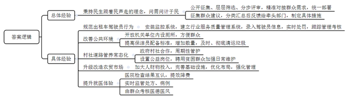
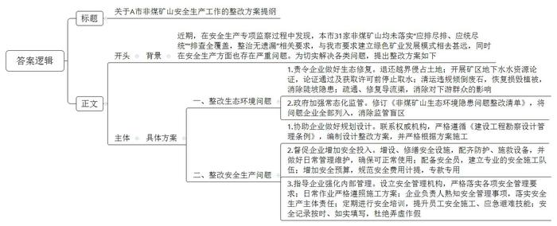
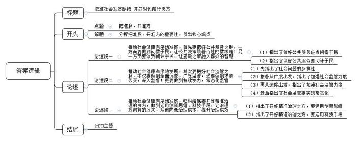

# 2022年山东省公考《申论》题（B卷）

<!-- gwy:overview:start -->
> **山东 · 2022 · 申论 · B类** ｜ 3 题 · 图片 3 处 · 答案随题折叠

导航：[题目](#题目) · [材料 1](#材料-1)
<!-- gwy:overview:end -->

> 候选采集稿。参考答案及解析来自粉笔页面，不代表官方答案或真实高分答卷；来源使用许可与原卷对应关系仍需人工核实。

## 给定材料

### 材料 1

“变化太大了，让人深感欣慰！”2021年春节前，在外务工的李先生回到家乡F市，这里的一系列变化，让他喜出望外。“城市的通行秩序比以前好多了，车主主动礼让行人，行人也少有乱穿马路的。乡村变化更大，各种设施比过去提升不止一个档次。”变化缘于2019年F市聚焦民生难点痛点，有针对性开展的整治“群众最不满意的10件事”活动。

2018年以前，F市连续多年推出年度十大民生实事项目。工作做了不少，经费也投入不少，但群众并不是很买账。2011年至2018年，F市党风廉政建设社会评价满意度在全省排名一直很靠后。

为改变这种情况，F市秉持民生跟着民声走的理念，找准难点痛点，解决群众最不满意的问题。按照公开征集、层层筛选、分步评审的方法步骤，将群众最关心最盼望解决的重点诉求问题纳入全市统一部署予以解决，确保整治事项符合群众“胃口”。2019年12月起，F市启动了大梳理、大走访、大调查、大征集活动，综合运用基层走访、统计调查、新媒体等多种方式，全方位问需于民，共收集群众诉求25.1万余条，一大批群众最想说的话、最想办的事被全面真实收集上来。经过层层筛选，最终将农贸市场环境脏乱差等10件事作为2020年度F市集中整治的群众最不满意的10件事，使集中整治事项更加精准对接群众需求。同时，针对这10件事，在全市范围开展“金点子”征集活动，在主流媒体设置专栏，公开邮箱、电话，共征集群众意见建议1039条。将意见建议分类汇总后，分别反馈给市级牵头整治部门，制定具体整治措施。

“出租车驾驶员行为不规范，很难监督到位，我们从‘金点子’中寻找灵丹妙药，采纳群众建议，安装了4G监控系统。”市公交运输管理局负责人介绍。2020年9月起，F市建立起了出租车行业服务质量管理系统，运管机构、出租车公司按权限录入驾驶员相关情况和数据，实时对违章、违规行为记分并推送信息，对驾驶员实施跟踪管理考核。

针对缺少公共厕所的事项，市城管局统一协调相关各方，将部分机关事业单位内设厕所对外开放，让现有资源和闲置资源得到充分利用，不到半年时间，就开放了855座便民公厕。为解决垃圾清运不及时、不彻底问题，按每6000平方米保洁面积配备不少于1名保洁员的标准，建成了一支高效稳定的保洁队伍，有效推进了人居环境改善。

村社道路线长、面广、分散，其管护工作是一个不小的难题，只修不养，公路损耗快，要实现可持续、高质量使用，就得推进村社道路管养常态化。在整治村社道路维护不到位的问题上，群众提出的3个“金点子”得到采纳：当地乡镇政府出资，村社出人，对村庄道路进行周期性的监管和维护；设置村级公益岗位，加强日常维护；聘用村里贫困户和困难户管理村社道路，解决就业问题，增加农民收入。

农贸市场环境脏乱差，是群众感触最直接、诟病最多的事项之一。F市投入大量人力物力财力，强力推动农贸市场升级改造，完善消防、管养、线路、设备等基础设施，优化布局，强化管理。升级改造后的西晶农贸市场环境整洁、秩序井然，蔬菜水果鲜肉分区合理。如今，中心城区已有10个农贸市场完成改造，这一惠民举措，得到群众交口称赞。

到医院看病不用重复做检查，就医体验大大提升。去年11月20日，市民李欣因感冒到F市市级医院就诊，取号问诊，拿检查报告，缴费拿药……整个流程耗时不到一小时，总计花费47.5元。此外，F市智慧医疗综合监督平台正式启用，可以对医生的门诊处方及住院病例进行实时监管，让群众来打分的全市医德医风考核信息平台已建成。国家卫生健康委满意度调查平台显示，截至2020年12月月底，F市患者满意度94.03%，排全省第二位。

群众最不满意的10件事的解决，赢得了民心，使群众的获得感、幸福感、安全感得到提升。

### 材料 2

牛年伊始，由中央广播电视总台重磅推出的《典籍里的中国》聚焦《尚书》《论语》《史记》等享誉中外、流传千古的典籍，融合“戏剧+影视+文化访谈”的手法，讲述感人至深的传承故事，在“历史空间”和“现实空间”中分别展开戏剧演绎和专家解读，以穿越的方式实现了古今读书人跨越千年的时空对话，引起广泛关注和热烈反响。

“《典籍里的中国》是总台探索传统典籍当代化传播的又一次有益尝试。中华传统文化，绝不是晦涩艰深的古董，而是集中储存在典籍里、至今仍然能够使人思考‘我们从哪里来，我们到哪里去’的思想构建。”央视广播电视总台负责人说。

节目中，主持人以典籍为舟，带领观众畅游华夏文明之长河：今人穿越到古代，看先贤如何燃万古之明灯；古人穿越到当下，看后世如何传千年之经义。如在《尚书》一集中，主持人以“当代读书人”的身份与“古代护书人”伏生展开跨越时空的对话，他们穿梭于商朝、春秋、战国、汉代、唐代等多个朝代，围绕《尚书》进行思想的碰撞和传承的巡礼，并且一直延展到2021年，在现代化的图书馆里，驻足观赏今天的孩子如何读“书”。在《天工开物》一集中，主持人邀请老年宋应星来到300多年后的今天，看后世如何在天空、大地、海洋里续写《天工开物》。宋应星和袁隆平跨越时空的握手尤其引人注目。当宋应星从袁隆平手中接过那株超级稻时，时间静止，空间无垠。此时我们明白了为什么几千年来中华民族一直把重农固本视为安民之基；为什么从宋应星到袁隆平，一代代科学家怀揣着“禾下乘凉梦”，殚精竭虑致力于提高农业技术；为什么我们国家全力保障“粮食安全”，为端牢中国人的饭碗，把种子视为农业的“芯片”，提速攻关。

节目播出后，很多专家、网友纷纷留言，给予好评：

专家A：《典籍里的中国》捕捉到了最具中国文化特质的独特标识——历史典籍，诠释了延绵不绝、生生不息的中华民族精神命脉，深度挖掘出蕴含在典籍中久远、深沉、厚重的中华优秀文化基因和精神追求。

专家B：致敬传统，尊重观众，深挖传统精髓，《典籍里的中国》向古人要智慧，把中国传统文化的精神本真呈现了出来。同时，精准地找到了能让古代人和当代人内心贴近的共振点，体现了优秀传统文化的创造性转化和创新性发展。

专家C：这个节目通过穿越的形式，解读了根植于中国人血液当中的历史文化基因，让观众看得懂，符合各层次观众的观赏需求。

网友A：古今对话很有新意，典籍里的人物活了起来。这文化底蕴，也没谁了！

网友B：《论语》倒是读过，但如果没有《典籍里的中国》，我就不会对《尚书》有如此的了解了。

网友C：服化道好看，配乐也赞。不光我爱看，连孩子都爱看，这节目激起了他对传统文化的喜欢。

### 材料 3

根据H省安全生产专项整治三年行动计划方案部署，H省组织国家级安全生产专家团队，对全省危化品、非煤矿山和工贸等行业领域的企业开展安全生产大诊断行动。2021年6月，H省应急管理厅组织安全生产专项监察组进驻A市，对非煤矿山安全生产开展专项监察。

基本情况如下：

A市矿产资源丰富，有非煤矿山31家，其中花岗石矿山12家，区域内花岗石储量超1.2亿立方米，位居全国前列。A市提出，要构建环境友好、节约高效、矿地和谐、符合生态文明建设要求的绿色矿业发展模式，但花岗石矿山中尚无一家开展“绿色矿山”创建工作，部分矿产资源开发利用过程中生态破坏和环境污染问题突出。

众晶矿业有限公司大洼花岗石矿越界侵占土地约7200平方米；石桥矿业有限责任公司寨子山冰花兰矿自2008年以来陆续设置3口取水井，在这期间既没有开展地下水水资源论证，也未取得地下水取水许可，长期违法取用地下水用于矿山生产。

众晶矿业在设计排土场的西南面约150米处违规倾倒废石，压覆损毁植被面积达15000平方米，且形成高陡边坡。众晶矿业和石桥矿业水土保持方案均要求通过设置截排水沟收集地表水并引流，保持排水沟畅通。但在监察中发现，众晶矿业排土场排洪沟和石桥矿业排土场导流渠均存在损毁淤堵，其中众晶矿业排土场整体已呈现出明显水力侵蚀痕迹，排土场下游不足1千米处为农田和村庄，水土流失、安全隐患等问题突出。

排查过程中发现，A市的31家非煤矿山均没有落实省、市关于“应排尽排、应统尽统”和“排查全覆盖、整治无遗漏”的相关要求。资料显示，A市自然资源和规划局《非煤矿山生态环境隐患问题整改清单》中仅有3家非煤矿山在列，常态化监管存在盲区。

大广山矿业有限公司是一家具备30万吨/年生产能力的镇属民营铁矿，开采深度为35米至负560米，该矿山水文地质条件属复杂类型，水患严重，曾发生过多起透水事故。尽管如此，企业并未对安全问题足够重视，甚至没有专门的探放水队伍，而是由外包施工队代替，且未按探放水设计方案进行作业。探放水设计方案要求，探水孔长度为60米，超前距离20米。现场实际探水孔长度30米，超前距离10米，缩减了一半。监察组现场检查时发现，负470米中段水泵房、中央变电所未按设计要求设置防水门，中段内设置的防水门因轨道、风筒阻挡，企业人员多次尝试都未能将其关闭，防水门失去防水作用。

监察组在金龙矿业有限公司发现，该矿山的最初设计是由省冶金设计院等3家设计单位分别完成的，企业从3家设计方案中选择了对自己有利的部分，致使现场与3家单位编制的设计、变更均存在差异，相关资料相互矛盾，可谓“三不靠”，严重违反《建设工程勘察设计管理条例》。当监察人员提出“请介绍一下你们自行编制的《非煤矿山大检查方案》中组织机构、排查重点、重点工作任务等情况”时，在场的公司总经理、安全副总、安全科科长面面相觑，无一人能回答出来，监察组又询问了矿山通风线路、防排水制度、避灾线路等问题，安全科科长的回答和企业提供的现状图不一致。

在水窝子矿业有限公司，监察组通过查看资料和现场询问发现，该企业没有专门的安全管理机构，安全管理人员身兼数职，安全生产费用计提混乱，未专款专用。下井实地监察时监察组发现，在负350米避灾硐室，打开供水施救设备，无水流出；打开阀门，拿起压风自救面罩，气表无压力；拿起通信电话，无信号。“这‘三不通’的硐室能避难吗？”监察组人员质问。“这个硐室已经停用很长时间了，氧气不足，太危险了，我们还是赶快撤吧。”企业陪同人员边回答边向外走。

监察组发现，企业提供的井上井下对照图、避灾线路图、井下电气设备布置图都与现状图对应不上，作为第二安全出口的盲斜井不具备行人条件。“我们入井时途经培训室，但企业未进行任何入井安全培训；查阅领导带班下井记录，多日缺失，领导带班值班表上所列人员为安全科员工，有弄虚作假嫌疑；入罐前，无安全员检查入井人员安全防护用品佩戴情况，未清点入罐人数，且该罐笼竖井未经验收即投入使用；在负430米中段工作面，作业人员无法提供作业班组便携式气体检测仪；乘坐斜井人车时，无安全员检查挂钩、防护链是否挂设完毕就发出提升信号。”

针对此次专项监察中发现的问题，监察组要求A市“把准脉，开准方”切实抓好整改，确保取得实效。为此，A市成立了由常务副市长牵头的非煤矿山安全生产整治工作专班……

### 材料 4

凭码出行，已成为疫情下人们的新日常，时间倒回至2020年，这个小小的健康码曾让人费尽心思。“大家现在使用的健康码，最早的原型是杭州二维码。”关于健康码的诞生，杭州市公安局计算机应用管理科的工作人员说起个中缘由——2020年年初疫情发生后，城市运转几乎停滞，为了让一部分人先流动起来，逐步实现企业复工复产，杭州市政府决定由公安局牵头研发一个“出行凭证”。

初步拟订方案之后，研发团队经过调研，发现提出的问题比预想的更多：人们不能出门，凭证如何发放和领取？企业复工复产需要提交详尽的材料，申请流程太长、审批需要协调的部门太多怎么办？机关、社区、学校、医院，怎样分类才能做到全面覆盖……研发团队意识到，必须转变设计理念，开发一个面向所有人、无差别的线上平台。设计理念转变，产品名字也从开始的“员工码”“企业码”变为“杭州健康码”。

2020年2月11日，杭州健康码正式上线，当天申请量即突破130万。但实际上挑战才刚刚开始。健康码上线后，市长公开电话、网络等各个渠道的咨询络绎不绝。由于当时的赋码规则不够完善，出现了很多的问题。大量的投诉，倒逼着研发团队对产品进行迭代，提高健康码的准确率。他们分析投诉内容，回应网友疑问，收集不同人群、不同场景对健康码的不同需求，梳理出共性问题，对健康码进行优化。共完成了29轮次技术调整，完善了14个赋码规则，迭代了63项应用功能。一周后，群众投诉量迅速回落到100起以下，降幅达98%。两周后，杭州健康码从浙江走向全国，迅速复制推广到全国18个省200多个城市。

此后，深圳捷易科技借助自身研发和技术力量，基于健康码推出了精准防疫核验产品，该产品对接了国家政务平台及各省大数据中心，实现了全国防疫健康信息码、粤康码、随申码、八闽码、苏康码、安康码、穗康码等健康码快速解码，并通过移动通信大数据，与各个省份推送的核酸检测情况、疫苗接种情况、核酸检测结果等防疫大数据信息进行对接，实现了扫码或刷身份证实时读取核验，保障了全国成百上千个大型公共场所人员快速核验健康码通行。

2021年8月，在W市S区，沌口街道被划定为中风险地区，纳入重点防控。沌阳街道则保持风险等级不变，二者之间，只隔着一条东风大道。为划清这条风险带，降低疫情影响。S区组织流调队员对风险点挨个现场摸排、抽丝剥茧，大数据专家将病毒携带者行动轨迹从时间上精确到秒，从空间上精准到一个早点摊。公交因时因势调整优化，商业场所核酸检测无恙后即恢复正常营业，各大医院鼓励患者分时段预约，避开高峰时段，但并不一停了之。S区通过靶向施策，让社会适度“静”下来，但绝不是“停”下来。

## 题目

### 第 1 题

**请根据给定资料**1**，总结F市整治“群众最不满意的10件事”的基本经验。（20分）**

关联材料：材料 1

作答要求：

要求：全面、准确、有条理，不超过300字。

第 1 题 · 答案与解析

**参考答案（粉笔题库参考内容）**

秉持民生跟着民声走的理念，问需问计于民。公开征集、层层筛选、分步评审，精准对接群众需求，统一部署；征集群众建议，分类汇总后反馈给牵头部门，制定具体措施。1.规范出租车驾驶员行为。安装监控系统，建立行业服务质量管理系统，录入驾驶员信息，实时处罚，跟踪管理考核。2.改善公共环境。开放机关单位内设厕所，方便群众；提高保洁员配备标准，增加数量，及时、彻底清运垃圾。3.村社道路管养常态化。政府村社合作，周期性管护；设置公益岗位，聘用贫困群众加强日常维护。4.升级改造农贸市场。加大人财物投入，完善基础设施，优化布局，强化管理。5.提升就医体验。医院检查结果互认，提效降费；实时监管处方、病例；由群众考核医德医风。

**参考答案说明：**本参考答案在宏观上分为“总体经验”和“具体经验”两个部分。在“具体经验”内部，又从“规范出租车驾驶员行为”“改善公共环境”“村社道路管养常态化”“升级改造农贸市场”“提升就医体验”五个方面展开，各条要点之间在内容上相互并列，没有交叉。

**解析状态：unknown（来源未提供）**

### 第 2 题

**假如你是****A市非煤矿山安全整治工作专班成员，请根据给定资料**3**，草拟一份整改方案提纲。（30分）**

关联材料：材料 3

作答要求：

要求：结构完整，条理清晰，措施得当，要素全面，不超过600字。

第 2 题 · 答案与解析

**参考答案（粉笔题库参考内容）**

关于A市非煤矿山安全生产工作的整改方案提纲

背景：近期，在安全生产专项监察过程中发现，本市31家非煤矿山均未落实“应排尽排、应统尽统”“排查全覆盖，整治无遗漏”相关要求，与我市要求建立绿色矿业发展模式相去甚远，同时在安全生产方面也存在严重问题。为切实解决各类问题，提出整改方案如下：

具体方案：一、整改生态环境问题。1.责令企业做好生态修复。退还越界侵占土地；开展矿区地下水水资源论证，论证通过及获取许可前停止取水；清运违规倾倒废石，恢复损毁植被，消除陡坡隐患；疏通、修复导流渠，消除对下游群众的影响。2.政府加强常态化监管。修订《非煤矿山生态环境隐患问题整改清单》，将问题企业全部列入，消除监管盲区。

二、整改安全生产问题。1.协助企业做好规划设计。联系权威机构，严格遵循《建设工程勘察设计管理条例》，编制设计整改方案，并严格根据方案施工。2.督促企业增加安全投入。增设、修缮安全设施，配齐防护、施救设备，并做好日常管理维护，确保可正常使用；配备安全员，建立专业的安全施工队伍；增加安全预算，规范安全费用计提，专款专用。3.指导企业强化内部管理。设立安全管理机构，严格落实各项安全管理要求；日常作业严格遵照施工方案；企业负责人熟知安全管理事项，落实安全生产主体责任；定期进行安全培训，提升员工安全施工、应急避难技能；安全记录按时、如实填写，杜绝弄虚作假。

**参考答案说明**：（1）本题要求撰写提纲不必考虑格式，但是为了保险起见，建议加上标题。（2）正文部分，从内容来看，围绕着“非煤矿山安全整治”这一主题，本参考答案开头部分总体性介绍了A市非煤矿山企业生产过程中存在的问题；主体部分按照“整改生态环境问题”“整改安全生产问题”两个层面进行分类，其中，在“整改生态环境问题”中分别从“责令企业做好生态修复”和“政府加强常态化监管”两方面给出了整改方案；在“整改安全生产问题”中分别从“协助企业做好规划设计”“督促企业增加安全投入”和“指导企业强化内部管理”三方面给出了整改方案。（3）从形式来看，本参考答案做到了分段、分条撰写，整体上条理较为清晰。

**解析状态：unknown（来源未提供）**

### 第 3 题

**请结合全部给定资料，以****“把准脉，开准方”为主题，自拟题目，撰写一篇文章。（50分）**

关联材料：材料 1、材料 2、材料 3、材料 4

作答要求：

要求：

（1）观点明确，见解深刻；

（2）参考“给定资料”，但不拘泥于“给定资料”；

（3）逻辑清晰，语言流畅；

（4）1000字左右。

第 3 题 · 答案与解析

**参考答案（粉笔题库参考内容）**

**把准社会发展脉搏** **开好时代前行良方**

清代名医徐灵胎认为“医法一误，必至伤生害命，尤不可不慎也”，社会治理又何尝不是如此？医社会之疾如治人之病，不作为、假作为、乱作为等错误的“医法”，不仅会损害百姓的切身利益，更制约着全社会的良性运转。因此，若想**推动社会健康有序地发展**，务必应当先**摸清社会肌体的脉搏，找准施策的正确方向；再有的放矢，开好治理社会的妙药良方**。

**推动社会健康有序地发展，首先要把好公共服务之脉，一方面要做到问需于民，让公共决策跟着百姓的需求走；另一方面要做到问计于民，让施政之策融入群众的智慧。**正所谓“治政之要在于安民，安民之道在于查其疾苦”，不闻百姓平日疾苦，不问人民需求之处，是不可能把公共服务做好、做实、做精的。管理者更是服务者，应当放下架子、沉下身子、迈开步子，深入基层、走近群众、问需于民，把人民最不满意的事情，提上工作日程；把群众最殷切的期盼，纳入工作规划。此外，也要高度信任群众的智慧，认真听取民众的意见建议，充分调动群众的参与热情，把百姓的良方良策运用到民生建设的实际工作中。

**推动社会健康有序地发展，****其次****要把好社会监管之脉，****不仅要做到全面调查，广泛监督；还要做到求真务实，深入监督；更要做到持续发力，常态化监管。**社会发展中出现的问题，有的是显性且易于发觉的，而更多的顽疾是潜藏且具有隐蔽性的。没有调查就没有发言权，一方面，管理者只有深入基层一线，组织最为全面、广泛与充分的调查，才能将监管的盲区悉数摸清，让问题暴露在炽热的阳光之下。另一方面，有关部门也应加强监管力度，不搞形式主义，严格落实责任，将隐患遏制在萌发阶段。例如解决非煤矿山的安全问题，有关部门应当加大监管力度，督促涉事单位企业遵纪守法、科学规划、有效整改，确保矿山开采工作安全、有序地开展。无论是加强监督的广度还是深度，只有持之以恒、一以贯之，才能将社会之疾连根拔除。

把准脉，是为了开出好方子，只有对症下药，才能让顽疾药到病除。那么，应对社会之疾，治理者应该开出什么样的妙计良方呢？

**推动社会健康有序****地****发展，归根结底要开好精准治理的良方，做到运用创新思维、科技手段，让治理政策有的放矢，从而降低治理成本，提升治理成效。**凡益之道，与时偕行。社会治理也应当是一个动态的过程，管理者不应墨守成规、固执己见，而要与时偕行、与时俱进。正如新冠疫情期间，起步于杭州的二维码，为了挣脱地域限制，公安部门转变设计理念，几经优化最终推广至全国，让世界感叹中国的精准防疫。思维的进步，必然带来管理方式的不断优化和蜕变。随着时代的发展，社会中既有新问题应时而生，也有老问题始终存在，这就要求管理者借助互联网、云技术、大数据等现代科技的力量，让治理手段更智慧，让治理方式更智能，让治理成果更显著。

有的放矢胜于万箭齐发，只有把好社会肌体的脉搏，摸清社会症结的源头，才能在精准施策时对症下药，从而让全社会在强健平稳中焕发生机，在健康有序中阔步向前！

**文章分析**

**把准社会发展脉搏** **开好时代前行良方**

【**标题的优点：**标题中含有主题词，使文章主题更突出、清晰。其次，主标题在形式上采用对称式结构，使标题颇有亮点。】

（1）清代名医徐灵胎认为“医法一误，必至伤生害命，尤不可不慎也”，<u>社会治理又何尝不是如此</u>？医社会之疾如治人之病，<u>不作为、假作为、乱作为等错误的</u><u>“医法”</u>，<u>不仅会损害百姓的切身利益</u>，<u>更制约着全社会的良性运转</u>。（2）因此，<u>若想</u><u><b>推动社会健康有序地发展</b></u>，务必要<u><b>先摸清社会肌体的脉搏</b></u>**，**<u><b>找准施策的正确方向</b></u>**；**<u><b>再有的放矢</b></u>**，**<u><b>开好治理社会的妙药良方</b></u>。

【**开头的优点：**★内容方面。范文的开头是紧扣题目给定的“把准脉，开准方”这一主题展开的。一方面，通过类比的修辞方法，从反面论述如果没有做到“把准脉，开准方”，对社会发展产生的危害；另一方面，引出核心观点，推动社会健康有序发展，要先把好社会肌体脉搏，再开出妙药良方。★文字表达方面。使用了“不仅……更”“因此”“先……再”等连接词，使语言表达有逻辑性。】

**推动社会健康有序地发展，首先要把好公共服务之脉，一方面要做到问需于民，让公共决策跟着百姓的需求走；另一方面要做到问计于民，让施政之策融入群众的智慧。**（1）正所谓“治政之要在于安民，安民之道在于查其疾苦”，<u>不闻百姓平日疾苦</u>，<u>不问人民需求之处</u>，<u>是不可能把公共服务做好、做实、做精的</u>。<u>管理者更是服务者</u>，<u>应当放下架子、沉下身子、迈开步子</u>，<u>深入基层、走近群众、问需于民</u>，<u>把人民最不满意的事情</u>，<u>提上工作日程</u>；<u>把群众最殷切的期盼</u>，<u>纳入工作规划</u>。（2）此外，也要<u>高度信任群众的智慧</u>，<u>认真听取民众的意见建议</u>，<u>充分调动群众的参与热情</u>，<u>把百姓的良方良策运用到民生</u><u>建设</u><u>的实际工作中</u>。

【**论述段****1的优点：**★观点句：范文的观点句是紧扣“把准脉，开准方”这一文章主题提出的。形式上，它在段首处直接写出，位置突出，容易发现。内容上，关键词突出，内容要点明确，可以明显看出从“公共服务”角度，对“把好脉”展开了论述。★论述内容：（1）一方面指出了做好公共服务应当问需于民。（2）另一方面指出了做好公共服务要问计于民。注意：以上两个方面的内容都是紧扣“推动社会健康有序地发展，首先要把好公共服务之脉，一方面要做到问需于民，让公共决策跟着百姓的需求走；另一方面要做到问计于民，让施政之策融入群众的智慧”这个观点句进行分析论述的，论述的针对性强，内容层次丰富。在论述方法上主要采用了讲道理的方式，论述清晰透彻。】

**推动社会健康有序地发展，****其次****要把好社会监管之脉，****不仅要做到全面调查，广泛监督；还要做到求真务实，深入监督；更要做到持续发力，常态化监管。**（1）<u>社会发展中出现的问题</u>，<u>有的是显性且易于发觉的</u>，而<u>更多的顽疾是潜藏且具有隐蔽性的</u>。（2）没有调查就没有发言权，一方面，<u>管理者</u><u>只有</u><u>深入基层一线</u>，<u>组织最为全面、广泛与充分的调查</u>，<u>才能将监管的盲区悉数摸清</u>，<u>让问题暴露在炽热的阳光之下</u>。（3）另一方面，<u>有关部门也应加强监管力度</u>，<u>不搞形式主义</u>，<u>严格落实责任</u>，<u>将隐患遏制在萌发阶段</u>。例如解决非煤矿山的安全问题，有关部门应当加大监管力度，督促涉事单位企业遵纪守法、科学规划、有效整改，确保矿山开采工作安全、有序地开展。（4）<u>无论是</u><u>加强</u><u>监督的广度还是深度</u>，<u>只有持之以恒、一以贯之</u>，<u>才能将社会之疾连根拔除</u>。

【**论述段****2的优点：**★观点句：范文的观点句是紧扣“把准脉，开准方”这一文章主题提出的。形式上，它在段首处直接写出，位置突出，容易发现。内容上，关键词突出，内容要点明确，可以明显看出从“社会监管”角度，对“把好脉”展开了论述。★论述内容：（1）先指出了社会问题的多样性；（2）接着从广度出发，指出了加强社会监管力度；（3）再从深度出发，指出了加强社会监管力度；（4）最后指出了社会监管要实现常态化。注意：以上几个方面的内容都是紧扣“推动社会健康有序地发展，其次要把好社会监管之脉，不仅要做到全面调查，广泛监督；还要做到求真务实，深入监督；更要做到持续发力，常态化监管”这个观点句进行分析论述的，论述的针对性强，内容层次丰富。在论述方法上采用了讲道理、摆事实相结合的方式，论述清晰透彻。】

把准脉，是为了开出好方子，只有对症下药，才能让顽疾药到病除。那么，应对社会之疾，治理者应该开出什么样的妙计良方呢？

【**过渡段的优点：**本段既是对论述段1与2的总结，也是引出论述段3的过渡性段落，起到了承上启下的作用。】

**推动社会健康有序****地****发展，归根结底要开好精准治理的良方，做到运用创新思维、科技手段，让治理政策有的放矢，从而降低治理成本，提升治理成效。**（1）凡益之道，与时偕行。<u>社会治理也应当是一个动态的过程</u>，<u>管理者不应墨守成规、固执己见</u>，<u>而要与时偕行、与时俱进</u>。正如新冠疫情期间，起步于杭州的二维码，为了挣脱地域限制，公安部门转变设计理念，几经优化最终推广至全国，让世界感叹中国的精准防疫。（2）<u>思维的进步</u>，<u>必然带来管理方式的不断优化和蜕变</u>。随着时代的发展，<u>社会中既有新问题应时而生</u>，<u>也有老问题始终存在</u>，这就要求<u>管理者借助互联网、云技术、大数据等现代科技的力量</u>，<u>让治理手段更智慧</u>，<u>让治理方式更智能</u>，<u>让治理成果更显著</u>。

【**论述段****3的优点：**★观点句：范文的观点句是紧扣“把准脉，开准方”这一文章主题提出的。形式上，它在段首处直接写出，位置突出，容易发现。内容上，关键词突出，内容要点明确，可以明显看出从“精准治理”角度，对“开好方”展开了论述。★论述内容：（1）一方面指出了开好精准治理之方，要运用创新思维；（2）另一方面指出了开好精准治理之方，要运用科技手段。注意：以上两个方面的内容都是紧扣“推动社会健康有序地发展，归根结底要开好精准治理的良方，做到运用创新思维、科技手段，让治理政策有的放矢，从而降低治理成本，提升治理成效”这个观点句进行分析论述的，论述的针对性强，内容层次丰富。在论述方法上采用了讲道理、摆事实相结合的方式，论述清晰透彻。】

有的放矢胜于万箭齐发，<u>只有把好社会肌体的脉搏</u>，摸清社会症结的源头，<u>才能在精准施策时对症下药</u>，从而让全社会在强健平稳中焕发生机，在健康有序中阔步向前！

【**结尾的优点：**范文的结尾回扣了为社会发展“把准脉，开准方”这个主题，并且进行了总结提升。】

**解析状态：unknown（来源未提供）**

