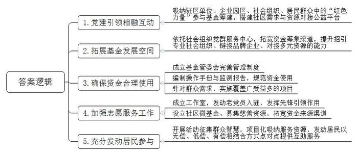
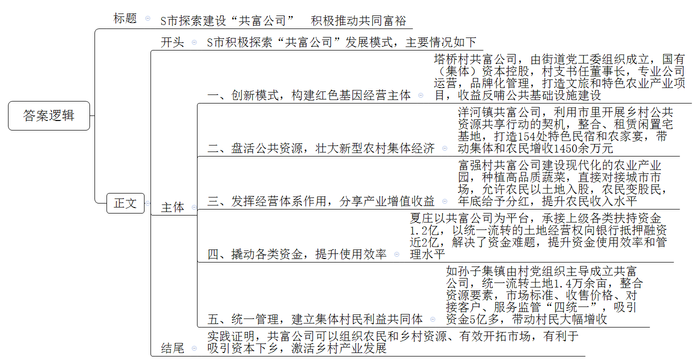
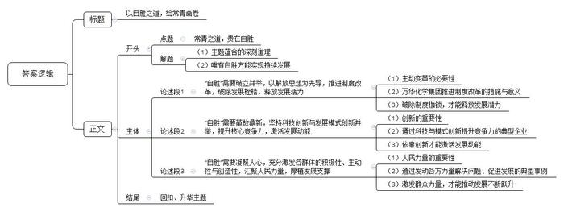

# 2023年山东省公考《申论》题（B卷）

<!-- gwy:overview:start -->
> **山东 · 2023 · 申论 · B类** ｜ 3 题 · 图片 3 处 · 答案随题折叠

导航：[题目](#题目) · [材料 1](#材料-1)
<!-- gwy:overview:end -->

> 候选采集稿。参考答案及解析来自粉笔页面，不代表官方答案或真实高分答卷；来源使用许可与原卷对应关系仍需人工核实。

## 给定材料

### 材料 1

“说凤阳，道凤阳，凤阳本是好地方。自从出了朱皇帝，十年倒有九年荒。”这段凤阳花鼓，唱出了凤阳人数百年来逃荒要饭的沧桑历史。

安徽省凤阳县小岗村是淮河岸边的一个普通村庄。1978年，18位农民冒着坐牢的风险，按下了“生死契约”，开创了中国农村改革的先河。

车行至小岗村村口，凤阳县文化馆的老朋友汉寿兄已等候多时。停好车，穿过社会学家费孝通题词的“凤阳县小岗村”牌坊，一条大道直通村中。汉寿告诉我，脚下的这条大道叫“改革大道”，小岗村成为红色旅游景区后，每年接待国内外游客人次已突破百万。

“大包干，大包干，直来直去不拐弯。保证国家的，留够集体的，剩下的都是自己的。”这首1979年在当地传唱的《大包干歌》，在大包干纪念馆内不停地滚动播放。纪念馆大厅正中的一座雕塑复原了1978年冬天18位农民秘密在一张纸上按下鲜红手印的场景：18位农民或坐或站或蹲，在同意“分田单干”的字据上，摁下18个鲜红的手印。“我们分田到户，每户户主签字盖章，如以后能干，每户保证完成每户的全年上交公粮，不再向国家伸手要钱要粮。如不成，我们干部坐牢杀头也甘心，大家社员也保证把我们的小孩养活到十八岁。”

丰富翔实的资料、图片，完整地再现了当年小岗村人大包干发展的历史过程。走出纪念馆，我们又走进纪念馆对面的一个大棚，这是村民杨伟和妻子开办的家庭农场。2012年，转业回乡的杨伟看到家乡变化之大，决定放弃外出打工，留在村里做一名“新农人”。2013年，他流转了20亩土地，开始种植西瓜、蔬菜，但成效并没有想象中好。“慢慢琢磨发现，小岗游客多，西瓜、蔬菜这类不能带走，应该种一些既能让游客参与，又方便携带的品种，于是想到种植草莓。”杨伟四处考察学习草莓种植技术，建起8个草莓大棚，打造了一个可供采摘、游玩的家庭农场，游客络绎不绝。

中午时分，我们来到“金昌食府”。汉寿介绍，这家食府的主人就是大包干带头人之一严金昌。如今，“金昌食府”已成为小岗村的网红打卡地。

今年已经79岁的严金昌十分健谈，被问及当年他们是怎么想起大包干的，严金昌放下手中的碗筷说：“大包干之前，我们村一直是‘吃粮靠返销、用钱靠救济、生产靠贷款’的‘三靠村’。1978年又逢大旱，被生活逼得走投无路的我们才有了18个红手印的事。真没想到，大包干第一年，我们村就发生了巨大变化，粮食产量是过去5年的总和，油料产量是过去20年的总和，自1956年合作化以来，第一次向国家交了12488公斤公粮，人均收入由上一年的22元一下增长到350元。”

说到这里，严金昌一脸兴奋，话题一转继续说道：“由于各种原因，之后这些年，我们并未真正走上致富路。‘一夜迈过温饱线，20年没进富裕门。’这是20世纪80年代我们村曾经流传的一句话。直到进入新世纪后，我们村开始了第二次‘革命’，就是通过土地流转，将土地集中起来，改‘化整为零’为‘化零为整’，改‘分田到户’为‘分红到人’，发展现代农业，壮大集体经济。我家60多亩地全部流转了出去，每亩800元的租金，去年我们村人均可支配收入达到3.05万元。”

吃完饭，我们来到“当年农家”，小院门前，一石碑上刻写着“滁州市重点文物保护单位——中国农村改革‘大包干’发源地”。走进小院，院里只有几间泥巴垒成的矮旧茅草小屋。低头弯腰走进屋内，坑坑洼洼的地面、袒露的土墙壁、分不清颜色的桌椅板凳、一盏没有灯罩的煤油灯，目睹眼前这一切，一种历史的沧桑感让人心里发颤。谁能想到，就是在这样一间破旧的小屋里，18位农民按下红手印，拉开了中国农村改革的序幕。

走出“当年农家”，汉寿又带我转了转。在村委会办事大厅的墙上，我们看到《小岗村美德银行积分办法》：好人好事每次积10分，遵守村里红白喜事公约每次积200分……所有积分，可兑换各种生活用品。在农产品深加工产业园，我们看到，盼盼食品、蒸谷米等一个个知名农产品加工企业的现代化生产线，正开足马力、昼夜不停地生产。在葡萄采摘园，一串串圆润饱满的葡萄挂满枝头，透着诱人的光泽，游客们冒着酷暑体验采摘的乐趣……

“中国要强，农业必须强；中国要美，农村必须美；中国要富，农民必须富。”站在村口，面对眼前宽阔的“改革大道”，我想，小岗村的蝶变再次向我们证明：幸福美好的生活都是奋斗得来的。

### 材料 2

“不仅仅是方便，还省了不少钱呢！”一大早，小区72岁老人董先生对上门服务的“义剪美”爱心理发师竖起了大拇指，“我们楼上好几位老人腿脚不利索，下楼困难，现在只需支付1元钱就能享受上门理发。”

老人赞不绝口的“义剪美”公益项目便是社区党委通过“小区1元公益服务”方式汇集社区基金，“取之于民，用之于民”、共建幸福家园的一个缩影。

W市经济技术开发区在实践中探索设立社区基金，吸纳驻区单位、企业园区、社会组织、居民群众中的“红色力量”参与社区基金的筹建，搭建社区需求与资源对接的公益平台，构建起党建引领下相融互动新模式。同时依托社会组织党群服务中心，拓宽资金筹集渠道，提升招引专业社会组织、链接品牌企业、对接多元资源的能力，拓展社区基金发展空间，形成精准化对接、项目化运作、品牌化带动新格局。“目前我们已经成立街道级社区基金2支、社区级基金32支、青少年专项基金1支，累计募捐资金达到了130余万元。”W市经济技术开发区人力资源部副部长王刚介绍，随着越来越多“公益血液”加入和“源头活水”注入，党委搭台、社会出资、居民参与的全域化基金参与体系愈加完善。

为确保每一笔资金花到群众需求最迫切、最关注的地方，每个社区基金都成立了包括捐赠人代表和社区居民代表的基金管理委员会，搭建起完善的社区基金管理流程和制度体系。由各街道党工委组织编制操作管理手册、战略规划监测报告，全方位规范项目资金的使用报销及审批，实现对社区基金人员、资金、项目实施的全流程管理。

“筹建社区基金的最终目的还是要全部用于社区开展治理服务，有针对性地实施一批覆盖广、受益多的社区服务项目，让每一笔资金都能发挥出最大的社会效益、用到群众最需要的地方。”W市经济技术开发区东城街道党工委组织委员言灵说。

小基金撬动大服务，解决百姓“小急难”问题。“感谢社区对我们的关心和帮助，我们更有信心渡过难关！”日前，龙城国际南区居民沈先生收到了府东社区慈善基金管委会送来的救助款，一家人非常感动。沈先生去年7月发生车祸，因家庭困难，后续康复费用巨大，于是向府东社区慈善基金申请救助。府东社区党总支高度重视，迅速落实“社区慈善基金”款项，社区党总支“第一书记”马春江与市社会救助综合服务中心主任杨益东来到沈先生家中，送上救助款并了解他们的生活情况，鼓励他们战胜眼前的困难，并表示生活上有什么困难，府东社区将尽力提供服务。

为了加强志愿服务队伍建设，锦明社区将培育党员典型、学习先进党员与社区治理结合起来，充分发挥先锋引领作用，激发社区党建和社区治理新活力。社区成立了“王允功工作室”，发动辖区内符合条件、热心社区公益的离退休老党员入驻，指导工作室制定了周例会等制度，研究分析居民需求，制定服务项目，精准实施。同时，挂靠街道社区基金，设立社区微基金，通过社区微基金运作和慈善资源募集，为志愿服务项目开展拓宽资金来源渠道，拓展社会力量的参与。

除了推进公益项目的实施，W市经济技术开发区还开展“居民金点子征集”“公益项目大赛”等活动，项目化吸纳各类服务资源，发动居民参与“自我买单”，以无偿、低偿、有偿相结合方式点对点提供互助服务，以“服务换服务、服务换资源、资源换资金”等方式解决实际问题。

引得源头活水，觅得群芳争艳。随着社区基金的合理运行发展，W市经济技术开发区已推出“清道夫”“安易行”“村村有个图书角”“关爱出行·幸福陪伴”等众多公益项目，一些由社区党委牵头领办的“幸福食堂”、“针心针意”编织坊、“锦华之声”编辑部等都实现了商业化“造血”，累计盈利超10万元，这些资金又投入到了社区治理服务当中，有效解决了一系列居民群众关心关注的公共事务难题。

### 材料 3

从空中俯瞰，万华烟台工业园中的一座座办公楼，形同一个个巨大的苯环分子结构。位列全球化工50强的万华，是中国唯一、世界少数拥有异氰酸酯（英文简称MDI）自主知识产权的化工企业。

如果说“创业+改革”是促使万华活起来的化学反应，那么“改革+创新”则是促使它强起来的深刻巨变。与中国改革开放同龄的万华化学集团股份有限公司，从昔日生产合成革的传统国企起步，技术创新能力从无到有、从弱到强，成长为全球MDI行业领军者的现代化大型企业，走出了一条令人瞩目的中国特色现代国有企业改革发展之路。

万华的诞生，与解决中国人穿鞋问题有着不解之缘：40年前的中国，还是一个踩在布鞋上的国度。此后10年，万华累计为2亿双合成革皮鞋提供原料，相当于提供全国皮鞋原料的1/4。

中国老百姓实现了从“穿布鞋”到“穿皮鞋”的历史跨越，万华也随之踏上了从“计划”走向“市场”的艰辛探索之路。一方面，万华沿袭着传统计划模式：轻工部拨原料、下指标，万华生产后再由轻工部统一调配。另一方面，外国企业产品不断涌入，民营合成革企业迅速兴起，动摇了万华产品一统天下的地位。很快，万华从“皇帝女儿不愁嫁”变成了“门前冷落鞍马稀”。

作为计划体制的“宠儿”，国有企业能不能在市场竞争中成为“弄潮儿”？这是万华，也是所有国有企业必须回答的重大课题。时任技术车间副主任丁建生很着急：“成本一万一，卖价七八千，企业眼看着往死里作。”这个一口胶东腔的山东大汉，性子急、嗓门大，楼上说话，楼下都听得见。

从此，万华义无反顾地迈出从“计划”到“市场”的步伐，坚定不移地踏着国家改革的时代鼓点——1993年破除铁饭碗、铁工资、铁交椅；1995年进行第一次企业制度改革；1998年进行股份制改造；2001年登陆资本市场；2006年进行员工持股试点；2016年开展更进一步的混合所有制改革；2018年整体上市获批准……

20世纪90年代开始，全国国有企业逐步推进劳动、人事、分配制度改革。万华第一时间在全厂试行全员合同制，打破铁饭碗，搬掉铁交椅，取消铁工资……时任万华人事主管栾新光说，如果没有这些变革，后期很难实现与国家改革的对接。1995年，万华由“烟台合成革总厂”改制为“烟台万华合成革集团有限公司”，成为山东省首家、全国第八家建立现代企业制度的国有企业。

万华在此后的数年间，32个子公司只留王牌主业MDI，其余全部剥离、改制。最艰难的是下岗分流。万华第二代掌门人李建奎清楚地记得：“当时万华7000人不到的工厂，30多个处室，副科长以上的干部就有三四百人，人浮于事很严重。”他找来栾新光：“交给你4000人的下岗分流指标，减一个我有奖励，增一个我扣你工资。”万华先从领导干部身上“动刀”：只要到了55岁，就办理厂内退养。于是，71个领导干部从管理岗位上退下。

改革就像一场剧烈的化学反应，所释放的巨大能量，推动万华加速发展。一套改革“组合拳”后，集中了MDI优势资源和近400名业务骨干，万华聚氨酯股份有限公司正式挂牌。

万华建立现代企业制度的步伐向纵深挺进。2001年1月5日，万华股份公司敲响了上交所的锣声；2006年推行员工持股，探索混合所有制；2007年引入外资股份……

“市场竞争归根结底是人才的竞争。让市场做选择，就要体现人的价值。”丁建生说。1998年年底，万华股份公司成立后，即实施“创新工程”：技术成果按盈利比例提成奖励。第二年，一个生产装置技改后创出显著效益，按新奖励办法一算，吓了大家一跳：10个人总奖金92万元。奖，还是不奖？公司高层争论了一个月。最后拍板：高管一分钱不拿，奖金全分给一线科研技术人员。

那天，公司财务人员用一个麻袋从银行把92万元现金提回来，按获奖人头把一摞摞钞票在桌上整齐摆放。老工程师孙敦孝分得最多，拿了21万元。老伴看到他用小布袋抱回来的这笔钱吓坏了，心怀忐忑地抓起电话打给时任副总廖增太。

“分给科研人员92万元，他们挣回的是1200万元的利润。”当公司给大家算清这笔账时，再没有人提出异议。

常青之道，贵在自胜。今天的万华，自主研发并完成重大科技成果转化已有100余项，先后获得国家科技进步一、二等奖等国家奖励7次。今天的万华，拥有国内外6大研发基地、7大国家级创新平台、150多个装备先进的实验室，一大批小试、中试产品形成梯队接力……

### 材料 4

在S市湖西街道塔桥村正在为特殊儿童建设一所康复学校。该项目计划投资4200万元，将在废弃的小学原地建设，可盘活闲置用地30余亩，供当地700余名学龄前至大龄孤独症儿童进行康复训练。

“如果没有‘共富公司’的专业运营，很难想象这么好的项目可以落户乡村。”村党支部书记王晓介绍。在街道党工委统一组织下，城乡建设投资发展有限公司、湖西街道塔桥村经济合作社、万禾文化传播有限公司，分别按照25%、40%、35%的股份比例出资成立“共富公司”——湖西印象文旅产业有限公司。

该公司国有（集体）资本控股达到65%，由村党支部书记担任董事长，专业运营公司负责人担任总经理，招募合伙人进行品牌化管理，打造文旅和特色农业产业项目，用取得的收益反哺公共基础设施建设，既有“红色基因，权属集体”的政治属性，又有集体成员普惠式的福利性和社会属性。

洋河镇党委书记千飞谈道：“让被低效使用的乡村公共资源重回村集体，再通过‘共富公司’这个平台，有效盘活乡村公共资源，更好地发展壮大新型农村集体经济，才能够加快实现共同富裕。去年，我们整合、租赁闲置宅基地，打造了154处特色民宿和农家宴，带动集体和农民增收1450余万元。”据悉，去年以来，S市实施党建统领乡村公共资源共享行动，坚持上下统筹、整镇推进、逐村突破、全城清收，让3.6万亩土地、5.9亿元资金重回村集体。

“现在年龄大了，也种不了地了，去年我用自己的土地入股‘共富公司’，让我从一个农民变成了股民，他们有实力，建的是现代化的产业园，种的都是高品质蔬菜，直接往大城市供应。年底我得了5000元的分红，比之前入股合作社挣得多。”富强村村民赵德海高兴地说。“共富公司”不仅具备完全市场主体地位，更可以依靠上下贯通、执行有力的经营体系发挥作用，让农民分享更多产业增值收益。

过去，各级投入乡村的大量资金，很多没有实现资产化，也没有导入市场主体中进行经营和管护，使用效率极低，现在资金能引得来也能管得好。“我们以‘共富公司’为平台，承接上级各类扶持资金1.2亿元，以统一流转的土地经营权向银行抵押融资近2亿元，解决了资金难题。”夏庄党委书记张文说道。

“‘共富公司’背靠政府、面向市场，在推动乡村振兴中，具有撬动各类资金的特殊优势。与传统的合作社相比，乡村‘共富公司’的市场化程度更高，资本对话能力、市场培养能力、抵抗风险能力更强，能够在更大范围、更高层次带领村集体和农民抱团闯市场。”S市农贸集团负责人赵亮表示。

孙子集镇近年来大力发展小西红柿种植，由各村党组织主导成立“共富公司”，统一流转土地1.4万余亩，整合土地资产等资源要素，实行统一市场标准、统一收售价格、统一对接客户、统一服务监管“四统一”管理模式，建立起集体与村民“共担风险，同享收益”的利益共同体，吸引各类资金5亿多元，建设小西红柿大棚2400余个，带动村民大幅增收。

实践证明，共同富裕是等不来的，必须大胆闯、大胆试。“有了‘共富公司’，一端可以组织农民和乡村各类资源，另一端可以有效开拓市场，使各类市场主体有了一个可以保产保质保信的‘红色合伙人’，更有利于吸引各类资本下乡，有效激活了乡村产业发展的一池春水。”S市主要领导同志张建业说，授之以鱼不如授之以平台、授之以机制。国有或集体的性质，解决了农民怕企业“跑路”、企业怕农民“挑刺”的问题，同时使集体经济的“蛋糕”做大了，还可以更好地反哺村集体和村民，村党组织将更有能力通过切好“蛋糕”推动共同富裕。

### 材料 5

历史川流不息，人类总是在同困难的斗争中前进的。历史只会眷顾坚定者、奋进者、搏击者，而不会等待犹豫者、懈怠者、畏难者。关键在于自信。

“今天的中国，是充满生机活力的中国。”不同岗位、不同战线的拼搏奋斗，各行各业、方方面面的创新创造，让中国始终活力四射。纵然有风风雨雨、沟沟坎坎，只要充分调动社会各方面的积极性、主动性、创造性，干部敢为、地方敢闯、企业敢干、群众敢首创，我们就能不断积蓄前进动能、释放发展活力，让明天的中国更美好。

在新的赶考之路上，唯有“自信自强、守正创新，踔厉奋发、勇毅前行”，鼓起不懈奋进的精气神，集中精力办好自己的事，依靠顽强斗争打开事业发展新天地，我们才能向人民、向历史交出优异答卷。

## 题目

### 第 1 题

**根据****“给定资料**2**”，归纳W市经开区依托社区基金提升基层社会治理水平的经验做法。（20分）**

关联材料：材料 2

作答要求：

要求：全面、准确、有条理，不超过300字。

第 1 题 · 答案与解析

**参考答案（粉笔题库参考内容）**

1.党建引领相融互动。吸纳驻区单位、企业园区、社会组织、居民群众中的“红色力量”参与基金筹建，搭建社区需求与资源对接公益平台。

2.拓展基金发展空间。依托社会组织党群服务中心，拓宽资金筹集渠道，提升招引专业社会组织、链接品牌企业、对接多元资源的能力。

3.确保资金合理使用。成立基金管委会完善管理制度；编制操作手册与监测报告，规范资金使用；针对群众需求，实施覆盖广受益多的项目。

4.加强志愿服务工作。成立工作室，发动老党员入驻，发挥先锋引领作用；设立社区微基金、募集慈善资源，拓宽资金来源渠道。

5.充分发动居民参与。开展活动征集群众智慧，项目化吸纳服务资源，发动居民以无偿、低偿、有偿相结合方式点对点提供互助服务。

**参考答案说明**：本参考答案从“党建引领相融互动”“拓展基金发展空间”“确保资金合理使用”“加强志愿服务工作”“充分发动居民参与”五个方面展开，各条答案要点之间在内容上相互并列，没有交叉。

**解析状态：unknown（来源未提供）**

### 第 2 题

**假如你是****S市政府办公室工作人员，请根据“给定资料**4**”起草一篇关于S市探索建设“共富公司”，积极推动共同富裕的政务信息，报上级领导参阅。（30分）**

关联材料：材料 4

作答要求：

要求：内容全面，条理清晰，结构完整，不超过600字。

第 2 题 · 答案与解析

**参考答案（粉笔题库参考内容）**

S市探索建设“共富公司” 积极推动共同富裕

S市积极探索“共富公司”发展模式，主要情况如下：

一、创新模式，构建红色基因经营主体。塔桥村共富公司，由街道党工委组织成立，国有（集体）资本控股，村支书任董事长，专业公司运营，品牌化管理，打造文旅和特色农业产业项目，收益反哺公共基础设施建设。

二、盘活公共资源，壮大新型农村集体经济。洋河镇共富公司，利用市里开展乡村公共资源共享行动的契机，整合、租赁闲置宅基地，打造154处特色民宿和农家宴，带动集体和农民增收1450余万元。

三、发挥经营体系作用，分享产业增值收益。富强村共富公司建设现代化的农业产业园，种植高品质蔬菜，直接对接城市市场，允许农民以土地入股，农民变股民，年底给予分红，提升农民收入水平。

四、撬动各类资金，提升使用效率。夏庄以共富公司为平台，承接上级各类扶持资金1.2亿，以统一流转的土地经营权向银行抵押融资近2亿，解决了资金难题，提升资金使用效率和管理水平。

五、统一管理，建立集体村民利益共同体。如孙子集镇由村党组织主导成立共富公司，统一流转土地1.4万余亩，整合资源要素，市场标准、收售价格、对接客户、服务监管“四统一”，吸引资金5亿多，带动村民大幅增收。

实践证明，共富公司可以组织农民和乡村资源、有效开拓市场，有利于吸引资本下乡，激活乡村产业发展。

**参考答案说明：**（1）格式方面，本参考答案写到了“标题”“正文”两个部分。（2）正文部分，一方面从内容上来看，围绕“S市探索建设‘共富公司’，推动共同富裕”这一主题，本参考答案的开头先进行话题引入；主体部分从“创新模式，构建红色基因经营主体”“盘活公共资源，壮大新型农村集体经济”“发挥经营体系作用，分享产业增值收益”“撬动各类资金，提升使用效率”“统一管理，建立集体村民利益共同体”五个方面介绍了具体情况；结尾进行了总结。另一方面，形式上，本参考答案做到了分段、分条撰写，整体上条理较为清晰。

**解析状态：unknown（来源未提供）**

### 第 3 题

**请结合全部给定资料，以****“常青之道，贵在自胜”为主题，自拟题目，撰写一篇文章。****（****50分）**

关联材料：材料 1、材料 2、材料 3、材料 4、材料 5

作答要求：

要求：

（1）观点明确，见解深刻；

（2）参考“给定资料”，但不拘泥于“给定资料”；

（3）逻辑清晰，语言流畅；

（4）1000字左右。

第 3 题 · 答案与解析

**参考答案（粉笔题库参考内容）**

**以自胜之道，绘常青画卷**

“常青之道，贵在自胜。”这一古训穿越历史尘埃，在今天依然振聋发聩。它揭示了一个朴素的真理：真正的长青之路，源于对内生困境的清醒认知，源于打破陈规、自我革新的勇气与智慧。个人、组织乃至一个民族、国家，要保持生机活力、实现持续发展，关键在于不断超越自我、突破桎梏。在时代的浪潮中，唯有秉持自胜之道，方能绘就常青画卷。

**“****自胜****”****需要破立并举，以解放思想为先导，推进制度改革，破除发展桎梏，释放发展活力。**“穷则变，变则通，通则久”，面对时代浪潮，唯有主动变革，方能破局前行。万华化学集团曾是传统国企，在计划经济中举步维艰，面对外企竞争与民企崛起，它未固步自封。自1993年起，先破“铁饭碗”等旧制，后经股份制、混合所有制改革，不断挣脱旧体制束缚，建立现代企业制度。改革让万华集中资源、激发活力，从濒危走向全球化工领军。事实证明，旧有体制机制如枷锁，唯有敢于突破，才能扫除发展障碍，释放无限潜力，实现自我超越。

**“****自胜****”****需要革故鼎新，坚持科技创新与发展模式创新并举，提升核心竞争力，激活发展动能。**“问渠那得清如许？为有源头活水来”，创新正是驱动企业发展的源头活水。华为在重重封锁中坚持自主创新，终在5G通信领域引领全球；大疆凭借持续技术迭代与产品革新，主导全球消费级无人机市场；比亚迪通过电池技术突破与产业链垂直整合模式，迅速崛起为新能源汽车的领军者。科技创新让企业掌握核心，模式创新助其在竞争中胜出，实现可持续发展。可见，唯有依靠持续而系统的创新，才能突破瓶颈、重塑格局，在不断变化的环境中赢得主动，为长远发展注入源源不断的强劲动能。

**“****自胜****”****需要凝聚人心，充分激发各群体的积极性、主动性与创造性，汇聚人民力量，厚植发展支撑。**“水能载舟，亦能覆舟”，人民的力量向来是事业成败的关键。北京“回天地区”曾面临诸多治理难题，当地以党建引领凝聚各方力量，组织居民成立“社区议事厅”，激发大家参与社区规划、环境整治等事务的热情，让曾经的“睡城”焕发生机；海尔在制造业转型浪潮中，以激励机制汇聚员工智慧，鼓励全员创新，打造出智能化家电新格局。这启示我们，人民是历史的创造者，更是历史演进的动力源泉。唯有充分激发人民内心热忱、自主奋进精神与开拓创新思维，方可汇聚排山倒海之势，推动发展不断跃上新的台阶。

“历史只会眷顾坚定者、奋进者、搏击者。”走在新的赶考之路上，面对更高的发展要求，我们尤须深谙“自胜”之道。唯有如此，我们才能向着共同富裕的美好明天稳步迈进，交出无愧于人民与历史的优异答卷。

**文章分析**

**以自胜之道，绘常青画卷**

【**标题的优点：**标题中含有主题词，使文章主题更突出、清晰。】

（1）“常青之道，贵在自胜。”这一古训穿越历史尘埃，在今天依然振聋发聩。它揭示了一个朴素的真理：<u><u>真正的长青之路</u></u>，<u><u>源于对内生困境的清醒认知</u></u>，<u><u>源于打破陈规、自我革新的勇气与智慧</u></u>。（2）个人、组织乃至一个民族、国家，<u><u>要保持生机活力、实现持续发展</u></u>，关键在于<u><u>不断超越自我、突破桎梏</u></u>。在时代的浪潮中，唯有秉持自胜之道，方能绘就常青画卷。

【**开头的优点：**★内容方面。范文的开头是紧扣题目给定的“常青之道，贵在自胜”这一主题展开的。首先，开头第一句话点出主题，做到了主题明确。其次，对“常青之道，贵在自胜”这一主题进行了分析阐述：（1）指出了主题蕴含的深刻道理；（2）指出了唯有自胜方能实现持续发展。★文字表达方面。使用了“唯有……，方能……”等关联词，使语言表达有逻辑性。】

**“自胜”需要破立并举，以解放思想为先导，推进制度改革，破除发展桎梏，释放发展活力。**（1）“穷则变，变则通，通则久”，<u><u>面对时代浪潮</u></u>，<u><u>唯有主动变革</u></u>，<u><u>方能破局前行</u></u>。（2）<u><u>万华化学集团</u></u>曾是传统国企，在计划经济中举步维艰，面对外企竞争与民企崛起，它未固步自封。自1993年起，先破“铁饭碗”等旧制，后经股份制、混合所有制改革，不断<u><u>挣脱旧体制束缚</u></u>，<u><u>建立现代企业制度</u></u>。改革让万华<u><u>集中资源、激发活力</u></u>，从濒危<u><u>走向全球化工领军</u></u>。（3）事实证明，旧有体制机制如枷锁，唯有敢于突破，才能<u><u>扫除发展障碍</u></u>，<u><u>释放无限潜力</u></u>，<u><u>实现自我超越</u></u>。

【**论述段****1的优点：**★观点句：范文的观点句是紧扣“常青之道，贵在自胜”这一文章主题提出的。形式上，它在段首处直接写出，位置突出，容易发现。内容上，关键词突出，内容要点明确，可以明显看出主要从“解放思想，推进制度改革”这个角度展开论述。★论述内容：（1）指出了主动变革的必要性；（2）介绍了万华化学集团推进制度改革的措施与意义；（3）再次强调破除制度枷锁，才能释放发展潜力。注意：以上三个方面的内容都是紧扣“‘自胜’需要破立并举，以解放思想为先导，推进制度改革，破除发展桎梏，释放发展活力”这个观点句进行分析论述的，论述的针对性强，内容层次丰富。在论述方法上采用了讲道理与举例子相结合的方式，论述充实透彻。】

**“自胜”需要革故鼎新，坚持科技创新与发展模式创新并举，提升核心竞争力，激活发展动能。**（1）“问渠那得清如许？为有源头活水来”，<u><u>创新正是驱动企业发展的源头活水</u></u>。（2）<u><u>华为</u></u>在重重封锁中坚持自主创新，终在5G通信领域引领全球；<u><u>大疆</u></u>凭借持续技术迭代与产品革新，主导全球消费级无人机市场；<u><u>比亚迪</u></u>通过电池技术突破与产业链垂直整合模式，迅速崛起为新能源汽车的领军者。<u><u>科技创新让企业掌握核心</u></u>，<u><u>模式创新助其在竞争中胜出</u></u>，实现可持续发展。（3）可见，<u><u>唯有依靠持续而系统的创新</u></u>，才能<u><u>突破瓶颈、重塑格局</u></u>，在不断变化的环境中<u><u>赢得主动</u></u>，为长远发展注入源源不断的强劲动能。

【**论述段****2的优点：**★观点句：范文的观点句是紧扣“常青之道，贵在自胜”这一文章主题提出的。形式上，它在段首处直接写出，位置突出，容易发现。内容上，关键词突出，内容要点明确，可以明显看出主要从“科技创新与发展模式创新”这个角度展开论述。★论述内容：（1）指出了创新的重要性；（2）介绍了通过科技与模式创新提升竞争力的典型企业；（3）再次强调依靠创新才能激活发展动能。注意：以上三个方面的内容都是紧扣“‘自胜’需要革故鼎新，坚持科技创新与发展模式创新并举，提升核心竞争力，激活发展动能”这个观点句进行分析论述的，论述的针对性强，内容层次丰富。在论述方法上采用了讲道理与举例子相结合的方式，论述充实深刻。】

**“自胜”需要凝聚人心，充分激发各群体的积极性、主动性与创造性，汇聚人民力量，厚植发展支撑。**（1）“水能载舟，亦能覆舟”，<u><u>人民的力量向来是事业成败的关键</u></u>。（2）<u><u><u>北京</u></u></u><u><u><u>“回天地区”</u></u></u>曾面临诸多治理难题，当地以党建引领凝聚各方力量，组织居民成立“社区议事厅”，激发大家参与社区规划、环境整治等事务的热情，让曾经的“睡城”焕发生机；<u><u>海尔</u></u>在制造业转型浪潮中，以激励机制汇聚员工智慧，鼓励全员创新，打造出智能化家电新格局。（3）这启示我们，<u><u>人民是历史的创造者</u></u>，更<u><u>是历史演进的动力源泉</u></u>。唯有<u><u>充分激发人民内心热忱、自主奋进精神与开拓创新思维</u></u>，方可汇聚排山倒海之势，<u><u>推动发展不断跃上新的台阶</u></u>。

【**论述段****3的优点：**★观点句：范文的观点句是紧扣“常青之道，贵在自胜”这一文章主题提出的。形式上，它在段首处直接写出，位置突出，容易发现。内容上，关键词突出，内容要点明确，可以明显看出主要从“凝聚人心，激发社会群体力量”这个角度展开论述。★论述内容：（1）指出了人民力量的重要性；（2）介绍了通过发动各方力量解决问题、促进发展的典型事例；（3）再次强调激发群众力量，才能推动发展不断跃升。注意：以上三个方面的内容都是紧扣“‘自胜’需要凝聚人心，充分激发各群体的积极性、主动性与创造性，汇聚人民力量，厚植发展支撑”这个观点句进行分析论述的，论述的针对性强，内容层次丰富。在论述方法上采用了讲道理与举例子相结合的方式，论述清晰透彻。】

【**论述段之间的关系：**★内容的内在逻辑：范文的论述段之间是依照“并列”的逻辑展开的。论述段1先写了“解放思想，推进制度改革，释放发展活力”，论述段2再写了“坚持科技创新与发展模式创新并举，激活发展动能”，论述段3接着写了“充分激发各群体的积极性、主动性与创造性，厚植发展支撑”。文章整体论述逻辑清晰。】

“历史只会眷顾坚定者、奋进者、搏击者。”走在新的赶考之路上，面对更高的发展要求，我们尤须深谙“自胜”之道。唯有如此，我们才能向着共同富裕的美好明天稳步迈进，交出无愧于人民与历史的优异答卷。

【**结尾的优点：**范文的结尾回扣了“常青之道，贵在自胜”这个主题，并且进行了总结提升。】

**解析状态：unknown（来源未提供）**

