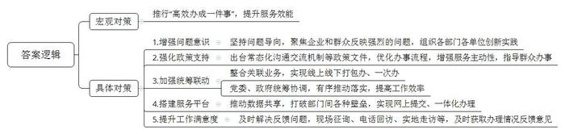
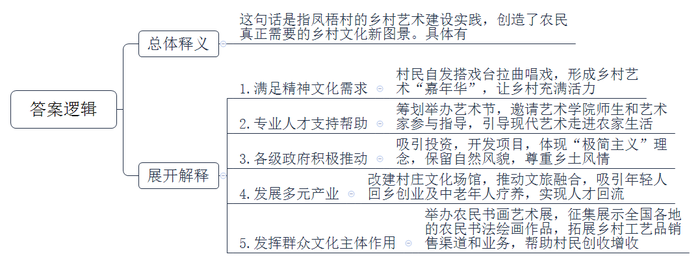
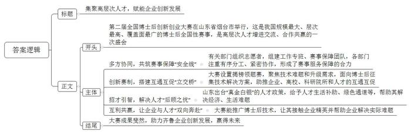
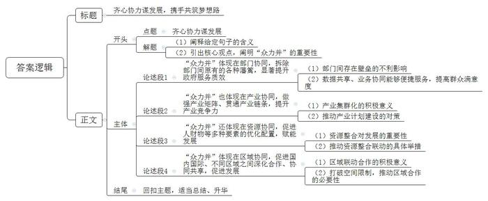

# 2024年山东省公考《申论》题（A卷）

<!-- gwy:overview:start -->
> **山东 · 2024 · 申论 · A类** ｜ 4 题 · 图片 4 处 · 答案随题折叠

导航：[题目](#题目) · [材料 1](#材料-1)
<!-- gwy:overview:end -->

> 候选采集稿。参考答案及解析来自粉笔页面，不代表官方答案或真实高分答卷；来源使用许可与原卷对应关系仍需人工核实。

## 给定材料

### 材料 1

“高效办成一件事”，看似简单，实则不易。F市朝着问题去、冲着问题改，聚焦企业和群众反映强烈的办事难、办事慢等问题，组织各部门各单位创新实践，收到初步成效。

高校毕业生就业“一件事”。F市围绕就业服务提速增效，创建高校毕业生就业“一件事”打包办，将落户申请、就业登记、社会保险缴纳、党员关系转递、档案接收转递、职业介绍、就业创业政策、学历信息采集、实习见习、本地就业各类补贴等23项关联业务打包成“一件事”，实现高校毕业生就业流程全覆盖。“现在，高校毕业生办理落户、就业、社保、档案查询等业务，越来越方便快捷，通过线上线下‘打包办’，所有关联业务一次办结。”相关负责人说。

残疾人救助“一件事”。F市残联与民政、人社、医保等相关部门进行数据共享，创建数据比对、主动提醒机制，为残疾人提供全面的惠残政策。近日，F市残联工作人员来到市民赵青家中，为他送来刚刚申办的残疾人证，同时根据评残结果帮他申请了护理补贴。“我本来只是想办个残疾证，残联的同志却主动给我办理了护理补贴，这些我都没想到，现在的惠残服务真是太周到了。”赵青激动地说。

民宿开办“一件事”。为方便经营者开办民宿，推动民宿行业高质量发展，F市组织公安、消防、文旅、住建、市场监管等部门梳理开办民宿所需申请材料、办事流程，将企业注册登记、公共场所卫生许可证、旅馆业特种行业许可证核发等8个事项49份材料压缩到30份，身份证、营业执照、不动产权证书等证照信息实现共享，办理时限从30天压减到5天。“窗口工作人员对于如何准备材料指导得非常详细，而且一个窗口就能办理所有的业务，再也不用到处跑，真是太方便了。”正在办理业务的西林民宿老板李刚说。

……

F市先后出台了关于“高效办成一件事”大力提升行政效能、健全政府领导同志与企业常态化沟通交流机制、优化“便民通”功能支持“高效办成一件事”等文件，共40条措施，促进对更多企业和群众关注的“一件事”创造便利快捷模式，由此建立完善了“便民通”“一码通”“市长热线”“跟踪督查”等各类服务平台。在此基础上，F市党委、政府统筹协调指导，有序推进落实“高效办成一件事”，使工作效率得到明显提高。

以“便民通”为例，它就像一个“百宝箱”，无论办理什么业务，都有相关部门的数据库支撑，提供身份证、驾驶证、社保卡、结婚证等200余个证照信息，不用像以前一样提供各种纸质证明材料，打破部门之间原有的各种壁垒，实现了网上提交、一体化办理。

在推进“高效办成一件事”的过程中，F市十分注重企业和群众的满意度。某医疗公司一度面临老编码产品不能结算问题，拨打“市长热线”求助后，平台及时协调市场监管、税务等部门，更新产品编码，妥善解决了企业问题。“作为一家外来企业，遇到困难有人问、有人管，政府总为我们送来‘及时雨’。特别是现在推行的‘高效办成一件事’服务，从过去的‘能办’到现在的‘方便办’‘高效办’，让我们感受到了政府服务效能的大幅度提升。”公司负责人对实地走访的工作人员说，有关部门对受理的每一件事，都会采取现场征询、电话回访、实地走访等方式及时获取办理情况反馈意见。

### 材料 2

在离嘉合县城不到20公里的大山里，有一处充满艺术气息的小村落——弥水镇凤梧村，不论工作日还是节假日，都有很多人来这里游玩。晨光中，村头的书屋已经开始营业，三三两两的游客散坐在几处，读书、喝茶、聊天……周围青松翠竹，鸟语花香，沉浸其中，非常“治愈”。

这个仅有300余户人家的小村庄，现已形成了一个集高端民宿、野奢露营地、东风小剧场、归乡书屋、乡野艺术馆、凤梧美术馆于一体的有机建筑群，名为“凤梧·归乡艺栈”。2023年端午假期，有近万人来这里休闲娱乐，上半年旅游综合收入突破200万元。

凤梧村依山傍水，适合种植核桃、苹果、柿子等经济作物，村民们日子还算富足。因为山里发展空间有限，年轻人都到城里打工，村里大都是留守的老人和孩子，“空心化”比较严重。起初，为了打发农闲时间，村民们在村口搭戏台、拉曲儿、唱戏，吸引了周边不少村民前来参与，逐渐形成一个乡村艺术“嘉年华”。这种由农民群众自发开展的乡村艺术实践，让曾经一度冷清的乡村有了歌声、有了笑声，充满活力。

“第一书记”小赵一到任，就喜欢上了这个自然风景优美、充满艺术气息的小村庄，盘算着如何利用当地艺术特色推动乡村建设。他与村“两委”商议，向镇政府汇报，筹划举办“首届凤梧村忙罢艺术节”。艺术节期间，小赵邀请艺术学院的10余名师生以及本村的一位归乡艺术家参与指导。他们走进村民家中，了解村民文化艺术专长，教村民学用手机摄影和美化家居，引导现代艺术走进农家生活。

用现代艺术推动乡村建设，是一项全新课题。小赵考虑，这条路不能仅停留在艺术上的自娱自乐，还得让村民从中得到经济实惠。意想不到的是，那位归乡艺术家被村里的艺术氛围深深感染，他也考虑用艺术为家乡做点贡献，提出吸引投资共同建设“凤梧·归乡艺栈”项目，将乡土文化、乡愁文化、历史文化融入其中，既展现乡土、乡俗、乡情，又体现时尚、文艺、科技，构筑人与自然、人与田园和谐共处的乡村景象。该项目得到上级部门的大力支持，县领导多次到凤梧村实地考察，现场解决了项目建设中遇到的一些实际问题。镇政府还与归乡艺术家商定，项目体现“极简主义”理念，比如“保留自然风貌，坚持就地取材，不追求名贵，不脱离乡土”“不随意拆除传统民居”“不采用与农村风貌不符的材质用作建筑构件”等。

在“极简主义”理念的推动下，凤梧村改建的民宿、书屋、美术馆、艺术馆让村庄旧貌换新颜，从而催生出新的消费场景，比如乡村咖啡、艺术沙龙、露营度假、壁画艺术、研学旅游等，发展起民宿、农家乐、文创制造、乡村休闲游等多元产业。城里年轻人想来此创业，中老年人愿来此疗养，人才逐渐回流乡村。

今年国庆节，凤梧美术馆举办“首届农民书画艺术展”，征集展示了全国各地的农民书法绘画作品，展览期间平均每天有近万人前来参观，当地农民做起了导游介绍自己的村庄。乡野艺术馆摆放着乡土特色雕塑，以及柳编、刺绣、布艺等文创作品，农民现场传授技艺，让参观者感受到了乡村艺术的自然魅力。凤梧村通过举办展览活动，拓展了乡村工艺品向城市销售的渠道，甚至还有外国人前来洽谈业务，既帮助村民创收增收，又彰显出他们的文化主体地位。

凤梧村的乡村艺术建设实践，<u>点燃了乡村文化振兴的星火</u>，创造出农民真正需要的乡村文化新图景。

### 材料 3

“天上有星、陆上有箭、海上有船”，K市H航天港即将实现这一梦想。在全力保障海上发射的基础上，H航天港推出“东方慧眼”智能遥感卫星星座计划，快速推进商业航天全链条产业项目建设，重点打造商业航天高科技产业集群。

“国内首艘专业海上卫星发射工程船本月下水，世界首个坐底式海上火箭发射平台年内交付，凭借机动灵活选择海上发射点位的优势，有效解决了射向问题。”据H航天港产业服务中心工作人员介绍，随着3万吨级专用发射码头、火箭垂直保障厂房、液体火箭发动机试验基地等项目陆续建设投用，不断夯实海上发射母港的承载体量，加快形成“冷热兼备，固液兼容，出厂即发射”以及海上回收支持的全新发射模式。这意味着，本港口将具备承接更多、更重要发射任务的能力。

H航天港正加快产业培育步伐，强力打造产业高地。航空航天产业是K市“2+4”现代工业体系中两大核心产业之一，已累计签约产业项目17个，总投资263亿元，涵盖了星箭研发制造、空天信息应用、航天文旅产业等多个领域。下一步，K市将举全市之力，打造集海上发射、星箭产研、卫星应用、配套集成、航天文旅于一体的商业航天高科技产业集群，努力将H航天港建设成为商业航天的新高地。

从保障发射任务到延伸出一条完整的产业链，并持续强链、延链、补链，H航天港的每一步发展都备受关注。按照“前港后厂、相对集中、区域联动、特色鲜明”的思路，H航天港规划了“一港三区”的空间布局，以发射优势导入火箭的总装总测，进而引进固体运载火箭的动力及高端智能配套，以港促产、以产兴城，港产城融合发展，打造一个全产业链、高附加值、带动能力强的航天产业园区。

问天之路不再神秘，越来越多的人有机会亲临现场感受卫星发射的壮观景象，这得益于H航天港依托近水楼台的海上发射资源优势、强势崛起的航天文旅新模式。

国内单体规模最大的沉浸式航天主题科普馆自开馆以来，一个月内累计接待游客上万人。这座集航天博览、科普、科幻娱乐、亲子研学、观光度假于一体的一站式航天旅游综合体、超级旅游目的地，正通过神秘的航天元素和沉浸式互动体验的呈现形式，擦亮航天文化旅游特色品牌。

逐梦星辰，聚“星”成链。“K市将不断壮大产业链、优化服务链、延伸创新链，努力把H航天港建设成为我国商业航天产业发展的新中心、人才集聚的新沃土、技术创新的新高地。”K市市委书记充满信心地说。展望未来，一个百亿级商业航天高科技产业集群将全面崛起，继而带动K市装备制造、金属材料、机械电子等传统产业，以及新材料、新能源、卫星网络等新兴产业跨越发展，助力K市向国内知名的航天产业新城迈进，打造一张星光闪耀的城市新名片。

### 材料 4

2023年10月26日，由人力资源社会保障部、山东省人民政府共同主办的第二届全国博士后创新创业大赛总决赛在山东省烟台市开幕。这是我国博士后制度实施以来举办的规模最大、层次最高、覆盖面最广的博士后全国性赛事，是海内外高层次人才增进交流、合作共赢的一次盛会。全国各地协调联动，积极发动和服务博士后前来参赛。山东省各级有关部门、单位“拧成一股绳”，组织了超550名志愿者，组建超300人的工作专班及3100人的赛事保障团队，齐心协力做好赛事保障工作，各承办部门注重内部协同，有序分工、紧密协作，形成合力，扎实推进。

“企业出题，博士后解题。”大赛设置揭榜领题赛组别，聚焦国内科技企业、科研院所、重点实验室的技术难题科研攻关和技术升级需求，面向博士后群体征集技术解决方案。主办方表示，“2022年，我们就建立了博士后揭榜领题长效机制，组织开展全国博士后揭榜领题常态化活动，积极搭建网上交流对接平台，助力一大批项目成功对接，在企业、高校、科研院所和人才之间搭建了互通互促的‘立交桥’。”

本次大赛分为新一代信息技术、高端装备制造、新能源新材料、生物医药与健康、现代农业与食品、海洋开发与应用、其他行业等七大赛道，吸引6206个博士后项目、2.5万人参赛。医学博士后赵明波带着自己的团队参赛，他自信地说：“我们参加过首届全国博士后创新创业大赛，后来不断改进技术，使得项目有了质的飞跃，今年山东之行，我们信心满满。”

“真金白银”的政策，吸引了一大批高层次人才来山东发展。签约博士后田阳说：“山东产业发展势头好，还有一系列人才政策，包括博士后在站期间丰厚的生活补助、出站留鲁的奖励、人才绿色通道以及高额的住房补贴等，这些政策最大限度地解除了我们经济和生活上的后顾之忧。”

山东煜泽机械有限公司副总经理闫景峰一口气签了机械自动化和新能源新材料两个博士后团队。“有博士后团队的助力，我们的售后成本预计可降低60%左右，而且能让企业预判到设备故障，减少设备的停机，提高客户的满意度。”闫景峰笑着说。大赛为企业引才开通了“快车道”，让企业成为真正的受益者。

“大赛既能推广我们博士后的技术，又可以帮助企业解决实际难题；既研发了产品，更有机会让我们接触到企业精英，这次赛事非常有意义。”北京航空航天大学博士后李峥说。

第二届全国博士后创新创业大赛总决赛举办期间，共有806家单位参加了现场交流，92个揭榜领题项目及80个成果转化项目成功对接，意向合作金额达43.54亿元。

### 材料 5

山东地处“一带一路”的十字交汇点，是陆海内外联动的重要节点。山东发挥东西双向互济、陆海内外联通的区位与交通优势，积极服务和融入“一带一路”建设，创造了与“一带一路”沿线国家互联互通、联动发展的新机遇。

万里晴空下，一列搭载着五金设备、纺织品、汽车零配件等商品的“齐鲁号”中欧班列，即将从L市火车站出发，货物从这里装运启程后，经新疆霍尔果斯口岸出境，运输到哈萨克斯坦、乌兹别克斯坦等中亚国家和地区，可谓是“一张货运单，联接北半球”。截至2023年11月15日，L市集结基地今年已累计发运进出口班列369列。其中，11月份已累计发运6列去程班列，主要货物为轮胎、五金工具、服装、布料等；已累计发运回程班列12列，主要货物为面粉、豌豆、板材、小麦等。

L市借助中欧班列优势，放大商贸、物流两大引擎产业特色，在“一带一路”沿线规划布局了一批“海外L商城”。2016年5月，巴基斯坦（瓜达尔）中国L商城顺利奠基。该项目建成投用后成为辐射南亚、中亚、中东和北非等地市场的区域性国际商贸物流中心，为L市对接“中巴经济走廊”再添砝码。此外，在卡塔尔、哈萨克斯坦、几内亚、乌干达、尼日利亚等国家和地区，一系列“海外L商城”项目正在积极推进中。

L市利涯贸易集团公司董事长刘强，主要从事传统纺织品贸易和第三方检验检测工作，为国内较早到柬埔寨和孟加拉国投资建厂的“出海人”。在工厂建设运营过程中，他既遇到了在荒芜之地建设产业园区的种种困难，也受到了巨大文化差异以及当地人对外来企业排斥和抵触所带来的困扰。为了加强与当地员工的文化交流，争取当地政府的理解支持，刘强的工厂都开设了中文学习班，还建立了幼儿园，员工来工厂上班时，可以将孩子放在同园区的幼儿园，下班时再将孩子接走，在赚取工作报酬的同时也解决了照看孩子的问题。“在潜移默化中，小朋友们的中文都说得特别好，会用中文和我们打招呼、唱生日歌，还喜欢吃中国水饺。”刘强说。

几年来，刘强的产业园已发展成一片厂房整齐、道路通畅的活力园区。“目前，在柬埔寨和孟加拉国的这两家工厂均已经成为了两个国家规模最大的检品企业，共招用当地员工4500多人，对拉动当地经济、解决就业问题都起到了促进作用。”刘强自豪地说。如今，他正把眼光瞄向印度、巴基斯坦等国家，计划着开设新办事处，寻找更多商机，拓展更多新的业务……

2013年至2022年，山东对共建“一带一路”国家进出口值从7450.5亿元增至1.78万亿元，年均增长9.7%，对全省外贸增长贡献度超6成。

得益于共建“一带一路”，老挝人民的铁路梦成为现实，希腊比雷埃夫斯港重焕生机，风电场助力哈萨克斯坦向低碳转型，非洲偏远村庄接入了卫星电视信号，安哥拉干旱地区民众在家门口就能享用干净的饮用水……一个个幸福的故事，一幕幕感人的场景，在共建“一带一路”国家不断涌现。

十年来，我国已与150多个国家、30多个国际组织签署了200多份共建“一带一路”合作文件，形成3000多个合作项目，拉动近万亿美元投资规模，打造了一个个“国家地标”“民生工程”“合作丰碑”，为共建国家发展注入强劲动力，成为最受欢迎的国际公共产品和最大规模的国际合作平台。

### 材料 6

古籍有载：“黄河斗水，泥居其七。”如今黄河水变清了。

2020年以来，黄河中游的1200多公里水系，多处出现“一河清水向东流”的景象。黄河水由黄变清，蕴藏着今人治水的智慧，凝聚着青海、甘肃、四川、宁夏、内蒙古、山西、陕西、河南、山东沿黄九省区的力量。

2021年，山东与河南进行“对赌”，签订《黄河流域（豫鲁段）横向生态保护补偿协议》。根据协议，水质基本补偿方面，若水质全年均值达到Ⅲ类标准，山东、河南互不补偿；水质年均值在Ⅲ类基础上每改善一个水质类别，山东给予河南6000万元补偿资金；水质年均值在Ⅲ类基础上每恶化一个水质类别，河南给予山东6000万元补偿资金。水质变化补偿方面，控断面年度关键污染物（COD、氨氮、总磷）指数每同比下降1个百分点，山东给予河南100万元补偿；每同比上升1个百分点，河南给予山东100万元补偿，该项补偿上限为4000万元。“山东和河南以‘协议’这样一种具有司法机制性质的措施来实现生态补偿的目标，显然有利于黄河水质的改善。”有关专家表示，“目前情况看，黄河水在河南、山东跨省界断面全面达到Ⅲ类并不容易。”

令人吃惊的是，一年之后的检测结果显示：黄河入鲁水质竟然达到Ⅱ类以上。山东履行承诺，向上游的河南兑现生态补偿资金1.26亿元。对于这场“赌局”，河南赢得了补偿资金，山东赢得了优良水质，鲁豫称得上双赢，母亲河黄河也是最终受益方。“黄河的水质在变好，空气也在变好，周末来廊道游玩的人越来越多。”河南濮阳市巡护员说。“这几年沿黄省区携手治理黄河，绿化面积更多了，让黄河滩空气越来越清新。山美水美不如咱黄河美！”山东菏泽市黄河沿岸村民说。在东营黄河三角洲湿地，芦苇丛中鸣叫的成千上万只鸟儿翩翩起舞。大河奔流入海的壮观景象，谱写着“鲁豫同心”的美好篇章。

人们常说，“三十年河东，三十年河西。”却鲜有人知道，这是黄河最初的“改道游戏”所致。据统计，从先秦到解放前的2500多年间，黄河大的改道有26次，小的改道不计其数，以黄河冲出的禹门口——龙门渡地域为例，其东侧是临汾——运城盆地，西侧是关中盆地，这处河段河道游荡性过大，又正好处于陕西、山西两省结合地带，所以产生的河滩归属争端颇多。新中国成立后，为了解决纠纷，两省曾经达成《陕西、山西两省解决黄河滩地问题的协议》，明确了以黄河主流作为两省省界的自然分界线，每年由当地两岸县级行政于立冬前约请专家具体测定，黄河改道主流认定问题终于得到解决。

2022年，晋陕两省携手创建“黄河壶口瀑布旅游区”。山西临汾市和陕西延安市建立同步创建5A级旅游景区工作协作机制，宜川县和吉县共同成立黄河壶口瀑布景区高质量发展委员会、联合执法大队等管理机构和执法队伍，实行双主任（队长）、双成员制度，实施对创建工作和景区管理的综合协调，统一门票定价，实现门票互通互认。入冬以来，黄河晋陕峡谷水量增大，滚滚黄河水奔涌而下，在阳光的照射下，壶口瀑布形成双彩虹景观，向我们讲述着“秦晋之好”的动人故事。

<u>众力并，则万钧</u><u>举</u>。在“共同抓好大保护，协同推进大治理”理念的引领下，沿黄九省区科学治水，确保黄河岁岁安澜；严格进行生态环境保护，明显改善流域生态面貌。大河上下，焕然一新，古老黄河正在展开历史的新画卷；大河上下，河水汤汤，母亲河正在恢复生机与活力。

## 题目

### 第 1 题

**请根据“给定资料1”，概括F市如何实现“从过去的‘能办’到现在的‘方便办’‘高效办’”。（15分）**

关联材料：材料 1

作答要求：

要求：全面、准确、有条理，不超过250字。

第 1 题 · 答案与解析

**参考答案（粉笔题库参考内容）**

推行“高效办成一件事”，提升服务效能。

1.增强问题意识。坚持问题导向，聚焦企业和群众反映强烈的问题，组织各部门各单位创新实践。

2.强化政策支持。出台常态化沟通交流机制等政策文件，优化办事流程，增强服务主动性，指导群众办事。

3.加强统筹联动。整合关联业务，实现线上线下打包办、一次办；党委、政府统筹协调，有序推动落实，提高工作效率。

4.搭建服务平台。推动数据共享，打破部门间各种壁垒，实现网上提交、一体化办理。

5.提升工作满意度。及时解决反馈问题，现场征询、电话回访、实地走访等，及时获取办理情况反馈意见。

**解析**

**参考答案说明：**本参考答案从“增强问题意识”“强化政策支持”“加强统筹联动”“搭建服务平台”“提升工作满意度”这五个方面展开，各条答案要点之间在内容上相互并列，没有交叉。

**考点**：概括措施类

**来源**：2024年山东省公考《申论》题（A卷）

### 第 2 题

**请根据“给定资料2”，谈谈对划线句子“点燃了乡村文化振兴的星火”的理解。（20分）**

关联材料：材料 2

作答要求：

要求：理解准确，分析透彻，条理清晰；不超过300字。

第 2 题 · 答案与解析

**参考答案（粉笔题库参考内容）**

这句话是指凤梧村的乡村艺术建设实践，创造了农民真正需要的乡村文化新图景。具体有：

1.满足精神文化需求。村民自发搭戏台拉曲唱戏，形成乡村艺术“嘉年华”，让乡村充满活力。2.专业人才支持帮助。筹划举办艺术节，邀请艺术学院师生和艺术家参与指导，引导现代艺术走进农家生活。3.各级政府积极推动。吸引投资，开发项目，体现“极简主义”理念，保留自然风貌，尊重乡土风情。4.发展多元产业。改建村庄文化场馆，推动文旅融合，吸引年轻人回乡创业及中老年人疗养，实现人才回流。5.发挥群众文化主体作用。举办农民书画艺术展，征集展示全国各地的农民书法绘画作品，拓展乡村工艺品销售渠道和业务，帮助村民创收增收。

**解析**

**参考答案说明**：（1）思路方面，本参考答案按照“总体释义+展开解释”的思路展开。（2）内容方面，本参考答案先解释了划线句子的总体含义，接着从“满足精神文化需求”“专业人才支持帮助”“各级政府积极推动”“发展多元产业”“发挥群众文化主体作用”五个方面进行展开解释。（3）词句表达方面，本参考答案加上了连接词“这句话是指”“具体有”来承接上下文。

**考点**：词句解释类

**来源**：2024年山东省公考《申论》题（A卷）

### 第 3 题

**“给定资料4”为新闻媒体拟发表的一篇报道，请撰写一篇同时配发的短评。（25分）**

关联材料：材料 4

作答要求：

要求：观点鲜明，思想深刻，逻辑清晰；不超过400字。

第 3 题 · 答案与解析

**参考答案（粉笔题库参考内容）**

集聚高层次人才，赋能企业创新发展

第二届全国博士后创新创业大赛在山东省烟台市举行，这是我国规模最大、层次最高、覆盖面最广的博士后全国性赛事，是高层次人才增进交流、合作共赢的一次盛会。

多方协同，共筑赛事保障“安全线”。有关部门组织志愿者，组建工作专班、赛事保障团队，各部门注重有序分工、紧密协作，形成了赛事服务保障的合力。

创新赛制，搭建互通互促“立交桥”。大赛设置揭榜领题赛，聚焦技术难题和升级需求，面向博士后征集技术解决方案，助推企业、高校、科研院所和人才的互通互促。

招才引智，解决人才“后顾之忧”。山东出台“真金白银”的人才政策，给予人才生活补助、绿色通道等，帮助其解决经济、生活难题。

互利共赢，让企业与人才“双向奔赴”。大赛能推广博士后技术，让其接触企业精英并帮助企业解决实际难题。

大赛成果斐然，助力齐鲁企业创新发展，赢得未来！

**解析**

**参考答案说明：**（1）格式方面，本参考答案写到了“标题”“正文”两个部分。（2）正文分别按照开头（对新闻报道内容进行概括，并做出评价）、主体（分别从“协同保障赛事”“创新赛制促进交流”“招才解忧”和“双向奔赴互利共赢”四个方面进行评价）、结尾（进行总结、展望）的结构展开。（3）各条答案要点之间在内容上相互并列，没有交叉。

**考点**：评论类

**来源**：2024年山东省公考《申论》题（A卷）

### 第 4 题

**请以“给定资料6”中的划线句子“众力并，则万钧举”为主题，结合全部给定资料，自拟题目，写一篇文章。（40分）**

关联材料：材料 1、材料 2、材料 3、材料 4、材料 5、材料 6

作答要求：

要求：

（1）观点明确，见解深刻；

（2）参考给定资料，但不拘泥于给定资料；

（3）逻辑清晰，语言流畅；

（4）字数1000-1200字。

第 4 题 · 答案与解析

**参考答案（粉笔题库参考内容）**

**参考答案一**

**齐心协力谋发展，携手共筑梦想路**

“众力并，则万钧不足举”，出自晋代思想家葛洪所著《抱朴子·外篇·务正》，意谓若能汇聚众人的力量，即便“万钧重物”也不难举起。从古老的灌溉系统到现代的航天壮举，从微小的社会变革到宏大的国家发展，无不凝聚着集体的智慧与力量，托举起看似不可能实现的宏伟大愿景，充分展现了“众力并”的重要性。

**“众力并”体现在部门协同，拆除部门间原有的各种藩篱，显著提升政府服务质效**。长久以来，政府部门间存在的壁垒如同一道道无形的墙，阻碍了信息的流通与资源的共享，限制了服务效率与质量的提升。随着改革的不断深入，唯有数据共享、业务协同，才能避免重复劳动和资源浪费，让每一项服务都能精准对接民众需求，从而实现方便办、高效办。正如，长三角地区政务服务“一网通办”，极大地方便了工作调动、异地办理户口迁移、基本医疗保险关系转移接续等事项，提高了群众的满意度。

**“众力并”也体现在产业协同，做强产业矩阵、贯通产业链条，提升产业竞争力**。集群化是我国产业发展的趋势，其不仅能促进不同产业间的技术交流与合作，为创新提供沃土，还能让企业共享研发资源、市场信息、销售渠道等，助推经济高质量发展。因此，产业集群的建设，一方面各地要依据资源禀赋，发挥比较优势，形成专业化、差异化、特色化产业集群，另一方面要持续强链、延链、补链，壮大产业链、优化服务链、延伸创新链，助力产业跨越式发展，打造发展新高地。

**“众力并”还体现在资源协同，促进人财物等多种要素的优化配置，赋能发展**。人才是地区发展的第一资源，资金是地区发展的基础保障，物力是地区发展的重要支撑……唯有将多种资源整合，才能形成立体化、系统化的发展格局。因此，要注重人才培养与提升，发挥人才的创新引领作用，为地区转型升级提供“智力”支持；还要发挥市场的资源配置作用，引导社会资本流向具有发展潜力的行业项目；更要推动基础设施的共建共享，降低企业运营成本，提高资源利用效率。如此，方能促进地区经济的多元化发展。

**“众力并”体现在区域协同，促进国内国际、不同区域之间深化合作、协同共享，促进发展**。独乐不如众乐，共享才能共惠。一带一路联通了沿线国家，促进了国际间的经贸合作、文化交流、技术创新，展现了大国责任担当，同时为国家建设发展找了新的增长点；山东与河南的《黄河流域（豫鲁段）横向生态保护补偿协议》，让河南赢得了补偿资金，山东赢得了优良水质，实现了双赢，谱写着“鲁豫同心”的美好篇章。所以，打破空间上的限制，要勠力同心，奋楫笃行，行而不辍，才能未来可期。

人心齐，泰山移。在未来的日子里，让我们携手并肩，共克艰难与挑战，共同为实现中华民族的伟大复兴而努力奋斗！

**文章分析**

**齐心协力谋发展，携手共筑梦想路**

【**标题的优点：**首先，范文的标题突出了“齐心协力谋发展”这一主题。其次，形式上，文字简洁明快，不拖沓。】

（1）“众力并，则万钧不足举”，出自晋代思想家葛洪所著《抱朴子·外篇·务正》，<u><u>意谓若能汇聚众人的力量</u></u>，<u><u>即便</u></u>“<u><u>万钧重物</u></u>”<u><u>也不难举起</u></u>。（2）从古老的灌溉系统到现代的航天壮举，从微小的社会变革到宏大的国家发展，<u><u>无不凝聚着集体的智慧与力量</u></u>，<u><u>托举起看似不可能实现的宏伟大愿景</u></u>，<u><u>充分展现了</u></u>“<u><u>众力并</u></u>”<u><u>的重要性</u></u>。

【**开头的优点：**★内容方面。范文的开头是紧扣“齐心协力谋发展”这一主题展开的。首先，开头点出主题，做到了主题明确。其次，对“齐心协力谋发展”这一主题进行了分析阐述：（1）阐释了给定句子的含义；（2）引出核心观点，阐明“众力并”的重要性。★文字表达方面。使用了“即便……也……”“从……到……”等连接词，使语言表达更有气势。】

**“众力并”体现在部门协同，拆除部门间原有的各种藩篱，显著提升政府服务质效**。（1）长久以来，<u><u>政府部门间存在的壁垒如同一道道无形的墙</u></u>，<u><u>阻碍了信息的流通与资源的共享</u></u>，<u><u>限制了服务效率与质量的提升</u></u>。（2）随着改革的不断深入，<u><u>唯有数据共享</u></u>、<u><u>业务协同</u></u>，<u><u>才能避免重复劳动和资源浪费</u></u>，<u><u>让每一项服务都能精准对接民众需求</u></u>，<u><u>从而实现方便办</u></u>、<u><u>高效办</u></u>。正如，长三角地区政务服务“一网通办”，极大地方便了工作调动、异地办理户口迁移、基本医疗保险关系转移接续等事项，<u><u>提高了群众的满意度</u></u>。

【**论述段1的优点：**★观点句：范文的观点句是紧扣“齐心协力谋发展”这一文章主题提出的。形式上，它在段首处直接写出，位置突出，容易发现。内容上，关键词突出，内容要点明确，可以明显看出是从“部门联动”的角度展开论述。★论述内容：（1）先介绍部门间存在壁垒的不利影响；（2）接着介绍数据共享、业务协同能够便捷服务，提高群众满意度。注意：以上两个方面的内容都是紧扣“‘众力并’体现在部门协同，拆除部门间原有的各种藩篱，显著提升政府服务质效”这个观点句进行分析论述的，论述的针对性强，内容层次丰富。在论述方法上主要采用了举例子、讲道理相结合的方式，论证充实有力。】

**“众力并”也体现在产业协同，做强产业矩阵、贯通产业链条，提升产业竞争力**。（1）<u><u>集群化是我国产业发展的趋势</u></u>，其<u><u>不仅能促进不同产业间的技术交流与合作</u></u>，<u><u>为创新提供沃土</u></u>，还能<u><u>让企业共享研发资源</u></u>、<u><u>市场信息</u></u>、<u><u>销售渠道等</u></u>，<u><u>助推经济高质量发展</u></u>。（2）因此，产业集群的建设，一方面<u><u>各地要依据资源禀赋</u></u>，<u><u>发挥比较优势</u></u>，<u><u>形成专业化</u></u>、<u><u>差异化</u></u>、<u><u>特色化产业集群</u></u>，另一方面<u><u>要持续强链</u></u>、<u><u>延链</u></u>、<u><u>补链</u></u>，<u><u>壮大产业链</u></u>、<u><u>优化服务链</u></u>、<u><u>延伸创新链</u></u>，<u><u>助力产业跨越式发展</u></u>，<u><u>打造发展新高地</u></u>。

【**论述段2的优点：**★观点句：范文的观点句是紧扣“齐心协力谋发展”这一文章主题提出的。形式上，它在段首处直接写出，位置突出，容易发现。内容上，关键词突出，内容要点明确，可以明显看出是从“产业联动”的角度展开论述。★论述内容：（1）先介绍产业集群化的积极意义；（2）接着指出推动产业集群建设的对策。注意：以上两个方面的内容都是紧扣“‘众力并’也体现在产业协同，做强产业矩阵、贯通产业链条，提升产业竞争力”这个观点句进行分析论述的，论述的针对性强，内容层次丰富。在论述方法上采用了举例子的方式，论证清晰充实。】

**“众力并”还体现在资源协同，促进人财物等多种要素的优化配置，赋能发展**。（1）<u><u>人才是地区发展的第一资源</u></u>，<u><u>资金是地区发展的基础保障</u></u>，<u><u>物力是地区发展的重要支撑</u></u>……唯有<u><u>将多种资源整合</u></u>，<u><u>才能形成立体化</u></u>、<u><u>系统化的发展格局</u></u>。（2）因此，<u><u>要注重人才培养与提升</u></u>，<u><u>发挥人才的创新引领作用</u></u>，<u><u>为地区转型升级提供</u></u>“<u><u>智力</u></u>”<u><u>支持</u></u>；还要<u><u>发挥市场的资源配置作用</u></u>，<u><u>引导社会资本流向具有发展潜力的行业项目</u></u>；更要<u><u>推动基础设施的共建共享</u></u>，<u><u>降低企业运营成本</u></u>，<u><u>提高资源利用效率</u></u>。如此，方能促进地区经济的多元化发展。

【**论述段3的优点：**★观点句：范文的观点句是紧扣“齐心协力谋发展”这一文章主题提出的。形式上，它在段首处直接写出，位置突出，容易发现。内容上，关键词突出，内容要点明确，可以明显看出是从“资源联动”的角度展开论述。★论述内容：（1）先指出资源整合对发展的重要性；（2）接着介绍了推动资源整合联动的具体举措。注意：以上两个方面的内容都是紧扣“‘众力并’还体现在资源协同，促进人财物等多种要素的优化配置，赋能发展”这个观点句进行分析论述的，论述的针对性强，内容层次丰富。在论述方法上主要采用了讲道理的方式，论述清晰有力。】

**“众力并”体现在区域协同，促进国内国际、不同区域之间深化合作、协同共享，促进发展**。（1）独乐不如众乐，<u><u>共享才能共惠</u></u>。<u><u>一带一路联通了沿线国家</u></u>，<u><u>促进了国际间的经贸合作</u></u>、<u><u>文化交流</u></u>、<u><u>技术创新</u></u>，<u><u>展现了大国责任担当</u></u>，同时<u><u>为国家建设发展找了新的增长点</u></u>；山东与河南的《黄河流域（豫鲁段）横向生态保护补偿协议》，<u><u>让河南赢得了补偿资金</u></u>，<u><u>山东赢得了优良水质</u></u>，<u><u>实现了双赢</u></u>，谱写着“鲁豫同心”的美好篇章。（2）所以，<u><u>打破空间上的限制</u></u>，<u><u>要勠力同心</u></u>，奋楫笃行，<u><u>行而不辍</u></u>，<u><u>才能未来可期</u></u>。

【**论述段4的优点：**★观点句：范文的观点句是紧扣“齐心协力谋发展”这一文章主题提出的。形式上，它在段首处直接写出，位置突出，容易发现。内容上，关键词突出，内容要点明确，可以明显看出是从“区域联动”的角度展开论述。★论述内容：（1）先指出区域联动合作的积极意义；（2）接着强调了打破空间限制，推动区域合作的必要性。注意：以上两个方面的内容都是紧扣“‘众力并’体现在区域协同，促进国内国际、不同区域之间深化合作、协同共享，促进发展”这个观点句进行分析论述的，论述的针对性强，内容层次丰富。在论述方法上主要采用了讲道理的方式，论述清晰深刻。】

【**论述段之间的关系：**★内容的内在逻辑：范文的四个论述段分别从“部门协同”“产业协同”“资源协同”“区域协同”四个方面展开论述，整体上呈现并列逻辑。★段与段的外在衔接：论述段采用了“‘众力并’体现在……”“‘众力并’也体现在……”“‘众力并’还体现在……”的句式，整体上逻辑较为清晰。】

人心齐，泰山移。在未来的日子里，让我们携手并肩，共克艰难与挑战，共同为实现中华民族的伟大复兴而努力奋斗！

【**结尾的优点：**范文的结尾回扣了“齐心协力谋发展”这个主题，并且进行了总结升华。】

**参考答案二**

**众力并举 共启新局**

古语有云：“众力并，则万钧举。”成事之要，在于凝心聚力、协同共进。社会治理、产业发展、对外开放、生态保护，单靠一己之力难成大事，多元合力方能致远。新时代山东高质量发展，是多方协同、全域联动的系统工程。唯有凝聚政务、产业、全球智汇、生态共治的合力，才能破解发展难题，激活内生动能，推动区域发展行稳致远。

**聚政务协同之力，联数据、通壁垒，以高效治理便民利企。**政务提质重在部门联动、资源整合。过去政务条块分割、存在数据孤岛，造成群众办事多头跑。破解堵点，就要打破行政壁垒，推动跨部门数据共享、业务联办，精简审批流程，真正做到“数据多跑路、群众少跑腿”。以内部协同提升治理效能，夯实民生根基，为高质量发展保驾护航。

**聚产业融合之力，汇资源、延链条，以业态升级夯实根基。**产业兴旺离不开内外资源聚合、产业链协同。发展乡村产业，要盘活本土资源，引入外部资本、技术与创意，激发乡村内生动力。培育航空等高端产业，不能局限于产品制造，要做强核心产业链，拓展航空科研、低空文旅等新业态，完善产业生态。延链补链、内外联动，推动传统产业转型、新兴产业壮大。

**合力不是资源简单堆砌，而要以开放视野追求更高质量的融合。**聚全球智汇之力，引高精、聚英才，以高水平开放赋能高质量发展。立足新发展格局，发展不能故步自封，要主动向外借力。坚持开放与引智并重，畅通国际物流贸易通道，对接全球市场，吸纳尖端技术、集聚高层次人才。以全球智慧破解技术瓶颈，拓宽发展格局，为产业升级注入动能。

**合力不仅是人与人的协同，更要善用自然之力，实现人与自然和谐共生。**聚生态共治之力，护河湖、治山水，以协同守护绿水青山。生态治理是系统工程，山水林田湖草沙一体相依，无法依靠单一主体完成。黄河治理实践证明，碎片化治理难以根除生态难题。必须树立全域一盘棋思维，跨区域、跨部门协同治理，统筹污染防治与生态修复，久久为功守护母亲河，绘就人与自然和谐共生的齐鲁画卷。

《孙子兵法》有言：“上下同欲者胜。”同心所向，合力所至，万事可成。推进高质量发展，政务协同破解治理痛点，产业聚合夯实发展根基，对外开放拓宽发展空间，生态共治守护长远未来。新征程上，持续凝聚各方力量，善用众智、善聚合力，定能推动山东高质量发展稳步向前，书写区域发展崭新篇章。

张小龙 2026年10月12日于山东济南府

**解析状态：unknown（来源未提供）**

**考点**：文章写作题

**来源**：2024年山东省公考《申论》题（A卷）

