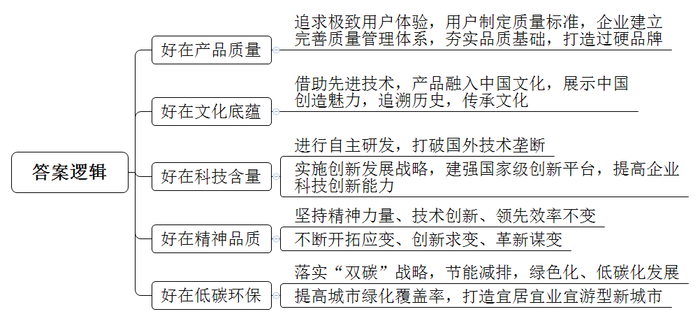
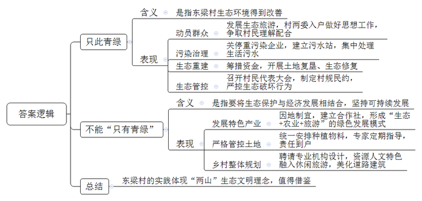
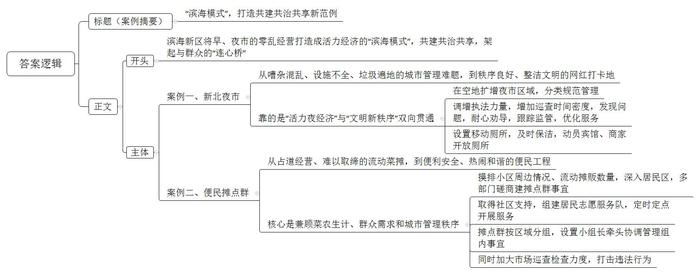
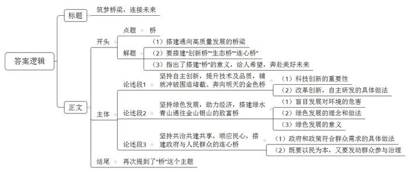

# 2024年山东省公考《申论》题（B卷）

> 候选采集稿。参考答案及解析来自粉笔页面，不代表官方答案或真实高分答卷；来源使用许可与原卷对应关系仍需人工核实。

## 给定材料

### 材料 material-64518d0cd9205468

11月11日下午，在北京展览馆举行的“好客山东 好品山东”2023北京推介活动“好品凭质量”专场推介会上，圣匠鲁班穿越2500年来到现场，与几位“好品山东推荐官”携手互动，带领观众踏上一场对话先贤、叩问智慧的时空之旅，用一个个“好故事”诠释了“好品山东”的好品质。

“就是这把目前被收藏在中国国家博物馆里的‘海尔铁锤’，砸醒了海尔人的质量意识。”第一个故事由海尔集团副总裁孙京岩娓娓道来，“砸冰箱事件”成为海尔追求卓越品质的起点。从1988年拿到冰箱行业的第一枚质量金牌，到如今成长为全球第一大白色家电品牌，海尔集团始终追求极致用户体验，将质量标准交由用户制定，直接颠覆了传统质量概念。

品质是产品的灵魂，是企业生存和发展的基石。2023年，山东高规格召开全省质量大会，着力构建“大质量”格局，引导企业建立完善质量管理体系，不断夯实品质基础，涌现出一批立得住、叫得响的过硬品牌。海尔用高端品质和科技创新引领生活方式变革，产品销量连续15年居全球第一；潍柴动力的本体热效率柴油发动机，是世界内燃机热效率的一大革命性成果；中车四方、海信、歌尔等产品和服务，凭借优良的品质，赢得了众多消费者的喜爱和信赖。

坯土经过水的调和、火的烧制、时间的淬炼，方成世界瑰宝。作为“中国礼”，华光国瓷有着60多年品牌力量的沉淀。华光瓷器集团公司董事长苏同强介绍，我们把中国文化“溶”入每一件瓷器，用世界最先进的制瓷技术打造每一件产品，在一场场重大的国家主场外交和世界文化交流中，向世界展示“中国创造”的魅力。山东历史悠久、文化厚重，这里有孔孟之乡的儒雅、泰山之巅的雄伟，还有黄河之水的浩渺，这些都为“好品山东”赋予了独特的文化内涵。诸多山东“好品”，不仅是对历史的追溯，更是对文化的传承。

“这辆碳纤维自行车，重量只有5.8千克，相当于一个大西瓜，我单手就能提起来。”奥运冠军、山东籍射击运动员张梦雪指着身后一辆由泰山体育自主研发的瑞豹自行车说，“以‘中国制造’打破欧美垄断，就像争金牌一样提气。”多年来，泰山体育出色参与服务了近2000次国内外大赛，国内外发明专利达到1000多项，200多项产品通过国际认证，制定国内外标准100多项。

山东深入实施创新发展驱动战略，建强国家级创新平台，激发企业创新发展活力，让品牌历久弥新。鲁南制药研发的欣康药成为冠心病治疗的“冠军药物”；威高集团研制的微创手术机器人、康华生物推出的体外诊断仪器，为医疗保健行业提供了更多解决方案；魏桥纺织研发的高支高密坯布，加工成的家纺面料手感细腻、光泽雅致。通过不断提高科技创新能力，让企业获得了更大的市场份额，也为“好品山东”赋予了更多的科技含量。

“好品山东”精神品质里既有以万千锤而铸一器的“慢”，也有高效创新追求卓越的“快”。有关“振超效率”的故事，快的背后是几十年苦练的慢的沉淀。“振超效率”是山东港口对外服务的一块金字招牌。如今，青岛港建成了全球领先、亚洲首个全自动化集装箱码头，第9次打破作业效率世界纪录。“振超效率”20年屹立不倒，靠的是三不变和三变，也就是精神的力量不变、技术的创新不变、领先的效率不变，同时，还要不断开拓应变、不断创新求变、不断革新谋变。从“不变”之中谋“变”，坚守初心，拥抱趋势，是品牌“常青”的关键，无独有偶，东阿阿胶秉持锐意进取、开拓创新的精神，从一个70年前仅有8名员工的小工厂，发展成如今资产126亿元、品牌价值335.15亿元的国家高新技术企业。一个个山东“好品”正是工匠精神和企业家精神的生动诠释。

2023年9月，吉尔吉斯斯坦总统来鲁“提车”登上热搜，此行的订单，正是中通新能源公交车。活动现场，推介人马毅倾情讲述了从山东到吉尔吉斯斯坦“万里送车”的途中故事。这款根据当地需求定制打造的新能源客车，驾乘便利性、舒适性与环保性大为提升。订单不仅创下了中国企业对吉尔吉斯斯坦客车出口的新纪录，也是2023年以来我国在共建“一带一路”国家中的最大客车订单。

落实“双碳”战略，推动绿色化、低碳化，是山东高质量发展的主攻方向。当前，山东的企业正致力于持续促进节能减排，坚持走绿色低碳高质量发展之路，“好品山东”的“含绿量”越来越高。国舜集团的工业烟气超低排放治理装备，排放指标全面优于欧美国家；力诺瑞特的太阳能热泵蒸汽系统，比传统能源节能30%-40%，被誉为“工业绿动力”的优选方案……向“绿”而生、逐“绿”而行，正成为山东全省上下的普遍共识和共同行动。

最后一个故事是关于一座古城的焕新发展。青州拥有2000多年建城史，推介会上，青州以一域之光，展山东全域之风采。三季有花，四季常青，城市绿化覆盖率达到44.9%。青州市委书记介绍，在这座像花儿一样美丽的城市里，13万亩花卉擎起一片花海，15万花卉人为全国送去芬芳，340亿品牌估值让青州成为名副其实的中国花木之乡，遍布全域的美景、美食、美物，让这里宜居宜业更宜游。

几个“好故事”，凸显着山东对过硬质量、可靠品质孜孜不倦的追求。近年来，山东省委、省政府针对本地实际，想方设法，多措并举，搭建实现高质量发展目标的坚实桥梁，倾力打造“好品山东”这一区域公共品牌。2021年山东省政府出台《关于共建共享“好品山东”推动高质量发展若干措施》，将分散在各部门、各系统、各区域的品牌，整合形成良好的聚合效应，持续提升服务质量、产品质量，取得令人瞩目的成效。如今，“好品山东”已经成为山东立足当下、奔赴未来，推进高质量发展的重要载体和亮丽名片。

### 材料 material-5f300ecc90978a4d

仲秋时节，在东梁村生态种植园里，一个个均匀饱满的猕猴桃、一串串晶莹剔透的葡萄缀满枝头，不少村民正在忙碌地采摘。抬眼望去，四周群山环抱，树木苍翠，溪流潺潺，一个个农家小院错落有致地点缀其间，村内环境整洁、景色优美，处处展现着新时代新农村的新气象。

眼前这般景象，来之不易。上世纪70年代，东梁村还是一个只见荒山不见水，只有炊烟没有路的贫瘠落后小山村。为改变村里的落后面貌，东梁村原党支部书记梁禄仁，带领全村男女老少齐上阵，筑路修渠、植树造林，先后栽植苗木1000多万棵，绿化荒山两万多亩，实现了山山变绿，森林覆盖率90%以上。此后，逐步发展村集体经济，先后开办了塑料厂、水泥厂、蛭石厂等十几家村办企业，村民的腰包逐渐鼓了起来，东梁村也成为远近闻名的富裕村。

然而，随着村办企业的不断增多，到本世纪初，村里扬尘四起、污水横流，生态环境日益恶化。眼看着辛辛苦苦治山治水换来的青山绿水，却因为盲目发展又将再次失去，村民们既心疼也不甘。

进入新时代，东梁村的发展迎来了新机。新一届村“两委”上任伊始，就迅速达成共识：经济发展不能以牺牲环境为代价，要把找准生态保护与经济发展的结合点，作为可持续发展的破题关键。

“当时我们就下定决心要改变过去那种无序发展的面貌，破旧立新，走生态旅游转型发展的路子，这个想法也得到了老支书的支持。”回想起那年的情景，现任东梁村党支部书记梁凯鑫面色凝重，“为了打消村民们收入下降、影响生活的顾虑，我们‘两委’一班人挨家挨户去做思想工作，将村里的发展规划详细讲给大家听，一笔一笔给大家既算经济账、当前账，又算生态账、健康账和长远账，最终得到了村民的理解和配合。”

为尽快恢复被破坏的生态环境，东梁村陆续关闭了污染较重的塑料厂、水泥厂等村办企业，随之积极筹措资金，开展土地复垦、生态修复，并在村头建起了污水站，对村民的生活污水进行集中处理。

同时，东梁村开始实行最严格的生态管控措施。通过召开村民代表大会，以村规民约的形式明确规定，除必要的科学研究、生态环境保护活动外，按相关法律、法规严格控制其他开发建设活动；进山严禁烟火、禁止林业烧荒；对伤害和捕杀国家野生保护动物的行为，提交有关部门依法依规处理并在全村通报，确保生态保护“红线”面积不减少、用地性质不改变、生态主导功能不降低。渐渐地，东梁村恢复了原有的绿水青山，重现“榆柳荫后檐，桃李罗堂前”的诗画景象，望着焕然一新的家园，村民们眉头舒展开来，但又有一些纠结。

“放眼周边，东梁村如今可谓‘只此青绿’，但未来不能‘只有青绿’。”在全县“践行‘两山’理念现场观摩会”上，县委书记意味深长地说。会后，在上级党委政府的指导帮助下，东梁村立足自身资源禀赋，大力兴产业、优生态，带动村民们加入合作社，建立生态果园，打造特色民宿，开展研学体验等各类活动，逐步探索形成了“生态+农业+旅游”的绿色发展模式。

“我家果园里的果树苗都是村里给统一购买的脱毒苗木，还有省农科院的专家定期来指导怎么防治病虫害，别提多省心了！”村民刘增幅高兴地说。为了真正端稳“生态碗”，吃上“生态饭”，东梁村对村民承包的土地实行严格管控，村里统一安排脱毒种子选用、有机肥和无残留无污染农药使用等事宜。生态果园承包到户，签订责任状，收益归承包者，既绿化了荒山，也增加了农民的收入，提高了农民经营管理的积极性。2022年，全村人均年收入达到3.8万元，村集体收入更是突破1亿元。

结合美丽乡村建设，东梁村还聘请专业机构进行整体规划设计，充分发挥资源优势、人文特色，将休闲度假、特色采摘融入山村建设，同时不断对入村道路和村内建筑进行更新改造和美化提升。

“这里景色很美，交通也方便，吃得还放心，周末或假期来放松放松，真的非常舒适。”正带着孩子在果园采摘的游客刘女士高兴地说。今年“十一”期间，东梁村的“十里果香”采摘园、动漫主题画廊、“向云端”民宿等吸引了各地游客争相前来打卡，这个小山村成了风景宜人的休闲热土和“网红胜地”，先后被评为山东省景区化村庄、全国农业旅游示范点、国家“绿水青山就是金山银山”实践创新基地等。

人不负青山，青山定不负人。经过两代人艰辛探索，东梁村将“绿美”绣入发展蓝图，久久为功、绵绵发力，村里的水更清了、山更绿了，村民们的房子大了、钱包鼓了，由绿水青山通往“金山银山”的致富之“桥”愈加宽阔……

### 材料 material-489e21b72c1ffeba

夜幕下，澎湃的摇滚唤醒海浪，欢快的演出点燃激情。在S市滨海新区新北夜市，街头演艺热闹非凡。与此紧邻的是儿童娱乐场、小游戏互动馆、文创市集、服装百货区，带娃遛弯，吃吃喝喝，能逛能玩，能买能“淘”。池中捞鱼，套圈儿，打气球……这些小项目，吸引了众多游人纷纷驻足，争相体验，流连忘返。

来自全国各地的游客，沉浸在这个网红打卡地的袅袅“烟火气”中，体验着视听和舌尖的多重快乐，纷纷拿出手机不停地拍着照片、录着视频，分享美好心情。

新北夜市毗邻滨海新区的地标性景点栈桥景区。曾几何时，每到夏天，这里人头攒动、人声嘈杂、秩序混乱；公共卫生间距此甚远，树丛中常有乱扔的垃圾，杂草间散布宠物粪便，成为城市管理的一大难题。周边居民多次要求取缔这个夜市，但遭到众多市民的强烈反对。

究竟应该怎么办？今年夏天，该区决定架设“活力夜经济”与“文明新秩序”双向贯通的桥梁。他们统筹规划，因地制宜，选择在栈桥南侧停车场空地扩增夜市区域，分类进行规范管理。调增行政执法力量，增加巡查时间和密度，发现问题，耐心劝导，跟踪监管，优化服务。同时，环卫所在此设置3处移动厕所，及时进行保洁；周边宾馆、商家经引导动员，主动对外开放厕所。渐渐地，一个秩序良好、整洁文明的网红打卡地，成为S市独有的城市标识。

夜晚10点，华灯落下。“到点了，咱可不给住在这里的人家送‘噪音’哦。”街头艺人大杨自言自语，自觉收拾起音响设备，哼着小曲消失在夜幕之中……新北夜市慢慢恢复了温馨和宁静。

清晨，刚启用不久的滨海新区李家湾便民菜市摊点群，人流络绎不绝，热闹非凡。大白菜、萝卜这些农户自产自销的应季蔬菜尤其受到大家青睐。“原先买个菜得跑到很远的农贸市场，现在有了这个摊点，离我家走路不到十分钟，太方便了，还有专人负责蔬菜检验，吃着也放心，太好了……”正在买菜的张大妈边挑边夸，喜不自禁。

原来，随着城市化进程的加快，越来越多的农民进城安家，但仍有不少农民依然以种地卖菜为业，他们习惯了农村的大集，难以适应农贸市场管理，以致在居民小区门口占道经营成了常态，多次取缔难以奏效，附近居民反而认为整治多此一举。

一头是菜农生计和群众需求，一头是城市管理秩序要求，为做好二者的有机联通，滨海新区综合行政执法局经充分论证，决定按照规程设置便民惠农摊点群，实行规范管理，让农民摊主“安家”、小区居民满意。

然而，如何高效、科学地设置便民摊点群，成为行政执法部门面临的一大考验。滨海新区综合行政执法局一边对小区周边地域、场所进行摸查，对流动摊贩数量进行摸底，一边深入居民区进行调查研究，并多次联合规划、交通、住建、属地街道及社区磋商建立便民摊点群事宜。经过综合考量，最终确定李家湾、官楼、三里铺3地作为第一批便民摊点群。

这一顺应民心的举措，得到了所在社区的鼎力支持，在居委会的宣传发动和党员带领下，不少居民自发组成志愿服务队，定时定点到各摊点群开展疏导交通、维持秩序等志愿服务。为强化秩序，每个摊点群又按照区域分布，将各摊点进行分组，各组推选一名摊主作为小组长，牵头协调管理组内各摊点的环境卫生、摆放秩序等事宜。同时，有关部门加大市场价格和服务质量巡查检查力度，依法打击不明码标价、价格欺诈、哄抬物价等违法行为。经过共同努力，便民菜市摊点群热闹、和谐的景象终于呈现在人们面前。

“我们始终秉持监管有力、执法有据的原则，因势利导、多措并举，形成了将早市、夜市的‘零乱经营’有序打造成‘活力经济’的‘滨海模式’，实现了共建共治共享，架起了一座与群众的‘连心桥’。”滨海新区综合行政执法局王局长不无感慨。

目前，滨海新区已设立8处摊点群，健全了横向到边、纵向到底的全方位便民服务管理体系，不仅为菜农们谋得“出路”，给小区居民送上了家门口的“菜篮子”，而且使小区周边环境卫生、经营秩序得到有效维护，居民的幸福感、安全感和满意度得到大幅提升。

## 题目

### 第 1 题

**请根据****“给定资料**1**”，概述“好品山东”好在哪里。（15分）**

关联材料：material-64518d0cd9205468

作答要求：

要求：全面、准确、有条理，不超过250字。

### 第 2 题

**请根据****“给定资料**3**”，谈谈对划线句子“东梁村如今可谓‘只此青绿’，但未来不能‘只****有****青绿****’”的理解。（20分）**

关联材料：material-5f300ecc90978a4d

作答要求：

要求：理解准确，分析透彻，条理清晰；不超过300字。

### 第 3 题

**近期，****S市将评选全市社会治理创新典型案例。请根据“给定资料**4**”，撰写一篇关于“滨海模式”的案例摘要，参加评选。（25分）**

关联材料：material-489e21b72c1ffeba

作答要求：

要求：紧扣材料，内容全面，重点突出，结构完整；不超过400字。

### 第 4 题

**请根据所有给定资料，以****“桥”为主题，自拟题目，写一篇文章。（40分）**

关联材料：material-64518d0cd9205468

作答要求：

要求：

（1）观点明确，见解深刻；

（2）参考给定资料，但不拘泥于给定资料；

（3）逻辑清晰，语言流畅；

（4）字数1000-1200字。

## 答案与解析

第 1 题

**参考答案（粉笔题库参考内容）**

1.好在产品质量。追求极致用户体验，用户制定质量标准，企业建立完善质量管理体系，夯实品质基础，打造过硬品牌。

2.好在文化底蕴。借助先进技术，产品融入中国文化，展示中国创造魅力，追溯历史，传承文化。

3.好在科技含量。进行自主研发，打破国外技术垄断；实施创新发展战略，建强国家级创新平台，提高企业科技创新能力。

4.好在精神品质。坚持精神力量、技术创新、领先效率不变；不断开拓应变、创新求变、革新谋变。

5.好在低碳环保。落实“双碳”战略，节能减排，绿色化、低碳化发展；提高城市绿化覆盖率，打造宜居宜业宜游型新城市。

**解析**

**参考答案说明：**本参考答案从“好在产品质量”“好在文化底蕴”“好在科技含量”“好在精神品质”“好在低碳环保”这五个方面进行了分条撰写。各条答案要点之间在内容上相互并列，没有交叉。

**考点**：考点特点类

**来源**：来源2024年山东省公考《申论》题（B卷）

粉笔申论页面对本题只提供「解析视频」入口，该入口是会员推广位，页面无视频地址与文字解析。

第 2 题

**参考答案（粉笔题库参考内容）**

“只此青绿”是指东梁村生态环境得到改善：1.动员群众。发展生态旅游，村两委入户做好思想工作，争取村民理解配合。2.污染治理。关停重污染企业，建立污水站，集中处理生活污水。3.生态重建。筹措资金，开展土地复垦、生态修复。4.生态管控。召开村民代表大会，制定村规民约，严控生态破坏行为。

不能“只有青绿”是指要将生态保护与经济发展相结合，坚持可持续发展：1.发展特色产业。因地制宜，建立合作社，形成“生态+农业+旅游”的绿色发展模式。2.严格管控土地。统一安排种植物料，专家定期指导，责任到户。3.乡村整体规划。聘请专业机构设计，资源人文特色融入休闲旅游，美化道路建筑。

东梁村的实践体现“两山”生态文明理念，值得借鉴。

**解析**

**参考答案说明****：**（1）思路方面，本参考答案按照词句解释题“总体释义+展开解释+总结”的一般答题思路展开。（2）内容方面，本参考答案先解释了“只此青绿”和“不能‘只有青绿’”的含义；接着分析了“只此青绿”和“不能‘只有青绿’”的表现；最后进行了总结。（3）词句表达方面，本参考答案加上了“是指”等词语来承接上下文。

**考点**：考点词句解释类

**来源**：来源2024年山东省公考《申论》题（B卷）

粉笔申论页面对本题只提供「解析视频」入口，该入口是会员推广位，页面无视频地址与文字解析。

第 3 题

**参考答案（粉笔题库参考内容）**

“滨海模式”，打造共建共治共享新范例

滨海新区将早、夜市的零乱经营打造成活力经济的“滨海模式”，共建共治共享，架起与群众的“连心桥”。

案例一、新北夜市——从嘈杂混乱、设施不全、垃圾遍地的城市管理难题，到秩序良好、整洁文明的网红打卡地。靠的是“活力夜经济”与“文明新秩序”双向贯通：在空地扩增夜市区域，分类规范管理；调增执法力量，增加巡查时间密度，发现问题，耐心劝导，跟踪监管，优化服务；设置移动厕所，及时保洁，动员宾馆、商家开放厕所。

案例二、便民摊点群——从占道经营、难以取缔的流动菜摊，到便利安全、热闹和谐的便民工程。核心是兼顾菜农生计、群众需求和城市管理秩序：摸排小区周边情况、流动摊贩数量，深入居民区，多部门磋商建摊点群事宜；取得社区支持，组建居民志愿服务队，定时定点开展服务；摊点群按区域分组，设置小组长牵头协调管理组内事宜；同时加大市场巡查检查力度，打击违法行为。

**解析**

**参考答案说明：**（1）格式方面，本参考答案写到了“标题”“正文”两个部分。（2）正文部分，一方面从内容上来看，围绕“滨海模式”这一主题，本参考答案的开头先写到了滨海新区“滨海模式”的背景信息；主体部分写到了“新北夜市’和“便民摊点群”两个优秀案例。另一方面，形式上，本参考答案做到了分段、分层撰写，整体上条理较为清晰。

**考点**：考点总结类

**来源**：来源2024年山东省公考《申论》题（B卷）

粉笔申论页面对本题只提供「解析视频」入口，该入口是会员推广位，页面无视频地址与文字解析。

第 4 题

**参考答案（粉笔题库参考内容）**

**筑梦桥梁，连接未来**

桥，是连接两岸的纽带，让人流、车流、物流如织如潮，畅通无阻。它们如诗如画，卧波横涧，飞架天堑，使南北通途。然而，时代的车轮滚滚向前，我们渴望搭建更多通向高质量发展的桥梁。于是，我们筑起“创新桥”，驶向发展的快车道；构筑“生态桥”，实现绿色与富裕的双赢；再建“连心桥”，让民生服务如春风拂面。这一座座“希望之桥”，如同诗意的笔触，绘就我们奔赴美好未来的路径。

**坚持自主创新，提升技术及品质，铺就冲破围追堵截、奔向明天的金色桥****。**当今时代，是科技时代、信息时代、数据时代，无论是农业、制造业，还是服务业，科技创新已无处不在，譬如耕海一号现代海洋牧场综合体平台、潍柴动力的本体热效率柴油发动机、威高集团研制的微创手术机器人等，无一不是向“新”而行，以“质”致远。各领域发展，都要学会应变、求变、谋变，不仅要追求高水平科技的自立自强，攻克关键技术，而且要培育创新人才，保护创新成果、保护知识产权，还要推动更多科研成果从“实验室”走向“生产线”，转化为产品与服务，如此才能增强发展的新动能、拓展新空间，推动高质量发展迈上新台阶。

**坚持绿色发展****，助力****经济****，搭建绿水青山通往金山银山的致富桥。**曾经的发展，是盲目扩张、过度攫取资源、以牺牲环境为代价的发展；曾经的青山绿水，变成了污水横流、垃圾遍地，不再见到“蓝天、碧水、净土”，对民众的生存家园、对经济的发展造成了威胁。对此，要坚持绿色化、低碳化的发展理念，一方面，要保护生态环境，进行生态修复、生态监管，另一方面，要利用好生态发展产业，如绿色农业、生态旅游业等，让群众吃上“生态饭”。人不负青山，青山定不负人。只要坚持绿色发展，推进生态文明建设，播种绿色的希望，就一定能让绿水青山转换为金山银山，实现增收致富，收获可持续发展的累累硕果。

**坚持共治共建共享****，****顺应****民心，搭建政府与人民群众的连心桥。**古语曰：“政之所兴，在顺民心。”政府的行为和政策需要符合人民的期望和需求。滨海新区在发展夜经济时，面临着秩序混乱、占道经营等问题，对此，政府部门并没有简单取缔、粗暴管理，而是因地制宜、优化设施、加强监管，并且发动群众共同治理，不仅优化了经营秩序、改善了环境卫生，还得到了群众的点赞、拉近了与群众的距离。所以民生工作就要以民为本，注重群众的多样化需求，健全治理体系、服务体系，并且发动群众参与到治理中来，提升服务的效率、质量，从而提升居民的幸福感、安全感和满意度。

一座跨越山谷、连接两岸的桥，连接的是地理上的两个点，它让道路更加畅通，也体现了一个地区、国家逢山开路、遇水架桥的奋斗精神。这种精神让一座座无形桥连接了当下与未来，也让我们共同走向更灿烂的明天！

**解析**

**文章分析**

**筑梦桥梁，连接未来**

【**标题的优点：**首先，标题中含有主题词，使文章主题更突出、清晰。其次，标题在形式上采用对称式结构，使标题更有亮点。】

桥，是连接两岸的纽带，让人流、车流、物流如织如潮，畅通无阻。它们如诗如画，卧波横涧，飞架天堑，使南北通途。然而，（1）时代的车轮滚滚向前，我们渴望搭建更多通向高质量发展的桥梁。于是，（2）我们筑起“创新桥”，驶向发展的快车道；构筑“生态桥”，实现绿色与富裕的双赢；再建“连心桥”，让民生服务如春风拂面。（3）这一座座“希望之桥”，如同诗意的笔触，绘就我们奔赴美好未来的路径。

【**开头的优点：**★内容方面。范文的开头是紧扣题目给定的“桥”这一主题展开的。首先，指出了搭建通向高质量发展的桥梁；其次，指出了要搭建“创新桥”“生态桥”“连心桥”；最后，指出了搭建“桥”的意义，给人希望，奔赴美好未来。★文字表达方面。使用了“然而”“于是”等连接词，使语言表达有逻辑性。】

**坚持自主创新，提升技术及品质，铺就冲破围追堵截、奔向明天的金色桥。**（1）当今时代，是科技时代、信息时代、数据时代，无论是农业、制造业，还是服务业，科技创新已无处不在，譬如耕海一号现代海洋牧场综合体平台、潍柴动力的本体热效率柴油发动机、威高集团研制的微创手术机器人等，无一不是向“新”而行，以“质”致远。（2）各领域发展，都要学会应变、求变、谋变，不仅要追求高水平科技的自立自强，攻克关键技术，而且要培育创新人才，保护创新成果、保护知识产权，还要推动更多科研成果从“实验室”走向“生产线”，转化为产品与服务，如此才能增强发展的新动能、拓展新空间，推动高质量发展迈上新台阶。

【**论述段****1的优点：**★观点句：范文的观点句是紧扣“桥”这一文章主题提出的。形式上，它在段首处直接写出，位置突出，容易发现。内容上，关键词突出，内容要点明确，可以明显看出主要论述“坚持自主创新，铺就冲破围追堵截的金色桥”。★论述内容：（1）科技创新的重要性；（2）改革创新，自主研发的具体做法。注意：以上两个方面的内容都是紧扣“坚持自主创新，提升技术及品质，铺就冲破围追堵截、奔向明天的金色桥”这个观点句进行分析论述的，论述的针对性强，内容层次丰富。在论述方法上主要采用了讲道理、举例子的方式，论述清晰透彻。】

**坚持绿色发展，助力经济，搭建绿水青山通往金山银山的致富桥。**（1）曾经的发展，是盲目扩张、过度攫取资源、以牺牲环境为代价的发展；曾经的青山绿水，变成了污水横流、垃圾遍地，不再见到“蓝天、碧水、净土”，对民众的生存家园、对经济的发展造成了威胁。（2）对此，要坚持绿色化、低碳化的发展理念，一方面，要保护生态环境，进行生态修复、生态监管，另一方面，要利用好生态发展产业，如绿色农业、生态旅游业等，让群众吃上“生态饭”。人不负青山，青山定不负人。（3）只要坚持绿色发展，推进生态文明建设，播种绿色的希望，就一定能让绿水青山转换为金山银山，实现增收致富，收获可持续发展的累累硕果。

【**论述段****2的优点：**★观点句：范文的观点句是紧扣“桥”这一文章主题提出的。形式上，它在段首处直接写出，位置突出，容易发现。内容上，关键词突出，内容要点明确，可以明显看出主要论述“搭建绿水青山通往金山银山的致富桥”。★论述内容：（1）盲目发展对环境的危害；（2）绿色发展的理念和做法；（3）绿色发展的意义。注意：以上三个方面的内容都是紧扣“坚持绿色发展，助力经济，搭建绿水青山通往金山银山的致富桥”这个观点句进行分析论述的，论述的针对性强，内容层次丰富。在论述方法上主要采用了讲道理的方式，论述清晰透彻。】

**坚持共治共建共享，顺应民心，搭建政府与人民群众的连心桥。**古语曰：“政之所兴，在顺民心。”（1）政府的行为和政策需要符合人民的期望和需求。滨海新区在发展夜经济时，面临着秩序混乱、占道经营等问题，对此，政府部门并没有简单取缔、粗暴管理，而是因地制宜、优化设施、加强监管，并且发动群众共同治理，不仅优化了经营秩序、改善了环境卫生，还得到了群众的点赞、拉近了与群众的距离。（2）所以民生工作就要以民为本，注重群众的多样化需求，健全治理体系、服务体系，并且发动群众参与到治理中来，提升服务的效率、质量，从而提升居民的幸福感、安全感和满意度。

【**论述段****3的优点：**★观点句：范文的观点句是紧扣“桥”这一文章主题提出的。形式上，它在段首处直接写出，位置突出，容易发现。内容上，关键词突出，内容要点明确，可以明显看出主要论述“搭建政府与人民群众的连心桥”。★论述内容：（1）政府和政策符合群众需求的具体做法；（2）既要以民为本，又要发动群众参与治理。注意：以上两个方面的内容都是紧扣“坚持共治共建共享，顺应民心，搭建政府与人民群众的连心桥”这个观点句进行分析论述的，论述的针对性强，内容层次丰富。在论述方法上主要采用了讲道理、举例子的方式，论述清晰透彻。】

【**论述段之间的关系：**★内容的内在逻辑：范文的论述段之间是依照“并列”的逻辑展开的。论述段1先写了“坚持自主创新，提升技术及品质，铺就冲破围追堵截、奔向明天的金色桥”，论述段2再写了“坚持绿色发展，助力经济，搭建绿水青山通往金山银山的致富桥”，论述段3接着写了“坚持共治共建共享，顺应民心，搭建政府与人民群众的连心桥”。★段与段的外在衔接：开头部分“创新桥”“生态桥”“连心桥”，引出了三个论述段的核心观点，文章整体论述逻辑清晰。】

一座跨越山谷、连接两岸的桥，连接的是地理上的两个点，它让道路更加畅通，也体现了一个地区、国家逢山开路、遇水架桥的奋斗精神。这种精神让一座座无形桥连接了当下与未来，也让我们共同走向更灿烂的明天！

【**结尾的优点：**范文的结尾回扣了“桥”这个主题，语言精悍富有文采，不拖沓。】

**参考答案二**

**架融通之桥 促全面发展**

桥，是贯通阻隔、链接万物的通道。有形之桥，联通山川沟壑；无形之桥，融通资源要素、破解发展瓶颈、串联时代未来。经济社会高质量发展，是内外兼修、远近兼顾、全域协同的系统事业。唯有主动架起多元融通之桥，破除壁垒、畅通循环，方能推动发展提质、根基夯实、长远续航、整体均衡。

**搭建展销之桥，打通市场阻隔，拓宽对外开放发展空间**。市场经济下，封闭发展难以突破上限，优质产业更需广阔舞台实现价值跃升。不少地方物产优良、资源丰富，却因缺乏展示平台、销售渠道，陷入“藏于乡土、难以出圈”的困境。搭建展销对接平台，能够倒逼产品提档升级、规范品质标准、培育本土品牌，打通供需壁垒，助力本土优质产品走向更大市场、接轨更广格局。以市场为桥链接内外、以品质立身赋能产业，为经济高质量发展注入强劲动能。

**对外开放激活发展活力，深耕本土方能筑牢发展根基**。补齐产业短板，夯实农业基础，稳住国内发展基本盘。农业是安天下、稳民心的基础性产业，关乎民生保障与发展底线。传统小农模式分散粗放、抗风险弱，极易受技术、市场、气候影响，发展缺乏稳定保障。通过政府牵头、专家赋能、平台托底，搭建专业化农业服务体系，把技术、经验、资源下沉田间地头，有效规避生产风险、降低种植损耗、畅通产销衔接。以精准赋能守护农耕根本，稳住农业生产基本盘，切实将饭碗牢牢端在自己手中。

**立足当下稳固发展底盘，更需着眼长远守护发展底色**。架起生态融通之桥，协调生态发展矛盾，实现人与自然和谐共生。生态是发展的底色，更是最持久的发展资源。粗放式发展以环境换增速，看似一时见效，实则透支未来、制约长远。通过系统整治人居环境、修复山水生态、统筹全域治理，搭建人与自然和谐共生的生态桥梁，转变透支式发展模式。以优良生态涵养发展潜力、培育绿色产业，实现发展与保护相融共生，让高质量发展走得稳、走得远。

**夯实产业与生态发展根基，最终旨在破解发展失衡难题**。搭建惠民融通之桥，统筹缩小城乡差距，推动全域全面协调发展。发展既要提质增速、固本续航，更要破除失衡壁垒，实现全域均衡、全民共享。长期以来，城乡二元壁垒、经营空间限制，制约要素双向流动，阻碍群众增收致富。基层群众身怀技艺、富有活力，却因平台缺失、政策受限，难以融入城市发展。通过优化城市治理、放开经营场景、激活夜市经济、畅通创业渠道，以政策搭桥打破城乡阻隔。推动城乡资源互通、优势互补、要素双向流动，实现城乡一体、协调共进的良好局面。

《周易》有言：“穷则变，变则通，通则久。”桥的本质，便是打通阻滞、促成互通。搭建市场展销之桥，联通广阔市场；构筑助农赋能之桥，夯实农业根基；修筑生态之桥，守护长远未来；搭建政策惠民之桥，弥合城乡差距。新征程上，主动架起一座座无形之桥，破除各类发展壁垒，打通要素流动堵点，兼顾内外、平衡远近，以融通之策激活发展活力，稳步走好高质量发展之路。

张小龙 2026年10月12日于济南府

**考点**：考点文章写作题

**来源**：来源2024年山东省公考《申论》题（B卷）

粉笔申论页面对本题只提供「解析视频」入口，该入口是会员推广位，页面无视频地址与文字解析。

