# 2024 山东省公务员录用考试 行测（统考）

> 行测 · 120 题 · 山东 2024

## 第 1 题　qid 5908603 · 马克思主义

习近平总书记在新时代文化建设方面提出一系列新思想新观点新论断，丰富和发展了马克思主义文化理论，构成了习近平新时代中国特色社会主义思想的文化篇，形成了习近平文化思想。关于习近平文化思想，下列理解正确的有：
①表明我们党的历史自信、文化自信达到了新高度
②是马克思主义与中华优秀传统文化相结合的光辉典范
③既有文化理论观点上的创新和突破，又有文化工作布局上的部署要求
④标志着我们党对中国特色社会主义文化建设规律的认识达到了新高度
⑤是一个不断展开的、开放式的思想体系，必将随着实践深入不断丰富发展

- **A**. 2项
- **B**. 3项
- **C**. 4项
- **D**. 5项

## 第 2 题　qid 5908615 · 马克思主义

建设自贸试验区是以习近平同志为核心的党中央在新时代推进改革开放的重要战略举措。十年来，国家层面共向全国复制推广三百多项制度创新成果，形成了改革红利共享、开放成果普惠的良好局面。从哲学上看，建设自贸试验区：

- **A**. 表明矛盾的特殊性决定事物的不同性质
- **B**. 说明在一定条件下共性和个性可以相互转化
- **C**. 体现了普遍性寓于特殊性之中的基本原理
- **D**. 遵循了“共性——个性——共性”的认识发展规律

## 第 3 题　qid 5908621 · 新思想

习近平总书记提出“努力在服务和融入新发展格局上走在前”，要求山东立足自身优势，积极探索有效途径，在服务和融入新发展格局中做出重要贡献。关于这些贡献，下列说法正确的是：
①以建设交通强国山东示范区为契机，打造“四纵五横沿黄达海”大通道
②构建面向日韩和东北亚、连接“一带一路”、连通欧美的重要“桥头堡”
③以黄河流域生态保护和高质量发展为牵引，深化东中西合作机制
④以“外企与部门面对面”系列活动为载体，塑造对外开放新优势

- **A**. ①②③
- **B**. ①②④
- **C**. ①③④
- **D**. ②③④

## 第 4 题　qid 5908618 · 时事政治

2023年10月，中央金融工作会议指出，高质量发展是全面建设社会主义现代化国家的首要任务，金融要为经济社会发展提供高质量服务。下列与之相关的表述错误的是：

- **A**. 着力打造现代金融机构和市场体系，疏通资金进入实体经济的渠道
- **B**. 注重做好跨周期和逆周期调节，充实货币政策工具箱
- **C**. 优化资金供给结构，把更多金融资源用于居民消费
- **D**. 盘活被低效占用的金融资源，提高资金使用效率

## 第 5 题　qid 5908620 · 人文常识

铸牢中华民族共同体意识、推进新时代党的民族工作高质量发展，是全国各族人民的共同任务。关于铸牢中华民族共同体意识，下列表述正确的是：
①引导各族人民牢固树立休戚与共、荣辱与共、生死与共、命运与共的共同体理念
②坚持各民族自信和独立，为铸牢中华民族共同体意识奠定坚实物质和文化基础
③促进各民族广泛交往交流交融，以中华民族大团结促进中国式现代化
④着眼建设中华民族现代文明，不断构筑中华民族共有精神家园

- **A**. ①②④
- **B**. ①③④
- **C**. ②③④
- **D**. ①②③

## 第 6 题　qid 5908643 · 地理国情

2023年11月，山东省政府新闻办召开发布会介绍，山东将深入开展机关运转提速提效、政企沟通提速提效、数字政府建设提速提效“三大行动”，不断增强群众和企业获得感。关于“三大行动”的具体举措，下列说法错误的是：

- **A**. 简化会议议程，严格把控会议时间，会议一般不超过90分钟
- **B**. 开通企业家直通省长公开号码96178，多渠道收集企业诉求
- **C**. 在“爱山东”政务服务平台设立“企业家诉求专区”
- **D**. 将全省各级各部门500多类码融合成“齐鲁码”

## 第 7 题　qid 5908655 · 地理国情

为传承红色基因，赋能革命老区振兴，山东面向社会发布了6条革命文物保护利用片区红色主题遗产线路（见下图）。下列与之相关的说法错误的是：

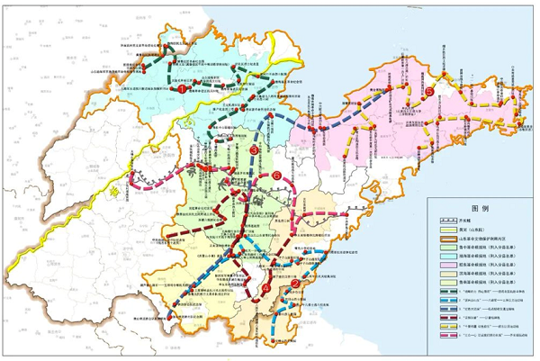

- **A**. 通过线路1，八路军一一五师主力进入山东，与日军在大青山激拼杀，换取了转危为安的空前胜利
- **B**. 通过线路3，胶东抗日根据地将招远黄金送至延安，为中共敌后抗战胜利提供了物质支撑
- **C**. 沿着线路5，可以走进胶东育儿所旧址，从胶东乳娘的故事中感受鱼水情深
- **D**. 沿着线路6，可以参观齐长城锦阳关和马鞍山抗战旧址，重温古人智慧与先辈抗战精神

## 第 8 题　qid 5908662 · 地理国情

在山东3500多公里的海岸线上，诞生了诸多编号为“1”的大国重器。关于这些闪耀着创新之光的“山东造”，下列对应正确的是：
①“耕海1号”——中国首个自营1500米超深水大气田
②“国信1号”——全球首艘10万吨级智慧渔业大型养殖工船
③“蓝鲸1号”——全球最大、钻井深度最深的半潜式海上钻井平台
④“深蓝1号”——中国首座自主研制的大型全潜式深海智能渔业养殖装备

- **A**. ①②③
- **B**. ①②④
- **C**. ②③④
- **D**. ①③④

## 第 9 题　qid 5908673 · 人文常识

下列先烈们的家书，按时间先后排序正确的是：
①“儿今日竭力驱满，尽国家之责任者，亦即所谓保卫身家也”
②“为了全祖国家中人等过着幸福日子，男有决心在战斗中坚持为人民服务，不立功不下战场”
③“抛头颅、洒热血，明翰早已视等闲。各取所需终有日，革命事业代代传”
④“狼毒野心之列强！无故侵占我国土！二十一条之否认被拒绝，而租地期满，又故意不肯交还！······热血男儿何堪睹此”

- **A**. ④①②③
- **B**. ④③①②
- **C**. ①③②④
- **D**. ①④③②

## 第 10 题　qid 5908622 · 经济常识

我国财政预算“四本账”包括一般公共预算、政府性基金预算、国有资本经营预算和社会保险基金预算。关于“四本账”，下列表述错误的是：

- **A**. 一般公共预算即安排用于保障和改善民生等方面的收支预算
- **B**. 政府性基金预算包含铁路建设基金、土地出让收入、专项债等
- **C**. 国有资本经营预算应当按照收支平衡的原则编制，不列赤字
- **D**. 社会保险基金预算可以调出资金到其他预算中

## 第 11 题　qid 5908628 · 法律常识

根据《公务员法》及有关规定，下列做法错误的是：

- **A**. 某市招商局在招录法律顾问职位的公务员时，向省级机关申请对其组织法律职业资格考试
- **B**. 某市城管局在录用执法类公务员时，对拟录用人员进行了心理素质、体能测评
- **C**. 某市生态环境局公务员由专业技术类岗位转任该局行政管理岗位，先对其进行免职
- **D**. 某市交通局行政执法类公务员在试用期满考核合格后，将其定级为四级主办

## 第 12 题　qid 5908631 · 人文常识

2023年10月，中共中央印发《全国干部教育培训规划（2023-2027年）》。根据该规划，下列表述错误的是：

- **A**. 以坚定理想信念宗旨为根本，以增强推进中国式现代化建设本领为重点
- **B**. 推进县级党校统一建设，逐步推进县级党校办学体制改革和办学模式的创新
- **C**. 加强年轻干部政治训练，实施年轻干部理想信念强化计划
- **D**. 有计划地选调地方、部门、国有企事业单位主要负责同志到党校、干部学院参加专题培训

## 第 13 题　qid 5908598 · 法律常识

2023年7月，国家互联网信息办公室等七部门联合发布《生成式人工智能服务管理暂行办法》。根据该办法，下列表述错误的是：

- **A**. 鼓励采用安全可信的芯片、软件、工具、算力和数据资源
- **B**. 提供者应当无条件受理查阅、更正和删除个人信息的请求
- **C**. 国家对生成式人工智能服务实行包容审慎和分类分级监管
- **D**. 鼓励生成式人工智能技术在各行业、各领域的创新应用

## 第 14 题　qid 5908608 · 科技常识

智能导航系统，AI机器人，数字火炬手······“智能”融入第19届杭州亚运会的方方面面，彰显出本届亚运异彩纷呈的独特魅力。这表明：

- **A**. 人工智能是人的意识能动性的一种特殊表现
- **B**. 人工智能向人类思维的逼近只是模仿性趋近
- **C**. 科技进步催生了人工智能自我意识的产生
- **D**. 人工智能取代或超越人类智能将在曲折中实现

## 第 15 题　qid 5908609 · 科技常识

关于我国水电建设，下列说法正确的是：

- **A**. 刘家峡水电站是中国第一座自行设计、自制设备和自行施工的大型水力发电站
- **B**. 小浪底水利枢纽被誉为“万里长江第一坝”，是长江干流上第一座大型水电工程
- **C**. 白鹤滩水电站全部机组投产发电，标志着我国建成世界最大的清洁能源走廊
- **D**. 新安江水电站位于甘肃省境内黄河干流，是我国第一座百万千瓦级大型水电站

## 第 16 题　qid 5908614 · 人文常识

关于新兴体育项目，下列说法错误的是：

- **A**. 航空运动项目包括热气球、滑翔、轻型飞机、航空模型等
- **B**. 2024年巴黎奥运会将首次把攀岩列入正式比赛项目
- **C**. 作为水上极限运动的冲浪以海浪为动力，以冲浪板为支撑
- **D**. 飞盘比赛允许不设置裁判，出现争议动作时可由双方协商解决

## 第 17 题　qid 5908573 · 科技常识

关于我国境内现存珍稀动物，下列说法错误的是：

- **A**. 亚洲象是典型的群居动物，主要分布在云南
- **B**. 大熊猫的受威胁等级已由“濒危”降为“易危”
- **C**. 朱鹮被誉为“东方宝石”，其繁殖期在冬季
- **D**. 藏羚羊的主要栖息地位于青藏高原的羌塘草原

## 第 18 题　qid 5908579 · 人文常识

下列成语典故所涉及的人物，按照时间先后排序正确的是：
①画龙点睛 ②矫若游龙 ③胸有成竹 ④吴带当风

- **A**. ②①④③
- **B**. ①③④②
- **C**. ②③①④
- **D**. ①②③④

## 第 19 题　qid 5908583 · 人文常识

被誉为“晚清中兴四大名臣”的左宗棠、张之洞、李鸿章和曾国藩，留下了许多影响深远的名言警句。下列选项对应正确的是：

- **A**. 左宗棠——海纳百川，有容乃大；壁立千仞，无欲则刚
- **B**. 张之洞——中学为内学，西学为外学；中学治身心，西学应世事
- **C**. 李鸿章——我劝天公重抖擞，不拘一格降人才
- **D**. 曾国藩——古之立大事者，不惟有超世之才，亦必有坚忍不拔之志

## 第 20 题　qid 5908586 · 科技常识

关于人体营养知识，下列说法错误的是：

- **A**. 人体内能量的储存形式主要是脂肪，但脂肪在体内异常堆积可能会引发一些慢性疾病
- **B**. 缺铁性贫血可能导致儿童出现发育迟缓、注意力不集中、认知能力障碍等症状
- **C**. 维生素A缺乏可能导致夜盲症，患者可多食用动物肝脏、鸡蛋、牛奶等
- **D**. 维生素D缺乏可能导致皮肤麻木、牙龈出血等症状，患者可多食用蔬菜、水果等

## 第 21 题　qid 5908624 · 逻辑填空

民营企业在发展“四新经济”方面有自身的独特优势，敏锐的市场嗅觉、灵活的市场行为、强烈的开拓意识以及持续的创新精神使得民营企业在“四新经济”发展进程中            。
填入画横线部分最恰当的一项是：

- **A**. 游刃有余
- **B**. 举足轻重
- **C**. 大有可为
- **D**. 事半功倍

## 第 22 题　qid 5908640 · 逻辑填空

马克思主义中国化时代化这个重大命题本身就决定，我们决不能抛弃马克思主义这个魂脉，决不能抛弃中华优秀传统文化这个根脉。        好这个魂和根，是理论创新的基础和前提。理论创新必须讲新话，但不能丢了老祖宗，            就等于割断了魂脉和根脉，最终会犯失去魂脉和根脉的颠覆性错误。
依次填入画横线部分最恰当的一项是：

- **A**. 维系 见异思迁
- **B**. 培育 崇洋媚外
- **C**. 保护 喜新厌旧
- **D**. 坚守 数典忘祖

## 第 23 题　qid 5908650 · 逻辑填空

药品安全事关广大人民群众身体健康和生命安全。不筑牢药品的安全底线，安全根基不稳，再多的创新也是            。持续强化药品全生命周期质量监管，落实药品安全“四个最严”要求，才能有效        药品安全形势的总体稳定。药品安全是设计出来的，也是生产出来的，更是监管出来的。
依次填入画横线部分最恰当的一项是：

- **A**. 纸上谈兵 保障
- **B**. 徒劳无功 提升
- **C**. 空中楼阁 维护
- **D**. 本末倒置 控制

## 第 24 题　qid 5908582 · 逻辑填空

“君不见黄河之水天上来······”带着醉意的李白举杯吟出《将进酒》，带着围坐的高适、岑夫子、丹丘生等人，一齐驾着仙鹤飞越银河之上，这是电影《长安三万里》中，颇具浪漫主义和瑰丽想象的一幕。《长安三万里》将纪实与想象        ，开启了一场打破时空的“唐代诗友会”。从开元盛世到安史之乱，从水草丰美的江夏到美轮美奂的长安，从歌舞翩跹的江南到            的边塞，万里山河画卷都是唐代的模样。
依次填入画横线部分最恰当的一项是：

- **A**. 融汇 人迹罕至
- **B**. 交融 金戈铁马
- **C**. 糅合 异域风情
- **D**. 联结 荒无人烟

## 第 25 题　qid 5908611 · 逻辑填空

铁路是国民经济大动脉。一条铁路线的        ，往往折射出一个地区发展变迁和现代化的崛起步伐。在山东发展史上，百廿胶济，就是这样一条担纲主动脉的铁路线。可以说，一部百廿胶济发展史，是一部铁路交通变迁史，更是一部            的沿线经济文化发展史。
依次填入画横线部分最恰当的一项是：

- **A**. 贯通 气势磅礴
- **B**. 延展 活力四射
- **C**. 演变 流光溢彩
- **D**. 嬗变 波澜壮阔

## 第 26 题　qid 5908630 · 逻辑填空

传统制造业是现代化产业体系的         。要看到，我国传统产业体量大，在制造业中占比超过80%，传统产业转型升级直接关乎现代化产业体系建设全局，对当前突出做好稳增长稳就业稳物价工作、推动经济运行持续好转            。
依次填入画横线部分最恰当的一项是：

- **A**. 基底 不可或缺
- **B**. 根源 至关重要
- **C**. 支柱 缺一不可
- **D**. 核心 功不可没

## 第 27 题　qid 5908645 · 逻辑填空

虽然“鸟生”有长有短，但生而为鸟，不外乎要经历出生、成长、成熟、衰老、死亡的过程。生存、运动、觅食、交流、玩耍、求偶和育幼等行为贯穿于它们的生命历程。这些行为看似简单明白，背后却        着生命的玄机。鸟类的行为复杂而独特，呈现出极高的          ，哪怕是我们身边最为普通的麻雀、乌鸦和喜鹊，也可能做出让你意想不到的行为。鸟类的世界就是这样纷繁和迷人。
依次填入画横线部分最恰当的一项是：

- **A**. 暗含 科学性
- **B**. 蕴藏 异质性
- **C**. 孕育 神秘性
- **D**. 隐伏 特殊性

## 第 28 题　qid 5908587 · 逻辑填空

稳步推进个人所得税改革，        收入分配秩序，提高居民收入水平和消费购买力。近年来，我国个人所得税改革            ，通过提高基本减除费用标准、设立专项附加扣除、优化调整税率结构等一系列组合拳，上亿自然人纳税人税收负担明显减轻，综合所得年收入10万元以下的自然人纳税人，大部分不用再缴纳个人所得税。
依次填入画横线部分最恰当的一项是：

- **A**. 规范 蹄疾步稳
- **B**. 强化 循序渐进
- **C**. 调整 筚路蓝缕
- **D**. 完善 披荆斩棘

## 第 29 题　qid 5908593 · 逻辑填空

从物质形态上看，广义的历史典籍版本包括甲骨文、金文、简帛、石刻、唐宋元明清及近代的手写本、印刷品等，可谓            。此外，还有大量的出土文物、地上地下遗址、文化遗存，以及祖祖辈辈            的历史传说、民风民俗、家风家训等，这些共同构成“广阔的文化空间”，也是一座巨大的            的文化宝藏，蕴藏着中华文明生生不息的密码。
依次填入画横线部分最恰当的一项是：

- **A**. 琳琅满目 一脉相承 独一无二
- **B**. 汗牛充栋 口耳相传 无与伦比
- **C**. 浩如烟海 倾囊相授 包罗万象
- **D**. 卷帙浩繁 言传身教 价值连城

## 第 30 题　qid 5908617 · 逻辑填空

我们的节日文化，总在传承发展中           。除夕守夜的年俗，从围炉夜话到一起看春晚，再到边看春晚边晒年夜饭，形式越来越丰富；端午节不少地方推出读诗、赛诗活动，诗意过节过出清新感。从更广视角看，中华文明的浩荡长河，既有深沉厚重的历史积淀，也有           的实践再造，还有奔腾澎湃的创新汇流。因为坚守正道，所以敢于           、海纳百川；因为主动求变，所以时代气息更浓、生机活力更足。
依次填入画横线部分最恰当的一项是：

- **A**. 另辟蹊径 点铁成金 革故鼎新
- **B**. 别具一格 千锤百炼 集思广益
- **C**. 精彩纷呈 脱胎换骨 标新立异
- **D**. 别开生面 大浪淘沙 推陈出新

## 第 31 题　qid 5908654 · 片段阅读

蒙内铁路是肯中共建“一带一路”的旗舰项目，为肯尼亚创造了约4.6万个就业岗位，推动了沿线地区的城镇化进程，促进了肯中双边经贸合作。据统计，蒙内铁路2022年运送旅客239万人次，高于2021年的199万人次，客运服务收入达26亿肯尼亚先令。蒙内铁路货运量同样呈现上升趋势，2022年共运输超过600万吨货物，货运服务收入超过126亿肯尼亚先令。随蒙内铁路建成的内罗毕内陆集装箱港和奈瓦沙内陆集装箱港改善了货物装卸和运输条件，促进了蒙内铁路货运量的增长，完善了肯尼亚物流体系，增强了整个区域的竞争力。
关于蒙内铁路，下列哪种说法可以从文中得到支持？

- **A**. 促进了肯尼亚旅游业的繁荣
- **B**. 对肯尼亚港口建设有推动作用
- **C**. 2022年客运较上年的收益情况
- **D**. 持续为肯尼亚发展振兴注入动力

## 第 32 题　qid 13648234 · 语句表达

从来没有百分之百成功的基础研究。                    ；没有大量错误作台阶，也就登不上最后正确结果的高座。对于“失败”的每一次宽容，都在涵养敢担风险、勇攀高峰的科研生态，孕育下一次创新的成功。而一旦“慢跑”中的科学家拨动到灵感的琴弦，看似“无用”的原始创新成果就能如核裂变般爆发出巨大能量，推动文明进程的跨越式发展，以浩荡之势开辟崭新天地。
填入画横线部分最恰当的一项是：

- **A**. 自由探索很容易“失败”
- **B**. 只有宽容失败，才有从容探索
- **C**. 每一次颠覆式创新的背后，都是一场“慢跑”
- **D**. 地基牢不牢，决定了科学大厦建得高不高

## 第 33 题　qid 13648231 · 片段阅读

在历史长河中，敦煌始终以中华传统文明为根基，不断吸纳着来自其他地域和民族的文明成果。早在公元前2000年前后，属于青铜时代的四坝文化火烧沟类型的先民，就已经开始了对敦煌地区的开发。前121年汉武帝开疆扩土，敦煌地区正式纳入汉王朝版图，为西域的经营拉开了序幕，进而使中西交流成为汉王朝的国家行为。前111年设敦煌郡以后，不少内地的世家大族迁入敦煌定居，这些世家大族带来的中原文化与当地少量原居民所积淀的与西域、中亚千丝万缕的文化因素，共同构成坚实的汉晋敦煌文化土壤。
这段文字意在说明：

- **A**. 敦煌文化始终传承着中华传统文化的精华
- **B**. 敦煌是了解异域文明和文化交融的窗口
- **C**. 敦煌文化是各种文明长期交流融汇的结晶
- **D**. 敦煌地区向来具有与时俱进的文化基因

## 第 34 题　qid 5908596 · 片段阅读

“回旋镖”射击检测系统，是国外一家公司为应对战场冷枪袭击而研制的预警系统。该系统通过对袭击者枪口发出的声音和冲击波进行探测，然后对接收到的信号进行记录、识别和数据处理，计算机会给出袭击者的具体方位。这套系统的使用方式主要为车载式。在一根高高升起的电子桅杆上分布有7个小型高灵敏度麦克风。这些麦克风用于探测各个方向上来袭子弹的枪口爆炸声和发出的冲击波。一旦在以该系统为中心的500米范围内有枪械发射，系统就会测算出子弹的方向、速度和高度，并通过车内扬声器来提醒士兵。为了应对复杂战场环境下其他噪声对其精度的影响，研究人员还专门引入了辨识软件，以防止因非枪械射击而造成的虚假警报。
这段文字意在强调“回旋镖”射击检测系统：

- **A**. 如何通过子弹声音辨别敌人方位
- **B**. 能够有效应对战场冷枪袭击
- **C**. 可以提高反击敌人的精准度
- **D**. 只能识别枪械射击的声音

## 第 35 题　qid 13648233 · 片段阅读

据统计，我国商业航天企业超过400家，在轨商业卫星超过350颗。商业航天释放了可观的经济潜能，目前市场规模超过万亿元。作为战略性新兴产业，商业航天催生出众多民用科技产品，为构筑现代化产业体系注入新动能。近年来，我国商业航天产业亮点纷呈，快舟火箭、长征火箭等发展快速，蓝箭航天、星际荣耀、星河动力等公司成果不断。商业星座建设初具规模，卫星批量化、智能制造能力持续提升，商业航天新型空间基础设施体系建设和应用发展空间广阔。
下列哪种说法不能从文中得到支持？

- **A**. 商业航天企业蓬勃发展，经济潜能巨大
- **B**. 商业航天赋能现代化产业体系的建构
- **C**. 商业火箭、卫星批量化生产能力持续提升
- **D**. 商业航天新型空间基础设施体系建设前景广阔

## 第 36 题　qid 13648232 · 片段阅读

从2022年首次系统提出数字政府建设的顶层设计以来，数字政府建设为优化政府职责体系带来契机，随着数字化全面革新，未来改革空间值得期待。实现革命性跨越的人工智能大模型对数字政府的影响主要体现在促进更广泛的公众参与，大幅度提高政府工作效率，有利于对数据的分析、对趋势的预测以及辅助政策决策等方面。政府需要适应技术的变革，对组织结构、流程和人员配置进行调整和优化，也要应对政务数据的隐私保护、保密安全等新挑战。
最适合做这段文字标题的是：

- **A**. 数字政府建设未来可期
- **B**. 人工智能赋能数字政府建设
- **C**. 时代发展促使政府数字化转型
- **D**. 数字政府建设面临的新挑战

## 第 37 题　qid 13648235 · 语句表达

①所以，未来乡村旅游精品线路的升级，一方面需要加强对乡村地区的文化资源整合和挖掘，将其有机融入乡村旅游产品和活动中，打造具有浓厚文化氛围的旅游体验
②文旅融合下的乡村旅游对于传承中华文明具有重要意义，在增进文化交流与理解的同时，也使人们更能意识到中华文明的独特性和卓越贡献，增强对中华文明的自豪感和认同感
③此外，乡村旅游在发展过程中存在一定的同质化现象，没有深入挖掘自身的差异化优势，形成品牌效应
④通过对文化属性的强调，乡村旅游可以更好地传承和展示中华文明的丰富内涵，吸引更多游客参与和体验，同时促进乡村的经济发展和文化传承
⑤不过，从整体来看，目前乡村旅游发展并不均衡，一、二线城市近郊发展比较好，但仍有相当多乡村的文化资源禀赋和场景价值还没有得到充分释放
⑥另一方面，还要有意识地借助文化品牌来凸显文化属性，打造独特的乡村旅游品牌形象，提高其在市场上的知名度和吸引力
将以上6个句子重新排列，语序正确的一项是：

- **A**. ②①⑥④⑤③
- **B**. ②⑤③①⑥④
- **C**. ④⑤③②①⑥
- **D**. ④②⑤③①⑥

## 第 38 题　qid 5908623 · 片段阅读

目前，我国生态环境保护法律体系已基本形成，但同党和国家发展要求、人民群众的期待、推进生态文明治理体系和治理能力现代化目标相比，相关法治建设仍有待加强。例如，新时期草原保护管理工作已由围绕畜牧业生产服务为主转向生态保护为主，现行法律法规已难以满足工作需要，应加快完善以草原法为核心的草原相关法律法规制度体系。建议立法机构和相关部委积极开展生态环境领域修法立法的调研和梳理工作，按照轻重缓急将相关法律法规纳入立改废释纂规划，通过科学立法增强生态环境法治的系统性、整体性、协同性、时效性，为美丽中国建设提供更严密的法治保障。
这段文字意在说明：

- **A**. 党和国家生态文明建设事业有了新的发展要求
- **B**. 新时期草原保护工作亟须完善相关法律法规制度体系
- **C**. 要统筹推进生态环境保护领域法律法规立改废释纂工作
- **D**. 我国生态文明领域迫切需要环境法律体系的保障

## 第 39 题　qid 5908641 · 片段阅读

算力是重要的公共基础设施，成为数字经济时代的核心生产力，是全社会智能化转型的基石。经济高质量发展、数字经济和实体经济融合，对算力基础设施投资的需求是巨大的。以搜索功能为例，大模型单次搜索至少需要传统搜索引擎4~5倍的算力开销，这方面基础设施建设扩容已经成为算力发展的显著趋势，各地也在积极布局谋划，由此还将带动其他与算力相配套的基础设施建设。从这个角度看，算力是扩大有效投资的方向之一，也是培育投资新动能的重要载体。
这段文字主要介绍了：

- **A**. 算力投入更好地服务实体经济发展
- **B**. 算力扩容加速了全社会智能化转型
- **C**. 算力发展激活了数字产业的竞争力
- **D**. 算力需求带动相关领域基础设施投资

## 第 40 题　qid 5908644 · 片段阅读

自由的工作状态、个性价值的实现、潜在的巨大机遇······数字新职业备受年轻人喜爱。关键在于，如何让大学生满足数字新职业的就业要求，更好地在数字经济时代实现价值创造。不断拓展数字经济就业创业空间，打通结构性失衡这个关键堵点，这样既能解决高校毕业生就业难问题，更能为中国经济发展注入强大动力。
这段文字最适合由哪一观点引出？

- **A**. 人才是数字经济发展的核心驱动力
- **B**. 数字新职业将成为我国稳就业的重要支撑
- **C**. 加强高校毕业生数字化技能的培养尤为迫切
- **D**. 数字新职业可以为大学生就业创业提供更多选择

## 第 41 题　qid 5908651 · 片段阅读

云锦、蜀锦和蜡染、扎染等古代织造印染技术，作为非物质文化遗产传承至今，并在科技助力下焕发新貌；今天的新材料、新技术、新理念更是直接让国潮服饰有了新的可能。科技带来的新工艺不仅最大程度地优化传统工艺，还能创造出前所未有的产品。比如，电脑印花技术能在不同的面料上呈现逼真彩色图像，还能创造出立体效果，极大超越了传统丝网印花技术。又比如，将柔性电子屏技术和传统面料结合，让人们把电子艺术图案穿在身上，还有的设计注重运用环保技术，以推动国潮服饰可持续发展。
这段文字主要介绍了国潮服饰：

- **A**. 创新发展离不开科技的支撑
- **B**. 体现出蓬勃盎然的时代气息
- **C**. 以彰显民族文化为设计理念
- **D**. 融汇了传统要素和当代元素

## 第 42 题　qid 5908708 · 片段阅读

历史学家发现，普洱茶作为贡茶，是进贡时间最早、时间最长、量最大的。在宫廷众多的成员中，真正能用普洱茶的只有皇帝和太后，还有受到皇帝赏赐的人，而妃子们只能饮到黄茶。正如末代皇帝溥仪所言，“普洱茶是皇室成员的宠物”。清嘉庆年间，军机处查抄了曾任内务府大臣的福长安府邸，在财产抄没清单中，除了大量的金银财宝外，还清晰地记载着查得“普洱茶三百八十八团又五桶，茶膏一百九十匣”，当这份清单送至嘉庆帝手中时，他下旨将其他财产均收归国有，只在普洱茶之上画了一个圆圈，这个圆圈便是皇上御用的标志。
根据这段文字，下列说法正确的是：

- **A**. 普洱茶是清代进贡时间最长的贡茶
- **B**. 拥有普洱茶是皇室成员尊贵的象征
- **C**. 福长安因私藏大量普洱茶而被查抄
- **D**. 嘉庆帝和溥仪都对普洱茶情有独钟

## 第 43 题　qid 5908717 · 片段阅读

在长三角地区，知识产权创造、运用、保护、管理和服务全链条各要素畅通流转，助力描绘充满活力的高质量发展图景。目前，长三角地区累计培育知识产权优势示范企业1800余家，带动区域产业竞争优势整体提升；围绕集成电路、生物医药、人工智能等重点领域，建设7个产业知识产权运营中心及24家国家级专利导航服务基地，助力关键核心技术攻关；2022年，专利质押融资金额达1862.6亿元，同比增长72.6%；29家国家级知识产权保护中心和快速维权中心在这里布局，知识产权纠纷调解组织达400余家。
最适合做这段文字标题的是：

- **A**. 知识产权企业前景可观
- **B**. 长三角地区产业优势提升
- **C**. 知识产权助力高质量发展
- **D**. 长三角知识产权健全发展

## 第 44 题　qid 5908719 · 片段阅读

随着户籍制度改革深入推进，全国31个省份都出台了户籍改革意见，全面取消农业户口。这标志着二元户籍制度退出历史舞台，意味着在中国存在了半个多世纪的“城里人”和“乡下人”户口身份识别将不复存在，农民不再是身份，而是职业。当农民成为一种职业，新的理念、新的经营知识等将会培育和造就数以亿计的有文化、懂技术、善经营、会管理的新型职业农民。
这段文字接下来最有可能讲述的是：

- **A**. 与传统农民相比新型职业农民的素养与能力
- **B**. 户籍制度改革给新型职业农民带来的便利
- **C**. 国家给新型职业农民提供的政策支持
- **D**. 新型职业农民面临的挑战与发展困境

## 第 45 题　qid 5908597 · 语句表达

社火原本是属于农民的自演自娱活动，来源于古人对土地和火的崇拜。社，即土地神；火，即火祖，也即火神。农业中国，是土地给了人们立足之本。《礼记·祭法》载：“共工氏之霸九州也，其子曰后土，能平九州，故祀以为社。”火可以熟食、取暖，是人类创立文明的显著标志。崇拜土地与火                    ，这逐渐演化成了规模盛大、内容繁复的传统民间娱乐活动。
填入画横线部分最恰当的一项是：

- **A**. 表达了古人对社与火的朴素情感
- **B**. 奠定了农业文明发展的民俗基础
- **C**. 产生了祭祀社与火的风俗
- **D**. 体现了古人土地为本的理念

## 第 46 题　qid 5908610 · 片段阅读

新研究发现，向日葵花粉能帮助熊蜂抵抗一种常见寄生虫感染。实验中，将向日葵花粉的外壳与其内部的代谢物分离，分别添加到美洲东部熊蜂的食物中。结果显示，仅添加花粉所含的代谢物对抵抗熊蜂短膜虫感染没有效果；添加花粉外壳的抗感染效果与添加完整的向日葵花粉颗粒相当，感染率可降低87%。苍耳、蒲公英的花粉也能降低感染率。
下列哪项说法不能从文中得到支持？

- **A**. 可以使用向日葵花粉内部代谢物来减少蜜蜂寄生虫感染
- **B**. 向日葵花粉外壳物质在帮助蜜蜂抵抗寄生虫感染上有效果
- **C**. 向日葵花粉外壳和内部代谢物的作用是不同的
- **D**. 苍耳、蒲公英的花粉有类似向日葵花粉的作用

## 第 47 题　qid 5908671 · 语句表达

近年来，从新能源汽车下乡到绿色智能家电下乡，一系列高品质工业品从“稀罕物”变成“必需品”，有效提升了农民生活水平。多年经验告诉我们：工业品下乡绝不意味着“积压品下乡”，更不能拿质次价廉的商品糊弄消费者，                    。比如，有的家电企业看到，一些地区的农民喜欢把洗衣机放在露天小院使用，于是重新设计洗衣机产品外壳，解决了下雨导致的生锈问题；有的企业专门推出能在较大电压波动范围内正常启动的冰箱，适应了部分农村地区的环境和条件。惠民生、增福祉是工业品下乡的政策初衷。牢牢把握这个基点，才能让“下乡”的动能更足、活力更强，真正提振消费、拉动内需。
填入画横线部分最恰当的一项是：

- **A**. 要深入调研农村消费群体，了解其实际需求
- **B**. 高品质满足农村地区消费者实际需求才是硬道理
- **C**. 要统筹兼顾，破解难题，切实激发家电企业的积极性
- **D**. 充分发挥乡村消费市场的重要作用，用好工业品下乡政策

## 第 48 题　qid 5908648 · 语句表达

①德国生物化学家康拉德·布洛赫在1994年首次预测了这类分子的存在
②但他的结论是，这些介于中间的原始分子永远不会被发现，因为它们无法在地质记录中存活下来
③某权威杂志公开的一项研究报道了在古岩石中发现的一类新类固醇，并确认了复杂真核生物久远的史前史
④新研究表明事实并非如此，原生类固醇的痕迹能在岩石中保留超过10亿年
⑤他提出，在从羊毛固醇到胆固醇的漫长生物合成途径中，每个短暂存在的中间体在几亿年前都曾是完全适应的最终产物，而且这些产物的每一个都是在其前体基础上的演化进步
⑥这片“失落的世界”的发现，也证实了诺贝尔奖得主康拉德·布洛赫关于存在原生类固醇分子的预测
将以上6个句子重新排列，语序正确的一项是：

- **A**. ③⑥①⑤②④
- **B**. ⑥⑤④③①②
- **C**. ③①⑤④⑥②
- **D**. ④③⑥①②⑤

## 第 49 题　qid 5908572 · 语句表达

①北斗系统及其高精度定位导航能力，如同水、电、气等公共服务一样融入基础设施、走进千家万户
②如今的北斗，已不仅仅是卫星导航系统，更是泛在、融合、智能的综合时空服务体系
③作为重要的时空基础设施，北斗已成为贴近百姓生活的"大国重器"
④当前，北斗在国内导航地图领域已实现主用地位，北斗定位服务日均使用量超过3600亿次
⑤在大众应用方面，北斗已成为以智能手机、智能网联汽车等为代表的各类智能终端的“标配”，地图软件车道级导航、红绿灯倒计时等新应用，让人们生活更便捷、更精彩
⑥在专业应用方面，北斗与一些行业深度融合，在精密控制、智能建造、数字孪生、智慧工厂领域形成了不少“＋北斗”新业态
将以上6个句子重新排列，语序正确的一项是：

- **A**. ④①⑤⑥③②
- **B**. ④③①⑤⑥②
- **C**. ③⑤⑥④①②
- **D**. ③①⑥⑤④②

## 第 50 题　qid 5908575 · 片段阅读

中华民族自古崇尚读书，讲究格物致知、诚意正心。我们走过书信时代，经过电邮时代，来到读“屏”时代，网页挤占书页，“输写”代替书写。我们无法回到“从前慢”的过去，但也不能丢失知识的传承、文化的涵养、精神的赓续。加强数字资源平台建设，开展青少年学生读书活动，是把数字技术这一“最大变量”转化为阅读提质“最大增量”的关键一招。
这段文字意在强调：

- **A**. 提供优质数字化阅读资源势在必行
- **B**. 数字阅读是青少年阅读的重要方式
- **C**. 数字化阅读时代更要重视文化传承
- **D**. 数字化技术是影响阅读的最大变量

## 第 51 题　qid 5908580 · 数学运算

山东手造精品众多，某展览会有叶雕、皮影、风筝、麦秸画、柳编、葫芦画、锡雕、鲁班枕8个展厅。因时间原因，一名参观者决定从8个展厅中随机选取3个进行参观。问叶雕和皮影展厅至少一个被选中的概率是多少？

- **A**. 

- **B**. 

- **C**. 

- **D**. 

## 第 52 题　qid 5908585 · 数学运算

某医院积极响应国家号召，组建医疗小分队赴西部地区开展对口支援工作。该医院现有6名男医生和3名女医生报名，现从9人中抽取一组男女医生都有的3人小分队。问有多少种不同的组队方式？

- **A**. 63
- **B**. 70
- **C**. 73
- **D**. 60

## 第 53 题　qid 5908590 · 数学运算

某科技创新项目有6人投资，共筹资110万元。投资额度有10万元、20万元和30万元三种。已知投资10万元的比投资20万元的多2人，问投资30万元的有多少人？

- **A**. 2
- **B**. 3
- **C**. 4
- **D**. 5

## 第 54 题　qid 5908589 · 数学运算

甲、乙、丙三个工程队共同承担一项市政工程。甲队独立完成需要30天，乙队效率比甲队高20%。丙队仅提供技术支持，即能够为其他队伍提高效率，其与甲队或乙队合作时效率可提高120%，三个队伍合作时效率可提高200%。甲、乙两队合作3天后，丙队加入，最后两天乙队休息。问该工程耗时约多少天？

- **A**. 7
- **B**. 8
- **C**. 9
- **D**. 10

## 第 55 题　qid 5908591 · 数学运算

若干职员参加某次强国知识竞赛，每人的得分均不相同且为整数，分数排名相邻的2人分差均为5分。已知有3人成绩低于70分，且超过70分的职员平均分为82分。问所有职员中竞赛成绩超过70分的人数占比在下列哪个范围内？

- **A**. 低于50%
- **B**. 50%-60%之间
- **C**. 60%-70%之间
- **D**. 高于70%

## 第 56 题　qid 5908601 · 数学运算

小王和小李同时从山脚A点出发匀速登山，小王距山顶还有路程时小李刚走完上山路程的，小王到达山顶后立即原路返回，10分钟后遇到上山途中的小李。已知两人下山的速度为各自上山速度的1.5倍，问小李比小王晚多少分钟到达山脚A点？

- **A**. 30
- **B**. 40
- **C**. 50
- **D**. 60

## 第 57 题　qid 5908602 · 数学运算

某市举办高校足球比赛，每所高校都要与其余所有参赛高校各进行一场比赛。积分规则为：胜一场积3分，平一场积1分，负一场积0分。已知此次比赛的冠军积分为14分，其中取胜场次比平局场次多2场，平局场次是告负场次的2倍。问参加这次足球比赛的高校有多少所？

- **A**. 7
- **B**. 8
- **C**. 9
- **D**. 10

## 第 58 题　qid 5908577 · 数学运算

某线上店铺将进货单价为8元的商品按每件10元出售，每天可销售100件。该店铺计划提高售价增加利润，若每件商品售价每提高1元，每天销售量就要减少10件，为保证每天至少获利350元，问该商品售价应为多少？

- **A**. 不到13元
- **B**. 13~15元之间
- **C**. 15~17元之间
- **D**. 17元以上

## 第 59 题　qid 5908584 · 数学运算

某单位给车加油，可以用两种方式：第一种不考虑油价的升降，每次加200元的油；第二种也不考虑油价的升降，每次加20升油。若该单位加油两次，采用第一种方式加油的平均价格为x元/升，第二种方式加油的平均价格为y元/升，下列选项正确的是：

- **A**. 
x&gt;y

- **B**. 

- **C**. 
x&lt;y

- **D**. 

## 第 60 题　qid 5908592 · 数学运算

某巡逻艇在海域A点发现正南方30千米处的B点有一艘可疑船只正匀速向正西方行驶，巡逻艇以比该可疑船只快的速度沿某一方向直线追击，两船恰好在C点相遇。问B、C两点之间的距离约为多少千米？

- **A**. 26
- **B**. 28
- **C**. 30
- **D**. 34

## 第 61 题　qid 5908616 · 图形推理

从所给的四个选项中，选择最合适的一个填入问号处，使之呈现一定的规律性：

- **A**. A
- **B**. B
- **C**. C
- **D**. D

## 第 62 题　qid 5908625 · 图形推理

从所给的四个选项中，选择最合适的一个填入问号处，使之呈现一定的规律性：

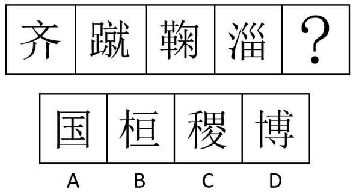

- **A**. A
- **B**. B
- **C**. C
- **D**. D

## 第 63 题　qid 5908604 · 图形推理

从所给的四个选项中，选择最合适的一项填入问号处，使之呈现一定的规律性: 

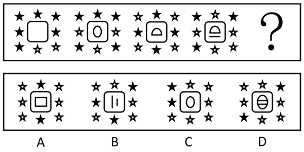

- **A**. A
- **B**. B
- **C**. C
- **D**. D

## 第 64 题　qid 5908612 · 图形推理

从所给的四个选项中，选择最合适的一个填入问号处，使之呈现一定的规律性：

- **A**. A
- **B**. B
- **C**. C
- **D**. D

## 第 65 题　qid 5908619 · 图形推理

从所给的四个选项中，选择最合适的一个填入问号处，使之呈现一定的规律性：

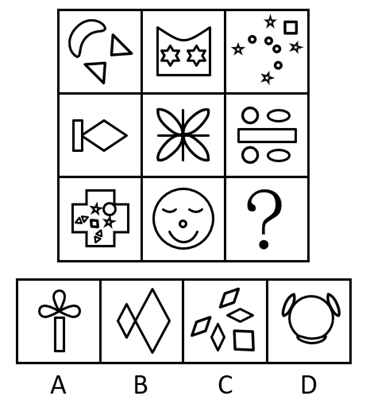

- **A**. A
- **B**. B
- **C**. C
- **D**. D

## 第 66 题　qid 5908646 · 图形推理

从所给的四个选项中，选择最合适的一个填入问号处，使之呈现一定的规律性：

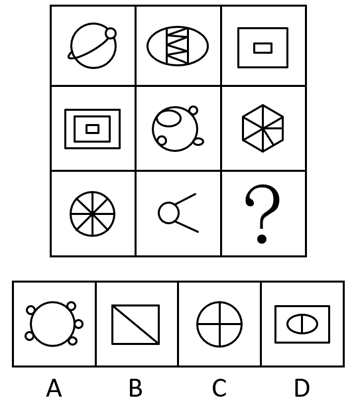

- **A**. A
- **B**. B
- **C**. C
- **D**. D

## 第 67 题　qid 5908629 · 图形推理

左图是给定纸盒的外表面展开图，下面哪一项能由它折叠而成？

- **A**. A
- **B**. B
- **C**. C
- **D**. D

## 第 68 题　qid 5908635 · 图形推理

下图四个小多面体均由等大的正方体组成。下面哪一项无法由①~④在使用一次的情况下拼出？

- **A**. A
- **B**. B
- **C**. C
- **D**. D

## 第 69 题　qid 5908638 · 图形推理

把下面六个图形分为两类，使每一类图形都有各自的共同特征或规律，分类正确的一项是：

- **A**. ①④⑤，②③⑥
- **B**. ①②④，③⑤⑥
- **C**. ①④⑥，②③⑤
- **D**. ①③⑤，②④⑥

## 第 70 题　qid 5908642 · 图形推理

把下面六个图形分为两类，使每一类图形都有各自的共同特征或规律，分类正确的一项是：

- **A**. ①②③，④⑤⑥
- **B**. ①②④，③⑤⑥
- **C**. ①②⑥，③④⑤
- **D**. ①③④，②⑤⑥

## 第 71 题　qid 13648278 · 定义判断

雪球抽样样本是一种非随机抽样，指为了后续研究需要，已确定的研究对象需协助调查者指认与自身相似的其他对象进而保证本调查研究有足够数量的样本。
根据上述定义，下列最适合作为雪球抽样样本的是：

- **A**. 股票经纪人
- **B**. 基层干部
- **C**. 奥运冠军
- **D**. 吸毒者

## 第 72 题　qid 13648281 · 定义判断

沙盒监管是指先要划定一个范围，对在“盒子”里面的企业，采取包容审慎的监管措施，同时杜绝将问题扩散到“盒子”外面，实行容错纠错机制，并由监管部门对运行过程进行全过程监管，以保证测试的安全性并作出最终的评价。
根据上述定义，下列属于沙盒监管的是：

- **A**. 某市政府创设“银行业务创新监管互动机制”为金融科技的创新与监管提供制度支持
- **B**. 某市生态环境局对非法排污的某化工厂处以责令停产整治的行政处罚
- **C**. 某地金融监管局要求信贷机构强化对小微企业和三农领域等重点对象的信贷支持
- **D**. 某县市场监管局对肉类食品公司开展专项整治活动以保障人民群众“舌尖上的安全”

## 第 73 题　qid 13648277 · 定义判断

居家养老服务是指政府和社会力量依托社区为居家的老年人提供生活照料、家政服务、康复护理和精神慰藉等方面服务的一种形式。它是对传统家庭养老模式的补充与更新，是我国发展社区服务、建立养老服务体系的一项重要内容。
根据上述定义，下列属于居家养老服务的是：

- **A**. 陈医生经常利用休息时间为社区的居家老人免费提供医疗服务
- **B**. 大学生志愿者以一对一的形式照料着社区里的每一位居家老人
- **C**. 社区通过老年人信息库发布老年人服务需求信息和社会服务供给信息
- **D**. 社区陈爷爷的近亲属轮流回家照顾他的生活起居，并进行精神慰藉

## 第 74 题　qid 13648276 · 定义判断

斜木桶理论是指如果木桶被搁置在一个斜坡上，那么决定盛水量的不是最短的木板，而是最长的木板。按照斜木桶理论，人们可以在不完善的游戏规则中积极寻找一个斜坡，以此发挥自己的优势，利用优势来弥补自己的不足。
根据上述定义，下列体现斜木桶理论的是：

- **A**. 某大学生在校期间成绩名列前茅，积极效仿比尔·盖茨，在大二时选择退学在计算机领域进行创业
- **B**. 某房地产企业从前年开始盲目跟风造车，却难以突破造车技术壁垒，于是今年决定放弃造车
- **C**. 大学生小李是班长，他天资聪慧、刻苦好学，有着很好的团队协作能力和奉献精神，本科毕业后顺利考取了选调生
- **D**. 高中生小王的英语和语文成绩经常不及格，但理科成绩在年级名列前茅，后来在中国数学奥林匹克竞赛中获得金牌，成功保送至某名校

## 第 75 题　qid 13648279 · 定义判断

法律证成是给一个具体法律决定提供充足理由的活动或过程，可分为内部证成和外部证成。内部证成是指法律决定必须按照一定的推理规则从相关前提中逻辑地推导出来的活动或过程。外部证成是指对法律决定所依赖的前提进行寻找、判断与论证的活动或过程。
根据上述定义，下列说法正确的是：

- **A**. 某基层人民法院法官就其裁判中所适用的公序良俗原则进行正当性论证属于外部证成
- **B**. 某市监狱管理局执法人员就存在冲突的法律条文进行优先适用论证属于内部证成
- **C**. 某设区的市人大常委会就新修订法规的实施情况组织专家评估属于法律证成
- **D**. 某市公安局依据法律条文对张某散布谣言的行为处以行政拘留不涉及法律证成

## 第 76 题　qid 13648280 · 定义判断

似真推理是一种认知推理，它是由似真前提或似真推论导出似真结论，尽管无法得到确定性的真结论，但也暂时没有理由支持结论为假，这就使得结论似然为真。
根据上述定义，下列不属于似真推理的是：

- **A**. 员工小王到济南出差，在住酒店、坐公交车、逛商场时感受到山东人的服务态度都很好，因此他说：“山东人就是热情好客！”
- **B**. 股民小张经常把两只股票进行对比，发现其中一只股票价格上涨，便预测另一只股票价格也可能会上涨
- **C**. 警察小李对某案情分析如下：如果受害者没有与凶手搏斗，那么手指不会折断；受害者手指折断，所以他与凶手搏斗了
- **D**. 经理小赵在演讲中说：“如果保证产品质量，那么就会增加产品的销量；现在我们的产品销量增加了，说明我们保证了产品质量。”

## 第 77 题　qid 13648283 · 定义判断

睡眠-觉醒节律紊乱，也称昼夜节律睡眠-觉醒障碍，指个体的睡眠与其现实要求或大部分人所遵循的节律不符的觉醒紊乱。
根据上述定义，下列不属于睡眠-觉醒节律紊乱的是：

- **A**. 小张入睡时间在凌晨2~6点，不能在正常时间起床
- **B**. 老李睡眠时间比正常人早，经常在傍晚就感到困倦
- **C**. 小王因次日要参加重要考试，当晚久久不能入睡
- **D**. 老赵因居住环境拥挤嘈杂，晚上常处于时睡时醒状态

## 第 78 题　qid 13648282 · 定义判断

新闻是对客观事实进行报道和传播而形成的信息。但是，客观事实本身不是新闻，被报道出来的新闻是在报道者对客观事实进行主观反映之后形成的观念性的信息。新闻报道是对客观事实的报道，按照传播手段，可划分为口头新闻、文字新闻、广播新闻和电视新闻等。
根据上述定义，下列不属于新闻报道的是：

- **A**. 外交部新闻发言人在新闻发布会上发表讲话，并回答中外记者的提问
- **B**. 中国女篮以73-71力克日本队，夺取了2023年女篮亚洲杯冠军
- **C**. 村委会通过村务公开栏张贴和大喇叭公告两种形式宣传“中央一号文件”
- **D**. 全国各地电视台都在第一时间实况转播了全国“两会”的开幕式盛况

## 第 79 题　qid 13648285 · 定义判断

侔式推理是指从一个命题通过“侔”的方法，即在这一命题的主项和谓项上附加齐等的词项可得出另一命题，从而使得两辞相比而俱行。也就是说，侔式推理就是附加齐等词项的直接推理。
根据上述定义，下列属于侔式推理的是：

- **A**. “三日入厨下，洗手作羹汤。未谙姑食性，先遣小姑尝。”
- **B**. “信言不美，美言不信。善者不辩，辩者不善。”
- **C**. “树在道边而多子，此必苦李。”
- **D**. “白马，马也；乘白马，乘马也。”

## 第 80 题　qid 13648286 · 定义判断

封闭性问题指具有标准答案的问题，这类问题除了标准答案之外的解答，均被认为是错误解答。
根据上述定义，下列属于封闭性问题的是：

- **A**. 什么是幸福生活
- **B**. 宇宙中有外星人吗
- **C**. 我应该报考哪所大学
- **D**. 世界上最美丽的城市是哪座

## 第 81 题　qid 5908627 · 类比推理

聊斋志异：马骥

- **A**. 三国演义：诸葛亮
- **B**. 平凡的世界：孙少平
- **C**. 源氏物语：紫式部
- **D**. 红楼梦：贾宝玉

## 第 82 题　qid 5908632 · 类比推理

星舰发射：火星移民

- **A**. 个性消费：网红经济
- **B**. 风洞试验：飞机定性
- **C**. 降低利率：调控经济
- **D**. 宜居安居：城市更新

## 第 83 题　qid 5908633 · 类比推理

颁奖人：获奖者

- **A**. 参会人：主持人
- **B**. 纳税人：税务局
- **C**. 纪录片：观众
- **D**. 绑架者：人质

## 第 84 题　qid 5908636 · 类比推理

鳄鱼：鱼

- **A**. 镭：金属
- **B**. 蜗牛：昆虫
- **C**. 小熊猫：浣熊
- **D**. 蝮蛇：蛇

## 第 85 题　qid 5908595 · 类比推理

铁锅：炒菜：生锈

- **A**. 炸药：爆破：爆炸
- **B**. 玻璃：瓶子：折射
- **C**. 清水：饮用：结冰
- **D**. 飞机：运输：乘坐

## 第 86 题　qid 5908606 · 类比推理

明：囦：岩

- **A**. 汉：囩：导
- **B**. 科：闪：崽
- **C**. 鹛：困：穹
- **D**. 群：田：至

## 第 87 题　qid 5908613 · 类比推理

证人：出庭：陈述

- **A**. 军队：排练：阅兵
- **B**. 医生：查房：出诊
- **C**. 编导：拍摄：采访
- **D**. 乘客：购票：乘车

## 第 88 题　qid 5908599 · 类比推理

城市气候：热岛效应：气温变化

- **A**. 赤潮：绿藻增殖：水体污染
- **B**. 生物：遗传物质：DNA遗传
- **C**. 法律：国家机器：捍卫权益
- **D**. 灾害：气象灾害：经济损失

## 第 89 题　qid 5908626 · 类比推理

（    ） 对于 裁缝 相当于 （    ） 对于 司机

- **A**. 方格尺 网约车
- **B**. 宿舍 车库
- **C**. 工作服 千斤顶
- **D**. 车间 4S店

## 第 90 题　qid 5908637 · 类比推理

蝉噪林逾静 对于 （    ） 相当于 （    ） 对于 满架蔷薇一院香

- **A**. 菊花从此不须开 谷鸟吟晴日
- **B**. 蒌蒿满地芦芽短 雁行遥上月
- **C**. 石榴开遍透帘明 卢橘垂金弹
- **D**. 千里莺啼绿映红 燕草如碧丝

## 第 91 题　qid 13648288 · 逻辑判断

作为中国离海最远的内陆省份，坐拥沙漠和戈壁滩的新疆利用现代技术，让海鲜“搬家”到这里谋生，实现了海鲜和陆地养殖的“双向奔赴”。然而业内专家指出，尽管利用盐碱地和半咸水开展水产养殖的新疆海鲜火爆出圈，但海水养殖和河口养殖仍难以被轻易替代。
以下哪项如果为真，最能支持上述观点？

- **A**. 陆养海鲜面临养殖周期短、成本高、运输困难等问题
- **B**. 新疆尼勒克县的三文鱼除了供应国内市场外，也会出口新加坡等国家
- **C**. 从阿克苏市赶来的东风惠民市场客商们赶早抢购南美白对虾，趁着鲜活上市售卖
- **D**. 麦盖提县天然的碱性水质养出了个头肥硕、体型饱满的澳洲淡水龙虾

## 第 92 题　qid 13648287 · 逻辑判断

原子制造是以原子为原料制造所需的材料和器件产品。它是近来被高度关注的原子级制造技术体系中的核心部分之一，将史无前例地实现对原子的逐一精确操控，将原子按需垒砌，构筑原子级细锐、精准、完美，而且具备从物理上远超常规块材物性的产品。因此，有观点认为，原子制造将会成为微纳制造后人类制造技术继续微缩发展的趋势，也将成为新物质创制中的极限，对于现有制造业具有颠覆性意义。
以下哪项如果为真，最能削弱上述观点？

- **A**. 当今微纳制造的芯片能力正在趋于极限，而原子制造能够突破这一极限
- **B**. 原子制造是传统的纳米化制造，是现在制造技术的线性化发展
- **C**. 原子制造操控技术不成熟，其技术精致化仍面临重大挑战
- **D**. 原子制造可以使材料学家获得真正具有应用价值的新材料

## 第 93 题　qid 13648289 · 逻辑判断

在工作和生活中，人们遇到拿不准的问题总是习惯于请教专家。人们常常认为，某一领域的专家对该领域了解得更多，相关知识更丰富，经验更多，因此，对该领域相关问题的判断比外行更准确，而专家们对自己的判断通常也非常自信。人们（包括专家自己）对于专家的这一信念被一些人称为“专家幻觉”。
以下哪项如果为真，最能解释上述现象？

- **A**. 对那些与人的情感和性格涉及不多或影响不大的领域，专家预测的准确性较强
- **B**. 当事件的可预测性低时，专家比一般人更自信，反而降低了专家的预测水平
- **C**. 专门知识的拥有量、经验的丰富程度与判断的准确性之间并不存在必然正相关性
- **D**. 由于专家在其研究的领域具有较强专业性，人们对专家有一种习惯性信赖

## 第 94 题　qid 13648291 · 逻辑判断

人类早期是从丛林中走出来的，后来又从农村走向了城市。在这个过程中，我们身上带着很多看不见的老朋友——微生物。然而，在进入城市后，室内生活的增加使得人类与自然的接触大大减少，我们身上的微生物与自然界微生物的交换机会也大大减少，这不可避免地会带来一些健康问题。因此，有研究者指出，城市绿色空间的构建，应强化基于自然的解决方案，突出自然和人工的有机耦合，实现良好的微生态循环。
以下哪项如果为真，最能支持上述结论？

- **A**. 大量采样表明城市里绝大部分的微生物来自人类
- **B**. 通过调控人居环境微生物的组成可以有效改善人体免疫力
- **C**. 当前人类身上的微生物不断在人口高度集中的环境中循环
- **D**. 城市的绿色生态景观能够明显稀释以人类自身微生物为主的微生物体系

## 第 95 题　qid 13648290 · 类比推理

国家要繁荣富强，必须科技腾飞；科技要想腾飞，关键在于人才。因此，国家繁荣富强迫切需要大批优秀的科技人才。
下列选项与上述推理结构形式最为相似的是：

- **A**. 1号仓库中储存小麦，2号仓库中储存大豆。因此，1号仓库中不可能储存大豆
- **B**. 乡村要振兴，必须产业振兴；产业要振兴，关键在组织。因此，乡村急需产业振兴
- **C**. 小张个头比小王高，小王个头比小李高。因此，小张个头比小李高
- **D**. 只有勤奋才会取得优秀成绩，勤奋需要意志支撑。因此，要取得优秀成绩必须具有坚强意志

## 第 96 题　qid 13648292 · 逻辑判断

盐湖是由不同矿物离子富集而形成的湖泊。合适的构造、丰富的物源，加上持续干旱的气候，导致湖水大量蒸发浓缩，各类元素不断在盆地中富集，经过长时间演化，最终形成了高矿化度的盐湖。如果补给水源减少或消失，盐湖将进一步浓缩，甚至可能形成地表水较少或没有地表水的干盐湖，或者最终埋藏在地下而形成古代盐湖。因此，有观点认为，盐湖在流域水文生态系统中对于维持水-盐动态平衡具有重要作用。
以下哪项如果为真，最能支持上述观点？

- **A**. 盐湖虽然含盐量高，但水中仍然生活着大量嗜盐和耐盐微生物
- **B**. 盐湖地区淡水资源短缺，植被覆盖度低，生态环境十分脆弱
- **C**. 盐湖地区的地表水与周围地下水之间存在密切的水力联系
- **D**. 有的盐湖在一年内绝大部分时间是干枯的，只有潮湿季节才有暂时性的表面卤水

## 第 97 题　qid 13648296 · 逻辑判断

在超大特大城市积极稳步实施城中村改造是改善民生、扩大内需、推动城市高质量发展的一项重要举措。落实这一重要举措的一个必备的战略思路是要坚持稳中求进、积极稳妥，优先对群众需求迫切、城市安全和社会治理隐患多的城中村进行改造。
由此可以推出：

- **A**. 如果不在超大特大城市积极稳步实施城中村改造，就不能改善民生、扩大内需、推动城市高质量发展
- **B**. 如果要改善民生、扩大内需、推动城市高质量发展，就要在超大特大城市积极稳步实施城中村改造
- **C**. 如果坚持稳中求进、积极稳妥，优先对群众需求迫切、城市安全和社会治理隐患多的城中村进行改造，就能够在超大特大城市积极稳步实施城中村改造
- **D**. 如果不坚持稳中求进、积极稳妥，优先对群众需求迫切、城市安全和社会治理隐患多的城中村进行改造，就不能在超大特大城市积极稳步实施城中村改造

## 第 98 题　qid 13648294 · 逻辑判断

外来物种入侵已成为当前急需解决的生态环境问题，在国内环境下，由于外来物种没有天敌，放生或弃养的鳄雀鳝已对相关水域水生生物多样性以及生态安全造成重大影响。捕捞鳄雀鳝已成为相当棘手的问题。对此，有人认为，可以通过从国外引进天敌来制约外来物种。
以下哪项如果为真，最能反驳上述结论？

- **A**. 外来物种的天敌并不适宜中国国内的生存环境
- **B**. 引入外来物种的天敌将对国内生态环境造成更大破坏
- **C**. 外来物种天敌的引入需要经过复杂的论证
- **D**. 我国每年对外来物种入侵的治理投入难以估算

## 第 99 题　qid 13648295 · 逻辑判断

欧洲晴雨表网站的调查表明，英国民众对欧盟的支持是波动的，苏格兰和威尔士的支持程度一直稳定且偏高，在法国和德国拒绝入侵伊拉克之后，英国对欧盟的总体支持达到最低点，英国政府推迟了涉及多数表决的新宪法的所有提议。然而，英国政府支持进一步扩大欧盟——为了削弱法国和德国的主导地位。
由此可以推出：

- **A**. 法德两国在欧盟的地位影响了英国政府的某些决策
- **B**. 英国政府此前对“扩大欧盟”的支持与法德两国有关
- **C**. 苏格兰对欧盟的支持程度一直高于英国
- **D**. 苏格兰和威尔士并不担忧法德两国在欧盟的地位

## 第 100 题　qid 13648297 · 逻辑判断

学生小赵、小钱、小孙、小李和小周，他们都想选某老师作为自己的指导老师，现已知：
（1）5名学生中有3名属于20岁以下年龄段，2名属于20岁及以上年龄段；
（2）有2名学生的专业是哲学，其他3名学生的专业是文学；
（3）小赵和小孙的年龄段相同，小李和小周的年龄段不同；
（4）小钱和小周的专业相同，小孙和小李的专业不同；
（5）最终结果为，该老师选择了一名年龄大于20岁的哲学专业学生。
由此可以推出，这名学生是：

- **A**. 小赵
- **B**. 小钱
- **C**. 小孙
- **D**. 小李

## 材料 1

        2022年全省实现地区生产总值87435.1亿元，按不变价格计算，比上年增长3.9%。分产业看，第一产业增加值6298.6亿元，增长4.3%，三次产业结构为7.2：40.0：52.8。

        农林牧渔业产值12130.7亿元，按可比价格计算，比上年增长4.8%。猪牛羊禽肉产量838.4万吨，比上年增长2.9%；禽蛋产量（不含小品种)）438.1万吨，下降3.8%；牛奶产量304.4万吨，增长5.6%。水产品总产量（不含远洋渔业产量）843.9万吨，增长2.8%。其中，海水产品产量724.9万吨，增长2.6%；淡水产品产量119.0万吨，增长4.3%。

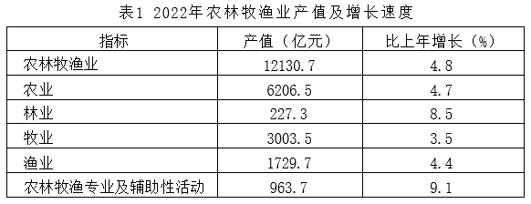

### 第 101 题　qid 10942271 · 增长

2022年，第三产业增加值比第二产业增加值大约高：

- **A**. 39870.4亿元
- **B**. 28678.7亿元
- **C**. 12130.7亿元
- **D**. 11191.7亿元

### 第 102 题　qid 10942277 · 增长

将2022年第一产业各类产品的同比增速由高到低进行排序，以下正确的是：

- **A**. 棉花>猪牛羊禽肉>园林水果>淡水产品
- **B**. 猪牛羊禽肉>淡水产品>园林水果>棉花
- **C**. 淡水产品>猪牛羊禽肉>棉花>园林水果
- **D**. 淡水产品>棉花>猪牛羊禽肉>园林水果

### 第 103 题　qid 10942279 · 比重

2022年，渔业占第一产业产值的比重较上年：

- **A**. 下降不足1个百分点
- **B**. 上升不足1个百分点
- **C**. 下降约5个百分点
- **D**. 上升约5个百分点

### 第 104 题　qid 10942301 · 综合

下列各图符合2021年农林牧渔业各组成部分产值数量关系的是：

- **A**. 
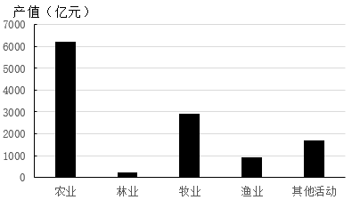

- **B**. 

- **C**. 
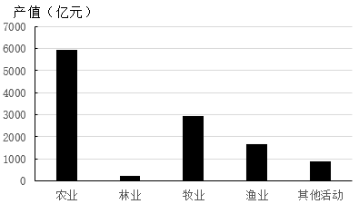

- **D**. 
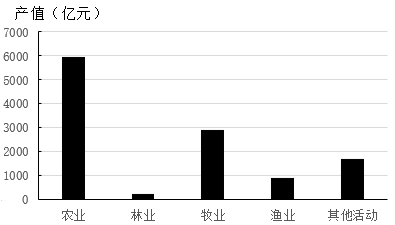

### 第 105 题　qid 10942304 · 综合

能够从上述资料中推出的是：

- **A**. 2022年，林业平均亩产值约为650元
- **B**. 2022年，粮食产量较上年约增加8.8亿斤
- **C**. 2022年，第一产业增加值比重较上年约下降1个百分点
- **D**. 2022年，油料作物下降速度比禽蛋产量的慢0.4个百分点

## 材料 2

        2022年，我国全年国有建设用地供应76.6万公顷（1公顷=15亩）。其中，工矿仓储用地、商服用地、住宅用地、基础设施及其他用地供应面积分别为19.8万公顷、3.1万公顷、7.9万公顷和45.8万公顷。全年出让国有建设用地30.7万公顷，出让成交价款6.03万亿元。

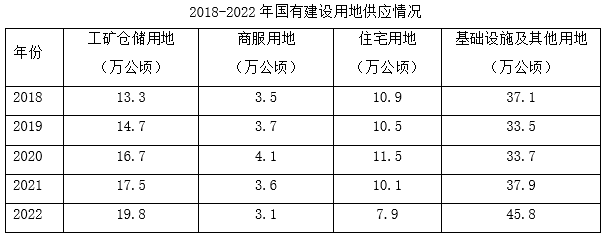

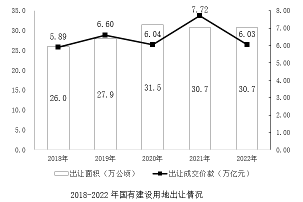

### 第 106 题　qid 16437523 · 增长

2019-2022年，工矿仓储用地供应面积同比增速最快的年份是：

- **A**. 2020年
- **B**. 2022年
- **C**. 2021年
- **D**. 2019年

### 第 107 题　qid 16437524 · 综合

2018-2022年，国有建设用地出让成交单价高于150万元/亩的年份有几个？

- **A**. 4
- **B**. 1
- **C**. 2
- **D**. 3

### 第 108 题　qid 16437525 · 综合

若国有建设用地出让率=出让面积÷供应总面积×100%，则2018-2022年，国有建设用地出让率最高和最低大约相差：

- **A**. 7.6个百分点
- **B**. 5.7个百分点
- **C**. 4.5个百分点
- **D**. 2.3个百分点

### 第 109 题　qid 16437526 · 比重

2018-2022年，国有建设用地供应中各类用地占比变动程度最小的是：

- **A**. 工矿仓储用地
- **B**. 商服用地
- **C**. 住宅用地
- **D**. 基础设施及其他用地

### 第 110 题　qid 16437527 · 综合

能够从上述材料推出的是：

- **A**. 2018-2022年，住宅用地年均供应面积比商服用地约多3倍
- **B**. 2018-2022年，国有建设用地出让面积与成交单价变动趋势相同
- **C**. 2018-2022年，住宅用地占国有建设用地供应总面积的比重逐年递减
- **D**. 2018-2022年，基础设施及其他用地占供应总面积比重最高的是2022年

## 材料 3

        2022年，中国国内旅游总人次达25.30亿。其中，城镇居民国内旅游人次19.28亿，同比下降17.7%；农村居民国内旅游人次6.02亿，同比下降33.5%。2022年，中国国内旅游收入（旅游总消费）2.05万亿元，为2019年的35.8%。

        2023年春节假期，全国国内旅游人次3.08亿，实现国内旅游收入3758.43亿元，分别恢复至2019年同期的88.6%和73.1%。

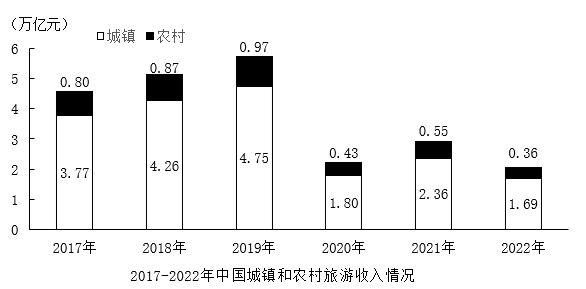

### 第 111 题　qid 16437528 · 增长

2022年，中国国内旅游总人次同比约下降：

- **A**. 17%
- **B**. 19%
- **C**. 20%
- **D**. 22%

### 第 112 题　qid 16437529 · 增长

2018-2022年，中国国内旅游收入同比增速最大的年份是：

- **A**. 2021年
- **B**. 2019年
- **C**. 2022年
- **D**. 2018年

### 第 113 题　qid 16437531 · 比重

2019年春节假期，中国国内旅游收入占全年全国国内旅游收入的比重约为：

- **A**. 9%
- **B**. 8%
- **C**. 7%
- **D**. 6%

### 第 114 题　qid 16437533 · 平均数

2022年，中国国内平均每人次旅游消费较2021年约减少：

- **A**. 76元
- **B**. 86元
- **C**. 96元
- **D**. 106元

### 第 115 题　qid 18697341 · 综合

能够从上述资料中推出的是：

- **A**. 2022年，城镇居民的国内旅游人次同比净减少数少于农村居民
- **B**. 2023年春节假期，全国国内旅游消费恢复程度强于旅游人次
- **C**. 2017-2022年，城镇和农村旅游收入之差最大年份约为最小年份的2.8倍
- **D**. 2019年春节假期，全国国内平均每人次旅游消费不到1300元

## 材料 4

        2022年，我国风电、光伏发电新增装机达到1.25亿千瓦，再创历史新高。全年可再生能源新增装机1.52亿千瓦，占全国新增发电装机的76.2%，其中风电新增3763万千瓦，太阳能发电新增8741万千瓦，生物质发电新增334万千瓦，常规水电新增1507万千瓦，抽水蓄能新增880万千瓦。截至2022年年底，可再生能源装机达到12.13亿千瓦，占全国发电总装机的47.3%，较2021年提高2.5个百分点。其中风电3.65亿千瓦，太阳能发电3.93亿千瓦，生物质发电0.41亿千瓦，常规水电3.68亿千瓦，抽水蓄能0.45亿千瓦。

        2022年，风电、光伏年发电量首次突破1万亿千瓦时，达到1.19万亿千瓦时，较2021年增加2073亿千瓦时，同比增长21%，占全社会用电量的13.8%，同比提高2个百分点，接近全国城乡居民用电量。2022年，可再生能源发电量达到2.72万亿千瓦时，占全社会用电量的比重为31.6%，较2021年提高1.7个百分点，可再生能源在保障能源供应方面发挥的作用越来越明显。

### 第 116 题　qid 18697345 · 综合

2022年，我国新增发电装机约为：

- **A**. 1.25亿千瓦
- **B**. 15.2亿千瓦
- **C**. 1.99亿千瓦
- **D**. 2.33亿千瓦

### 第 117 题　qid 18697346 · 综合

2022年，可再生能源新增装机规模从大到小排序正确的是：

- **A**. 风电>太阳能>抽水蓄能
- **B**. 太阳能>常规水电>生物质
- **C**. 抽水蓄能>风电>生物质
- **D**. 常规水电>生物质>抽水蓄能

### 第 118 题　qid 18697347 · 比重

截至2022年年底，各类可再生能源发电装机中占比最大与最小的大约相差：

- **A**. 27个百分点
- **B**. 29个百分点
- **C**. 36个百分点
- **D**. 55个百分点

### 第 119 题　qid 18697348 · 比重

2021年，除风电、光伏发电外的可再生能源发电量及其占全社会用电量的比重约为：

- **A**. 1.36万亿千瓦时，18.1%
- **B**. 1.36万亿千瓦时，14.2%
- **C**. 1.51万亿千瓦时，18.1%
- **D**. 1.51万亿千瓦时，14.2%

### 第 120 题　qid 18697349 · 综合

不能从上述资料中推出的是：

- **A**. 2021年，可再生能源发电量占全社会用电量的比重为11.8%
- **B**. 2022年，生物质发电装机规模同比增长约8.87%
- **C**. 截至2022年年底，非可再生能源装机超过12.13亿千瓦
- **D**. 2022年，风电、光伏发电量基本可以满足全国城乡居民生活用电需求

## 答案与解析

第 1 题

**答案**：D

**来源参考解析（非官方标准答案）**

本题考查政治常识。
①③④⑤正确，2023年全国宣传思想文化工作会议提出，习近平文化思想既有文化理论观点上的创新和突破，又有文化工作布局上的部署要求，明体达用、体用贯通，明确了新时代文化建设的路线图和任务书，标志着我们党对中国特色社会主义文化建设规律的认识达到了新高度，表明我们党的历史自信、文化自信达到了新高度，并在我国社会主义文化建设中展现出了强大伟力，为做好新时代新征程宣传思想文化工作、担负起新的文化使命提供了强大思想武器和科学行动指南。习近平文化思想是一个不断展开的、开放式的思想体系，必将随着实践深入不断丰富发展。要深刻领悟“两个确立”的决定性意义，增强“四个意识”、坚定“四个自信”、做到“两个维护”，持续加强对习近平文化思想的学习、研究、阐释，并自觉贯彻落实到宣传思想文化工作各方面和全过程。
②正确，光明日报文章《彰显党的历史自信、文化自信达到了新高度》中指出：“习近平文化思想的形成和发展，必将进一步提振中国人民的自信心自豪感，激发全体中华儿女满怀信心走好全面建设社会主义现代化国家、全面推进中华民族伟大复兴的新征程······源于对中华优秀传统文化的坚定自信，是马克思主义与中华优秀传统文化相结合的光辉典范。”
故理解正确的有①②③④⑤，共5项。
故正确答案为D。

---

第 2 题

**答案**：C

**来源参考解析（非官方标准答案）**

本题考查政治常识。
A项错误，矛盾的特殊性是指各个具体事物的矛盾、每一个矛盾的各个方面在发展的不同阶段上各有其特点。但是事物的性质是由主要矛盾的主要方面所决定的。题干中“建设自贸试验区”“国家层面共向全国复制推广三百多项制度创新成果，形成了改革红利共享、开放成果普惠的良好局面”的表述并未涉及事物的不同性质。
B项错误，矛盾的普遍性和特殊性的关系，也就是共性与个性、一般与个别的关系。共性和个性在一定条件下可以互相转化。题干中“建设自贸试验区”转化为“国家层面共向全国复制推广三百多项制度创新成果”体现了个性转化为共性，但并未体现“相互转化”。
C项正确，矛盾普遍性与特殊性是互相联系的。普遍性寓于特殊性之中，特殊性中包含着普遍性。“国家层面共向全国复制推广三百多项制度创新成果”是从“建设自贸试验区”的经验中总结出来的，从个性中总结出可推广复制的经验，即共性，体现了矛盾的普遍性寓于特殊性之中。
D项错误，矛盾的普遍性和特殊性的关系，也就是共性与个性、一般与个别的关系。其发展规律是在特殊性中总结普遍性的规律，又具体的应用到特殊性中，即为“个性——共性——个性”的认识发展规律。
故正确答案为C。

---

第 3 题

**答案**：A

**来源参考解析（非官方标准答案）**

本题考查政治常识。
2023年9月6日出版的《经济日报》第1版以《推进中国式现代化的山东实践》为题刊发山东省委书记、省人大常委会主任林武专访报道。
①正确，文章指出，一是发力供需两端，助力畅通国内大循环······同时，以建设交通强国山东示范区为契机，打造“四纵五横沿黄达海”大通道，实施内河航运高质量发展三年行动，构建“铁公水空”综合运输大网络，确保经济循环畅通无阻。
②正确，文章指出，二是加强内外联动，促进国内国际双循环······构建面向日韩和东北亚、连接“一带一路”、连通欧美的重要“桥头堡”，力争成为双循环的战略支点。10年来，山东省进出口增幅达89%（人民币口径），实际使用外资增长超过3倍，山东好物通过齐鲁号“中欧班列”源源不断流向世界。
③正确，文章指出，三是推动陆海统筹，构筑高质量发展空间动力系统。立足山东省海洋资源丰富、海洋产业基础雄厚等优势，统筹陆海区域联动，以黄河流域生态保护和高质量发展为牵引，深化东中西合作机制······
④错误，文章指出，工作中，我们将加快塑造八个方面新优势：······六是加快塑造对外开放新优势，深化“千企百展”境外市场开拓活动，巩固传统市场，大力开拓“一带一路”、东盟、非洲等新兴市场，发展外贸新业态，打造新增长点······故“以‘外企与部门面对面’系列活动为载体，塑造对外开放新优势”说法错误。
故说法正确的是①②③。
故正确答案为A。

---

第 4 题

**答案**：C

**来源参考解析（非官方标准答案）**

本题考查政治常识。
A项正确，会议指出，要着力打造现代金融机构和市场体系，疏通资金进入实体经济的渠道。优化融资结构，更好发挥资本市场枢纽功能，推动股票发行注册制走深走实，发展多元化股权融资，大力提高上市公司质量，培育一流投资银行和投资机构。
B项正确，会议指出，始终保持货币政策的稳健性，更加注重做好跨周期和逆周期调节，充实货币政策工具箱。
C项错误，会议指出，优化资金供给结构，把更多金融资源用于促进科技创新、先进制造、绿色发展和中小微企业，大力支持实施创新驱动发展战略、区域协调发展战略，确保国家粮食和能源安全等。
D项正确，会议指出，盘活被低效占用的金融资源，提高资金使用效率。做好科技金融、绿色金融、普惠金融、养老金融、数字金融五篇大文章。
本题为选非题，故正确答案为C。

---

第 5 题

**答案**：B

**来源参考解析（非官方标准答案）**

本题考查政治常识。
2023年10月27日，中共中央政治局就铸牢中华民族共同体意识进行第九次集体学习。中共中央总书记习近平主持集体学习。
①正确，习近平总书记强调，铸牢中华民族共同体意识，就是要引导各族人民牢固树立休戚与共、荣辱与共、生死与共、命运与共的共同体理念。
②错误，④正确，习近平总书记强调，要着眼建设中华民族现代文明，不断构筑中华民族共有精神家园。必须顺应中华民族从历史走向未来、从传统走向现代、从多元凝聚为一体的发展大趋势，深刻理解把握中华文明的突出特性，在新的历史起点上不断构筑中华民族共有精神家园，为铸牢中华民族共同体意识奠定坚实的精神和文化基础。故②中“坚持各民族自信和独立，为铸牢中华民族共同体意识奠定坚实物质和文化基础”的说法错误。
③正确，习近平总书记指出，要促进各民族广泛交往交流交融，以中华民族大团结促进中国式现代化。强国建设、民族复兴的进程，必然是各民族广泛交往交流交融的过程，必然是各民族共同团结奋斗、共同繁荣发展的过程。
故表述正确的是①③④。
故正确答案为B。

---

第 6 题

**答案**：D

**来源参考解析（非官方标准答案）**

本题考查政治常识。
2023年11月，山东将深入开展机关运转提速提效、政企沟通提速提效、数字政府建设提速提效“三大行动”，强力推动“高效办成一件事”纵深推进、落细落实，不断增强群众和企业获得感。
A项正确，本次发布会指出，进一步精简会议，除因法律法规规定、上级部署，省委、省政府工作要求以及发生重大突发事件等确需召开会议外，一般不安排以省政府名义召开全省性会议。简化会议议程，严格把控会议时间，会议一般不超过90分钟。
B、C两项正确，本次发布会指出，省政府领导将每月至少主持召开1次政企沟通交流会，开展1次走进企业家会客厅活动······发挥好“省长信箱”作用，在“爱山东”政务服务平台设立“企业家诉求专区”，开通企业家直通省长公开号码96178，多渠道收集企业诉求。
D项错误，本次发布会指出，集中力量建设“鲁通码”，将全省各级各部门500多类码融合成一码，一码关联多证，群众持“一码”就可在政务办事、医疗健康、交通出行等6大类场景中免证办事。
本题为选非题，故正确答案为D。

---

第 7 题

**答案**：A

**来源参考解析（非官方标准答案）**

本题考查人文常识。
2023年7月1日，在国家文物局全程指导支持下，2023年山东省红色文化主题月启动暨山东革命文物保护利用片区红色主题遗产线路发布活动在烟台海阳举行，活动发布了6条山东革命文物保护利用片区红色主题遗产线路。
A项错误，线路1是“战略后方 丹心渤海”——渤海老区抗敌斗争线，这里诞生了家喻户晓的大刀记，无数志士仁人为了“保卫黄河”奔赴前线奋勇杀敌，奏响了中华民族救亡图存的时代强音。
B项正确，线路3是“红色大动脉”——抗战秘密交通运输线，具体线路从烟台市招远金矿近代采掘基址群起，到济宁市微山铁道游击队队部旧址止。抗战时期山东抗日根据地的胶东军民历经千难万险,将13万两黄金成功运送到延安，为中共敌后抗战胜利提供了物质支撑。
C项正确，线路5是“千里海疆 红色胶东”——胶东抗日运动线，具体线路从青岛市高家民兵联防遗址起，经过胶东育儿所旧址等，到地雷战纪念馆止。在这里马石山十勇士、胶东乳娘的故事代代相传。
D项正确，线路6是“万众一心 筑成我们新的长城”——齐长城抗战线，具体线路从济南市大峰山革命旧址起，经过齐长城锦阳关和淄博市马鞍山抗战旧址等，到青岛市中共青岛工委旧址止。
本题为选非题，故正确答案为A。

---

第 8 题

**答案**：C

**来源参考解析（非官方标准答案）**

本题考查科技常识。
①错误，“耕海1号”海洋牧场综合体平台位于山东省烟台市渔人码头以东海域，将渔业养殖、海上旅游、科技研发等功能相结合，以科技创新提升渔业养殖效率，实现海洋渔业转型升级。2021年6月25日，我国自营勘探开发的首个1500米超深水大气田“深海一号”在海南岛东南陵水海域正式投产，标志着中国海洋石油勘探开发能力全面进入“超深水时代”。
②正确，“国信1号”是全球首艘10万吨级智慧渔业大型养殖工船，2022年1月25日，在中国船舶集团青岛北海船厂顺利实现出坞下水。“国信1号”在产业发展和技术创新应用上的前瞻性、引领性和示范性，对拓展我国深远海养殖空间、带动渔业产业升级转化具有非常重要的现实意义。
③蓝鲸1号”是一个钻井平台，净重超过43000吨、37层楼高，由中国自主制造，是世界最大、钻井深度最深的半潜式海上钻井平台，适用于全球任何深海作业。
④正确，“深蓝1号”是中国首座自主研制的大型全潜式深海智能渔业养殖装备，是中船重工武船集团为山东日照市万泽丰渔业有限公司建造的首座“深海渔场”。“深蓝1号”用于日照市以东130海里的黄海冷水团进行三文鱼养殖生产。
故对应正确的是②③④。
故正确答案为C。

---

第 9 题

**答案**：D

**来源参考解析（非官方标准答案）**

本题考查人文常识。
①“儿今日竭力驱满，尽国家之责任者，亦即所谓保卫身家也”出自黄花岗起义中牺牲的方声洞烈士在起义前夕写给父亲的绝笔书。黄花岗起义，是革命党人1911年4月在广州举行的起义，又称广州起义、广州三·二九起义。
②1952年4月29日，黄继光写给母亲邓芳芝一封家信，信中写出了自己的初心：“男现在为了祖国人民，需要站在光荣战斗最前面，为了全祖国家中人等过着幸福日子，男有决心在战斗中坚持为人民服务，不立功不下战场。”
③大革命失败后，共产党员夏明翰在汉口被捕，1928年3月，夏明翰在监狱里给妻子写信诀别：“抛头颅、洒热血，明翰早已视等闲。各取所需终有日，革命事业代代传。红珠留着相思念，赤云孤苦望成全。坚持革命继吾志，誓将真理传人寰！”
④“狼毒野心之列强！无故侵占我国土！二十一条之否认被拒绝，而租地期满，又故意不肯交还！······热血男儿何堪睹此？”出自1922年6月3日聂荣臻在比利时留学时写给父母的家书。
故按时间先后排序为①④③②。
故正确答案为D。

---

第 10 题

**答案**：D

**来源参考解析（非官方标准答案）**

本题考查经济常识。
A项正确，一般公共预算，是安排用于保障和改善民生，推动经济社会发展，维护国家安全，维持国家机构正常运转等方面的收支预算。
B项正确，政府性基金预算，是依照法律、行政法规的规定，在一定期限内向特定对象征收、收取或者以其他方式筹集的资金，专项用于特定公共事业发展的收支预算。铁路建设基金、民航发展基金、土地出让收入和专项债纳入在该本预算里。
C项正确，国有资本经营预算，是对国有资本收益作出支出安排的收支预算。《中央国有资本经营预算管理暂行办法》第三条规定：“中央国有资本经营预算保持完整独立，并与一般公共预算相衔接，应当按照收支平衡的原则编制，以收定支，不列赤字。”
D项错误，社会保险基金预算，是对社会保险缴款一般公共预算安排和其他方式筹集的资金，专项用于社会保险的收支预算。该笔预算专款专用，只进不出。
本题为选非题，故正确答案为D。

---

第 11 题

**答案**：A

**来源参考解析（非官方标准答案）**

本题考查法律常识。
A项错误，根据《中华人民共和国公务员法》第二十五条第二款规定：“国家对行政机关中初次从事行政处罚决定审核、行政复议、行政裁决、法律顾问的公务员实行统一法律职业资格考试制度，由国务院司法行政部门商有关部门组织实施。”题中，应由国务院司法行政部门商有关部门组织实施，而非由招录机关向省级机关申请组织。
B项正确，根据《行政执法类公务员管理规定》第二十一条第三款规定：“根据职位特点和工作需要，经省级以上公务员主管部门批准，可以对有关心理素质、体能等进行测评。”
C项正确，根据《专业技术类公务员管理规定》第二十条规定：“专业技术类公务员转任其他职位类别公务员或者专业技术任职资格被取消的，应当予以免职。”
D项正确，根据《行政执法类公务员管理规定》第二十条规定：“试用期满考核合格的新录用行政执法类公务员，应当按照规定在一级主办以下职级层次任职定级。”第十条第三款规定：“行政执法类公务员职级序列分为十一个层次。通用职级名称由高至低依次为：督办、一级高级主办、二级高级主办、三级高级主办、四级高级主办、一级主办、二级主办、三级主办、四级主办、一级行政执法员、二级行政执法员。”题中，将该行政执法类公务员定级为四级主办符合规定。
本题为选非题，故正确答案为A。

---

第 12 题

**答案**：B

**来源参考解析（非官方标准答案）**

本题考查政治常识。
A项正确，《全国干部教育培训规划（2023-2027年）》“一、总体要求”中指出：“······把深入学习贯彻习近平新时代中国特色社会主义思想作为主题主线，以坚定理想信念宗旨为根本，以提高政治能力为关键，以增强推进中国式现代化建设本领为重点······”
B项错误，《全国干部教育培训规划（2023-2027年）》“五、推进培训资源建设，夯实培训保障基础”中指出：“深化和巩固县级党校（行政学校）分类建设成效，逐步实现应建尽建，因地制宜推进县级党校（行政学校）办学体制改革和办学模式创新。由市级党校（行政学院）牵头建立市、县两级优质师资共建共享机制。推进乡镇（街道）党校规范化建设，强化县级党校（行政学院）对乡镇（街道）党校的业务指导。”
C项正确，《全国干部教育培训规划（2023-2027年）》“三、围绕深刻领悟‘两个确立’的决定性意义、做到‘两个维护’，强化政治训练”中指出：“（三）加强年轻干部政治训练。强化习近平新时代中国特色社会主义思想学习教育，突出政治忠诚教育、理想信念教育、纪律规矩教育，加强优良传统作风和责任感使命感教育，强化斗争意识，综合运用理论讲授、政策解读、案例教学、现场体验等方式开展系统培训······实施年轻干部理想信念强化计划。”
D项正确，《全国干部教育培训规划（2023-2027年）》“三、围绕深刻领悟‘两个确立’的决定性意义、做到‘两个维护’，强化政治训练”中指出：“（二）突出‘关键少数’政治训练。坚持把政治训练贯穿干部成长全周期，使干部的政治素养、政治能力与担负的领导职责相匹配。强化‘一把手’政治培训，有计划地选调地方、部门、国有企事业单位主要负责同志到党校（行政学院）、干部学院参加专题培训。实施‘一把手’政治能力提升计划。”
本题为选非题，故正确答案为B。

---

第 13 题

**答案**：B

**来源参考解析（非官方标准答案）**

本题考查政治常识。
《生成式人工智能服务管理暂行办法》以下简称《暂行办法》。
A项正确，《暂行办法》第六条第二款规定：“推动生成式人工智能基础设施和公共训练数据资源平台建设。促进算力资源协同共享，提升算力资源利用效能。推动公共数据分类分级有序开放，扩展高质量的公共训练数据资源。鼓励采用安全可信的芯片、软件、工具、算力和数据资源。”
B项错误，《暂行办法》第十一条第二款规定：“提供者应当依法及时受理和处理个人关于查阅、复制、更正、补充、删除其个人信息等的请求。”
C项正确，《暂行办法》第三条规定：“国家坚持发展和安全并重、促进创新和依法治理相结合的原则，采取有效措施鼓励生成式人工智能创新发展，对生成式人工智能服务实行包容审慎和分类分级监管。”
D项正确，《暂行办法》第五条第一款规定：“鼓励生成式人工智能技术在各行业、各领域的创新应用，生成积极健康、向上向善的优质内容，探索优化应用场景，构建应用生态体系。”
本题为选非题，故正确答案为B。

---

第 14 题

**答案**：A

**来源参考解析（非官方标准答案）**

本题考查政治常识。
A项正确，意识能动性指人的意识能动地反映物质又通过实践反作用于物质。人工智能是人的意识能动性的一种特殊表现，是人的本质力量的对象化、现实化。人工智能的出现表明，人类意识已经发展到能够把意识活动部分地从人脑中分离出来，物化为机器的物理运动从而延伸意识器官功能的新阶段。
B项错误，人类的自然语言是思维的物质外壳和意识的现实形式，而人工智能难以完全具备理解自然语言真实意义的能力，因此，人工智能向人类思维的逼近只是模仿性趋近。但是材料并未表明这一点。
C项错误，意识是人脑对大脑内外表象的觉察，是人类所独有的。人工智能只是对人类的理性智能的模拟和扩展，不具备情感、信念、意志等人类意识形式，因此人工智能不会产生自我意识。
D项错误，人工智能超越人类智能，或者说在某些程度上比人类更有能力，比如下棋、做决策等，已经成为了现实。但是事实证明，人类的能力和潜能，会由于工具的发展而不断地被开发出来，人因为有了智能机器将会变得越来越聪明。题干并未表明人工智能能否取代或超越人类智能。
故正确答案为A。

---

第 15 题

**答案**：C

**来源参考解析（非官方标准答案）**

本题考查科技常识。
A、D两项错误，新安江水电站位于浙江省杭州市建德县原铜官镇附近，在钱塘江水系干流上游新安江，是中国第一座自己勘测、设计、施工和制造设备的大型水电站，反映了20世纪50年代中国水电建设的水平。刘家峡水电站是中国首座百万千瓦级水电站，位于甘肃省永靖县境内的黄河干流。
B项错误，葛洲坝水利枢纽被誉为“万里长江第一坝”，位于中国湖北省宜昌市境内的长江三峡末端河段上，距离长江三峡出口南津关下游2.3公里。它是长江上第一座大型水电站，也是世界上最大的低水头大流量、径流式水电站。小浪底水利枢纽位于河南省洛阳市孟津区与济源市之间，是黄河中游最后一段峡谷的出口，是黄河干流三门峡以下唯一能取得较大库容的控制性工程。
C项正确，白鹤滩水电站电站位于四川省宁南县和云南省巧家县交界的金沙江河道上，是实施“西电东送”的国家重大工程，是当今世界在建规模最大、技术难度最高的水电工程，全面建成投产后将成为仅次于三峡工程的世界第二大水电站。2022年12月20日白鹤滩水电站全部机组投产发电，标志着我国在长江上全面建成世界最大清洁能源走廊。
故正确答案为C。

---

第 16 题

**答案**：B

**来源参考解析（非官方标准答案）**

本题考查科技常识。
A项正确，航空运动是利用飞行器或其他器械在空中进行的体育运动。国际上普遍开展的航空运动项目有轻型飞机运动、航空模型运动、跳伞运动、滑翔运动和热气球运动等。
B项错误，攀岩是一项在天然岩壁或人工岩壁上进行的向上攀爬的运动项目，通常被归类为极限运动。2016年，国际奥委会确认攀岩成为2020东京奥运会正式比赛项目。
C项正确，冲浪运动是运动员站立在冲浪板上，或利用腹板、跪板、充气的橡皮垫、划艇、皮艇等驾驭海浪的一项水上极限运动。冲浪起源于夏威夷，是以海浪为动力，以冲浪板为支撑，与海浪共同前进的极限运动。
D项正确，团队飞盘比赛与其他竞技项目最大的不同，在于比赛没有裁判。出现分歧后，需要两方队员通过互相沟通来解决争议。这种对规则自我约束的“飞盘精神”，是团队飞盘的内在核心，也是这项运动的魅力所在。
本题为选非题，故正确答案为B。

---

第 17 题

**答案**：C

**来源参考解析（非官方标准答案）**

本题考查地理国情。
A项正确，亚洲象是亚洲大陆最大的陆生哺乳动物，典型的群居动物，有较为复杂的社群结构。亚洲象在我国主要分布于云南省西双版纳、普洱和临沧3个州市。
B项正确，按照世界自然保护联盟（IUCN）濒危物种红色名录对物种濒危等级划分，由高到低划分为9类：灭绝、野外灭绝、极危、濒危、易危、近危、无危、数据缺乏和未评估。其中极危、濒危和易危物种，又被统称为受威胁物种。在2016年9月，世界自然保护联盟就曾宣布，中国的大熊猫已经不再处于世界濒危动物之列，由“濒危”变为“易危”。
C项错误，朱鹮被誉为“东方宝石”，它也被人们称为爱情鸟、吉祥鸟、和平鸟。春季是朱鹮的繁殖季节，这时成年的雄鸟和雌鸟结成配偶，离开越冬时组成的群体，分散在栓皮栎树等高大的乔木树上筑巢、产卵。
D项正确，藏羚羊是中国国家一级保护动物，主要分布在以羌塘草原为中心的青藏高原地区，栖息地海拔3700米至5500米。
本题为选非题，故正确答案为C。

---

第 18 题

**答案**：A

**来源参考解析（非官方标准答案）**

本题考查人文常识。
①“画龙点睛”是指南北朝时期，梁朝画家张僧繇画龙之后再点上眼睛，龙便飞走了，形容其作画的神妙，后多比喻写文章或讲话时，在关键处用几句话点明实质，使内容更加生动有力。
②“矫若游龙”出自《晋书·王羲之传》，该书评价东晋时期书法家王羲之：“尤善隶书，为古今之冠，论者称其笔势，以为飘若浮云，矫若惊龙。”因此，这一成语常用于形容书法笔势刚健，或舞姿婀娜。
③“胸有成竹”出自宋代苏轼的《文与可画筼筜谷偃竹记》，指画竹前竹子的完美形象已在胸中，比喻处理事情之前已有完整的谋划打算。
④“吴带当风”出自《图画见闻志》，意思是唐代画家吴道子善画佛像，笔势圆转，所画衣带如被风吹拂，后人以之称美其高超画技与飘逸的风格。
故上述成语所涉及的人物按照时间先后排序正确的是②①④③。
故正确答案为A。

---

第 19 题

**答案**：B

**来源参考解析（非官方标准答案）**

本题考查人文常识。
A项错误，“海纳百川，有容乃大；壁立千仞，无欲则刚”为清末政治家林则徐任两广总督时在总督府衙题书的堂联，意思是大海因为有宽广的度量才容纳了成百上千条河流；高山因为没有勾心斗角的凡世杂欲才如此的挺拔。
B项正确，“中学为内学，西学为外学；中学治身心，西学应世事”出自张之洞创作的作品《劝学篇》，该书于1898年刊行，是阐述“中体西用”、宣传洋务思想的代表作。
C项错误，“我劝天公重抖擞，不拘一格降人才”出自清代龚自珍的《己亥杂诗·其一百二十五》，意思是我希望皇帝重新振作精神，不要局限于一种规格或方式去选用治国的人才。
D项错误，“古之立大事者，不惟有超世之才，亦必有坚忍不拔之志”出自宋代苏轼的《晁错论》，意思是自古以来凡是做大事业的人，不仅有出类拔萃的才能，也一定有坚韧不拔的意志。
故正确答案为B。

---

第 20 题

**答案**：D

**来源参考解析（非官方标准答案）**

本题考查科技常识。
A项正确，一切生命活动都需要能量，但能量摄入过剩会在体内贮存起来。人体内能量的储存形式主要就是脂肪，但脂肪在体内的异常堆积，会导致肥胖和机体不必要的负担，并可成为心血管疾病、某些癌症、糖尿病等慢性疾病的危险因素。
B项正确，缺铁性贫血跟体内长时间缺乏铁元素有关，会影响幼儿的生长发育，导致身体发育迟缓、身材瘦小，同时伴有注意力不集中、烦躁不安，还可能会出现精神不振、免疫力低下、认知能力障碍等症状。
C项正确，维生素A有促进生长、繁殖，维持骨骼、上皮组织、视力和粘膜上皮正常分泌等多种生理功能，缺乏时表现为生长迟缓、暗适应能力减退而形成夜盲症。含维生素A多的食物有禽、畜的肝脏、鸡蛋的蛋黄、牛奶等，患者可多食用。
D项错误，维生素D的作用主要是促进肠道对钙、磷的吸收和在骨骼中沉积，维持骨骼的正常生长与发育。缺乏维生素D时，儿童易患佝偻病，成人易患骨质软化症。维生素D缺乏与皮肤麻木、牙龈出血等症状并无直接关联。
本题为选非题，故正确答案为D。

---

第 21 题

**答案**：C

**来源参考解析（非官方标准答案）**

根据文意可知，横线处应体现民营企业在“四新经济”发展进程中利用自身独特优势能够带来积极的结果，C项“大有可为”指前途极有希望，值得去做，置于此处能体现出“民营企业”立足优势，在“四新经济”中可以大展拳脚之意，符合文意，当选。
A项“游刃有余”比喻做事熟练，解决问题轻松利落，强调因为熟练而可以轻松完成，文中民营企业面对的是“四新经济”，很难做到熟练而轻松，与文意不符，排除；B项“举足轻重”形容有实力，所处的地位很重要，若置于此处，前文应论述民营企业在“四新经济”中所处的地位非常重要，而非论述民营企业自身的优势，故置于此处与前文对应不当，排除；D项，“事半”指花一半力气，“功倍”指收到成倍效果，“事半功倍”形容费力小，收效大，文段强调民营企业有自身的独特优势，并不意味着民营企业在“四新经济”发展进程中就可以付出少、收效多，与文意不符，排除。
故正确答案为C。
【文段出处】经济日报《引导更多民企加入“四新”赛道》

---

第 22 题

**答案**：D

**来源参考解析（非官方标准答案）**

第一空，根据“决不能抛弃中华优秀传统文化这个根脉”可知，横线处应体现守护好这个魂和根的意思，A项“维系”指维持和联系，C项“保护”指尽力照顾，使不受损害，D项“坚守”指坚决守卫，不离开，均能搭配“魂和根”，且符合文意，保留。B项“培育”指培养，强调从无到有或从弱到强的过程，不符合文意，排除。
第二空，根据“不能丢了老祖宗”可知，横线处所在句子应体现不能忘本的意思，D项“数典忘祖”指查数着典籍，却忘了自己祖先的行事，后用来比喻忘本，符合文意，当选。A项“见异思迁”指看到别的事物就想改变原来的主意，强调主意不坚定，喜爱不专一，与文意无关，排除；C项“喜新厌旧”指喜欢新的，厌弃旧的，置于此处程度过轻，无法与前文“丢了老祖宗”构成对应，排除。
故正确答案为D。
【文段出处】求是网《求是网评论员：始终坚守理论创新的魂和根》

---

第 23 题

**答案**：C

**来源参考解析（非官方标准答案）**

第一空，根据“不筑牢药品的安全底线，安全根基不稳”可知，横线处应体现安全根基不稳，再多的创新也无用之意。B项“徒劳无功”指白费力气，没有成就或好处，C项“空中楼阁”指海市蜃楼，多用来比喻虚幻的事物或脱离实际的理论、计划等，均符合文意，保留。A项“纸上谈兵”比喻空谈理论，不能解决实际问题，也比喻空谈不能成为现实，文段未体现理论和实际的问题，也并未讨论落实的问题，与文意不符，排除；D项“本末倒置”比喻把主要的和次要的、本质和非本质的关系弄颠倒了，文段并未体现主次、轻重的关系，与文意无关，排除。
第二空，搭配“形势”，且应体现出前面一系列工作对药品安全形势总体稳定所发挥的作用。C项“维护”指维持保护，使免于遭受破坏，与“形势”搭配恰当，当选。B项“提升”指使位置、程度、水平、数量、质量等方面比原来高，与“形势”搭配不当，排除。
故正确答案为C。
【文段出处】人民网《加快迈向医药创新强国》

---

第 24 题

**答案**：B

**来源参考解析（非官方标准答案）**

第一空，根据“带着醉意的李白举杯吟出《将进酒》，带着围坐的高适、岑夫子、丹丘生等人，一齐驾着仙鹤飞越银河之上”可知，横线处所填词语应体现电影《长安三万里》将纪实与想象融合之意，A项“融汇”指融合汇聚，B项“交融”指融合在一起，均符合文意，保留。 C项“糅合”指掺和，混合（多指不适宜合在一起的），感情色彩与文段不符，排除；D项“联结”指把两个以上事物结合在一起，侧重于联系、连接，体现不出融合的意思，排除。
第二空，根据“万里山河画卷都是唐代的模样”可知，横线处所填成语应体现出唐代边塞的景象，B项“金戈铁马”比喻战争，也形容战士持枪驰马的雄姿，与“歌舞翩跹的江南”构成两幅不同的画卷，且符合唐代边塞多打仗的景象，符合文意，当选。A项“人迹罕至”指荒凉偏僻的地方，与“万里山河画卷”无法对应，排除。
故正确答案为B。
【文段出处】人民网《人民艺起评：&lt;长安三万里&gt;，打破时空的“唐代诗友会”》

---

第 25 题

**答案**：D

**来源参考解析（非官方标准答案）**

第一空，根据后文“折射出一个地区发展变迁”“一部铁路交通变迁史”可知，横线处应体现铁路线的变化之意，C项“演变”指变化发展，D项“嬗变”指蜕变、演变，均符合文意，保留。A项“贯通”指连接、通连，B项“延展”指延长伸展，均与文意无关，排除。
第二空，搭配“经济文化发展史”，且根据前文“铁路是国民经济大动脉”“百廿胶济，就是这样一条担纲主动脉的铁路线”可知，百廿胶济铁路线较为重要，该铁路线对百廿胶济沿线经济文化发展的影响很大，D项“波澜壮阔”比喻声势浩大，规模宏伟，可以体现百廿胶济沿线的经济文化发展变化巨大，符合文意，当选。C项“流光溢彩”形容形象美好，光彩照人，与文意无关，且与“经济文化发展史”搭配不当，排除。
故正确答案为D。
【文段出处】大众日报《读懂高质量发展的“胶济”样本》

---

第 26 题

**答案**：A

**来源参考解析（非官方标准答案）**

第一空，根据后文“我国传统产业体量大，在制造业中占比超过80%，传统产业转型升级直接关乎现代化产业体系建设全局”可知，横线处应体现传统制造业对现代化产业体系非常重要之意，A项“基底”指基础的最下部分或沉积物之下的岩石，置于此处可体现基础之意，C项“支柱”比喻中坚力量，D项“核心”指中心、主要部分，均符合文意，保留。B项“根源”指使事物产生的根本原因，与文意不符，排除。
第二空，根据前文“传统产业转型升级直接关乎现代化产业体系建设全局”可知，横线处应体现传统产业转型升级对于“突出做好稳增长稳就业稳物价工作、推动经济运行持续好转”起到非常重要的作用之意，A项“不可或缺”表示非常重要，不能有一点点的缺失，符合文意，当选。C项“缺一不可”指少一样也不行，使用时前面应搭配多个主语，横线前只有“传统产业转型升级”一个主语，用法不当，排除；D项“功不可没”指功劳极大，不可抹灭，一般表示对某人或某物已取得成果的肯定，而根据文段“对当前突出做好······”可知，文段表示正在做，传统产业转型并未“完成”，与文意不符，排除。
故正确答案为A。
【文段出处】人民网《坚持推动传统产业转型升级（评论员观察）》

---

第 27 题

**答案**：B

**来源参考解析（非官方标准答案）**

第一空，根据转折标志词“却”以及“背后”可知，横线处与前文“这些行为看似简单明白”意思相反，体现出这些行为背后隐藏着生命的玄机，A项“暗含”指做事、说话包含某种意思而未明白说出，B项“蕴藏”指蓄积深藏未露，D项“隐伏”指隐藏，潜伏，均符合文意，保留。C项“孕育”比喻既存的事物中酝酿着新事物，行为与玄机之间并不是孕育的关系，与文意不符，排除。
第二空，搭配“极高”，且根据前文“鸟类的行为复杂而独特”以及后文“······最为普通的麻雀、乌鸦和喜鹊，也可能做出让你意想不到的行为”可知，鸟类的行为可能存在着与其属性不同的特征，B项“异质性”指一些事物在某些特征上存在差异。在生物学中，异质性通常指物种内部个体之间的差异。这种差异可能表现在基因、形态、生理、行为等多个方面。与后文“最为普通的麻雀、乌鸦和喜鹊，也可能做出让你意想不到的行为”的对应最为准确，并且“异质性”与“极高”搭配较为常见，当选。A项“科学性”指概念、原理等内容的叙述是否清楚、确切，历史事实、任务以及参考文献等写得是否准确，或者前后是否一致等，文段并未体现鸟类行为是否科学，与文意不符，排除；D项“特殊性”指不同于其他事物或一般情况的性质，对比B、D两项，B项“异质性”更多运用于生物学语境，因此B项比D项更符合文段语境，并且D项“特殊性”多搭配“极强”，排除。
故正确答案为B。
【文段出处】《鸟类的行为》序言-生而为鸟

---

第 28 题

**答案**：A

**来源参考解析（非官方标准答案）**

第一空，搭配“收入分配秩序”，根据横线前后“稳步推进个人所得税改革”“提高居民收入水平和消费购买力”可知，横线处所填词语应体现收入分配秩序向好发展。A项“规范”意为使合乎约定俗成或明文规定的标准，C项“调整”指改变原有的情况，使适应客观环境和要求，均符合文意，且与“收入分配秩序”搭配恰当，保留。B项“强化”指加强，使坚固巩固，常见搭配有“强化监督”“强化服务”“强化训练”等，D项“完善”指使完备良好，常见搭配有“完善机制”“完善体系”等，均与“收入分配秩序”搭配不当，排除。
第二空，根据前文“稳步推进个人所得税改革”，以及后文“税收负担明显减轻”可知，横线处所填成语意在表达个人所得税改革稳步推进、成果斐然。A项“蹄疾步稳”指马跑得很快同时很平稳，可引申为速度快并且很稳，符合文意，当选。C项“筚路蓝缕”形容创业的艰苦，与前后文内容对应不当，排除。
故正确答案为A。
【文段出处】人民日报《税收新举措激发消费新潜能（财经观）》

---

第 29 题

**答案**：B

**来源参考解析（非官方标准答案）**

第一空，搭配“历史典籍版本”，根据前文可知，横线处所填成语应表达历史典籍版本很多之意，B项“汗牛充栋”形容藏书非常多，C项“浩如烟海”形容书籍、资料等数量繁多，十分丰富，D项“卷帙浩繁”形容书籍或篇章多而繁琐，均可体现历史典籍版本很多，符合文意，保留。A项“琳琅满目”形容满眼都是珍贵的东西，多指商品和工艺品，与“历史典籍版本”搭配不当，排除。
第二空，搭配“历史传说”“民风民俗”“家风家训”，B项“口耳相传”指口说耳听地往下传授，与“历史传说”“民风民俗”“家风家训”均搭配恰当，保留。C项“倾囊相授”指把所有的技能和知识都传授给学生，与“家风家训”搭配不当，排除；D项“言传身教”指一面口头上传授，一面行动上以身作则，与“历史传说”搭配不当，排除。
第三空，代入验证，B项“无与伦比”指事物非常完美，没有能跟它相比的，侧重指事物的完美，可以用于形容“文化宝藏”，当选。
故正确答案为B。 
【文段出处】人民网《做好历史典籍版本的研究和挖掘》

---

第 30 题

**答案**：D

**来源参考解析（非官方标准答案）**

本题可从第二空入手，根据前后文可知，中华文明在历史长河中经历了沉淀与创新。D项“大浪淘沙”比喻在激烈的斗争中经受考验、筛选，可以体现中华文明在传承中经历了磨砺与锻造，且可与前文的“长河”、后文的“奔腾澎湃的创新汇流”构成形象表达的对应，保留。A项“点铁成金”指通过外力使铁变成金，比喻稍加改动就能使事物变得更好，B项“千锤百炼”指千百次的锤打和冶炼，比喻经受多次的艰苦斗争的锻炼、考验，C项“脱胎换骨”指彻底改变，三项虽符合文意，但相较于D项均无法与文段中“长河”构成形象表达的对应，排除。
第一空，代入验证，根据横线前后文可知，我们的节日文化在传承发展中形式越来越新颖、丰富。D项“别开生面”比喻另外创出一种新的形式或面貌，符合文意，保留。
第三空，代入验证，D项“推陈出新”指去掉旧事物的糟粕，取其精华，并使它向新的方向发展，置于此处可与横线前后文对应，符合文意，当选。
故正确答案为D。
【文段出处】光明网《在传统节日中增进文化自信力量》

---

第 31 题

**答案**：D

**来源参考解析（非官方标准答案）**

A项，“旅游业”文段并未提及，无中生有，排除；
B项，根据“随蒙内铁路建成的内罗毕内陆集装箱港和奈瓦沙内陆集装箱港改善了货物装卸和运输条件，促进了蒙内铁路货运量的增长”可知，文段论述的是两个港口的建成促进了蒙内铁路的发展，而非蒙内铁路促进了港口的发展，因果倒置，排除；
C项，根据“蒙内铁路2022年运送旅客239万人次，高于2021年的199万人次，客运服务收入达26亿肯尼亚先令”可知，文段仅论述蒙内铁路2022年客运量高于2021年，以及2022年的客运服务收入，并未将2022年以及2021年的客运收益情况进行比较，无关对比，排除；
D项，根据“蒙内铁路是肯中共建‘一带一路’的旗舰项目，为肯尼亚创造了约4.6万个就业岗位，推动了沿线地区的城镇化进程，促进了肯中双边经贸合作”可知，表述正确，当选。
故正确答案为D。
【文段出处】北青网《共建“一带一路”助力肯尼亚发展振兴》

---

第 32 题

**答案**：B

**来源参考解析（非官方标准答案）**

横线出现在文段中间，需结合前后文进行分析。横线前指出基础研究不可能百分之百成功，横线后表明只有以大量错误作台阶，才能获得最后正确的结果，随后介绍宽容研究中“失败”的意义，最后指出一旦科学家有灵感，原先看似“无用”的原始创新成果就能爆发出巨大能量，开辟出崭新天地，此处的“无用”可作“失败”理解。故横线前后均在论述“失败”对基础研究的作用，强调应宽容失败，横线处也应表达此意，对应B项。
A项，“很容易‘失败’”仅能承接上文，不能体现“宽容失败”，与后文衔接不当，排除；
C项，偏离文段核心“失败”，无法与前后文衔接，排除；
D项，“地基牢不牢”偏离文段核心，文段重在强调宽容研究中失败的重要性，而非强调基础的重要性，排除。
故正确答案为B。
【文段出处】人民日报《在“无人区”里探奇观》

---

第 33 题

**答案**：C

**来源参考解析（非官方标准答案）**

文段开篇指出，自古以来，敦煌始终以中华传统文明为根基，不断吸纳着各种文明，之后分别通过“早在公元前2000年前后，属于青铜时代的四坝文化火烧沟类型的先民”“前121年汉武帝开疆扩土”“前111年设敦煌郡”这三个不同时期敦煌文化吸收其他文明成果的例子，对首句观点进行解释说明。故文段意在强调敦煌文化是自古以来各种文明交融的成果，对应C项。
A项，未提及“其他地域和民族的文明成果”，表述片面，排除；
B项，“了解异域文明”文段并未提及，无中生有，排除；
D项，“与时俱进”无中生有，文段重在强调敦煌文化长期融汇其他文明的特点，并非与时代同进步，排除。
故正确答案为C。
【文段出处】求是网《保护传承敦煌文化 增强中华文化自信》

---

第 34 题

**答案**：A

**来源参考解析（非官方标准答案）**

文段开篇指出“回旋镖”射击检测系统作为预警系统能对袭击者枪口发出的声音和冲击波进行探测和处理后计算出袭击者的具体方位，接着介绍了这套系统的具体使用方式和原理，尾句进一步说明了如何防止因非枪械射击而造成的虚假警报。故整个文段重点强调“回旋镖”射击检测系统可以通过枪口发出的声音和冲击波测算出袭击者位置进行预警，对应A项。
B项，“回旋镖”射击检测系统只是一个预警系统，起到提示的作用，“能够有效应对”表述程度过重，且如何有效应对不明确，排除；
C项，文段重在强调“回旋镖”射击检测系统能够检测预警，“反击敌人”文段并未提及，无中生有，排除；
D项，根据“麦克风用于探测各个方向上来袭子弹的枪口爆炸声和发出的冲击波”可知，“枪械射击的声音”与文意不符，且该系统还能探测冲击波，“只能识别”表述过于绝对，排除。
故正确答案为A。
【文段出处】解放军报《“回旋镖”射击检测系统——听声就能辨方位》

---

第 35 题

**答案**：C

**来源参考解析（非官方标准答案）**

A项，根据“据统计，我国商业航天企业超过400家，在轨商业卫星超过350颗。商业航天释放了可观的经济潜能，目前市场规模超过万亿元”可知，可以从文中得到支持，排除；
B项，根据“作为战略性新兴产业，商业航天催生出众多民用科技产品，为构筑现代化产业体系注入新动能”可知，可以从文中得到支持，排除；
C项，根据“商业星座建设初具规模，卫星批量化、智能制造能力持续提升”可知，文段仅论述“卫星批量化、智能制造能力提升”，并未阐述“商业火箭生产能力提升”，无中生有，当选；
D项，根据“商业航天新型空间基础设施体系建设和应用发展空间广阔”可知，可以从文中得到支持，排除。
本题为选非题，故正确答案为C。
【文段出处】人民日报《首枚成功入轨的液氧甲烷火箭——朱雀二号（科技自立自强）》

---

第 36 题

**答案**：A

**来源参考解析（非官方标准答案）**

文段开篇引出数字政府建设的话题并点明观点，即数字政府建设随着数字化全面革新，未来改革空间值得期待，接下来展开具体论述，指出人工智能大模型对数字政府产生的影响，尾句说明政府要采取的应对措施以及面临哪些新的挑战，即对于政府未来的改革空间进行具体阐述，故整个文段为总分结构，旨在强调数字政府建设未来改革空间值得期待，对应A项。
B项，“人工智能”对应解释说明部分，非重点，排除；
C项，文段并非强调政府开始数字化转型，而是强调随着数字化全面革新，数字政府建设未来改革空间值得期待，排除；
D项，“新挑战”仅对应后文解释说明部分的一个并列分句，非重点且表述片面，排除。
故正确答案为A。
【文段出处】中国社会科学网《数字技术赋能中国式现代化新实践》

---

第 37 题

**答案**：B

**来源参考解析（非官方标准答案）**

观察选项，对比首句，②句指出文旅融合下的乡村旅游对于传承中华文明具有重要意义，④句指出通过对文化属性的强调，乡村旅游可以更好地传承中华文明，两句均适合作为首句，无法排除。
继续观察句子发现，⑥句引出“文化属性”的话题，指出文化属性可以打造独特的乡村旅游品牌形象，恰好与④句话题一致，且④句论述强调“文化属性”带来的意义，根据逻辑顺序应先引出话题，再论述意义效果，故⑥句在④句之前，排除C、D两项。
对比A、B两项发现，区别在于①⑥④三句和⑤③两句的前后位置不同，①⑥两句是在提对策，④句论述意义效果，而⑤③两句是提出问题，根据行文逻辑，应先提出问题，再论述对策及意义，故⑤③两句应在①⑥④三句之前，排除A项，B项当选。
故正确答案为B。
【文段出处】光明网-《畅游美丽乡村 体验“村味”文化》

---

第 38 题

**答案**：C

**来源参考解析（非官方标准答案）**

文段开篇阐述我国生态环境保护法律体系已基本形成，随后通过“但”进行转折引出问题，表示相关法治建设仍需加强，接着通过“例如”列举现行草原保护管理的相关法律法规无法满足当前工作需要，需加快完善立法的案例，然后对这一情况进行分析。后文针对“目前生态环境领域相关法治建设有待加强”这一现象提出对策，建议相关部门针对生态环境领域进行修法立法系列工作，将相关法律法规纳入立改废释纂规划，对生态环境法治进行多维度完善。故文段重点为尾句的对策，强调各部门要将相关法律法规纳入立改废释纂工作，对生态环境法治的系统性、整体性、协同性、时效性进行多维度增强。C项，“统筹”即统一筹划，对应文段对策中的各相关部门对生态环境保护法多维度的完善工作，“推进生态环境保护领域法律法规立改废释纂工作”对应文段对策，符合文意，当选。
A项，“党和国家生态文明建设事业有了新的发展要求”对应文段开篇阐述的内容，非重点，排除；
B项，“新时期草原保护工作”为例子当中的内容，非重点，排除；
D项，“需要环境法律体系的保障”即目前没有法律体系对生态文明领域进行保障，但文段首句提出“目前，我国生态环境保护法律体系已基本形成”，说明目前我们已有相关法律，且文段重点强调需要通过系列工作去完善法治保障，而非需要创造一部新法律，表述与文意不符，另外，选项中“迫切需要”表明我国目前对于环境法律体系保障需求的急迫性，文段并未提及，无中生有，排除。
故正确答案为C。
【文段出处】人民网《全面推进美丽中国建设（人民政协新实践）》

---

第 39 题

**答案**：D

**来源参考解析（非官方标准答案）**

文段开篇引出话题“算力”，接着指出当下对算力基础设施投资的需求是巨大的，随后以搜索功能为例，具体说明巨大的算力开销将带动其他与算力相配套的基础设施建设，尾句通过“从这个角度看”进一步指出算力是投资的方向和培育投资新动能的载体，即强调算力对投资的重要性，故整个文段围绕“算力”和“投资”这两个主题词展开论述，对应D项。
A项，“实体经济”表述片面，且未提及文段主题词“投资”，排除；
B项，“全社会智能化转型”对应首句引出话题的部分，非重点，且表述片面，排除；
C项，“数字产业的竞争力”文段并未提及，无中生有，排除。
故正确答案为D。
【文段出处】经济日报《充分发挥算力“发展加速器”作用》

---

第 40 题

**答案**：D

**来源参考解析（非官方标准答案）**

根据提问方式“这段文字最适合由哪一观点引出”可知，所选观点应置于文段之前，起到话题引入的作用，且与文段话题保持一致。文段开篇介绍了数字新职业备受年轻人喜爱的背景，接着通过“关键在于”指出要让大学生满足数字新职业的就业要求，打通数字经济时代结构性失衡的堵点，最后指出大学生满足数字新职业的就业要求的意义。故文段主要围绕“大学生”与“数字新职业”的话题，D项“数字新职业可以为大学生就业创业提供更多选择”与文段话题一致，可以引出文段内容，当选。
A项，偏离文段“大学生”与“数字新职业”的核心话题，无法与文段构成话题一致，排除；
B项，“稳就业”相较于文段中“大学生就业新选择”而言，范围过大，无法与文段构成话题一致，排除；
C项，根据行文逻辑，“加强高校毕业生数字化技能的培养”作为“如何让大学生满足数字新职业的就业要求”的具体措施，应该出现在该文段后文，而非引出该文段的观点，排除。
故正确答案为D。
【文段出处】经济日报《拓展数字经济就业创业空间》

---

第 41 题

**答案**：A

**来源参考解析（非官方标准答案）**

文段开篇指出云锦、蜀锦等古代织造印染技术在科技助力下焕发新貌，并介绍今天的新材料、新技术、新理念让国潮服饰有了新的可能，接着论述科技对传统工艺及产品的积极作用，然后通过“比如”“又比如”进行举例论证，具体论述科技在国潮服饰中的作用。故文段重点强调科技对国潮服饰的贡献，讨论的核心话题是“科技”，对应A项。
B项“时代气息”、C项“彰显民族文化”和D项“传统要素和当代元素”均偏离文段核心话题“科技”，排除。
故正确答案为A。
【文段出处】《解读国风国潮：服饰文化绽放新光彩》

---

第 42 题

**答案**：B

**来源参考解析（非官方标准答案）**

A项，根据“历史学家发现，普洱茶作为贡茶，是进贡时间最早、时间最长、量最大的”可知，文段论述历史上普洱茶的进贡时间最长，但并未论述普洱茶在清代的进贡时间，无中生有，排除；
B项，根据“普洱茶作为贡茶”“真正能用普洱茶的只有皇帝和太后”“普洱茶是皇室成员的宠物”以及“······这个圆圈便是皇上御用的标志”可知，“拥有普洱茶是皇室成员尊贵的象征”表述正确，当选；
C项，根据“军机处查抄了曾任内务府大臣的福长安府邸，在财产抄没清单中，除了大量的金银财宝外，还清晰地记载着查得‘普洱茶三百八十八团又五桶，茶膏一百九十匣’”可知，文段仅阐述福长安府邸被查抄时有大量普洱茶，并未论述查抄福长安府邸的原因，强加因果，排除；
D项，“情有独钟”文段未提及，无中生有，排除。
故正确答案为B。
【文段出处】《感受普洱茶文化的无限魅力》

---

第 43 题

**答案**：D

**来源参考解析（非官方标准答案）**

文段开篇提出观点，即长三角地区的知识产权链条各要素畅通流转，助力描绘高质量发展图景。接着后文通过长三角地区的知识产权优势示范企业、产业知识产权运营中心及国家级专利导航服务基地、专利质押融资金额、国家级知识产权保护中心和快速维权中心、知识产权纠纷调解组织的例子对首句观点进行了论证。故文段首句是重点，重点强调了长三角地区的知识产权产业正在蓬勃发展，对应D项。
A项，“企业前景”对应后文举例论证部分，非重点，排除；
B项，“产业优势提升”未提及文段核心话题“知识产权”，排除；
C项，“知识产权助力高质量发展”未提及文段核心话题“长三角”，排除。
故正确答案为D。
【文段出处】《长三角：知识产权为高质量发展蓄动力》

---

第 44 题

**答案**：A

**来源参考解析（非官方标准答案）**

文段开篇提出“户籍制度改革”这一话题，并指出多省份出台了户籍改革意见，全面取消农业户口。接着介绍了其影响，即二元户籍制度退出历史舞台，农民不再是身份，而是职业。尾句提出“新型职业农民”这一话题，并说明其优势。故接下来应该围绕新型职业农民的优势展开具体论述，对应A项。
B项，偏离文段最后谈论的核心内容“新型职业农民的优势”，且“户籍制度改革”仅为文段开篇引出的话题，并非文段最后谈论的核心内容，排除；
C项，“政策支持”偏离文段最后谈论的核心话题，相较于A项而言，整体逻辑过于跳跃，对比来看应该先阐述“与传统农民相比新型职业农民的素养与能力”，再介绍国家能够针对新型职业农民的特点给予何种政策支持，排除；
D项，文段最后论述的核心话题是“新型职业农民的优势”，整体观点呈积极态势，“挑战与发展困境”与前文衔接不当，排除。
故正确答案为A。
【文段出处】《端牢“饭碗” 守护粮食安全》

---

第 45 题

**答案**：C

**来源参考解析（非官方标准答案）**

横线出现在结尾，且为尾句的分句，故需依据横线前内容以及横线所在尾句内容进行分析。文段开篇引出“社火”的话题，指出其来源于古人对土地和火的崇拜，接着对“社”与“火”的概念进行了解释说明，并强调了“社”与“火”的重要性，横线后指出这种崇拜逐渐演化成了规模盛大、内容繁复的传统民间娱乐活动，故横线处应围绕“社”与“火”展开，指出古人对“社”与“火”的崇拜产生了祭祀活动，继而再演变成规模盛大、内容繁复的民间娱乐活动，前后衔接恰当，对应C项。
A项，“朴素情感”与后文核心话题“民间娱乐活动”的衔接不及C项准确，排除；
B项，缺少核心话题“社与火”，且“奠定了农业文明发展的民俗基础”程度过重，排除；
D项，仅提及“土地”，缺少核心话题“火”，排除。
故正确答案为C。
【文段出处】《陕西民间社火-国家级非物质文化遗产》

---

第 46 题

**答案**：A

**来源参考解析（非官方标准答案）**

A项，根据“仅添加花粉所含的代谢物对抵抗熊蜂短膜虫感染没有效果”可知，花粉内部代谢物对感染没有效果，与文意相悖，当选；
B项，根据“添加花粉外壳的抗感染效果与添加完整的向日葵花粉颗粒相当，感染率可降低87%”可知，表述正确，排除；
C项，根据“仅添加花粉所含的代谢物······感染率可降低87%”可知，花粉内部代谢物对感染没有效果，花粉外壳可以降低感染率，故二者作用不同，表述正确，排除；
D项，根据“向日葵花粉能帮助熊蜂抵抗一种常见寄生虫感染”及“苍耳、蒲公英的花粉也能降低感染率”可知，三者的花粉均可降低感染率，有类似的作用，表述正确，排除。
本题为选非题，故正确答案为A。
【文段出处】《研究揭示向日葵花粉如何帮助熊蜂抵御寄生虫》

---

第 47 题

**答案**：B

**来源参考解析（非官方标准答案）**

横线位于文段中间，需结合前后文进行分析。横线前先交代背景，即近年来，一系列高品质工业品的下乡有效提升了农民生活水平，随后介绍经验，表示工业品下乡绝不是拿质次价廉的商品糊弄消费者。横线后通过“比如”对横线处进行举例说明，列举了一些企业为满足农村消费者的需求而重新设计产品的例子。因此，横线处所填句子应围绕“满足农村消费者实际需求”这一话题展开论述。结合选项分析，B项“高品质满足农村地区消费者实际需求才是硬道理”既能承接横线前的“质次价廉”，又能对应横线后的例子，与前后文衔接紧密，当选。
A项，虽提及“了解其实际需求”，但相较于B项未体现“高品质”，不够全面准确，排除；
C项“统筹兼顾”、D项“充分发挥乡村消费市场的重要作用”均未体现“满足农村消费者实际需求”，与后文衔接不当，排除。
故正确答案为B。
【文段出处】人民日报《新能源汽车下乡，重在满足需求》

---

第 48 题

**答案**：A

**来源参考解析（非官方标准答案）**

对比选项，确定首句。首句有③、④、⑥三句，③句通过某杂志的研究报道引出新类固醇话题，可以作首句，保留A、C两项。④句中出现指代词“并非如此”，指代对象不明确，⑥句中出现指代词“这片‘失落的世界’”，指代对象不明确，均不适合作首句，排除B、D两项。
对比A、C两项，确定③句之后接⑥句还是接①句，也就是判断①⑥两句的先后顺序，⑥句中引出了“康拉德·布洛赫关于存在原生类固醇分子的预测”这一话题， ①句针对该预测出现的具体年份进行介绍，根据“观点+解释说明”的逻辑顺序，应先引出话题，再进行解释说明，故⑥句应在①句前，排除C项，锁定A项。
故正确答案为A。
【文段出处】《十亿年前岩石中发现“失落的世界”》

---

第 49 题

**答案**：D

**来源参考解析（非官方标准答案）**

观察选项，对比首句。③句指出北斗作为时空基础设施，已成为贴近百姓生活的“大国重器”，④句论述当前北斗在国内导航地图领域的地位，并通过日均使用量进行具体说明，④句是对③句的进一步论述，故③句应在④句之前，排除A、B两项。
继续观察C、D两项，对比是③①还是③⑤，①句指出北斗系统及其高精度定位导航能力如同公共服务一样融入基础设施、走进千家万户，是对③句北斗已成为贴近百姓生活的"大国重器"的具体解释说明，故③①两句衔接恰当，⑤句具体论述北斗的新应用，与③句内容的衔接不够恰当，排除C项。另外，也可以根据④句的位置进行判断，④句围绕北斗在国内导航地图领域的应用，是对⑤句的进一步论述，而非⑥句，亦可排除C项。
故正确答案为D。
【文段出处】人民网《推动北斗加速融入千行百业》

---

第 50 题

**答案**：A

**来源参考解析（非官方标准答案）**

文段首先引出读书的话题并介绍时代环境已经发生了变化，接下来通过转折词“但”说明新的时代我们也不能丢失知识的传承、文化的涵养、精神的赓续，最后通过“关键”一词强调要加强数字资源平台建设，开展青少年读书活动，通过数字技术促进阅读提质。故文段意在强调要加强数字资源平台建设促进阅读质量提升，对应A项。
B项，“青少年阅读的重要方式”偏离文段重点，排除；
C项，“更要重视文化传承”未体现数字化阅读资源，表述不明确，排除；
D项，“最大变量”属于重点句中的内容，非重点，排除。
故正确答案为A。
【文段出处】《最是书香能致远（教育时评）》

---

第 51 题

**答案**：C

**来源参考解析（非官方标准答案）**

方法一：从8个展厅中选取3个进行参观，有种情况。叶雕和皮影展厅至少一个被选中，包括两种情况：①叶雕或皮影展厅只选中1个，从其他6个展厅中选取2个，有种情况；②叶雕和皮影展厅都被选中，从其他6个展厅中选取1个，有种情况，共有30+6=36种情况。根据公式：概率，叶雕和皮影展厅至少一个被选中的概率为。

方法二：正面情况更多可以从反面考虑，叶雕和皮影展厅至少一个被选中的反面为叶雕和皮影两个展厅都没有被选中，从其他6个展厅中选取3个，有种情况，总情况数为种，所求概率为。

故正确答案为C。

---

第 52 题

**答案**：A

**来源参考解析（非官方标准答案）**

由题意可知，该3人小分队中需要男女医生都有，则可能的情况有2种：①2男1女种情况；②2女1男种情况。分类用加法，则共有45+18=63种不同的组队方式。

故正确答案为A。

---

第 53 题

**答案**：A

**来源参考解析（非官方标准答案）**

设投资20万元的有x人，投资30万元的有y人，则投资10万元的有（x+2）人。根据题意，可列方程组为（x+2）+x+y=6······①；······②。解得x=1，y=2。则投资30万元的有2人。

故正确答案为A。

---

第 54 题

**答案**：B

**来源参考解析（非官方标准答案）**

赋值甲队效率为5，则乙队效率为5×（1+20%）=6，工程总量为5×30=150。设甲、乙、丙三队合作了x天，可列方程：，解得：，取3天才可保证完成该工程，因此该工程耗时约3+3+2=8天。

故正确答案为B。

---

第 55 题

**答案**：C

**来源参考解析（非官方标准答案）**

由题意可知，成绩构成公差为5的等差数列。设成绩超过70分的人数为n，若n为偶数时，平均分82分等于排名居中的两位职员得分平均数，公差为5时，这两位职员的得分均为小数，与“得分均为整数”矛盾。若n为奇数时，82分是数列的中间项，超过70分的得分分别为72、77、82、87、92，共5人。故所有职员中竞赛成绩超过70分的人数占比，在C项范围内。

故正确答案为C。

---

第 56 题

**答案**：C

**来源参考解析（非官方标准答案）**

设小王上山的速度为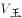，小李上山的速度为。当时间相同时，速度比=路程比，则，赋值，，则小王下山的速度为8×1.5=12，小李下山的速度为6×1.5=9。设总路程为24S，当小王到达山顶时，小李距离山顶。根据相遇公式：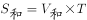，可知：6S=（6+12）×10，解得S=30，则总路程=24×30=720。则小王往返一次的时间为分钟；小李往返一次的时间为分钟。故小李比小王晚200-150=50分钟到达山脚A点。

故正确答案为C。

---

第 57 题

**答案**：B

**来源参考解析（非官方标准答案）**

设此次比赛的冠军告负x场，则平局2x场，取胜（2x+2）场。根据“积分规则”及“此次比赛的冠军积分为14分”，可得（2x+2）×3+2x=14，解得x=1，即此次比赛的冠军告负1场、平局2场、取胜4场，共比赛1+2+4=7场。根据“每所高校都要与其余所有参赛高校各进行一场比赛”，可得参加这次足球比赛的高校有7+1=8所。
故正确答案为B。

---

第 58 题

**答案**：B

**来源参考解析（非官方标准答案）**

方法一：选项范围各不相同，可分别选取各选项范围内的特定数字代入验证。代入A项：假设售价为12元，即售价提高12-10=2元，则每天获利为（12-8）×（100-10×2）=320元&lt;350元，排除；代入B项，假设售价为14元，即售价提高14-10=4元，则每天获利为（14-8）×（100-10×4）=360元&gt;350元，满足条件，B项当选，无需再验证C、D两项。

方法二：根据题意，每天获利最高时一定满足大于等于350元的情况，又因为选项范围各不相同，因此可验证每天获利最高时的售价。设该商品售价提高了x元，每天获利为y元。根据题意，可列方程：，即，令y=0，解得，，当时，y最大为（2+4）×（100-10×4）=360元&gt;350，满足条件，此时商品售价为10+4=14元，在B项范围内。

方法三：设该商品售价提高了x元，根据题意，可列方程：，化简可得，则当时满足题干要求，即该商品售价应在10+3=13元和10+5=15元之间。

故正确答案为B。

---

第 59 题

**答案**：D

**来源参考解析（非官方标准答案）**

方法一：根据题意，两次加油的油价可以相等也可以不相等，且没有给出具体的油价，因此可对两次的油价赋值。若两次加油价格不相等：赋值第一次加油的平均价格为10元/升，第二次加油的平均价格为5元/升。根据平均价格，若采用第一种方式加油，可知，若采用第二种方式加油，可知，则x&lt;y；若两次加油价格相等：赋值两次加油的平均价格均为10元/升。根据平均价格，若采用第一种方式加油，可知，若采用第二种方式加油，可知，则x=y；综上可知，。

方法二：设第一次加油的平均价格为a元/升，第二次加油的平均价格为b元/升。根据平均价格，若采用第一种方式加油，可知，若采用第二种方式加油，可知。则，由于，且2（a+b）&gt;0，可知，即。

故正确答案为D。

---

第 60 题

**答案**：D

**来源参考解析（非官方标准答案）**

由题意可知，可疑船只和巡逻艇的行驶路线为下图所示，可疑船只在C点被追上。

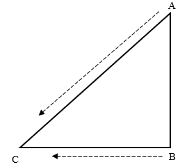

根据时间相同，路程与速度成正比，可知，设AC=4x千米、BC=3x千米，根据勾股定理可列式：，即，解得，则，结合选项只有D项符合。

故正确答案为D。

---

第 61 题

**答案**：D

**来源参考解析（非官方标准答案）**

元素组成不同，且无明显属性规律，考虑数量规律。题干每幅图形均出现直线，且直线数量较多，考虑直线数。题干图形的直线数依次为5、6、7、8、9，故“？”处图形的直线数应为10，只有D项符合。
故正确答案为D。

---

第 62 题

**答案**：C

**来源参考解析（非官方标准答案）**

元素组成不同，且无明显属性规律，优先考虑数量规律。观察发现，题干图形均为汉字，且有明显的封闭空间，优先考虑面数量。题干图形的面数量依次为1、2、3、4，故“？”处图形的面数量应为5，只有C项符合。
故正确答案为C。

---

第 63 题

**答案**：A

**来源参考解析（非官方标准答案）**

元素组成不同，且无明显属性规律，考虑数量规律。观察发现，题干图形分为内外两部分，考虑分开看，题干图形外部白色五角星的数量依次为2、3、4、5，所以？处图形外部应有6个白色五角星，排除B项；再次观察发现，题干图形内部线条数量依次为0、1、2、3，故？处图形的内部线条数量应为4，只有A项符合。
故正确答案为A。

---

第 64 题

**答案**：A

**来源参考解析（非官方标准答案）**

元素组成不同，且无明显属性规律，优先考虑数量规律。观察发现，第一组图中图1和图2均出现“单”，图2和图3均出现“虫”，即相邻图形存在相同元素，且相同元素并不相同；第二组图中图1和图2均出现“中”，故图2与“？”处图形应均出现“心”，排除B、C两项。再次观察发现，第一组图中每幅图可拆成的单字个数分别为1、2、3，第二组图中前两幅图可拆成的单字个数分别为1、2，故“？”处图形可拆成的单字个数应为3，只有A项符合。
故正确答案为A。

---

第 65 题

**答案**：C

**来源参考解析（非官方标准答案）**

元素组成不同，优先考虑属性规律。观察发现，题干图形出现等腰三角形、菱形、五角星等多个等腰元素，优先考虑对称性。题干图形均为轴对称图形，且对称轴如下图所示，九宫格图形呈“米”字型对称，只有C项符合。

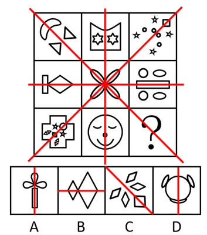

故正确答案为C。

---

第 66 题

**答案**：A

**来源参考解析（非官方标准答案）**

元素组成不同，且无明显属性规律，考虑数量规律。观察发现，题干图形的封闭面明显，优先考虑数面。第一行中，面数量分别为4、9、2，和为15；第二行中，面数量分别为3、5、7，和为15；第三行应用此规律，前两幅图的面数量分别为8、1，故？处图形的面数量应为6，只有A项符合。
故正确答案为A。

---

第 67 题

**答案**：B

**来源参考解析（非官方标准答案）**

将题干展开图标上序号，如下图所示，逐一分析选项。

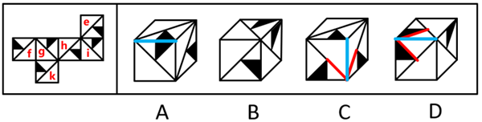

A项：如上图所示，题干展开图中不存在两个面内的黑色三角形的直角边有公共边，而选项中正面和顶面内的黑色三角形的直角边有公共边，选项与题干展开图不一致，排除；

B项：选项为面e、f、g或面e、h、i或面f、i、k，选项与题干展开图一致，当选；

C项：如上图所示，题干展开图中不存在两个面内的最小白色三角形的斜边均朝向公共边，而选项中正面和侧面内的最小白色三角形的斜边均朝向公共边，选项与题干展开图不一致，排除；

D项：如上图所示，题干展开图中不存在两个面内的黑色三角形的斜边均朝向公共边，而选项中正面和顶面内的黑色三角形的斜边均朝向公共边，选项与题干展开图不一致，排除。

故正确答案为B。

---

第 68 题

**答案**：A

**来源参考解析（非官方标准答案）**

本题考查立体拼合。B、C、D三项均可以由①~④在使用一次的情况下拼出，拼合方式如下图所示。

对于A项，由于视角问题，无法确定A项最下层的左上角（如箭头所示）是否有正方体。如果此处有正方体，则A项可以由①~④在使用一次的情况下拼出，拼合方式如下图所示；如果此处没有正方体，则A项无法拼出，因此，粉笔更倾向于选择A项。

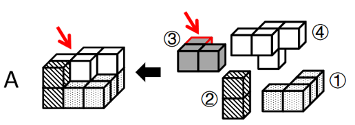

本题为选非题，故正确答案为A。

注：本题为争议题，大家了解基本解题思路即可，无需作为备考重点。

---

第 69 题

**答案**：B

**来源参考解析（非官方标准答案）**

本题为分组分类题目。元素组成不同，优先考虑属性规律。观察发现，图①②④均为含有曲线的图形，图③⑤⑥均为全直线的图形，故图①②④为一组，图③⑤⑥为一组。
故正确答案为B。

---

第 70 题

**答案**：C

**来源参考解析（非官方标准答案）**

本题为分组分类题目。元素组成不同，优先考虑属性规律。题干出现若干生活化图形，且存在明显封闭与开放，优先考虑开闭性。观察发现，图①②⑥为全封闭图形，图③④⑤为半开半闭图形，故图①②⑥为一组，图③④⑤为一组。
故正确答案为C。

---

第 71 题

**答案**：D

**来源参考解析（非官方标准答案）**

第一步：找出定义关键词。
“已确定的研究对象需协助调查者指认与自身相似的其他对象”、“保证本调查研究有足够数量的样本”。
第二步：逐一分析选项。
A项：股票经纪人是指在证券交易所中接受客户指令买卖证券，充当交易双方中介并收取佣金的证券商。在针对股票经纪人进行抽样调查时，直接在证券公司等股票经纪人的工作场所进行抽样调查，即可确保足够数量的调查样本，不需要通过让已确定的股票经纪人协助调查者指认其他股票经纪人来确保足够数量的样本，不符合“已确定的研究对象需协助调查者指认与自身相似的其他对象”、“保证本调查研究有足够数量的样本”，不符合定义，排除；
B项：在针对基层干部进行抽样调查时，直接在基层单位进行抽样调查，即可确保足够数量的调查样本，不需要通过让已确定的基层干部协助调查者指认其他基层干部来确保足够数量的样本，不符合“已确定的研究对象需协助调查者指认与自身相似的其他对象”、“保证本调查研究有足够数量的样本”，不符合定义，排除；
C项：在针对奥运冠军进行抽样调查时，直接根据官方名录进行抽样调查，即可确保足够数量的调查样本，不需要通过让已确定的奥运冠军协助调查者指认其他奥运冠军来确保足够数量的样本，不符合“已确定的研究对象需协助调查者指认与自身相似的其他对象”、“保证本调查研究有足够数量的样本”，不符合定义，排除；
D项：在针对吸毒者进行抽样调查时，调查者很难整体性获取足够数量的调查样本，往往需要调查者找到一位吸毒者作为起始点，与他建立信任关系，通过他获取更多其他吸毒者的信息，并邀请他们参与调查，以确保有足够数量的样本，符合“已确定的研究对象需协助调查者指认与自身相似的其他对象”、“保证本调查研究有足够数量的样本”，符合定义，当选。
故正确答案为D。

---

第 72 题

**答案**：A

**来源参考解析（非官方标准答案）**

第一步：找出定义关键词。
“划定一个范围”、“对在‘盒子’里面的企业，采取包容审慎的监管措施”、“杜绝将问题扩散到‘盒子’外面”、“由监管部门对运行过程进行全过程监管”。
第二步：逐一分析选项。
A项：某市政府创设“银行业务创新监管互动机制”，说明划定了银行业务这个范围，符合“划定一个范围”，为金融科技的创新与监管提供制度支持，说明该制度涉及监管机制，符合“对在‘盒子’里面的企业，采取包容审慎的监管措施”、“由监管部门对运行过程进行全过程监管”，符合定义，当选；
B项：某市生态环境局对某化工厂处以行政处罚，其中行政处罚是一种惩戒行为，并未体现监管措施，不符合“对在‘盒子’里面的企业，采取包容审慎的监管措施”、“由监管部门对运行过程进行全过程监管”，不符合定义，排除；
C项：某地金融监管局要求信贷机构强化对重点对象的信贷支持，其中金融监管局提出具体要求，并未体现监管措施，不符合“对在‘盒子’里面的企业，采取包容审慎的监管措施”、“由监管部门对运行过程进行全过程监管”，不符合定义，排除；
D项：某县市场监管局对肉类食品公司开展专项整治活动，其中专项整治活动是一种解决问题的举措，并未体现监管措施，不符合“对在‘盒子’里面的企业，采取包容审慎的监管措施”、“由监管部门对运行过程进行全过程监管”，不符合定义，排除。
故正确答案为A。

---

第 73 题

**答案**：C

**来源参考解析（非官方标准答案）**

第一步：找出定义关键词。
“政府和社会力量”、“依托社区”、“为居家的老年人提供生活照料、家政服务、康复护理和精神慰藉”。
第二步：逐一分析选项。
A项：陈医生为社区的居家老人免费提供医疗服务，并未体现以社区为依托，不符合“依托社区”，不符合定义，排除；
B项：大学生志愿者一对一照料社区里的居家老人，并未体现以社区为依托，不符合“依托社区”，不符合定义，排除；
C项：社区通过老年人信息库发布老年人服务需求信息和社会服务供给信息，说明政府和社会力量可以依托社区，为老年人提供居家养老服务，符合“政府和社会力量”、“依托社区”、“为居家的老年人提供生活照料、家政服务、康复护理和精神慰藉”，符合定义，当选；
D项：近亲属轮流照顾陈爷爷的生活起居，其中近亲属是家人，不属于社会力量，且并未体现以社区为依托，不符合“政府和社会力量”、“依托社区”，不符合定义，排除。
故正确答案为C。

---

第 74 题

**答案**：D

**来源参考解析（非官方标准答案）**

第一步：找出定义关键词。
“发挥自己的优势，利用优势来弥补自己的不足”。
第二步：逐一分析选项。
A项：某大学生在校期间成绩优异，在大二时退学创业，其中成绩优异是他的优势，但退学创业并不是发挥他自身的优势来弥补不足，不符合“发挥自己的优势，利用优势来弥补自己的不足”，不符合定义，排除；
B项：某房地产企业跟风造车，因难以突破造车技术壁垒而放弃造车，仅体现出该企业的不足之处，没有体现出该企业利用优势来弥补不足，不符合“发挥自己的优势，利用优势来弥补自己的不足”，不符合定义，排除；
C项：大学生小李天资聪慧、刻苦好学，毕业后顺利考取了选调生，仅体现出他的优势，并未体现出他的不足之处，没有体现出他利用自身优势来弥补不足，不符合“发挥自己的优势，利用优势来弥补自己的不足”，不符合定义，排除；
D项：高中生小王的英语和语文成绩经常不及格，这是他的不足之处，而理科成绩优异，这是他的优势，他通过在中国数学奥林匹克竞赛中获得金牌，成功保送至名校，说明他利用了自身优势来弥补不足，符合“发挥自己的优势，利用优势来弥补自己的不足”，符合定义，当选。
故正确答案为D。

---

第 75 题

**答案**：A

**来源参考解析（非官方标准答案）**

第一步：找出定义关键词。
法律证成：“给一个具体法律决定提供充足理由的活动或过程”；
内部证成：“法律决定必须按照一定的推理规则从相关前提中逻辑地推导出来的活动或过程”；
外部证成：“对法律决定所依赖的前提进行寻找、判断与论证的活动或过程”。
第二步：逐一分析选项。
A项：法官就其裁判中所适用的公序良俗原则进行正当性论证，“公序良俗原则”是法律决定依赖的前提，对该前提进行正当性论证，符合“对法律决定所依赖的前提进行寻找、判断与论证的活动或过程”，符合“外部证成”定义，说法正确，当选；
B项：执法人员就存在冲突的法律条文进行优先适用论证，需要按照法律条文的等级、新旧等原则选择出优先使用的法律条文，“使用的法律条文”是法律决定依赖的前提，对使用的法律条文进行优先适用论证，符合“对法律决定所依赖的前提进行寻找、判断与论证的活动或过程”，符合“外部证成”定义，不符合“内部证成”定义，说法错误，排除；
C项：就新修订法规的实施情况组织专家评估，只是评估实施情况，并不是给具体法律决定提供充足理由的活动或过程，不符合“给一个具体法律决定提供充足理由的活动或过程”，不符合“法律证成”定义，说法错误，排除；
D项：对张某散布谣言的行为处以行政拘留，是一个具体的法律决定，依据法律条文进行拘留，是给这个具体法律决定提供理由，符合“给一个具体法律决定提供充足理由的活动或过程”，符合“法律证成”定义，说法错误，排除。
故正确答案为A。

---

第 76 题

**答案**：C

**来源参考解析（非官方标准答案）**

第一步：找出定义关键词。
“无法得到确定性的真结论”。
第二步：逐一分析选项。
A项：员工小王根据自己的经历得出“山东人就是热情好客”的结论，该结论不必然为真，即得到了不确定为真的结论，符合“无法得到确定性的真结论”，符合定义，排除；
B项：股民小张根据一只股票价格上涨得到“另一只股票价格也可能会上涨”的结论，该结论不必然为真，即得到了不确定为真的结论，符合“无法得到确定性的真结论”，符合定义，排除；
C项：警察小李在案情分析中说“如果受害者没有与凶手搏斗，那么手指不会折断”，而“受害者手指折断”属于否后，根据否后必否前，可以推出“受害者与凶手搏斗”，因此结论“受害者与凶手搏斗了”必然为真，不符合“无法得到确定性的真结论”，不符合定义，当选；
D项：经理小赵在演讲中说“如果保证产品质量，那么就会增加产品的销量”，而“我们的产品销量增加”属于肯后，由于肯后无必然结论，因此“我们保证了产品质量”不必然为真，即得到了不确定为真的结论，符合“无法得到确定性的真结论”，符合定义，排除。
本题为选非题，故正确答案为C。

---

第 77 题

**答案**：C

**来源参考解析（非官方标准答案）**

第一步：找出定义关键词。
“个体的睡眠与其现实要求或大部分人所遵循的节律不符的觉醒紊乱”。
第二步：逐一分析选项。
A项：小张入睡时间在凌晨，且不能在正常时间起床，说明小张的睡眠与大部分人所遵循的节律不符，符合“个体的睡眠与其现实要求或大部分人所遵循的节律不符的觉醒紊乱”，符合定义，排除；
B项：老李睡眠时间比正常人早，经常在傍晚就感到困倦，说明老李的睡眠与大部分人所遵循的节律不符，符合“个体的睡眠与其现实要求或大部分人所遵循的节律不符的觉醒紊乱”，符合定义，排除；
C项：小王因次日要参加重要考试，当晚久久不能入睡，这属于特殊情况，不是小王的睡眠所遵循的节律，不符合“个体的睡眠与其现实要求或大部分人所遵循的节律不符的觉醒紊乱”，不符合定义，当选；
D项：老赵因居住环境拥挤嘈杂，晚上常处于时睡时醒状态，说明老赵的睡眠与大部分人所遵循的节律不符，符合“个体的睡眠与其现实要求或大部分人所遵循的节律不符的觉醒紊乱”，符合定义，排除。
本题为选非题，故正确答案为C。

---

第 78 题

**答案**：B

**来源参考解析（非官方标准答案）**

第一步：找出定义关键词。
新闻：“对客观事实进行报道和传播而形成的信息”；
新闻报道：“对客观事实的报道”。
第二步：逐一分析选项。
A项：外交部新闻发言人在发布会上发表讲话并回答记者的提问，是对外交方面客观事实的报道，符合“对客观事实的报道”，符合“新闻报道”定义，排除；
B项：中国女篮夺取女篮亚洲杯冠军，是客观事实，未体现报道，不符合“对客观事实的报道”，不符合“新闻报道”定义，当选；
C项：村委会通过村务公开栏张贴和大喇叭公告两种形式宣传“中央一号文件”，是对“中央一号文件”这个客观事实的报道，符合“对客观事实的报道”，符合“新闻报道”定义，排除；
D项：全国各地电视台实况转播全国“两会”的开幕式，是对全国“两会”开幕式这个客观事实的报道，符合“对客观事实的报道”，符合“新闻报道”定义，排除。
本题为选非题，故正确答案为B。

---

第 79 题

**答案**：D

**来源参考解析（非官方标准答案）**

第一步：找出定义关键词。

“附加齐等词项的直接推理”。

第二步：逐一分析选项。

A项：意思为新婚三天来到厨房，洗手亲自来做羹汤，不知婆婆什么口味，做好先让小姑品尝，没有体现推理过程，不符合“附加齐等词项的直接推理”，不符合定义，排除；

B项：意思为真实可信的话不漂亮，漂亮的话不真实，善良的人不巧说，巧说的人不善良，选项前半部分的推理过程为“信言不美，美言不信”，后半部分的推理过程为“善者不辩，辩者不善”，选项前后没有附加齐等词项，不符合“附加齐等词项的直接推理”，不符合定义，排除；

C项：意思为李树在路边竟然还有这么多李子，这一定是苦李子，选项的推理过程为“树在道边而多子苦李”，选项只有一个命题，且前后没有附加齐等词项，不符合“附加齐等词项的直接推理”，不符合定义，排除；

D项：意思为白马是马，乘白马是乘马，选项前半部分的推理过程为“白马马”，后半部分的推理过程为“乘白马乘马”，附加了齐等词项“乘”，符合“附加齐等词项的直接推理”，符合定义，当选。

故正确答案为D。

---

第 80 题

**答案**：B

**来源参考解析（非官方标准答案）**

第一步：找出定义关键词。
“具有标准答案的问题”、“除了标准答案之外的解答，均被认为是错误解答”。
第二步：逐一分析选项。
A项：“什么是幸福生活”这一问题没有标准答案，因为每个人心目中的幸福生活是不同的，不符合“具有标准答案的问题”、“除了标准答案之外的解答，均被认为是错误解答”，不符合定义，排除；
B项：“宇宙中有外星人吗”这一问题具有标准答案，即要么有外星人，要么没有外星人，符合“具有标准答案的问题”、“除了标准答案之外的解答，均被认为是错误解答”，符合定义，当选；
C项：“我应该报考哪所大学”问题中的“我”指代的是每一个看到这个问题的人，因此该问题没有标准答案，因为每个人能报考的大学是不同的，不符合“具有标准答案的问题”、“除了标准答案之外的解答，均被认为是错误解答”，不符合定义，排除；
D项：“世界上最美丽的城市是哪座”这一问题没有标准答案，因为每个人心目中最美丽的城市是不同的，不符合“具有标准答案的问题”、“除了标准答案之外的解答，均被认为是错误解答”，不符合定义，排除。
故正确答案为B。

---

第 81 题

**答案**：D

**来源参考解析（非官方标准答案）**

第一步：判断题干词语间逻辑关系。
“马骥”是《聊斋志异》中描写的人物，二者是作品与其描写人物的对应关系。
第二步：判断选项词语间逻辑关系。
A项：“诸葛亮”是《三国演义》中描写的人物，二者是作品与其描写人物的对应关系，与题干逻辑关系一致，保留；
B项：“孙少平”是《平凡的世界》中描写的人物，二者是作品与其描写人物的对应关系，与题干逻辑关系一致，保留；
C项：“紫式部”是《源氏物语》的作者，二者是作品与其作者的对应关系，与题干逻辑关系不一致，排除；
D项：“贾宝玉”是《红楼梦》中描写的人物，二者是作品与其描写人物的对应关系，与题干逻辑关系一致，保留。
对比A、B、D三项，题干的《聊斋志异》是清代的作品，马骥是作品中虚构的人物；A项的《三国演义》是元末明初的作品，诸葛亮是历史上真实存在的人物；B项的《平凡的世界》是20世纪80年代的作品，孙少平是作品中虚构的人物；D项的《红楼梦》是清代的作品，贾宝玉是作品中虚构的人物，因此D项与题干的逻辑关系更为一致，当选。
注：也有些同学选择A项，认为《聊斋志异》是由很多故事组成的，马骥只是其中一篇《罗刹海市》中的主人公，并非贯穿整本小说的主人公，A项中的诸葛亮也并非贯穿整本小说的主人公，而B项中的孙少平和D项中的贾宝玉都是贯穿整本小说的主人公。这样理解确实有一定道理，但是对于诸葛亮算不算贯穿《三国演义》的主人公，各方说法存在争议，所以小粉笔更倾向于D项。
本题为争议题，我们重点学习出现作品和人物时可能考查的两种关系即可。
故正确答案为D。

---

第 82 题

**答案**：B

**来源参考解析（非官方标准答案）**

第一步：判断题干词语间逻辑关系。
通过“星舰发射”可以达到“火星移民”的目的，二者是方式目的的对应关系。
第二步：判断选项词语间逻辑关系。
A项：个性消费是指消费者购买商品不再只是满足对物的需求，而主要是看重商品的个性特征，希望通过购物来展示自我，以达到精神上的满足；网红经济是以网红的品味和眼光为主导，依托庞大的粉丝群体进行定向营销，从而将粉丝转化为购买力的一个过程，二者没有明显的逻辑关系，与题干逻辑关系不一致，排除；
B项：通过“风洞试验”可以达到给“飞机定性”的目的，二者是方式目的的对应关系，与题干逻辑关系一致，保留；
C项：通过“降低利率”可以达到“调控经济”的目的，二者是方式目的的对应关系，与题干逻辑关系一致，保留；
D项：城市更新是一种对城市中已经不适应现代化城市社会生活的地区进行的必要的、有计划的改建活动，因此通过“城市更新”可以达到让城市“宜居安居”的目的，二者是方式目的的对应关系，但词语顺序与题干相反，与题干逻辑关系不一致，排除。
对比B、C两项，题干中“星舰发射”和“火星移民”均为“名词在前，动作在后”的结构，B项中“风洞试验”和“飞机定性”均为“名词在前，动作在后”的结构，C项中“降低利率”和“调控经济”均为“动作在前，名词在后”的结构，因此B项与题干逻辑关系更为一致，当选。
故正确答案为B。

---

第 83 题

**答案**：D

**来源参考解析（非官方标准答案）**

第一步：判断题干词语间逻辑关系。
颁奖人颁奖的对象是获奖者，二者是动作发出者与对象的对应关系。
第二步：判断选项词语间逻辑关系。
A项：参会人和主持人不是动作发出者与对象的对应关系，与题干逻辑关系不一致，排除；
B项：纳税人纳税的对象是税务局，二者是动作发出者与对象的对应关系，与题干逻辑关系一致，保留；
C项：观众观看的对象是纪录片，二者是动作发出者与对象的对应关系，但词语顺序与题干相反，与题干逻辑关系不一致，排除；
D项：绑架者绑架的对象是人质，二者是动作发出者与对象的对应关系，与题干逻辑关系一致，保留。
对比B、D两项，题干中的“获奖者”和D项中的“人质”均指“人”，而B项中的税务局是“政府机关”，因此D项与题干的逻辑关系更为一致，当选。
故正确答案为D。

---

第 84 题

**答案**：B

**来源参考解析（非官方标准答案）**

第一步：判断题干词语间逻辑关系。
鳄鱼是爬行动物，不是鱼，二者为反向种属关系。
第二步：判断选项词语间逻辑关系。
A项：镭是金属，二者为种属关系，与题干逻辑关系不一致，排除；
B项：蜗牛是软体动物，不是昆虫，二者为反向种属关系，与题干逻辑关系一致，当选；
C项：小熊猫和浣熊是两种不同的哺乳动物，二者为并列关系，与题干逻辑关系不一致，排除；
D项：蝮蛇是蛇，二者为种属关系，与题干逻辑关系不一致，排除。
故正确答案为B。

---

第 85 题

**答案**：A

**来源参考解析（非官方标准答案）**

第一步：判断题干词语间逻辑关系。
铁锅可以用来炒菜，二者为功能的对应关系；铁锅具有会生锈的特点，二者为属性的对应关系。
第二步：判断选项词语间逻辑关系。
A项：炸药可以用来爆破，二者为功能的对应关系；炸药具有会爆炸的特点，二者为属性的对应关系，与题干逻辑关系一致，保留；
B项：玻璃是用来制造瓶子的原材料，二者为原材料和成品的对应关系，与题干逻辑关系不一致，排除；
C项：清水可以用来饮用，二者为功能的对应关系；清水具有会结冰的特点，二者为属性的对应关系，与题干逻辑关系一致，保留；
D项：飞机可以用来运输，也可以用来乘坐，运输、乘坐和飞机都是功能的对应关系，与题干逻辑关系不一致，排除。
对比A、C两项，题干中的铁锅为人造产物，生锈为化学反应；A项中的炸药为人造产物，爆炸为化学反应；C项中的清水为自然界中本来就存在的物质，结冰为物理反应。因此A项与题干逻辑关系更为一致，当选。
故正确答案为A。

---

第 86 题

**答案**：C

**来源参考解析（非官方标准答案）**

第一步：判断题干词语间逻辑关系。
 “明”为左右结构，“囦”为全包围结构，“岩”为上下结构。
第二步：判断选项词语间逻辑关系。
A项：“汉”为左右结构，“囩”为全包围结构，“导”为上下结构，与题干逻辑关系一致，保留；
B项：“科”为左右结构，但“闪”为半包围结构，与题干逻辑关系不一致，排除；
C项：“鹛”为左右结构，“困”为全包围结构，“穹”为上下结构，与题干逻辑关系一致，保留；
D项：“群”为左右结构，但“田”是独体字，即以笔画为直接单位构成的汉字，作为一个囫囵整体切分不开，并非全包围结构，与题干逻辑关系不一致，排除。
解法一：对比A、C两项，题干中“明”（日+月）、“囦”（囗+水）、“岩”（山+石）均可拆分为2个独立汉字，C项中“鹛”（眉+鸟）、“困”（囗+木）、“穹”（穴+弓）也可拆分为2个独立汉字，A项中“囩”（囗+云）、“导”（巳+寸）可拆分为2个独立汉字，但“汉”无法拆分为2个独立汉字，因此C项与题干逻辑关系更为一致，当选。
故正确答案为C。
解法二：对比A、C两项，题干中“明”字的部首“日”在左边，“囦”字的部首“囗”在外边，“岩”的部首“山”在上边，A项中“汉”字的部首“氵”在左边，“囩”字的部首“囗”在外边，“导”字的部首“巳”在上边，而C项中“鹛”字的部首“鸟”在右边，因此A项与题干逻辑关系更为一致，当选。
故正确答案为A。
上述两种解法都有道理，小粉笔建议不用太过纠结，学习一下解题思路即可。

---

第 87 题

**答案**：D

**来源参考解析（非官方标准答案）**

第一步：判断题干词语间逻辑关系。
证人先出庭，再陈述，后两词存在时间先后顺序的对应关系。
第二步：判断选项词语间逻辑关系。
A项：军队先排练，再被阅兵，后两词存在时间先后顺序的对应关系，与题干逻辑关系一致，保留；
B项：医生查房和出诊之间没有必然的时间先后顺序，与题干逻辑关系不一致，排除；
C项：编导拍摄和采访之间没有必然的时间先后顺序，与题干逻辑关系不一致，排除；
D项：乘客先购票，再乘车，后两词存在时间先后顺序的对应关系，与题干逻辑关系一致，保留。
对比A、D两项，题干中“出庭”和“陈述”的主体均为证人，D项中“购票”和“乘车”的主体均为乘客，而A项中“阅兵”的主体不是军队，因此D项与题干逻辑关系更为一致，当选。
故正确答案为D。

---

第 88 题

**答案**：D

**来源参考解析（非官方标准答案）**

第一步：判断题干词语间逻辑关系。
“热岛效应”是城市热岛效应的简称，是指城市气温高于郊区的现象。“热岛效应”是一种“城市气候”，二者为种属关系，一般来说，“气温变化”会导致“热岛效应”，但这么理解本题无答案，而“热岛效应”也会加剧“气温变化”，二者也可以看为因果的对应关系。
第二步：判断选项词语间逻辑关系。
A项：“赤潮”是在特定的环境条件下，藻类等爆发性增殖或高度聚集而引起水体变色的一种有害生态现象。“绿藻增殖”不是一种“赤潮”，二者不是种属关系，与题干逻辑关系不一致，排除；
B项：“遗传物质”即亲代与子代之间传递遗传信息的物质。“生物”具备“遗传物质”，二者不是种属关系，与题干逻辑关系不一致，排除；
C项：“国家机器”是马克思主义经典作家对国家形象化的称呼，主要指军队、警察、法庭、监狱等。“国家机器”不是一种“法律”，二者不是种属关系，与题干逻辑关系不一致，排除；
D项：“气象灾害”是一种“灾害”，二者为种属关系，“气象灾害”会导致“经济损失”，二者为因果的对应关系，与题干逻辑关系一致，当选。
故正确答案为D。

---

第 89 题

**答案**：A

**来源参考解析（非官方标准答案）**

逐一代入选项。
A项：方格尺是裁缝工作时需要使用的工具，二者为工具与职业的对应关系；网约车是司机工作时需要使用的工具，二者为工具与职业的对应关系，前后逻辑关系一致，当选；
B项：裁缝住在宿舍里，二者为职业与住宿地点的对应关系；司机将车停在车库里，二者为职业与工具存放地点的对应关系，前后逻辑关系不一致，排除；
C项：裁缝工作时穿着工作服，二者为职业与穿着的对应关系；千斤顶是一种起重设备，是司机维修车辆时可能会用到的工具，二者为工具与职业的对应关系，前后逻辑关系不一致，排除；
D项：裁缝在车间工作，二者为职业与工作地点的对应关系；司机和4S店无必然联系，前后逻辑关系不一致，排除。
故正确答案为A。

---

第 90 题

**答案**：C

**来源参考解析（非官方标准答案）**

逐一代入选项。
A项：“蝉噪林逾静”出自王籍《入若耶溪》，意思是蝉鸣阵阵，林间愈见幽静，“菊花从此不须开”出自杜甫《九日五首·其一》，意思是菊花也没有必要开放，两句诗分别描绘夏天和秋天的景象；“谷鸟吟晴日”出自李白《江夏别宋之悌》，意思是天气晴朗时山间的鸟不停地鸣叫，“满架蔷薇一院香”出自高骈《山亭夏日》，意思是满架的蔷薇花开，香气弥漫整个院子，两句诗均描绘夏天的景象，前后逻辑关系不一致，排除；
B项：“蝉噪林逾静”出自王籍《入若耶溪》，意思是蝉鸣阵阵，林间愈见幽静，“蒌蒿满地芦芽短”出自苏轼《惠崇春江晚景二首·其一》，意思是遍地蒌蒿，芦苇露出短芽，两句诗分别描绘夏天和春天的景象；“雁行遥上月”出自李百药《送别》，意思是飞雁的行列映着遥远的月亮，“满架蔷薇一院香”出自高骈《山亭夏日》，意思是满架的蔷薇花开，香气弥漫整个院子，两句诗分别描绘秋天和夏天的景象，前后逻辑关系不一致，排除；
C项：“蝉噪林逾静”出自王籍《入若耶溪》，意思是蝉鸣阵阵，林间愈见幽静，“石榴开遍透帘明”出自苏舜钦《夏意》，意思是穿透帘子看见石榴花开得正艳，两句诗均描绘夏天的景象；“卢橘垂金弹”出自樊珣《状江南·仲夏》，意思是卢橘挂果，仿佛金灿灿的弹珠，“满架蔷薇一院香”出自高骈《山亭夏日》，意思是满架的蔷薇花开，香气弥漫整个院子，两句诗均描绘夏天的景象，前后诗句均描绘相同季节，前后逻辑关系一致，当选；
D项：“蝉噪林逾静”出自王籍《入若耶溪》，意思是蝉鸣阵阵，林间愈见幽静，“千里莺啼绿映红”出自杜牧《江南春》，意思是辽阔的千里江南，黄莺在欢乐地歌唱，丛丛绿树映着簇簇红花，两句诗分别描绘夏天和春天的景象；“燕草如碧丝”出自李白《春思》，意思是燕地小草像碧丝般青绿，“满架蔷薇一院香”出自高骈《山亭夏日》，意思是满架的蔷薇花开，香气弥漫整个院子，两句诗分别描绘春天和夏天的景象，前后逻辑关系不一致，排除。
故正确答案为C。

---

第 91 题

**答案**：A

**来源参考解析（非官方标准答案）**

第一步：找出论点和论据。
论点：海水养殖和河口养殖仍难以被轻易替代。
论据：无。
本题只有论点没有论据，加强优先考虑补充论据，即解释原因或举例子。
第二步：逐一分析选项。
A项：该项指出陆养海鲜面临很多问题，说明海水养殖和河口养殖的确难以被轻易替代，补充论据，可以加强，当选；
B项：该项指出三文鱼的供应市场包含国内外，而论点说的是海水养殖和河口养殖仍难以被轻易替代，话题不一致，无法加强，排除；
C项：该项指出新疆养殖的海鲜被客商们争相抢购，而论点说的是海水养殖和河口养殖仍难以被轻易替代，话题不一致，无法加强，排除；
D项：该项指出麦盖提县天然的碱性水质养出了澳洲淡水龙虾，说明海水养殖和河口养殖可以被替代，削弱论点，无法加强，排除。
故正确答案为A。

---

第 92 题

**答案**：B

**来源参考解析（非官方标准答案）**

第一步：找出论点和论据。
论点：原子制造将会成为微纳制造后人类制造技术继续微缩发展的趋势，也将成为新物质创制中的极限，对于现有制造业具有颠覆性意义。
论据：原子制造是近来被高度关注的原子级制造技术体系中的核心部分之一，将史无前例地实现对原子的逐一精确操控，将原子按需垒砌，构筑原子级细锐、精准、完美，而且具备从物理上远超常规块材物性的产品。
本题论点讨论的是原子制造对于现有制造业具有“颠覆性意义”，而论据讨论的是原子制造将“史无前例”地实现对原子的逐一精确操控，而且构筑具备从物理上远超常规块材物性的产品，论点和论据话题一致，削弱优先考虑削弱论点。
第二步：逐一分析选项。
A项：该项指出原子制造能够突破当今芯片能力的极限，说明原子制造可能对于现有制造业具有颠覆性意义，具有加强作用，无法削弱，排除；
B项：该项指出原子制造是“传统”的纳米化制造，是现在制造技术的线性化发展，说明原子制造不具有颠覆性，削弱论点，可以削弱，当选；
C项：该项指出原子制造技术仍面临重大挑战，只能说明原子制造的技术还有待进步，而论点讨论的是原子制造对于现有制造业具有颠覆性意义，话题不一致，无法削弱，排除；
D项：该项指出原子制造可以使材料学家获得真正具有应用价值的新材料，但无法判断新材料是否能证明原子制造对于现有制造业具有颠覆性意义，不明确项，无法削弱，排除。
故正确答案为B。

---

第 93 题

**答案**：C

**来源参考解析（非官方标准答案）**

第一步：找出题干矛盾。
人们（包括专家自己）对于专家的这一信念被一些人称为“专家幻觉”，认为前面题干的内容是假的，即实际上专家并不会因为对某一领域了解得更多，相关知识更丰富，经验更多而判断得更准确。
第二步：逐一分析选项。
A项：选项指出部分领域的专家预测比较准确，但并没有解释为什么前面题干的内容是“专家幻觉”，不能解释题干矛盾，排除；
B项：选项指出当事件的可预测性低时专家预测水平更低的原因，并没有解释为什么前面题干的内容是“专家幻觉”，不能解释题干矛盾，排除；
C项：选项指出专门知识的拥有量、经验的丰富程度与判断的准确性不存在必然的正相关性，解释为什么专家并不会因为对某一领域了解得更多，相关知识更丰富，经验更多而判断得更准确，即解释了前面题干的内容为什么是“专家幻觉”，可以解释题干矛盾，当选；
D项：选项指出人们对专家信赖的原因，并没有解释为什么前面题干的内容是“专家幻觉”，不能解释题干矛盾，排除。
故正确答案为C。

---

第 94 题

**答案**：B

**来源参考解析（非官方标准答案）**

第一步：找出论点和论据。
论点：城市绿色空间的构建，应强化基于自然的解决方案，突出自然和人工的有机耦合，实现良好的微生态循环。
论据：在进入城市后，室内生活的增加使得人类与自然的接触大大减少，我们身上的微生物与自然界微生物的交换机会也大大减少，这不可避免地会带来一些健康问题。
本题论点和论据说的都是城市使得人类与自然界微生物交换变少，二者话题一致，加强优先考虑补充论据。
第二步：逐一分析选项。
A项：该项指出城市里绝大部分微生物的来源，而论点讨论的是城市绿色空间应如何构建，话题不一致，无法加强，排除；
B项：该项指出调控人居环境微生物的组成可以有效改善人体免疫力，说明城市绿色空间的构建可以减少微生物给人类带来的健康问题，补充论据，可以加强，当选；
C项：该项指出人类身上的微生物不断在人口高度集中的环境中循环，而论点讨论的是城市绿色空间应如何构建，话题不一致，无法加强，排除；
D项：该项指出城市的绿色生态景观能够稀释以人类自身微生物为主的微生物体系，但无法判断是否可以减少因缺乏微生物的交换而给人类带来的健康问题，无法加强，排除。
故正确答案为B。

---

第 95 题

**答案**：D

**来源参考解析（非官方标准答案）**

第一步：分析题干推理结构。

题干翻译为：国家繁荣富强科技腾飞，科技腾飞人才。因此，国家繁荣富强人才，即12，23，因此13。

第二步：逐一分析选项。

A项：翻译为：1号小麦，2号大豆。因此，1号大豆，即12，34，因此14，与题干推理结构不一致，排除；

B项：翻译为：乡村振兴产业振兴，产业振兴组织。因此，乡村产业振兴，即12，23，因此42，与题干推理结构不一致，排除；

C项：翻译为：小张&gt;小王，小王&gt;小李。因此，小张&gt;小李，即1&gt;2，2&gt;3，因此1&gt;3，与题干推理结构不一致，排除；

D项：翻译为：取得优秀成绩勤奋，勤奋意志支撑。因此，取得优秀成绩坚强意志，即12，23，因此13，与题干推理结构一致，当选。

故正确答案为D。

---

第 96 题

**答案**：C

**来源参考解析（非官方标准答案）**

第一步：找出论点和论据。
论点：盐湖在流域水文生态系统中对于维持水-盐动态平衡具有重要作用。
论据：如果补给水源减少或消失，盐湖将进一步浓缩，甚至可能形成地表水较少或没有地表水的干盐湖，或者最终埋藏在地下而形成古代盐湖。
本题论点说的是盐湖对于维持水-盐动态平衡具有重要作用，论据说的是水源的动态变化对盐湖地表水位的影响，二者话题一致，加强优先考虑补充论据。
第二步：逐一分析选项。
A项：该项指出盐湖中生活着大量嗜盐和耐盐微生物，并未提及盐湖能否维持水-盐动态平衡，属于无关项，无法加强，排除；
B项：该项指出盐湖地区生态环境十分脆弱，并未提及盐湖能否维持水-盐动态平衡，属于无关项，无法加强，排除；
C项：该项指出盐湖地区的地表水与周围地下水之间存在水力联系，解释了为什么盐湖能够维持水-盐动态平衡，补充论据，可以加强，当选；
D项：该项指出有的盐湖在只有潮湿季节才有暂时性的表面卤水，并未提及盐湖能否维持水-盐动态平衡，属于无关项，无法加强，排除。
故正确答案为C。

---

第 97 题

**答案**：D

**来源参考解析（非官方标准答案）**

第一步：翻译题干。

落实这一重要举措（在超大特大城市积极稳步实施城中村改造）坚持稳中求进、积极稳妥，优先对群众需求迫切、城市安全和社会治理隐患多的城中村进行改造。

第二步：逐一分析选项。

A项：翻译为：在超大特大城市积极稳步实施城中村改造改善民生、扩大内需、推动城市高质量发展，二者不存在逻辑关系，无法推出，排除；

B项：翻译为：改善民生、扩大内需、推动城市高质量发展在超大特大城市积极稳步实施城中村改造，二者不存在逻辑关系，无法推出，排除；

C项：翻译为：坚持稳中求进、积极稳妥，优先对群众需求迫切、城市安全和社会治理隐患多的城中村进行改造在超大特大城市积极稳步实施城中村改造，是对题干推出关系的肯后，肯后得不到确定结论，无法推出，排除；

D项：翻译为：坚持稳中求进、积极稳妥，优先对群众需求迫切、城市安全和社会治理隐患多的城中村进行改造在超大特大城市积极稳步实施城中村改造，是对题干推出关系的否后，否后必否前，可以推出，当选。

故正确答案为D。

---

第 98 题

**答案**：B

**来源参考解析（非官方标准答案）**

第一步：找出论点和论据。
论点：可以通过从国外引进天敌来制约外来物种。
论据：外来物种入侵已成为当前急需解决的生态环境问题，在国内环境下，由于外来物种没有天敌，放生或弃养的鳄雀鳝已对相关水域水生生物多样性以及生态安全造成重大影响。捕捞鳄雀鳝已成为相当棘手的问题。
本题论点说的是可以通过从国外引进天敌来制约外来物种，论据以鳄雀鳝为例，说的是没有天敌的外来物种对生态环境造成重大影响，二者话题紧密相关，可以理解为话题一致，削弱优先考虑削弱论点。
第二步：逐一分析选项。
A项：该项指出外来物种的天敌并不适宜中国国内的生存环境，说明外来物种的天敌在国内可能无法生存，也就无法制约外来物种，削弱论点，保留；
B项：该项指出引入外来物种的天敌将对国内生态环境造成更大破坏，说明通过引进天敌来制约外来物种无法达到保护生态环境的目的，削弱论点，保留；
C项：该项指出外来物种天敌的引入需要经过复杂的论证，讨论的是引入外来物种天敌前需要做的工作，而论点是通过从国外引进天敌来制约外来物种，话题不一致，无法削弱，排除；
D项：该项指出我国每年对外来物种入侵的治理投入难以估算，说的是治理外来物种的投入多，而论点是通过从国外引进天敌来制约外来物种，话题不一致，无法削弱，排除。
对比A、B两项，A项仅说明外来物种的天敌并不适宜中国国内的生存环境，可能无法制约外来物种；B项直接指明无法通过从国外引进天敌制约外来物种来达到保护生态环境的目的，与题干论证的联系更紧密、更确定，B项削弱力度大于A项，当选。
故正确答案为B。

---

第 99 题

**答案**：A

**来源参考解析（非官方标准答案）**

日常结论题，根据题干信息逐一分析选项。
A项：题干最后一句指出英国政府为了削弱法国和德国的主导地位支持进一步扩大欧盟，证明了法德两国在欧盟的地位影响了英国政府的某些决策，可以推出，当选；
B项：题干中没有涉及“此前”英国政府的情况，无中生有，无法推出，排除；
C项：题干只是指出“苏格兰和威尔士的支持程度一直稳定且偏高”，并没有与英国比较，无法推出，排除；
D项：题干未提及苏格兰和威尔士是否担忧法德两国在欧盟的地位，无中生有，无法推出，排除。
故正确答案为A。

---

第 100 题

**答案**：D

**来源参考解析（非官方标准答案）**

第一步：分析题干条件。
（1）5名学生中有3名20岁以下，2名20岁及以上；
（2）2名学生的专业是哲学，3名学生的专业是文学；
（3）小赵和小孙的年龄段相同，小李和小周的年龄段不同；
（4）小钱和小周的专业相同，小孙和小李的专业不同；
（5）最终选择了一名年龄大于20岁的哲学专业学生。
第二步：根据题干条件进行推理。
根据条件（3）小李和小周的年龄段不同，可知小李和小周中必有一个人与条件（3）中小赵和小孙的年龄段相同，根据条件（1）有3名20岁以下，2名20岁及以上，可以推出小赵和小孙一定是20岁以下，排除A、C两项；
根据条件（4）小孙和小李的专业不同，可知小孙和小李中必有一个人与条件（4）中小钱和小周的专业相同，根据条件（2）2名学生的专业是哲学，3名学生的专业是文学，可以推出小钱和小周的专业一定是文学，排除B项，D项当选。
故正确答案为D。

---

第 101 题

**答案**：D

**来源参考解析（非官方标准答案）**

根据题干“2022年······比······大约高”，结合材料给出2022年全省实现地区生产总值以及三次产业结构，可判定本题为现期比重问题。定位文字材料第一段可得：2022年全省实现地区生产总值87435.1亿元，三次产业结构为7.2：40.0：52.8。则2022年第二产业增加值所占比重为40.0%，第三产业增加值所占比重为52.8%。根据公式：部分=整体×比重，则2022年第三产业增加值比第二产业增加值高亿元，与D项最接近。

故正确答案为D。

---

第 102 题

**答案**：D

**来源参考解析（非官方标准答案）**

定位文字材料第二段可得：猪牛羊禽肉产量比上年增长2.9%；淡水产品产量增长4.3%；定位表2可得：棉花产量同比增长3.3%；园林水果产量同比增长2.7%。则2022年第一产业各类产品的同比增速由高到低排序为：淡水产品（4.3%）&gt;棉花（3.3%）&gt;猪牛羊禽肉（2.9%）&gt;园林水果（2.7%），对应D项。
故正确答案为D。

---

第 103 题

**答案**：A

**来源参考解析（非官方标准答案）**

根据题干“2022年······占······的比重较上年”，可判定本题为两期比重问题。定位文字材料第二段可得：（2022年）农林牧渔业产值12130.7亿元（B），按可比价格计算，比上年增长4.8%（b）。定位表1可得：2022年渔业产值1729.7亿元（A），比上年增长4.4%（a）。根据两期比重比较结论“当部分增长率（a）＜整体增长率（b）时，比重下降”，由于a（4.4%）＜b（4.8%），则渔业占第一产业产值的比重较上年下降，排除B、D两项。根据公式：两期比重差，则2022年，渔业占第一产业产值的比重较上年变化为，即下降不足1个百分点。

故正确答案为A。

备注：1.本题中第一产业产值理论上指农业、林业、牧业、渔业这四业的产值，而表中农林牧渔业产值包括农业、林业、牧业、渔业及农林牧渔专业及辅助性活动这五业的产值，其中农林牧渔专业及辅助性活动产值属于第三产业产值范畴，故第一产业产值应为表中农林牧渔业总产值减去农林牧渔专业及辅助性活动产值，但是这样算出的第一产业产值同比增长率约为4.4%（b），与渔业产值同比增长率4.4%（a）相等，即比重与上年保持不变，这样会没有答案。故推测命题人把农林牧渔业总产值看成了第一产业产值进行计算。2.本题不能通过第一产业增加值来替代第一产业产值进行计算。

---

第 104 题

**答案**：C

**来源参考解析（非官方标准答案）**

根据题干“······2021年······各组成部分产值数量关系的是”，结合材料时间为2022年，可判定本题为基期计算问题。定位表1可得2022年农林牧渔业各组成部分产值及增长速度。根据公式：基期量，则2021年农业产值亿元，排除A、B两项；渔业产值亿元，排除D项。

故正确答案为C。

---

第 105 题

**答案**：B

**来源参考解析（非官方标准答案）**

A项：定位表1可得：2022年，林业产值227.3亿元。材料中并未给出2022年林业种植面积的相关数据，即不能推出林业平均亩产值，错误；

B项：定位表2可得：2022年，粮食产量5543.8万吨，比上年增长0.8%。根据公式：增长量，则2022年，粮食产量较上年增加万吨。由于1吨=2000斤，则2022年，粮食产量较上年约增加44万吨×2000=88000万斤=8.8亿斤，正确；

C项：定位文字材料第一段可得：2022年全省实现地区生产总值87435.1亿元，按不变价格计算，比上年增长3.9%（b）。分产业看，第一产业增加值6298.6亿元，增长4.3%（a）。根据两期比重比较结论“当部分增长率（a）&gt;整体增长率（b）时，比重上升”，由于a（4.3%）&gt;b（3.9%），则2022年，第一产业增加值比重较上年上升，错误；

D项：定位文字材料第二段可得：2022年，禽蛋产量(不含小品种)下降3.8%。定位表2可得：2022年，油料产量比上年增长-4.2%。由于4.2%-3.8%=0.4%，即2022年，油料作物下降速度比禽蛋产量的快0.4个百分点，错误。

故正确答案为B。

---

第 106 题

**答案**：A

**来源参考解析（非官方标准答案）**

根据题干“······同比增速最快的年份是”，可判定本题为一般增长率问题。定位统计表可得2018-2022年我国工矿仓储用地供应面积。根据公式：增长率，则2019-2022年工矿仓储用地供应面积同比增速分别为：

2019年，；

2020年，；

2021年，；

2022年，。

比较可知，2020年工矿仓储用地供应面积同比增速最快。

故正确答案为A。

---

第 107 题

**答案**：D

**来源参考解析（非官方标准答案）**

根据题干“2018-2022年······出让成交单价高于······的年份有几个”，结合出让成交单价，且材料给出2018-2022年国有建设用地出让面积和出让成交价款，可判定本题为现期平均数问题。定位统计图可得2018-2022年国有建设用地出让面积和出让成交价款。题干要求，即，则只需找到满足的年份即可。2018-2022年国有建设用地分别为：

2018年，，符合；

2019年，，符合；

2020年，，不符合；

2021年，，符合；

2022年，，不符合。

则有2018年、2019年、2021年3个年份国有建设用地出让成交单价高于150万元/亩。

故正确答案为D。

---

第 108 题

**答案**：A

**来源参考解析（非官方标准答案）**

根据题干“若国有建设用地出让率=出让面积÷供应总面积×100%······国有建设用地出让率······”，可判定本题为现期比重问题。定位文字材料可得：2022年，我国全年国有建设用地供应76.6万公顷；定位统计表可得2018-2022年国有建设用地各类用地供应情况；定位统计图可得2018-2022年国有建设用地出让面积。根据公式：国有建设用地出让率=出让面积÷供应总面积×100%，则2018-2022年国有建设用地出让率分别为：

2018年，；

2019年，；

2020年，；

2021年，；

2022年，。

比较可知，出让率最低的是40.1%，出让率最高的是47.7%，故相差47.7%-40.1%=7.6%，即7.6个百分点。

故正确答案为A。

---

第 109 题

**答案**：B

**来源参考解析（非官方标准答案）**

根据题干“2018-2022年······占比变动程度最小的是”，可判定本题为两期比重比较问题。定位文字材料可得：2022年我国国有建设用地供应面积为76.6万公顷；定位统计表可得2018年和2022年我国国有建设用地供应中各类用地面积，2018年我国国有建设用地供应面积=13.3+3.5+10.9+37.1=64.8万公顷。则2018-2022年，四类用地面积占比变动程度分别为：

工矿仓储用地：2018年占比，2022年占比，变动程度=25.8%-20.5%=5.3%，即变化了5.3个百分点；

商服用地：2018年占比，2022年占比，变动程度=5.4%-4.0%=1.4%，即变化了1.4个百分点；

住宅用地：2018年占比，2022年占比，变动程度=16.8%-10.3%=6.5%，即变化了6.5个百分点；

基础设施及其他用地：2018年占比，2022年占比，变动程度=59.8%-57.3%=2.5%，即变化了2.5个百分点。

比较可知，商服用地占比变动程度最小。

故正确答案为B。

---

第 110 题

**答案**：D

**来源参考解析（非官方标准答案）**

A项：定位统计表可得2018-2022年商服用地和住宅用地供应面积。根据公式：平均数，则2018-2022年商服用地年均供应面积万公顷；2018-2022年住宅用地年均供应面积万公顷，所求倍数倍，错误；

B项：定位统计图可得2018-2022年国有建设用地出让面积和出让成交价款。2020年出让成交单价，2019年出让成交单价，前者分子小分母大，则分数值小，故2020年出让成交单价小于2019年；而2020年出让面积（31.5万公顷）大于2019年（27.9万公顷），变化趋势不一致，错误；

C项：定位统计表可得2018-2022年我国国有建设用地供应中各类用地面积。根据公式：比重，则2019年所求占比；2020年所求占比，2020年比重高于2019年，并非逐年递减，错误；

D项：定位文字材料可得，2022年我国国有建设用地供应面积为76.6万公顷，定位统计表可得2018-2022年我国国有建设用地供应中各类用地面积。根据公式：比重，则2018-2022年基础设施及其他用地供应面积占比分别为：2018年，；2019年，；2020年，；2021年，；2022年，，比较可知，2022年占比最高，正确。

故正确答案为D。

---

第 111 题

**答案**：D

**来源参考解析（非官方标准答案）**

方法一：根据题干“2022年······同比约下降”，结合选项为百分数，可判定本题为一般增长率问题。定位文字材料第一段可得：2022年，中国国内旅游总人次达25.30亿；城镇居民国内旅游人次19.28亿，同比下降17.7%；农村居民国内旅游人次6.02亿，同比下降33.5%。由于国内旅游总人次=城镇居民国内旅游人次+农村居民国内旅游人次，根据公式：基期量，可得2021年中国国内旅游总人次为亿。根据公式：增长率，则题干所求为，即约下降22%。

方法二：根据题干“2022年······同比约下降”，结合选项为百分数，且材料给出2022年中国城镇居民国内旅游人次和农村居民国内旅游人次数和同比增速，可判定本题为混合增长率问题。定位文字材料第一段可得：2022年，中国城镇居民国内旅游人次19.28亿，同比下降17.7%；农村居民国内旅游人次6.02亿，同比下降33.5%。设所求增速为x，根据线段法口诀“距离与量成反比（一般用现期量代替基期量估算）”，可得：，化简为，解得，即约下降21.46%，与D项最接近。

故正确答案为D。

---

第 112 题

**答案**：A

**来源参考解析（非官方标准答案）**

根据题干“······同比增速最大的年份是”，可判定本题为一般增长率问题。定位统计图可得2017-2022年中国城镇和农村旅游收入情况，由于中国国内旅游收入=中国城镇旅游收入+中国农村旅游收入，则2017-2022年中国国内旅游收入分别为：3.77+0.8=4.57万亿元、4.26+0.87=5.13万亿元、4.75+0.97=5.72万亿元、1.80+0.43=2.23万亿元、2.36+0.55=2.91万亿元、1.69+0.36=2.05万亿元。根据公式：增长率，可得选项中各年中国国内旅游收入同比增速分别为：

A项：2021年，；

B项：2019年，；

C项：2022年，；

D项：2018年，。

比较可知，中国国内旅游收入同比增速最大的年份是2021年。

故正确答案为A。

---

第 113 题

**答案**：A

**来源参考解析（非官方标准答案）**

根据题干“2019年······占······比重约为”，结合材料时间为2023年，可判定本题为基期比重问题。定位文字材料第二段可得：2023年春节假期，实现国内旅游收入3758.43亿元，恢复至2019年同期的73.1%；定位统计图可得：2019年中国城镇和农村旅游收入分别为4.75万亿元和0.97万亿元，则2019年中国国内旅游收入为4.75+0.97=5.72万亿元=57200亿元。根据公式：比重，则题干所求为。

故正确答案为A。

---

第 114 题

**答案**：B

**来源参考解析（非官方标准答案）**

根据题干“2022年······平均每······较2021年约减少”，结合选项带单位，可判定本题为平均数的增长量问题。定位文字材料第一段可得：2022年，中国国内旅游总人次达25.30亿（B），2022年，中国国内旅游收入（旅游总消费）2.05万亿元（A）。定位统计图可得：2021年中国城镇和农村旅游收入分别为2.36万亿元、0.55万亿元，则2021年中国国内旅游收入（旅游总消费）=2.36+0.55=2.91万亿元。根据公式：增长率，则2022年中国国内旅游收入（旅游总消费）同比增长率（a）。根据本篇材料第一题结果可得，2022年中国国内旅游总人次同比增长率（b）为-22.0%。根据公式：平均数的增长量，故所求元，即平均每人次旅游消费较2021年约减少89元，与B项最接近。

故正确答案为B。

---

第 115 题

**答案**：C

**来源参考解析（非官方标准答案）**

A项，定位文字材料第一段可得，2022年，城镇居民国内旅游人次19.28亿，同比下降17.7%；农村居民国内旅游人次6.02亿，同比下降33.5%。根据公式：增长量，则2022年城镇居民国内旅游人次同比增长量亿，故其同比净减少数约为3.9亿；农村居民国内旅游人次同比增长量亿，故其同比净减少数约为3.0亿。因此，城镇居民的国内旅游人次同比净减少数多于农村居民，并非少于，错误；

B项，定位文字材料第二段可得，2023年春节假期，全国国内旅游人次、实现国内旅游收入（旅游总消费）分别恢复至2019年同期的88.6%和73.1%，则2023年春节假期，全国国内旅游消费恢复程度（73.1%）低于旅游人次（88.6%），并非强于，错误；

C项，定位统计图可得2017-2022年中国城镇和农村各年份旅游收入，则2017-2022年城镇和农村旅游收入之差分别为3.77-0.8=2.97万亿元、4.26-0.87=3.39万亿元、4.75-0.97=3.78万亿元、1.80-0.43=1.37万亿元、2.36-0.55=1.81万亿元、1.69-0.36=1.33万亿元。其中差值最大的为2019年（3.78万亿元），最小的为2022年（1.33万亿元），则前者是后者的倍数为，正确；

D项，定位文字材料第二段可得，2023年春节假期，全国国内旅游人次3.08亿，实现国内旅游收入（旅游总消费）3758.43亿元，分别恢复至2019年同期的88.6%和73.1%。则2019年春节期间，全国国内旅游人次亿，实现国内旅游收入（旅游总消费）亿元。根据公式：全国国内平均每人次旅游消费，故所求 元，并非不到1300元，错误。

故正确答案为C。

注：B项没有明确说明是相比哪一时期的恢复程度，故也可认为是没有数据，无法推出。

---

第 116 题

**答案**：C

**来源参考解析（非官方标准答案）**

根据题干“2022年，我国新增发电装机约为”，结合材料给出2022年我国可再生能源新增装机以及占全国新增发电装机的比重，可判定本题为现期比重问题。定位文字材料第一段可得：2022年，我国可再生能源新增装机1.52亿千瓦，占全国新增发电装机的76.2%。根据公式：整体，可得2022年我国新增发电装机为亿千瓦，与C项最接近。

故正确答案为C。

---

第 117 题

**答案**：B

**来源参考解析（非官方标准答案）**

定位文字材料第一段可得：2022年我国风电新增装机3763万千瓦，太阳能发电新增8741万千瓦，生物质发电新增334万千瓦，常规水电新增1507万千瓦，抽水蓄能新增880万千瓦。比较可知，可再生能源新增装机规模从大到小正确排序为：太阳能（8741万千瓦）&gt;风电（3763万千瓦）&gt;常规水电（1507万千瓦）&gt;抽水蓄能（880万千瓦）&gt;生物质（334万千瓦）。
故正确答案为B。

---

第 118 题

**答案**：B

**来源参考解析（非官方标准答案）**

根据题干“截至2022年年底······占比······”，结合材料给出2022年的相关数据，可以判定本题为现期比重问题。定位文字材料第一段可得：截至2022年年底，可再生能源装机达到12.13亿千瓦，其中风电3.65亿千瓦，太阳能发电3.93亿千瓦，生物质发电0.41亿千瓦，常规水电3.68亿千瓦，抽水蓄能0.45亿千瓦。比较可知，占比最大的为太阳能发电（3.93亿千瓦），占比最小的为生物质发电（0.41亿千瓦）。根据公式：比重，可得所求为，即截至2022年年底，各类可再生能源发电装机中占比最大与最小的大约相差29个百分点。

故正确答案为B。

---

第 119 题

**答案**：C

**来源参考解析（非官方标准答案）**

根据题干“2021年······发电量及其占······比重约为”，结合材料时间为2022年，可判定本题为基期计算与基期比重问题。定位文字材料第二段可知，2022年，风电、光伏年发电量达到1.19万亿千瓦时，较2021年增加2073亿千瓦时，占全社会用电量的13.8%，同比提高2个百分点，可再生能源发电量占全社会用电量的比重为31.6%，较2021年提高1.7个百分点。可得2021年风电、光伏发电量占全社会用电量的比重为13.8%-2%=11.8%，可再生能源发电量占全社会用电量的比重为31.6%-1.7%=29.9%，则2021年除风电、光伏发电外的可再生能源发电量占全社会用电量的比重为29.9%-11.8%=18.1%，排除B、D两项。

根据公式：基期量=现期量-增长量，可得2021年风电、光伏发电量为1.19万亿千瓦时-2073亿千瓦时=1.19万亿千瓦时-0.2073万亿千瓦时万亿千瓦时。根据公式：部分=整体×比重、整体，则2021年除风电、光伏发电外的可再生能源发电量=2021年全社会用电量×18.1%万亿千瓦时，与C项最接近。

故正确答案为C。

---

第 120 题

**答案**：A

**来源参考解析（非官方标准答案）**

A项：定位文字材料第二段可知，2022年，可再生能源发电量占全社会用电量的比重为31.6%，较2021年提高1.7个百分点。则2021年，可再生能源发电量占全社会用电量的比重为31.6%-1.7%=29.9%，错误；

B项：定位文字材料第一段可知，2022年，生物质发电新增334万千瓦，截至2022年年底，生物质发电装机0.41亿千瓦。根据公式：，则2022年，生物质发电装机规模同比增长率，正确；

C项：定位文字材料第一段可知，截至2022年年底，可再生能源装机达到12.13亿千瓦，占全国发电总装机的47.3%。截至2022年年底，非可再生能源装机占全国发电总装机的比重=1-47.3%=52.7%&gt;47.3%，则非可再生能源装机&gt;可再生能源装机（12.13亿千瓦），正确；

D项：定位文字材料第二段可知，2022年，风电、光伏年发电量接近全国城乡居民用电量，说明风电、光伏发电量基本可以满足全国城乡居民生活用电需求，正确。

本题为选非题，故正确答案为A。

---

