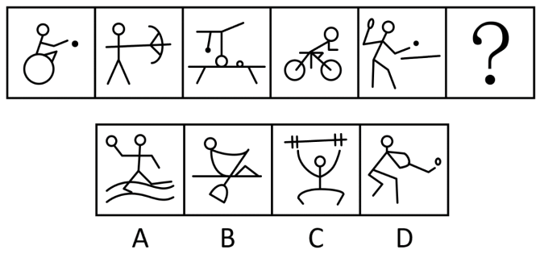
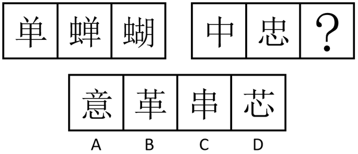
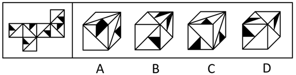
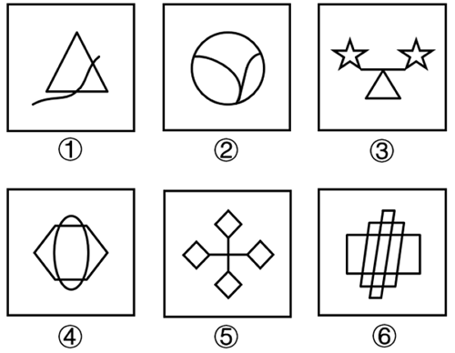
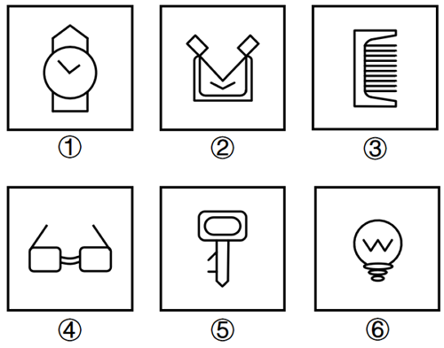

# 2024年山东省公务员录用考试《行测》试题（网友回忆版）

> 候选采集稿。参考答案及解析来自粉笔页面，不代表官方答案或真实高分答卷；来源使用许可与原卷对应关系仍需人工核实。

## 题型与作答说明

常识

（20题）

第一部分 常识判断。 根据题目要求，在四个选项中选出一个最恰当的答案。

言语理解与表达

（30题）

第二部分 言语理解与表达。 本部分包括表达与理解两方面的内容。请根据题目要求，在四个选项中选出一个最恰当的答案。

数量关系

（10题）

第三部分 数量关系。 在这部分试题中，每道题呈现一段表述数字关系的文字，要求你迅速、准确地计算出答案。

判断推理

（40题）

第四部分 判断推理。 本部分包含图形推理、定义判断、类比推理和逻辑判断四个部分，根据题目的表述选择最佳选项。

资料分析

（20题）

第五部分 资料分析。 所给出的图、表、文字或综合性资料均有若干个问题需要你回答。你应根据资料提供的信息进行分析、比较、计算和判断处理。

## 给定材料

### 材料 dom-material-f930c6871f8d47f1

2022年全省实现地区生产总值87435.1亿元，按不变价格计算，比上年增长3.9%。分产业看，第一产业增加值6298.6亿元，增长4.3%，三次产业结构为7.2：40.0：52.8。

农林牧渔业产值12130.7亿元，按可比价格计算，比上年增长4.8%。猪牛羊禽肉产量838.4万吨，比上年增长2.9%；禽蛋产量（不含小品种)）438.1万吨，下降3.8%；牛奶产量304.4万吨，增长5.6%。水产品总产量（不含远洋渔业产量）843.9万吨，增长2.8%。其中，海水产品产量724.9万吨，增长2.6%；淡水产品产量119.0万吨，增长4.3%。

### 材料 dom-material-806013286d1e280c

2022年，我国全年国有建设用地供应76.6万公顷（1公顷=15亩）。其中，工矿仓储用地、商服用地、住宅用地、基础设施及其他用地供应面积分别为19.8万公顷、3.1万公顷、7.9万公顷和45.8万公顷。全年出让国有建设用地30.7万公顷，出让成交价款6.03万亿元。

### 材料 dom-material-0e7922cb3dd8269d

2022年，中国国内旅游总人次达25.30亿。其中，城镇居民国内旅游人次19.28亿，同比下降17.7%；农村居民国内旅游人次6.02亿，同比下降33.5%。2022年，中国国内旅游收入（旅游总消费）2.05万亿元，为2019年的35.8%。

2023年春节假期，全国国内旅游人次3.08亿，实现国内旅游收入3758.43亿元，分别恢复至2019年同期的88.6%和73.1%。

### 材料 dom-material-8c91f278c2d8533e

2022年，我国风电、光伏发电新增装机达到1.25亿千瓦，再创历史新高。全年可再生能源新增装机1.52亿千瓦，占全国新增发电装机的76.2%，其中风电新增3763万千瓦，太阳能发电新增8741万千瓦，生物质发电新增334万千瓦，常规水电新增1507万千瓦，抽水蓄能新增880万千瓦。截至2022年年底，可再生能源装机达到12.13亿千瓦，占全国发电总装机的47.3%，较2021年提高2.5个百分点。其中风电3.65亿千瓦，太阳能发电3.93亿千瓦，生物质发电0.41亿千瓦，常规水电3.68亿千瓦，抽水蓄能0.45亿千瓦。

2022年，风电、光伏年发电量首次突破1万亿千瓦时，达到1.19万亿千瓦时，较2021年增加2073亿千瓦时，同比增长21%，占全社会用电量的13.8%，同比提高2个百分点，接近全国城乡居民生活用电量。2022年，可再生能源发电量达到2.72万亿千瓦时，占全社会用电量的比重为31.6%，较2021年提高1.7个百分点，可再生能源在保障能源供应方面发挥的作用越来越明显。

## 题目

### 第 1 题

习近平总书记在新时代文化建设方面提出一系列新思想新观点新论断，丰富和发展了马克思主义文化理论，构成了习近平新时代中国特色社会主义思想的文化篇，形成了习近平文化思想。关于习近平文化思想，下列理解正确的有：

①表明我们党的历史自信、文化自信达到了新高度

②是马克思主义与中华优秀传统文化相结合的光辉典范

③既有文化理论观点上的创新和突破，又有文化工作布局上的部署要求

④标志着我们党对中国特色社会主义文化建设规律的认识达到了新高度

⑤是一个不断展开的、开放式的思想体系，必将随着实践深入不断丰富发展

A. 2项

B. 3项

C. 4项

D. 5项

### 第 2 题

建设自贸试验区是以习近平同志为核心的党中央在新时代推进改革开放的重要战略举措。十年来，国家层面共向全国复制推广三百多项制度创新成果，形成了改革红利共享、开放成果普惠的良好局面。从哲学上看，建设自贸试验区：

A. 表明矛盾的特殊性决定事物的不同性质

B. 说明在一定条件下共性和个性可以相互转化

C. 体现了普遍性寓于特殊性之中的基本原理

D. 遵循了“共性——个性——共性”的认识发展规律

### 第 3 题

铸牢中华民族共同体意识、推进新时代党的民族工作高质量发展，是全国各族人民的共同任务。关于铸牢中华民族共同体意识，下列表述正确的是：

①引导各族人民牢固树立休戚与共、荣辱与共、生死与共、命运与共的共同体理念

②坚持各民族自信和独立，为铸牢中华民族共同体意识奠定坚实物质和文化基础

③促进各民族广泛交往交流交融，以中华民族大团结促进中国式现代化

④着眼建设中华民族现代文明，不断构筑中华民族共有精神家园

A. ①②④

B. ①③④

C. ②③④

D. ①②③

### 第 4 题

习近平总书记提出“努力在服务和融入新发展格局上走在前”，要求山东立足自身优势，积极探索有效途径，在服务和融入新发展格局中做出重要贡献。关于这些贡献，下列说法正确的是：

①以建设交通强国山东示范区为契机，打造“四纵五横沿黄达海”大通道

②构建面向日韩和东北亚、连接“一带一路”、连通欧美的重要“桥头堡”

③以黄河流域生态保护和高质量发展为牵引，深化东中西合作机制

④以“外企与部门面对面”系列活动为载体，塑造对外开放新优势

A. ①②③

B. ①②④

C. ①③④

D. ②③④

### 第 5 题

2023年11月，山东省政府新闻办召开发布会介绍，山东将深入开展机关运转提速提效、政企沟通提速提效、数字政府建设提速提效“三大行动”，不断增强群众和企业获得感。关于“三大行动”的具体举措，下列说法错误的是：

A. 简化会议议程，严格把控会议时间，会议一般不超过90分钟

B. 开通企业家直通省长公开号码96178，多渠道收集企业诉求

C. 在“爱山东”政务服务平台设立“企业家诉求专区”

D. 将全省各级各部门500多类码融合成“齐鲁码”

### 第 6 题

为传承红色基因，赋能革命老区振兴，山东面向社会发布了6条革命文物保护利用片区红色主题遗产线路（见下图）。下列与之相关的说法错误的是：

A. 通过线路1，八路军一一五师主力进入山东，与日军在大青山激拼杀，换取了转危为安的空前胜利

B. 通过线路3，胶东抗日根据地将招远黄金送至延安，为中共敌后抗战胜利提供了物质支撑

C. 沿着线路5，可以走进胶东育儿所旧址，从胶东乳娘的故事中感受鱼水情深

D. 沿着线路6，可以参观齐长城锦阳关和马鞍山抗战旧址，重温古人智慧与先辈抗战精神

### 第 7 题

在山东3500多公里的海岸线上，诞生了诸多编号为“1”的大国重器。关于这些闪耀着创新之光的“山东造”，下列对应正确的是：

①“耕海1号”——中国首个自营1500米超深水大气田

②“国信1号”——全球首艘10万吨级智慧渔业大型养殖工船

③“蓝鲸1号”——全球最大、钻井深度最深的半潜式海上钻井平台

④“深蓝1号”——中国首座自主研制的大型全潜式深海智能渔业养殖装备

A. ①②③

B. ①②④

C. ②③④

D. ①③④

### 第 8 题

下列先烈们的家书，按时间先后排序正确的是：

①“儿今日竭力驱满，尽国家之责任者，亦即所谓保卫身家也”

②“为了全祖国家中人等过着幸福日子，男有决心在战斗中坚持为人民服务，不立功不下战场”

③“抛头颅、洒热血，明翰早已视等闲。各取所需终有日，革命事业代代传”

④“狼毒野心之列强！无故侵占我国土！二十一条之否认被拒绝，而租地期满，又故意不肯交还！······热血男儿何堪睹此”

A. ④①②③

B. ④③①②

C. ①③②④

D. ①④③②

### 第 9 题

2023年10月，中央金融工作会议指出，高质量发展是全面建设社会主义现代化国家的首要任务，金融要为经济社会发展提供高质量服务。下列与之相关的表述错误的是：

A. 着力打造现代金融机构和市场体系，疏通资金进入实体经济的渠道

B. 注重做好跨周期和逆周期调节，充实货币政策工具箱

C. 优化资金供给结构，把更多金融资源用于居民消费

D. 盘活被低效占用的金融资源，提高资金使用效率

### 第 10 题

我国财政预算“四本账”包括一般公共预算、政府性基金预算、国有资本经营预算和社会保险基金预算。关于“四本账”，下列表述错误的是：

A. 一般公共预算即安排用于保障和改善民生等方面的收支预算

B. 政府性基金预算包含铁路建设基金、土地出让收入、专项债等

C. 国有资本经营预算应当按照收支平衡的原则编制，不列赤字

D. 社会保险基金预算可以调出资金到其他预算中

### 第 11 题

根据《公务员法》及有关规定，下列做法错误的是：

A. 某市招商局在招录法律顾问职位的公务员时，向省级机关申请对其组织法律职业资格考试

B. 某市城管局在录用执法类公务员时，对拟录用人员进行了心理素质、体能测评

C. 某市生态环境局公务员由专业技术类岗位转任该局行政管理岗位，先对其进行免职

D. 某市交通局行政执法类公务员在试用期满考核合格后，将其定级为四级主办

### 第 12 题

2023年10月，中共中央印发《全国干部教育培训规划（2023-2027年）》。根据该规划，下列表述错误的是：

A. 以坚定理想信念宗旨为根本，以增强推进中国式现代化建设本领为重点

B. 推进县级党校统一建设，逐步推进县级党校办学体制改革和办学模式的创新

C. 加强年轻干部政治训练，实施年轻干部理想信念强化计划

D. 有计划地选调地方、部门、国有企事业单位主要负责同志到党校、干部学院参加专题培训

### 第 13 题

2023年7月，国家互联网信息办公室等七部门联合发布《生成式人工智能服务管理暂行办法》。根据该办法，下列表述错误的是：

A. 鼓励采用安全可信的芯片、软件、工具、算力和数据资源

B. 提供者应当无条件受理查阅、更正和删除个人信息的请求

C. 国家对生成式人工智能服务实行包容审慎和分类分级监管

D. 鼓励生成式人工智能技术在各行业、各领域的创新应用

### 第 14 题

智能导航系统，AI机器人，数字火炬手······“智能”融入第19届杭州亚运会的方方面面，彰显出本届亚运异彩纷呈的独特魅力。这表明：

A. 人工智能是人的意识能动性的一种特殊表现

B. 人工智能向人类思维的逼近只是模仿性趋近

C. 科技进步催生了人工智能自我意识的产生

D. 人工智能取代或超越人类智能将在曲折中实现

### 第 15 题

关于我国水电建设，下列说法正确的是：

A. 刘家峡水电站是中国第一座自行设计、自制设备和自行施工的大型水力发电站

B. 小浪底水利枢纽被誉为“万里长江第一坝”，是长江干流上第一座大型水电工程

C. 白鹤滩水电站全部机组投产发电，标志着我国建成世界最大的清洁能源走廊

D. 新安江水电站位于甘肃省境内黄河干流，是我国第一座百万千瓦级大型水电站

### 第 16 题

关于新兴体育项目，下列说法错误的是：

A. 航空运动项目包括热气球、滑翔、轻型飞机、航空模型等

B. 2024年巴黎奥运会将首次把攀岩列入正式比赛项目

C. 作为水上极限运动的冲浪以海浪为动力，以冲浪板为支撑

D. 飞盘比赛允许不设置裁判，出现争议动作时可由双方协商解决

### 第 17 题

关于我国境内现存珍稀动物，下列说法错误的是：

A. 亚洲象是典型的群居动物，主要分布在云南

B. 大熊猫的受威胁等级已由“濒危”降为“易危”

C. 朱鹮被誉为“东方宝石”，其繁殖期在冬季

D. 藏羚羊的主要栖息地位于青藏高原的羌塘草原

### 第 18 题

下列成语典故所涉及的人物，按照时间先后排序正确的是：

①画龙点睛 ②矫若游龙 ③胸有成竹 ④吴带当风

A. ②①④③

B. ①③④②

C. ②③①④

D. ①②③④

### 第 19 题

被誉为“晚清中兴四大名臣”的左宗棠、张之洞、李鸿章和曾国藩，留下了许多影响深远的名言警句。下列选项对应正确的是：

A. 左宗棠——海纳百川，有容乃大；壁立千仞，无欲则刚

B. 张之洞——中学为内学，西学为外学；中学治身心，西学应世事

C. 李鸿章——我劝天公重抖擞，不拘一格降人才

D. 曾国藩——古之立大事者，不惟有超世之才，亦必有坚忍不拔之志

### 第 20 题

关于人体营养知识，下列说法错误的是：

A. 人体内能量的储存形式主要是脂肪，但脂肪在体内异常堆积可能会引发一些慢性疾病

B. 缺铁性贫血可能导致儿童出现发育迟缓、注意力不集中、认知能力障碍等症状

C. 维生素A缺乏可能导致夜盲症，患者可多食用动物肝脏、鸡蛋、牛奶等

D. 维生素D缺乏可能导致皮肤麻木、牙龈出血等症状，患者可多食用蔬菜、水果等

### 第 21 题

民营企业在发展“四新经济”方面有自身的独特优势，敏锐的市场嗅觉、灵活的市场行为、强烈的开拓意识以及持续的创新精神使得民营企业在“四新经济”发展进程中            。

填入画横线部分最恰当的一项是：

A. 游刃有余

B. 举足轻重

C. 大有可为

D. 事半功倍

### 第 22 题

马克思主义中国化时代化这个重大命题本身就决定，我们决不能抛弃马克思主义这个魂脉，决不能抛弃中华优秀传统文化这个根脉。        好这个魂和根，是理论创新的基础和前提。理论创新必须讲新话，但不能丢了老祖宗，            就等于割断了魂脉和根脉，最终会犯失去魂脉和根脉的颠覆性错误。

依次填入画横线部分最恰当的一项是：

A. 维系 见异思迁

B. 培育 崇洋媚外

C. 保护 喜新厌旧

D. 坚守 数典忘祖

### 第 23 题

药品安全事关广大人民群众身体健康和生命安全。不筑牢药品的安全底线，安全根基不稳，再多的创新也是            。持续强化药品全生命周期质量监管，落实药品安全“四个最严”要求，才能有效        药品安全形势的总体稳定。药品安全是设计出来的，也是生产出来的，更是监管出来的。

依次填入画横线部分最恰当的一项是：

A. 纸上谈兵 保障

B. 徒劳无功 提升

C. 空中楼阁 维护

D. 本末倒置 控制

### 第 24 题

“君不见黄河之水天上来······”带着醉意的李白举杯吟出《将进酒》，带着围坐的高适、岑夫子、丹丘生等人，一齐驾着仙鹤飞越银河之上，这是电影《长安三万里》中，颇具浪漫主义和瑰丽想象的一幕。《长安三万里》将纪实与想象        ，开启了一场打破时空的“唐代诗友会”。从开元盛世到安史之乱，从水草丰美的江夏到美轮美奂的长安，从歌舞翩跹的江南到            的边塞，万里山河画卷都是唐代的模样。

依次填入画横线部分最恰当的一项是：

A. 融汇 人迹罕至

B. 交融 金戈铁马

C. 糅合 异域风情

D. 联结 荒无人烟

### 第 25 题

铁路是国民经济大动脉。一条铁路线的        ，往往折射出一个地区发展变迁和现代化的崛起步伐。在山东发展史上，百廿胶济，就是这样一条担纲主动脉的铁路线。可以说，一部百廿胶济发展史，是一部铁路交通变迁史，更是一部            的沿线经济文化发展史。

依次填入画横线部分最恰当的一项是：

A. 贯通 气势磅礴

B. 延展 活力四射

C. 演变 流光溢彩

D. 嬗变 波澜壮阔

### 第 26 题

传统制造业是现代化产业体系的         。要看到，我国传统产业体量大，在制造业中占比超过80%，传统产业转型升级直接关乎现代化产业体系建设全局，对当前突出做好稳增长稳就业稳物价工作、推动经济运行持续好转            。

依次填入画横线部分最恰当的一项是：

A. 基底 不可或缺

B. 根源 至关重要

C. 支柱 缺一不可

D. 核心 功不可没

### 第 27 题

虽然“鸟生”有长有短，但生而为鸟，不外乎要经历出生、成长、成熟、衰老、死亡的过程。生存、运动、觅食、交流、玩耍、求偶和育幼等行为贯穿于它们的生命历程。这些行为看似简单明白，背后却        着生命的玄机。鸟类的行为复杂而独特，呈现出极高的          ，哪怕是我们身边最为普通的麻雀、乌鸦和喜鹊，也可能做出让你意想不到的行为。鸟类的世界就是这样纷繁和迷人。

依次填入画横线部分最恰当的一项是：

A. 暗含 科学性

B. 蕴藏 异质性

C. 孕育 神秘性

D. 隐伏 特殊性

### 第 28 题

稳步推进个人所得税改革，        收入分配秩序，提高居民收入水平和消费购买力。近年来，我国个人所得税改革            ，通过提高基本减除费用标准、设立专项附加扣除、优化调整税率结构等一系列组合拳，上亿自然人纳税人税收负担明显减轻，综合所得年收入10万元以下的自然人纳税人，大部分不用再缴纳个人所得税。

依次填入画横线部分最恰当的一项是：

A. 规范 蹄疾步稳

B. 强化 循序渐进

C. 调整 筚路蓝缕

D. 完善 披荆斩棘

### 第 29 题

从物质形态上看，广义的历史典籍版本包括甲骨文、金文、简帛、石刻、唐宋元明清及近代的手写本、印刷品等，可谓            。此外，还有大量的出土文物、地上地下遗址、文化遗存，以及祖祖辈辈            的历史传说、民风民俗、家风家训等，这些共同构成“广阔的文化空间”，也是一座巨大的            的文化宝藏，蕴藏着中华文明生生不息的密码。

依次填入画横线部分最恰当的一项是：

A. 琳琅满目 一脉相承 独一无二

B. 汗牛充栋 口耳相传 无与伦比

C. 浩如烟海 倾囊相授 包罗万象

D. 卷帙浩繁 言传身教 价值连城

### 第 30 题

我们的节日文化，总在传承发展中           。除夕守夜的年俗，从围炉夜话到一起看春晚，再到边看春晚边晒年夜饭，形式越来越丰富；端午节不少地方推出读诗、赛诗活动，诗意过节过出清新感。从更广视角看，中华文明的浩荡长河，既有深沉厚重的历史积淀，也有           的实践再造，还有奔腾澎湃的创新汇流。因为坚守正道，所以敢于           、海纳百川；因为主动求变，所以时代气息更浓、生机活力更足。

依次填入画横线部分最恰当的一项是：

A. 另辟蹊径 点铁成金 革故鼎新

B. 别具一格 千锤百炼 集思广益

C. 精彩纷呈 脱胎换骨 标新立异

D. 别开生面 大浪淘沙 推陈出新

### 第 31 题

蒙内铁路是肯中共建“一带一路”的旗舰项目，为肯尼亚创造了约4.6万个就业岗位，推动了沿线地区的城镇化进程，促进了肯中双边经贸合作。据统计，蒙内铁路2022年运送旅客239万人次，高于2021年的199万人次，客运服务收入达26亿肯尼亚先令。蒙内铁路货运量同样呈现上升趋势，2022年共运输超过600万吨货物，货运服务收入超过126亿肯尼亚先令。随蒙内铁路建成的内罗毕内陆集装箱港和奈瓦沙内陆集装箱港改善了货物装卸和运输条件，促进了蒙内铁路货运量的增长，完善了肯尼亚物流体系，增强了整个区域的竞争力。

关于蒙内铁路，下列哪种说法可以从文中得到支持？

A. 促进了肯尼亚旅游业的繁荣

B. 对肯尼亚港口建设有推动作用

C. 2022年客运较上年的收益情况

D. 持续为肯尼亚发展振兴注入动力

### 第 32 题

从来没有百分之百成功的基础研究。                    ；没有大量错误作台阶，也就登不上最后正确结果的高座。对于“失败”的每一次宽容，都在涵养敢担风险、勇攀高峰的科研生态，孕育下一次创新的成功。而一旦“慢跑”中的科学家拨动到灵感的琴弦，看似“无用”的原始创新成果就能如核裂变般爆发出巨大能量，推动文明进程的跨越式发展，以浩荡之势开辟崭新天地。

填入画横线部分最恰当的一项是：

A. 自由探索很容易“失败”

B. 只有宽容失败，才有从容探索

C. 每一次颠覆式创新的背后，都是一场“慢跑”

D. 地基牢不牢，决定了科学大厦建得高不高

### 第 33 题

在历史长河中，敦煌始终以中华传统文明为根基，不断吸纳着来自其他地域和民族的文明成果。早在公元前2000年前后，属于青铜时代的四坝文化火烧沟类型的先民，就已经开始了对敦煌地区的开发。前121年汉武帝开疆扩土，敦煌地区正式纳入汉王朝版图，为西域的经营拉开了序幕，进而使中西交流成为汉王朝的国家行为。前111年设敦煌郡以后，不少内地的世家大族迁入敦煌定居，这些世家大族带来的中原文化与当地少量原居民所积淀的与西域、中亚千丝万缕的文化因素，共同构成坚实的汉晋敦煌文化土壤。

这段文字意在说明：

A. 敦煌文化始终传承着中华传统文化的精华

B. 敦煌是了解异域文明和文化交融的窗口

C. 敦煌文化是各种文明长期交流融汇的结晶

D. 敦煌地区向来具有与时俱进的文化基因

### 第 34 题

“回旋镖”射击检测系统，是国外一家公司为应对战场冷枪袭击而研制的预警系统。该系统通过对袭击者枪口发出的声音和冲击波进行探测，然后对接收到的信号进行记录、识别和数据处理，计算机会给出袭击者的具体方位。这套系统的使用方式主要为车载式。在一根高高升起的电子桅杆上分布有7个小型高灵敏度麦克风。这些麦克风用于探测各个方向上来袭子弹的枪口爆炸声和发出的冲击波。一旦在以该系统为中心的500米范围内有枪械发射，系统就会测算出子弹的方向、速度和高度，并通过车内扬声器来提醒士兵。为了应对复杂战场环境下其他噪声对其精度的影响，研究人员还专门引入了辨识软件，以防止因非枪械射击而造成的虚假警报。

这段文字意在强调“回旋镖”射击检测系统：

A. 如何通过子弹声音辨别敌人方位

B. 能够有效应对战场冷枪袭击

C. 可以提高反击敌人的精准度

D. 只能识别枪械射击的声音

### 第 35 题

据统计，我国商业航天企业超过400家，在轨商业卫星超过350颗。商业航天释放了可观的经济潜能，目前市场规模超过万亿元。作为战略性新兴产业，商业航天催生出众多民用科技产品，为构筑现代化产业体系注入新动能。近年来，我国商业航天产业亮点纷呈，快舟火箭、长征火箭等发展快速，蓝箭航天、星际荣耀、星河动力等公司成果不断。商业星座建设初具规模，卫星批量化、智能制造能力持续提升，商业航天新型空间基础设施体系建设和应用发展空间广阔。

下列哪种说法不能从文中得到支持？

A. 商业航天企业蓬勃发展，经济潜能巨大

B. 商业航天赋能现代化产业体系的建构

C. 商业火箭、卫星批量化生产能力持续提升

D. 商业航天新型空间基础设施体系建设前景广阔

### 第 36 题

从2022年首次系统提出数字政府建设的顶层设计以来，数字政府建设为优化政府职责体系带来契机，随着数字化全面革新，未来改革空间值得期待。实现革命性跨越的人工智能大模型对数字政府的影响主要体现在促进更广泛的公众参与，大幅度提高政府工作效率，有利于对数据的分析、对趋势的预测以及辅助政策决策等方面。政府需要适应技术的变革，对组织结构、流程和人员配置进行调整和优化，也要应对政务数据的隐私保护、保密安全等新挑战。

最适合做这段文字标题的是：

A. 数字政府建设未来可期

B. 人工智能赋能数字政府建设

C. 时代发展促使政府数字化转型

D. 数字政府建设面临的新挑战

### 第 37 题

①所以，未来乡村旅游精品线路的升级，一方面需要加强对乡村地区的文化资源整合和挖掘，将其有机融入乡村旅游产品和活动中，打造具有浓厚文化氛围的旅游体验

②文旅融合下的乡村旅游对于传承中华文明具有重要意义，在增进文化交流与理解的同时，也使人们更能意识到中华文明的独特性和卓越贡献，增强对中华文明的自豪感和认同感

③此外，乡村旅游在发展过程中存在一定的同质化现象，没有深入挖掘自身的差异化优势，形成品牌效应

④通过对文化属性的强调，乡村旅游可以更好地传承和展示中华文明的丰富内涵，吸引更多游客参与和体验，同时促进乡村的经济发展和文化传承

⑤不过，从整体来看，目前乡村旅游发展并不均衡，一、二线城市近郊发展比较好，但仍有相当多乡村的文化资源禀赋和场景价值还没有得到充分释放

⑥另一方面，还要有意识地借助文化品牌来凸显文化属性，打造独特的乡村旅游品牌形象，提高其在市场上的知名度和吸引力

将以上6个句子重新排列，语序正确的一项是：

A. ②①⑥④⑤③

B. ②⑤③①⑥④

C. ④⑤③②①⑥

D. ④②⑤③①⑥

### 第 38 题

目前，我国生态环境保护法律体系已基本形成，但同党和国家发展要求、人民群众的期待、推进生态文明治理体系和治理能力现代化目标相比，相关法治建设仍有待加强。例如，新时期草原保护管理工作已由围绕畜牧业生产服务为主转向生态保护为主，现行法律法规已难以满足工作需要，应加快完善以草原法为核心的草原相关法律法规制度体系。建议立法机构和相关部委积极开展生态环境领域修法立法的调研和梳理工作，按照轻重缓急将相关法律法规纳入立改废释纂规划，通过科学立法增强生态环境法治的系统性、整体性、协同性、时效性，为美丽中国建设提供更严密的法治保障。

这段文字意在说明：

A. 党和国家生态文明建设事业有了新的发展要求

B. 新时期草原保护工作亟须完善相关法律法规制度体系

C. 要统筹推进生态环境保护领域法律法规立改废释纂工作

D. 我国生态文明领域迫切需要环境法律体系的保障

### 第 39 题

算力是重要的公共基础设施，成为数字经济时代的核心生产力，是全社会智能化转型的基石。经济高质量发展、数字经济和实体经济融合，对算力基础设施投资的需求是巨大的。以搜索功能为例，大模型单次搜索至少需要传统搜索引擎4~5倍的算力开销，这方面基础设施建设扩容已经成为算力发展的显著趋势，各地也在积极布局谋划，由此还将带动其他与算力相配套的基础设施建设。从这个角度看，算力是扩大有效投资的方向之一，也是培育投资新动能的重要载体。

这段文字主要介绍了：

A. 算力投入更好地服务实体经济发展

B. 算力扩容加速了全社会智能化转型

C. 算力发展激活了数字产业的竞争力

D. 算力需求带动相关领域基础设施投资

### 第 40 题

自由的工作状态、个性价值的实现、潜在的巨大机遇······数字新职业备受年轻人喜爱。关键在于，如何让大学生满足数字新职业的就业要求，更好地在数字经济时代实现价值创造。不断拓展数字经济就业创业空间，打通结构性失衡这个关键堵点，这样既能解决高校毕业生就业难问题，更能为中国经济发展注入强大动力。

这段文字最适合由哪一观点引出？

A. 人才是数字经济发展的核心驱动力

B. 数字新职业将成为我国稳就业的重要支撑

C. 加强高校毕业生数字化技能的培养尤为迫切

D. 数字新职业可以为大学生就业创业提供更多选择

### 第 41 题

云锦、蜀锦和蜡染、扎染等古代织造印染技术，作为非物质文化遗产传承至今，并在科技助力下焕发新貌；今天的新材料、新技术、新理念更是直接让国潮服饰有了新的可能。科技带来的新工艺不仅最大程度地优化传统工艺，还能创造出前所未有的产品。比如，电脑印花技术能在不同的面料上呈现逼真彩色图像，还能创造出立体效果，极大超越了传统丝网印花技术。又比如，将柔性电子屏技术和传统面料结合，让人们把电子艺术图案穿在身上，还有的设计注重运用环保技术，以推动国潮服饰可持续发展。

这段文字主要介绍了国潮服饰：

A. 创新发展离不开科技的支撑

B. 体现出蓬勃盎然的时代气息

C. 以彰显民族文化为设计理念

D. 融汇了传统要素和当代元素

### 第 42 题

历史学家发现，普洱茶作为贡茶，是进贡时间最早、时间最长、量最大的。在宫廷众多的成员中，真正能用普洱茶的只有皇帝和太后，还有受到皇帝赏赐的人，而妃子们只能饮到黄茶。正如末代皇帝溥仪所言，“普洱茶是皇室成员的宠物”。清嘉庆年间，军机处查抄了曾任内务府大臣的福长安府邸，在财产抄没清单中，除了大量的金银财宝外，还清晰地记载着查得“普洱茶三百八十八团又五桶，茶膏一百九十匣”，当这份清单送至嘉庆帝手中时，他下旨将其他财产均收归国有，只在普洱茶之上画了一个圆圈，这个圆圈便是皇上御用的标志。

根据这段文字，下列说法正确的是：

A. 普洱茶是清代进贡时间最长的贡茶

B. 拥有普洱茶是皇室成员尊贵的象征

C. 福长安因私藏大量普洱茶而被查抄

D. 嘉庆帝和溥仪都对普洱茶情有独钟

### 第 43 题

在长三角地区，知识产权创造、运用、保护、管理和服务全链条各要素畅通流转，助力描绘充满活力的高质量发展图景。目前，长三角地区累计培育知识产权优势示范企业1800余家，带动区域产业竞争优势整体提升；围绕集成电路、生物医药、人工智能等重点领域，建设7个产业知识产权运营中心及24家国家级专利导航服务基地，助力关键核心技术攻关；2022年，专利质押融资金额达1862.6亿元，同比增长72.6%；29家国家级知识产权保护中心和快速维权中心在这里布局，知识产权纠纷调解组织达400余家。

最适合做这段文字标题的是：

A. 知识产权企业前景可观

B. 长三角地区产业优势提升

C. 知识产权助力高质量发展

D. 长三角知识产权健全发展

### 第 44 题

随着户籍制度改革深入推进，全国31个省份都出台了户籍改革意见，全面取消农业户口。这标志着二元户籍制度退出历史舞台，意味着在中国存在了半个多世纪的“城里人”和“乡下人”户口身份识别将不复存在，农民不再是身份，而是职业。当农民成为一种职业，新的理念、新的经营知识等将会培育和造就数以亿计的有文化、懂技术、善经营、会管理的新型职业农民。

这段文字接下来最有可能讲述的是：

A. 与传统农民相比新型职业农民的素养与能力

B. 户籍制度改革给新型职业农民带来的便利

C. 国家给新型职业农民提供的政策支持

D. 新型职业农民面临的挑战与发展困境

### 第 45 题

社火原本是属于农民的自演自娱活动，来源于古人对土地和火的崇拜。社，即土地神；火，即火祖，也即火神。农业中国，是土地给了人们立足之本。《礼记·祭法》载：“共工氏之霸九州也，其子曰后土，能平九州，故祀以为社。”火可以熟食、取暖，是人类创立文明的显著标志。崇拜土地与火                    ，这逐渐演化成了规模盛大、内容繁复的传统民间娱乐活动。

填入画横线部分最恰当的一项是：

A. 表达了古人对社与火的朴素情感

B. 奠定了农业文明发展的民俗基础

C. 产生了祭祀社与火的风俗

D. 体现了古人土地为本的理念

### 第 46 题

新研究发现，向日葵花粉能帮助熊蜂抵抗一种常见寄生虫感染。实验中，将向日葵花粉的外壳与其内部的代谢物分离，分别添加到美洲东部熊蜂的食物中。结果显示，仅添加花粉所含的代谢物对抵抗熊蜂短膜虫感染没有效果；添加花粉外壳的抗感染效果与添加完整的向日葵花粉颗粒相当，感染率可降低87%。苍耳、蒲公英的花粉也能降低感染率。

下列哪项说法不能从文中得到支持？

A. 可以使用向日葵花粉内部代谢物来减少蜜蜂寄生虫感染

B. 向日葵花粉外壳物质在帮助蜜蜂抵抗寄生虫感染上有效果

C. 向日葵花粉外壳和内部代谢物的作用是不同的

D. 苍耳、蒲公英的花粉有类似向日葵花粉的作用

### 第 47 题

近年来，从新能源汽车下乡到绿色智能家电下乡，一系列高品质工业品从“稀罕物”变成“必需品”，有效提升了农民生活水平。多年经验告诉我们：工业品下乡绝不意味着“积压品下乡”，更不能拿质次价廉的商品糊弄消费者，                    。比如，有的家电企业看到，一些地区的农民喜欢把洗衣机放在露天小院使用，于是重新设计洗衣机产品外壳，解决了下雨导致的生锈问题；有的企业专门推出能在较大电压波动范围内正常启动的冰箱，适应了部分农村地区的环境和条件。惠民生、增福祉是工业品下乡的政策初衷。牢牢把握这个基点，才能让“下乡”的动能更足、活力更强，真正提振消费、拉动内需。

填入画横线部分最恰当的一项是：

A. 要深入调研农村消费群体，了解其实际需求

B. 高品质满足农村地区消费者实际需求才是硬道理

C. 要统筹兼顾，破解难题，切实激发家电企业的积极性

D. 充分发挥乡村消费市场的重要作用，用好工业品下乡政策

### 第 48 题

①德国生物化学家康拉德·布洛赫在1994年首次预测了这类分子的存在

②但他的结论是，这些介于中间的原始分子永远不会被发现，因为它们无法在地质记录中存活下来

③某权威杂志公开的一项研究报道了在古岩石中发现的一类新类固醇，并确认了复杂真核生物久远的史前史

④新研究表明事实并非如此，原生类固醇的痕迹能在岩石中保留超过10亿年

⑤他提出，在从羊毛固醇到胆固醇的漫长生物合成途径中，每个短暂存在的中间体在几亿年前都曾是完全适应的最终产物，而且这些产物的每一个都是在其前体基础上的演化进步

⑥这片“失落的世界”的发现，也证实了诺贝尔奖得主康拉德·布洛赫关于存在原生类固醇分子的预测

将以上6个句子重新排列，语序正确的一项是：

A. ③⑥①⑤②④

B. ⑥⑤④③①②

C. ③①⑤④⑥②

D. ④③⑥①②⑤

### 第 49 题

①北斗系统及其高精度定位导航能力，如同水、电、气等公共服务一样融入基础设施、走进千家万户

②如今的北斗，已不仅仅是卫星导航系统，更是泛在、融合、智能的综合时空服务体系

③作为重要的时空基础设施，北斗已成为贴近百姓生活的"大国重器"

④当前，北斗在国内导航地图领域已实现主用地位，北斗定位服务日均使用量超过3600亿次

⑤在大众应用方面，北斗已成为以智能手机、智能网联汽车等为代表的各类智能终端的“标配”，地图软件车道级导航、红绿灯倒计时等新应用，让人们生活更便捷、更精彩

⑥在专业应用方面，北斗与一些行业深度融合，在精密控制、智能建造、数字孪生、智慧工厂领域形成了不少“＋北斗”新业态

将以上6个句子重新排列，语序正确的一项是：

A. ④①⑤⑥③②

B. ④③①⑤⑥②

C. ③⑤⑥④①②

D. ③①⑥⑤④②

### 第 50 题

中华民族自古崇尚读书，讲究格物致知、诚意正心。我们走过书信时代，经过电邮时代，来到读“屏”时代，网页挤占书页，“输写”代替书写。我们无法回到“从前慢”的过去，但也不能丢失知识的传承、文化的涵养、精神的赓续。加强数字资源平台建设，开展青少年学生读书活动，是把数字技术这一“最大变量”转化为阅读提质“最大增量”的关键一招。

这段文字意在强调：

A. 提供优质数字化阅读资源势在必行

B. 数字阅读是青少年阅读的重要方式

C. 数字化阅读时代更要重视文化传承

D. 数字化技术是影响阅读的最大变量

### 第 51 题

山东手造精品众多，某展览会有叶雕、皮影、风筝、麦秸画、柳编、葫芦画、锡雕、鲁班枕8个展厅。因时间原因，一名参观者决定从8个展厅中随机选取3个进行参观。问叶雕和皮影展厅至少一个被选中的概率是多少？

A. 

B. 

C. 

D. 

### 第 52 题

某医院积极响应国家号召，组建医疗小分队赴西部地区开展对口支援工作。该医院现有6名男医生和3名女医生报名，现从9人中抽取一组男女医生都有的3人小分队。问有多少种不同的组队方式？

A. 63

B. 70

C. 73

D. 60

### 第 53 题

某科技创新项目有6人投资，共筹资110万元。投资额度有10万元、20万元和30万元三种。已知投资10万元的比投资20万元的多2人，问投资30万元的有多少人？

A. 2

B. 3

C. 4

D. 5

### 第 54 题

甲、乙、丙三个工程队共同承担一项市政工程。甲队独立完成需要30天，乙队效率比甲队高20%。丙队仅提供技术支持，即能够为其他队伍提高效率，其与甲队或乙队合作时效率可提高120%，三个队伍合作时效率可提高200%。甲、乙两队合作3天后，丙队加入，最后两天乙队休息。问该工程耗时约多少天？

A. 7

B. 8

C. 9

D. 10

### 第 55 题

若干职员参加某次强国知识竞赛，每人的得分均不相同且为整数，分数排名相邻的2人分差均为5分。已知有3人成绩低于70分，且超过70分的职员平均分为82分。问所有职员中竞赛成绩超过70分的人数占比在下列哪个范围内？

A. 低于50%

B. 50%-60%之间

C. 60%-70%之间

D. 高于70%

### 第 56 题

小王和小李同时从山脚A点出发匀速登山，小王距山顶还有路程时小李刚走完上山路程的，小王到达山顶后立即原路返回，10分钟后遇到上山途中的小李。已知两人下山的速度为各自上山速度的1.5倍，问小李比小王晚多少分钟到达山脚A点？

A. 30

B. 40

C. 50

D. 60

### 第 57 题

某市举办高校足球比赛，每所高校都要与其余所有参赛高校各进行一场比赛。积分规则为：胜一场积3分，平一场积1分，负一场积0分。已知此次比赛的冠军积分为14分，其中取胜场次比平局场次多2场，平局场次是告负场次的2倍。问参加这次足球比赛的高校有多少所？

A. 7

B. 8

C. 9

D. 10

### 第 58 题

某线上店铺将进货单价为8元的商品按每件10元出售，每天可销售100件。该店铺计划提高售价增加利润，若每件商品售价每提高1元，每天销售量就要减少10件，为保证每天至少获利350元，问该商品售价应为多少？

A. 不到13元

B. 13~15元之间

C. 15~17元之间

D. 17元以上

### 第 59 题

某单位给车加油，可以用两种方式：第一种不考虑油价的升降，每次加200元的油；第二种也不考虑油价的升降，每次加20升油。若该单位加油两次，采用第一种方式加油的平均价格为x元/升，第二种方式加油的平均价格为y元/升，下列选项正确的是：

A. x>y

B. 

C. x<y

D. 

### 第 60 题

某巡逻艇在海域A点发现正南方30千米处的B点有一艘可疑船只正匀速向正西方行驶，巡逻艇以比该可疑船只快的速度沿某一方向直线追击，两船恰好在C点相遇。问B、C两点之间的距离约为多少千米？

A. 26

B. 28

C. 30

D. 34

### 第 61 题

从所给的四个选项中，选择最合适的一个填入问号处，使之呈现一定的规律性：

A. A

B. B

C. C

D. D

### 第 62 题

从所给的四个选项中，选择最合适的一个填入问号处，使之呈现一定的规律性：

A. A

B. B

C. C

D. D

### 第 63 题

从所给的四个选项中，选择最合适的一项填入问号处，使之呈现一定的规律性:

A. A

B. B

C. C

D. D

### 第 64 题

从所给的四个选项中，选择最合适的一个填入问号处，使之呈现一定的规律性：

A. A

B. B

C. C

D. D

### 第 65 题

从所给的四个选项中，选择最合适的一个填入问号处，使之呈现一定的规律性：

A. A

B. B

C. C

D. D

### 第 66 题

从所给的四个选项中，选择最合适的一个填入问号处，使之呈现一定的规律性：

A. A

B. B

C. C

D. D

### 第 67 题

左图是给定纸盒的外表面展开图，下面哪一项能由它折叠而成？

A. A

B. B

C. C

D. D

### 第 68 题

下图四个小多面体均由等大的正方体组成。下面哪一项无法由①~④在使用一次的情况下拼出？

A. A

B. B

C. C

D. D

### 第 69 题

把下面六个图形分为两类，使每一类图形都有各自的共同特征或规律，分类正确的一项是：

A. ①④⑤，②③⑥

B. ①②④，③⑤⑥

C. ①④⑥，②③⑤

D. ①③⑤，②④⑥

### 第 70 题

把下面六个图形分为两类，使每一类图形都有各自的共同特征或规律，分类正确的一项是：

A. ①②③，④⑤⑥

B. ①②④，③⑤⑥

C. ①②⑥，③④⑤

D. ①③④，②⑤⑥

### 第 71 题

雪球抽样样本是一种非随机抽样，指为了后续研究需要，已确定的研究对象需协助调查者指认与自身相似的其他对象进而保证本调查研究有足够数量的样本。

根据上述定义，下列最适合作为雪球抽样样本的是：

A. 股票经纪人

B. 基层干部

C. 奥运冠军

D. 吸毒者

### 第 72 题

沙盒监管是指先要划定一个范围，对在“盒子”里面的企业，采取包容审慎的监管措施，同时杜绝将问题扩散到“盒子”外面，实行容错纠错机制，并由监管部门对运行过程进行全过程监管，以保证测试的安全性并作出最终的评价。

根据上述定义，下列属于沙盒监管的是：

A. 某市政府创设“银行业务创新监管互动机制”为金融科技的创新与监管提供制度支持

B. 某市生态环境局对非法排污的某化工厂处以责令停产整治的行政处罚

C. 某地金融监管局要求信贷机构强化对小微企业和三农领域等重点对象的信贷支持

D. 某县市场监管局对肉类食品公司开展专项整治活动以保障人民群众“舌尖上的安全”

### 第 73 题

居家养老服务是指政府和社会力量依托社区为居家的老年人提供生活照料、家政服务、康复护理和精神慰藉等方面服务的一种形式。它是对传统家庭养老模式的补充与更新，是我国发展社区服务、建立养老服务体系的一项重要内容。

根据上述定义，下列属于居家养老服务的是：

A. 陈医生经常利用休息时间为社区的居家老人免费提供医疗服务

B. 大学生志愿者以一对一的形式照料着社区里的每一位居家老人

C. 社区通过老年人信息库发布老年人服务需求信息和社会服务供给信息

D. 社区陈爷爷的近亲属轮流回家照顾他的生活起居，并进行精神慰藉

### 第 74 题

斜木桶理论是指如果木桶被搁置在一个斜坡上，那么决定盛水量的不是最短的木板，而是最长的木板。按照斜木桶理论，人们可以在不完善的游戏规则中积极寻找一个斜坡，以此发挥自己的优势，利用优势来弥补自己的不足。

根据上述定义，下列体现斜木桶理论的是：

A. 某大学生在校期间成绩名列前茅，积极效仿比尔·盖茨，在大二时选择退学在计算机领域进行创业

B. 某房地产企业从前年开始盲目跟风造车，却难以突破造车技术壁垒，于是今年决定放弃造车

C. 大学生小李是班长，他天资聪慧、刻苦好学，有着很好的团队协作能力和奉献精神，本科毕业后顺利考取了选调生

D. 高中生小王的英语和语文成绩经常不及格，但理科成绩在年级名列前茅，后来在中国数学奥林匹克竞赛中获得金牌，成功保送至某名校

### 第 75 题

法律证成是给一个具体法律决定提供充足理由的活动或过程，可分为内部证成和外部证成。内部证成是指法律决定必须按照一定的推理规则从相关前提中逻辑地推导出来的活动或过程。外部证成是指对法律决定所依赖的前提进行寻找、判断与论证的活动或过程。

根据上述定义，下列说法正确的是：

A. 某基层人民法院法官就其裁判中所适用的公序良俗原则进行正当性论证属于外部证成

B. 某市监狱管理局执法人员就存在冲突的法律条文进行优先适用论证属于内部证成

C. 某设区的市人大常委会就新修订法规的实施情况组织专家评估属于法律证成

D. 某市公安局依据法律条文对张某散布谣言的行为处以行政拘留不涉及法律证成

### 第 76 题

似真推理是一种认知推理，它是由似真前提或似真推论导出似真结论，尽管无法得到确定性的真结论，但也暂时没有理由支持结论为假，这就使得结论似然为真。

根据上述定义，下列不属于似真推理的是：

A. 员工小王到济南出差，在住酒店、坐公交车、逛商场时感受到山东人的服务态度都很好，因此他说：“山东人就是热情好客！”

B. 股民小张经常把两只股票进行对比，发现其中一只股票价格上涨，便预测另一只股票价格也可能会上涨

C. 警察小李对某案情分析如下：如果受害者没有与凶手搏斗，那么手指不会折断；受害者手指折断，所以他与凶手搏斗了

D. 经理小赵在演讲中说：“如果保证产品质量，那么就会增加产品的销量；现在我们的产品销量增加了，说明我们保证了产品质量。”

### 第 77 题

睡眠-觉醒节律紊乱，也称昼夜节律睡眠-觉醒障碍，指个体的睡眠与其现实要求或大部分人所遵循的节律不符的觉醒紊乱。

根据上述定义，下列不属于睡眠-觉醒节律紊乱的是：

A. 小张入睡时间在凌晨2~6点，不能在正常时间起床

B. 老李睡眠时间比正常人早，经常在傍晚就感到困倦

C. 小王因次日要参加重要考试，当晚久久不能入睡

D. 老赵因居住环境拥挤嘈杂，晚上常处于时睡时醒状态

### 第 78 题

新闻是对客观事实进行报道和传播而形成的信息。但是，客观事实本身不是新闻，被报道出来的新闻是在报道者对客观事实进行主观反映之后形成的观念性的信息。新闻报道是对客观事实的报道，按照传播手段，可划分为口头新闻、文字新闻、广播新闻和电视新闻等。

根据上述定义，下列不属于新闻报道的是：

A. 外交部新闻发言人在新闻发布会上发表讲话，并回答中外记者的提问

B. 中国女篮以73-71力克日本队，夺取了2023年女篮亚洲杯冠军

C. 村委会通过村务公开栏张贴和大喇叭公告两种形式宣传“中央一号文件”

D. 全国各地电视台都在第一时间实况转播了全国“两会”的开幕式盛况

### 第 79 题

侔式推理是指从一个命题通过“侔”的方法，即在这一命题的主项和谓项上附加齐等的词项可得出另一命题，从而使得两辞相比而俱行。也就是说，侔式推理就是附加齐等词项的直接推理。

根据上述定义，下列属于侔式推理的是：

A. “三日入厨下，洗手作羹汤。未谙姑食性，先遣小姑尝。”

B. “信言不美，美言不信。善者不辩，辩者不善。”

C. “树在道边而多子，此必苦李。”

D. “白马，马也；乘白马，乘马也。”

### 第 80 题

封闭性问题指具有标准答案的问题，这类问题除了标准答案之外的解答，均被认为是错误解答。

根据上述定义，下列属于封闭性问题的是：

A. 什么是幸福生活

B. 宇宙中有外星人吗

C. 我应该报考哪所大学

D. 世界上最美丽的城市是哪座

### 第 81 题

聊斋志异：马骥

A. 三国演义：诸葛亮

B. 平凡的世界：孙少平

C. 源氏物语：紫式部

D. 红楼梦：贾宝玉

### 第 82 题

星舰发射：火星移民

A. 个性消费：网红经济

B. 风洞试验：飞机定性

C. 降低利率：调控经济

D. 宜居安居：城市更新

### 第 83 题

颁奖人：获奖者

A. 参会人：主持人

B. 纳税人：税务局

C. 纪录片：观众

D. 绑架者：人质

### 第 84 题

鳄鱼：鱼

A. 镭：金属

B. 蜗牛：昆虫

C. 小熊猫：浣熊

D. 蝮蛇：蛇

### 第 85 题

铁锅：炒菜：生锈

A. 炸药：爆破：爆炸

B. 玻璃：瓶子：折射

C. 清水：饮用：结冰

D. 飞机：运输：乘坐

### 第 86 题

明：囦：岩

A. 汉：囩：导

B. 科：闪：崽

C. 鹛：困：穹

D. 群：田：至

### 第 87 题

证人：出庭：陈述

A. 军队：排练：阅兵

B. 医生：查房：出诊

C. 编导：拍摄：采访

D. 乘客：购票：乘车

### 第 88 题

城市气候：热岛效应：气温变化

A. 赤潮：绿藻增殖：水体污染

B. 生物：遗传物质：DNA遗传

C. 法律：国家机器：捍卫权益

D. 灾害：气象灾害：经济损失

### 第 89 题

（ ） 对于 裁缝 相当于 （ ） 对于 司机

A. 方格尺 网约车

B. 宿舍 车库

C. 工作服 千斤顶

D. 车间 4S店

### 第 90 题

蝉噪林逾静 对于 （ ） 相当于 （ ） 对于 满架蔷薇一院香

A. 菊花从此不须开 谷鸟吟晴日

B. 蒌蒿满地芦芽短 雁行遥上月

C. 石榴开遍透帘明 卢橘垂金弹

D. 千里莺啼绿映红 燕草如碧丝

### 第 91 题

作为中国离海最远的内陆省份，坐拥沙漠和戈壁滩的新疆利用现代技术，让海鲜“搬家”到这里谋生，实现了海鲜和陆地养殖的“双向奔赴”。然而业内专家指出，尽管利用盐碱地和半咸水开展水产养殖的新疆海鲜火爆出圈，但海水养殖和河口养殖仍难以被轻易替代。

以下哪项如果为真，最能支持上述观点？

A. 陆养海鲜面临养殖周期短、成本高、运输困难等问题

B. 新疆尼勒克县的三文鱼除了供应国内市场外，也会出口新加坡等国家

C. 从阿克苏市赶来的东风惠民市场客商们赶早抢购南美白对虾，趁着鲜活上市售卖

D. 麦盖提县天然的碱性水质养出了个头肥硕、体型饱满的澳洲淡水龙虾

### 第 92 题

原子制造是以原子为原料制造所需的材料和器件产品。它是近来被高度关注的原子级制造技术体系中的核心部分之一，将史无前例地实现对原子的逐一精确操控，将原子按需垒砌，构筑原子级细锐、精准、完美，而且具备从物理上远超常规块材物性的产品。因此，有观点认为，原子制造将会成为微纳制造后人类制造技术继续微缩发展的趋势，也将成为新物质创制中的极限，对于现有制造业具有颠覆性意义。

以下哪项如果为真，最能削弱上述观点？

A. 当今微纳制造的芯片能力正在趋于极限，而原子制造能够突破这一极限

B. 原子制造是传统的纳米化制造，是现在制造技术的线性化发展

C. 原子制造操控技术不成熟，其技术精致化仍面临重大挑战

D. 原子制造可以使材料学家获得真正具有应用价值的新材料

### 第 93 题

在工作和生活中，人们遇到拿不准的问题总是习惯于请教专家。人们常常认为，某一领域的专家对该领域了解得更多，相关知识更丰富，经验更多，因此，对该领域相关问题的判断比外行更准确，而专家们对自己的判断通常也非常自信。人们（包括专家自己）对于专家的这一信念被一些人称为“专家幻觉”。

以下哪项如果为真，最能解释上述现象？

A. 对那些与人的情感和性格涉及不多或影响不大的领域，专家预测的准确性较强

B. 当事件的可预测性低时，专家比一般人更自信，反而降低了专家的预测水平

C. 专门知识的拥有量、经验的丰富程度与判断的准确性之间并不存在必然正相关性

D. 由于专家在其研究的领域具有较强专业性，人们对专家有一种习惯性信赖

### 第 94 题

人类早期是从丛林中走出来的，后来又从农村走向了城市。在这个过程中，我们身上带着很多看不见的老朋友——微生物。然而，在进入城市后，室内生活的增加使得人类与自然的接触大大减少，我们身上的微生物与自然界微生物的交换机会也大大减少，这不可避免地会带来一些健康问题。因此，有研究者指出，城市绿色空间的构建，应强化基于自然的解决方案，突出自然和人工的有机耦合，实现良好的微生态循环。

以下哪项如果为真，最能支持上述结论？

A. 大量采样表明城市里绝大部分的微生物来自人类

B. 通过调控人居环境微生物的组成可以有效改善人体免疫力

C. 当前人类身上的微生物不断在人口高度集中的环境中循环

D. 城市的绿色生态景观能够明显稀释以人类自身微生物为主的微生物体系

### 第 95 题

国家要繁荣富强，必须科技腾飞；科技要想腾飞，关键在于人才。因此，国家繁荣富强迫切需要大批优秀的科技人才。

下列选项与上述推理结构形式最为相似的是：

A. 1号仓库中储存小麦，2号仓库中储存大豆。因此，1号仓库中不可能储存大豆

B. 乡村要振兴，必须产业振兴；产业要振兴，关键在组织。因此，乡村急需产业振兴

C. 小张个头比小王高，小王个头比小李高。因此，小张个头比小李高

D. 只有勤奋才会取得优秀成绩，勤奋需要意志支撑。因此，要取得优秀成绩必须具有坚强意志

### 第 96 题

盐湖是由不同矿物离子富集而形成的湖泊。合适的构造、丰富的物源，加上持续干旱的气候，导致湖水大量蒸发浓缩，各类元素不断在盆地中富集，经过长时间演化，最终形成了高矿化度的盐湖。如果补给水源减少或消失，盐湖将进一步浓缩，甚至可能形成地表水较少或没有地表水的干盐湖，或者最终埋藏在地下而形成古代盐湖。因此，有观点认为，盐湖在流域水文生态系统中对于维持水-盐动态平衡具有重要作用。

以下哪项如果为真，最能支持上述观点？

A. 盐湖虽然含盐量高，但水中仍然生活着大量嗜盐和耐盐微生物

B. 盐湖地区淡水资源短缺，植被覆盖度低，生态环境十分脆弱

C. 盐湖地区的地表水与周围地下水之间存在密切的水力联系

D. 有的盐湖在一年内绝大部分时间是干枯的，只有潮湿季节才有暂时性的表面卤水

### 第 97 题

在超大特大城市积极稳步实施城中村改造是改善民生、扩大内需、推动城市高质量发展的一项重要举措。落实这一重要举措的一个必备的战略思路是要坚持稳中求进、积极稳妥，优先对群众需求迫切、城市安全和社会治理隐患多的城中村进行改造。

由此可以推出：

A. 如果不在超大特大城市积极稳步实施城中村改造，就不能改善民生、扩大内需、推动城市高质量发展

B. 如果要改善民生、扩大内需、推动城市高质量发展，就要在超大特大城市积极稳步实施城中村改造

C. 如果坚持稳中求进、积极稳妥，优先对群众需求迫切、城市安全和社会治理隐患多的城中村进行改造，就能够在超大特大城市积极稳步实施城中村改造

D. 如果不坚持稳中求进、积极稳妥，优先对群众需求迫切、城市安全和社会治理隐患多的城中村进行改造，就不能在超大特大城市积极稳步实施城中村改造

### 第 98 题

外来物种入侵已成为当前急需解决的生态环境问题，在国内环境下，由于外来物种没有天敌，放生或弃养的鳄雀鳝已对相关水域水生生物多样性以及生态安全造成重大影响。捕捞鳄雀鳝已成为相当棘手的问题。对此，有人认为，可以通过从国外引进天敌来制约外来物种。

以下哪项如果为真，最能反驳上述结论？

A. 外来物种的天敌并不适宜中国国内的生存环境

B. 引入外来物种的天敌将对国内生态环境造成更大破坏

C. 外来物种天敌的引入需要经过复杂的论证

D. 我国每年对外来物种入侵的治理投入难以估算

### 第 99 题

欧洲晴雨表网站的调查表明，英国民众对欧盟的支持是波动的，苏格兰和威尔士的支持程度一直稳定且偏高，在法国和德国拒绝入侵伊拉克之后，英国对欧盟的总体支持达到最低点，英国政府推迟了涉及多数表决的新宪法的所有提议。然而，英国政府支持进一步扩大欧盟——为了削弱法国和德国的主导地位。

由此可以推出：

A. 法德两国在欧盟的地位影响了英国政府的某些决策

B. 英国政府此前对“扩大欧盟”的支持与法德两国有关

C. 苏格兰对欧盟的支持程度一直高于英国

D. 苏格兰和威尔士并不担忧法德两国在欧盟的地位

### 第 100 题

学生小赵、小钱、小孙、小李和小周，他们都想选某老师作为自己的指导老师，现已知：

（1）5名学生中有3名属于20岁以下年龄段，2名属于20岁及以上年龄段；

（2）有2名学生的专业是哲学，其他3名学生的专业是文学；

（3）小赵和小孙的年龄段相同，小李和小周的年龄段不同；

（4）小钱和小周的专业相同，小孙和小李的专业不同；

（5）最终结果为，该老师选择了一名年龄大于20岁的哲学专业学生。

由此可以推出，这名学生是：

A. 小赵

B. 小钱

C. 小孙

D. 小李

### 第 101 题

2022年，第三产业增加值比第二产业增加值大约高：

关联材料：dom-material-f930c6871f8d47f1

A. 39870.4亿元

B. 28678.7亿元

C. 12130.7亿元

D. 11191.7亿元

### 第 102 题

将2022年第一产业各类产品的同比增速由高到低进行排序，以下正确的是：

关联材料：dom-material-f930c6871f8d47f1

A. 棉花>猪牛羊禽肉>园林水果>淡水产品

B. 猪牛羊禽肉>淡水产品>园林水果>棉花

C. 淡水产品>猪牛羊禽肉>棉花>园林水果

D. 淡水产品>棉花>猪牛羊禽肉>园林水果

### 第 103 题

2022年，渔业占第一产业产值的比重较上年：

关联材料：dom-material-f930c6871f8d47f1

A. 下降不足1个百分点

B. 上升不足1个百分点

C. 下降约5个百分点

D. 上升约5个百分点

### 第 104 题

下列各图符合2021年农林牧渔业各组成部分产值数量关系的是：

关联材料：dom-material-f930c6871f8d47f1

A. 

B. 

C. 

D. 

### 第 105 题

能够从上述资料中推出的是：

关联材料：dom-material-f930c6871f8d47f1

A. 2022年，林业平均亩产值约为650元

B. 2022年，粮食产量较上年约增加8.8亿斤

C. 2022年，第一产业增加值比重较上年约下降1个百分点

D. 2022年，油料作物下降速度比禽蛋产量的慢0.4个百分点

### 第 106 题

2019-2022年，工矿仓储用地供应面积同比增速最快的年份是：

关联材料：dom-material-806013286d1e280c

A. 2020年

B. 2022年

C. 2021年

D. 2019年

### 第 107 题

2018-2022年，国有建设用地出让成交单价高于150万元/亩的年份有几个？

关联材料：dom-material-806013286d1e280c

A. 4

B. 1

C. 2

D. 3

### 第 108 题

若国有建设用地出让率=出让面积÷供应总面积×100%，则2018-2022年，国有建设用地出让率最高和最低大约相差：

关联材料：dom-material-806013286d1e280c

A. 7.6个百分点

B. 5.7个百分点

C. 4.5个百分点

D. 2.3个百分点

### 第 109 题

2018-2022年，国有建设用地供应中各类用地占比变动程度最小的是：

关联材料：dom-material-806013286d1e280c

A. 工矿仓储用地

B. 商服用地

C. 住宅用地

D. 基础设施及其他用地

### 第 110 题

能够从上述材料推出的是：

关联材料：dom-material-806013286d1e280c

A. 2018-2022年，住宅用地年均供应面积比商服用地约多3倍

B. 2018-2022年，国有建设用地出让面积与成交单价变动趋势相同

C. 2018-2022年，住宅用地占国有建设用地供应总面积的比重逐年递减

D. 2018-2022年，基础设施及其他用地占供应总面积比重最高的是2022年

### 第 111 题

2022年，中国国内旅游总人次同比约下降：

关联材料：dom-material-0e7922cb3dd8269d

A. 17%

B. 19%

C. 20%

D. 22%

### 第 112 题

2018-2022年，中国国内旅游收入同比增速最大的年份是：

关联材料：dom-material-0e7922cb3dd8269d

A. 2021年

B. 2019年

C. 2022年

D. 2018年

### 第 113 题

2019年春节假期，中国国内旅游收入占全年全国国内旅游收入的比重约为：

关联材料：dom-material-0e7922cb3dd8269d

A. 9%

B. 8%

C. 7%

D. 6%

### 第 114 题

2022年，中国国内平均每人次旅游消费较2021年约减少：

关联材料：dom-material-0e7922cb3dd8269d

A. 76元

B. 86元

C. 96元

D. 106元

### 第 115 题

能够从上述资料中推出的是：

关联材料：dom-material-0e7922cb3dd8269d

A. 2022年，城镇居民的国内旅游人次同比净减少数少于农村居民

B. 2023年春节假期，全国国内旅游消费恢复程度强于旅游人次

C. 2017-2022年，城镇和农村旅游收入之差最大年份约为最小年份的2.8倍

D. 2019年春节假期，全国国内平均每人次旅游消费不到1300元

### 第 116 题

2022年，我国新增发电装机约为：

关联材料：dom-material-8c91f278c2d8533e

A. 1.25亿千瓦

B. 15.2亿千瓦

C. 1.99亿千瓦

D. 2.33亿千瓦

### 第 117 题

2022年，可再生能源新增装机规模从大到小排序正确的是：

关联材料：dom-material-8c91f278c2d8533e

A. 风电>太阳能>抽水蓄能

B. 太阳能>常规水电>生物质

C. 抽水蓄能>风电>生物质

D. 常规水电>生物质>抽水蓄能

### 第 118 题

截至2022年年底，各类可再生能源发电装机中占比最大与最小的大约相差：

关联材料：dom-material-8c91f278c2d8533e

A. 27个百分点

B. 29个百分点

C. 36个百分点

D. 55个百分点

### 第 119 题

2021年，除风电、光伏发电外的可再生能源发电量及其占全社会用电量的比重约为：

关联材料：dom-material-8c91f278c2d8533e

A. 1.36万亿千瓦时，18.1%

B. 1.36万亿千瓦时，14.2%

C. 1.51万亿千瓦时，18.1%

D. 1.51万亿千瓦时，14.2%

### 第 120 题

不能从上述资料中推出的是：

关联材料：dom-material-8c91f278c2d8533e

A. 2021年，可再生能源发电量占全社会用电量的比重为11.8%

B. 2022年，生物质发电装机规模同比增长约8.87%

C. 截至2022年年底，非可再生能源装机超过12.13亿千瓦

D. 2022年，风电、光伏发电量基本可以满足全国城乡居民生活用电需求

## 答案与解析

第 1 题

**答案状态：unknown（来源未提供）**

**解析状态：unknown（来源未提供）**

第 2 题

**答案状态：unknown（来源未提供）**

**解析状态：unknown（来源未提供）**

第 3 题

**答案状态：unknown（来源未提供）**

**解析状态：unknown（来源未提供）**

第 4 题

**答案状态：unknown（来源未提供）**

**解析状态：unknown（来源未提供）**

第 5 题

**答案状态：unknown（来源未提供）**

**解析状态：unknown（来源未提供）**

第 6 题

**答案状态：unknown（来源未提供）**

**解析状态：unknown（来源未提供）**

第 7 题

**答案状态：unknown（来源未提供）**

**解析状态：unknown（来源未提供）**

第 8 题

**答案状态：unknown（来源未提供）**

**解析状态：unknown（来源未提供）**

第 9 题

**答案状态：unknown（来源未提供）**

**解析状态：unknown（来源未提供）**

第 10 题

**答案状态：unknown（来源未提供）**

**解析状态：unknown（来源未提供）**

第 11 题

**答案状态：unknown（来源未提供）**

**解析状态：unknown（来源未提供）**

第 12 题

**答案状态：unknown（来源未提供）**

**解析状态：unknown（来源未提供）**

第 13 题

**答案状态：unknown（来源未提供）**

**解析状态：unknown（来源未提供）**

第 14 题

**答案状态：unknown（来源未提供）**

**解析状态：unknown（来源未提供）**

第 15 题

**答案状态：unknown（来源未提供）**

**解析状态：unknown（来源未提供）**

第 16 题

**答案状态：unknown（来源未提供）**

**解析状态：unknown（来源未提供）**

第 17 题

**答案状态：unknown（来源未提供）**

**解析状态：unknown（来源未提供）**

第 18 题

**答案状态：unknown（来源未提供）**

**解析状态：unknown（来源未提供）**

第 19 题

**答案状态：unknown（来源未提供）**

**解析状态：unknown（来源未提供）**

第 20 题

**答案状态：unknown（来源未提供）**

**解析状态：unknown（来源未提供）**

第 21 题

**答案状态：unknown（来源未提供）**

**解析状态：unknown（来源未提供）**

第 22 题

**答案状态：unknown（来源未提供）**

**解析状态：unknown（来源未提供）**

第 23 题

**答案状态：unknown（来源未提供）**

**解析状态：unknown（来源未提供）**

第 24 题

**答案状态：unknown（来源未提供）**

**解析状态：unknown（来源未提供）**

第 25 题

**答案状态：unknown（来源未提供）**

**解析状态：unknown（来源未提供）**

第 26 题

**答案状态：unknown（来源未提供）**

**解析状态：unknown（来源未提供）**

第 27 题

**答案状态：unknown（来源未提供）**

**解析状态：unknown（来源未提供）**

第 28 题

**答案状态：unknown（来源未提供）**

**解析状态：unknown（来源未提供）**

第 29 题

**答案状态：unknown（来源未提供）**

**解析状态：unknown（来源未提供）**

第 30 题

**答案状态：unknown（来源未提供）**

**解析状态：unknown（来源未提供）**

第 31 题

**答案状态：unknown（来源未提供）**

**解析状态：unknown（来源未提供）**

第 32 题

**答案状态：unknown（来源未提供）**

**解析状态：unknown（来源未提供）**

第 33 题

**答案状态：unknown（来源未提供）**

**解析状态：unknown（来源未提供）**

第 34 题

**答案状态：unknown（来源未提供）**

**解析状态：unknown（来源未提供）**

第 35 题

**答案状态：unknown（来源未提供）**

**解析状态：unknown（来源未提供）**

第 36 题

**答案状态：unknown（来源未提供）**

**解析状态：unknown（来源未提供）**

第 37 题

**答案状态：unknown（来源未提供）**

**解析状态：unknown（来源未提供）**

第 38 题

**答案状态：unknown（来源未提供）**

**解析状态：unknown（来源未提供）**

第 39 题

**答案状态：unknown（来源未提供）**

**解析状态：unknown（来源未提供）**

第 40 题

**答案状态：unknown（来源未提供）**

**解析状态：unknown（来源未提供）**

第 41 题

**答案状态：unknown（来源未提供）**

**解析状态：unknown（来源未提供）**

第 42 题

**答案状态：unknown（来源未提供）**

**解析状态：unknown（来源未提供）**

第 43 题

**答案状态：unknown（来源未提供）**

**解析状态：unknown（来源未提供）**

第 44 题

**答案状态：unknown（来源未提供）**

**解析状态：unknown（来源未提供）**

第 45 题

**答案状态：unknown（来源未提供）**

**解析状态：unknown（来源未提供）**

第 46 题

**答案状态：unknown（来源未提供）**

**解析状态：unknown（来源未提供）**

第 47 题

**答案状态：unknown（来源未提供）**

**解析状态：unknown（来源未提供）**

第 48 题

**答案状态：unknown（来源未提供）**

**解析状态：unknown（来源未提供）**

第 49 题

**答案状态：unknown（来源未提供）**

**解析状态：unknown（来源未提供）**

第 50 题

**答案状态：unknown（来源未提供）**

**解析状态：unknown（来源未提供）**

第 51 题

**答案状态：unknown（来源未提供）**

**解析状态：unknown（来源未提供）**

第 52 题

**答案状态：unknown（来源未提供）**

**解析状态：unknown（来源未提供）**

第 53 题

**答案状态：unknown（来源未提供）**

**解析状态：unknown（来源未提供）**

第 54 题

**答案状态：unknown（来源未提供）**

**解析状态：unknown（来源未提供）**

第 55 题

**答案状态：unknown（来源未提供）**

**解析状态：unknown（来源未提供）**

第 56 题

**答案状态：unknown（来源未提供）**

**解析状态：unknown（来源未提供）**

第 57 题

**答案状态：unknown（来源未提供）**

**解析状态：unknown（来源未提供）**

第 58 题

**答案状态：unknown（来源未提供）**

**解析状态：unknown（来源未提供）**

第 59 题

**答案状态：unknown（来源未提供）**

**解析状态：unknown（来源未提供）**

第 60 题

**答案状态：unknown（来源未提供）**

**解析状态：unknown（来源未提供）**

第 61 题

**答案状态：unknown（来源未提供）**

**解析状态：unknown（来源未提供）**

第 62 题

**答案状态：unknown（来源未提供）**

**解析状态：unknown（来源未提供）**

第 63 题

**答案状态：unknown（来源未提供）**

**解析状态：unknown（来源未提供）**

第 64 题

**答案状态：unknown（来源未提供）**

**解析状态：unknown（来源未提供）**

第 65 题

**答案状态：unknown（来源未提供）**

**解析状态：unknown（来源未提供）**

第 66 题

**答案状态：unknown（来源未提供）**

**解析状态：unknown（来源未提供）**

第 67 题

**答案状态：unknown（来源未提供）**

**解析状态：unknown（来源未提供）**

第 68 题

**答案状态：unknown（来源未提供）**

**解析状态：unknown（来源未提供）**

第 69 题

**答案状态：unknown（来源未提供）**

**解析状态：unknown（来源未提供）**

第 70 题

**答案状态：unknown（来源未提供）**

**解析状态：unknown（来源未提供）**

第 71 题

**答案状态：unknown（来源未提供）**

**解析状态：unknown（来源未提供）**

第 72 题

**答案状态：unknown（来源未提供）**

**解析状态：unknown（来源未提供）**

第 73 题

**答案状态：unknown（来源未提供）**

**解析状态：unknown（来源未提供）**

第 74 题

**答案状态：unknown（来源未提供）**

**解析状态：unknown（来源未提供）**

第 75 题

**答案状态：unknown（来源未提供）**

**解析状态：unknown（来源未提供）**

第 76 题

**答案状态：unknown（来源未提供）**

**解析状态：unknown（来源未提供）**

第 77 题

**答案状态：unknown（来源未提供）**

**解析状态：unknown（来源未提供）**

第 78 题

**答案状态：unknown（来源未提供）**

**解析状态：unknown（来源未提供）**

第 79 题

**答案状态：unknown（来源未提供）**

**解析状态：unknown（来源未提供）**

第 80 题

**答案状态：unknown（来源未提供）**

**解析状态：unknown（来源未提供）**

第 81 题

**答案状态：unknown（来源未提供）**

**解析状态：unknown（来源未提供）**

第 82 题

**答案状态：unknown（来源未提供）**

**解析状态：unknown（来源未提供）**

第 83 题

**答案状态：unknown（来源未提供）**

**解析状态：unknown（来源未提供）**

第 84 题

**答案状态：unknown（来源未提供）**

**解析状态：unknown（来源未提供）**

第 85 题

**答案状态：unknown（来源未提供）**

**解析状态：unknown（来源未提供）**

第 86 题

**答案状态：unknown（来源未提供）**

**解析状态：unknown（来源未提供）**

第 87 题

**答案状态：unknown（来源未提供）**

**解析状态：unknown（来源未提供）**

第 88 题

**答案状态：unknown（来源未提供）**

**解析状态：unknown（来源未提供）**

第 89 题

**答案状态：unknown（来源未提供）**

**解析状态：unknown（来源未提供）**

第 90 题

**答案状态：unknown（来源未提供）**

**解析状态：unknown（来源未提供）**

第 91 题

**答案状态：unknown（来源未提供）**

**解析状态：unknown（来源未提供）**

第 92 题

**答案状态：unknown（来源未提供）**

**解析状态：unknown（来源未提供）**

第 93 题

**答案状态：unknown（来源未提供）**

**解析状态：unknown（来源未提供）**

第 94 题

**答案状态：unknown（来源未提供）**

**解析状态：unknown（来源未提供）**

第 95 题

**答案状态：unknown（来源未提供）**

**解析状态：unknown（来源未提供）**

第 96 题

**答案状态：unknown（来源未提供）**

**解析状态：unknown（来源未提供）**

第 97 题

**答案状态：unknown（来源未提供）**

**解析状态：unknown（来源未提供）**

第 98 题

**答案状态：unknown（来源未提供）**

**解析状态：unknown（来源未提供）**

第 99 题

**答案状态：unknown（来源未提供）**

**解析状态：unknown（来源未提供）**

第 100 题

**答案状态：unknown（来源未提供）**

**解析状态：unknown（来源未提供）**

第 101 题

**答案状态：unknown（来源未提供）**

**解析状态：unknown（来源未提供）**

第 102 题

**答案状态：unknown（来源未提供）**

**解析状态：unknown（来源未提供）**

第 103 题

**答案状态：unknown（来源未提供）**

**解析状态：unknown（来源未提供）**

第 104 题

**答案状态：unknown（来源未提供）**

**解析状态：unknown（来源未提供）**

第 105 题

**答案状态：unknown（来源未提供）**

**解析状态：unknown（来源未提供）**

第 106 题

**答案状态：unknown（来源未提供）**

**解析状态：unknown（来源未提供）**

第 107 题

**答案状态：unknown（来源未提供）**

**解析状态：unknown（来源未提供）**

第 108 题

**答案状态：unknown（来源未提供）**

**解析状态：unknown（来源未提供）**

第 109 题

**答案状态：unknown（来源未提供）**

**解析状态：unknown（来源未提供）**

第 110 题

**答案状态：unknown（来源未提供）**

**解析状态：unknown（来源未提供）**

第 111 题

**答案状态：unknown（来源未提供）**

**解析状态：unknown（来源未提供）**

第 112 题

**答案状态：unknown（来源未提供）**

**解析状态：unknown（来源未提供）**

第 113 题

**答案状态：unknown（来源未提供）**

**解析状态：unknown（来源未提供）**

第 114 题

**答案状态：unknown（来源未提供）**

**解析状态：unknown（来源未提供）**

第 115 题

**答案状态：unknown（来源未提供）**

**解析状态：unknown（来源未提供）**

第 116 题

**答案状态：unknown（来源未提供）**

**解析状态：unknown（来源未提供）**

第 117 题

**答案状态：unknown（来源未提供）**

**解析状态：unknown（来源未提供）**

第 118 题

**答案状态：unknown（来源未提供）**

**解析状态：unknown（来源未提供）**

第 119 题

**答案状态：unknown（来源未提供）**

**解析状态：unknown（来源未提供）**

第 120 题

**答案状态：unknown（来源未提供）**

**解析状态：unknown（来源未提供）**

