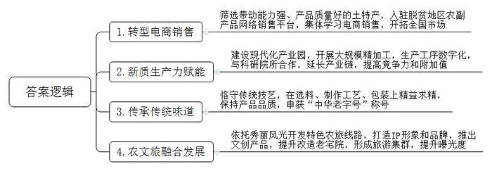
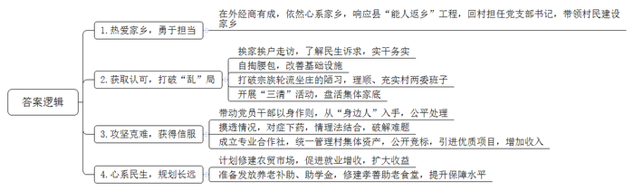
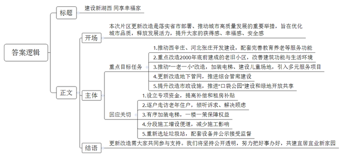
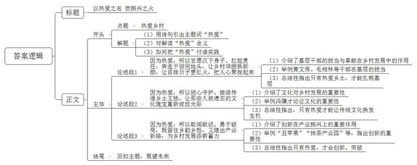

# 2025年山东省公考《申论》题（C卷）

<!-- gwy:overview:start -->
> **山东 · 2025 · 申论 · C类** ｜ 4 题 · 图片 4 处 · 答案随题折叠

导航：[题目](#题目) · [材料 1](#材料-1)
<!-- gwy:overview:end -->

> 候选采集稿。参考答案及解析来自粉笔页面，不代表官方答案或真实高分答卷；来源使用许可与原卷对应关系仍需人工核实。

## 给定材料

### 材料 1

“为什么我的眼里常含泪水？因为我对这土地爱得深沉……”对土地的热爱，是一种深沉而质朴的情感，它如同血液流淌在每一个热爱家国与生命的人心中。这份爱，不仅是对脚下那片坚实而温暖的土地的依恋，更是对大自然赋予我们生存之基、万物之源的感激与敬畏。

几千年的农耕社会，奠定了传统中国社会的乡土底色。在改革开放和现代化城市建设的进程中，乡村为城市提供了发展空间、环境容量、物质基础和人口红利。可以说，中国的城市脱胎于乡村，所以要认识到乡村的贡献，肯定农民的价值，不仅要念农民的情，还要记农民的好。

纪录片《乡村里的中国》以24节气为时间线索，呈现了H县一个乡村的生活百态。该片导演说：“我并没有学过电影和纪录片，拍摄这部作品的底气源自对乡土题材作品的喜爱和骨子里流淌着农民的血液，我就是当年从那片土地上出来的。”虽然离开乡村已经三四十年，但“农民的儿子”始终带着泥土的底色，让他不断回望和反思自己曾经生活的这片土地。

这部纪录片拍摄出了“老百姓怎么吃、怎么住、怎么生活，他们的困难是什么，他们的疑虑是什么，他们的追求是什么”，在这一意义上，完成对中国乡村客观的摹写。该片通过对当地真实的呈现，让我们认识到中国乡村社会的复杂性，更让我们深刻地明白：要想了解中国乡村的运行逻辑，必须走近她、亲历她，只有扎根实践才有发言权。

小琴不到18岁就打工供弟弟上学、农民因作物被糟蹋而大动干戈，这些情节在农村生活中并不鲜见，但开篇一位农民在阳光照耀的门前用清水写字，在现实压力的重担之下，仍然葆有对梦想的渴望和追求，这一幕有触动人心的力量。

通过这部纪录片我们可以发现，不论在农村还是城市，都有追求诗意生活的人，都有家长里短和鸡毛蒜皮，都有生命的困境和生存的努力。这不是一个城乡二元结构演变的故事，而是揭示了从农业社会走过来的中国农民可贵的精神——质朴、坚韧、肯干、向上。

越来越多的年轻人，在父辈的支持和鼓励下走出乡村，去探索、开拓更广阔的世界，与时光并行，当他们回望来路，发现乡村不止于出发和励志，更是回归和新生，是内心最真挚和深沉的热爱。

### 材料 2

“推动产业振兴，要把‘土特产’这3个字琢磨透。”香甜的苹果、清香的茶叶、香醇的面豉……近年来，各地产业振兴的带头人为了做活、做优、做强当地的土特产，真情投入、创新经营，努力让乡村“土味”香飘四海，以更高的“品味”走向广阔的市场。

“丑”苹果变身“致富果”

每天一大早，高原县田园种植专业合作社的负责人赵惠都会带工人一起，赶到山上的果园里忙碌。高原县平均海拔2000多米，是苹果优生带之一。由于当地苹果多数带有果斑，因而被称为“丑”苹果，但有着独特的冰糖心，口感香甜。“酒香也怕巷子深。”过去，因为地处偏远，果农们只能坐等收购商上门，好苹果卖不出好价钱，成为困扰当地干部群众的难题。

变化发生在2020年，高原县农业农村局筛选当地带动能力强、产品质量好的土特产，入驻财政部、农业农村部、全国供销总社打造的脱贫地区农副产品网络销售平台。赵惠抓住机遇，把“丑”苹果摆上平台货架，带领大伙学习电商销售，将自家苹果卖到全国各地。“丑”苹果走出大山，摇身变成了“致富果”。

抹茶留香，香飘世界

在梵净山脚下的飘香抹茶产业园内，建有大型精制车间，每年有约4000吨抹茶产品从厂房产出，运输至全球超40个国家和地区的消费者手中，在这个规模庞大的抹茶生产车间里，近95%的精制环节都由机器完成，只有后期定制化包装环节需要借助人工的力量。

抹茶的精制色选、灭菌、研磨等十几道工序全部数字化操作，既提高了生产效率，又可以从源头进行全产业链追溯。“接下来，我们将继续与科研院所合作，推进精深加工，真正将茶叶的深层价值充分挖掘出来，通过新质生产力赋能，延长产业链，提高竞争力和附加值，让抹茶香气留得更久、飘得更远。”产业带头人刘文博介绍。

百余年仍是“老味道”

清朝道光年间，杨氏商人因西江水清澈、民间酿造面豉之风盛行，遂在古劳镇创办“调珍酱园”，经营面豉、酱油，带动了当地酱料作坊的发展。到新中国成立前夕，小小的古劳镇并立着数十家酱料作坊。虽然竞争激烈，但杨氏商人在选料、制作工艺、包装上精益求精，调珍酱园出产的古劳面豉仍独占鳌头。一些华侨还将面豉带往美洲，作为儿时的乡情记忆。

时移世易，众多酱园历经国营、改制等历史阶段，形成今天的鹤山市东古调味食品有限公司，成为国家商务部首批“中华老字号”企业。虽然招牌变了，当家人、制酱师傅也换了新面孔，但他们始终没有丢掉传统的制酱技艺，制作的面豉依然保持着那份“老味道”。

融合共生，美美与共

土特产产区往往风光秀丽，多地做足“农业+”文章，推出与农时季节相适应的特色农旅线路，由之前传统的种植、加工逐步向新型业态拓展，走农文旅融合发展的新路子。

“这是我们不久前上线的新产品。”拎起一个印有卡通IP“水灵灵”的漂亮文创礼盒，东乡村党支部书记张国强介绍，“我们打破单打独斗的局面，与西乡村共同成立合作社，将东乡水芹、西乡白芹进行一体化策划，共创‘两芹相悦’品牌，设计了精美的产品礼盒，掀起了一波购买热。”最近，东乡村借助“万石粮仓”风景道和汇丰现代农业产业园，打造了一条以劳动创造、乡村文化为主的农耕研学路线，一经推出就广受好评。

安曲镇一群年轻的乡村致富带头人依托“安曲天路”沿线风光，对白鹿山前、合家峪村等农村老宅院进行提升改造，建成“半亩方塘”“归隐乡野”等六大板块，共12处小院，形成“一路生花”的旅游集群，成为天路脚下的诗意画卷。随着曝光度的增加，樱桃、小米等土特产也走俏市场，全国各地的游客既能来领略美丽“乡愁”，还能来品尝“安曲味道”。

### 材料 3

“乡村振兴，关键在人、关键在干。”近日，D县推出《咱们的村干部》系列节目，聚焦10名扎根基层、振兴乡村的优秀村党支部书记，充分展现他们在地方担当作为的先进事迹。在他们身上，集中体现了优秀基层干部的品质和能力，三河镇河西村党支部书记李伟民就是其中之一，前期，节目组对李伟民进行了采访，以下是采访笔录节选。

记者：李书记，听说您原来一直在外经商，能谈谈当初为什么回来干村党支部书记吗？

李伟民：这些年，我一直在外面做物流生意，干得还不错，也希望趁着自己年轻，回家乡给乡亲们出点力。2020年，县里实施“能人返乡”工程，镇党委王书记亲自找我谈话，希望我能回村担任党支部书记带领村民搞好家乡建设。说实话，出去这么多年了，对家乡的情况了解不透，能不能当好这个“带头人”心里也没底，但毕竟我的根在这儿，对家乡有很深的感情，还是义不容辞地答应下来了。

记者：您上任时，村里是什么情况呢？

李伟民：我们村是镇党委政府的驻地村，有村民1200多户，仅大姓就四五个，加上其他姓氏有十几个。党员轮流当过村干部，10年换了8个党支部书记。一到换届选举，你告我、我告你，谁也干不长，搞得乌烟瘴气。按理说，村里有区位优势，集体资产应该不少，我接手时一盘算，居然负债累累。虽然是驻地村，但还有部分路是土路，更不用说路灯照明了。另外，村务不公开，村里大事小事群众不知道，财务也长期不公开，一直是笔糊涂账。

记者：您是怎么打破这种局面，实现由“乱”到“治”的呢？

李伟民：在我们村，干部要想干成点事，首先得让老百姓认可你这个人。如果不认可，即使你说得再好，老百姓也不买账。上任后，我先挨家挨户串门，弄清楚大家想什么、盼什么、怨什么，在此基础上来了“三板斧”：一是树威信。先自掏腰包，硬化了村里的道路，安装了路灯，让老少爷们看到，咱是真心实意想干点事。二是调班子。在镇党委指导下，打破宗族轮流坐庄的陋习，让想干事、能干事的留下来，让有想法、有冲劲的年轻人补充进来，做到“不看门户看能力”，进一步理顺和充实了村两委班子。三是破难点。为把村里的糊涂账理清楚，开展了集体资产、债权债务、经济合同“三清”活动，清理违法违规合同45份，收回集体建设用地130多亩，盘活了集体家底。通过这“三板斧”，心气顺了，风气变了，村里的发展也走向正轨。

记者：这期间，您遇到过最大的阻力是什么？

李伟民：我认为，最难的是让老百姓打心底里服气。比如，我们在“三清”时，有很多村民租赁村集体用地搞生产经营，建设了一些临时厂房，且以非常低的价格与之前的村委会签订过长期合同，但承包费多年欠缴。我看了一下台账，很多承包户都是原来村干部的近亲属，这里面也有我的亲戚、发小，在清理时有很多说情打招呼的，遇到的阻力不小。我带领村里的党员干部，先从我们的“身边人”入手，清理和规范合同。针对一些难啃的“硬骨头”，摸透情况，对症下药，聘请律师配合，连续半个月上门做工作，讲透情、理、法，最终破解了僵局。我们成立专业合作社，对整合后的村集体资产统一管理，通过“三资”交易平台公开竞标，租金比原来上涨几十倍，引进了一批优质农业产业项目，为村集体经济每年增收200余万元。

记者：在您的治理下，村里发展越来越好，下一步有什么打算？

李伟民：当下，主要考虑两件事。一是扩大收益。我们计划在镇政府驻地北侧的云岭路修建占地30亩的农贸市场，鼓励农户摆摊经营，努力实现“人人有活干、户户有收益”。二是提升保障。作为一名村干部，眼里得看得见群众的困难。我们准备给村里60岁以上的老人每年量力发放养老补助，给考上大学的困难学生发助学金。另外，我们计划依托镇驻地改造实施的“阳光新城”项目，建设300平方米的孝善助老食堂，解决村内部分空巢、高龄老人的吃饭难题。

### 材料 4

党的二十届三中全会提出，建立可持续的城市更新模式和政策法规。今年，S省坚持以人民为中心，优选了160个城市更新项目，在政策、资金上加大支持力度，为城市高质量发展赋能。A市W区的湖西片区项目是其中之一，涉及CBD建设、老旧小区改造、基础设施更新等，旨在优化城市品质，释放发展活力，提升群众的获得感、幸福感、安全感。为确保城市更新有序推进，W区深入评估资源条件、更新潜力和发展需求，坚持“拆改升”并举，科学确定更新内容和时序，配套制定了一揽子政策措施：

（1）片区开发建设。加强资金筹措，优化规划布局，按照“当年拆、当年建、就地安置、三年回迁”的要求，推动西辛庄、河北张庄2个城中村开发建设，配套完善教育、养老等服务功能，打造宜居宜业的高品质城市社区。

（2）老旧小区改造。重点改造2000年底以前建成的老旧小区，按基础类、完善类、提升类3个类别，制定老旧小区改造标准，持续改善建筑功能，提升生活环境品质。

（3）适龄化改造。重点推动“一老一小”适龄化改造，加装电梯100部，建设儿童友好活动场地2万平方米，引入养老、托育、助餐等服务项目。

（4）地下管网改造。对燃气、热力、给排水、强弱电等城市地下管网实施更新改造，因地制宜推进城市地下综合管廊建设，提升城市地下管网整体水平。

（5）市政基础设施提升。对生活垃圾分类、物流设施等市政基础设施进行提升改造，补齐城市基础设施短板弱项；提升城市绿地服务功能，推进“口袋公园”建设和绿地开放共享。

为推动政策落地落实，抓好片区综合更新改造，该项目所在的湖西街道办事处进行了摸底调研，痛点堵点主要集中在：片区开发建设涉及征迁户406户，有95%左右的住户有动迁意向，部分对征迁补偿标准不满意，部分住户认为“躲迁”期间租房补贴偏低；老旧小区改造涉及3个小区，均为1995年单位自建房，居住群体多为60岁以上老年人，部分住户改造意愿不高；适老化改造加装电梯，需经本单元三分之二以上的业主同意，政府补贴标准为每部电梯10万元，多数一楼业主不同意加装；地下管网改造需要破路，会对沿街商铺经营、群众日常出行造成较大影响，工期预计2个月；计划建设1处垃圾转运站，规划选址调研过程中，周边部分群众表示反对，予以抵制。

近日，湖西街道办事处将面向片区群众代表，组织召开片区更新改造宣传动员会，进一步统一思想认识、明确目标任务、回应群众关切、争取群众支持，真正把惠民利民的好事办好。

### 材料 5

2021年冬天，一粒不足4毫米长的炭化稻米亮相中国国家博物馆，举世瞩目。这粒在浙江上山遗址被发现的“万年稻米”，是迄今为止考古发现的世界上最早的栽培稻米，是稻作文明起源于中国的有力佐证。推动上山文化、“万年稻米”走向世界舞台，背后起到重要作用的是一位基层干部——原浙江省浦江县委常委、宣传部部长徐利民。

2005年，浦江县虞宅乡山区水源紧张。当时，徐利民刚刚上任虞宅乡乡长，面对乡亲们的用水难题，他和“一班人”作出一个大胆的决定：修建一个可以为14个村供水的水库。他掷地有声地对大家说：“只要对老百姓有利，困难再大也要做。”抱着这样的决心，徐利民开始了水库建设筹备工作。为了寻找一个理想的水库建设点，他带领同事们冒着酷暑，一趟趟往深山老林里钻，爬遍了虞宅乡所有的山头，一副手套、一把镰刀，饿了吃饼干，渴了喝山泉水，工地跑了无数趟。就这样，短短两年，徐利民就带领大家完成了深清源水库的建设。如今，只要水龙头一拧，水就能流进老百姓的家里，也流进了老百姓的“心里”。

2019年10月，徐利民就任浦江县委常委、宣传部部长，第一时间到上山遗址博物馆调研，凝视着“万年稻米”，他心里思忖着，“原来早在一万年前，上山先民们就已走出洞穴、搭建房子，过上了农耕定居生活。他们驯化野生作物，推动了农业变革。”古老的上山文化，在他心里一次次激荡起波澜，责任感、使命感油然而生。“一定要把宝贵的上山文化保护好，传承好，弘扬好！”为擦亮“上山文化”品牌，他多方考察、呕心沥血，走遍了上山的每一寸土地；为提升宣传效果，一篇述评他字斟句酌，足足改了31稿，大家想不明白，到底是什么让他如此在意上山。“或许是有缘吧，二十年前我从农校农学专业毕业，就与上山稻作相连了，这也意味着我必须担起为上山具体谋划的责任。”

2020年是上山遗址发现20周年，徐利民暗下决心，必须抓住这一难得的机会，通过举办学术研讨会，广邀专家学者，为上山文化的保护、传承和弘扬指导把脉。徐利民带领团队奔赴北京，向考古界泰斗当面汇报上山文化研究的进展和成效，得到悉心指导。2020年11月，上山遗址发现20周年学术研讨会如期举办，形成了“上山文化是中国农耕村落文化的源头”这一重要共识。然后，徐利民的心中又萌生了一个更远的目标：让上山走向世界！

如何才能迈出走向世界的第一步？徐利民想到了在中国国家博物馆办展。2021年6月，国博策展人员受邀来到上山遗址博物馆。刚开始，他们没有想到，那个对上山文化一点一滴都了然于胸，对每一件展品如数家珍、娓娓道来的讲解员，是县委宣传部部长。在接下来的五个月里，徐利民全程与策展人员密切沟通，精心挑选了近200件涵盖上山文化早、中、晚期的文物，布展顺序、标签位置、字号大小他都反复琢磨、逐一核对。那段时间他就只有一个念头，就是将上山文化完美地呈现在全世界观众面前。2021年11月21日，稻·源·启明——浙江上山文化考古特展正式开展。五个月的展期，吸引了国内外100多万名观众，这一古老文明走进了公众视野、国际视野。借助上山文化特展的影响力，上山文化的宣传声势一浪接着一浪、一浪高过一浪……

2022年8月初，徐利民积劳成疾，短短不到一个月的时间，他的生命就进入了倒计时。即便在生命的尽头，徐利民最牵挂的还是上山，他的微信头像一直是上山遗址照片，他的朋友圈满是上山遗址的宣传报道。徐利民生前常说一句话，“人总要为什么而燃烧”。当在虞宅乡建水库披荆斩棘时，当为宣传上山文化马不停蹄时，他的心中始终跃动着一团火，那是一种热爱，是对脚下这片土地的爱，是对这片土地上生活的人们的爱。

<u><u>因为热爱，所以燃烧！</u></u>

## 题目

### 第 1 题

**请根据****“给定资料**2**”，归纳概括“土味”怎样转化成“品味”。****（****15分****）**

关联材料：材料 2

作答要求：

要求：全面、准确，有条理，不超过250字。

第 1 题 · 答案与解析

**参考答案（粉笔题库参考内容）**

1.转型电商销售。筛选带动能力强、产品质量好的土特产，入驻脱贫地区农副产品网络销售平台，集体学习电商销售，开拓全国市场。

2.新质生产力赋能。建设现代化产业园，开展大规模精加工，生产工序数字化，与科研院所合作，延长产业链，提高竞争力和附加值。

3.传承传统味道。恪守传统技艺，在选料、制作工艺、包装上精益求精，保持产品品质，申获“中华老字号”称号。

4.农文旅融合发展。依托秀丽风光开发特色农旅线路，打造IP形象和品牌，推出文创产品，提升改造老宅院，形成旅游集群，提升曝光度。

**解析**

**参考答案说明**：本参考答案从“转型电商销售”“新质生产力赋能”“传承传统味道”“农文旅融合发展”四个方面展开，各条答案要点之间在内容上相互并列，没有交叉。

**考点**：概括措施类

**来源**：2025年山东省公考《申论》题（C卷）

### 第 2 题

**请根据****“给定资料**3**”****，分析村党支部书记李伟民为何能够****入****选《咱们的村干部》系列节目。****（****20分****）**

关联材料：材料 3

作答要求：

要求：理解准确，分析透彻，条理清晰，不超过300字。

第 2 题 · 答案与解析

**参考答案（粉笔题库参考内容）**

1.热爱家乡，勇于担当。在外经商有成，依然心系家乡，响应县“能人返乡”工程，回村担任党支部书记，带领村民建设家乡。

2.获取认可，打破“乱”局。挨家挨户走访，了解民生诉求，实干务实；自掏腰包，改善基础设施；打破宗族轮流坐庄的陋习，理顺、充实村两委班子；开展“三清”活动，盘活集体家底。

3.攻坚克难，获得信服。带动党员干部以身作则，从“身边人”入手，公平处理；摸透情况，对症下药，情理法结合，破解难题；成立专业合作社，统一管理村集体资产，公开竞标，引进优质项目，增加收入。

4.心系民生，规划长远。计划修建农贸市场，促进就业增收，扩大收益；准备发放养老补助、助学金，修建孝善助老食堂，提升保障水平。

**解析**

**参考答案说明**：本参考答案从“热爱家乡，勇于担当”“获取认可，打破‘乱’局”“攻坚克难，获得信服”“心系民生，规划长远”四个方面展开，各条答案要点之间在内容上相互并列，没有交叉。

**考点**：单一题

**来源**：2025年山东省公考《申论》题（C卷）

### 第 3 题

**请根据****“给定资料**4**”，为湖西街道办事处主任草拟一份片区更新改造宣传动员会的讲话提纲。****（****25分****）**

关联材料：材料 4

作答要求：

要求：紧扣资料，内容全面，重点突出，结构完整；不超过400字。

第 3 题 · 答案与解析

**参考答案（粉笔题库参考内容）**

建设新湖西 同享幸福家

开场：本次片区更新改造是落实省市部署、推动城市高质量发展的重要举措，旨在优化城市品质，释放发展活力，提升大家的获得感、幸福感、安全感。

重点目标任务：1.推动西辛庄、河北张庄开发建设，配套完善教育养老等服务功能。2.重点改造2000年底前建成的老旧小区，改善建筑功能与生活环境。3.推动“一老一小”改造，加装电梯、建设儿童场地，引入多元服务项目。4.更新改造地下管网，推进综合管廊建设。5.提升改造市政设施，推进“口袋公园”建设和绿地开放共享。

回应关切：1.设立专项资金，提高补偿和租房补贴。2.逐户走访老年住户，倾听诉求、解决顾虑。3.有序加装电梯，一楼一策保障权益。4.分段施工增设便道，减少施工影响。5.重新选址垃圾站，配套设备并公示接受监督。

结语：更新改造需大家共同参与支持。我们将坚持公开透明，努力把好事办好，共建宜居宜业新家园！

**解析**

**参考答案说明：**（1）格式方面，本参考答案写到了“标题”“正文”两个部分。（2）正文部分，一方面从内容上来看，围绕“片区更新改造”这一主题，本参考答案的开头先简单介绍了开场；主体部分先介绍了片区更新改造的重点目标任务，然后介绍了对群众的回应关切；结尾进行了总结展望。另一方面，形式上，本参考答案做到了分段、分条撰写，整体上条理较为清晰。

**考点**：宣传类

**来源**：2025年山东省公考《申论》题（C卷）

### 第 4 题

**请围绕对****“给定资料**5**”中划线句子“因为热爱，所以燃烧****！****”的理解，结合全部给定资料，自拟题目，写一篇议论文。****（****40分****）**

关联材料：材料 1、材料 2、材料 3、材料 4、材料 5

作答要求：

要求：

（1）观点明确，见解深刻；

（2）参考给定资料，但不拘泥于给定资料；

（3）逻辑清晰，语言流畅；

（4）字数1000~1200字。

第 4 题 · 答案与解析

**参考答案（粉笔题库参考内容）**

**参考答案一**

**以热爱之名 燃振兴之火**

“为什么我的眼里常含泪水？因为我对这土地爱得深沉。”这句饱含深情的诗句，道出了无数人对脚下这片土地炽热的爱。这份热爱，源于血脉里对故土的依恋、对田园自然的敬畏与感恩，也承载着世世代代农民对美好生活的渴望与追求。从扎根基层服务到共建美好家园，从守护文化根脉到革新产业模式，无数人以热爱为燃料，燃烧自己，照亮了乡村振兴的前行之路。

**因为热爱，所以甘愿沉下身子、扛起责任，奔走于田间地头，让乡村旧貌换新颜，让百姓日子更红火，把人心聚拢起来****。**乡村的发展离不开基层干部的担当与奉献。黄文秀研究生毕业后放弃大城市优渥条件，回到百色任驻村第一书记，走村串户记满村民需求，争项目修通致富路、引技术发展砂糖橘产业，让百坭村贫困发生率大幅下降；毛相林扎根巫峡深处，带领村民绝壁凿路，历时7年铺就8公里“天路”，又引产业、搞旅游，让下庄村从“穷山沟”变成“致富村”。他们用行动诠释：唯有心怀对乡土的热爱，才能扎根基层、担当作为，凝聚起共治共享的强大合力，为乡村发展注入不竭动力。

**因为热爱，所以倾心守护、接续传递乡土文脉，让那些久被遗忘的文化瑰宝重新绽放光彩****。**文化是乡村的灵魂，是连接过去与未来的桥梁。冯骥才便是心怀热爱的典范，他一直钟情于传统村落文化，多年来不辞辛劳，自费组织团队深入全国众多古村落调研考察，积极奔走呼吁保护这些即将消逝的文化瑰宝。正如冯骥才所言：“文化真正的根扎在农村。”热爱是打开文化宝库的钥匙，唯有以赤子之心深耕乡土，才能让传统技艺、民俗风情在时代浪潮中扎根生长。这种热爱不是一时兴起，而是将个人情感升华为文化使命，使古老文明焕发永恒魅力。

**因为热爱，所以敢闯敢试、勇于破局，既留住乡韵乡愁，又蹚出产业新路，为乡村发展添薪蓄力****。**在产业振兴的道路上，创新是关键。高原县的“丑苹果”曾因外观不佳而难以进入主流市场，但在电商直播等新模式的推动下，“丑”苹果成功走出深山，真正变成了致富一方的“金果子”。梵净山脚下的抹茶产业园，依托数字化车间实现全流程追溯与高效生产，提升附加值，推动抹茶香飘世界。这些实践告诉我们，只有心怀热爱，才能勇于创新，敢于突破，让乡村产业在市场竞争中脱颖而出。

“志之所趋，无远弗届，穷山距海，不能限也。”对乡村的热爱，是一种强大的精神力量，让我们以热爱之名，燃乡村之火，共同书写乡村发展的壮丽篇章，让乡村这片承载希望与梦想的土地绽放出更加绚烂的光彩。

**文章分析：**

**以热爱之名 燃振兴之火**

【**标题的优点：**标题中包含“热爱乡村”这一主题，使文章主题更突出、清晰。】

（1）“为什么我的眼里常含泪水？因为我对这土地爱得深沉。”这句饱含深情的诗句，道出了无数人对脚下这片土地炽热的爱。（2）这份<u><u>热爱</u></u>，源于<u><u>血脉里对故土的依恋</u></u>、<u><u>对田园自然的敬畏与感恩</u></u>，也<u><u>承载着世世代代农民对美好生活的渴望与追求</u></u>。（3）<u><u>从扎根基层服务到共建美好家园</u></u>，<u><u>从守护文化根脉到革新产业模式</u></u>，无数人以热爱为燃料，燃烧自己，照亮了乡村振兴的前行之路。

【**开头的优点：**★内容方面。范文的开头是紧扣“热爱乡村”这一主题展开的。（1）用诗句引出主题词“热爱”；（2）解读“热爱”含义；（3）如何把“热爱”付诸实践。★文字表达方面。使用了“从……到……”等关联词，使语言表达有逻辑性；长短句配合使用，使得语言表达有节奏感。】

**因为热爱，所以甘愿沉下身子、扛起责任，奔走于田间地头，让乡村旧貌换新颜，让百姓日子更红火，把人心聚拢起来**。（1）<u><u>乡村的发展离不开基层干部的担当与奉献</u></u>。（2）<u><u>黄文秀</u></u>研究生毕业后放弃大城市优渥条件，回到百色任驻村第一书记，走村串户记满村民需求，争项目修通致富路、引技术发展砂糖橘产业，让百坭村贫困发生率大幅下降；<u><u>毛相林</u></u>扎根巫峡深处，带领村民绝壁凿路，历时7年铺就8公里“天路”，又引产业、搞旅游，让下庄村从“穷山沟”变成“致富村”。（3）他们用行动诠释：<u><u>唯有心怀对乡土的热爱</u></u>，<u><u>才能扎根基层</u></u>、<u><u>担当作为</u></u>，凝聚起共治共享的强大合力，为乡村发展注入不竭动力。

【**论述段****1****的优点：**★观点句：范文的观点句是紧扣“热爱乡村”这一文章主题提出的。形式上，它在段首处直接写出，位置突出，容易发现。内容上，关键词突出，内容要点明确，可以明显看出主要论述“因为热爱，所以要扎根基层、凝聚人心”。★论述内容：（1）介绍了基层干部的担当与奉献在乡村发展中的作用；（2）举例黄文秀、毛相林等干部在基层的担当；（3）总结性指出只有热爱乡土，才能扎根基层。注意：以上几个方面的内容都是紧扣“因为热爱，所以甘愿沉下身子、扛起责任，奔走于田间地头，让乡村旧貌换新颜，让百姓日子更红火，把人心聚拢起来”这个观点句进行分析论述的，论述的针对性强，内容层次丰富。在论述方法上主要采用了讲道理、举例子相结合的方式，论述充实深刻。】

**因为热爱，所以倾心守护、接续传递乡土文脉，让那些久被遗忘的文化瑰宝重新绽放光彩**。（1）<u><u>文化是乡村的灵魂</u></u>，<u><u>是连接过去与未来的桥梁</u></u>。（2）<u><u>冯骥才</u></u>便是心怀热爱的典范，他一直钟情于传统村落文化，多年来不辞辛劳，自费组织团队深入全国众多古村落调研考察，积极奔走呼吁保护这些即将消逝的文化瑰宝。正如冯骥才所言：“文化真正的根扎在农村。”（3）<u><u>热</u></u><u><u>爱是打开文化宝库的钥匙</u></u>，唯有以赤子之心深耕乡土，<u><u>才能让传统技艺</u></u>、<u><u>民俗风情在时代浪潮中扎根生长</u></u>。这种热爱不是一时兴起，而是将个人情感升华为文化使命，使古老文明焕发永恒魅力。

【**论述段****2****的优点：**★观点句：范文的观点句是紧扣“热爱乡村”这一文章主题提出的。形式上，它在段首处直接写出，位置突出，容易发现。内容上，关键词突出，内容要点明确，可以明显看出主要论述“因为热爱，所以要传承乡土文化”。★论述内容：（1）介绍了文化对乡村发展的重要性；（2）举例冯骥才论证文化的重要性；（3）总结性指出只有热爱才能让传统文化焕发生机。注意：以上几个方面的内容都是紧扣“因为热爱，所以倾心守护、接续传递乡土文脉，让那些久被遗忘的文化瑰宝重新绽放光彩”这个观点句进行分析论述的，论述的针对性强，内容层次丰富。在论述方法上主要采用了讲道理、举例子相结合的方式，论述充实深刻。】

**因为热爱，所以敢闯敢试、勇于破局，既留住乡韵乡愁，又蹚出产业新路，为乡村发展添薪蓄力**。（1）<u><u>在产业振兴的道路上</u></u>，<u><u>创新是关键</u></u>。（2）<u><u>高原县的</u></u>“<u><u>丑苹果</u></u>”曾因外观不佳而难以进入主流市场，但在电商直播等新模式的推动下，“丑”苹果成功走出深山，真正变成了致富一方的“金果子”。<u><u>梵净山脚下的抹茶产业园</u></u>，依托数字化车间实现全流程追溯与高效生产，提升附加值，推动抹茶香飘世界。（3）这些实践告诉我们，只有心怀热爱，<u><u>才能勇于创新</u></u>，<u><u>敢于突破</u></u>，让乡村产业在市场竞争中脱颖而出。

【**论述段****3****的优点：**★观点句：范文的观点句是紧扣“热爱乡村”这一文章主题提出的。形式上，它在段首处直接写出，位置突出，容易发现。内容上，关键词突出，内容要点明确，可以明显看出主要论述“因为热爱，所以要创新产业发展”。★论述内容：（1）介绍了创新在产业振兴上的重要作用；（2）举例“丑苹果”“抹茶产业园”等，指出创新的重要性；（3）总结性指出只有热爱，才会创新、突破。注意：以上几个方面的内容都是紧扣“因为热爱，所以敢闯敢试、勇于破局，既留住乡韵乡愁，又蹚出产业新路，为乡村发展添薪蓄力”这个观点句进行分析论述的，论述的针对性强，内容层次丰富。在论述方法上主要采用了讲道理、举例子相结合的方式，论述充实深刻。】

【**论述段之间的关系**：★内在逻辑上：文章先论述“因为热爱，所以要扎根基层、凝聚人心”，再论述“因为热爱，所以要传承乡土文化”，最后论述“因为热爱，所以要创新产业发展”，并列逻辑清晰严谨。】

“志之所趋，无远弗届，穷山距海，不能限也。”对<u><u>乡村的热爱</u></u>，是一种强大的精神力量，<u><u>让我们以热爱之名</u></u>，<u><u>燃乡村之火</u></u>，共同书写乡村发展的壮丽篇章，让乡村这片承载希望与梦想的土地绽放出更加绚烂的光彩。

【**结尾的优点：**范文的结尾回扣了“热爱乡村”这个主题，并且进行了展望，发出了号召。】

**参考答案二**

**以赤诚热爱 筑发展新篇**

热爱是初心火种，实干是奋进力量。徐利民同志扎根乡土，用行动诠释“因为热爱，所以燃烧”。一方土地的蓬勃发展、一方百姓的安居乐业，源于真挚的乡土情怀、精进务实的过硬本领、同心共治的团结力量，更源于造福于民的坚定担当。新时代唯有以热爱立心、以本领立身、以聚力成事、以实干惠民，方能让初心之火永续燃烧，铸就发展新貌。

**心怀赤诚热爱，厚植乡土情怀，守住扎根实****干****的初心根基**。真挚的奋斗，始于对土地、人民与本土文脉的纯粹热爱。乡土文脉是一方水土的精神根脉，唯有真心眷恋故土、真情牵挂群众、真诚守护本土文化，才能沉下心扎根一线、踏实干事。无数乡土守护者默默深耕、传承文脉，用坚守留住乡土底蕴。这份根植心底的深情，是干事创业最纯粹、最坚实的初心根基。

**空有满腔热爱远远不够，真挚的情怀必须依托过硬本领方能落地见效。**热爱是初心起点，精进是成事关键，情怀唯有转化为实干本领与创新突破，方能激活发展动能。区域发展提质增效，离不开资源盘活、产业升级、业态创新的硬核支撑。真正的热爱，不是止步于眷恋与坚守，而是以热爱为动力精进求索、突破创新。立足乡土实际深耕主业、潜心钻研，敢于打破固有模式、攻克发展难题，因地制宜盘活本土资源、培育特色业态、补齐产业短板，以专业本领破解发展瓶颈，让质朴的乡土情怀转化为驱动区域进阶、产业提质的强劲动能。

**个人的能力本领是发展基石，想要实现长远发展，更要凝聚团队力量、汇聚集体合力。**独行快，众行远，个人的微光唯有汇聚成集体炬火，方能成就长远发展大业。地方发展建设从不是一人之功，既需要实干先锋率先垂范勇挑重担，更需要建强骨干队伍、唤醒群众主体意识，凝聚全民共建共治的强大力量。优秀的奋斗者以自身实干担当的热忱为标杆，以身作则、示范引领，用执着坚守与奋进姿态感染身边团队、带动广大群众，以热爱为纽带凝聚人心、统一共识，让个体的奋斗追求升华为干群同心、携手共建的集体信念，汇聚起振兴发展的磅礴合力。

**个人实干的本领、万众同心的合力，最终的落脚点与归宿，必然是惠及民生、造福群众。**一切坚守、精进与聚力，最终都要以群众的获得感、幸福感为根本标尺。发展的最终目的，是回应群众期盼、破解民生难题、增进百姓福祉。所有扎根乡土的坚守探索、攻坚克难的创新实践、同心同向的共建奋斗，最终都聚焦于民生提质、群众增收。把产业升级的红利、治理优化的成效、队伍共建的力量，切实转化为百姓看得见、摸得着的实惠，补齐民生短板、改善生活品质，让每一份赤诚热爱、每一次实干奋进，都真正润泽万家、造福一方。

“鸟飞反故乡兮，狐死必首丘。”万物犹怀故土之情，徐利民同志燃尽一生扎根乡土，用生命诠释对这片土地深沉的热爱。这份眷恋不止于心间情怀，更要化作实干行动，锤炼本领、凝聚合力，将对故土的赤诚转化为服务群众的担当，以实干增进民生福祉，让热爱永远在乡土大地上燃烧。

张小龙 2026年10月12日初入齐鲁大地德州地界

**解析状态：unknown（来源未提供）**

**考点**：文章写作题

**来源**：2025年山东省公考《申论》题（C卷）

