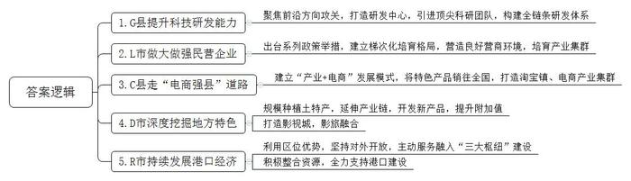
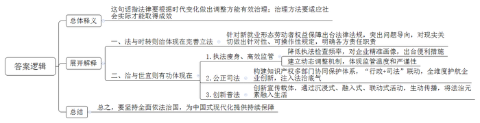
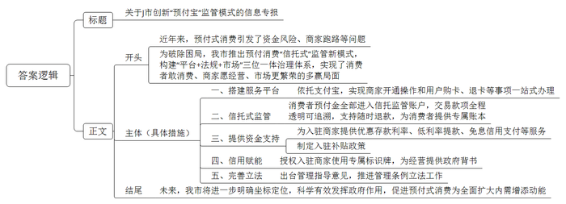
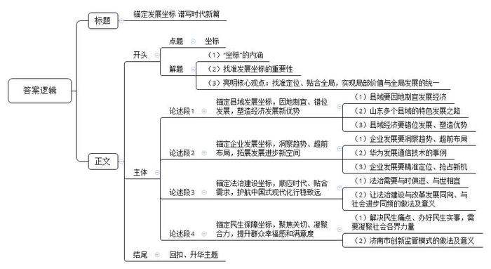

# 2026年山东省公考《申论》题（B卷）

> 候选采集稿。参考答案及解析来自粉笔页面，不代表官方答案或真实高分答卷；来源使用许可与原卷对应关系仍需人工核实。

## 给定材料

### 材料 material-eef9541282b00194

党的十八大以来，习近平总书记围绕促进县域经济高质量发展作出一系列重要论述，强调“更好发挥县城连接城市、带动乡村作用”“因地制宜推动兴业、强县、富民一体发展”。《中共中央关于制定国民经济和社会发展第十五个五年规划的建议》提出，发展各具特色的县域经济。S省作为我国东部沿海大省，近年来深入贯彻落实习近平总书记重要指示要求，推动各地在全国大局中找准县域坐标、错位发展、串珠成链，持续塑造县域经济新优势。2024年，S省有28个县（市、区）GDP过千亿元，2025年有12个县（市）上榜全国“百强县”榜单。

在G县源晟橡胶生产车间，研发人员正在对用于新能源汽车的静音轮胎进行性能测试。该企业实验部部长介绍：“这款轮胎能在汽车行驶100KM/h时，使车内噪音能降低10个分贝，一经问世便备受市场青睐。不仅如此，我们还聚焦低滚动阻力、材料轻量化等前沿方向攻关，目标是让轮胎成为提升我国新能源汽车产业整体竞争力的关键一环。”

G县虽是闻名遐迩的“轮胎之都”，但本地企业的研发能力曾有短板。面对这一困境，县政府联合高校打造高端橡胶轮胎研发中心，积极引进两院院士领衔的科研团队，构建覆盖材料配方、设备制造、成型工艺一体的全链条研发体系，为传统产业升级“搭梯铺路”。目前，全县已有8家企业跻身全球轮胎75强，该县入选全国科技创新百强县（市）、S省技术转移先进县。

很多人了解L市是因为其盛产粉丝，但很少有人知道，L市拥有12家上市企业，有“江北A股第一县”的美誉。今年上半年，L市七大主导产业产值超千亿元、同比增长30%以上。其中，以民营企业为主的高端铝产业链相关企业有150多家，获评国家中小企业特色产业集群和S省“十强产业”雁阵形集群。

“多年来，L市始终注重支持引导民营企业做大做强、向好发展。”该市相关部门负责人向媒体介绍，L市先后出台上市规范补助、融资与融资支持等方面的一系列政策举措，建立梯次化培育格局，在行政审批、政务服务、基础设施和公共服务配套等方面为民营企业营造良好的环境。目前，全市各类市场主体突破12万，平均每6个人就有1个市场主体，以民营企业巨头为引领的产业集群，成为L市经济发展的重要引擎。

深秋清晨的C县数字经济产业园内，快递车往来穿梭，汉服直播间里上演着上架“秒空”的震撼场面，分拣的工人正在把包装好的木质产品发往全国各地……随着双十一购物节的到来，C县再次迎来电商产业的爆发式增长，汉服、木制品、宠物用品、芦笋等商品订单不断，销售异常火爆。

通过“产业+电商”发展模式，越来越多的农民将当地的特色产品销往全国各地，实现了产品前端和消费者末端的无缝连接。C县电商发展服务中心负责人介绍，目前，全县共有21个淘宝镇，181个淘宝村，电商企业达8476家，网店超9.12万个，直接带动35万人创业就业，今年1-9月实现网上销售额311亿余元。如今的C县，已凭借着全国淘宝镇数量第一、电商产业集群第二的强劲实力，成为全国县域电商版图上的亮眼坐标。C县闯出了一条“农业大县”向“电商强县”的跨越新路。

“土特产也能变成‘金疙瘩’。”在D市第十届主流媒体和网络达人采风活动上，D市农业农村局负责人介绍，作为中国金丝小枣之乡，我们将传统土特产作为乡村振兴的核心引擎，在规模种植的同时，通过创新研发开发出枣花蜜、枣膳食纤维、枣类保健品等10大系列300余种产品，产品附加值提升了5-10倍，实现了“一颗枣”到“一条链”的价值裂变。目前，D市已培育省级以上龙头企业18家，成为全国最大的红枣交易市场和深加工基地，网上销售额占比超40%，金丝小枣文化旅游节、红枣暨健康食品产业博览会累计销售额超200亿元。

让这座北方小城出圈的，除了衍生出健康食品矩阵的“一颗小枣”，还有今年新晋为“影旅标杆”的D市影视城。作为多部年度热门影视作品的实景拍摄地，游客可以在这里进行沉浸式体验，百余场全时段演出让“一秒入戏”成为常态。作为曾经的无名小城，D市通过影旅融合的差异化路径，从影视拍摄地蜕变为全国文旅新地标。中秋国庆假期期间，尽管遭遇持续降雨，影视城仍接待游客20余万人次，其中沉浸式街区连续两天荣登短视频平台全国第一，真正实现了“一部剧带火一座城”。

R市A区港区，泊位星罗棋布，巨轮往来集散。发自K省的平板半挂车，几周后将行驶在埃及尼罗河畔；产自M省的线缆，20多天后将在印尼连接各岛间的通讯……在全球贸易承压大背景下，A区对外贸易保持强劲动能，2024年实现外贸进出口总值250.3亿元人民币，同比增长25.2%。

“临港作为R市A区得天独厚的天然优势，港口经济对全区GDP的贡献率已突破30%。”区政府负责人表示，A区坚持把港口作为对外开放的龙头，主动服务融入北方能源、黄河流域陆海联动转换、港口型国家物流“三大枢纽”建设，通过港城联动招商、涉港项目合资合作、搭建供应链金融平台，将港口资源、开放优势持续不断地转化为高质量发展的经济流量、产业增量。同时，积极整合资源，在政策、土地、人才、营商环境等方面对港口给予全力支持，真正做好“强港、兴产、活城”的大文章。

### 材料 material-172e30784cbd5c97

在全民普法40周年、八五普法规划收官、《中华人民共和国法治宣传教育法》正式施行之际，11月5日，由H市广播电视台策划的大型融媒体行动《法治H市2025——全民普法》走进Y区，通过“体验+探访”形式，用镜头细腻呈现Y区全民普法和法治建设成果。

镜头一：一部新规

“外卖员进不了小区咋办？平台不签劳动合同咋办？遇到恶意投诉咋办？这些问题规定里都讲了吗？”……11月5日，在新就业群体党群服务中心，市人大、区政府相关部门负责同志与平台企业代表、专家学者、新就业群体代表坐在一起，就刚出台的《H市新就业形态劳动者劳动权益保障规定》进行面对面宣讲解读。

“新就业形态劳动者享有平等就业和选择职业、取得劳动报酬、休息休假、获得劳动安全卫生保护、接受职业技能培训、享受社会保险和福利、提请劳动争议处理以及法律规定的其他劳动权益。跟其他劳动者一样，都应该受到全社会的关心尊重和法律的保护支持。”市人大法工委负责人曹副主任介绍，作为首部由地方立法的新就业形态劳动者权益保障规定，该规定突出问题导向，对劳动关系、社会保障、平台算法、考核机制等现实关切做了针对性、可操作性规定，明确了平台企业、平台用工合作企业责任和政府各相关部门职责。

“近年来，围绕新就业群体权益保障和劳动纠纷化解，区委社会工作部牵头搭建了‘平台+社保+仲裁+法院’的协调机制，在全区设立了27个工会法律服务站点，并打造‘E路同行’数字化服务平台。新规的出台，让我们对今后的工作更有信心和底气，一张由政府、企业、社会共同编织的‘关爱网’，正在这座城市越织越密。”区委社会工作部林副部长说。

镜头二：一次“瘦身”

“自从公司进入AEO试点名单后，明显感受到执法检查频率的降低，大大节约了公司人力物力，让我们能够将更多时间精力投入到生产经营中。”Y区亿荣科技总经理张玮表示。

张玮口中所说的“AEO”是指H市年初出台的工业领域经认定的经营者制度，“经认定的经营者”是世界海关组织对高信用等级企业的统称。H市借鉴海关AEO制度经验，以Y区等三个区县为试点，聚焦集成电路、生物医药、人工智能、高端装备等重点产业的制造企业，依托近三年行政执法检查和信用大数据，从法规合规、税款缴纳、外部信用、管理要求四大维度进行精准画像，通过“免申即享+告知承诺”的方式，对认定企业试点实施免于现场检查等便利措施。

“该项制度试点涉及市场监管、工信、卫健等7个领域83项中低风险行政检查情形。”Y区工信局王副局长介绍，对于低风险事项，原则上3年内免于检查；对于中风险事项，每年仅检查1次，且优先采用非现场方式进行。同时，建立动态调整机制，对信用修复达标企业及时纳入，对违规企业给予3个月整改期，整改到位则保留资格。这种“有进有出”的管理方式，既体现了监管温度，又确保试点严谨性。

“从‘综合查一次’到‘告知式执法’，从‘政务服务体验官’到‘AEO制度试点’，一系列的执法‘瘦身’、高效监管举措正在不断给企业松绑减负，为市场活力赋能。”Y区高端装备产业协会祝会长对记者表示。

镜头三：一场判决

“法治不会让老实人吃亏！”在Y区灵运机械科技有限公司，该公司董事长李良回忆起去年那场惊心动魄的诉讼，向记者发出感叹。

灵运公司主营机械设备的研发与制造。自2019年起，一家同业竞争企业两次以专利侵权为由，把灵运公司告上法庭，均以失败告终。2023年7月，在灵运公司上市审核期间，对方第三次对其提起专利侵权诉讼，索赔金额从前两次的800万元飙升至2300万元。

知识产权侵权纠纷是上市审核的重中之重，一旦处理不当，不仅会使公司商誉受损，前期投入付诸东流，还可能被彻底赶出赛道。李良很清楚，灵运公司遇到创立以来最危险的困境，“那一段时间天天失眠，有人建议我拿2300万元换取对方撤诉，但我怎么都接受不了，明摆着是恶意诉讼，凭什么！”想起前两次诉讼经历，李良决定应诉。

随着调查深入，真相浮出水面。该同业竞争企业明知涉案专利稳定性较差，被控侵权产品明显缺少特定技术特征，仍提起诉讼；此前已知晓被控侵权产品存在，却到灵运公司上市关键期才提起诉讼；索赔金额正好满足信息披露规则要求的“占公司最近一期经审计净资产绝对值10%以上”，灵运公司不得不披露信息，中止上市审核……种种证据表明，这就是恶意诉讼，李良立刻提起反诉。

2024年10月，法院宣判，驳回对方诉讼请求，并责令刊登声明消除影响，赔偿灵运公司合理开支40万元。今年5月，灵运公司顺利过会；8月19日，正式敲响了上市的钟声。合影时，李良特意挺了挺腰板。“如果说前两次应诉的底气源于技术自信，那第三次的底气，则更多源于法治自信！”李良说。

创新是引领发展的第一动力，保护知识产权就是保护创新。“近年来，我区统筹公安、法院、市场监管等部门构建协同保护体系，通过‘行政+司法’联动，为企业提供‘授权+确权+维权’全维度护航，给企业创新注入法治底气。”Y区区委政法委负责人说。

镜头四：一条短视频

“这些普法小视频巧妙结合年轻人喜爱的‘黑神话：悟空’话题，寓教于乐宣传法律知识，真有创意。”家住Y区的网友“小海贝”表示。

今年2月，一条名为“Y小法的时空旅行”的新媒体系列作品在网络平台爆火，点击量突破10万。该作品以《黑神话：悟空》中涉及的大量古建筑和古文物为媒介，以学生Y小法的穿越时空旅行为主线，采用动漫形式，深度挖掘文物和建筑背后的法治故事，展现其所在朝代的经济、人文、法治生态，激发观者的法治兴趣，营造遵法守法的良好氛围。目前，该系列已发布13期作品，其衍生品Y小法文创用品、Y小法的书籍也在今年5月第五届“民法典宣传月”期间正式亮相。

“近年来，区司法局不断创新法治宣传载体，推出Y小法剧场普法情景剧，在网红咖啡店开展‘法治图书漂流’，在菜市场摆出‘法治早市’，通过沉浸式、融入式、联动式的‘花式’活动，让普法宣传由‘枯燥说教’转向‘生动传播’，将法治元素融入广大群众的日常生活中。”Y区司法局杜局长介绍。

“‘法与时转则治，治与世宜则有功。’全面依法治国在四个全面战略布局的总体坐标系中，正在持续释放温暖而有力、深沉且持久的力量，必将更加有力保障中国式现代化巨轮破浪前行、扬帆远航。”节目的最后，主持人如是说。

### 材料 material-5ad738f0a53983c0

“J市预付宝自2月26日上线以来，已累计入驻商家1.8万余家，涵盖餐饮、美娱、教培、健身、宠物及零售等多个领域。”在2025年11月17日召开的“优化营商环境、助力提振消费”专项新闻发布会上，J市市场监管局负责人自豪地表示。

“近年来，预付式消费作为一种便捷的支付方式，在健身、教培、美容等领域逐渐兴起，但同时也引发了资金风险、经营者恶意跑路等一系列问题。”J市消费者协会负责人介绍，“为破除预付式消费困局，J市联合工商银行、国民信托、支付宝，在全国首创‘政府推动、平台保障、银行支持、商家积极、消费者满意’的预付消费‘信托式’监管新模式。”

“操作简单吗？”“需要额外办卡，下载软件吗？”“商家关店，真的可以退款吗？”上线之初，预付宝迅速引发广泛关注，但也有不少消费者发出了疑问。

“预付宝项目依托我们的支付宝平台，商家开通操作和用户购卡消费以及退卡等，统一都是在这一平台上一站式完成。”支付宝项目经理表示。

“预付宝的最大特色就是引入了‘信托式’监管新模式，消费者的预付资金100%进入信托监管账户，由我们负责提供预付资金的财产保管、权益登记、执行监督等服务。”“国民信托”相关负责人介绍，“消费者消费一笔、账户扣款一笔、商家进账一笔，全程监控、笔笔透明、全程追溯，商家关店可退款，也可按照协议随时退款。消费者可以通过平台查询自己的‘专属’账本，购买服务、消费次数、剩余钱数、服务有效期等一目了然。”

“一直在寻找这样的保险箱，近些年，不少商家闭店、跑路，让消费者对预付卡充值有着诸多担忧，也让诚信经营的商家无辜受到牵连。”J市某编程教育培训机构负责人周先生表示。当收到家长推送给他的预付宝上线新闻时，用他的话说：“就好像一下子击中了内心”。对于商家，击中内心的“点”不只是让消费者更放心，预付不担忧，还有就是让商家更得利，用款不发愁。

“预付宝为入驻商家提供最大限度的专属融资支持。”工商银行相关负责人表示，对于监管账户资金，商家免申即享优惠活期存款利率。有资金需求，可一键申请最高额度50万元的低利率提款，即刻审核，随借随还。同时，还可享受免息信用支付支持，一键申领专属数字信用卡，个人综合授信额度最高可达60万元，免息还款期最长可达50天。有融资需求，可在平台一键申请低息贷款支持，最高可达300万元。

诚意的释放还不止于此。为调动商家入驻积极性，J市还采用市场化手段，制定了专门的入驻补贴政策，授权入驻商家使用“预付宝使用商家，请放心办理预付卡”标识牌，实现“信用赋能”和“资金流动”的双重赋能，推动商家从被动合规转向主动诚信。

“预付宝”上线同日，J市同步发布《关于预付式消费管理的指导意见》，推进《预付式消费管理条例》立法工作。这种“平台+法规+市场”三位一体的治理体系，既解决当前问题，又为未来预付消费规范化提供制度样本。当消费者通过“看牌”选择商家、商家因诚信获得流量红利时，市场自净功能得以激活，形成“良币驱逐劣币”的良性生态。

“从‘资金监管’到‘生态重构’，J市‘预付宝’不仅是一次技术应用的创新，更是政府治理理念的升级。通过精准识别社会痛点的制度设计，最终实现消费者敢消费、商家愿经营、市场更繁荣的多赢局面。”国家市场监管总局相关部门负责人在考察调研“预付宝”模式时评价道。

“我们将在服务高质量发展中进一步明确坐标定位，更加科学有效发挥政府作用，更好保障消费者合法权益，助力商家诚信经营，促进预付式消费为全面扩大内需增添动能。在此也请媒体朋友持续关注、持续监督，共同擦亮‘放心消费在J市’的城市名片。”J市市场监管局负责人在发布会最后说道。

## 题目

### 第 1 题

**请结合****“给定资料**1**”，归纳概括S省各地为推进县域经济高质量发展的特色做法。（15分）**

关联材料：material-eef9541282b00194

作答要求：

要求：全面，准确，有条理；不超过250字。

### 第 2 题

**请结合****“给定资料**3**”，谈谈对划线句子“法与时转则治，治与世宜则有功”的理解。（20分）**

关联材料：material-172e30784cbd5c97

作答要求：

要求：理解准确，分析透彻，条理清晰；不超过300字。

### 第 3 题

**假如你是****J市市场监管局工作人员，请结合“给定资料**4**”，起草一篇关于J市创新“预付宝”监管模式的信息****专****报，供上级领导参阅。（****25分）**

关联材料：material-5ad738f0a53983c0

作答要求：

要求：紧扣资料，内容全面，重点突出，结构完整；不超过400字。

### 第 4 题

**请结合全部给定资料，以****“坐标”为主题，自拟题目，写一篇文章。（40分）**

关联材料：material-eef9541282b00194

作答要求：

要求：

（1）观点明确，立意深刻；

（2）逻辑清晰，语言流畅；

（3）参考给定资料，但不拘泥于给定资料；

（4）1000-1200字。

## 答案与解析

第 1 题

**参考答案（粉笔题库参考内容）**

1.G县提升科技研发能力。聚焦前沿方向攻关，打造研发中心，引进顶尖科研团队，构建全链条研发体系。

2.L市做大做强民营企业。出台系列政策举措，建立梯次化培育格局，营造良好营商环境，培育产业集群。

3.C县走“电商强县”道路。建立“产业+电商”发展模式，将特色产品销往全国，打造淘宝镇、电商产业集群。

4.D市深度挖掘地方特色。规模种植土特产，延伸产业链，开发新产品，提升附加值；打造影视城，影旅融合。

5.R市持续发展港口经济。利用区位优势，坚持对外开放，主动服务融入“三大枢纽”建设；积极整合资源，全力支持港口建设。

**解析**

**参考答案说明**：本参考答案围绕S省G县、L市、C县、D市、R市这五个地方发展高质量县域经济的特色做法展开，各条答案要点之间在内容上相互并列，没有交叉。

**考点**：考点概括措施类

**来源**：来源2026年山东省公考《申论》题（B卷）

粉笔申论页面对本题只提供「解析视频」入口，该入口是会员推广位，页面无视频地址与文字解析。

第 2 题

**参考答案（粉笔题库参考内容）**

这句话指法律要根据时代变化做出调整方能有效治理；治理方法要适应社会实际才能取得成效。

一、法与时转则治体现在完善立法。针对新就业形态劳动者权益保障出台法律法规，突出问题导向，对现实关切做出针对性、可操作性规定，明确各方责任职责。

二、治与世宜则有功体现在：1.执法瘦身、高效监管。降低执法检查频率，对企业精准画像，出台便利措施；建立动态调整机制，体现监管温度和严谨性。2.公正司法。构建知识产权多部门协同保护体系，“行政+司法”联动，全维度护航企业创新，注入法治底气。3.创新普法。创新宣传载体，通过沉浸式、融入式、联动式活动，生动传播，将法治元素融入生活。

总之，要坚持全面依法治国，为中国式现代化提供持续保障。

**解析**

**参考答案说明：**（1）思路方面，本参考答案按照词句解释题“总体释义+展开解释+总结”的一般答题思路展开。（2）内容方面，本参考答案先对指定句子的含义进行了总体解释；再从“法与时转则治”和“治与世宜则有功”四个方面进行展开解释，最后进行总结。（3）词句表达方面，本参考答案加上了“总之”等连接词来承接上下文，使上下衔接更顺畅。

**考点**：考点词句解释类

**来源**：来源2026年山东省公考《申论》题（B卷）

粉笔申论页面对本题只提供「解析视频」入口，该入口是会员推广位，页面无视频地址与文字解析。

第 3 题

**参考答案（粉笔题库参考内容）**

关于J市创新“预付宝”监管模式的信息专报

近年来，预付式消费引发了资金风险、商家跑路等问题。为破除困局，我市推出预付消费“信托式”监管新模式，构建“平台+法规+市场”三位一体治理体系，实现了消费者敢消费、商家愿经营、市场更繁荣的多赢局面。

具体措施有：一、搭建服务平台。依托支付宝，实现商家开通操作和用户购卡、退卡等事项一站式办理。二、信托式监管。消费者预付金全部进入信托监管账户，交易款项全程透明可追溯，支持随时退款，为消费者提供专属账本。三、提供资金支持。为入驻商家提供优惠存款利率、低利率提款、免息信用支付等服务；制定入驻补贴政策。四、信用赋能。授权入驻商家使用专属标识牌，为经营提供政府背书。五、完善立法。出台管理指导意见，推进管理条例立法工作。

未来，我市将进一步明确坐标定位，科学有效发挥政府作用，促进预付式消费为全面扩大内需增添动能。

**解析**

**参考答案说明：**（1）格式方面，本参考答案写到了“标题”“正文”两个部分。（2）正文部分，一方面从内容上来看，围绕“创新‘预付宝’监管模式”这一主题，本参考答案的开头先写到了问题、意义等背景；主体部分从“搭建服务平台”“信托式监管”“提供资金支持”“信用赋能”“完善立法”这五个方面给出了具体措施；结尾部分进行展望。另一方面，形式上，本参考答案做到了分段、分条撰写，整体上条理较为清晰。

**考点**：考点总结类

**来源**：来源2026年山东省公考《申论》题（B卷）

粉笔申论页面对本题只提供「解析视频」入口，该入口是会员推广位，页面无视频地址与文字解析。

第 4 题

**参考答案（粉笔题库参考内容）**

**锚定发展坐标** **谱写时代新篇**

坐标，是确定位置的基本依据，更是把握方向的重要遵循。找准发展坐标，方能厘清自身方位、找准前行路径、明确行动举措。“着眼‘全局之所需’观照一域，立足‘一域之所能’服务全局”，无论是地方发展还是部门履职，无论是企业经营还是社会治理，都需找准自身定位，贴合全局部署，依托自身优势与能力主动作为，为整体发展赋能，实现局部价值与全局发展的统一。

**锚定县域发展坐标，因地制宜、错位发展，塑造经济发展新优势。**县域是国民经济的基本单元，唯有找准定位、差异化发展，方能实现百花齐放。山东省推动各地在全国大局中各展所长，走出了特色发展之路。广饶县立足橡胶轮胎产业优势，补齐研发短板，推动传统产业转型升级；曹县以“产业+电商”模式打通产销壁垒，建成电商强县；乐陵深挖金丝小枣与影视资源，实现产业价值裂变与文旅发展突破。实践证明，立足禀赋、找准坐标，方能让县域经济既有“特色味”，更有“竞争力”。

**锚定企业发展坐标，洞察趋势、超前布局，拓展发展进步新空间。**企业要在激烈的市场竞争中立于不败之地，必须敏锐捕捉行业发展和市场需求趋势，用超前思维作出精准的战略选择，赢得发展主动权。面对通信技术迭代浪潮，华为以前瞻性视野，早在2009年就投入5G技术研发，持续多年深耕核心技术，最终在标准制定和核心专利上占据先发优势，成功把握了新一轮信息技术革命的战略机遇。这深刻表明，企业唯有在时代变迁的坐标系中，以前瞻性、精准性的战略定位引领发展，方能在变局中开新局，于挑战中育新机。

**锚定法治建设坐标，顺应时代、贴合需求，护航中国式现代化行稳致远。**“法与时转则治，治与世宜则有功”，法治的生命力在于与时俱进、与世相宜。从针对新就业形态的专项立法，到优化监管模式适配企业发展需求；从完善知识产权保护体系回应市场主体诉求，到寓教于乐的普法创新弘扬法治精神，无不表明只有让法治建设始终与改革发展同向、与社会进步同频，才能真正发挥法治固根本、稳预期、利长远的保障作用，为中国式现代化注入深沉而持久的法治力量。

**锚定民生保障坐标，聚焦关切、凝聚合力，提升群众幸福感和满意度。**民生痛点在哪里，治理创新的坐标就锚定在哪里。民生保障不是单一主体的责任，需要社会各界协同发力，凝聚各方智慧与力量，才能把民生实事办实、办好。面对预付式消费“商家跑路、退款无门”的难题，济南市首创“信托式”监管模式，依托政府、平台、银行、商家、消费者的多方协同，实现了群众消费放心、商家经营安心的双赢局面，在共建共治共享中绘就了民生幸福的最大同心圆。

锚定发展坐标，方能行稳致远。唯有立足全局、发挥所长，在各领域精准定位、主动作为，才能凝聚发展合力，谱写中国式现代化建设时代新篇。

**解析**

**文章分析**

**锚定发展坐标 谱写时代新篇**

【**标题的优点：**首先，标题中含有主题词，使文章主题更突出、清晰；其次，形式上采用对称式结构，使标题更加完整、饱满。】

（1）坐标，是确定位置的基本依据，更是把握方向的重要遵循。（2）找准发展坐标，方能厘清自身方位、找准前行路径、明确行动举措。（3）“着眼‘全局之所需’观照一域，立足‘一域之所能’服务全局”，无论是地方发展还是部门履职，无论是企业经营还是社会治理，都需找准自身定位，贴合全局部署，依托自身优势与能力主动作为，为整体发展赋能，实现局部价值与全局发展的统一。

【**开头的优点：**★内容方面。范文的开头是紧扣题目给定的“坐标”这一主题展开的。首先，开头第一句话点出主题，做到了主题明确。其次，对“坐标”这一主题进行了分析阐述：（1）指出了“坐标”的内涵；（2）指出了找准发展坐标的重要性；（3）亮明了核心观点：找准定位、贴合全局，实现局部价值与全局发展的统一。★文字表达方面。使用了“是……，更是……”“无论是……，还是……”等关联词，使语言表达有逻辑性。】

**锚定县域发展坐标，因地制宜、错位发展，塑造经济发展新优势**。（1）县域是国民经济的基本单元，唯有找准定位、差异化发展，方能实现百花齐放。（2）山东省推动各地在全国大局中各展所长，走出了特色发展之路。广饶县立足橡胶轮胎产业优势，补齐研发短板，推动传统产业转型升级；曹县以“产业+电商”模式打通产销壁垒，建成电商强县；乐陵深挖金丝小枣与影视资源，实现产业价值裂变与文旅发展突破。（3）实践证明，立足禀赋、找准坐标，方能让县域经济既有“特色味”，更有“竞争力”。

【**论述段****1的优点：**★观点句：范文的观点句是紧扣“坐标”这一文章主题提出的。形式上，它在段首处直接写出，位置突出，容易发现。内容上，关键词突出，内容要点明确，可以明显看出主要从“县域发展”这个角度展开论述。★论述内容：（1）指出了县域要因地制宜发展经济；（2）介绍了山东多个县域的特色发展之路；（3）再次强调县域经济要错位发展、塑造优势。注意：以上三个方面的内容都是紧扣“锚定县域发展坐标，因地制宜、错位发展，塑造经济发展新优势”这个观点句进行分析论述的，论述的针对性强，内容层次丰富。在论述方法上采用了讲道理与举例子相结合的方式，论述充实清晰。】

**锚定企业发展坐标，洞察趋势、超前布局，拓展发展进步新空间**。（1）企业要在激烈的市场竞争中立于不败之地，必须敏锐捕捉行业发展和市场需求趋势，用超前思维作出精准的战略选择，赢得发展主动权。（2）面对通信技术迭代浪潮，华为以前瞻性视野，早在2009年就投入5G技术研发，持续多年深耕核心技术，最终在标准制定和核心专利上占据先发优势，成功把握了新一轮信息技术革命的战略机遇。（3）这深刻表明，企业唯有在时代变迁的坐标系中，以前瞻性、精准性的战略定位引领发展，方能在变局中开新局，于挑战中育新机。

【**论述段****2的优点：**★观点句：范文的观点句是紧扣“坐标”这一文章主题提出的。形式上，它在段首处直接写出，位置突出，容易发现。内容上，关键词突出，内容要点明确，可以明显看出主要从“企业发展”这个角度展开论述。★论述内容：（1）指出了企业发展要洞察趋势、超前布局；（2）介绍了华为发展通信技术的事例；（3）再次强调企业发展要精准定位、抢占新机。注意：以上三个方面的内容都是紧扣“锚定企业发展坐标，洞察趋势、超前布局，拓展发展进步新空间”这个观点句进行分析论述的，论述的针对性强，内容层次丰富。在论述方法上采用了讲道理与举例子相结合的方式，论述充实透彻。】

**锚定法治建设坐标，顺应时代、贴合需求，护航中国式现代化行稳致远**。（1）“法与时转则治，治与世宜则有功”，法治的生命力在于与时俱进、与世相宜。（2）从针对新就业形态的专项立法，到优化监管模式适配企业发展需求；从完善知识产权保护体系回应市场主体诉求，到寓教于乐的普法创新弘扬法治精神，无不表明只有让法治建设始终与改革发展同向、与社会进步同频，才能真正发挥法治固根本、稳预期、利长远的保障作用，为中国式现代化注入深沉而持久的法治力量。

【**论述段****3的优点：**★观点句：范文的观点句是紧扣“坐标”这一文章主题提出的。形式上，它在段首处直接写出，位置突出，容易发现。内容上，关键词突出，内容要点明确，可以明显看出主要从“法治建设”这个角度展开论述。★论述内容：（1）指出了法治需要与时俱进、与世相宜；（2）介绍了让法治建设与改革发展同向、与社会进步同频的做法及意义。注意：以上两个方面的内容都是紧扣“锚定法治建设坐标，顺应时代、贴合需求，护航中国式现代化行稳致远”这个观点句进行分析论述的，论述的针对性强，内容层次丰富。在论述方法上主要采用了讲道理的方式，论述清晰深刻。】

**锚定民生保障坐标，聚焦关切、凝聚合力，提升群众幸福感和满意度**。（1）民生痛点在哪里，治理创新的坐标就锚定在哪里。民生保障不是单一主体的责任，需要社会各界协同发力，凝聚各方智慧与力量，才能把民生实事办实、办好。（2）面对预付式消费“商家跑路、退款无门”的难题，济南市首创“信托式”监管模式，依托政府、平台、银行、商家、消费者的多方协同，实现了群众消费放心、商家经营安心的双赢局面，在共建共治共享中绘就了民生幸福的最大同心圆。

【**论述段****4的优点：**★观点句：范文的观点句是紧扣“坐标”这一文章主题提出的。形式上，它在段首处直接写出，位置突出，容易发现。内容上，关键词突出，内容要点明确，可以明显看出主要从“民生保障”这个角度展开论述。★论述内容：（1）指出了解决民生痛点、办好民生实事，需要凝聚社会各界力量；（2）介绍了济南市创新监管模式的做法及意义。注意：以上两个方面的内容都是紧扣“锚定民生保障坐标，聚焦关切、凝聚合力，提升群众幸福感和满意度”这个观点句进行分析论述的，论述的针对性强，内容层次丰富。在论述方法上采用了讲道理与举例子相结合的方式，论述充实到位。】

【**论述段之间的关系：**★内容的内在逻辑：范文的论述段之间是依照“并列”的逻辑展开的。论述段1先写了“锚定县域发展坐标”，论述段2再写了“锚定企业发展坐标”，论述段3接着写了“锚定法治建设坐标”，论述段4最后写了“锚定民生保障坐标”。文章整体论述逻辑清晰。】

锚定发展坐标，方能行稳致远。唯有立足全局、发挥所长，在各领域精准定位、主动作为，才能凝聚发展合力，谱写中国式现代化建设时代新篇。

【**结尾的优点：**范文的结尾回扣了“坐标”这个主题，并且进行了总结提升。】

**参考答案二**

**固本培元强实业** **创新利民绘鲁韵**

在社会经济高速发展的今天，要实现高质量发展的命题，本质上就是找准发展的坐标。坐标有两层内涵：一是认清自身基础，找准发展定位；二是明晰前行方向，锚定发展目标。产业升级是根基，科技创新是引擎，法治建设是保障，民生幸福是归宿。齐鲁大地深耕实干、勇毅创新，在传统产业迭代、前沿科创突破、基层法治革新、民生提质增效中积累了宝贵实践经验。事实证明，发展既要守住实体经济之本、激活科技创新之能，也要筑牢公平法治之基、厚植惠民利民之心，多维发力、系统推进，方能持续推动区域高质量发展行稳致远。

**深耕实业沃土，赋能传统产业迭代升级，夯实经济发展基本盘。**传统优势产业是实体经济的重要支柱，是地方发展的深厚家底，绝非拖累发展的陈旧包袱。面对新旧动能转换的时代考题，各地主动摒弃粗放式经营、低效能产出的旧路径，以技术改造为核心、以链条延伸为关键、以模式创新为抓手，持续推动汽车等传统制造业转型升级。通过淘汰落后产能、引入智能生产体系、完善上下游配套，不断盘活产业存量资源、优化产业发展结构，让传统产业告别老旧形态、焕发全新活力，以稳固的实业底盘为高质量发展保驾护航。

**聚力科创突破，攻坚高精尖产业赛道，激活转型升级新动能。**科技是第一生产力，创新是引领发展的核心动力，区域跃升离不开前沿产业的硬核支撑。山东主动布局未来产业、抢占新兴赛道，在商业航天领域持续攻坚克难，突破一系列关键核心技术，不断拓宽技术应用场景、完善产业生态体系；立足本土培育生物医药产业，深耕技术研发、攻坚行业技术壁垒，以高精尖技术推动产业提质增效。以创新破局突围、以科技赋能提质，持续培育新产业、新业态、新增长点，为区域长远发展积蓄澎湃科创动能。

**恪守法治要义，构建公平公正治理生态，筑牢社会稳定压舱石。**法治是治国理政的基本方式，更是规范市场秩序、化解社会矛盾、保障群众权益的坚实屏障。伴随社会快速发展，预付式消费乱象、市场不规范行为等新型治理问题不断涌现，对基层治理提出更高要求。各地坚持法与时转、治与世宜，紧跟时代变化完善制度规范、优化治理流程、细化监管举措，用制度化、规范化、精细化治理约束行业乱象、调和社会纠纷。以公正透明的法治环境守护市场秩序、保障社会安定，为产业发展、群众安居营造良好治理氛围。

**坚守利民初心，汇聚发展红利普惠民生，擦亮基层治理暖底色。**古语云：治国有常，而利民为本。产业升级的成效、科技创新的成果、法治的效能，最终都要以群众的幸福感、获得感作为检验标尺。增进民生福祉需要精准发力、双向赋能。一方面，聚焦群众急难愁盼的消费安全问题，依托数字化手段创新“预付宝”智慧监管模式，优化监管流程、强化源头管控，用科技赋能堵住制度漏洞，切实守护群众财产权益。另一方面，下沉基层、体察民情，围绕老旧小区改造、人居环境整治、基础设施提质等民生工程精准施策，补齐生活短板、优化居住体验。让经济发展的红利、科技进步的优势、法治建设的成果，实实在在落地于民、惠及于民。

实业立根基，创新启新程，法治固大局，民生暖人心。新时代齐鲁大地的高质量发展之路，是守正固本、创新图强的实干之路，更是枝叶关情、为民造福的惠民之路。立足新起点，坚持以传统产业提质夯实发展底盘，以高精尖科创激活发展潜能，以公平法治护航发展大局，以普惠民生彰显发展温度，久久为功、笃行实干，奋力书写新时代基层高质量发展的齐鲁新答卷。

张小龙 2026年10月12日于北京

**考点**：考点文章写作题

**来源**：来源2026年山东省公考《申论》题（B卷）

粉笔申论页面对本题只提供「解析视频」入口，该入口是会员推广位，页面无视频地址与文字解析。

