# 2008年山西省公务员录用考试《行测》题

<!-- gwy:overview:start -->
> **山西 · 2008 · 行测 · 统考** ｜ 125 题 · 图片 179 处 · 答案随题折叠

| 题型模块 | 题量 | 题号 |
| --- | ---: | ---: |
| 言语理解与表达 | 30 | 1–30 |
| 数量关系 | 20 | 31–50 |
| 判断推理 | 35 | 51–85 |
| 常识判断 | 20 | 86–105 |
| 资料分析 | 20 | 106–125 |
| **合计** | **125** | |

导航：[题型与作答说明](#题型与作答说明) · [题目](#题目) · [材料 1](#材料-1)
<!-- gwy:overview:end -->

> 候选采集稿。参考答案及解析来自粉笔页面，不代表官方答案或真实高分答卷；来源使用许可与原卷对应关系仍需人工核实。

## 题型与作答说明

言语理解与表达

（30题）

本部分中每道题包含一段话、一个句子或一篇短文，后面是一个不完整的陈述，要求你从四个选项中选出一个来完成陈述。注意：答案可能是完成对所给文字主要意思的提要，也可能是满足陈述中其他方面的要求，你的选择应与所提要求最相符合。

数量关系

（20题）

本部分包括数字推理与数学运算两种类型的试题。

判断推理

（35题）

本部分包括图形推理、定义判断、类比推理与演绎推理四种类型的试题。

常识判断

（20题）

下列各题都有四个备选答案，其中正确答案只有一个，请将正确答案选出，并填涂在答题卡相应位置。

资料分析

（20题）

请根据资料所提供的文字、图表、信息，进行分析、比较、统计、归纳，回答问题。

## 题目

### 第 1 题

南太平洋上的岛国A国，空气清新，环境优美，每人每年享受政府发放的3.5万美元的零用钱，人们无需工作。但是，无法想象的是，生活在这里的人们，高血压、心脏病、脑中风居世界之最，有37%的人患糖尿病，为全球最高，全国只有1.3%的人活到60岁，是人均寿命最短的国家。

这段文字主要表达的是：

A. 富足的代价

B. 生于忧患，死于安乐

C. 安逸是我们生命的杀手

D. 养尊处优、舒适安逸的A国人

第 1 题 · 答案与解析

**参考答案（粉笔题库参考内容）**

C

**解析**

根据提问知本题为中心理解题。

材料首句叙述了A国人们安逸的生活状态，然后用转折词“但是”引出这些人们的健康状态，可见材料重点在于这种健康状态，而这种健康状态是前者的结果，因此C项正确。A、D项均没有完整表达生活状态与健康间的关系，都只是材料表述的一方面，不是重点；B项“生于忧患”未在材料中体现，属于无中生有。

故正确答案为C。

**考点**：关联词-转折

**来源**：2008年山西省公务员录用考试《行测》题第1题

### 第 2 题

1923年国语统一筹备会决定采用北京语音标准，在全国推行，语言与方言不只是交流工具，而且是文化载体。现在，方言的萎缩即是一方文化的褪色。保持方言、民族语言与共通语的并存有利于保持文化的多样性，在推广普通话的同时也应让方言有一定的表达空间。而且方言不但应用于一方土地，还能丰富共通语的色彩，如粤语的“打的”“买单”“高企”与“烂尾楼”等词语已经进入共通语语汇，并且有所发展。

这段文字的主旨是：

A. 提倡双语有利于保持传统文化与地方文化特色

B. 共通语认同有利于提高全民族文化水平与科技发展水平

C. 提倡双语、方言、民族语言与共通语并存

D. 任何一种共通语都是以某种方言为基础的

第 2 题 · 答案与解析

**参考答案（粉笔题库参考内容）**

A

**解析**

根据提问知本题为中心理解题。

材料先提出语言和方言的价值，然后引出方言萎缩这一问题，对于这一问题作者紧接着提出了解决方法及其意义，“而且”后面的内容是正面论证解决方法，可以判断材料重点在解决问题及其意义。A项与主旨句“保持方言、民族语言与共通语的并存有利于保持文化的多样性，在推广普通话的同时也应让方言有一定的表达空间”同义，正确。B、D两项未在材料中提及，排除；C项不是材料论述的重点，排除。

故正确答案为A。

**考点**：分述句特征-多角度论述

**来源**：2008年山西省公务员录用考试《行测》题第2题

### 第 3 题

我们如果把人生比作几何图形中的一个圆。在一个已经画好的圆上，你要找到起点在哪、终点在哪，固然是很困难的，但你要找出其半径有多长，则是比较容易的。圆有半径，人生也有半径。生命的宽度、厚度及重度，就是由你的人生半径决定的。人生半径越大，你的生命的空间也就越大。

这段文字的意思主要是：

A. 生活中年少者的价值远胜于年长者的并不少见

B. 生命虽然是个充满变数的事物，但它也是可以度量的

C. 不是有生命就有价值，也不是活得越久就越有价值

D. 度量生命，首先应该度量你的所思所想、所言所行、所作所为

第 3 题 · 答案与解析

**参考答案（粉笔题库参考内容）**

B

**解析**

根据提问知本题为中心理解题。

材料是“引出论题+阐述论题”的结构。材料首句是铺垫，第二句承接上文，并用转折词“但”阐述“找半径是容易的”，之后的材料都是进一步阐述人生半径对生命空间的决定关系，可知材料的主旨句是第二句，主要说的是决定生命的人生半径是可度量的，因此B项正确；

A、C两项阐述的是生命的价值并不完全由生命长度决定，为同类选项，并非材料阐述主旨，故排除；

D项讲的是度量生命的方式，具体度量方式材料中未提及，这是一个延伸的意图推断选项，是文段的言外之意，而非直接表达出来的主旨，故排除。

故正确答案为B。

**考点**：关联词-转折

**来源**：2008年山西省公务员录用考试《行测》题第3题

### 第 4 题

有一家农场主，为了方便拴牛，在庄园一棵榆树的树干上箍了一个铁圈。随着榆树的长大，铁圈慢慢地长进了树身里，榆树的表皮留下一道深深的伤痕。一年后，当地发生了榆树病，方圆几十里开外的榆树全部死亡，唯独那棵箍了铁圈、留下深深伤痕的榆树却存活下来。植物学家研究发现，它从锈蚀的铁圈里吸收了大量的铁，才对真菌产生免疫力。

这段文字说明的道理是：

A. 坚强的生命能把伤害变成财富和力量

B. 生命在逆境中创造惊人的奇迹

C. 伤痕有时会成为生命的一种养料

D. 生命在伤害中更坚强，更充满活力和希望

第 4 题 · 答案与解析

**参考答案（粉笔题库参考内容）**

C

**解析**

文段讲述在庄园里的一棵榆树被农场主箍上铁圈，铁圈随榆树生长长进树身，留下深深伤痕。后来却因吸收了铁圈中大量的铁使其避免了感染榆树病，因此文段重在说明无意中箍上铁圈留下的伤痕，却成为了榆树活下去的重要因素，从而可以引申为生命中留下的伤痕或遭遇的伤害，并非全然是负面的，有时反而会转化为助力生命存续、成长的积极因素。对应C项。

A项，强调“坚强的生命”的主动性，而文段中榆树并非主动“把伤害变成财富”，而是被动吸收铁圈锈蚀产生的铁元素才得以存活，与文意不符，排除；

B项，“逆境”概念过于宽泛，文段的核心是“伤痕”带来的具体益处，而非泛化的“逆境”，与文意不符，排除；

D项，文段未提及榆树在伤害后变得“坚强”或“有活力”，仅说明伤痕带来的物质帮助其存活，与文意不符，排除。

故正确答案为C。

**来源**：2008年山西省公务员录用考试《行测》题第4题

### 第 5 题

年画作为民俗的一种具体表现形式，通过点、线、面、色等的巧妙组合，反映了民众的文化心理、审美观。在长期的生活实践中，民众的审美情趣以红为美，以大为美，以对称为美，以规范为美，都充分体现于年画艺术特色上。在农村，吉祥的含义包含着人们对美好生活的向往以及祝愿、期望、赞赏和歌颂的多种意思。

这段文字主要说的是：

A. 年画传达着我国民间的美学形态

B. 年画体现出民众的审美情趣

C. 年画是人们在长期生活中形成的一种美好心愿

D. 年画反映了民众的文化心理和审美情趣

第 5 题 · 答案与解析

**参考答案（粉笔题库参考内容）**

D

**解析**

根据提问知本题为中心理解题。

材料首先提出年画反映了民众的文化心理和审美观，接着分别论述民众的审美情趣和文化心理在年画上的体现。由此可以看出，材料的主旨在前一部分，因此D项正确。A、C项材料并未提及；B项没有提到文化心理，表述不完整。

故正确答案为D。

**考点**：分述句特征-多角度论述

**来源**：2008年山西省公务员录用考试《行测》题第5题

### 第 6 题

大家知道，这次汶川地震，虽然危害很大、破坏性很强、造成的损失也十分惨重。但是，各种不利于抗震救灾、不利于社会稳定的谣传却几乎没有。一个重要的原因，就在于政府信息的公开透明，在于政府在第一时间向全国发布了汶川地震的消息，在第一时间向老百姓公布了地震的真相。真相走在了谣言的前面，谣言自然没有生存的土壤，没有传播的空间。

这段话主要支持了这样一个观点：

A. 汶川地震破坏巨大的信息在社会上没有广泛传播

B. 有关地震谣言的危害要远远大于地震本身的危害

C. 我国政府对待汶川地震信息一事处理得非常及时

D. 信息透明、公布及时，可防止谣言的产生及传播

第 6 题 · 答案与解析

**参考答案（粉笔题库参考内容）**

D

**解析**

根据提问知本题为中心理解题。

材料首先阐述了汶川地震中政府对此信息处理的方式和结果，从而得出信息公布的效率与谣言的关系，可见前面的内容都是对最后结论的铺垫，因此D项正确。A项表述与材料“政府在第一时间向全国发布”不符；B项材料并未提及；C项符合材料表层信息，但不是重点。

故正确答案为D。

**考点**：分述句特征-引入铺垫

**来源**：2008年山西省公务员录用考试《行测》题第6题

### 第 7 题

30年前日本遭遇能源危机，这个资源匮乏的岛国不是被动地应对——在油价高起时节制消耗，在油价低廉时又恢复消费的无度，而是把能源危机变成提高国家经济竞争力的“黄金时机”，举国上下厉行节能，政府打出一系列“政策环保”牌，使得该国的能源使用效率不断提升，成为全球楷模。现在，高油价不仅对日本经济的冲击有限，反而，之前未雨绸缪建立的低资源消耗发展模式，使得日本企业在高油价时代更具竞争优势，低油耗汽车等日本产品风靡全球。

可以推知，日本应对能源危机的主动策略是：

A. 油价高起时节制消耗，油价低廉时恢复无度消费

B. 改变能源使用方式，以非稀缺能源代替稀缺能源

C. 调整经济增长发力点，改变过分依赖能源的缺点

D. 改变消费观念，加强环保意识，提高能源利用率

第 7 题 · 答案与解析

**参考答案（粉笔题库参考内容）**

D

**解析**

根据提问可知本题为细节判断题。

由材料“不是······而是······”可以看出，A项不是日本的主动策略，日本的主动策略是“厉行节能”、打“政策环保”牌，从而提升能源使用效率，D项符合材料的表述。B、C项不符合材料表述，日本的主动策略是节能环保、低资源消耗，并未提到“以非稀缺能源代替稀缺能源”“调整经济增长发力点”。

故正确答案为D。

**考点**：细节判断题

**来源**：2008年山西省公务员录用考试《行测》题第7题

### 第 8 题

曾几何时，网络被视为只言片语的集散地、道听途说的原产地。这些对网络的陈旧认识，正在随着网络的发展而逐步被抛弃。今天，我国网民的数量已超过1.5亿，因特网全面渗入中国人的日常生活，网络文化产业正在赶上并超过传统文化产业的规模，网络文化变得日益丰富，网络理性的力量正在成为主流，对年轻一代的影响尤甚。那种忽视网络价值、贬低网络影响的观点，在信息技术日益发展的今天，是违背历史唯物论的。

可以推知，作者对网络的态度是：

A. 肯定

B. 否定

C. 中立

D. 不清楚

第 8 题 · 答案与解析

**参考答案（粉笔题库参考内容）**

A

**解析**

材料第一句说的是以前人们对网络的负面认识。第二句陈述这种认识正在被抛弃。第三句以事实说明网络的蓬勃发展。最后一句正面表明作者的立场：忽视网络价值、贬低网络影响是违背历史唯物论的。可见作者对网络的态度是肯定的，A项正确。B项“否定”与作者的态度相反；C项“中立”也是错的，应为“支持”；D项表述空泛含糊，而作者是有明确的立场的。

故正确答案为A。

**考点**：分述句特征-引入铺垫、特殊问法

**来源**：2008年山西省公务员录用考试《行测》题第8题

### 第 9 题

海南泓缘生物科技公司从日本引进先进技术，经自主研发生产出泓缘菌并掌握相关应用技术，在普通环境里，用普通的喂养饲料，加上泓缘菌及相关的微生物应用技术，生产出符合国家绿色食品标准的猪肉、鸡肉等产品，有效解决了传统养猪业中药物残留高、猪场环境污染、猪肉口感差、产品达不到出口要求等4大问题。经农业部热带农产品质量监督检验测试中心检测，海南泓缘生物科技有限公司生产的猪肉、鸡肉等产品全部指标均达到国家绿色猪肉、禽肉质量标准。

这段话主要支持了这样一个观点，即海南泓缘生物科技公司：

A. 注意国际合作，通过引进日本技术解决了很多的问题

B. 研发出来绿色肉类，解决了长期困扰我们的几个问题

C. 研发出的肉类，经权威部门检验，全部达到绿色标准

D. 在绿色肉类自主研发技术上已经达到国际前沿的水平

第 9 题 · 答案与解析

**参考答案（粉笔题库参考内容）**

B

**解析**

本题属于中心理解题。

文段的行文脉络是“总-分”结构，文段的观点是海南泓缘生物科技公司引用新技术并结合自主研发的技术生产出绿色肉类，解决了相关难题。接下来进一步解释说明，生产出来的肉类食品符合国家绿色猪肉、禽肉质量标准。所以答案选择B。

A选项，文段的重点在于利用技术，生产出了绿色的肉类，不是在于利用外国技术解决了很多问题，也没有体现“国际合作”，而是“经自主研发生产出泓缘菌并掌握相关应用技术”，故排除。

C选项，只强调了符合绿色标准，属于解释说明的内容，不能完整概括出文段的中心，故排除。

D选项，“达到国际前沿水平”文中并未提到，故排除。

故正确答案为B。

【文段出处】

光明网：《海南泓缘菌养猪猪肉可生吃》

**考点**：特殊问法

**来源**：2008年山西省公务员录用考试《行测》题第9题

### 第 10 题

炫耀的目的，都是希望在某个层次上获得成功，如某人确有钱财，确实美貌，确有文才，有口才，那你就炫耀吧，用现在一个词儿：展示。你总能获得局部成功，但成本太大，别人在认可你的同时，也要剥夺你本来具有的一些别的美德，比如稳重，比如谦虚。世人总是心照不宣地认为，看他那个讨厌劲儿啊！

由上述文字可推知，“炫耀”是：

A. 施展的舞台

B. 成功的催化剂

C. “双刃剑”

D. 金玉其外，败絮其中

第 10 题 · 答案与解析

**参考答案（粉笔题库参考内容）**

C

**解析**

根据提问知本题为词句理解题。材料第一句说的是有资本的炫耀叫展示，接着用转折词“但”来引出由此带来的另一方面的损失：显得不稳重谦虚。可见，“炫耀”被人认可的同时也有消极的影响，即“双刃剑”，因此C项正确。A、B两项只提到了炫耀积极的一面，均排除；D项强调的是内在的破败，而炫耀的内里不一定是破败的，不符合题意，排除。

故正确答案为C。

**考点**：实词

**来源**：2008年山西省公务员录用考试《行测》题第10题

### 第 11 题

特定的社会发展阶段，框定了相应的社会文化，特定的社会文化又决定着相应的财富文化，特定的财富文化决定相应的财富观。只有取之于民、用之于民的财富观已然成为社会较普遍的对财富的价值判断和价值追求时，盖茨式的、真正理解和认同“千金散尽还复来”的财富哲学的、热衷于慈善的企业家才会成批涌现。

这段话主要支持了这样一个观点，即：

A. 中国的企业家不具备盖茨式的慈善精神

B. 社会发展阶段决定了特定的慈善企业家

C. 财富观正确与否在不同国度有不同答案

D. 慈善家的“井喷”需要相应的财富文化

第 11 题 · 答案与解析

**参考答案（粉笔题库参考内容）**

D

**解析**

根据提问可知本题为中心理解题。

材料为“引出论题+阐述论题”的结构，材料第一句是理论铺垫，第二句是关键句。根据条件关系引导词“只有······才······”可知，“才”之前的条件重要，也就是财富观成为价值判断和价值追求，而财富观的决定因素是财富文化，因此材料强调财富文化对慈善企业家的决定性影响，D项符合题意。

A、B项的观点过度发挥，材料并未提及；C项观点错误，也不是材料的重点。

故正确答案为D。

**考点**：关联词-对策

**来源**：2008年山西省公务员录用考试《行测》题第11题

### 第 12 题

从管理角度上来讲，主管应该是强势的，“一只狮子带领的一群羊”会轻易击败“一只羊带领的一群狮子”。经营管理如同带兵打仗，作为团队领袖的主管，绝对需要稳定军心，给团队提起无论是精神上还是物质上的“主心骨”。缺乏强势，团队就缺乏士气和斗志，一个团队的强势是由这个团队的主管是否强势所决定的——虎啸震山岗，狮吼百兽惊!

这段话主要支持了这样一个观点，即：

A. 团队主管的管理能力决定了这个团队的战斗力

B. 一个团队的强弱和团队主管的强弱有直接关系

C. “狮子”和“羊”的最大差距在于不同的首领

D. 只有团队强大了，其中的首领才能建立起威信

第 12 题 · 答案与解析

**参考答案（粉笔题库参考内容）**

B

**解析**

本题属于中心理解题。

文段强调的是团队领袖对于整个团队的重要作用，“一个团队的强势是由这个团队的主管是否强势所决定的”，只有团队的主管强势，整个团队才能强势。B项符合文段主旨，当选。

A项，原文说的是“团队主管的强势决定团队的强势”，而不是“团队主管的管理能力”，不符合文意，故排除。

C项，是对文段字面意思的理解，未能把握文段中心，故排除。

D项，该项的观点是团队对首领的重要作用，与原文表述的中心意思相反，故排除。

故正确答案为B。

【文段出处】

《员工心目中的主管什么样》

**考点**：特殊问法

**来源**：2008年山西省公务员录用考试《行测》题第12题

### 第 13 题

“道理”浅显易懂，是常理和常识，人们很容易识别其有“理”还是没“理”，同时也就不会轻易地盲从。而“真理”不一样，要么是自然世界的奥秘，要么是历史规律。这些都是平民百姓所不懂的。在“真理”面前，百姓们处于绝对的低位态，只有靠上面那些精英人物灌输给他们“真理”的知识。对于其是否有“理”，他们是不知晓的。

可以推知，上述文字意在解释：

A. “真理”比“道理”更具权威性的原因

B. “真理”比“道理”难以被参悟的原因

C. “真理”比“道理”被混为一体的原因

D. “真理”比“道理”更具欺骗性的原因

第 13 题 · 答案与解析

**参考答案（粉笔题库参考内容）**

D

**解析**

根据提问“意在”一词知本题为中心理解题。

材料主要阐述了人们容易识别“道理”，而在“真理”面前处低位态，最后三句都在强调在“真理”面前，话语权在精英而不在人们。加上“绝对的低位态”“那些精英人物”等字眼，可看出作者对真理话语权持有者的保留态度，因此作者并非尽信权威，A项错误，D项正确。B、C项均不符合文意。

故正确答案为D。

**考点**：分述句特征-引入铺垫

**来源**：2008年山西省公务员录用考试《行测》题第13题

### 第 14 题

中国的粮食问题，仍然还是要靠自己，这是中国作为一个人口大国的国情所决定的。粮价是市场创造过程的客观结果，我们与其在价格干预上绞尽脑汁，不如把目光放长远，切实在农业基础设施、农业技术进步方面下大力气，珍惜每一寸土地，利用好每一项要素投入，保持粮食产量的稳定增长和粮食自给率的合适水平。在<u>此基础</u>上，才可能有“不管风吹浪打，胜似闲庭信步”的底气。

文中画线的“此基础”表示：

A. 引进国外先进的农业技术，改变农业生产结构

B. 提高粮食的销售价格，调动农民种粮的积极性

C. 改善农业生产要素，保证足够适量的粮食产量

D. 加大宏观调控，避免粮食市场掉入盲目的误区

第 14 题 · 答案与解析

**参考答案（粉笔题库参考内容）**

C

**解析**

根据提问可知本题为词句理解题。

定位“此基础”，结合上下文理解，可知“此基础”指的是前一句话“切实······下大力气，珍惜······，利用······，保持······”，农业基础设施、农业技术、土地等属于农业生产要素，“保持粮食产量的稳定增长和粮食自给率的合适水平”和“保证足够适量的粮食产量”同义，整句话概括起来就是C项。

故正确答案为C。

**考点**：代词

**来源**：2008年山西省公务员录用考试《行测》题第14题

### 第 15 题

日本的文化在战后一直在潜移默化地影响着西方，现在越来越成为主流文化的重要组成部分，村上隆、奈良美智、村上春树已经成了世界流行文化的突出符号，在《黑客帝国》等一批好莱坞大片中可以清楚地看到日本动漫的影子。而在这些影响着世界（包括中国）的日本文化中，我们看到的并不是非常表面化的“菊与刀”之类的东西，而是更加本质的东西，有些东西需要仔细考量才能真正领悟。

这段文字主要说明：

A. 日本文化已经渗透到了世界很多国家的文化领域

B. 《黑客帝国》表明美国文化呈现出东方化的趋势

C. 日本已经改变策略，我们要提防深层的文化侵略

D. 要抵制异域文化的侵袭，需要我们提高分析能力

第 15 题 · 答案与解析

**参考答案（粉笔题库参考内容）**

A

**解析**

文段开篇指出日本文化在战后越来越成为主流文化的重要组成部分，并举了村上隆、奈良美智、村上春树以及《黑客帝国》等例子进行论证，尾句论述对于影响世界的日本文化，我们需要仔细考量才能真正领悟，故文段重点围绕“日本文化”这个核心话题进行论述，对应A项。

B项，缺少文段核心话题“日本文化”，且《黑客帝国》对应例子内容，非重点，排除；

C、D两项，均缺少文段核心话题“日本文化”，且“文化侵略”“异域文化的侵袭”文段均未提及，无中生有，排除。

故正确答案为A。

**考点**：主题词

**来源**：2008年山西省公务员录用考试《行测》题第15题

### 第 16 题

美国五星上将麦克阿瑟统率百万雄师，驰骋沙场，却对自己的小儿子不听管教，不把书念好，无望进入西点军校而苦恼不已。将军尚且管教不了儿子，何况是普通人呢？现代青少年和麦克阿瑟儿子的时代不同、思想迥异，但其“叛逆不羁”的程度，实有过之而无不及，越来越难以管教了。

这段话主要支持了这样一个观点，即：

A. 现在青少年难以管教，是普遍现象

B. 美国上将都管不了孩子，何况常人

C. 人无完人，管不了孩子，不用自责

D. 对不同时代的孩子，管教方法不一

第 16 题 · 答案与解析

**参考答案（粉笔题库参考内容）**

A

**解析**

根据提问可知本题为中心理解题。

材料首先叙述了美国上将苦恼于小儿子不听管教，接着提出现代青少年和麦克阿瑟儿子的叛逆程度一样，都难以管教，可知前者为后面的观点作铺垫，重点在现代青少年难以管教，A项符合题意。

B项是材料中的观点之一，但材料强调的是难以管教的对象，而非管教的主体；C项也没有抓住重点；D项材料未涉及。

故正确答案为A。

**来源**：2008年山西省公务员录用考试《行测》题第16题

### 第 17 题

网络的出现使人们更加敢于大胆地表露自己的想法，因为“在网络上，没有人知道你是一条狗”。从而网络传播也促进了快餐文化的盛行，受众不再静下心研究作品，而只追求视觉上的刺激，他们平时在网络上看到的信息今天一个样，明天又是另外一个样，长此以往，受众就会产生浮躁心理，对网络中的信息产生不信任。

最符合这段文字中心思想的是：

A. 网络文化是快餐文化的典型表现形态之一

B. 主体隐蔽性致使网络文化及其传播产生负面效应

C. 从长远来看，网络文化应该是一种泡沫文化

D. 网络对传统文化带来的害处是不言而喻的

第 17 题 · 答案与解析

**参考答案（粉笔题库参考内容）**

B

**解析**

根据提问“中心思想”一词可知本题为中心理解题。

由连接词“从而”一词可以看出，前者人们在网络上身份的隐蔽性是后者负面效应“浮躁心理”“不信任”的原因，B项符合题意。A项材料并未直接提及，且并非重点；C项不是重点，属于过度发挥；材料并未提及“传统文化”，D项错误。

故正确答案为B。

**考点**：关联词-因果

**来源**：2008年山西省公务员录用考试《行测》题第17题

### 第 18 题

古代咏花诗对花的自然属性有丰富多彩的描绘。剪春萝花瓣前端呈不规则锯齿状，像剪出的花边，被描述为“谁把风刀剪薄萝，极知造化著功多”。写腊梅的“洗却铅膏饰道装，檀心浅露紫香囊”。“饰道装”表明总体来说花被是黄色的，长在下陷成囊状的花托上，且基部有紫晕，所以说“檀心浅露紫香囊”。写山茶花“雪里开花到春晚，世间耐久孰如君”、野蔷薇“似锦如霞色，连春接夏开”。

这段文字说明的主要是：

A. 人们赏析古代咏花诗的人文内涵和对自然属性的描述

B. 古时候人们对花卉有细致深入的观察，并表达得言简意赅

C. 古代咏花诗对花形、花色、开花时间有精彩纷呈的描述

D. 中国古代诗人们观花咏花，留下无数名垂千古的诗篇

第 18 题 · 答案与解析

**参考答案（粉笔题库参考内容）**

C

**解析**

根据提问可知本题为中心理解题。

材料首句说古代咏花诗对花的自然属性有很多描绘，接着分别从古诗对花形、花色、开花时间举例说明，因此主旨句为首句。A项“人文内涵”无中生有；B项“细致深入的观察”表述宽泛；C项准确完整地概括了材料的主要内容；D项只提诗篇，没有涉及对花的自然属性的描述，没有抓住重点。

故正确答案为C。

**考点**：分述句特征-举例子

**来源**：2008年山西省公务员录用考试《行测》题第18题

### 第 19 题

《简·爱》中的罗彻斯特身为庄园主，财大气粗，对地位低下又其貌不扬的简·爱说：“我有权蔑视你！”但有坚强个性又渴望平等的简·爱反唇相讥：“你以为我穷、不好看，就没有自尊吗？不！我们在精神上是平等的！正像你和我最终将通过坟墓平等地站在上帝面前一样。”这番话强烈地震撼了罗彻斯特。

这段文字主要表达的是：

A. 自重方能赢得别人的尊重

B. 在比自己强的人面前，不要畏缩

C. 在比自己弱的人面前，不要骄纵

D. 在现实生活中，人需要彼此尊重

第 19 题 · 答案与解析

**参考答案（粉笔题库参考内容）**

A

**解析**

根据提问可知此题是中心理解题。

故事中的简·爱坚称自己与地位悬殊的罗彻斯特平等而震撼了对方，震撼对方是故事的结果，也是故事想要表达的重点，A项符合题意。B、C、D项都只提到了应该怎样做，而没有这样做的结果，没有抓住故事表达的重点。

故正确答案为A。

**来源**：2008年山西省公务员录用考试《行测》题第19题

### 第 20 题

复杂的现代民族-国家体系提示每一个试图从弱到强崛起的落后国家：国家硬软实力的强化首先不是一个外部竞争的问题，而是一个内部理顺的问题。只要一个国家内部问题重重，既无视经济上基本机制的建构，又忽视政治上政体的严肃选择，更抹杀社会文化的价值认同，那这样的国家就会始终处于民族-国家间竞争的弱势位置，即使它偶尔获得机遇成为一时大国甚至强国，它的长期维持能力也严重不足。

这段话主要支持了这样一个观点：

A. 国家的软实力要比硬实力更具决定性

B. 国家的内部问题要比外部问题更重要

C. 经济、政治、文化共同决定国家实力

D. 任何国家都不可能长期保持强势状态

第 20 题 · 答案与解析

**参考答案（粉笔题库参考内容）**

B

**解析**

根据提问可知本题为中心理解题。

首句中“不是......而是......”中的转折词“而是”后面的为表述重点，即国家硬软实力的强化是内部理顺的问题，强调内部理顺，后面从反面论证了内部理顺的重要性，因此B项正确。材料比较的是内外而非软硬，A项错误；C项不是材料的观点，更不是重点；D项不是材料观点，且表述错误。

故正确答案为B。

**考点**：分述句特征-多角度论述

**来源**：2008年山西省公务员录用考试《行测》题第20题

### 第 21 题

一个人要有所敬畏，在自己心目中总有一些东西属于做人的根本，是＿＿＿＿＿不得的。

填入画横线部分最恰当的一项是：

A. 张扬

B. 亵渎

C. 诋毁

D. 冒犯

第 21 题 · 答案与解析

**参考答案（粉笔题库参考内容）**

B

**解析**

此题考查实词的语境搭配。根据句子“要......，......是......不得的”可知，空格处应填入与“敬畏”意思相反的词。“张扬”指把隐秘的或不必让众人知道的事情声张出去。“亵渎”指轻慢、不尊敬。“诋毁”指诽谤、污蔑。“冒犯”指言语或行动没有礼貌，冲撞了对方。B项最符合题意。

故正确答案为B。

**考点**：关联关系-并列关系、实词填空

**来源**：2008年山西省公务员录用考试《行测》题第21题

### 第 22 题

“为政不在多言”，这是中国自古以来的政治＿＿＿＿＿。这既是一种政治＿＿＿＿＿，更是做人的诚信。

填入画横线部分最恰当的一项是：

A. 训诫 诚信

B. 劝诫 精诚

C. 训诲 至诚

D. 训示 诚意

第 22 题 · 答案与解析

**参考答案（粉笔题库参考内容）**

A

**解析**

此题考查近义实词的语境搭配。根据最后一句“既是······，更是······的诚信”可知第二空应填入“诚信”一词或近于“诚信”的词，故对于第二空A项最符合题意。再检查A项中的第一个词“训诫”，代入句中符合题意。

故正确答案为A。

**考点**：关联关系-并列关系、实词填空

**来源**：2008年山西省公务员录用考试《行测》题第22题

### 第 23 题

抗震救灾＿＿＿＿＿民族精神的活力，＿＿＿＿＿民族精神的内涵，＿＿＿＿＿民族精神的价值。民族精神成为战胜灾害的巨大力量。

填入画横线部分最恰当的一项是：

A. 展示 激发 彰显

B. 彰显 展示 激发

C. 彰显 激发 展示

D. 激发 彰显 展示

第 23 题 · 答案与解析

**参考答案（粉笔题库参考内容）**

D

**解析**

此题考查近义实词的语境搭配。“展示”指清楚地摆出来、明显地表现出来。“激发”指刺激使奋发。“彰显”指鲜明地显示。根据词语的含义和搭配可知，“激发”与“活力”明显搭配，目标锁定D项，再将D中的其余两个词语代入句中，符合题意。

故正确答案为D。

**考点**：实词填空、词的辨析-搭配对象

**来源**：2008年山西省公务员录用考试《行测》题第23题

### 第 24 题

与物质财富相比，人的精神财富的最大特点是＿＿＿＿＿，它是一种看不见的存在，一个人所拥有的精神财富的多少，别人只能凭＿＿＿＿＿知道。

填入画横线部分最恰当的一项是：

A. 无量 相处

B. 无限 想象

C. 无比 接触

D. 无形 感觉

第 24 题 · 答案与解析

**参考答案（粉笔题库参考内容）**

D

**解析**

此题考查近义实词的语境搭配。本题的突破口在第一个空。后面的“它是一种看不见的存在”是对前一句的同义阐释，“它”与“精神财富”对应，“看不见”与第一空对应，因此第一个空的词应表示“看不见”，选项中只有D项中的“无形”符合这一含义，再将“感觉”代入第二空，符合题意。

故正确答案为D。

**考点**：实词填空、对应关系-解释说明

**来源**：2008年山西省公务员录用考试《行测》题第24题

### 第 25 题

理论与创作恰如一辆车的两个轮子，失去一个，另一个就难以＿＿＿＿＿地前行了，理论是支点，失去支点，也就失去了＿＿＿＿＿。

填入画横线部分最恰当的一项是：

A. 稳健 平衡

B. 正常 根基

C. 平衡 力量

D. 自如 重心

第 25 题 · 答案与解析

**参考答案（粉笔题库参考内容）**

A

**解析**

此题考查实词的填空。本题从第二空入手。根据“失去支点，也就失去了······”可知，前者与后者是因果关系，失去支点的结果是失去平衡，A项中的“平衡”最符合题意。再将“稳健”代入第一空，也符合题意。

故正确答案为A。

**考点**：关联关系-因果关系、实词填空、对应关系-前后呼应

**来源**：2008年山西省公务员录用考试《行测》题第25题

### 第 26 题

几株老梅竟斗雪开着满树的繁花，仿佛毫不以深冬为意；倒塌的亭子旁边还有一株山茶树，从暗绿的密叶里显出十几朵红花来，赫赫的在雪中明得如火，＿＿＿＿＿而且＿＿＿＿＿。

填入画横线部分最恰当的一项是：

A. 狂暴 混乱

B. 愤怒 傲慢

C. 张扬 动荡

D. 猛烈 惊心

第 26 题 · 答案与解析

**参考答案（粉笔题库参考内容）**

B

**解析**

此题考查实词的填空。

空格处的词是形容红花的，而这些红花是“赫赫”地在“雪中”开放。A项的“狂暴”和“混乱”、C项的“动荡”和D项的“猛烈”明显不合语境；B项将花当做人来形容，突出了花在雪中傲放的神韵，在语意和修辞上都契合材料。

故正确答案为B。

**考点**：实词填空、对应关系-前后呼应

**来源**：2008年山西省公务员录用考试《行测》题第26题

### 第 27 题

人类的大脑细胞具有＿＿＿＿＿的抵抗癌症的能力，不但可以调节人体免疫系统能力，还能＿＿＿＿＿肿瘤细胞的生长，人类实现自主抗癌不再是幻想。

填入画横线部分最恰当的一项是：

A. 显著 减缓

B. 潜在 遏制

C. 轻微 压迫

D. 优异 阻止

第 27 题 · 答案与解析

**参考答案（粉笔题库参考内容）**

B

**解析**

此题考查近义实词的程度辨析和语境搭配。本题从第二空入手。第二空与“肿瘤细胞的生长”是动宾搭配关系，而大脑细胞对肿瘤细胞的生长并不能“减缓”“压迫”“阻止”，综合句中的逻辑关系和词语搭配，B项的“遏制”为最佳选择；再将“潜在”代入句中，符合题意。

故正确答案为B。

**考点**：实词填空、词的辨析-搭配对象

**来源**：2008年山西省公务员录用考试《行测》题第27题

### 第 28 题

神话基本上不是靠理性原则、逻辑思维来安排的，而是依＿＿＿＿＿展开，因此充满了＿＿＿＿＿的色彩。神话之中的神，往往都会有明显的情绪表现，代表着一种尚未经过文化陶冶及修饰的，较为自然、原始、粗糙的人性面貌。

填入画横线部分最恰当的一项是：

A. 情感 感性

B. 情节 朴实

C. 情绪 率性

D. 情趣 喜剧

第 28 题 · 答案与解析

**参考答案（粉笔题库参考内容）**

A

**解析**

此题考查实词的填空。

根据“不是······而是······”的引导，可知该句前后语意上构成相反关系，即空格处的词语与“而是”前面的“理性原则”“逻辑思维”语意相反，选项中只有A项符合这一题意，故A项符合题意。

故正确答案为A。

**考点**：关联关系-并列关系、实词填空

**来源**：2008年山西省公务员录用考试《行测》题第28题

### 第 29 题

归属是人的一种＿＿＿＿＿需要，人在社会中总是＿＿＿＿＿归属一定的群体。

填入画横线部分最恰当的一项是：

A. 高级心理 渴望自己

B. 复杂心情 期望个人

C. 特殊感情 希望个体

D. 社会交往 自然而然

第 29 题 · 答案与解析

**参考答案（粉笔题库参考内容）**

A

**解析**

此题考查实词的填空。

B项中“复杂心情”与“需要”不搭配，排除；

归属是人的自然需要，故C选项中的“特殊感情”可以排除；

人的归属需求是“自然而然”的，但并不一定会天然地归于一定的群体。D选项前半句说的是一种需要，而并不是既定的结果，故D项排除；

A项“渴望自己”与主语“人”搭配恰当。

故正确答案为A。

**考点**：实词填空、对应关系-前后呼应、词的辨析-搭配对象

**来源**：2008年山西省公务员录用考试《行测》题第29题

### 第 30 题

一种文化决不能靠＿＿＿＿＿其他文化而得到真正的发展，有没有容纳外来文化成分的气魄，能不能＿＿＿＿＿和消化并不机械照搬、盲目崇外，正是衡量一种文化有没有生命力的标准。

填入画横线部分最恰当的一项是：

A. 排挤 吸收

B. 排斥 吸纳

C. 排挤 吸纳

D. 排斥 吸收

第 30 题 · 答案与解析

**参考答案（粉笔题库参考内容）**

D

**解析**

此题考查近义实词的语境搭配。

“排挤”指利用势力或手段使不利于自己的人失去地位或利益。“排斥”指使别的人或事物离开自己这方面。根据句意可知，第一空与“容纳”的词义相反，因此“排斥”更符合题意。与“消化”相对应的只能是“吸收”，而不能是“吸纳”，因此D项正确。

故正确答案为D。

**考点**：实词填空、对应关系-前后呼应、词的辨析-词义侧重

**来源**：2008年山西省公务员录用考试《行测》题第30题

### 第 31 题

3，8，24，48，120，（  ）

A. 148

B. 156

C. 168

D. 178

第 31 题 · 答案与解析

**参考答案（粉笔题库参考内容）**

C

**解析**

原数列为平方修正数列。

原数列 ；

平方项          底数为质数数列；

修正项  为常数列；

可得未知项为。

故正确答案为C。

**来源**：2008年山西省公务员录用考试《行测》题第31题

### 第 32 题

28，44，36，40，38，（  ）

A. 42

B. 41

C. 39

D. 34

第 32 题 · 答案与解析

**参考答案（粉笔题库参考内容）**

C

**解析**

原数列为作和递推数列。

数列中，相邻两项和的一半等于下一项，具体规律如下：，，，则未知项为。

故正确答案为C。

**来源**：2008年山西省公务员录用考试《行测》题第32题

### 第 33 题

1，，，，，（  ）

A. 

B. 

C. 

D. 

第 33 题 · 答案与解析

**参考答案（粉笔题库参考内容）**

B

**解析**

原数列变形：，，，，，。

分子部分：1、2、3、4、5、(6)，为等差数列；

分母部分：1、4、13、40、121、，为三倍递推数列，修正项为常数项；

具体规律为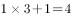，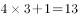，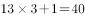，，故未知项为；

可得原未知项为。

故正确答案为B。

**来源**：2008年山西省公务员录用考试《行测》题第33题

### 第 34 题

4，4，9，29，119，（  ）

A. 596

B. 597

C. 598

D. 599

第 34 题 · 答案与解析

**参考答案（粉笔题库参考内容）**

D

**解析**

原数列为变倍递推数列，修正项构成等差数列。

具体如下：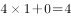，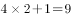，，，可得未知项为。

故正确答案为D。

**来源**：2008年山西省公务员录用考试《行测》题第34题

### 第 35 题

5，3，4，1，9，（  ）

A. 24

B. 11

C. 37

D. 64

第 35 题 · 答案与解析

**参考答案（粉笔题库参考内容）**

D

**解析**

原数列为作差递推数列。

数列中，相邻两项差的平方等于下一项，可得未知项为。

故正确答案为D。

**来源**：2008年山西省公务员录用考试《行测》题第35题

### 第 36 题

－1，0，8，25，54，（  ）

A. 87

B. 99

C. 101

D. 112

第 36 题 · 答案与解析

**参考答案（粉笔题库参考内容）**

B

**解析**

原数列为三级等差数列。

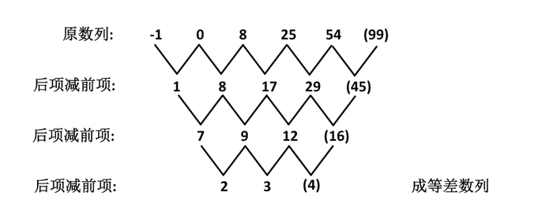

故正确答案为B。

**来源**：2008年山西省公务员录用考试《行测》题第36题

### 第 37 题

，，1，(     )

A. 

B. 

C. 

D. 

第 37 题 · 答案与解析

**参考答案（粉笔题库参考内容）**

B

**解析**

原数列变形为：， ， ，故下一项应为。

故正确答案为B。

**来源**：2008年山西省公务员录用考试《行测》题第37题

### 第 38 题

2，2，3，4，，（   ）

A. 5

B. 

C. 6

D. 

第 38 题 · 答案与解析

**参考答案（粉笔题库参考内容）**

B

**解析**

原数列两两分组：、、；

组内加和得到新数列：4、7、（10），为等差数列；

可得未知项为。

故正确答案为B。

**来源**：2008年山西省公务员录用考试《行测》题第38题

### 第 39 题

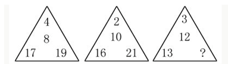

A. 17

B. 19

C. 20

D. 22

第 39 题 · 答案与解析

**参考答案（粉笔题库参考内容）**

A

**解析**

本题的规律为：右下方数字－左下方数字＝中间数字上方数字，故，，，所以应该填入17。

故正确答案为A。

**来源**：2008年山西省公务员录用考试《行测》题第39题

### 第 40 题

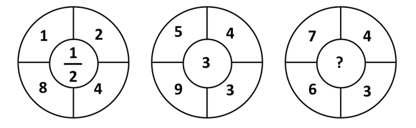

A. 2

B. 

C. 6

D. 8

第 40 题 · 答案与解析

**参考答案（粉笔题库参考内容）**

D

**解析**

观察数阵，具体规律为，可得未知项为。

故正确答案为D。

**来源**：2008年山西省公务员录用考试《行测》题第40题

### 第 41 题

的个位数是：

A. 3

B. 5

C. 7

D. 9

第 41 题 · 答案与解析

**参考答案（粉笔题库参考内容）**

B

**解析**

的个位数依次为8、4、2、6，四次一个周期；

的个位数依次为9、1，两次一个周期；

2008恰好被4整除，，而6+9=15，故原式个位数为5。

故正确答案为B。

**来源**：2008年山西省公务员录用考试《行测》题第41题

### 第 42 题

一个长7厘米、宽5厘米、高3厘米的长方体盒子。一只瓢虫从盒子的任意一个顶点，爬到与设定点在同一体对角线的另一个顶点，则所有情形的爬行路线的最小值是：

A. 

B. 

C. 

D. 

第 42 题 · 答案与解析

**参考答案（粉笔题库参考内容）**

D

**解析**

为了使瓢虫爬过的路程最短，瓢虫可以沿着长方体的“前面”和“右面”，从A到C，如下图所示。我们将“右面”顺时针旋转，与“前面”保持在同一平面上（如下图所示）。在这种情况下，直接连接A、C'就是最短的路程。

分为三种情况：

①AD边由长宽组成，则由勾股定理得，路程为厘米；

②AD边由长高组成，则由勾股定理得，路程为厘米；

③AD边由宽高组成，则由勾股定理得，路程为厘米；

所以可以得知最短路程为厘米。

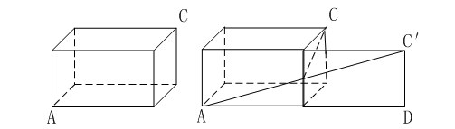

故正确答案为D。

**考点**：几何结论类-三角形相关、几何结论类-几何小题型、非典型最值问题

**来源**：2008年山西省公务员录用考试《行测》题第42题

### 第 43 题

某单位以箱为单位向困难职工分发救济品，如果有12人每人各分7箱，其余的每人分5箱，则余下148箱；如果有30人每人各分8箱，其余的每人分7箱，则余下20箱。

由此推知该单位共有困难职工：

A. 61人

B. 54人

C. 56人

D. 48人

第 43 题 · 答案与解析

**参考答案（粉笔题库参考内容）**

A

**解析**

设该单位共有困难职工a人，则有，解得a＝61。

故正确答案为A。

**考点**：和差倍比问题

**来源**：2008年山西省公务员录用考试《行测》题第43题

### 第 44 题

某学校入学考试，确定了录取分数线。在报考的学生中，只有被录取，录取者平均分比录取分数线高6分，没有被录取的学生其平均分比录取分数线低15分，所有考生的平均分是80分，推知录取分数线是：

A. 80分

B. 84分

C. 88分

D. 90分

第 44 题 · 答案与解析

**参考答案（粉笔题库参考内容）**

C

**解析**

不难看出，总共有多少人参加考试对本题的最终结果没有影响，仅是“只有被录取”对结果有影响，也即最后结果只与这个比例有关，而与总数无关。那么就可以直接看做录取了1个人，有2个人没录取，总人数为3人，则假定录取分数线为x分，于是得方程：，解得x＝88。

故正确答案为C。

**来源**：2008年山西省公务员录用考试《行测》题第44题

### 第 45 题

某人做一道整数减法题时，把减数个位上的3看成了8，把减数十位上的8看成了3，得到的差是122，那么正确的得数应该是：

A. 77

B. 88

C. 90

D. 100

第 45 题 · 答案与解析

**参考答案（粉笔题库参考内容）**

A

**解析**

解析1：原来减数的十位个位为83，现在为38，83－38＝45，减数缩小了45，也就是少减了45，那么在没看错的情况下得到的差为122－45＝77。

解析2：可以假设减数只有两位为83，看成了38，则被减数为122＋38＝160，正确得数为160－83＝77。

故正确答案为A。

**来源**：2008年山西省公务员录用考试《行测》题第45题

### 第 46 题

有些数既能表示成3个连续自然数的和，又能表示成4个连续自然数的和，还能表示成5个连续自然数的和，如30就满足上述要求。因为30＝9＋10＋11，30＝6＋7＋8＋9，30＝4＋5＋6＋7＋8，在700至1000之间满足要求的数有：

A. 5个

B. 7个

C. 8个

D. 10个

第 46 题 · 答案与解析

**参考答案（粉笔题库参考内容）**

A

**解析**

解析1：

设x、y、z分别为三个任意自然数，则所求数应同时满足如下三种形式；

x+(x+1)+(x+2)=3x+3 ①；

y+(y+1)+(y+2)+(y+3)=4y+6 ②；

z+(z+1)+(z+2)+(z+3)+(z+4)=5z+10 ③；

即该数应同时满足：①减去3之后可以被3整除（即该数可被3整除），②减去6之后可以被4整除，③减去10之后可以被5整除；由②可知该数末两位应为4的整数倍加6，由③可知该数末一位应为0或5，于是可得该数末两位应为10、30、50、70或90。再从700到1000中末两位为10、30、50、70和90的数中挑出满足条件①的即可：750=249+250+251；810=269+270+271；870=289+290+291；930=309+310+311；990=329+330+331。

解析2：

能表示成3个连续自然数的和，也就是能被连续的三个数整除，意味着此数能被三整除；能表示成4个连续自然数的和，也就是能被连续的四个数整除，意味着此数能除以四余二；能表示成5个连续自然数的和，也就是能被连续的五个数整除，意味着此数能被五整除；所以此数能被15整除，并且是个偶数，且不被4整除；能被15整除又是偶数的那么尾数是0，所以能被30整除，并且不被4整除；那么百位和十位相加应该被3整除。那么有：百位为7的有：720、750、780；百位为8的有：810、840、870；百位为9的有：900、930、960、990；排除中间能被4整除的：720、780、840、900、960；剩下的就只有750、810、870、930、990。

故正确答案为A。

**来源**：2008年山西省公务员录用考试《行测》题第46题

### 第 47 题

若干学校联合进行团体操表演，参演学生组成一个方阵，已知方阵由外到内第二层有104人，则该方阵共有学生多少人？

A. 625

B. 841

C. 1024

D. 1369

第 47 题 · 答案与解析

**参考答案（粉笔题库参考内容）**

B

**解析**

根据方阵公式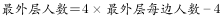可知：

由外到内第二层每排学生数人；

最外一层每排学生数=27+2=29个；

所以该方阵共有学生：人。

故正确答案为B。

**来源**：2008年山西省公务员录用考试《行测》题第47题

### 第 48 题

哥哥和弟弟在一周长为800米的环形跑道上赛跑，已知哥哥每分钟跑60米，弟弟每分钟跑40米。现在哥哥和弟弟沿着跑道同时、同地、同向起跑，且二人每跑200米都要停下来休息2分钟，那么多少分钟后哥哥第一次追上弟弟：

A. 78

B. 80

C. 82

D. 84

第 48 题 · 答案与解析

**参考答案（粉笔题库参考内容）**

D

**解析**

哥哥每跑200米所需时间为分钟，弟弟每跑200米需要分钟。根据环形追及结论，哥哥第一次追上弟弟时，应比弟弟多跑1个全程即800米。

代入A项：跑了78分钟后，，可知哥哥休息了14次，78分钟可跑米；，弟弟休息了11次，可跑米，3000-2240&lt;800米，排除；

代入B项：跑了80分钟后，，可知哥哥共跑了米；，弟弟休息了11次，可跑米，3000-2320&lt;800米，排除；

代入C项：跑了82分钟后，，可知哥哥休息了15次，82分钟可跑米；，弟弟休息了11次，可跑米，3120-2400&lt;800米，排除；

正确选项有且仅有一个，排除3个错误选项，无需验证D项。

故正确答案为D。

**考点**：相遇追及

**来源**：2008年山西省公务员录用考试《行测》题第48题

### 第 49 题

77个连续自然数的和是7546，则其中第45个自然数是：

A. 91

B. 100

C. 104

D. 105

第 49 题 · 答案与解析

**参考答案（粉笔题库参考内容）**

C

**解析**

77个连续自然数构成公差为1的等差数列，根据等差数列求和公式：，则这77个连续自然数的中位数（第项）。根据等差数列通项公式：，则。

故正确答案为C。

**考点**：数列问题

**来源**：2008年山西省公务员录用考试《行测》题第49题

### 第 50 题

一个盒子中有几百颗糖，如果平均分给7个人，则多3颗，平均分给8个人则多6颗，如果再加3颗，可以平均分给5个人，则该盒子中糖的数目可能有：

A. 3种

B. 4种

C. 5种

D. 6种

第 50 题 · 答案与解析

**参考答案（粉笔题库参考内容）**

A

**解析**

**解析1：**

设糖的总数为M，M除以7余3，余数群为10、17、24、31、38、45、……；M除以8余6，余数群为14、22、30、38、46、……，因此可知该糖数写成56N＋38（这里根据同余问题的口诀，和同加和，从余数群可以发现，余数都有38），根据再加3颗可以平均分给5个人，等同于糖数除以5余2，可知56N+41的尾数必为0或5，由此56N的尾数就需要为4或9，据此知N尾数只能为4或9。又根据此盒糖的数目在之间，N取值只可能为4、14、9，即盒中糖的数目只可能有3种。

注释：

通过将除数加到余数上，可以扩展余数群，所得其他余数不是真正的余数，但可以转化为同余情形。同余问题需要掌握如下口诀：余同取余，和同加和，差同加差，最小公倍数做周期。

口诀解释：余同取余，例如“一个数除以7余1，除以6余1，除以5余1”，可见所得余数恒为1，则取1，被除数的表达式为210n＋1；和同加和，例如“一个数除以7余1，除以6余2，除以5余3”，可见除数与余的和相同，取此和8，被除数的表达式为210n＋8；差同减差，例如“一个数除以7余3，除以6余2，除以5余1”，可见除数与余的差相同，取此差4，被除数的表达式为210n－4。特别注意前面的210是5、6、7的最小公倍数。

**解析2：**

设糖数量为a，根据题意，则得出a-3是7的倍数，a－6是8的倍数，a+3是5的倍数，即a－3＝7N，N属于自然数①；a+3=5M，M属于自然数②；a－6＝8L，L属于自然数③；因为M是自然数，得出5M尾数只能是0或5，故a尾数只能是2或7；因为L是自然数，得出a＝8L＋6，尾数只能是0、2、4、6、8，又因为上式求出a尾数只能是2或7，所以a尾数只能是2，a－3尾数只能是9，故N尾数只能是7，又因为N是自然数，100＜a＜1000，故13.8＜N＜142.8，N＝17、27、37、47、57、67、77、87、97、107、117、127、137，由①③得，7N-3＝8L，求得N＝37,77,117满足条件，最后求得a＝262,542,822，盒内可能有262、542、822颗糖，共三种情况。

故正确答案为A。

**来源**：2008年山西省公务员录用考试《行测》题第50题

### 第 51 题

请从所给的四个选项中，选择最合适的一个填在问号处，使之呈现一定的规律性：

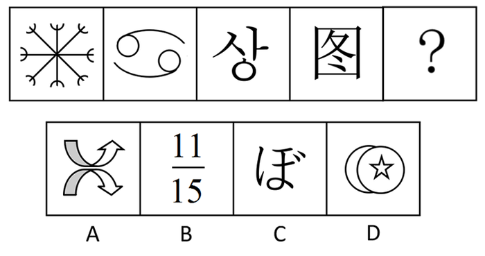

A. A

B. B

C. C

D. D

第 51 题 · 答案与解析

**参考答案（粉笔题库参考内容）**

B

**解析**

元素组成凌乱，数数。本题数部分，每个图形中包含的部分（即连在一起的黑色线条）的个数分别为1，2，3，4，5。

故正确答案为B。

**考点**：数量规律-素、文字/字母/数字类

**来源**：2008年山西省公务员录用考试《行测》题第51题

### 第 52 题

请从所给的四个选项中，选择最合适的一个填在问号处，使之呈现一定的规律性：

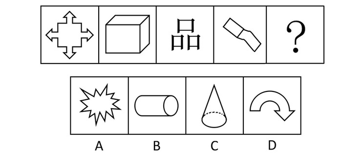

A. A

B. B

C. C

D. D

第 52 题 · 答案与解析

**参考答案（粉笔题库参考内容）**

A

**解析**

题干中的四个图形全部是由直线组成的。

故正确答案为A。

**考点**：属性规律-曲直性

**来源**：2008年山西省公务员录用考试《行测》题第52题

### 第 53 题

请从所给的四个选项中，选择最合适的一个填在问号处，使之呈现一定的规律性：

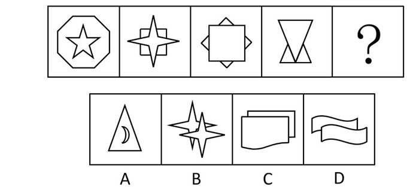

A. A

B. B

C. C

D. D

第 53 题 · 答案与解析

**参考答案（粉笔题库参考内容）**

B

**解析**

元素组成凌乱，先考虑属性，题目考查的是曲直性。题干中的四个图形全部是由直线组成的。

故正确答案为B。

**考点**：属性规律-曲直性

**来源**：2008年山西省公务员录用考试《行测》题第53题

### 第 54 题

请从所给的四个选项中，选择最合适的一个填在问号处，使之呈现一定的规律性：

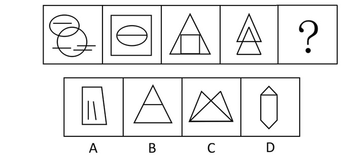

A. A

B. B

C. C

D. D

第 54 题 · 答案与解析

**参考答案（粉笔题库参考内容）**

A

**解析**

元素组成凌乱，考数数。题干中的每个图形都是由六个线条（包括曲线和直线）组成，选项中的线条数分别为6、4、5、7。

故正确答案为A。

**考点**：数量规律-线

**来源**：2008年山西省公务员录用考试《行测》题第54题

### 第 55 题

请从所给的四个选项中，选择最合适的一个填在问号处，使之呈现一定的规律性：

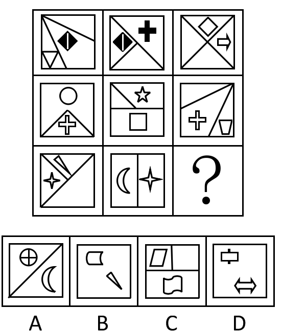

A. A

B. B

C. C

D. D

第 55 题 · 答案与解析

**参考答案（粉笔题库参考内容）**

C

**解析**

九宫格的每一行中，前两个图形的空白部分的个数相加等于第三个图形空白部分的个数。并且每一行中只有一个小图形重复两次出现，其它均不重复出现。

故正确答案为C。

**考点**：数量规律-素

**来源**：2008年山西省公务员录用考试《行测》题第55题

### 第 56 题

信息指的是客观世界的物质运动与主观世界精神活动所表现出来的各种状态特征的总和，这些特征被人的感觉器官或仪器所感觉到或测量到并被纪录或表达下来，就成为了一些数据、图像、符号、语言、文字等，它们包含着所表征事物或事件的内容，信息技术则是有关信息的产生、收集、传输、接受、处理、存贮、检索等技术的总称。

根据上述定义，下列不属于信息技术的是：

A. 微电子技术（提供电脑芯片）

B. 计算机技术、通信技术、信息存贮技术

C. 数据库技术、网络技术

D. 最新工程技术、如纳米技术

第 56 题 · 答案与解析

**参考答案（粉笔题库参考内容）**

D

**解析**

题目只问到信息技术的定义，因此只需分析信息技术即可。

第一步：抓住定义中的关键词。

关键词强调对信息的“产生、收集、传输、接受、处理、存贮、检索”等技术。

第二步：逐一判断选项。

A中的技术是对信息的处理；B是对信息的存贮、传输等；C是对信息的检索；D是工程技术中的材料技术，研究对象与信息无关。

本题为选非题，故正确答案为D。

**考点**：常规问法

**来源**：2008年山西省公务员录用考试《行测》题第56题

### 第 57 题

横向收购是指生产同类（或同种）商品或服务的企业之间的收购，它一般涉及在同种商业活动经营和竞争的两家企业，其目的在于消除竞争，扩大市场份额，增加收购公司的垄断实力或形成规模效应。

根据上述定义，下列属于横向收购的是：

A. 石化企业对石油制品销售企业的并购

B. 白酒生产企业并购啤酒生产企业

C. 美国著名零售商业公司蒙哥马利-沃德公司被美孚石油公司吞并

D. 1987年美国汽车公司被克莱斯勒汽车公司收购

第 57 题 · 答案与解析

**参考答案（粉笔题库参考内容）**

D

**解析**

第一步：抓住定义中的关键词。

定义中强调“同类（或同种）商品或服务”。

第二步：逐一判断选项。

A项中的石化与石油、B项中的啤酒与白酒、C项中的零售商与石油公司均不是生产同类（或同种）商品或服务的企业，因此不符合定义。D项中美国汽车公司与克莱斯勒汽车公司属于生产同类商品的企业。

故正确答案为D。

**考点**：主客体

**来源**：2008年山西省公务员录用考试《行测》题第57题

### 第 58 题

发散思维是指在创造和解决问题的思考过程中，从已有的信息出发，尽可能向各个方向扩展，不受已知的或现存的方式、方法、规则和范畴的约束，并且从这种扩散、辐射和求异式的思考中，求得多种不同的解决办法，衍生出各种不同的结果。

根据以上定义，下列不属于发散思维的是：

A. 化学能能产生电能，据此伏特发明了伏打电池；反过来电能也能产生化学能，通过电解，戴维发现了钾、钠等7种元素

B. 19世纪末法国园艺学家莫尼哀从植物的盘根错节想到水泥加固

C. 数学运算过程中的“一题多解”

D. 理论工作者依据许多现成的资料归纳出一种结论

第 58 题 · 答案与解析

**参考答案（粉笔题库参考内容）**

D

**解析**

第一步：抓住定义中的关键词。

定义中强调“从已有的信息出发”、“向各个方向扩展”、“求得多种不同的解决方法”、“不同的结果”。

第二步：逐一判断选项。

A是从已有的信息反向思考，获得另一个结果；B是从已有的信息出发，衍生出的想法；C提到多种解决方法，均符合定义。D中只有归纳一种思考途径，并且得出一个结论，不符合定义。

本题为选非题，故正确答案为D。

**考点**：方式目的

**来源**：2008年山西省公务员录用考试《行测》题第58题

### 第 59 题

领导意味着确立方向和战略决策，激励与鼓舞他人，为变革创建远景，管理意味着执行计划、制定实现目标的详细步骤和时间表，分配资源，支配日常工作，完成活动。管理者是把事情做正确的人，而领导者是做正确的事情的人。

根据上述定义，下列属于领导的是：

A. 公司的董事长

B. 军队的基层连长

C. 政府的新闻发言人

D. 企业的经理人

第 59 题 · 答案与解析

**参考答案（粉笔题库参考内容）**

A

**解析**

题干针对领导这一定义提问，因此只须分析领导这一概念即可。

第一步：抓住定义中的关键词。

定义中强调“确立方向和战略决策”，强调与管理者的不同。

第二步：逐一判断选项。

B项“军队的基层连长”不是军队里确定战略决策、为军队发展变革描绘远景者，而是军队的管理者；

C项“政府的新闻发言人”也不是确立方向和战略决策者；

D项“企业的经理人”属于企业的管理者。因此B、C、D三项不符合领导的定义，只有A项是为公司确立方向和战略决策的人。

故正确答案为A。

**考点**：常规问法

**来源**：2008年山西省公务员录用考试《行测》题第59题

### 第 60 题

意外利润指企业由于外界条件的变化，而并非因为本身经营有方所获得的利润，相比额外利润它不是企业经营所致，而是企业完全没有预料的情况下发生的、超出计划的那部分利润所得。

根据上述定义，下列属于意外利润的是：

A. 某市在郊外修建了一条铁路，沿线的小餐馆生意越来越红火

B. 某公司营业一直不景气，于是更换了业务主管，结果营业额上升

C. 某服装厂引进了先进的设备，结果获得了更多的利润

D. 某金融公司由于与大客户签订合同成功，获得了更多的利润

第 60 题 · 答案与解析

**参考答案（粉笔题库参考内容）**

A

**解析**

第一步：抓住定义中的关键词。

定义中强调“由于外界条件的变化”、“并非因为本身经营”、“没有预料”等。

第二步：逐一判断选项。

A项中铁路的修建对沿线的小餐馆来说是外界的变化，与自身经营无关，符合定义。B项中更换业务主管、C项中引进先进设备、D项中的与大公司签订合同均属于自身经营的行为，不符合定义。

故正确答案为A。

**考点**：原因结果

**来源**：2008年山西省公务员录用考试《行测》题第60题

### 第 61 题

价格竞争是指商品生产者为了增加商品销售量，击败对手，提高赢利水平，利用价格作为竞争手段，通过降低商品的价格或采用其他价格策略所展开的竞争，它是商业经营中频繁使用的竞争手段之一。

根据上述定义，下列不属于价格竞争的是：

A. 甲公司为招徕顾客丙打折销售

B. 乙公司为长期顾客降价优惠

C. 丙公司以赠小商品来招揽顾客

D. 丁公司靠加大广告宣传来招揽顾客

第 61 题 · 答案与解析

**参考答案（粉笔题库参考内容）**

D

**解析**

第一步：抓住定义中的关键词。

关键词强调“利用价格作为竞争手段”。

第二步：逐一判断选项。

A中的打折行为、B中的降价行为都是通过降低价格增加商品销量；C中赠送小商品的也是变相的降价行为，均符合利用价格作为竞争手段这一定义关键词。D中是利用扩大宣传的手段，而不是价格手段，不符合定义。

本题为选非题，故正确答案为D。

**考点**：方式目的

**来源**：2008年山西省公务员录用考试《行测》题第61题

### 第 62 题

金融诈骗犯罪是指采取虚构事实或隐瞒事实真相等方法，非法骗取金融机构资财或信用致使金融秩序遭到破坏，使国家资财遭受损失的行为。

根据上述定义，下面不属于金融诈骗犯罪的是：

A. 甲某以“外商”为名骗取银行某支行金额100万美元的备用信用证

B. 乙公司因经营不善到期未能偿还银行贷款，致使银行遭受损失

C. 丙团伙伪造国务院批文，伪造成立“中华福利银行”

D. 丁团伙非法集资百万

第 62 题 · 答案与解析

**参考答案（粉笔题库参考内容）**

B

**解析**

第一步：抓住定义中的关键词。

定义中强调“虚构事实或隐瞒事实真相”、“骗取资财或信用”、“金融秩序遭到破坏”等。

第二步：逐一判断选项。

B项中乙公司因经营不善未能偿还贷款，不属于“虚构事实或隐瞒事实真相”，不符合定义。A项中骗取金融机构信用的行为、C项中非法成立银行、D项中非法集资行为均为骗取资财的行为，符合定义。

本题为选非题，故正确答案为B。

**考点**：原因结果

**来源**：2008年山西省公务员录用考试《行测》题第62题

### 第 63 题

法律援助是指在国家设立的法律授助机构的指导和协调下，律师、公证人员、基层法律工作者等法律服务人员依法为经济困难或特殊案件的当事人给予减、免收费提供法律帮助的一项法律制度。它有一般对象和特殊对象，前者是要审查其是否是具备援助条件的中国公民；后者是指符合刑事诉讼法和司法部、最高人民法院关于开展刑事法律援助的联合通知规定的刑事被告人。

根据上述定义，下列属于法律援助对象的是：

A. 在中国犯抢劫罪的外国人

B. 确因经济困难，无能力或无完全能力支付法律服务费用的人

C. 因经济困难无能力聘请律师的作为残疾人的刑事嫌疑人

D. 在刑事案件中，委托了辩护人的外国籍被告人

第 63 题 · 答案与解析

**参考答案（粉笔题库参考内容）**

B

**解析**

本题题干只针对对象这个概念进行提问，因此只需关注“对象”这个定义。

第一步：抓住定义中的关键词。

定义中强调“具备援助条件的中国公民”或符合特殊条件的“刑事被告人”。

第二步：逐一判断选项。

A中既不是中国公民也不是刑事被告人；B符合“具备援助条件的中国公民”；C中的刑事嫌疑人不是“刑事被告人”；D中已委托辩护人，不符合特殊条件的“刑事被告人”，也不是“中国公民”。

故正确答案为B。

**考点**：常规问法

**来源**：2008年山西省公务员录用考试《行测》题第63题

### 第 64 题

职业价值观是指人们在选择职业时的一种内心尺度。它影响人的择业心态、行为及信念和理想，包含自我定位、自我设计等。它是人们对待职业的一种信念和态度，或者在职业生活中表现出来的一种价值取向。

根据上述定义，下列属于职业价值观的是：

A. 人尽其才，物尽其用

B. 龙下海、虎上山，孺子牛进机关

C. 天生我材必有用

D. 行行出状元

第 64 题 · 答案与解析

**参考答案（粉笔题库参考内容）**

B

**解析**

第一步：抓住定义中的关键词。

定义中强调“选择职业时”、“内心尺度”等。

第二步：逐一判断选项。

A是说用人方法，C肯定自我价值，D肯定每一行业的价值，都未涉及到职业选择。而B是说不同的类型的人有不同的职业选择，符合定义。

故正确答案为B。

**考点**：大前提

**来源**：2008年山西省公务员录用考试《行测》题第64题

### 第 65 题

行为管理是以提高效率为主要目标，通过侧重于关注员工的个体态度、行为及群体过程，主张员工的行为取决于工作场所的社会环境，关心员工可以提高其满意度，进而提高绩效的一种管理。

根据上述定义，下面属于行为管理的是：

A. IBM历年将薪酬作为该公司最主要的激励物，除了交付员工工资，还向其雇员提供退休金、保险以及高额资金

B. 谷歌公司按时支付员工工资，设有儿童中心、医疗和按摩室，报销车票，免费供餐，办公场所可以玩曲棍球

C. 福特公司率先创立生产流水线，建立计件工资制，使其员工日平均工资高达5美元，远高于其他公司的薪酬

D. 绿叶医药销售公司为了推销其一种新药，占领市场，较大幅度地增加了销售人员的业务提成

第 65 题 · 答案与解析

**参考答案（粉笔题库参考内容）**

B

**解析**

第一步：抓住定义中的关键词。

定义中强调“员工的行为取决于工作场所的社会环境”、“关心员工”。

第二步：逐一判断选项。

A、C、D都是通过提高员工薪酬来增加员工满意度的，不符合定义关键词；而B中行为都是属于建立工作场所的社会环境，符合定义。

故正确答案为B。

**考点**：方式目的

**来源**：2008年山西省公务员录用考试《行测》题第65题

### 第 66 题

中国：北京

A. 灯具：合灯

B. 南方：北方

C. 吉它：琴弦

D. 学校：中学

第 66 题 · 答案与解析

**参考答案（粉笔题库参考内容）**

C

**解析**

第一步：判断题干词语间逻辑关系。

题干两词是包容关系中的组成关系，北京是中国的一个组成部分。

第二步：判断选项词语间逻辑关系。

A、D两项中的词语均属于包容关系中的种属关系，合灯是灯具的一种，中学是学校的一种。B项中的两词是并列关系中的反对关系。C项中的琴弦是吉它的组成部分。

故正确答案为C。

**考点**：逻辑关系-包容关系

**来源**：2008年山西省公务员录用考试《行测》题第66题

### 第 67 题

剃须刀：刮胡子

A. 用电脑：写文章

B. 计算机：编程序

C. 新股民：买股票

D. 图书室：看报纸

第 67 题 · 答案与解析

**参考答案（粉笔题库参考内容）**

B

**解析**

第一步：判断题干词语间逻辑关系。

题干两词属于对应关系，是工具与功能的对应。

第二步：判断选项词语间的逻辑关系。

A中不构成对应关系，因为写文章的工具可以是电脑，而不是用电脑。B计算机与编程序构成用具与功能的对应。C是主体与客体的对应。D是地点的对应。

故正确答案为B。

**考点**：逻辑关系-对应关系

**来源**：2008年山西省公务员录用考试《行测》题第67题

### 第 68 题

木偶：傀儡

A. 二氧化碳：一氧化碳

B. 冒失鬼：马大哈

C. 炒鱿鱼：辞职

D. 兰花：桂花

第 68 题 · 答案与解析

**参考答案（粉笔题库参考内容）**

B

**解析**

第一步：判断题干词语间的逻辑关系。

题干两词为全同关系，源于比喻，演变为近义词。

第二步：判断选项词语间的逻辑关系。

A、D两项属于同一类别下的不同种，是并列关系。C项是主动与被动的对应关系。B项中两词是全同关系，源于比喻，演变为近义词。

故正确答案为B。

**考点**：语义关系-比喻象征义

**来源**：2008年山西省公务员录用考试《行测》题第68题

### 第 69 题

鬼门关：凶险

A. 高帽儿：恭维

B. 飞毛腿：快速

C. 打把势：练武

D. 臭皮囊：躯体

第 69 题 · 答案与解析

**参考答案（粉笔题库参考内容）**

B

**解析**

第一步：判断题干词语间的逻辑关系。

题干两词是属性关系，凶险是鬼门关的一个特征描述。

第二步：判断选项词语间的逻辑关系。

A、C中两词均为全同关系，是近义词。D中两词是种属关系，臭皮囊是躯体的一种。B中快速是飞毛腿的特征描述，属于属性关系。

故正确答案为B。

**考点**：逻辑关系-对应关系

**来源**：2008年山西省公务员录用考试《行测》题第69题

### 第 70 题

地震：核试验

A. 天灾：人祸

B. 辛迪加：垄断

C. 感冒：洗澡

D. 疾病：医生

第 70 题 · 答案与解析

**参考答案（粉笔题库参考内容）**

C

**解析**

第一步：判断题干词语间的逻辑关系。

题干中两词是选然因果关系，即核试验可能导致地震。

第二步：判断选项词语间的逻辑关系。

A中两词是并列关系；B是种属关系，即辛迪加是垄断的一种形式；D是对应关系；C是选然因果关系，洗澡有可能会感冒。

故正确答案为C。

**考点**：逻辑关系-对应关系

**来源**：2008年山西省公务员录用考试《行测》题第70题

### 第 71 题

明镜：公正

A. 蚍蜉：自不量力

B. 麒麟：祥瑞

C. 木马：病毒

D. 貔貅：军队

第 71 题 · 答案与解析

**参考答案（粉笔题库参考内容）**

B

**解析**

第一步：判断题干词语间逻辑关系。

明镜象征着公正，两者是事物与其象征意义。

第二步：判断选项词语间逻辑关系。

A项，蚍蜉应该象征弱小的力量，而不是“自不量力”本身，与题干不符。

B项，麒麟象征着祥瑞，符合题干。

C项，木马是病毒的一种，并非象征病毒，与题干不符。

D项，貔貅是凶猛的瑞兽，在古代用于比喻骁勇的军队，而非象征，与题干不符。

故正确答案为B。

**考点**：语义关系-比喻象征义

**来源**：2008年山西省公务员录用考试《行测》题第71题

### 第 72 题

新闻：采访

A. 特技：特效

B. 电影：剪辑

C. 声音：图像

D. 分数：学生

第 72 题 · 答案与解析

**参考答案（粉笔题库参考内容）**

B

**解析**

第一步：判断题干词语间的逻辑关系。

题干两词是语法关系，采访新闻，构成动宾结构。

第二步：判断选项词语间的逻辑关系。

A、C、D三项都不是动宾结构。B项中剪辑电影为动宾结构。

故正确答案为B。

**考点**：语法关系

**来源**：2008年山西省公务员录用考试《行测》题第72题

### 第 73 题

励精图治  对于  （  ）  相当于  （  ）  对于  错失良机

A. 治国安民 时不再来

B. 横征暴敛 千钧一发

C. 国富民强 瞻前顾后

D. 兢兢业业 争分夺秒

第 73 题 · 答案与解析

**参考答案（粉笔题库参考内容）**

C

**解析**

第一步：将选项逐一代入，判断各选项前后部分的逻辑关系。

A项中前一组可构成全同关系，但后一组不是全同关系。B项中前一组可构成反义词，后一组不是反义词。C项中两组均为因果关系，且前词为原因，后词为结果。D项中前一组为对应关系，后一组构不成逻辑关系。

第二步：逻辑关系相同即为答案。

前后逻辑关系相同的为C。

故正确答案为C。

**考点**：逻辑关系-对应关系

**来源**：2008年山西省公务员录用考试《行测》题第73题

### 第 74 题

重力  对于  滤水  相当于  （  ）  对于  （  ）

A. 镜子 反射

B. 书本 知识

C. 运动 惯性

D. 质量 重力

第 74 题 · 答案与解析

**参考答案（粉笔题库参考内容）**

D

**解析**

第一步：判断题干词语间的逻辑关系。

题干两词为因果关系，且重力是原因，滤水是结果。

第二步：判断选项词语间的逻辑关系。

D中两词是因果关系，有质量才会有重力。A、B、C均不构成因果关系。

故正确答案为D。

**考点**：逻辑关系-对应关系

**来源**：2008年山西省公务员录用考试《行测》题第74题

### 第 75 题

百合：鲜花：花店

A. 鲫鱼：动物：菜场

B. 木材：树木：森林

C. 沙发：家具：客厅

D. 衬衣：衣服：商场

第 75 题 · 答案与解析

**参考答案（粉笔题库参考内容）**

D

**解析**

第一步：判断题干词语间逻辑关系。

百合是鲜花，两者为种属关系，在花店里售卖鲜花，两者为物品与售卖场所的对应关系。

第二步：判断选项词语间逻辑关系。

A项：鲫鱼是动物，两者为种属关系，但动物和菜场间无明显逻辑关系，与题干逻辑关系不一致，排除；

B项：木材是树木采伐后经过初步加工得到的材料，两者为原材料对应关系，与题干逻辑关系不一致，排除；

C项：沙发是家具，两者为种属关系，但客厅是摆放家具的场所而非售卖家具的场所，与题干逻辑关系不一致，排除；

D项：衬衣是衣服，两者为种属关系，在商场里售卖衣服，两者为物品与售卖场所的对应关系，与题干逻辑关系一致，当选。

故正确答案为D。

**考点**：逻辑关系-包容关系、逻辑关系-对应关系

**来源**：2008年山西省公务员录用考试《行测》题第75题

### 第 76 题

水是未来人类长期驻扎月球最重要的物质，月球上是否有丰富的水，一直是科学家探索的目标。月球南极附近一些环形山的凹陷处终年照不到阳光，温度约为零下173摄氏度，因此有推测称那里有可能存在较厚的冰盖。

以下哪项如果为真，最能颠覆上述假说：

A. 月球上水的凝固温度与地球不同

B. 月球南极被陨石撞击后新生成了一些小坑

C. 月球南极个别环形山凹陷处有一定量的冰块

D. 过去被认为能反映“冰盖”存在的信号，源自环形山内壁的石块

第 76 题 · 答案与解析

**参考答案（粉笔题库参考内容）**

D

**解析**

第一步：找出论点和论据。

论点：月球南极附近一些环形山的凹陷处有可能存在较厚的冰盖。

论据：月球南极附近一些环形山的凹陷处终年照不到阳光，温度约为零下173摄氏度。

本题论点和论据均在讨论月球南极附近一些环形山的凹陷处存在冰盖，论点和论据话题一致，削弱优先考虑削弱论点。

第二步：逐一分析选项。

A项：该项指出月球上水的凝固温度与地球不同，但不确定月球上水的凝固温度是多少，不明确选项，无法削弱，排除；

B项：该项指出月球南极被撞后新生成了小坑，与论点讨论的环形山凹陷处是否存在冰盖无关，无关选项，无法削弱，排除；

C项：该项指出月球南极个别环形山凹陷处有一定量的冰块，举例加强，加强项，排除；

D项：该项指出过去能反映“冰盖”存在的信号，源自环形山内壁的石块，说明实际上探测到的不是冰盖，而是石块，直接削弱论点，当选。

故正确答案为D。

**考点**：削弱论点

**来源**：2008年山西省公务员录用考试《行测》题第76题

### 第 77 题

新近，研究人员通过筛选14.7万个化合物，发现了5种能够刺激细胞变成神经细胞形式的分子。随后，开发出了这些分子的“变异型”化合物——Isx-9，研究中，他们在培养取自啮齿动物大脑海马体部位的神经干细胞时，加入了化合物Isx-9，结果神经干细胞聚集起来并形成了神经突，这是神经细胞在体外培养基中生长所具有的典型特征。化合物Isx-9还能阻止干细胞发育成非神经细胞，并且比其他神经元物质在刺激神经细胞发育方面更有效。

由此推出：

A. 成年哺乳动物大脑能够生长新的神经细胞

B. 人们找到了一个干细胞开始发育成神经细胞的生化通道

C. 人们解决了认识中存在的鸿沟——如何控制干细胞

D. 人的神经干细胞能在体外经过培育成熟，并植入体内，治疗疾病

第 77 题 · 答案与解析

**参考答案（粉笔题库参考内容）**

B

**解析**

第一步：分析题干中每句话的含义及其关系。

第一句说研究人员通过筛选化合物，开发出了“变异型”化合物Isx-9。第二句指神经干细胞，加入化合物Isx-9后可以聚集起来并形成神经突。第三句是说化合物Isx-9比其它神经元物质在刺激神经细胞发育方面更有效。

第二步：逐一判断选项的作用。

A是说自身生长神经细胞、C指控制干细胞而不是培养干细胞、D是说治疗疾病均属于无关内容，因此排除。综合题干的三句话可推出B项正确。

故正确答案为B。

**考点**：日常结论

**来源**：2008年山西省公务员录用考试《行测》题第77题

### 第 78 题

20世纪70年代以来，光导纤维、非晶态、新型陶瓷、碳60、钛合金、纳米材料、生物材料、智能材料等具有各种特殊性能的材料不断涌现。目前已有25万种性能各异的材料问世，纳米科技正由于其一系列独特的性能及广泛应用，正在形成一个新产业群落，推动并影响整个科学技术研究及产业的发展。

以下哪项如果为真，最能加强上述断定：

A. 某些重要材料的出现，往往产生巨大的经济效益

B. 材料技术的发展是各种新技术发展的基础

C. 一系列新兴产业群落如纳米科技产业群正在崛起

D. 第五次技术革命是智能化革命

第 78 题 · 答案与解析

**参考答案（粉笔题库参考内容）**

B

**解析**

第一步：找出论点和论据。

论点：纳米科技正由于其一系列独特的性能及广泛应用，正在形成一个新产业群落，推动并影响整个科学技术研究及产业的发展。

论据：无。

只有论点没有论据，加强可以考虑补充论据，如解释原因、举例。

第二步：逐一分析选项。

A项：某些重要材料往往产生巨大的经济效益，而论点说的是纳米科技推动科技和产业的发展，“某些重要材料”是否为纳米材料并不确定，不明确项，无法加强，排除；

B项：材料技术的发展是各种新技术发展的基础，纳米科技属于材料科技，因此也会推动新技术的发展，解释了为什么纳米科技能推动科技和产业发展，补充论据加强，当选；

C项：纳米科技产业群正在崛起，但未提及崛起原因，而论点说的是纳米科技推动科技和产业的发展，话题不一致，无关项，无法加强，排除；

D项：第五次技术革命是智能化革命，而论点说的是纳米科技推动科技和产业的发展，话题不一致，无关项，无法加强，排除。

故正确答案为B。

**考点**：补充论据

**来源**：2008年山西省公务员录用考试《行测》题第78题

### 第 79 题

在冰河世纪中期，地球上有数百万的猛犸象。然而两万年之后，他们几乎全部灭绝了。从对数百个猛犸象化石上萃取下来的DNA进行检测后发现，猛犸象个体之间的基因差异并不明显，所以它们不能适应自己的环境。10万年前的冰河世纪晚期的世界森林扩张最终导致许多动物所赖以生存的冰冻草原后来慢慢被森林所取代。由此推出：

A. 该对这些巨大动物从历史上消失负责的是饥饿的史前猎人

B. 气候的剧变是猛犸象绝迹的主因

C. 森林扩张最终导致猛犸象灭绝

D. 灭绝是其基因变异的结果

第 79 题 · 答案与解析

**参考答案（粉笔题库参考内容）**

C

**解析**

第一步：抓住题干关键信息。

猛犸象灭绝的原因是它们不能适应自己的环境；

猛犸象个体之间的基因差异并不明显；

冰河世纪晚期的世界森林扩张最终导致许多动物所赖以生存的冰冻草原后来慢慢被森林所取代。

第二步：逐一判断选项。

A项，“史前猎人”文中没有提到，属于无中生有。

B项，“气候的剧变”文中没有直接提到，冰冻草原被森林取代属于地貌的变化，与气候的关系未知，不能推出。

C项，根据原文“世界森林扩张最终导致许多动物所赖以生存的冰冻草原后来慢慢被森林所取代”，可知猛犸象灭绝与不能适应森林扩张有关，该项说法符合题意。

D项，“猛犸象个体之间的基因差异并不明显”说明灭绝和基因变异无关，本项说法与题意不符。

故正确答案为C。

**考点**：日常结论

**来源**：2008年山西省公务员录用考试《行测》题第79题

### 第 80 题

何老师、李老师、詹老师都买了新手机，手机的牌子分别是诺基亚、摩托罗拉、三星，他们让小王猜他们各买的是什么牌子的手机，小王猜道：“何老师买的诺基亚手机，詹老师买的不是三星手机，李老师买的不是诺基亚手机。”事实上，小王的上述猜测只对了一个。由上述断定可推出以下哪项结论？

A. 何老师买的是摩托罗拉，李老师买的是诺基亚，詹老师买的是三星

B. 何老师买的是诺基亚，李老师买的是三星，詹老师买的是摩托罗拉

C. 何老师买的是诺基亚，李老师买的是摩托罗拉，詹老师买的是三星

D. 何老师买的是三星，李老师买的是诺基亚，詹老师买的是摩托罗拉

第 80 题 · 答案与解析

**参考答案（粉笔题库参考内容）**

D

**解析**

由于小王的三句话中不存在矛盾或反对关系，因此没有突破口。故本题采用假设法。

假设第一句正确，则何老师：诺基亚，詹老师：三星，李老师：诺基亚，结论矛盾，因此假设错误。

假设第三句正确，则詹老师：三星，李老师：摩托罗拉，何老师：诺基亚，与第一句矛盾，因此假设错误。

假设第二句正确，则李老师：诺基亚，詹老师：摩托罗拉，何老师：三星，结论没有矛盾，因此假设正确。

故正确答案为D。

**考点**：假设

**来源**：2008年山西省公务员录用考试《行测》题第80题

### 第 81 题

某旅行社组织了两个旅游团。一个团去北京旅游，一个团去杭州旅游，由于两个团同时出发，所以同一个人不可能报两个团，所有去杭州旅游的人都是北京人，有些四川人参加了北京的旅游团，所有的四川人都喜欢吃辣椒。

如果以上说法是正确的，那么下列哪个也一定是正确的？

A. 旅游团中不去北京旅游的人都不喜欢吃辣椒

B. 旅游团中有些四川人没有参加去杭州的旅游

C. 旅游团中有些北京人不去杭州旅游

D. 旅游团中有些参加杭州旅游的人不喜欢吃辣椒

第 81 题 · 答案与解析

**参考答案（粉笔题库参考内容）**

B

**解析**

第一步：翻译题干。

去北京的人和去杭州的人之间为不相容选言关系；杭州团北京人；有些四川人北京团；四川人吃辣。

第二步：逐一翻译并判断选项。

由结论三的逆否命题可知，不是北京团不是有些四川人，与辣椒无关，因此A项错误；

由题干可知，有些四川人北京团；由不相容选言命题性质可知，北京团不是杭州团，因此B项正确；

由杭州团北京人，只能推知有些北京人去杭州旅游，但不能推出是否不去杭州旅游，因此C项无法得出；

虽然杭州团北京人，但北京人是否吃辣无从得知，因此D项错误。

故正确答案为B。

**考点**：集合推理

**来源**：2008年山西省公务员录用考试《行测》题第81题

### 第 82 题

教授：如果父母都是O型血，其子女的血型也只能是O型，这是遗传规律。

学生：这不是真的，我的父亲是B型血，而我是O型血。

学生最有可能把教授的陈述理解为：

A. 只有O型血的人才会有O型血的孩子

B. O型血的人不可能有B型血的孩子

C. B型血的人永远都会有O型血的孩子

D. 如果父母都是B型血，其孩子也会是B型血

第 82 题 · 答案与解析

**参考答案（粉笔题库参考内容）**

A

**解析**

第一步：翻译题干。

教授：父母是O型血⇒孩子O型血。

由学生的意思可知，父亲不是O型血，则孩子也不会是O型血。因此学生可翻译为：父亲不是O型血⇒我（孩子）不是O型血。

第二步：逐一翻译判断选项。

A项翻译出来为：O型血的孩子⇒O型血的父母，是上述学生命题的逆否命题，因此与上述结论一致。

故正确答案为A。

**考点**：常规翻译

**来源**：2008年山西省公务员录用考试《行测》题第82题

### 第 83 题

有一种微生物，它产生毒素污染河水时会使河水变成绿色，这种现象被称为泛绿，当鸭子的主要食物河虾被这种有毒微生物污染时，鸭子就不会在那些区域觅食。对于鸭子的这种行为，科学家的一种解释认为，鸭子在某个地方正式觅食之前会先尝几只河虾，并且能够察觉出其中的任何毒素。

以下哪项为真，将最有力地表明上述解释是不正确的：

A. 当河里发生泛绿现象的时候，既看不到鸭子，水里也没有河虾

B. 鸭子在某个水域出现是一种显著的标志，表明那里可以找到其他水生生物

C. 少量的微生物毒素不会产生什么危害，但是过量的话还是会使鸭子死亡的

D. 当没有受到泛绿影响的一片河水被人为地染成绿色时，鸭子也不吃那些地方的河虾

第 83 题 · 答案与解析

**参考答案（粉笔题库参考内容）**

D

**解析**

第一步：找出论点和论据。

论点：当鸭子的主要食物河虾被这种有毒微生物污染时，鸭子就不会在那些区域觅食。

论据：鸭子在某个地方正式觅食之前会先尝几只河虾，并且能够察觉出其中的任何毒素。

第二步：逐一判断选项的作用。

D项通过对比实验说明鸭子吃不吃某个区域的河虾，只跟河水的颜色有关，跟河虾是否被有毒微生物污染无关，直接否定了专家的解释，属于类比削弱。A项中河水泛绿看不到鸭子和河虾、B项中鸭子跟其他水生生物的关系、C项中过量微生物毒素会导致鸭子死亡，都跟鸭子是否会因觉察出河虾中的毒素而停止觅食无关，无法说明题干中的解释是否正确。A、B、C三项均属于无关选项。

故正确答案为D。

**考点**：削弱论点

**来源**：2008年山西省公务员录用考试《行测》题第83题

### 第 84 题

当在消毒柜中消毒时，不含水分的餐盘包括其内部，可以达到很高的、足以把所有引起餐盘中毒的细菌杀死的温度；但是含有水分的餐盘的内部则达不到这样高的温度。

由上述断定不能推出的结论是哪项？

A. 水分可以有效地阻止微波加热餐盘的内部

B. 如果事先将要消毒的餐盘擦干，就能更彻底地消毒餐盘

C. 当用消毒柜消毒含水餐盘时，其原有的杀菌功能大大减弱

D. 经过消毒柜消毒的餐盘如果有残留的细菌，则其中一定含水分

第 84 题 · 答案与解析

**参考答案（粉笔题库参考内容）**

D

**解析**

日常结论题，根据题干信息逐一分析选项。

A项：题干指出“不含水分的餐盘包括其内部，可以达到很高的温度；但是含有水分的餐盘的内部则达不到这样高的温度”，说明水分可以有效地阻止微波加热餐盘的内部，可以推出，排除；

B项：题干指出“当在消毒柜中消毒时，不含水分的餐盘包括其内部，可以达到很高的、足以把所有引起餐盘中毒的细菌杀死的温度”，如果事先将要消毒的餐盘擦干，就不含水分，则就能更彻底地消毒餐盘，可以推出，排除；

C项：题干指出“当在消毒柜中消毒时，不含水分的餐盘包括其内部，可以达到很高的、足以把所有引起餐盘中毒的细菌杀死的温度；但是含有水分的餐盘的内部则达不到这样高的温度”，达不到这样高的温度说明不能把所有引起餐盘中毒的细菌杀死，即当用消毒柜消毒含水餐盘时，其原有的杀菌功能大大减弱，可以推出，排除；

D项：题干指出“当在消毒柜中消毒时，不含水分的餐盘包括其内部，可以达到很高的、足以把所有引起餐盘中毒的细菌杀死的温度；但是含有水分的餐盘的内部则达不到这样高的温度”，说明若含水分的餐盘经过消毒柜消毒，则可能有残留的细菌，即含水分的餐盘经过消毒柜消毒可能有残留的细菌，但无法说明经过消毒柜消毒的餐盘如果有残留的细菌，则其中一定含水分，肯后推不出必然结论，无法推出，当选。

本题为选非题，故正确答案为D。

**考点**：日常结论

**来源**：2008年山西省公务员录用考试《行测》题第84题

### 第 85 题

某镇组织部姚科长在接受当地记者的采访时说：“近年来刚进入机关的干部对下基层锻炼的兴趣普遍比以前强多了。我镇的机关干部对于下基层的报名十分踊跃。这在几年前几乎是不可思议的。”姚科长的结论基于以下哪项假设？

A. 机关干部下基层锻炼，对当地的发展也起到推动的作用

B. 对待下基层的态度是衡量是否有下基层兴趣的重要标准

C. 近年来进入该镇的干部较前几年的比起来有较高的综合素质

D. 该镇机关干部对下基层锻炼产生兴趣，是由于基层待遇提高

第 85 题 · 答案与解析

**参考答案（粉笔题库参考内容）**

B

**解析**

第一步：找出论点论据。

论点：近年来刚进入机关的干部对下基层锻炼的兴趣普遍比以前强多了。

论据：我镇的机关干部对于下基层的报名十分踊跃。

本题问题为“前提假设”，加强考虑搭桥和必要条件。本题论据讲的是机关干部对于下基层的报名十分踊跃，即态度很积极，而论点讲的是机关干部对下基层的兴趣普遍比以前强，二者话题不一致，需要在“态度”和“兴趣”之间搭桥。

第二步：逐一分析选项。

A项：选项讲的是机关干部下基层锻炼对当地的影响，而不是机关干部对下基层的兴趣，话题不一致，无法加强，排除；

B项：指出对待下基层的态度是衡量兴趣的重要标准，在“态度”和“兴趣”之间搭桥，加强论证，当选；

C项：指出进入该镇的干部的综合素质较高，但综合素质与机关干部是否对下基层的兴趣无关，无法加强，排除；

D项：指出机关干部对下基层锻炼产生兴趣的原因是基层待遇提高，解释了为什么机关干部会对下基层锻炼产生兴趣，虽然有一定的加强作用，但既不是搭桥，也不是必要条件，加强力度小于B项，排除。

故正确答案为B。

**考点**：搭桥

**来源**：2008年山西省公务员录用考试《行测》题第85题

### 第 86 题

《资本论》是诠释马克思思想最重要的文本依据。它通过探讨商品生产、商品流通和总过程的各种形式，明确了物质、利益、财富、阶级和所有制等问题，但贯穿这些方面的价值归旨不是：

A. “现实的个人”的处境及其未来

B. “实践的人和人的实践”

C. “人与人的关系”

D. 资本及资本的逻辑

第 86 题 · 答案与解析

**参考答案（粉笔题库参考内容）**

D

**解析**

从表面上来看，《资本论》探讨的是商品生产、商品流通和总过程的各种形式，探讨的是物质、利益、财富、阶级和所有制等问题，但贯穿这些方面的价值归旨是“现实的个人”的处境及其未来，是“实践的人和人的实践”，是“人与人的关系”。

本题为选非题，故正确答案为D。

**本题相关知识点：**

《资本论》对资本主义进行了彻底的批判，资本主义却从《资本论》中汲取营养，客观上促进了资本主义在自身范围内的进一步发展。马克思认识到了经济过程的动态性，并预见到了经济周期的存在，而且发展了关于经济活动的封闭理论。他同时还是第一个将经济和历史联系在一起的经济学家，而《资本论》就是他这种创举的体现。

同时《资本论》也没有简单地把精神生活、政治生活和社会生活的一般过程归结为它们的共同基础——物质生产过程，而是从物质生活的生产和再生产中引出了全部社会生活和精神生活的内容和形式。

《资本论》的方法的最大特色，就是把逻辑、辩证法和认识论有机地结合起来，融为一体。

**考点**：资本主义制度

**来源**：2008年山西省公务员录用考试《行测》题第86题

### 第 87 题

西藏自古以来就是中国领土不可分割的一部分，藏族是中华民族大家庭中的重要成员，我国历史上中央政府对西藏地方行使主权是：

A. 从宋朝到现在

B. 从元朝到现在

C. 从明朝到现在

D. 从清朝到现在

第 87 题 · 答案与解析

**参考答案（粉笔题库参考内容）**

B

**解析**

1271年，蒙古汗政权定国号为元，并于1279年统一了全中国，创建了继汉、唐王朝之后中国版图内各地区、各民族大统一的中央政权，西藏成为元朝中央政府直接治理下的一个行政区域。从元朝到现在的700多年来，中国中央政府一直对西藏地方行使着主权，西藏地方从未成为一个独立国家。

故正确答案为B。

**考点**：中国历史

**来源**：2008年山西省公务员录用考试《行测》题第87题

### 第 88 题

下列关于劳动合同期限的说法不正确的是：

A. 劳动合同期限三个月以上不满一年的试用期不得超过一个月

B. 劳动合同期限一年以上不满三年的，试用期不得超过三个月

C. 三年以上固定期限和无固定期限的劳动合同，试用期不得超过六个月

D. 以完成一定工作任务为期限的劳动合同或者劳动合同期限不满三个月的，不得约定试用期

第 88 题 · 答案与解析

**参考答案（粉笔题库参考内容）**

B

**解析**

《劳动合同法》规定：“劳动合同期限三个月以上不满一年的，试用期不得超过一个月；劳动合同期限一年以上不满三年的，试用期不得超过两个月；三年以上固定期限和无固定期限的劳动合同，试用期不得超过六个月。同一用人单位与同一劳动者只能约定一次试用期。以完成一定工作任务为期限的劳动合同或者劳动合同期限不满三个月的，不得约定试用期。”

本题为选非题，故正确答案为B。

**考点**：劳动法和经济法

**来源**：2008年山西省公务员录用考试《行测》题第88题

### 第 89 题

对被继承人生活提供了主要经济来源，或在劳务等方面给予了主要扶助的，应当认定其尽了主要赡养义务。

在司法实践中，不属于“尽了主要赡养义务”的是：

A. 子女与老人共同生活多年

B. 对老人的帮助具有持续性、长期性

C. 为老人日常生活提供帮助，如老人生病时进行护理

D. 在经济上为老人生活提供了帮助，老人主要靠其提供的费用生活

第 89 题 · 答案与解析

**参考答案（粉笔题库参考内容）**

A

**解析**

《最高人民法院关于适用中华人民共和国民法典继承编的解释（一）》第十九条规定：对被继承人生活提供了主要经济来源，或者在劳务等方面给予了主要扶助的，应当认定其尽了主要赡养义务或主要扶养义务。

A项错误，与老人共同生活多年，并不意味着提供了主要经济来源，或在劳务等方面给予了主要扶助。

B、C、D项正确，都属于“尽了主要赡养义务”。

本题为选非题，故正确答案为A。

**考点**：民法典

**来源**：2008年山西省公务员录用考试《行测》题第89题

### 第 90 题

问题面前，是迎难而上，还是绕着走，直接反映一个干部的精神风貌，也折射出这名干部对待工作的态度和责任心，在解放思想中破解难题存在风险，甚至受到别人的责难。我们应该坚持的正确态度是：

A. 没有百分之百的把握不去做

B. 上级领导没有点头的，不便去做

C. 为避免头脑发热，凡事都得找出处

D. 冲破习惯和传统思维的束缚，敢想也敢做

第 90 题 · 答案与解析

**参考答案（粉笔题库参考内容）**

D

**解析**

问题面前，是迎难而上，还是绕着走，直接反映着干部的精神风貌，也折射出对待工作的态度和责任心。在解放思想中破解难题，的确存在风险，但只要凡事出于公心，不是头脑发热、盲目蛮干，而是用科学发展观来指导实践，探索创新，即便一时遭受挫折，组织也会宽容，群众也会理解。在解放思想中不断创新，就必须破除“凡事都要找出处”的本本主义，在中国特色社会主义理论的指导下，充分发挥广大人民群众的创造力，不断开拓中国特色社会主义的新境界。

故正确答案为D。

**来源**：2008年山西省公务员录用考试《行测》题第90题

### 第 91 题

大气层中的温室气体能够透过太阳的短波辐射，但同时吸收地面放射出的长波辐射，从而产生温室效应。如果大气中没有温室气体，地表平均气温将会是零下18度。正是因为大气中温室气体的存在，地球现在的地表平均气温为：

A. 零上5度

B. 零上10度

C. 零上15度

D. 零上20度

第 91 题 · 答案与解析

**参考答案（粉笔题库参考内容）**

C

**解析**

温室气体指的是大气中能吸收地面反射的太阳辐射，并重新发射辐射的一些气体，如水蒸气、二氧化碳、大部分制冷剂等。它们的作用是使地球表面变得更暖，类似于温室截留太阳辐射，并加热温室内空气的作用。

如果大气中没有温室气体，地表平均气温将会是零下18度。正是因为大气中温室气体的存在，地球现在的地表平均气温为零上15度，非常适合人类的生活和繁衍。

故正确答案为C。

**考点**：自然地理

**来源**：2008年山西省公务员录用考试《行测》题第91题

### 第 92 题

甲县人大代表李某，于2006年当选为该县人大代表，一年后，因私迁入另一个县居住，他应：

A. 享有甲县人民代表大会代表资格到届满

B. 自然转任乙县人民代表大会代表

C. 按正常工作调动手续转任乙县人民代表大会代表

D. 被终止甲县人民代表大会代表资格

第 92 题 · 答案与解析

**参考答案（粉笔题库参考内容）**

D

**解析**

《选举法》第51条第二款规定：“地方各级人民代表大会代表在任期内调离或者迁出本行政区域的，其代表资格自行终止，缺额另行补选。”

故正确答案为D。

**考点**：宪法

**来源**：2008年山西省公务员录用考试《行测》题第92题

### 第 93 题

下列各项中，属于行政处罚的是：

A. 罚金

B. 拘役

C. 责令停产停业

D. 管制

第 93 题 · 答案与解析

**参考答案（粉笔题库参考内容）**

C

**解析**

《行政处罚法》第9条规定，行政处罚的种类：（一）警告、通报批评；（二）罚款、没收违法所得、没收非法财物；（三）暂扣许可证件、降低资质等级、吊销许可证件；（四）限制开展生产经营活动、责令停产停业、责令关闭、限制从业；（五）行政拘留；（六）法律、行政法规规定的其他行政处罚。罚金、拘役、管制都属于《刑法》中的惩罚措施。

故正确答案为C。

**考点**：行政法

**来源**：2008年山西省公务员录用考试《行测》题第93题

### 第 94 题

A市B区建设局根据市政府总体规划，对某大街实施改造，赵某房屋位于改造区。某日，B区建设局改造建设指挥部下达住房安置通知，赵某未搬迁。数日后，受B区建设局委托的该市某拆迁公司强行拆除了赵某房屋，赵某不服申请行政复议，本案的被申请人是：

A. A市政府

B. 某拆迁公司

C. B区建设局

D. B区建委改造建设指挥部

第 94 题 · 答案与解析

**参考答案（粉笔题库参考内容）**

C

**解析**

根据《行政复议法》和《行政复议法实施条例》规定，行政复议被申请人主要有以下几种情形：

1.公民、法人或者其他组织对行政机关的具体行政行为不服，依法申请行政复议的，作出该具体行政行为的行政机关为被申请人。

题干中拆除赵某房屋的虽然是拆迁公司，但拆迁公司受B区建设局委托。行政委托是指行政机关在其职权职责范围内依法将其行政职权或行政事项委托给有关行政机关、社会组织或者个人，受委托者以委托机关的名义实施管理行为和行使职权，并由委托机关承担法律责任。

本题应该由委托机关B区建设局作为被申请人。

故正确答案为C。

**本题相关知识点：**被申请人还有以下几种情形：

2.两个或者两个以上行政机关以共同的名义作出具体行政行为的，共同作出具体行政行为的行政机关为共同被申请人。

3.公民、法人或者其他组织对法律、法规授权的组织作出的具体行政行为不服，依法申请行政复议的，该组织为被申请人。

4.行政机关与法律、法规授权的组织以共同的名义作出具体行政行为的，行政机关和法律、法规授权的组织为共同被申请人。行政机关与其他组织以共同的名义作出具体行政行为的，行政机关为被申请人。

5.行政机关委托的组织作出具体行政行为的，委托的行政机关为被申请人。

6.作出具体行政行为的行政机关被撤销的，继续行使其职权的行政机关为被申请人。

7.下级行政机关依照法律、法规、规章规定，经上级行政机关批准作出具体行政行为的，批准机关为被申请人。

8.对县级以上地方人民政府依法设立的派出机关的具体行政行为不服申请行政复议的，该派出机关为被申请人。

9.对政府工作部门依法设立的派出机构依照法律、法规或者规章规定，以自己的名义作出的具体行政行为不服申请行政复议的，该派出机构为被申请人。

10.行政机关设立的派出机构、内设机构或者其他组织，未经法律、法规授权，对外以自己名义作出具体行政行为的，该行政机关为被申请人。

**考点**：行政法

**来源**：2008年山西省公务员录用考试《行测》题第94题

### 第 95 题

公民、法人或者其他组织对具体行政行为在法定期间不提起诉讼又不履行的，行政机关可以申请（    ）强制执行。

A. 人民法院

B. 检察院

C. 公安机关

D. 当地人民政府

第 95 题 · 答案与解析

**参考答案（粉笔题库参考内容）**

A

**解析**

《行政诉讼法》第66条规定，公民、法人或者其他组织对具体行政行为在法定期限内不提起诉讼又不履行的，行政机关可以申请人民法院强制执行，或者依法强制执行。

故正确答案为A。

**考点**：行政法

**来源**：2008年山西省公务员录用考试《行测》题第95题

### 第 96 题

下列关于行政复议和行政诉讼的关系说法正确的一项是：

A. 相对人对具体行政行为不服的，不经行政复议，都不能提起行政诉讼

B. 法院审理行政诉讼案件后，相对人不能再对所诉行政行为提请行政复议

C. 行政复议和行政诉讼一样，原则上进行开庭审查

D. 公务员对行政处分不服的，也是行政复议和行政诉讼的受案范围

第 96 题 · 答案与解析

**参考答案（粉笔题库参考内容）**

B

**解析**

A项错误，根据《行政诉讼法》第31条的规定，对属于人民法院受案范围的行政案件，公民、法人或者其他组织可以先申请复议，对复议不服的，再向人民法院提起诉讼；也可以直接向人民法院提起诉讼。法律、法规规定应当先向行政机关申请复议，对复议不服再向人民法院提起诉讼的，依照法律、法规的规定；

B项正确，法院审理行政诉讼案件后，相对人不能再对所诉行政行为提请行政复议；

C项错误，行政争议中许多问题带有很强的专业性和技术性，对于司法机关是一个障碍，需要通过开庭审查和广泛地调查取证才能澄清，而对于行政复议中的复议机关来讲则不是很大的困难。行政复议机关在审查具体行政行为时，往往不需要进行开庭审理，就可以对具体行政行为应当基于的事实和适用的法律，得出正确的判断。因此，原则上采取书面审查的办法进行行政复议，是很方便有效的制度；

D项错误，行政复议法将国家公务员对行政处分和其他人事处理决定不服的，排除在复议范围之外。根据《公务员法》的规定，公务员对涉及本人的人事处理决定不服的，可以在接到处理决定之日起30日内向原处理机关申请复核；对复核结果不服的，可以自接到复核决定之日起15日内，按照规定向同级公务员主管部门或者作出该人事处理的机关的上一级机关提出申诉；也可以不经复核，自知道该人事处理之日起30日内直接提出申诉。因此，不服行政机关作出的行政处分或者其他人事处理决定的，不需要通过行政复议的途径解决。《行政诉讼法》第12条规定：人民法院不受理公民、法人或者其他组织对下列事项提起的诉讼：(1)国防、外交等国家行为；(2)行政法规、规章或者行政机关制定发布的具有普遍约束力的决定、命令；(3)行政机关对行政机关工作人员的奖惩、任免等决定；(4)法律规定由行政机关最终裁决的具体行政行为。

故正确答案为B。

**考点**：行政法

**来源**：2008年山西省公务员录用考试《行测》题第96题

### 第 97 题

甲贩运违禁品，驾车路过一检查站时，被工商部门拦住检查，检查人员朱某正登车检查时，甲突然发动汽车夺路而逃。朱某抓住汽车的把手不放，甲为摆脱朱某，在疾驶后突然急刹车。朱某被摔在地，头部着地死亡，甲对朱某的死亡的心理态度是：

A. 直接故意

B. 间接故意

C. 过于自信的过失

D. 疏忽大意的过失

第 97 题 · 答案与解析

**参考答案（粉笔题库参考内容）**

B

**解析**

直接故意是指行为人明知自己的行为会发生危害社会的结果，并且希望这种结果发生的心理态度。

间接故意是指行为人明知自己的行为可能会发生危害社会的结果，并且放任这种结果发生的心理态度。

过于自信的过失，就是行为人已经预见到自己的行为可能发生危害社会的结果，但是轻信能够避免，以致发生这种结果的心理态度。

疏忽大意的过失，是行为人应该预见自己的行为可能发生危害社会的结果，因为疏忽大意没有预见而使得结果发生的心理态度。

甲某虽并未希望致朱某死亡，但他为摆脱朱某在疾驶后急刹车，这种情况极容易导致朱某发生意外，因此甲对朱某的死亡的心理态度应该是间接故意。

故正确答案为B。

**考点**：刑法

**来源**：2008年山西省公务员录用考试《行测》题第97题

### 第 98 题

《劳动法》规定，用人单位安排劳动者每月的加班时间不得超过（  ）小时。

A. 10

B. 24

C. 36

D. 48

第 98 题 · 答案与解析

**参考答案（粉笔题库参考内容）**

C

**解析**

《劳动法》第41条规定：“用人单位由于生产经营需要，经与工会和劳动者协商后可以延长工作时间，一般每日不得超过1小时；因特殊原因需要延长工作时间的，在保障劳动者身体健康的条件下延长工作时间每日不得超过3小时，但是每月不得超过36小时。”

故正确答案为C。

**考点**：劳动法和经济法

**来源**：2008年山西省公务员录用考试《行测》题第98题

### 第 99 题

十七大报告指出，全面建设小康社会是党和国家到（    ）的奋斗目标，是全国各族人民的根本利益所在。

A. 2015年

B. 2020年

C. 2030年

D. 2050年

第 99 题 · 答案与解析

**参考答案（粉笔题库参考内容）**

B

**解析**

本题考查新思想。

胡锦涛在党的十七大报告中指出：中国特色社会主义伟大旗帜，是当代中国发展进步的旗帜，是全党全国各族人民团结奋斗的旗帜。解放思想是发展中国特色社会主义的一大法宝，改革开放是发展中国特色社会主义的强大动力，科学发展、社会和谐是发展中国特色社会主义的基本要求，全面建设小康社会是党和国家到二〇二〇年的奋斗目标，是全国各族人民的根本利益所在。

故正确答案为B。

**考点**：新思想总论

**来源**：2008年山西省公务员录用考试《行测》题第99题

### 第 100 题

三个重量相同的实心铅球、铁球和铝球，将它们用细线分别挂在三个同样的弹簧秤下并浸入水中，比较三个弹簧秤的读数是：

A. 挂铝球的最大

B. 挂铅球的最大

C. 挂铁球的最大

D. 三者一样大

第 100 题 · 答案与解析

**参考答案（粉笔题库参考内容）**

B

**解析**

三者的密度都大于水，因此都会完全沉入水中。三种球由于铅的密度最大，故体积最小，浸入水中后排开水的体积最小，所以受到向上浮力也为最小。弹簧称上的示数=球身重量-所受浮力，故挂铅球的弹簧称读数最大。

故正确答案为B。

**考点**：物理常识

**来源**：2008年山西省公务员录用考试《行测》题第100题

### 第 101 题

中国人民银行公布，自2008年3月25日起，上调存款类金融机构人民币存款准备金率0.5个百分点。

下列关于提高存款准备金率说法错误的是：

A. 提高存款准备金率是为了减少银行流动资金

B. 提高存款准备金率是国家对经济进行宏观调控的货币手段

C. 提高存款准备金率能够吸引公众更多的存款

D. 提高存款准备金率是银根紧缩政策

第 101 题 · 答案与解析

**参考答案（粉笔题库参考内容）**

C

**解析**

存款准备金，也称为法定存款准备金或存储准备金（ Deposit Reserve），是指金融机构为保证客户提取存款和资金清算需要而准备的在中央银行的存款。中央银行要求的存款准备金占其存款总额的比例就是存款准备金率。中央银行通过调整存款准备金率，可以影响金融机构的信贷扩张能力，从而间接调控货币供应量。

当中央银行提高法定准备金率时，商业银行可提供放款及创造信用的能力就下降。因为准备金率提高，货币乘数就变小，从而降低了整个商业银行体系创造信用、扩大信用规模的能力，其结果是社会的银根偏紧，货币供应量减少，利息率提高，投资及社会支出都相应缩减，约束贷款能力。C选项错误。

本题为选非题，故正确答案为C。

**考点**：宏观经济与调控政策

**来源**：2008年山西省公务员录用考试《行测》题第101题

### 第 102 题

科学发展观的本质和核心是坚持：

A. 全面发展

B. 协调发展

C. 可持续发展

D. 以人为本

第 102 题 · 答案与解析

**参考答案（粉笔题库参考内容）**

D

**解析**

科学发展观的本质和核心是以人为本，这表现在：发展的目的是为人民争取最大的利益；推动发展的决定力量是最广大人民群众的积极性和创造能力；发展的最深层内涵和最终目标是实现人的全面发展。

故正确答案为D。

**来源**：2008年山西省公务员录用考试《行测》题第102题

### 第 103 题

某区公安分局就户籍管理有关事项向位于本行政辖区内的某大学发文，应使用的公文文种是：

A. 通知

B. 请示

C. 指示

D. 函

第 103 题 · 答案与解析

**参考答案（粉笔题库参考内容）**

D

**解析**

A项错误，通知是适用于转发上级机关、下级机关和不相隶属机关的公文，批转下级机关的公文，传达要求下级机关办理和需要有关单位周知或者执行的事项，任免人员的一种公文；

B项错误，请示是下级机关向上级机关请求对某项工作、问题作出指示，对某项政策界限给予明确，对某事予以审核批准时使用的一种请求性公文，是应用写作实践中的一种常用文体。请示可分为解决某种问题的请示和请求批准某种事项的请示；

C项错误，指示是领导机关对下级机关布置工作，阐明工作活动要点及要求、步骤和方法时所使用的一种具有指导原则的下行公文。指示具有较强的指导性、政策性，可以使某项重要事项、工作能顺利进行，起着决定性作用；

D项正确，公安分局和某大学不存在隶属关系，应该用函。函是不相隶属机关之间相互商洽工作、询问和答复问题，或者向有关主管部门请求批准事项时所使用的公文。

故正确答案为D。

**来源**：2011年上海市公务员录用考试《行测》题（A类）第114题

### 第 104 题

下列有关公文格式的表述中，不正确的一项是：

A. 附件名称不必加书名号，其后也不用标点符号

B. 加盖印章的公文，落款处一般不再署发文机关名称

C. 每份文件的主题词一般标三至五个为宜

D. 联合行文时，发文机关标识中的“文件”两字应另起一行，置于联署机关名称之下，并居中排布

第 104 题 · 答案与解析

**参考答案（粉笔题库参考内容）**

D

**解析**

D项错误，联合行文时，标识发文机关时应使主办机关名称在前，“文件”两字置于发文机关名称右侧，上下居中排列。

本题为选非题，故正确答案为D。

**来源**：2008年山西省公务员录用考试《行测》题第104题

### 第 105 题

向级别与本机关相同的有关主管部门请求批准某事项应使用：

A. 请示

B. 函

C. 批复

D. 报告

第 105 题 · 答案与解析

**参考答案（粉笔题库参考内容）**

B

**解析**

函是不相隶属机关之间相互商洽工作、询问和答复问题，或者向有关主管部门请求批准事项时所使用的公文。

故正确答案为B。

**本题相关知识点：**

请示：是下级机关向上级机关请求对某项工作、问题作出指示，对某项政策界限给予明确，对某事予以审核批准时使用的一种请求性公文。

批复：是用于答复下级机关请示事项的公文。

报告使用范围很广。按照上级部署或工作计划，每完成一项任务，一般都要向上级写报告，反映工作中的基本情况、工作中取得的经验教训、存在的问题以及今后工作设想等，以取得上级领导部门的指导。

**来源**：2008年山西省公务员录用考试《行测》题第105题

## 材料 1

我国2007全年普通高等教育招生566万人，在校生1885万人，毕业生448万人；各类中等职业教育招生800万人，在校生2000万人，毕业生530万人；全国普通高中招生840万人，在校生2522万人，毕业生788万人；全国初中招生1869万人，在校生5736万人，毕业生1964万人；普通小学招生1736万人，在校生10564万人，毕业生1870万人。我国2006全年普通高等教育招生546万人，在校生1739万人，毕业生377万人。各类中等职业教育招生748万人，在校生1809万人，毕业生476万人；全国普通高中招生871万人，在校生2515万人，毕业生727万人；全国初中招生1930万人，在校生5958万人，毕业生2072万人；普通小学招生1729万人，在校生10712万人，毕业生1928万人。

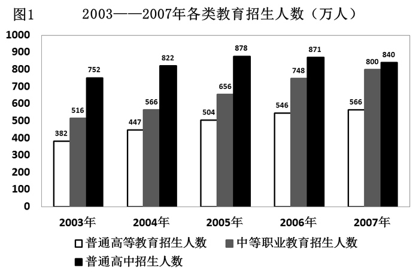

        从全国31个省份共抽取78所高等院校2162名大学生进行调查，道德类涉及道德品质或者关系的题目中，当提问：“你最看重人的哪3种品质或关系”，选择比例前五名的选项依次是“诚信”、“关爱”、“宽容”、“负责任”和“沟通”，选择比例依次为74.70%、65.40%、65.17%、49.49%、35.89%。前五名的选项均为积极道德意识；而当提问改为：“你觉得现在的人实际上哪3种品质或相互关系居多”，选择比例前五名的选项则依次为“相互利用”、“冷漠”、“不负责任”、“欺诈”、“关爱”，选择比例依次为62.49%、54.86%、43.52%、34.64%、29.19%，前五名的选项有4项是消极道德意识。

        虽然，大学生的道德期许与现实道德有很大的落差，这并不影响大学生保持良好的道德习惯。调查显示，大学生在爱护公共卫生上，选择“随手扔掉”的仅占3.5%；乘车时对老弱病残人士让座的态度上，自认会“主动让座”的达79.0%。

        调查主要从爱国与民族意识，文史哲常识和文化与生活价值观三个方面进行考察。调查显示，大学生具有很强的民族自尊心，当问到“被误认是日本或者韩国人时”，高达92.0%的大学生认为会“声明是中国人”，只有2.4%的大学生认为自己会“干脆回答是”，也只有5.6%的大学生认为自己会保持“沉默”。在爱国观念上，大学生对于我国在某些方面落后于其他国家，表示“立志为国争光”的占55.7%，表示“对社会风气不满”的占33.3%，而表示“无所谓”的占11.0%。

        理想信念是文化和生活价值观的重要组成部分，大学生作为国家多年培养教育的栋梁之才，理想是引领人生前进的重要航标，在树立人生理想问题上，选择“有理想，并为实现理想而努力”的大学生占65.8%，选择“有理想，但觉得要实现很困难”的占30.6%，而选择“无所谓理想，每天能过得去就行”的占3.7%。可见，大部分大学生还是有明确的理想抱负，但仍有不少的大学生对于如何实现理想抱有消极的态度。问卷还进而考察大学生的信念观，信念是激发一个人奋发进取、实现理想的重要支撑力量。自认“总是有信念支持”的大学生占40.4%，而自认“有时有信念支持”的大学生多达52.8%，大部分大学生在人生信念这个问题上还处于摇摆状态，既想努力向前，同时又有畏难情绪。

### 第 106 题

2007年我国普通高等教育招生规模扩大了：

A. 3.7%

B. 4.5%

C. 4.8%

D. 6.5%

第 106 题 · 答案与解析

**参考答案（粉笔题库参考内容）**

A

**解析**

根据题干“2007年······扩大了”，结合选项为百分数，可判定本题为一般增长率问题。定位图形材料可知，2007年我国普通高等教育招生人数为566万人，2006年我国普通高等教育招生人数为546万人，根据公式：增长率。

故正确答案为A。

**考点**：一般增长率、综合资料

**来源**：2008年山西省公务员录用考试《行测》题第106题

### 第 107 题

2007年高中毕业生占当年全体毕业生人数的比例是：

A. 9.8%

B. 14.1%

C. 9.5%

D. 8.5%

第 107 题 · 答案与解析

**参考答案（粉笔题库参考内容）**

B

**解析**

根据题干“2007年······占当年······比例是”，可判定本题为现期比重问题。定位文字材料第一段“我国2007全年普通高等教育······毕业生448万人；各类中等职业教育······毕业生530万人；全国普通高中······毕业生788万人；全国初中······毕业生1964万人；普通小学······毕业生1870万人。”可知，2007年高中毕业生占当年全体毕业生人数的比例是。

故正确答案为B。

**考点**：现期比重、综合资料

**来源**：2008年山西省公务员录用考试《行测》题第107题

### 第 108 题

2007年我国中等职业教育招生人数比上一年：

A. 下降了5.96%

B. 提高了5.96%

C. 下降了6.95%

D. 提高了6.95%

第 108 题 · 答案与解析

**参考答案（粉笔题库参考内容）**

D

**解析**

根据题干“2007年我国中等职业教育招生人数比上一年”，结合选项为百分数，可判定本题为一般增长率问题。定位图形材料可知，2007年我国中等职业教育招生人数为800万人，2006年我国中等职业教育招生人数为748万人，根据增长率公式：，可知2007年我国中等职业教育招生人数的增长率为，与D项最接近。

故正确答案为D。

**考点**：一般增长率、综合资料

**来源**：2008年山西省公务员录用考试《行测》题第108题

### 第 109 题

通过对心理期许道德状况和自认现实道德状况的对比分析，可以发现：

A. 大学生对优良的道德品质还是非常看重的

B. 大学生对现实生活中实际存在的道德品质做出消极的评价

C. 大学生的道德期许与实际道德有落差，但不是极大

D. 大学生看重优良的道德品质，但对实际存在的道德品质做出消极评价

第 109 题 · 答案与解析

**参考答案（粉笔题库参考内容）**

A

**解析**

A项：定位文字材料第三段“虽然，大学生的道德期许与现实道德有很大的落差，这并不影响大学生保持良好的道德习惯” 可知，大学生对优良的道德品质还是非常看重的，正确；

B项：定位文字材料第二段“当提问：‘你最看重人的哪3种品质或关系’······前五名的选项均为积极道德意识；而当提问改为：‘你觉得现在的人实际上哪3种品质或相互关系居多’，······前五名的选项有4项是消极道德意识”可知，当问卷题目不同时，大学生对实际存在的道德品质做出的评价情况是不同的，不止有消极，错误；

C项：定位文字材料第三段“虽然，大学生的道德期许与现实道德有很大的落差” 可知，大学生的道德期许与实际道德有很大的落差，错误；

D项：定位文字材料第二段“当提问：‘你最看重人的哪3种品质或关系’······前五名的选项均为积极道德意识；而当提问改为：‘你觉得现在的人实际上哪3种品质或相互关系居多’，······前五名的选项有4项是消极道德意识”可知，当问卷题目不同时，大学生对实际存在的道德品质做出评价情况是不同的，没有绝对的积极和消极之分，不止有消极，错误。

故正确答案为A。

**考点**：综合分析、综合资料

**来源**：2008年山西省公务员录用考试《行测》题第109题

### 第 110 题

从爱国与民族意识、文史哲常识和文化与生活价值观考察，发现：

A. 大学生有人生的理想信念，但缺少精神的滋养和文化的浸润

B. 有相当一部分大学生对我国某些方面落后的现状持消极态度

C. 大学生具有强烈爱国与民族意识、丰富的文史哲知识、健康的文化情趣，但理想信念摇摆不定

D. 大学生理想信念坚定，爱国与民族意识强，学识丰厚

第 110 题 · 答案与解析

**参考答案（粉笔题库参考内容）**

C

**解析**

A项：材料中未提及精神的滋养和文化的浸润的内容，无法得出，错误；

B项：定位文字材料第四段“在爱国观念上，大学生对于我国在某些方面落后于其他国家，表示‘立志为国争光’的占55.7%，表示‘对社会风气不满’的占33.3%”可知，大多数大学生对于我国在某些方面落后于其他国家，持有积极向上的态度，错误；

C项：定位文字材料第四段“大学生具有很强的民族自尊心”和文字材料第五段“大学生作为国家多年培养教育的栋梁之才”可知，大学生具有强烈爱国与民族意识、丰富的文史哲知识、健康的文化情趣；定位文字材料第五段“大部分大学生在人生信念这个问题上还处于摇摆状态”可知，大学生理想信念不坚定，正确；

D项：定位文字材料第五段“大部分大学生在人生信念这个问题上还处于摇摆状态”可知，大学生理想信念不坚定，错误。

故正确答案为C。

**考点**：综合分析、综合资料

**来源**：2008年山西省公务员录用考试《行测》题第110题

## 材料 2

在大学生文化和生活价值观上，问卷通过多选题型考察大学生的文化生活趋向，大学生喜欢的十类文化排序分别是：传统经典文化、现代文化、古代文化、民间民族文化、通俗流行文化、异国文化、全球共同文化、宗教文化、前卫（超前）文化和后现代文化。大学生作为一个高知群体，在文化价值取向上展现出传统与现代交织的态势，大学生既热衷于现代文化，也保持对传统经典文化最浓厚的兴趣，只有小部分的大学生自认比较喜欢前卫文化和后现代文化。

        在考察法律意识方面，问卷主要通过考察公民解决纠纷的途径来反映公民的法律意识。问卷设定了三种纠纷解决途径，即法律途径（“遵循法律和政策规定解决”）、行政途径（“找单位和领导帮助解决”）和武力途径（“通过恐吓、武力或其他施压方式解决”）三种，大学生在纠纷解决方面的选择情况分别为67.6%，28.9%，3.5%。应该说，只有极少部分大学生采取武力途径解决纠纷。在法律常识方面，大学生对法律性质的正确认识高达91.2%，在对我国已经颁布的部门法的了解上，选择“宪法”、“合同法”、“民事诉讼法”、“继承法”、“婚姻法”的分别为：96.7%、94.7%、93.7%、89.8%、95.1%，几乎都在90%以上。在调查中，我们还发现，大学生也以自己的实际行动来践行和维护法律。

        在知识产权方面，93%的被调查者知道“世界知识产权日”，76%的被调查者明确“我国国家知识产权战略现在是从‘制定’转入‘实施’”，48%的被调查者关注过“北京市高级人民法院2007年受理的《十大知识产权典型案例》”。

        大学生在科学意识方面，大学生自认在日常工作和学习中，选择“按他人意志办事”的仅占6.3%，选择“据自己兴趣办事”和“按客观规律办事”的占45.6%、48.1%。而对“科学发展观”，表示“明确知道”的占35.7%，表示“知道一些，不太明确”的占58.6%，而表示“不知道”的占5.6%。

        在科学行为方面，大学生发现、思考和解决问题的能力作为考察的重点。大学生自认“很少遇到问题”的仅占22.7%，而认为“经常遇到问题”、“善于发现问题的原因”、“善于提出解决问题的办法”、“善于解决问题”四项的选择比例分别为：57.1%、43.4%、39.5%和37.2%。

### 第 111 题

根据上图提供的信息可考察出大学生的文化生活趋向是：

A. 对现代文化有浓厚的学习兴趣

B. 传统与现代交织的态势

C. 热衷于传统经典文化

D. 一批人比较喜欢前卫和后现代文化

第 111 题 · 答案与解析

**参考答案（粉笔题库参考内容）**

B

**解析**

A项：定位文字材料第一段“大学生既热衷于现代文化，也保持对传统经典文化最浓厚的兴趣”可知，现代文化并非大学生的文化生活趋向，错误；

B项：定位文字材料第一段“大学生作为一个高知群体，在文化价值取向上展现出传统与现代交织的态势”可知，大学生的文化生活趋向是传统与现代交织的态势，正确；

C项：定位文字材料第一段“大学生既热衷于现代文化，也保持对传统经典文化最浓厚的兴趣”可知，大学生也热衷于现代文化，传统经典文化并非大学生的文化生活趋向，错误；

D项：定位文字材料第一段“只有小部分的大学生自认比较喜欢前卫文化和后现代文化”可知，只有小部分人比较喜欢前卫和后现代文化，错误。

故正确答案为B。

**考点**：综合分析、综合资料

**来源**：2008年山西省公务员录用考试《行测》题第111题

### 第 112 题

根据所给文字资料不能得出的结论是：

A. 解决纠纷大学生用法律途径多于行政途径，用行政途径多于武力

B. 在法律意识和法律常识方面，大学生是一个强势群体

C. 大学生能够以自己的实际行动来践行和维护法律

D. 大学生法律意识强、法律知识丰富，并且是遵守和维护法律的先锋

第 112 题 · 答案与解析

**参考答案（粉笔题库参考内容）**

B

**解析**

A项：定位文字材料第二段，大学生在法律途径、行政途径和武力途径解决纠纷方面的选择情况分别为67.6%，28.9%，3.5%，可知用法律途径多于行政途径，用行政途径多于武力，正确；

B项：定位文字材料第二段“大学生对法律性质的正确认识高达91.2%”，但并没有给出其他群体的相应数据，故不能判断大学生是一个强势群体，错误；

C项：定位文字材料第二段末句“大学生也以自己的实际行动来践行和维护法律”可知，正确；

D项：文字材料第二段给出：极少部分大学生采取武力途径解决纠纷，对法律性质的正确认识高达91.2%，而且以自己的实际行动来践行和维护法律。因此可得出大学生法律意识强、法律知识丰富，并且是遵守和维护法律的先锋，正确。

本题为选非题，故正确答案为B。

**考点**：综合分析、综合资料

**来源**：2008年山西省公务员录用考试《行测》题第112题

### 第 113 题

以上所给文字资料表明：

A. “实施知识产权战略”已深入人心

B. 大学生对知识产权的认知程度参差不齐

C. 高校建立了知识产权教育体系和宣传体系

D. 在经济全球化的今天，知识产权保护已成为大学生重要的游戏规则

第 113 题 · 答案与解析

**参考答案（粉笔题库参考内容）**

B

**解析**

A项：定位文字材料第三段，在知识产权方面······76%的被调查者明确“我国国家知识产权战略现在是从‘制定’转入‘实施’”，并非所有人了解“实施知识产权战略”，无法得知“实施知识产权战略”已深入人心，错误；

B项：定位文字材料第三段，在知识产权方面，93%的被调查者知道“世界知识产权日”，76%的被调查者明确“我国国家知识产权战略现在是从‘制定’转入‘实施’”，48%的被调查者关注过“北京市高级人民法院2007年受理的《十大知识产权典型案例》”，大学生对知识产权的认知程度存在差异，参差不齐，正确；

C项：材料中未提及高校建立了知识产权教育体系和宣传体系，无法得知，错误；

D项：材料中未提及知识产权保护已成为大学生重要的游戏规则，无法得知，错误。

故正确答案为B。

**考点**：综合分析、综合资料

**来源**：2008年山西省公务员录用考试《行测》题第113题

### 第 114 题

根据所给文字资料能够判定的是：

A. 在科学意识、科学行为方面，大学生是一个高知群体

B. 大学生有明确的科学观念，但动手解决问题的能力不强

C. 大学生从发现问题、思考问题到解决问题呈递增的过程

D. 大学生缺乏系统明确的科学观念，特别是动手、解决问题的能力

第 114 题 · 答案与解析

**参考答案（粉笔题库参考内容）**

D

**解析**

A项：定位文字材料第四段“在科学意识方面，大学生自认在日常工作和学习中······选择‘据自己兴趣办事’和‘ 按客观规律办事’的占45.6%、48.1%” 可知，大学生并不是高知群体，错误；

B项：定位文字材料第四段“而对‘科学发展观’，表示‘明确知道’的占35.7%，表示‘知道一些，不太明确’的占58.6%”可知，大学生没有明确的科学观念，错误；

C项：定位文字材料第五段“而认为‘经常遇到问题’、‘善于发现问题的原因’、‘善于提出解决问题的办法’、‘善于解决问题’四项的选择比例分别为：57.1%、43.4%、39.5%和37.2%”可知，大学生从发现问题、思考问题到解决问题呈递减的过程，错误；

D项：由B项可知大学生缺乏系统明确的科学观念，定位文字材料第五段可得，大学生选择“善于解决问题”的比例为37.2%，可知大学生缺乏动手、解决问题的能力，正确。

故正确答案为D。

**考点**：综合分析、综合资料

**来源**：2008年山西省公务员录用考试《行测》题第114题

### 第 115 题

上述图表和文字资料透视出：

A. 当代大学生的基础性人文素质状况

B. 当代大学生的发展性人文素质状况

C. 当代大学生的竞争性人文素质状况

D. 当代大学生的人文素质潜力发展状况

第 115 题 · 答案与解析

**参考答案（粉笔题库参考内容）**

D

**解析**

从图中和文中的文字可以直接看出，本文主要描述的是当代大学生的人文素质潜力发展状况。

故正确答案为D。

**考点**：综合分析、综合资料

**来源**：2008年山西省公务员录用考试《行测》题第115题

## 材料 3

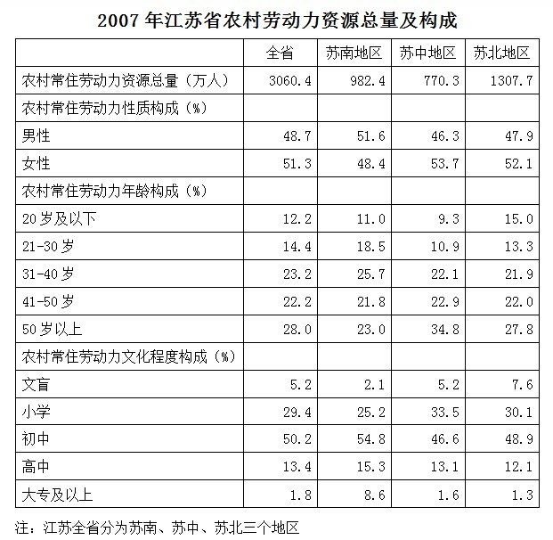

### 第 116 题

苏南地区的农村常住劳动力资源总量比苏北地区少：

A. 21.45%

B. 24.88%

C. 25.45%

D. 56.42%

第 116 题 · 答案与解析

**参考答案（粉笔题库参考内容）**

B

**解析**

根据题干“苏南地区······比苏北地区少”，结合选项为百分数，可判定本题为一般增长率问题。定位表格材料，可知苏南地区的农村常住劳动力资源总量为982.4万人，苏北地区的农村常住劳动力资源总量为1307.7万人，则苏南地区的农村常住劳动力资源总量比苏北地区少，与B项最接近。

故正确答案为B。

**考点**：一般增长率、统计表

**来源**：2008年山西省公务员录用考试《行测》题第116题

### 第 117 题

2007年该省农村常住劳动力人口男性比女性少多少万人：

A. 78.21

B. 79.05

C. 79.44

D. 79.57

第 117 题 · 答案与解析

**参考答案（粉笔题库参考内容）**

D

**解析**

根据题干“2007年该省农村常住劳动力人口男性比女性少多少万人”，且表格给出了男性、女性占农村常住劳动力人口的比重，可判定本题为现期比重问题。定位表格材料可知，2007年该省农村常住劳动力人口3060.4万人，男性占比48.7%，女性占比51.3%，则2007年该省农村常住劳动力人口男性比女性少万人，与D项最接近。

故正确答案为D。

**考点**：现期比重、统计表

**来源**：2008年山西省公务员录用考试《行测》题第117题

### 第 118 题

苏南、苏中、苏北三个地区中农村常住劳动力文盲最多的区域占该省农村常住劳动力文盲的：

A. 45.32%

B. 53.64%

C. 62.45%

D. 70.12%

第 118 题 · 答案与解析

**参考答案（粉笔题库参考内容）**

C

**解析**

根据题干“苏南、苏中、苏北三个地区中······占······的”，可判定本题为现期比重问题。定位表格材料可知，苏北地区农村常住劳动力（1307.7万人）最多，文盲占比（7.6%）最多，即苏北地区农村常住劳动力文盲最多。全省农村常住劳动力3060.4万人，文盲占比5.2%，可知苏北地区农村常住劳动力文盲占全省农村常住劳动力文盲的比例为，与C项最接近。

故正确答案为C。

**考点**：现期比重、统计表

**来源**：2008年山西省公务员录用考试《行测》题第118题

### 第 119 题

苏南地区21-40岁农村常住劳动力人口比苏中地区多多少万人：

A. 127.32

B. 152.2

C. 180.02

D. 187.14

第 119 题 · 答案与解析

**参考答案（粉笔题库参考内容）**

C

**解析**

根据题干“苏南地区21-40岁农村常住劳动力人口比苏中地区多多少万人”且表格给出了苏南、苏中各年龄段人口占比，可判定本题为现期比重问题。定位表格材料，可知苏南地区农村常住劳动力982.4万人，21-40岁人口占比18.5%+25.7%=44.2%，苏中地区农村常住劳动力770.3万人，21-40岁人口占比10.9%+22.1%=33%，因此苏南地区21-40岁农村常住劳动力人口比苏中地区多万人，与C项最接近。

故正确答案为C。

**考点**：现期比重、统计表

**来源**：2008年山西省公务员录用考试《行测》题第119题

### 第 120 题

根据表格，下列表述正确的是：

A. 农村常住劳动力人口中大专及以上文化程度最多的是苏南地区

B. 31-40岁农村常住劳动力人口在苏南、苏中、苏北三个地区比重为最高

C. 根据该表可以准确得知10年后该省农村常住劳动力年龄构成情况

D. 苏南地区的农村常住劳动力人口具有高中文化程度的人口数量多于苏北地区

第 120 题 · 答案与解析

**参考答案（粉笔题库参考内容）**

A

**解析**

A项：定位表格材料可知，苏中地区农村常住劳动力中大专及以上人数为，苏南地区为，苏北地区为，苏中地区总人数最少，且占比为1.6%，和苏北地区相比，占比相差较小，但总人数相差较大，故苏中地区农村常住劳动力中大专及以上人数最少，苏南和苏北总人数相差不大，苏南占比8.6%是苏北占比1.3%的6倍多，即更大，因此农村常住劳动力人口中大专及以上文化程度最多的是苏南地区，正确；

B项：定位表格材料可知，苏中地区农村常住劳动力人口中50岁以上（34.8%）＞31-40岁（22.1%），因此31-40岁农村常住劳动力人口在苏中地区比重不是最高，错误；

C项：由于人口存在城乡流动情况，因此根据该表无法得知10年后该省农村常住劳动力年龄构成情况，错误；

D项：定位表格材料可知，苏南地区的农村常住劳动力中具有高中文化程度的人口为万人，苏北地区的农村常住劳动力中具有高中文化程度的人口为万人，因此苏南地区的农村常住劳动力中具有高中文化程度的人口数量少于苏北地区，错误。

故正确答案为A。

**考点**：统计表、综合分析

**来源**：2008年山西省公务员录用考试《行测》题第120题

## 材料 4

经国家统计局核准，2006年某省生产总值641.05亿元，比上年增长12.2%；人均生产总值11753元，比上年增长11.3%。在产业结构调整中，全年第一产业完成产值69.60亿元，比上年增长3.5%；第二产业完成增加值334.82亿元，比上年增长15.7%。第一、第二和第三产业产值占生产总值的比重分别由“十五”末2005年的12.0：48.7：39.3转变为10.9：51.6：37.5；第一、第二和第三产业对GDP的贡献率分别为3.5%、62.7%、33.8%。

        其中，社会消费品零售总额180.11亿元，比上年增长12.2%。按城乡分：城市的消费品零售额122.78亿元，增长16.3%；县及县以下的消费品零售额57.33亿元，增长4.4%。按行业分：批发零售贸易业145.96亿元，增长10.5%；住宿餐饮业30.29亿元，增长24.1%；其它行业3.86亿元，下降2.8%。限额以上批发零售贸易企业零售额37.22亿元，增长19.1%（批发企业年销售额在2000万元及以上、零售企业年零售额在500万元及以上统称为限额以上企业）；其中，汽车类零售额4.68亿元，增长6.5倍；石油及制品类12.41亿元，下降7.7%；文化办公用品类0.32亿元，增长1.1倍；家用电器和音像器材类2.90亿元，增长43.6%；食品、饮料、烟酒类8.51亿元，增长39.9%。

### 第 121 题

2005年该省人口约有多少万：

A. 541.06

B. 5410.63

C. 547.17

D. 5422.74

第 121 题 · 答案与解析

**参考答案（粉笔题库参考内容）**

A

**解析**

根据题干“2005年该省人口约有多少万”，且材料给出了2006年该省生产总值和人均生产总值，可判定本题为基期平均数问题。定位文字材料第一段“2006年某省生产总值641.05亿元，比上年增长12.2%；人均生产总值11753元，比上年增长11.3%”，根据基期平均数公式可得：2005年该省人口万，与A项最接近。

故正确答案为A。

**考点**：基期平均数、文字资料

**来源**：2008年山西省公务员录用考试《行测》题第121题

### 第 122 题

2005年该省第三产业产值比2006年第三产业产值少多少亿元：

A. 10.36

B. 12.45

C. 14.36

D. 16.09

第 122 题 · 答案与解析

**参考答案（粉笔题库参考内容）**

D

**解析**

根据题干“2005年该······比2006年······少多少亿元”，可判定本题为增长量计算问题。定位文字材料第一段“2006年某省生产总值641.05亿元，比上年增长12.2%；······第三产业产值占生产总值的比重······由‘十五’末2005年的······39.3转变为······37.5”可知，2006年第三产业产值的增长量为亿元，即2005年该省第三产业产值比2006年第三产业产值约少17亿元，与D项最接近。

故正确答案为D。

**考点**：增长量计算、文字资料

**来源**：2008年山西省公务员录用考试《行测》题第122题

### 第 123 题

2005年汽车类零售额是社会消费品零售总额的：

A. 0.40%

B. 0.43%

C. 0.51%

D. 0.62%

第 123 题 · 答案与解析

**参考答案（粉笔题库参考内容）**

A

**解析**

根据题干“2005年汽车类零售额是社会消费品零售总额的”，结合选项为百分数，且材料时间是2006年，可判定本题为基期比重问题。定位文字材料第二段“社会消费品零售总额180.11亿元，比上年增长12.2%······其中，汽车类零售额4.68亿元，增长6.5倍”，根据基期比重公式可得：2005年汽车类零售额占社会消费品零售总额的比重，与A项最为接近。

故正确答案为A。

**考点**：基期比重、文字资料

**来源**：2008年山西省公务员录用考试《行测》题第123题

### 第 124 题

下列说法正确的是：

Ⅰ.2006年城乡消费品零售额差距进一步扩大

Ⅱ.2006年三大产业产值较2005年增长率最大的是第三产业

Ⅲ.批发零售贸易业和住宿餐饮业占社会消费品零售总额的比例2006年比2005年高

A. 仅Ⅰ

B. 仅Ⅲ

C. Ⅰ和Ⅲ

D. Ⅰ、Ⅱ和Ⅲ

第 124 题 · 答案与解析

**参考答案（粉笔题库参考内容）**

B

**解析**

Ⅰ不正确，题干“2006年城乡消费品零售额差距进一步扩大”，是指2005年比2004年扩大，2006年又比2005年扩大，而根据材料已知“城市的消费品零售额122.78亿元，增长16.3%；县及县以下的消费品零售额57.33亿元，增长4.4%。”无法求出2004年的城乡消费品零售额差距，所以无法推断，错误。

Ⅱ不正确，根据第122题，2006年第三产业的增长率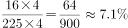，从文中第一段可知，第一产业增长3.5%，第二产业增长15.7%，所以增长率最大的为第二产业；

Ⅲ正确，2006年批发零售和住宿餐饮业占社会消费品零售总额的比例为，2005年占的比例为

。

故正确答案为B。

**考点**：文字资料、综合分析

**来源**：2008年山西省公务员录用考试《行测》题第124题

### 第 125 题

下列说法正确的是：

A. 2005年该省石油及制品类零售额为13.14亿元

B. 第二和第三产业产值占生产总值的比重2005年比2006年低1.1个百分点

C. 2006年该省县及县以下的消费品零售额比城市的消费品零售额少114.16%

D. 2006年该省第一、二产业完成产值比2005年增长1.8%

第 125 题 · 答案与解析

**参考答案（粉笔题库参考内容）**

B

**解析**

A项：定位文字材料第二段“石油及制品类12.41亿元，下降7.7%”，可知2005年该省石油及制品类零售额为亿元，错误；

B项：定位文字材料第一段“第一、第二和第三产业产值占生产总值的比重分别由‘十五’末2005年的12.0：48.7：39.3转变为10.9：51.6：37.5”可知，2005年第二和第三产业产值占生产总值的比重为1-12.0%=88%，2006年第二和第三产业产值占生产总值的比重为1-10.9%=89.1%，89.1%-88%=1.1%，因此第二和第三产业产值占生产总值的比重2005年比2006年低1.1个百分点，正确；

C项：定位文字材料第二段“城市的消费品零售额122.78亿元······县及县以下的消费品零售额57.33亿元”可知，2006年该省县及县以下的消费品零售额比城市的消费品零售额少，错误；

D项：定位文字材料第一段，全年第一产业完成产值69.60亿元，比上年增长3.5%；第二产业完成增加值334.82亿元，比上年增长15.7%。根据混合增长率居中可知，2006年该省第一、二产业完成产值比2005年增长在3.5%-15.7%之间，不可能是1.8%，错误。

故正确答案为B。

**考点**：文字资料、综合分析

**来源**：2008年山西省公务员录用考试《行测》题第125题

