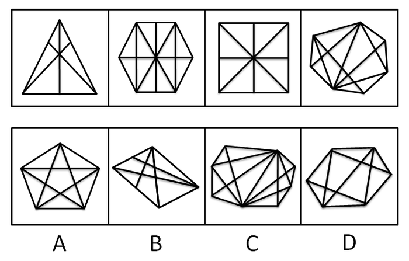
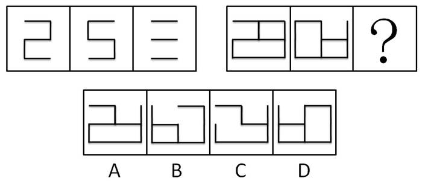
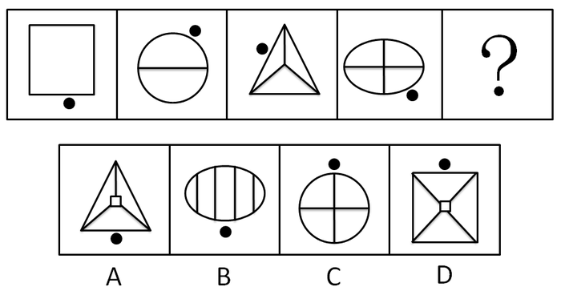
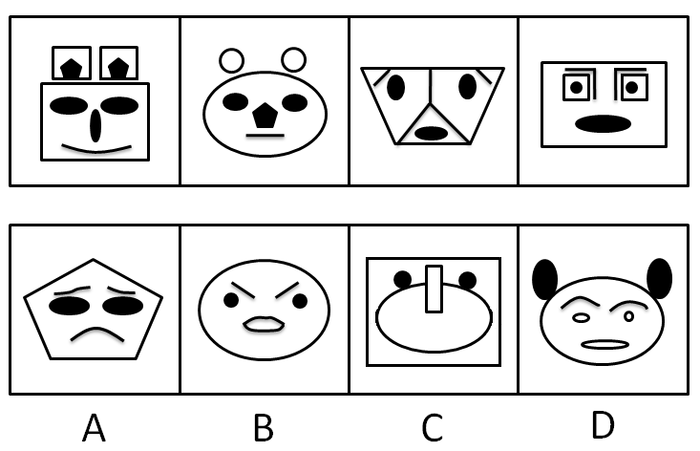
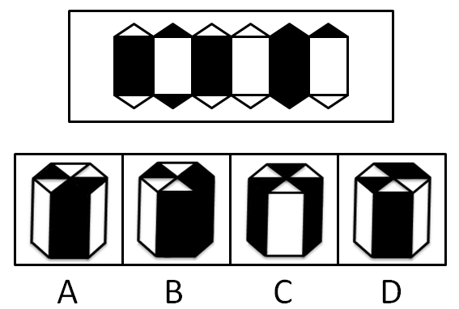
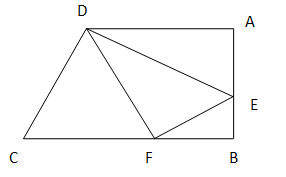
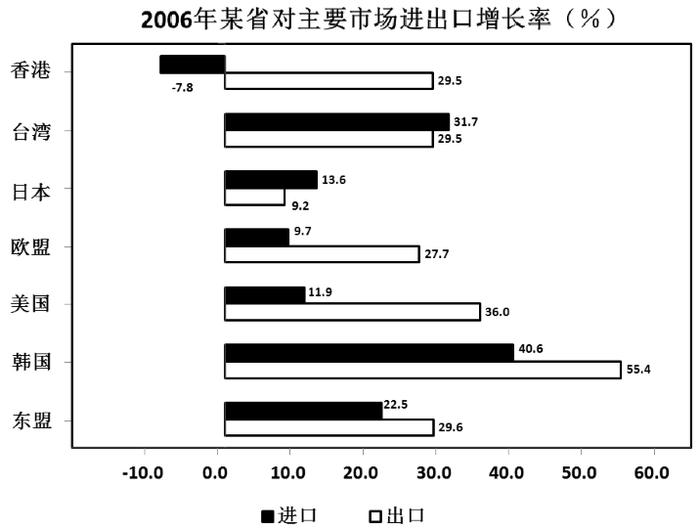
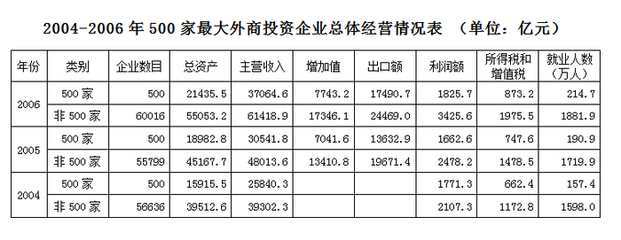

# 2009年山西省公务员录用考试《行测》题

<!-- gwy:overview:start -->
> **山西 · 2009 · 行测 · 统考** ｜ 130 题 · 图片 104 处 · 答案随题折叠

| 题型模块 | 题量 | 题号 |
| --- | ---: | ---: |
| 常识判断 | 20 | 1–20 |
| 言语理解与表达 | 30 | 21–50 |
| 判断推理 | 35 | 51–85 |
| 数量关系 | 25 | 86–110 |
| 资料分析 | 20 | 111–130 |
| **合计** | **130** | |

导航：[题型与作答说明](#题型与作答说明) · [题目](#题目) · [材料 1](#材料-1)
<!-- gwy:overview:end -->

> 候选采集稿。参考答案及解析来自粉笔页面，不代表官方答案或真实高分答卷；来源使用许可与原卷对应关系仍需人工核实。

## 题型与作答说明

常识判断

（20题）

根据题目要求，在四个选项中选出一个正确答案。

言语理解与表达

（30题）

本部分中每道题包含一段文字或一个句子，后面是一个不完整的陈述，要求你从四个选项中选出一项来完成陈述。注意：答案可能是完成对所给文字主要意思的提要，也可能是满足陈述中其他方面的要求，你的选择应与所提要求最相符合。

判断推理

（35题）

本部分包括定义判断、图形推理、类比推理与逻辑判断四种类型的试题。

数量关系

（25题）

本部分包括数字推理与数学运算两种类型的试题。

资料分析

（20题）

所给出的图、表、文字或综合性资料均有若干个问题要你回答。请根据资料提供的信息进行分析、比较、计算和判断处理。

## 题目

### 第 1 题

公共危机管理的第一原则是：

A. 科学性原则

B. 效率性原则

C. 时间性原则

D. 协同性原则

第 1 题 · 答案与解析

**参考答案（粉笔题库参考内容）**

C

**解析**

公共危机具有公共性、突发性、紧急性和高度不确定性。

处理公共危机必须坚持以下原则：

（1）时间性原则。采取紧急处置手段，及时控制危机事态的发展是危机管理的第一原则。

（2）效率性原则。公共危机蔓延速度很快，要求政府快速反应，有效动员社会资源。

（3）协同性原则。参与危机应对的人员和力量来自各个方面，比如交通、医疗、通信、消防、民政部门等，因此协同一致运作特别重要。

（4）科学性原则。该项原则主要针对因工业技术而引起的灾害以及由自然灾害而造成的危机事件。应对资源短缺、辐射事故、地震、海啸、飓风等灾害不可盲目蛮干，必须注重科学性、技术性，多征求特定技术领域内专家的意见。

故正确答案为C。

**来源**：2009年山西省公务员录用考试《行测》题第1题

### 第 2 题

某一经济主体的经济活动影响到其他的经济主体，而这种影响无法通过市场价格反映出来。这种现象称为：

A. 滞胀

B. 外部效应

C. 信息不对称

D. 经济危机

第 2 题 · 答案与解析

**参考答案（粉笔题库参考内容）**

B

**解析**

外部效应：某个经济主体的活动所产生的影响不表现在其自身的成本和收益上，而是会给其他的经济主体带来好处或者坏处。

故正确答案为B。

**本题相关知识点：**

滞胀：在经济学中，特指经济停滞与高通货膨胀、失业以及不景气并存的经济现象。

信息不对称：指交易中的各人拥有的资料不同。一般而言，卖家比买家拥有更多关于交易物品的信息，但相反的情况也可能存在。

经济危机：指的是一个或多个国民经济或整个世界经济在一段比较长的时间内不断收缩（负的经济增长率），是资本主义经济发展过程中周期爆发的生产相对过剩的危机。

**考点**：微观经济

**来源**：2009年山西省公务员录用考试《行测》题第2题

### 第 3 题

国际上用来判断一个国家的收入分配是否平等和公平的指标是：

A. 基尼系数

B. 恩格尔系数

C. CPI

D. 幸福指数

第 3 题 · 答案与解析

**参考答案（粉笔题库参考内容）**

A

**解析**

基尼系数：在全部居民收入中，用于进行不平均分配的那部分收入占总收入的百分比，是国际上用来综合考察居民内部收入分配差异状况的一个重要分析指标。

故正确答案为A。

**本题相关知识点：**

恩格尔系数：食品支出总额占个人消费支出总额的比重。恩格尔系数是国际上通用的衡量居民生活水平高低的一项重要指标。

CPI：消费者物价指数，是反映与居民生活有关的商品及劳务价格统计出来的物价变动指标，通常作为观察通货膨胀水平的重要指标。

幸福感是一种心理体验，它既是对生活的客观条件和所处状态的一种事实判断，又是对生活的主观意义和满足程度的一种价值判断，它表现为在生活满意度基础上产生的一种积极心理体验。而幸福指数，就是衡量这种感受具体程度的主观指标数值。

**考点**：市场经济

**来源**：2009年山西省公务员录用考试《行测》题第3题

### 第 4 题

“科学管理之父”弗雷德里克·温斯格·泰罗认为管理的中心问题是：

A. 管理的效率性

B. 管理的科学性

C. 管理的系统性

D. 管理的合理性

第 4 题 · 答案与解析

**参考答案（粉笔题库参考内容）**

B

**解析**

泰罗是西方古典管理理论主要代表人物之一，科学管理运动的创始人，被公认为“科学管理之父”，也有人称他为“理性效率的大师”。他提出，管理的中心问题在于管理的科学性。泰罗的科学管理思想深深地扎根在一系列科学实验的基础上，使之成为一门真正的科学。当代许多重要的管理理论都是在泰罗的科学管理理论基础上的继承和发展。

故正确答案为B。

**考点**：其他

**来源**：2009年山西省公务员录用考试《行测》题第4题

### 第 5 题

阳光中能引起皮肤癌的是：

A. 红外线

B. 绿光

C. 蓝光

D. 紫外线

第 5 题 · 答案与解析

**参考答案（粉笔题库参考内容）**

D

**解析**

在1890年，有报告指出紫外线与皮肤癌的发生有关系；在1906年，有文献具体述说某些人特别容易因暴露在紫外线下而罹患皮肤癌；其后在1928年，动物实验中证实紫外线照射可导致皮肤癌。在进一步的科学探索下，科学家们发现紫外线波长在290-320mm的范围下更容易产生致癌效果。

故正确答案为D。

**考点**：生物常识

**来源**：2009年山西省公务员录用考试《行测》题第5题

### 第 6 题

全国绿化委员会、国家林业局日前向各地发出“关于禁止大树移植进城的通知”。下列不是国家禁止大树进城原因的是：

A. 移植大树进城，可以起到快速有效绿化城市的效果

B. 移植大树违背树木生长自然规律，不利于树木生长

C. 移植大树成活率低，对森林资源保护和城市绿化不利

D. 移植大树成本费用高，不符合节约原则

第 6 题 · 答案与解析

**参考答案（粉笔题库参考内容）**

A

**解析**

大树移植进城，虽可起到“立竿见影”的效果，但一方面突然改变其自然生长环境，违背了自然生长规律，可致其生长衰败甚至死亡，造成森林资源的巨大浪费和破坏；另一方面，对大树的无度采挖，也会对良好的原生态造成巨大的破坏。而且移植大树的成本费用很高。

A选项是大树进城的原因，而不是国家禁止大树进城的原因。

本题为选非题，故正确答案为A。

**考点**：其他

**来源**：2009年山西省公务员录用考试《行测》题第6题

### 第 7 题

下列四句诗句中描写重阳节的是：

A. 月上柳梢头，人约黄昏后

B. 清明时节雨纷纷，路上行人欲断魂

C. 遥知兄弟登高处，遍插茱萸少一人

D. 海上生明月，天涯共此时

第 7 题 · 答案与解析

**参考答案（粉笔题库参考内容）**

C

**解析**

“遥知兄弟登高处，遍插茱萸少一人”出自王维《九月九日忆山东兄弟》，此句是写远在家乡的兄弟，按照重阳节的风俗而登高时，也在怀念自己。

故正确答案为C。

**本题相关知识点：**

“月上柳梢头，人约黄昏后”是宋代大文豪欧阳修描写元宵夜情侣们相会的词句。

“清明时节雨纷纷，路上行人欲断魂”出自杜牧的绝句《清明》，意思是清明的时候，又下起了纷纷的春雨，奔走旅行在外的人，心里更是增添了一分愁苦，简直失魂落魄了。

“海上生明月，天涯共此时”出自唐朝诗人张九龄的《望月怀远》，前句写景：辽阔无边的大海上升起一轮明月；后句触景生情：诗人想起了远在天涯海角的友人，此时此刻他也和我望着同一轮明月。无法推测描写的是什么节日，但人们常在中秋节时提到这句诗。

**考点**：文学常识

**来源**：2009年山西省公务员录用考试《行测》题第7题

### 第 8 题

5月22日是国际生物多样性日，今年它的主题是外来物种入侵。对待外来物种的正确态度是：

A. 有目的地大量引进外来物种，以促进本国生物多样化

B. 为保护本国生物多样化，所有外来物种应一概拒之门外

C. 引进外来物种应尽量选择生长快、繁殖快、适应性强的物种

D. 外来物种入侵对本地造成极大生态危害，有效防范外来物种入侵刻不容缓

第 8 题 · 答案与解析

**参考答案（粉笔题库参考内容）**

D

**解析**

近年来，外来物种入侵给我国造成了巨大的经济损失和严重的生态灾难。对待外来物种，我们应该谨慎引进，提高物种引进的自觉性和预见性，建立健全外来入侵物种防御体系。

A、B、C项错误，态度过于绝对、片面，不符合科学、合理的原则；

D项正确，该项是正确的态度，故选该项。

故正确答案为D。

**考点**：生物常识

**来源**：2009年山西省公务员录用考试《行测》题第8题

### 第 9 题

新中国成立60年来，在航天领域取得非凡成就，下列描述符合实际的是：

A. 首次月球探测工程的成功，标志着我国已经进入世界具有深空探测能力的国家行列

B. 1970年我国成功地研制并发射了第一颗人造地球卫星“东方红一号”，成为世界上第三个独立自主研制和发射人造地球卫星的国家

C. 我国是世界上第五个掌握卫星回收技术的国家

D. 2003年10月发射并回收了“神舟”五号载人飞船，取得首次载人航天飞行的成功，使我国成为了世界上第二个独立开展载人航天活动的国家

第 9 题 · 答案与解析

**参考答案（粉笔题库参考内容）**

A

**解析**

本题考查科技常识。

B选项错误，“东方红一号”卫星是我国于1970年4月24日发射的第一颗人造地球卫星。按时间先后，我国是继苏、美、法、日之后，世界上第五个用自制火箭发射国产卫星的国家；

C选项错误，1975年，中国成为世界上第三个掌握卫星回收技术的国家；

D选项错误，我国是世界上第三个独立开展载人航天活动的国家。

故正确答案为A。

**考点**：科技理论与成就

**来源**：2009年山西省公务员录用考试《行测》题第9题

### 第 10 题

促进中部地区崛起计划中所指的“中部六省”是：

A. 山西省、江西省、河南省、河北省、湖北省、湖南省

B. 山西省、河北省、江西省、河南省、湖南省、四川省

C. 山西省、安徽省、江西省、湖北省、河南省、河北省

D. 山西省、安徽省、江西省、河南省、湖北省、湖南省

第 10 题 · 答案与解析

**参考答案（粉笔题库参考内容）**

D

**解析**

2004年3月，温家宝总理在政府工作报告中，首次明确提出促进中部地区崛起的计划，“中部六省”指的是山西、安徽、江西、河南、湖北和湖南。

故正确答案为D。

**考点**：中国地理

**来源**：2009年山西省公务员录用考试《行测》题第10题

### 第 11 题

加快建立覆盖城乡居民的社会保障体系的重点是：

A. 基本养老、基本医疗、最低生活保障制度

B. 基本养老、基本医疗、社会救助

C. 社会保险、社会救助、社会福利

D. 慈善事业、社会福利、最低生活保障制度

第 11 题 · 答案与解析

**参考答案（粉笔题库参考内容）**

A

**解析**

党的十七大报告强调“加快建立覆盖城乡居民的社会保障体系，保障人民基本生活”，明确提出“要以社会保险、社会救助、社会福利为基础，以基本养老、基本医疗、最低生活保障制度为重点，以慈善事业、商业保险为补充，加快完善社会保障体系”的目标任务。

故正确答案为A。

**考点**：重要文件

**来源**：2009年山西省公务员录用考试《行测》题第11题

### 第 12 题

关于GDP，以下说法正确的是：

A. 我国企业在境外创造的产品价值可以计入GDP

B. 家务劳动的价值不可计入GDP

C. 企业为生产消费品而购入的中间产品的价值可计入GDP

D. GDP能够体现一国国民的生活质量

第 12 题 · 答案与解析

**参考答案（粉笔题库参考内容）**

D

**解析**

A选项错误，本国常住者通过在国外投资或到国外工作所获得的收入（称之为从国外得到的要素收入），应计入本国国民生产总值（GNP），而不是计入GDP；

B选项错误，以工资形式支付报酬的家务劳动，可计入GDP；

C选项错误，生产过程中的新增加值包括劳动者新创造的价值和固定资产的磨损价值，但不包含生产过程中作为中间投入的价值；

D选项正确，GDP是英文“Gross Domestic Product”的缩写，也就是国内生产总值。它是对一国（地区）经济在核算期内所有常住单位生产的最终产品总量的度量，常常被看成显示一个国家（地区）经济状况的一个重要指标。GDP能一定程度上体现人民的生活质量。

故正确答案为D。

**考点**：宏观经济与调控政策

**来源**：2009年山西省公务员录用考试《行测》题第12题

### 第 13 题

为了应对2008年底以来的金融危机，我国政府采取了：

A. 积极的财政政策和适度紧缩的货币政策

B. 积极的财政政策和高度紧缩的货币政策

C. 积极的财政政策和适度宽松的货币政策

D. 积极的财政政策和稳健的货币政策

第 13 题 · 答案与解析

**参考答案（粉笔题库参考内容）**

C

**解析**

2008年底，在世界金融危机日趋严峻、我国经济遭受冲击日益显现的背景下，中国的宏观调控政策作出了重大调整，实行积极的财政政策和适度宽松的货币政策，并在今后两年多时间内安排4万亿元资金强力启动内需，促进经济稳定增长。

故正确答案为C。

**考点**：宏观经济与调控政策

**来源**：2009年山西省公务员录用考试《行测》题第13题

### 第 14 题

根据我国《立法法》，以下不能制定行政规章的是：

A. 国务院

B. 公安部

C. 中国人民银行

D. 审计署

第 14 题 · 答案与解析

**参考答案（粉笔题库参考内容）**

A

**解析**

根据我国《立法法》第八十条第一款规定：“国务院各部、委员会、中国人民银行、审计署和具有行政管理职能的直属机构，可以根据法律和国务院的行政法规、决定、命令，在本部门的权限范围内，制定规章。”B、C、D项都能制定行政规章。国务院制定的是行政法规，而不是行政规章。

本题为选非题，故正确答案为A。

**考点**：法理学

**来源**：2009年山西省公务员录用考试《行测》题第14题

### 第 15 题

根据《公务员法》，下列说法符合规定的是：

A. 公务员陈某因违纪被处以警告处分，四个月后被提拔

B. 公务员张某因工作关系被派往某国有企业挂职锻炼

C. 某事业单位员工小李被调入某行政机关担任科长

D. 小陈在某行政机关从事财务工作，其爱人是该单位的领导

第 15 题 · 答案与解析

**参考答案（粉笔题库参考内容）**

B

**解析**

A选项错误，《公务员法》第六十四条规定：“公务员在受处分期间不得晋升职务、职级和级别，其中受记过、记大过、降级、撤职处分的，不得晋升工资档次。受处分的期间为：警告，六个月；记过，十二个月；记大过，十八个月；降级、撤职，二十四个月。受撤职处分的，按照规定降低级别。”由于受警告处分的期限为6个月，陈某6个月内不得被提拔；

B选项正确，《公务员法》第七十二条规定：“根据工作需要，机关可以采取挂职方式选派公务员承担重大工程、重大项目、重点任务或者其他专项工作。 公务员在挂职期间，不改变与原机关的人事关系。”

C选项错误，《公务员法》第七十条第一款规定：“国有企业、高等院校和科研院所以及其他不参照本法管理的事业单位中从事公务的人员,可以调入机关担任领导职务或者四级调研员以上及其他相当层次的职级。”这里不能确定小李的职务，也不能确定小李是否是“从事公务的人员”；

D选项错误，《公务员法》第七十四条第一款规定：“公务员之间有夫妻关系、直系血亲关系、三代以内旁系血亲关系以及近姻亲关系的，不得在同一机关双方直接隶属于同一领导人员的职位或者有直接上下级领导关系的职位工作，也不得在其中一方担任领导职务的机关从事组织、人事、纪检、监察、审计和财务工作。”

故正确答案为B。

**考点**：行政法

**来源**：2009年山西省公务员录用考试《行测》题第15题

### 第 16 题

下列案例中不属于我国《行政许可法》调整范围的是：

A. 小李租下临街店面一间，向工商局申请营业执照

B. 小王参加了教育局组织的考试，如成绩合格将取得教师资格证

C. 火炬中学拟对原教学楼进行加固和扩建，向市教育局申请拨款

D. 老赵发明了一种具有独特工艺的食品，向有关部门提出专利申请

第 16 题 · 答案与解析

**参考答案（粉笔题库参考内容）**

C

**解析**

根据我国《行政许可法》的规定，行政机关对直属事业单位有关事项的审批不属于我国《行政许可法》调整范围。事业单位不同于企业法人，是为发展特定的事业而设立的法人组织，通常不以营利为目的，致力于发展社会公共事业，如学校、医院、科研单位和文艺团体等。这种审批权来源于国家出资，来源于资金划拨，不同于行政机关对一般性社会事务的管理，因此不属于行政许可，不适用本法。所以C项不属于我国《行政许可法》调整的范围。

故正确答案为C。

**考点**：行政法

**来源**：2009年山西省公务员录用考试《行测》题第16题

### 第 17 题

甲型H1N1流感是由变异后的新型H1N1流感病毒所引起的急性呼吸道传染病。以下对甲型H1N1流感的认识错误的是：

A. 无症状的甲型H1N1流感病人不具有传染性

B. 甲型H1N1流感主要通过飞沫或气溶胶经呼吸道传播

C. 甲型H1N1流感潜伏期一般为1-7天

D. 甲型H1N1流感临床主要表现为流感样症状

第 17 题 · 答案与解析

**参考答案（粉笔题库参考内容）**

A

**解析**

甲型H1N1流感病人为主要传染源，无症状感染者也具有传染性。

A项错误；

B、C、D项正确，都是正确的认识。

本题为选非题，故正确答案为A。

**考点**：生物常识

**来源**：2009年山西省公务员录用考试《行测》题第17题

### 第 18 题

1978年，我党召开具有重大历史意义的十一届三中全会，开启了改革开放的历史新时期。下列关于新时期的描述不正确的是：

A. 新时期最鲜明的特点是改革开放

B. 新时期最显著的成就是快速发展

C. 新时期最突出的标志是与时俱进

D. 新时期最重要的目标是建设小康社会

第 18 题 · 答案与解析

**参考答案（粉笔题库参考内容）**

D

**解析**

本题考查毛中特。

在十一届三中全会上，我党明确了新时期最鲜明的特点是改革开放，新时期最显著的成就是快速发展，新时期最突出的标志是与时俱进。D选项是新时期某一阶段的奋斗目标，属于片面的描述。

本题为选非题，故正确答案为D。

**考点**：党的历史

**来源**：2009年山西省公务员录用考试《行测》题第18题

### 第 19 题

大陆首例对台农业合作的地方性法规于2009年5月出台，制定和通过该地方性法规的省份是：

A. 浙江

B. 广东

C. 福建

D. 山东

第 19 题 · 答案与解析

**参考答案（粉笔题库参考内容）**

C

**解析**

本题考查时事政治。

大陆首个对台农业合作地方性法规——《福建省促进闽台农业合作条例》于2009年5月23日在福建省第十一届人大常委会第九次会议上审议通过。以地方立法形式促进两岸农业合作，在大陆尚属首例，预示着两岸农业合作进入“深耕”阶段。

故正确答案为C。

**考点**：时事政治-其他

**来源**：2009年山西省公务员录用考试《行测》题第19题

### 第 20 题

我国法律规定行政处罚和刑罚可以折抵，但下列哪种情况不能出现：

A. 罚款可以折抵罚金

B. 行政拘留可以折抵拘役

C. 行政拘留可以折抵有期徒刑

D. 没收违法所得可以折抵没收财产

第 20 题 · 答案与解析

**参考答案（粉笔题库参考内容）**

D

**解析**

A、B、C项正确，我国《行政处罚法》第三十五条规定：“违法行为构成犯罪，人民法院判处拘役或者有期徒刑时，行政机关已经给予当事人行政拘留的，应当依法折抵相应刑期。违法行为构成犯罪，人民法院判处罚金时，行政机关已经给予当事人罚款的，应当折抵相应罚金；行政机关尚未给予当事人罚款的，不再给予罚款。”

D项错误，“没收违法所得”是《行政处罚法》第九条中规定的行政处罚种类，它是指行政机关将行政违法行为人占有的，通过违法途径和方法取得的财物收归国有的制裁方法。而“没收财产”则是《刑法》第五十九条中规定的刑罚附加刑之一，它是指将犯罪人所有财产的一部分或者全部强制无偿地收归国有的刑罚种类。“没收违法所得”没收的是通过违法途径和方法取得的财物，而“没收财产”没收的是犯罪人所有财产的一部分或者全部，“没收财产”作为一种附加刑，实际上是没收犯罪人合法所有并且没有用于犯罪的财产；不得以追缴犯罪所得，没收违禁品与供犯罪所用的本人财物来代替或折抵没收财产。因此，没收违法所得不能折抵没收财产。

本题为选非题，故正确答案为D。

**考点**：行政法

**来源**：2009年山西省公务员录用考试《行测》题第20题

### 第 21 题

对于企业管理风险，网络安全只是其中的一个环节，安全性也并不是在任何情况下都是越大越好的。你可以通过一进门就对每一个人进行严格审查的方式来改善一间银行的安全与风险管理，但是如果采取这种做法，会在很大程度上影响到商业利益。因此所有这些企业都在寻找着一个合理的安全的平衡点，这样的局面给另外一些公司和企业开拓了新的市场：为了在执行安全的同时吸引和留住新客户，他们需要根据所处的环境以及他们所从事的行业，来选择特定的计算机安全解决方案。

下面阐述符合文意的一项是：

A. 网络交易将走向消失

B. 网络安全的保障是相对的

C. 特定情况下，公司应该放弃网络交易

D. 应该尽最大可能保障网络安全

第 21 题 · 答案与解析

**参考答案（粉笔题库参考内容）**

B

**解析**

据提问可知此题是细节判断题。

由题干中原句“安全性也并不是在任何情况下都是越大越好的”，“因此所有这些企业都在寻找着一个合理的安全的平衡点”，由此可知安全的保障是相对的。

因此，结合选项应该选择B。

A、C、D项不符合文意。

故正确答案为B。

**考点**：细节判断题

**来源**：2009年山西省公务员录用考试《行测》题第21题

### 第 22 题

十二生肖像原是在圆明园海晏堂前的扇形水池喷水台12石台上的。这些肖像皆兽首人身，头部为铜质，身躯为石质，中空连接喷水管，每隔一个时辰，代表该时辰的生肖像，便从口中喷水；正午时分，十二生肖像口中同时涌射喷泉，蔚为奇观。在第二次鸦片战争中，英法联军掠走了十二个青铜兽首，致使这批国宝流失于海外一百多年。

根据这段文字，十二生肖像的实际用途是：

A. 调节园林空气湿度

B. 扇形水池中喷水的装置

C. 具有报告时辰的作用

D. 皇家园林的奢侈观赏品

第 22 题 · 答案与解析

**参考答案（粉笔题库参考内容）**

C

**解析**

A项，文段中未提及十二生肖像具有调节园林空气湿度的相关内容，无中生有，排除；

B项，根据“每隔一个时辰，代表该时辰的生肖像，便从口中喷水”以及“正午时分，十二生肖像口中同时涌射喷泉”可知，十二生肖像有喷水的功能，但是该喷水装置的目的是报时，而非单纯喷水，故“喷水”非十二生肖的实际用途，排除。

C项，根据“每隔一个时辰，代表该时辰的生肖像，便从口中喷水”及“正午时分，十二生肖像口中同时涌射喷泉”可知，“报告时辰”为其实际用途，当选；

D项，文段并未提及它是皇家园林的奢侈观赏品，无中生有，排除。

故正确答案为C。

【文段出处】《疑似圆明园流失龙首法国拍出240万欧元，专家称未必是》

**考点**：细节判断题

**来源**：2009年山西省公务员录用考试《行测》题第22题

### 第 23 题

汉学又称朴学，指汉儒的考据训诂之学，极盛于清乾嘉时代；宋学指宋代（也包括元明）程朱和陆王两派的理学，炽张于有宋一代。前者重文辞考据，后者重心性义理，门户之限甚严，彼此消长。

在以上话语中作者论述的是：

A. 汉学与宋学之分别

B. 程朱学派和陆王学派之分别

C. 文辞考据与心性义理之分别

D. 汉儒与宋儒的门户之争

第 23 题 · 答案与解析

**参考答案（粉笔题库参考内容）**

A

**解析**

由提问可知本题为中心理解题。

题干分别讲了汉学与宋学的定义和特点。

因此，结合选项应该选A，因为A项较为全面。

B项文段中没有论述；C、D项比较片面，仅说了汉学与宋学的某一方面。

故正确答案为A。

**考点**：主题词、分述句特征-引入铺垫

**来源**：2009年山西省公务员录用考试《行测》题第23题

### 第 24 题

位于黄石国家公园的大棱镜温泉(又称大虹彩温泉)，是美国最大、世界第三大的温泉。大棱镜温泉的美在于湖面的颜色随季节而改变。春季，湖面从绿色变为灿烂的橙红色，这是由于富含矿物质的水体中生活着的藻类和含色素的细菌等微生物，它们体内的叶绿素和类胡萝卜素的比例会随季节变换而改变，于是水体也就呈现出不同的色彩。

根据这段文字，大棱镜温泉湖面颜色变化的原因是：

A. 藻类和含色素的微生物的变化

B. 水体中叶绿素、类胡萝卜素比例的变化

C. 水中生活着藻类和含色素的细菌等微生物

D. 水体中富含矿物质

第 24 题 · 答案与解析

**参考答案（粉笔题库参考内容）**

A

**解析**

据提问可知此题是细节判断题。

A选项符合文意，故为正确答案。

由“春季，湖面从绿色变为灿烂的橙红色，这是由于富含矿物质的水体中生活着的藻类和含色素的细菌等微生物，它们体内的叶绿素和类胡萝卜素的比例会随季节变换而改变。”可知B项说法错误；C项、D项说法不准确，没有点明主要原因。

本题易错选B项。文段中说道“叶绿素和类胡萝卜素的比例会改变”但并不是水体中的，而是藻类和含色素的微生物体内的。

故正确答案为A。

**考点**：细节判断题

**来源**：2009年山西省公务员录用考试《行测》题第24题

### 第 25 题

藏獒是世界著名的大型猛犬，原产于我国青藏高原，其性格刚毅，力大凶猛，是世界上唯一敢与野兽搏斗的犬，因此被赋予“东方神犬”的美誉，在西藏被称为“活佛的坐骑”。藏獒虽然凶猛，但对主人却特别忠诚，为藏民护牧、看家、守院。藏獒是由1000多万年前的喜马拉雅巨型古鬃犬演变而来的高原犬种，是犬类世界唯一没有被时间和环境所改变的古老的活化石，它曾是青藏高原横行四方的野兽，6000年前才被人类驯化，古人称它是“天狗”。

根据这段文字，下面关于藏獒的描述不正确的一项是：

A. 西藏活佛出行时乘坐的坐骑是被驯化后的藏獒

B. 古藏獒6000年前曾是青藏高原横行四方的野兽

C. 藏獒是犬类中唯一没有被时间和环境所改变的古老的活化石

D. 藏獒是由1000多万年前的喜马拉雅巨型古鬃犬演变而来的

第 25 题 · 答案与解析

**参考答案（粉笔题库参考内容）**

A

**解析**

由提问可知本题为细节判断题。

A项说法错误，文段的第一句说道“藏獒······在西藏被称为‘活佛的坐骑’”，这是一种抽象而神化的象征，而并不能得出A项中的结论。

B项说法正确，文段中最后一句话“藏獒······曾是青藏高原横行四方的野兽，6000年前才被人类驯化”可以推出；C项说法正确，由文段最后一句话“藏獒······是犬类世界唯一没有被时间和环境所改变的古老的活化石”可以推出；D项说法正确，由文段最后一句话“藏獒是由1000多万年前的喜马拉雅巨型古鬃犬演变而来的高原犬种”可以推出。

本题为选非题，故正确答案为A。

**考点**：细节判断题

**来源**：2009年山西省公务员录用考试《行测》题第25题

### 第 26 题

一个企业或者行业的有效管理当然离不开依据行业发展规律和客观经济规律的通用管理规则指导的科学化管理，其基础是标准化体系。但这并不意味着，每个行业或者企业都需要遵循完全相同的、均一化的法则，成为文化工业社会流水线上没有个性、无差异的复制品。相反，手机广告行业作为现代文化产业和服务业的一个交叉新兴门类，其自身的发展和模式探寻有着自己的特殊性。这些特殊性要求管理者必须注重联系手机广告行业的客观实际，在标准化的基础上发展差异化。

这段文字主要是在强调（　）。

A. 企业应该进行标准化的科学管理

B. 企业或者行业应该遵循均一化的法则

C. 手机广告业应该在标准化的基础上发展差异化

D. 科学管理会有利于企业实现有效管理

第 26 题 · 答案与解析

**参考答案（粉笔题库参考内容）**

C

**解析**

本题属于主旨概括题型，主要考查概括类，本题对应的解法是识别陷阱类型中的概括不当。此文段有几个层次，首先通过转折词“但”强调在企业管理中不能单纯地强调遵守标准化、均一化的管理。接着通过“相反”一词引出了谈论的重点，即手机广告行业应该如何进行有效管理，尾句用“必须”引出解决问题的对策，即“注重联系手机广告行业的客观实际，在标准化的基础上发展差异化”一句，也就是该文段的主题句。由此可知正确答案应该是C项。而A，B两项表述有误，不符合文意，不难得出文段在标准化、均一化的基础之上更强调差异化、个性化管理。D项表述过于宽泛，没有针对文段讨论主体“手机广告行业”进行论述，应该排除。

故正确答案为C。

【文段出处】《论我国手机广告行业的标准化策略》

**考点**：关联词-转折

**来源**：2009年山西省公务员录用考试《行测》题第26题

### 第 27 题

财富的增加与道德的堕落并不必然成正比。但如果财富的增加不能与公正地分配财富并行，如果社会的普遍的道德水平非但不能相应地得到提高，反而持续不断地下降，那就谈不上有实质意义的自由与平等，社会就不可能成为一个更加美好的社会。

这段文字的主旨在于：

A. 财富的增加会带来道德水平的提高

B. 全社会的公平与幸福应体现为财富的公平分配与道德水准的提高

C. 道德水准的提高应以公正地分配社会财富为基础

D. 美好社会得以形成的前提是财富的增加

第 27 题 · 答案与解析

**参考答案（粉笔题库参考内容）**

B

**解析**

据提问可知此题是中心理解题。

B项全面准确地概括了题干的主旨。

因此，结合选项应该选B。

A、D说法与题意不符；C项只是说了道德水准与社会财富分配之间的关系，没有全面概括题干的主旨。

故正确答案为B。

**考点**：关联词-转折

**来源**：2009年山西省公务员录用考试《行测》题第27题

### 第 28 题

空间碎片，又称太空垃圾，是人类空间活动的废弃物，是空间环境的主要污染源。随着航天活动的日益频繁，空间碎片与日俱增，对近地空间的航天器构成严重威胁。此外，空间碎片坠入大气层，会对地面的生命财产安全构成严重威胁，特别是以核能为动力的航天器陨落时，对环境产生化学和放射性污染，后果尤其严重。

这段话谈论的重点是：

A. 什么是空间碎片

B. 空间碎片为何与日俱增

C. 空间碎片是空间环境的主要污染源

D. 空间碎片的概念及其严重危害

第 28 题 · 答案与解析

**参考答案（粉笔题库参考内容）**

D

**解析**

文段一开始先下定义，介绍了什么是“空间碎片”。之后通过并列分述介绍了空间碎片的两方面危害，即威胁近地空间航天器，以及其坠落时会带来各种危害。D项是对文段的概括，当选。

A项仅对应下定义部分，未提及空间碎片的危害，表述片面，排除。

B项“与日俱增”、C项“主要污染源”分别只对应文段的一个方面，表述片面，均排除。

故正确答案为D。

【文段出处】《我国空间碎片研究启动 防太空垃圾危害人类》

**考点**：关联词-并列

**来源**：2009年山西省公务员录用考试《行测》题第28题

### 第 29 题

五子棋在日本叫“连珠棋”。据日本史料记载，五子棋先由中国传到朝鲜，再由朝鲜传到日本。最初主要在皇宫和贵族大家庭中流行。经过不断的改变，主要是规则的变化，连珠五子棋逐渐复杂化、规范化，最终成为今天的职业连珠五子棋，同时也成为一种国际比赛项目。

根据这段文字，五子棋的发展变化主要经过了：

A. 由简单到复杂化规范化

B. 地区和游戏规则的变化

C. 流行范围的变化

D. 规则和地位不断的改变

第 29 题 · 答案与解析

**参考答案（粉笔题库参考内容）**

B

**解析**

此题为中心理解题。题干中“五子棋先由中国传到朝鲜，再由朝鲜传到日本”讲的是五子棋地区的变化，然后又经过一系列游戏规则的变化，使得五子棋渐渐成为了一种国际比赛项目。

因此，结合选项应该选B。

易错选D项。文中说，五子棋先由中国传到朝鲜，再由朝鲜传到日本，最后成为国际比赛的项目，是说明五子棋的地区变化发展，而并没有体现地位的变化，D项属于概念错位。

故正确答案为B。

**考点**：关联词-并列、特殊问法

**来源**：2009年山西省公务员录用考试《行测》题第29题

### 第 30 题

媒体影响着受众的价值选择。从传播学受众理论文化规范来看，大众传播媒介之所以能间接地影响人们的行为，是因为它发出的信息能形成一种道德的文化的规范力量，人们不知不觉地依据媒介逐步提供的“参考架构”来解释社会现象与事实，表明自己的观点和主张，因此传播内容可以促使对象发生改变。

这段文字主要想表达的是（    ）。

A. 人们的行为受媒体的影响

B. 社会现象根源于大众传播媒介

C. 社会道德文化来源于媒体

D. 传媒的影响是日积月累的

第 30 题 · 答案与解析

**参考答案（粉笔题库参考内容）**

A

**解析**

本题属于中心理解题。文段是总-分结构，通过“之所以······是因为······”的倒装句式提出观点，强调大众传播媒介影响人们的行为，结合选项，A项符合文意。

B项，原文只说人们根据媒介提供的“参考架构”解释社会现象，并没有说社会现象根源于传播媒介，排除。

C项，是文段解释原因的内容，非文段重点，故排除。

D项，原文未涉及相关内容，属于无中生有，故排除。

故正确答案为A。

【文段出处】《受众期望与受众选择对媒体运营内容及价值判断的影响》

**考点**：关联词-因果

**来源**：2009年山西省公务员录用考试《行测》题第30题

### 第 31 题

前来巴塞罗那“朝圣”的年轻学生终年不绝，他们与其说为凭吊中世纪名胜而来，不如说是被安东尼·高迪这位现代主义大师的作品所吸引。毕加索虽说出生于马加尔，但在巴塞罗那的阿吉拉宫，你可以观赏到他从8岁起按年代陈列的琳琅满目的作品。达利早年狂热地迷恋海洋，一生大部分时间在有着白色粉墙的渔村里度过，但他超现实主义的天才之作却珍藏在这个艺术的圣地——他的诞生与安息之地。

这段话主要支持了这样一种观点，即：

A. 现代主义的作品吸引了年轻的艺术家

B. 巴塞罗那是一个绘画艺术的圣殿

C. 画家的作品不一定保存在他的出生地

D. 年轻学生“朝圣”巴塞罗那不是为了凭吊中世纪名胜

第 31 题 · 答案与解析

**参考答案（粉笔题库参考内容）**

B

**解析**

据提问可知此题是中心理解题。

文段为分—分结构，根据文段表述，可知安东尼·高迪这位现代主义大师的作品在巴塞罗那；毕加索从八岁开始的画作也在巴塞罗那；达利的天才之作也在巴塞罗那。故文段所表达的主题即诸多大师的画作都在巴塞罗那，即巴塞罗那是一个绘画艺术的殿堂，B选项正确。

A、C两项缺乏核心话题“巴塞罗那”，排除；D项“年轻学生”对应第一个分句，表述片面，排除。

故正确答案为B。

**考点**：主题词、关联词-并列

**来源**：2009年山西省公务员录用考试《行测》题第31题

### 第 32 题

人们穿行于城市中，不仅是空间的行走，也是时间的穿越。时序的完整就是一座城市的文脉和谱牒，“它”是一座城市的血脉和气质所系。资金和技术可以使城市迅速变得高大，却无法使城市变得悠久。一件用许多金银珠宝堆砌而成的现代工艺品，其价值也许根本无法与一件朴素甚至有些残损的宋代瓷瓶相比，它们之间价值的体现仅仅在于时间。

这段话中的“它”是指：

A. 空间

B. 时间

C. 城市的文脉和谱牒

D. 时序的完整

第 32 题 · 答案与解析

**参考答案（粉笔题库参考内容）**

D

**解析**

据提问可知此题考查代词的指代。

遵循就近原则，指示代词“它”的意思从前句寻找，“时序的完整就是一座城市的文脉和谱牒”，由此句可知，“它”指代的是时序的完整。

故正确答案为D。

**考点**：代词

**来源**：2009年山西省公务员录用考试《行测》题第32题

### 第 33 题

幸福教育是师生发挥主体创造性的教育。在幸福教育中，师生都是教育活动的创造者。师生在教育活动中是主动还是被动，是创造的活动还是机械的活动，直接决定着教育的状态和境界。没有教育者的主观能动性的发挥，亦没有教育者的主体性。没有教育者的创造性，幸福教育就很难体现崇高的理想。

这段文字是针对什么问题阐述观点的：

A. 幸福教育是创造性的教育

B. 幸福教育如何体现崇高的理想

C. 幸福教育来源于教育者的创造性

D. 幸福教育应该是机械活动

第 33 题 · 答案与解析

**参考答案（粉笔题库参考内容）**

A

**解析**

据提问可知此题是中心理解题。

题干是典型的总—分结构，题干首句点明主旨：“幸福教育是师生发挥主体创造性的教育。”然后进行简单论述。

因此，结合选项应该选A。

B、C说法片面，只是文段中的细节重复；D项说法错误，与文意不符。

故正确答案为A。

**考点**：分述句特征-其他

**来源**：2009年山西省公务员录用考试《行测》题第33题

### 第 34 题

中国社会中的个体首先是天然地生活在一个他自己不能选择的网络中。他的喜怒哀乐、他的成功与失败总是嵌入在他的社会网络中而难以独享。这就是说，他在没有打算拥有社会网络的时候，别人在道义上就是他的潜在资源，而无论他愿意与否，他本身也是别人的可利用者。

这段文字主要谈的是：

A. 社会网络对中国人的重要性

B. 中国人都生活在网络世界

C. 中国的民间潜在资源

D. 中国的社团的发展基础

第 34 题 · 答案与解析

**参考答案（粉笔题库参考内容）**

A

**解析**

文段开篇点明核心观点，即中国社会中的个体天然生活在一个自身无法选择的社会网络中，其情绪、成败均嵌入该网络且难以脱离。后文进一步阐释这一观点，说明个体无论意愿如何，在社会网络中既会成为他人的潜在资源，也会成为他人的可利用对象，强调社会网络对个体生活的深刻影响以及其中蕴含的互惠关系。故文段主旨围绕社会网络与中国人的关联，强调在中国社会中，个体与社会网络的不可分割性，凸显社会网络对个体的重要性，对应A项，当选。

B项，“都生活在网络世界”表述绝对，且文段提及的是“社会网络”，并非泛化的“网络世界”，与文意不符，排除；

C项，“民间潜在资源”仅为文段尾句部分内容，非核心主旨，排除；

D项，“社团的发展基础”文段未提及，无中生有，排除。

故正确答案为A。

【文段出处】论文《“关系”与“社会资本”之辨析》

**考点**：主题词

**来源**：2009年山西省公务员录用考试《行测》题第34题

### 第 35 题

黄种人倾斜的凤眼可能与亚洲中部地区多风沙有关，因为这种结构可以保护眼睛。就像白种人的头发呈亚麻色，还有点透明，这样容易使头皮吸收太阳光的热量，从而适应高纬度地区的严寒；黑人的头发更黑更卷，则有利于阻隔太阳光带来的热量，保护大脑。

这段文字谈论的是：

A. 各色人种的外表特征

B. 各色人种外表特征之间的差异

C. 人类的长相保护着人类自己

D. 人类的外表特征是人类适应自然环境的产物

第 35 题 · 答案与解析

**参考答案（粉笔题库参考内容）**

D

**解析**

据提问可知此题是中心理解题。

D项正确，题干谈了黄种人的眼睛、白种人的头发、黑种人的头发与自然环境的关系，即人类的外表特征是人类适应自然环境的产物。

A项错误，各色人种的外表特征只是文段中的一部分；B项错误，各色人种外表特征差异并不是重点；C项错误，属于干扰项，虽然能看出人的长相保护着人类自身，但也不是文段强调的重点。

故正确答案为D。

**考点**：关联词-并列

**来源**：2009年山西省公务员录用考试《行测》题第35题

### 第 36 题

心理问题是亚健康的重要内容之一，处理不当会发展为心理障碍和心理疾病，而且心理问题又是诱发亚健康问题的重要因素。所以说，心理调节对于解决亚健康问题有非常重要、不可替代的作用。 作者接下来有可能要论述的是（    ）。

A. 心理调节的性质

B. 心理对亚健康的影响

C. 亚健康中的心理问题

D. 如何进行心理调节

第 36 题 · 答案与解析

**参考答案（粉笔题库参考内容）**

D

**解析**

本题属于接语选择题。文段已知部分介绍了心理问题的危害，以及心理调节对于心理健康的积极作用，按此逻辑，下文应重点介绍“如何进行心理调节”，即D项表述的内容。

A、B、C项，均不符合文段逻辑，故排除。

故正确答案为D。

【文段出处】《心理对亚健康的影响》

**考点**：接语选择题

**来源**：2009年山西省公务员录用考试《行测》题第36题

### 第 37 题

画者练就一双画眼、大千世界各种形象随时随地、有光有色地流过眼前，偶有美感，即刻被这双眼捉住，尽情地痴醉其间，这是何等的快乐。这些快感一层层积存心中，闲暇时一片片翻出来看，这又是何等美妙的享受。时而，浩阔深幽的心底，会悠然浮起一幅画来，它不是那些眼见过的画面，这才是一幅真正的画！我不过没有时间将它形之于纸，却常常这样完成了绘画所必需的全部思维过程。

根据这段文字，“这才是一幅真正的画”的含义是（    ）。

A. 绘画所必需的全部思维过程

B. 内心积存的绘画所需的美感

C. 画眼所见大千世界各种形象

D. 痴醉于画眼所见的美妙感受

第 37 题 · 答案与解析

**参考答案（粉笔题库参考内容）**

B

**解析**

首先定位原文，“这才是一幅真正的画”位于文段中间位置，所以应结合上下文对其进行解释。前文提到“时而，浩阔深幽的心底，会悠然浮起一幅画来，它不是那些眼见过的画面，这才是一幅真正的画！”，可知这不是一幅“眼见过的画面”，故排除C、D项。结合前文提到的“这些快感一层层积存心中，闲暇时一片片翻出来看，这又是何等美妙的享受”、“浩阔深幽的心底，会悠然浮起一幅画来”，可知“这幅真正的画”应是内心的感受，故B项正确。

A项为强干扰项，结合语意，该项的表述是形成“这幅真正的画”的具体过程，而不是最终呈现出来的结果，故排除。

故正确答案为B。

**考点**：代词

**来源**：2009年山西省公务员录用考试《行测》题第37题

### 第 38 题

碘化银在人工降雨中所起的作用在气象学上称作冷云催化。碘化银只要受热后就会在空气中形成极多极细（只有头发直径的百分之一到千分之一）的碘化银粒子。1g碘化银可以形成几十万亿个微粒。这些微粒会随气流运动进入云中，在冷云中产生几万亿到上百万亿个冰晶。因此，用碘化银催化降雨不需飞机、设备简单、用量很少、费用低廉，可以大面积推广。

根据这段文字，我们可以推测出碘化银催化降雨不需飞机的原因是：

A. 碘化银微粒会随气流运动进入云中

B. 碘化银只要受热后就会形成碘化银粒子

C. 冷云催化使碘化银可以形成几十万亿个微粒

D. 微粒在冷云中会产生几万亿到上百万亿个冰晶

第 38 题 · 答案与解析

**参考答案（粉笔题库参考内容）**

A

**解析**

据提问可知此题是细节判断题。

由“这些微粒会随气流运动进入云中，在冷云中产生几万亿到上百万亿个冰晶”可知，因为碘化银微粒可随气流运动进入云中，所以用碘化银催化降雨不需要飞机。

故正确答案为A。

**考点**：细节判断题

**来源**：2009年山西省公务员录用考试《行测》题第38题

### 第 39 题

总会有些人是白手起家，总会有些人崛起于社会的底层，总会有些传奇人物从生命的低谷爬上了事业的高峰。所以有一句长盛不衰的励志口号叫：苦难成就人生。可是，我们不要忘了，泯灭于苦难之中的人何其多，升起的永远是佼佼者。苦难常常只是性格的催化剂，它使强者更强，弱者更弱，智者更智，愚者更愚。

作者对苦难的看法是：

A. 苦难能够改变命运

B. 苦难能够保持生命的热忱

C. 苦难决定人的性格

D. 苦难并不能成就人生

第 39 题 · 答案与解析

**参考答案（粉笔题库参考内容）**

D

**解析**

根据材料中表示转折的“可是”可知，作者观点应在其后，概括其意得到“苦难并不能成就人生”。

因此，结合选项应该选D。

A、B项错误，都是别人的观点，作者持相反态度；C项错误，作者的重点并不是谈苦难和性格的关系，而是苦难和人生。

故正确答案为D。

**考点**：主题词、关联词-转折

**来源**：2009年山西省公务员录用考试《行测》题第39题

### 第 40 题

锆石极耐高温，其熔点达2750，并耐酸腐蚀。世界上有80％的锆石直接用于铸造、陶瓷、玻璃工业以及制造耐火材料。少量的锆石用于铁合金、医药、油漆、制革、磨料、化工及核工业。极少量的锆石用于冶炼金属锆。含ZrO_265％-66％的锆石英砂因其耐熔性（熔点2500以上）而直接用作铸造厂铁金属的铸型材料。

这段话的主要目的是告诉我们：

A. 锆石极耐高温

B. 锆石的工业用途

C. 锆石耐酸腐蚀

D. 锆石性质特殊

第 40 题 · 答案与解析

**参考答案（粉笔题库参考内容）**

B

**解析**

根据提问可知此题是中心理解题。

锆石极耐高温，并耐酸腐蚀，可以制造很多工业用品，“80%······用于······制造耐火材料”、“少量······用于······核工业”以及“含······铸型材料”从三方面阐述了它的工业用途。

因此，结合选项应该选B。

A、C、D项都是它用途的一个方面，属于概括不全面。

故正确答案为B。

**考点**：关联词-并列

**来源**：2009年山西省公务员录用考试《行测》题第40题

### 第 41 题

电影纪录片的数量正在逐渐下降，能够在影院放映的纪录片已属（  ），“幽暗大厅的芳香”越来越被各种各样无色无味的电子雾（  ），也越来越成为人们心中的记忆。

依次填入括号内的词语，最恰当的一组是：

A. 凤毛麟角 吞噬

B. 寥寥无几 吞没

C. 屈指可数 掩盖

D. 寥若星辰 遮蔽

第 41 题 · 答案与解析

**参考答案（粉笔题库参考内容）**

A

**解析**

此题考查成语和实词的混搭。

“凤毛麟角”比喻稀少而可贵的人或事物。“屈指可数”指弯出手指头计算数目，形容数目很少。“寥寥无几”指很少，没有几个，形容数量极少。“寥若晨星”指像早晨天空的星星那样稀少。

“吞噬”等于吞食。“吞没”指把公共或者代管的财物据为己有。“遮蔽”意思等同于遮。“掩盖”等于遮盖，隐藏，隐瞒。

通过句子所给出的信息“电影纪录片的数量正在逐渐下降······越来越成为人们心中的记忆”可以看出作者对电影纪录片满怀深情，认为现在的电影纪录片是弥足珍贵的。

因此，结合选项应该选A，因为符合这一感情色彩的词语只有A项。

本题易错项为B项。“凤毛麟角”“寥寥无几”“屈指可数”和“寥若晨星”都表示数目少，但只有“凤毛麟角”是指珍贵的东西。

故正确答案为A。

**考点**：混搭填空、词的辨析-感情色彩

**来源**：2009年山西省公务员录用考试《行测》题第41题

### 第 42 题

革命无非是为了对（  ）的权和利进行再分配，与劫富济贫或杀富济贫相比，（  ）税富济贫更符合现代文明，对整个社会及其各阶级来说，付出的成本都要小得多。

依次填入括号内的词语，最恰当的一组是：

A. 均衡 显然

B. 均衡 自然

C. 失衡 显然

D. 失衡 自然

第 42 题 · 答案与解析

**参考答案（粉笔题库参考内容）**

C

**解析**

此题考查近义实词的填空。

“失衡”指失去平衡，“均衡”即平衡；“显然”指容易看出或感觉到，“自然”意思是不勉强、不局促、不呆板。根据句意判断失衡、显然更符合句意。

故正确答案为C。

**考点**：实词填空、对应关系-前后呼应、词的辨析-词义侧重

**来源**：2009年山西省公务员录用考试《行测》题第42题

### 第 43 题

事实上不知道也好，因为他们已经是无可挽救的了。他自己的处境是这样的：他眼看着他们向那个深渊走去，却无法（  ）他们。这是多么痛苦的事！想到这里，他自己也变得忧郁了。他似乎走进了一条窄巷，找不到一个（  ）。外面的笑声接连地传到他的耳边，好像在讥笑他。

依次填入括号内的词语，最恰当的一组是：

A. 援救 出路

B. 援助 路口

C. 援助 出口

D. 援救 出口

第 43 题 · 答案与解析

**参考答案（粉笔题库参考内容）**

A

**解析**

本题考查近义实词辨析。

“援助”指支援、帮助。“援救”指帮助别人使脱离痛苦或危险。“出口”指从建筑物或场地出去的门或口儿。“出路”指通向外面的道路，比喻生存或向前发展的途径、前途。“路口”指道路汇合的地方。

“援助”和“援救”都含有帮助的意思，但援救的帮助更彻底。处在深渊的境地，很显然只有“援救”才更符合语境。

故正确答案为A。

**考点**：实词填空、对应关系-前后呼应

**来源**：2009年山西省公务员录用考试《行测》题第43题

### 第 44 题

这场目前只略见（  ）的革命，其未来的发展前景应该是（  ）的。

填入括号内的词语，最恰当的一组是：

A. 希望 光明

B. 光明 璀璨

C. 端倪 辉煌

D. 开端 辉煌

第 44 题 · 答案与解析

**参考答案（粉笔题库参考内容）**

C

**解析**

此题考查近义实词的填空。

“希望”：心里想着达到某种目的或出现某种情况。“端倪”：事情的眉目，头绪、边际。“光明”：比喻正义的或者有希望的。“开端”：事情的起头、开头。“辉煌”：光辉灿烂；（成绩等）显著，卓著。“璀璨”形容珠玉等光彩鲜明。“略见端倪”是固定搭配。

故正确答案为C。

**考点**：实词填空、词的辨析-搭配对象

**来源**：2009年山西省公务员录用考试《行测》题第44题

### 第 45 题

这一系列因素最终可能引发全局性的金融风险。更重大的代价是在未来数十年中，国家的信用等级在国际社会中将大大下降，这方面有墨西哥的（  ）为证。

填入括号内的词语，最恰当的一组是：

A. 他山之石

B. 前车之鉴

C. 囊中珍灿

D. 重蹈覆辙

第 45 题 · 答案与解析

**参考答案（粉笔题库参考内容）**

B

**解析**

此题考查成语的填空。

“前车之鉴”比喻以前人的失败作为鉴戒。“他山之石”比喻能帮助自己改正缺点、错误或提高认识的外力。“囊中珍灿”指的是特别好的妙计或者借鉴。“重蹈覆辙”比喻不吸取失败的教训，重犯以往的错误。此处填“前车之鉴”最恰当。

此外，题干背景也值得注意：1994年至1995年，墨西哥发生了一场比索汇率狂跌、股票价格暴泻的金融危机。这场金融危机震撼全球，危害极大，影响深远。如果报考者知道这一事件，则此题信手拈来。但根据句子中“国家的信用等级在国家社会中将大大下降”可以看出墨西哥提供的是一个教训，是一个失败的鉴戒。

故正确答案为B。

**考点**：对应关系-前后呼应、成语填空

**来源**：2009年山西省公务员录用考试《行测》题第45题

### 第 46 题

在中国，从来没有一条河被寄托了这么多的感情，黄河在被尊为“母亲”时，也被赋予了太多的历史（）。黄河流经晋陕峡谷到达吉县境内，水面一下子从400多米宽收缩为50余米，《书·禹贡》中只用八个字：“盖河漩涡，如一壶然。”壶口瀑布的（）跃然纸上。

依次填入括号内的词语，最恰当的一组是：

A. 任务 现象

B. 使命 形象

C. 责任 特点

D. 使命 景象

第 46 题 · 答案与解析

**参考答案（粉笔题库参考内容）**

B

**解析**

此题考查实词的填空。

“使命”指派人办事的命令，多比喻重大的责任。“形象”用于具体事物。“景象”用于宏观角度的比较抽象的事物，如“繁荣的景象”。此处用“形象”更合适。“赋予······历史使命”也是固定搭配。

故正确答案为B。

**考点**：实词填空、词的辨析-搭配对象

**来源**：2009年山西省公务员录用考试《行测》题第46题

### 第 47 题

海伦·凯勒是举世（）的作家和教育家。尽管命运之神夺走了她的视力和听力，这位女子却用勤奋和坚韧不拔的精神紧紧扼住了命运的喉咙。她的名字已经成为坚韧不拔意志的象征，传奇般的一生成为鼓舞人们战胜（）的巨大精神力量。

依次填入括号内的词语，最恰当的一组是：

A. 崇拜 自我

B. 敬仰 厄运

C. 仰慕 生命

D. 瞩目 困难

第 47 题 · 答案与解析

**参考答案（粉笔题库参考内容）**

B

**解析**

此题考查近义实词的填空。

海伦·凯勒被命运之神夺走了视力和听力，这种情况用“厄运”才能体现她困苦的遭遇、不幸的命运。

因此，结合选项应该选B。

可以快速运用排除法排除A、C、D。

此外易错选D项。因“举世瞩目”是常用成语，但“举世瞩目”通常用于事物，而并不直接用于人。

故正确答案为B。

**考点**：实词填空、对应关系-前后呼应

**来源**：2009年山西省公务员录用考试《行测》题第47题

### 第 48 题

特殊的地理位置和地理环境，造就了约旦人特殊的性格和国策。在几乎整个中东穆斯林世界对以色列（）的大背景下，约旦却对整个西部边界都与之接壤的邻国以色列奉行和睦政策。

填入括号内的词语，最恰当的一组是：

A. 同室操戈

B. 大动干戈

C. 短兵相接

D. 同仇敌忾

第 48 题 · 答案与解析

**参考答案（粉笔题库参考内容）**

D

**解析**

此题考查成语的填空。

“同仇敌忾”指全体一致地仇恨敌人。“大动干戈”比喻兴师动众或大张声势地做事。“短兵相接”比喻面对面地进行针锋相对的斗争。“同室操戈”明显不合适。此外，句中“几乎整个中东穆斯林世界对以色列······”可以知道，在对待以色列的态度上，穆斯林世界具有共同性、一致性。

因此，结合选项应该选D，因为表达这一倾向的成语只有D项。

故正确答案为D。

**考点**：关联关系-转折关系、成语填空

**来源**：2009年山西省公务员录用考试《行测》题第48题

### 第 49 题

《草书千字文》是难得一见的宋徽宗草书长卷，以其用笔、结体的熟稔精妙乃至书写意境而论，与怀素相比，委实（ ）。这卷笔翰飞舞的墨迹，书于全长三丈余的整幅描金云龙笺之上。其底文的精工图案，是由宫中画师就纸面一笔笔描绘而出，与徽宗的墨宝可谓（ ），共同成就了这篇空前绝后的旷世杰作！

依次填入括号内的词语，最恰当的一组是：

A. 高下难分 珠联璧合

B. 伯仲难分 相得益彰

C. 不相上下 交相辉映

D. 莫辨雌雄 同放异彩

第 49 题 · 答案与解析

**参考答案（粉笔题库参考内容）**

B

**解析**

此题考查成语的填空。

“伯仲难分”比喻人或事物不相上下，修饰程度要高于“高下难分”和“不相上下”。“莫辨雌雄”则完全是另外的意思，指难以分辨，并没有水平之分。

“相得益彰”指互相映衬，互相补充，更能显出好处。“珠联璧合”则指双方联合，是天生一对之意。“交相辉映”有共同闪耀之意，但没有相互补充的意思。此处徽宗书法和宫廷绘画并不是相同程度上的事物，所以用“相得益彰”更为贴切。

故正确答案为B。

**考点**：对应关系-解释说明、成语填空、词的辨析-词义侧重

**来源**：2009年山西省公务员录用考试《行测》题第49题

### 第 50 题

武汉沦陷后，许孟雄到重庆中央大学等学校任英语老师，深受当地学子欢迎，（）。1949年秋回到北京后，他先后任北京外国语学院（今北京外国语大学）和中国人民大学英语教授，一面教书，一面翻译。许孟雄是国内为数不多真正精通英语的学者之一，他能不假思索地写下流畅纯正的英文，一挥而就，（），达到（）的地步。

依次填入括号内的词语，最恰当的一组是：

A. 声名鹊起 一气呵成 白璧无瑕

B. 显赫一时 一鼓作气 挥洒自如

C. 名噪一时 文不加点 炉火纯青

D. 蜚声中外 一蹴而就 登峰造极

第 50 题 · 答案与解析

**参考答案（粉笔题库参考内容）**

C

**解析**

此题考查成语的填空。

第一空前说深受当地学子欢迎，所以首先排除有世界范围的“蜚声中外”。“白璧无瑕”一般是形容人品行或事物完美，并不用来形容书法等手段。“名噪一时”指一时名声很大，名声传扬于一个时期。“文不加点”形容文思敏捷，写作技巧纯熟。“炉火纯青”比喻功夫技巧达到了成熟完美的境界。

故正确答案为C。

**考点**：对应关系-前后呼应、成语填空、词的辨析-搭配对象

**来源**：2009年山西省公务员录用考试《行测》题第50题

### 第 51 题

左边的四个图形呈现一定的规律性，根据这种规律在所给出的备选答案中选出一个最合理的正确答案：

A. A

B. B

C. C

D. D

第 51 题 · 答案与解析

**参考答案（粉笔题库参考内容）**

C

**解析**

解法一：元素组成不同，且无明显属性规律，优先考虑数量规律。观察发现，题干图形封闭区域明显，优先考虑数面。题干图形的面数量依次为6、12、8、14、？，单独数面无规律；继续观察发现，题干图形的外框均为多边形，考虑数外框线条数，外框线条数依次为3、6、4、7、？，规律为面数量是外框线条数的2倍，只有C项符合此规律。

故正确答案为C。

解法二：元素组成不同，且无明显属性规律，优先考虑数量规律。观察发现图形均为直线图形，且分为内外两部分，考虑分开数直线。题干各图形内部线条数量与外部边框数量相等，排除C、D两项；再观察发现，题干图形外框线条数依次是3、6、4、7，根据乱序数量规律，补充线条数为5的图形，只有A项满足。

故正确答案为A。

注：此题为争议题，有两种思路，但本题面数量的特征较为明显，且面数量与外框运算可直接得到答案，相比解法二更为直接，因此粉笔更倾向于答案为C项。

**考点**：数量规律-复合

**来源**：2009年山西省公务员录用考试《行测》题第51题

### 第 52 题

请从所给的四个选项中，选择最合适的一个，使之呈现一定的规律性：

A. A

B. B

C. C

D. D

第 52 题 · 答案与解析

**参考答案（粉笔题库参考内容）**

C

**解析**

前两个图形叠加后去异存同得到第三个图形。

故正确答案为C。

**考点**：样式规律-加减同异

**来源**：2009年山西省公务员录用考试《行测》题第52题

### 第 53 题

请从所给的四个选项中，选择最合适的一个填在问号处，使之呈现一定的规律性：

A. A

B. B

C. C

D. D

第 53 题 · 答案与解析

**参考答案（粉笔题库参考内容）**

D

**解析**

考查封闭区域的数量。

已知题干所给四个图分别有1、2、3、4个封闭区域，下一个图形应有5个封闭区域，排除A、C；

再通过观察黑点位置各不相同，黑点位置逆时针旋转135度，排除B；

可知D项满足题意。

故正确答案为D。

**考点**：数量规律-复合

**来源**：2009年山西省公务员录用考试《行测》题第53题

### 第 54 题

所给的四个图形呈现一定的规律性，根据这种规律在所给出的备选答案中选出一个最合理的正确答案：

A. A

B. B

C. C

D. D

第 54 题 · 答案与解析

**参考答案（粉笔题库参考内容）**

C

**解析**

元素组成凌乱，考查数数。

阴影为干扰元素，忽略不计。题干主要考查图形的封闭区域个数。所有图形都只有3个封闭空间，A项只有1个，B项有2个，C项有3个，D项有4个。

故正确答案为C。

**考点**：数量规律-面

**来源**：2009年山西省公务员录用考试《行测》题第54题

### 第 55 题

在下面的四个图形中，只有一个是由上面的纸板折叠而成的。你需要选出正确的一个：

A. A

B. B

C. C

D. D

第 55 题 · 答案与解析

**参考答案（粉笔题库参考内容）**

D

**解析**

两个相连的黑色三角形逆时针方向相连的是两个白色三角形，排除A项；

由上面图形可知，折叠后黑色长方形不相邻，排除B项；

顶部有两个黑色小三角形相连，排除C项；

只有D项满足题意。

故正确答案为D。

**来源**：2009年山西省公务员录用考试《行测》题第55题

### 第 56 题

机会成本是指人们将某项资源固定于某项用途时，所放弃的用于其他用途所能产生的收益。

根据以上定义，下列不属于机会成本的是：

A. 王某购买了6万元国债券，如买企业债券一年可收入6000元

B. 李某将自有闲置住房改建为商店，一年损失房租收入5万元

C. 张某年工资3万元，后辞职在家种植花卉出售

D. 赵某考察某项目可否投资，花费4万元，后放弃投资

第 56 题 · 答案与解析

**参考答案（粉笔题库参考内容）**

D

**解析**

第一步：抓住定义中关键词句。

定义的关键词句有“固定于某项用途”、“所放弃的用于其他用途所能产生的收益”。两者是“机会成本”的必备条件，缺一不可。

第二步：逐一判断选项。

A项“王某购买了6万元国债券”体现了“固定于某项用途”，而“如买企业债券一年可收入6000元”体现了“所放弃的用于其他用途所能产生的收益”；

B项“闲置住房”体现了“固定于某项用途”，而“改建为商店，一年损失房租收入5万元”体现了“所放弃的用于其他用途所能产生的收益”；

C项“张某年工资3万元”体现了“固定于某项用途”，而“辞职在家种植花卉出售”体现了“所放弃的用于其他用途所能产生的收益”；

D项“考察某项目”的4万元花费，没有与其对应的“所放弃的用于其他用途”。

本题为选非题，故正确答案为D。

**考点**：原因结果

**来源**：2009年山西省公务员录用考试《行测》题第56题

### 第 57 题

不定时工作制是指因生产特点、工作特点需要或职责范围的关系，无法按标准工作时间衡量或需要机动作业的企业职工所采用的一种工时制度。

根据以上定义，下列属于不定时工作制的是：

A. 王某任教于某市重点中学，经常加班批改作业

B. 李某是某报社的记者，经常报道现场新闻

C. 张某在某大型超市担任品牌促销员

D. 赵某在某市政府后勤部门做接待工作

第 57 题 · 答案与解析

**参考答案（粉笔题库参考内容）**

B

**解析**

第一步：抓住定义中关键词。

定义的关键词有“生产特点、工作特点需要或职责范围”、“无法按标准工作时间衡量”、“需要机动作业”。

第二步：逐一判断选项。

A、C、D项，工作时间性质都属于定时工作制；

B项，由于新闻事件的突发性，记者的工作时间是难以固定的，符合“无法按标准工作时间衡量”、“需要机动作业”。

故正确答案为B。

**考点**：原因结果

**来源**：2009年山西省公务员录用考试《行测》题第57题

### 第 58 题

侵占罪是指以非法占有为目的，将为他人保管的财物或者其他遗忘物、埋藏物占为己有，数额较大且拒不交还的行为。

根据以上定义，下面哪种行为是典型的侵占罪：

A. 刘某的朋友张某到他家中做客，酒后张某将内有1.2万元人民币的手包忘在刘某的家中，返回寻找时刘某称未曾看到此包

B. 某企业会计利用其经手公司财务的便利，将公司的一笔2万元的款项转借给其好友，但是好友由于生意不好而未归还

C. 一位中年男子由于手头拮据，在一天晚上到其邻居家串门时，顺手拿走一条价值5000元的项链

D. 王某几年前向朋友刘某借用1万元，多年来一直忘记归还

第 58 题 · 答案与解析

**参考答案（粉笔题库参考内容）**

A

**解析**

第一步：抓住定义中关键词。

定义的关键词有“非法占有为目的”、“将为他人保管的财物或者其他遗忘物、埋藏物占为己有”、“数额较大且拒不交还”。

第二步：逐一判断选项。

A项符合定义；

B项“好友由于生意不好而未归还”不符合以非法占有为目的，排除B；

C项“顺手拿走一条价值5000元的项链”不符合“为他人保管财物”，排除C；

D项“多年来一直忘记归还”不符合“以非法占有为目的”和“拒不交还”，排除D。

故正确答案为A。

**考点**：方式目的

**来源**：2009年山西省公务员录用考试《行测》题第58题

### 第 59 题

回归教育是一种认为人的一生应是学习和工作不断交替、相互结合的过程，接受义务教育或基础教育乃至高等教育后就业的成年人，应在需要时又返回学校去学习的理论。

根据以上定义，下列属于回归教育的是（    ）。

A. 九年制义务教育

B. 某厂技术人员为充电，到本单位举办的职工夜校补习英语

C. 幼儿园学前教育

D. 中等职业学校学生二年全日制学习之后参加一年的实习

第 59 题 · 答案与解析

**参考答案（粉笔题库参考内容）**

B

**解析**

第一步：判断题干中的关键词。

主体：“接受义务教育或基础教育乃至高等教育后就业的成年人”。

方式：“在需要时又返回学校去学习”。

第二步：逐一分析选项。

A 项，九年制义务教育的主体与接受义务教育后就业的成年人这一主体相矛盾，不符合定义。

B 项，某厂技术人员符合接受教育后就业的成年人这一主体，在职工夜校补习英语符合返回学校去学习这一方式，符合定义关键词。

C 项，幼儿园学前教育的主体与接受义务教育后就业的成年人这一主体相矛盾，不符合定义。

D 项，学校学生的实习依然是学校教学安排的一部分，不属于工作后返回学校学习这一方式，不符合定义。

故正确答案为B。

**考点**：主客体

**来源**：2009年山西省公务员录用考试《行测》题第59题

### 第 60 题

绝对的公共物品是指被一些人使用时并不排斥和影响另一些人对该物品的使用，且无法将使用者与非使用者区分并向使用者收取费用的物品。

根据以上定义，下列属于绝对公共物品的是：

A. 公共厕所

B. 公共汽车

C. 有线电视

D. 空气

第 60 题 · 答案与解析

**参考答案（粉笔题库参考内容）**

D

**解析**

第一步：抓住定义中关键词。

定义的关键词有“并不排斥和影响另一些人”、“无法将使用者与非使用者区分”、“无法收取费用”。

第二步：逐一判断选项。

A项“公共厕所”、B项“公共汽车”在一些人使用时会排斥和影响另一些人对该物品的使用，不符合“并不排斥和影响另一些人”；

C项“有线电视”可以将使用者与非使用者分开，且是有偿的，不符合“无法收取费用”；

D项“空气”符合“并不排斥和影响另一些人”、“无法将使用者与非使用者区分”、“无法收取费用”。

故正确答案为D。

**考点**：单定义-其他句式

**来源**：2009年山西省公务员录用考试《行测》题第60题

### 第 61 题

皮格马利翁效应是指当某人获得他人信任和期望时，便会产生积极向上的动力，更加努力地实现他人对自己的期望。

根据以上定义，下列属于皮格马利翁效应的是：

A. 王东一心想成为奥运会冠军，在教练的严格训练和自身的努力下终于梦想成真

B. 小明幼年时因口吃而自我封闭，但在他父母的鼓励和帮助下，长大后竟成为了一名优秀的演说家

C. 高考落榜学生周某受周围人的歧视而自暴自弃

D. 民警小刘怀着为民服务的崇高理想，在工作中努力满足群众提出的各种要求

第 61 题 · 答案与解析

**参考答案（粉笔题库参考内容）**

B

**解析**

第一步：抓住定义中关键词。

定义的关键词有“获得他人信任和期望”、“产生积极向上的动力”。

第二步：逐一判断选项。

A项“一心想成为奥运会冠军”、D项“为民服务的崇高理想”都是自己的理想，没有体现“获得他人信任和期望”和“产生积极向上的动力”；

B项小明在父母的鼓励下成为演说家，符合定义“获得他人信任和期望”、“产生积极向上的动力”；

C项“自暴自弃”不符合“产生积极向上的动力”。

故正确答案为B。

**考点**：原因结果

**来源**：2009年山西省公务员录用考试《行测》题第61题

### 第 62 题

家用医疗器械是指在家庭中使用的，作用于人体体表或体内的，对健康起到预防、诊断、监护和缓解作用的仪器、设备或器具。

根据以上定义，以下不属于家用医疗器械的是：

A. 体温测量计

B. 有按摩作用的足浴盆

C. 用于吊挂液体的输液架

D. 家用氧气袋

第 62 题 · 答案与解析

**参考答案（粉笔题库参考内容）**

C

**解析**

第一步：抓住定义中关键词。

定义的关键词有“在家庭中使用的”、“作用于人体体表或体内”、“对健康起到预防、诊断、监护和缓解作用”。

第二步：逐一判断选项。

A项“体温测量计”用来测量体温，体现了“作用于人体体表或体内”、“对健康起到预防作用”；

B项“足浴盆”可以按摩脚丫，体现了“作用于人体体表或体内”、“对健康起到预防作用”；

C项输液架没有体现“对健康起到预防、诊断、监护和缓解作用”，不符合定义；

D项“家用氧气袋”满足人体呼吸需要，体现了“作用于人体体表或体内”、“对健康起到预防、诊断、监护和缓解作用”。

本题为选非题，故正确答案为C。

**考点**：单定义-其他句式

**来源**：2009年山西省公务员录用考试《行测》题第62题

### 第 63 题

要式法律行为是指行为必须按照法律要求的形式才能成立的行为。

根据以上定义，下列不属于要式法律行为的是：

A. 甲与乙协议离婚

B. 老王到移动营业厅办理宽带业务

C. 保险公司赠与老李人身保险合同一份

D. 小王向同事借款1000元

第 63 题 · 答案与解析

**参考答案（粉笔题库参考内容）**

D

**解析**

第一步：抓住定义中关键词。

定义的关键词有“按照法律要求”。

第二步：逐一判断选项。

A项“甲与乙协议离婚”、B项“办理宽带业务”、C项“赠与老李人身保险合同一份”均属于“按照法律要求”；

D项“小王向同事借款1000元”则不属于“按照法律要求”。

本题为选非题，故正确答案为D。

**考点**：单定义-其他句式

**来源**：2009年山西省公务员录用考试《行测》题第63题

### 第 64 题

强制性社会控制是指社会管理系统运用强制性手段建立和维持社会秩序的过程。

根据以上定义，下列不属于强制性社会控制的是：

A. 某工厂依据厂规对违反纪律的赵某作出处罚

B. 法院依法判处犯罪嫌疑人李某三年有期徒刑

C. 政府大力倡导向见义勇为的孙某学习

D. 学校对考试作弊的学生张某给予警告处分

第 64 题 · 答案与解析

**参考答案（粉笔题库参考内容）**

C

**解析**

第一步：抓住定义中关键词。

定义的关键词有“运用强制性手段”。

第二步：逐一判断选项。

A项“对违反纪律的赵某作出处罚”、B项“判处犯罪嫌疑人李某三年有期徒刑”、D项“对考试作弊的学生张某给予警告处分”均符合定义中“运用强制性手段”，满足定义要求；

C项“倡导向见义勇为的孙某学习”不属于“运用强制性手段”。

本题为选非题，故正确答案为C。

**考点**：拆词

**来源**：2009年山西省公务员录用考试《行测》题第64题

### 第 65 题

边际效用递减规律是指消费者连续消费某商品的过程中，随着消费数量提高而逐渐降低对商品评价的现象。

根据以上定义，下列符合边际效用递减规律的是（    ）。

A. 王某连续购入了3栋房屋，后两栋房屋价格逐渐下降

B. 张某连续吃了12个包子，吃第13个包子时，不仅不觉得饥饿，反而觉得恶心

C. 某企业发行了新一批企业债券，使得该企业所有债券的市场收益率出现下降的态势

D. 微波炉在上个世纪90年代属于昂贵的厨房设备，现在变得便宜而普及

第 65 题 · 答案与解析

**参考答案（粉笔题库参考内容）**

B

**解析**

第一步：判断题干中的关键词。

关键词：消费数量提高而对商品评价降低。

第二步：逐一分析选项。

A项，“房屋价格逐渐下降”不是对商品评价降低，不符合定义。

B项，张某吃12个包子后不觉得饿，反而觉得“恶心”，说明他降低了对包子的评价，符合定义。

C项，“市场收益率出现下降”是收益降低，不是对商品评价降低，不符合定义。

D项，微波炉的普及没有体现对商品的评价降低，不符合定义。

故正确答案为B。

**考点**：原因结果

**来源**：2009年山西省公务员录用考试《行测》题第65题

### 第 66 题

生命：透支

A. 飞机：起飞

B. 材料：涨价

C. 梦想：实现

D. 情绪：波动

第 66 题 · 答案与解析

**参考答案（粉笔题库参考内容）**

C

**解析**

第一步：判断题干词语间逻辑关系。

题干“生命”和“透支”属于动宾关系，为透支生命。

第二步：判断选项词语间逻辑关系。

C项实现梦想与题干逻辑关系相对应。其他选项不构成这种动宾关系。

故正确答案为C。

**考点**：语法关系

**来源**：2009年山西省公务员录用考试《行测》题第66题

### 第 67 题

光照：影子

A. 振动：声音

B. 飓风：损失

C. 努力：成功

D. 酒精：气氛

第 67 题 · 答案与解析

**参考答案（粉笔题库参考内容）**

A

**解析**

第一步：判断题干词语间逻辑关系。

产生影子必然离不开光照，没有光照就没有影子，二者为必要条件的对应关系。

第二步：判断选项词语间逻辑关系。

A项：产生声音必然离不开振动，没有振动就没有声音，二者为必要条件的对应关系，与题干逻辑关系一致，当选；

B项：飓风对于损失不是必要的，与题干逻辑关系不一致，排除；

C项：努力对于成功不是必要的，与题干逻辑关系不一致，排除；

D项：酒精对于气氛不是必要的，与题干逻辑关系不一致，排除。

故正确答案为A。

**考点**：逻辑关系-对应关系

**来源**：2009年山西省公务员录用考试《行测》题第67题

### 第 68 题

苏格拉底：柏拉图

A. 鲁迅：周作人

B. 孔子：颜回

C. 曹雪芹：吴承恩

D. 莎士比亚：萧伯纳

第 68 题 · 答案与解析

**参考答案（粉笔题库参考内容）**

B

**解析**

第一步：判断题干词语间逻辑关系。

题干词语之间为对应关系，前者和后者是师徒关系，属于一一对应。柏拉图是苏格拉底的弟子。

第二步：判断选项词语间逻辑关系。

A项周作人是鲁迅的弟弟；

B项颜回是孔子的弟子，符合题干逻辑；

C项曹雪芹和吴承恩没有直接关系；其中曹雪芹是清朝人，其代表作为《红楼梦》；吴承恩是明朝人，其代表作为《西游记》；

D项莎士比亚和萧伯纳也没有直接关系，莎士比亚是英国文艺复兴时期杰出的思想家、作家、戏剧家、诗人；而萧伯纳是近代英国剧作家、评论家。

故正确答案为B。

**考点**：逻辑关系-对应关系

**来源**：2009年山西省公务员录用考试《行测》题第68题

### 第 69 题

毫升：量杯

A. 硫酸：酒精灯

B. 几何：直角尺

C. 安培：物理

D. 度：电表

第 69 题 · 答案与解析

**参考答案（粉笔题库参考内容）**

D

**解析**

第一步：判断题干词语间逻辑关系。

题干两词之间是属性关系，量杯的刻度是毫升，毫升可以衡量量杯的容量。

第二步：判断选项词语间逻辑关系。

A、B、C项均不符合题干逻辑，A项酒精灯不是用硫酸来衡量，B项直角尺是几何的作图工具，也不符合题干逻辑，C项物理也不是用安培来衡量；

D项电表的刻度是度，度可以用来衡量电表电量的多少，符合题干逻辑。

故正确答案为D。

**考点**：逻辑关系-对应关系

**来源**：2009年山西省公务员录用考试《行测》题第69题

### 第 70 题

报纸：编辑

A. 学生：教师

B. 机器：操作

C. 信件：邮差

D. 电影：导演

第 70 题 · 答案与解析

**参考答案（粉笔题库参考内容）**

D

**解析**

第一步：判断题干词语间逻辑关系。

题干词语之间是对应关系，报纸需要编辑，报纸属于大众媒介。

第二步：判断选项词语间逻辑关系。

A项学生和教师之间关系显然不符合题干逻辑；

B项机器需要操作，但机器不属于大众媒介；

C项信件和邮差之间关系也不符合题干逻辑；

D项电影需要导演，电影也是大众媒介。

D项较B项更符合题干逻辑。

故正确答案为D。

**考点**：逻辑关系-对应关系

**来源**：2009年山西省公务员录用考试《行测》题第70题

### 第 71 题

惊蛰：清明

A. 春分：雨水

B. 立秋：白露

C. 秋分：立冬

D. 霜降：大雪

第 71 题 · 答案与解析

**参考答案（粉笔题库参考内容）**

B

**解析**

第一步：判断题干词语间逻辑关系。

题干词语之间是对应关系，惊蛰在清明之前，且二者都是春季节气。

第二步：判断选项词语间逻辑关系。

B项立秋在白露之前，且二者都是秋季节气；

A、C、D项均不符合题干逻辑，其中A项春分在雨水之后，C项秋分和立冬分别属于秋季和冬季节气。D项霜降和大雪分别属于秋季和冬季节气。

故正确答案为B。

**考点**：逻辑关系-对应关系

**来源**：2009年山西省公务员录用考试《行测》题第71题

### 第 72 题

山涧：河流：大海

A. 员工：企业：集团

B. 草：草坪：草原

C. 城市：国家：地球

D. 狂风：闪电：暴雨

第 72 题 · 答案与解析

**参考答案（粉笔题库参考内容）**

C

**解析**

第一步：判断题干词语间逻辑关系。

题干词语之间是包容关系，且是组成关系。山涧汇成河流，众多的河流汇成大海，是由小到大的发展过程，且都是由水组成的。

第二步：判断选项词语间逻辑关系。

A、B项是干扰项，其中A项共同元素是员工，员工不应是第一个词语，应该为“部门：企业：集团”才符合题干逻辑，同理，B项草也是本组词语的基本元素，应该为“草丛：草坪：草原”；

C项城市组成国家，而众多国家组成地球，是由小到大的发展过程，且都是由人组成的，符合题干逻辑；

D项显然不符合题干逻辑。

故正确答案为C。

**考点**：逻辑关系-包容关系

**来源**：2009年山西省公务员录用考试《行测》题第72题

### 第 73 题

权力：监督：腐败

A. 驾车：饮酒：事故

B. 理想：行动：空想

C. 舆论：引导：和谐

D. 灾难：救援：恢复

第 73 题 · 答案与解析

**参考答案（粉笔题库参考内容）**

B

**解析**

第一步：判断题干词语间逻辑关系。

题干词语间是对应关系，权力需要监督，否则会产生腐败。

第二步：判断选项词语间逻辑关系。

B项理想需要付诸行动，否则会变成空想，符合题干逻辑；

A、C、D项不符合题干逻辑，其中A项驾车不应该饮酒，C项舆论需要引导才能产生和谐的氛围，D项灾难需要救援才能恢复生产。

故正确答案为B。

**考点**：逻辑关系-对应关系

**来源**：2009年山西省公务员录用考试《行测》题第73题

### 第 74 题

（    ） 对于 大纲 相当于 讽刺 对于 （    ）

A. 简明 漫画

B. 论文 小说

C. 摘要 漫画

D. 撰写 作品

第 74 题 · 答案与解析

**参考答案（粉笔题库参考内容）**

A

**解析**

第一步：将选项逐一代入判断词语间逻辑关系。

A项大纲一般都是很简明的，漫画一般是讽刺的，前后逻辑关系一致，都是属性关系；

B、C、D项组成的逻辑关系前后不一致。其中B项大纲是论文一部分，小说可以用讽刺来形容；C项摘要和大纲是论文重要组成部分，而漫画可以用讽刺来形容；D项大纲可以撰写，作品可以用讽刺来形容。

第二步：逐一判断选项。

A项前后逻辑关系一致，答案为A。

故正确答案为A。

**考点**：逻辑关系-对应关系

**来源**：2009年山西省公务员录用考试《行测》题第74题

### 第 75 题

健谈  对于  （  ）  相当于  （  ）  对于  开支

A. 沉默 收入

B. 诽谤 谎言

C. 说话 奢侈

D. 性格 透支

第 75 题 · 答案与解析

**参考答案（粉笔题库参考内容）**

A

**解析**

第一步：将选项逐一代入判断词语间逻辑关系。

A项沉默是健谈的反义词，开支的反义词是收入；

B项谎言和C项奢侈均和题干开支没有明显的逻辑关系；

D项健谈是一种性格，而透支和开支不是这种包容关系。

第二步：逐一判断选项。

B、C、D项代入后，前后构不成明显的逻辑关系；而A项前后均是反义词关系。

故正确答案为A。

**考点**：语义关系-反义关系

**来源**：2009年山西省公务员录用考试《行测》题第75题

### 第 76 题

近期的食物监测表明：炸薯片中含有大量的铝，长期食用会引起神经系统病变，表现为记忆力减退，视觉与运动系统协调失灵。

由此可以推出：

A. 少吃薯片可以防止神经系统病变

B. 铝在人体中的积累可导致神经系统病变

C. 记忆力减退说明神经系统发生病变

D. 视觉与运动系统协调失灵说明神经系统发生病变

第 76 题 · 答案与解析

**参考答案（粉笔题库参考内容）**

B

**解析**

第一步：翻译题干。

多吃薯片→铝的累积；铝的累积→神经系统病变；神经系统病变→记忆力衰退∧视觉与运动系统协调失灵。题干关系为：多吃薯片→铝的累积→神经系统病变→记忆力衰退∧视觉与运动系统协调失灵。

第二步：根据逆否规则逐一判断选项的作用。

A项：-多吃薯片→神经系统病变，否前推不出否后，因此排除A；

B项：铝的累积→神经系统病变，正是题干逻辑推导；

C项：记忆力减退→神经系统发生病变，后件推不出前件，排除C；

D项：视觉与运动系统协调失灵→神经系统发生病变，后件推不出前件，排除D。

故正确答案为B。

**考点**：常规翻译

**来源**：2009年山西省公务员录用考试《行测》题第76题

### 第 77 题

在信息化的背景下，发展中国家和发达国家在经济全球化中的机遇和风险是相对平等的，因此，发达国家和发展中国家的经济发展差距呈现日益缩小的趋势。

以下哪项为真，能对以上结论提出最严重的质疑：

A. 经济全球化一方面促进了各国经济快速增长，另一方面却蕴含着前所未有的风险

B. 即使对美国这样的发达国家来说，全球化也给它带来了不利影响：过量移民、廉价商品、跨国犯罪等

C. 据联合国的报告，1990年到2000年间，世界各国中按发达程度排名的前15名和后15名的人均年收入比率从60：1扩大到74：1

D. 经济全球化为世界创造了无数的就业机会，为千百万人创造了新的发展机遇

第 77 题 · 答案与解析

**参考答案（粉笔题库参考内容）**

C

**解析**

第一步：找到论点和论据。

论点是发达国家和发展中国家的经济发展差距呈现日益缩小的趋势。论据是发展中国家和发达国家在经济全球化中的机遇和风险是相对平等的。

第二步：判断削弱方式。

本题论点和论据之间存在因果关系，需要削弱论点。

第三步：逐一判断选项的作用。

A项是对论据的肯定，不能削弱论点；

B项全球化也给美国带来了不利影响属于发达国家的个例，并不能说明发达国家和发展中国家的经济发展差距；

C项说人均年收入比率从60：1扩大到74：1说明差距扩大了，显然是对论点的削弱；

D项说全球化带来了机遇，也不能说明发达国家和发展中国家的经济发展差距。

故正确答案为C。

**考点**：削弱论点

**来源**：2009年山西省公务员录用考试《行测》题第77题

### 第 78 题

曾有媒体报道，某大学将五十四名正副教授“正式解聘”，并对这一所谓教授“下课”事件欢欣鼓舞，理由是我国实质上的“终身教授”制度形同大锅饭，一来“导致高校冗员众多”，二来致使教授不思进取，抑制竞争和创新。

以下哪项为真，能有力地对上述措施提出质疑：

A. 解聘教授会在大学教师中形成一种不安全感，增加了教师工作的后顾之忧

B. 教授应该是大学的主人，解聘教授不利于大学学术的发展

C. 大学行政领导制定的解聘条件不科学，会打击在职教授的工作积极性

D. 解聘教授并不能解决目前大学存在的一些问题，达不到预期效果

第 78 题 · 答案与解析

**参考答案（粉笔题库参考内容）**

B

**解析**

第一步：分析题干论证过程。

论点： 正副教授“正式解聘”原因有二：一来“导致高校冗员众多”，二来致使教授不思进取。

第二步：逐一分析选项。

A项是上述措施导致的结果，不能削弱论点；

B项说解聘教授不利于大学学术的发展，直接削弱了论点，否定了该措施；

C项说解聘条件不科学，会打击在职教授的工作积极性，也可以削弱论点，但在职教授并不能完全等同于正副教授，因此对论点削弱有限，削弱程度不及B项；

D项说“大学存在的一些问题”，而题干说“终身教授”制度导致的问题，D与题干无关。

故正确答案为B。

**考点**：削弱论点

**来源**：2009年山西省公务员录用考试《行测》题第78题

### 第 79 题

五十年代的西德、六十年代的日本、七十年代的新加坡和台湾、八十年代的泰国、印尼和马来西亚，经济增长率都很高。但是，在这些国家和地区并没有出现通货膨胀。

上述事实能够支持的观点是：

A. 经济增长率高的国家不会出现通货膨胀

B. 没有通货膨胀的国家一般经济增长率都较高

C. 通货膨胀在一定程度上会造成对经济的损害

D. 经济增长率高的国家不一定会同时出现通货膨胀

第 79 题 · 答案与解析

**参考答案（粉笔题库参考内容）**

D

**解析**

第一步：抓住题干主要信息。

第一句话说明这些国家经济增长率都很高。第二句话说明这些国家和地区并没有出现通货膨胀。

第二步：根据题干判断正确选项。

题干中并没有说增长率高就不会通货膨胀，只是文中列出的几个没有出现通货膨胀，因此不能得出肯定的结论，A项错误；

B项和C项在题干中没有提及，因此不能推出；

题干举了几个例子，证明了D项“经济增长率高的国家不一定会同时出现通货膨胀”。

故正确答案为D。

**考点**：日常结论

**来源**：2009年山西省公务员录用考试《行测》题第79题

### 第 80 题

某个国家在2008年的控制非法药物进入的计划失败了。尽管对非法药物的需求呈下降趋势，但是，如果这个计划没有失败，多数非法药物在2008年的批发价格不会急剧下降。

以上结论依赖于哪个假设：

A. 2008年，非法药物的供给大幅下降

B. 该国本国非法药物产量，比非法进入该国的非法药物增加更多

C. 2008年非法药物需求的下降不是其批发价格下降的唯一原因

D. 2008年少数几种非法药物的批发价格大幅上升了

第 80 题 · 答案与解析

**参考答案（粉笔题库参考内容）**

C

**解析**

第一步：找到论点和论据。

论点是某个国家在2008年的控制非法药物进入的计划失败了。论据是如果这个计划没有失败，多数非法药物在2008年的批发价格不会急剧下降。

第二步：判断加强方式。

论点和论据之间不存在明显的因果关系，要是论点成立，需要加强论证。

第三步：逐一判断选项的作用。

A项说供给下降，题干说需求下降，无法判断需求和供给的下降幅度，无法推断价格是不是下降，因此也就无法证明计划是否失败；

B项说本国非法药物产量比进入该国的多，题干说需求下降，无法判断需求下降的幅度和供给的增加的幅度，无法推断价格是不是下降，因此也就无法证明计划是否失败；

C项根据题干可知，非法药物的需求呈下降趋势，那么价格应该下降，然而价格却没有急剧下降，这说明一定有某些其他原因导致价格没有急剧下降，进而导致该计划失败，因此C项符合推断；

D项“少数”显然无法对大局产生明显影响，因此无法证明该计划失败。

故正确答案为C。

**考点**：必要条件

**来源**：2009年山西省公务员录用考试《行测》题第80题

### 第 81 题

据统计，被指控抢劫的定罪率要高于被指控贪污的定罪率。其重要原因是贪污案的被告能聘请到收费最贵的律师，而抢劫案的被告主要是由法庭指定的律师辩护。

以下哪项为真，最能支持题干的叙述：

A. 被指控抢劫的被告事实上犯罪的比例，不高于被指控贪污的被告相应的比例

B. 被告聘请的律师与法庭指定的律师一样，既忠实于法律，又努力维护委托人的合法权益

C. 司法腐败导致对有权势的罪犯的庇护，而贪污等职务犯罪的构成要件是当事人有职权

D. 被指控抢劫的被告，远多于被指控贪污的被告

第 81 题 · 答案与解析

**参考答案（粉笔题库参考内容）**

A

**解析**

第一步：找到论点和论据。

论点是被指控抢劫的定罪率要高于被指控贪污的定罪率。论据是贪污案的被告能聘请到收费最贵的律师，而抢劫案的被告主要是由法庭指定的律师辩护。

第二步：判断加强方式。

论点和论据之间不存在因果关系，需要加强论证，使得论点和论据搭桥。

第三步：逐一判断选项的作用。

A项，根据题干可知，定罪率等于犯罪率乘以律师的辩护影响，如果被指控抢劫本身事实上犯罪比例更高，那么即使律师一样的情况下，定罪率也更高，因此A项可以支持题干论述，否则被指控抢劫的被告事实上犯罪的比例高于被指控贪污的被告相应的比例，那么题干的论点就不成立；

B项，题干强调由于律师的原因产生了定罪率高低问题，而B项强调“聘请的律师与法庭指定的律师一样”显然不符合题干推断；

C项，“司法腐败导致对有权势的罪犯的庇护，而贪污等职务犯罪的构成要件是当事人有职权”与题干没有明显的逻辑关系，不能起到支持加强作用；

D项，定罪率和犯罪率与人数无关，因此D项单方面强调“被指控抢劫的被告，远多于被指控贪污的被告”不能起到对题干的支持加强作用。

故正确答案为A。

**考点**：必要条件

**来源**：2009年山西省公务员录用考试《行测》题第81题

### 第 82 题

北京东方艾格农业咨询公司董事长表示，猪流感疫情可能导致家禽畜需求下滑，饲料和玉米、豆粕等谷物需求也可能随之下滑。“这可能导致人们对猪肉的消费需求进一步降低，给当前低迷的养殖业市场带来较大的冲击，这种冲击增加了市场对饲粮消费下降的心理预期，豆粕价格后续可能会进一步走弱。”

由此可以推出：

A. 当猪流感疫情消除时，养殖业才能复苏

B. 如果猪流感疫情消除，养殖业就能复苏

C. 谷物需求下滑说明禽畜需求下滑

D. 猪流感疫情的影响会从养殖业蔓延到粮食市场

第 82 题 · 答案与解析

**参考答案（粉笔题库参考内容）**

D

**解析**

本题为日常结论，需要对比题干，逐一分析选项。

A、B项：题干均是“可能导致”这类的表述，A、B两项是绝对化的表述，并且题干中未提及“养殖业复苏”，无中生有，均排除；

C项：题干是禽畜需求下滑可能导致谷物需求下滑，这只是谷物需求下滑的一个可能性的原因，因此谷物需求下滑不一定说明禽畜需求下滑，排除；

D项：题干都在描述猪流感疫情可能会导致一连串的后果，该选项是题干的同义替换，当选。

故正确答案为D。

**考点**：日常结论

**来源**：2009年山西省公务员录用考试《行测》题第82题

### 第 83 题

市长任职的三年里经常被控对女性有性别歧视的态度。然而，他已经在他的管理层的19个高层职位中任用了5名妇女，她们中的所有人都仍在服务，这表明市长并不是一名性别歧视者。

以下哪项为真，最能反驳上面得出的结论：

A. 市长任命的一名高层职位的女性正准备辞职

B. 市长所在的政党的政纲要求他在高层职位里至少任命5名女性

C. 三年前在市长选举中，47％的女性投票支持这位市长

D. 相邻市的市长最近在高层职位任命了7名女性

第 83 题 · 答案与解析

**参考答案（粉笔题库参考内容）**

B

**解析**

第一步：找到论点和论据。

论点是市长并不是一名性别歧视者。论据是他已经在他的管理层的19个高层职位中任用了5名妇女，她们中的所有人都仍在服务。

第二步：判断削弱方式。

论点和论据之间构成因果关系，可对其论点进行削弱。

第三步：逐一判断选项的作用。

A项说明高层女性辞职的原因有很多，并不能说明市长性别歧视；

B项说明这位市长任用女性是为达到政纲要求，而他并未在基本要求的基础上增加一名女性，因而反驳了题干的结论；

C项说明近一半的女性支持市长，是支持题干结论的，加强了论点；

D项与性别歧视没有关系，不能削弱论点。

故正确答案为B。

**考点**：削弱论点

**来源**：2009年山西省公务员录用考试《行测》题第83题

### 第 84 题

中华连线心理健康研究中心专家认为：“看冗长的韩剧包括国内一些情感剧，观众通常不需要动脑思考，沿着缓慢的节奏向前进展，人的思维方式也会沿袭电视剧的剧情发展，可能养成遇事情不喜欢动脑的习惯。”

由此可以推出：

A. 应该限制电视剧的长度

B. 看快节奏的影视节目会激发大脑活动

C. 韩剧的节奏都很缓慢

D. 观看影视节目对人的思维方式很有影响

第 84 题 · 答案与解析

**参考答案（粉笔题库参考内容）**

D

**解析**

第一步：抓住题干的对象及关键。

题干强调看冗长的韩剧包括国内一些情感剧，观众通常不需要动脑思考，可能养成不喜欢动脑的习惯。

第二步：逐一判断选项。

A、B、C项中“应限制长度”、“快节奏会激发大脑活动”、“韩剧节奏慢”等观点性、意见性选项既具体又不恰当，均不能由题干推出；

D项，题干说明看冗长的韩剧包括国内一些情感剧造成的不喜欢动脑的习惯就是D项“观看影视节目对人的思维方式有影响”的反映，因此D项符合题干推断。

故正确答案为D。

**考点**：日常结论

**来源**：2009年山西省公务员录用考试《行测》题第84题

### 第 85 题

在国内1425个电子图书网站中，原创网站仅占4.49％。严重的盗版问题，导致国内电子图书市场迟迟不能进入迅速发展阶段，其销售收入也远不能同传统纸质图书市场相比。

由此可以推出：

A. 解决了盗版问题，国内电子图书市场就可以迅速发展

B. 原创网站也存在盗版问题

C. 必须减少电子图书网站的数量才能促进电子图书市场的发展

D. 国内电子图书市场远未发育成熟

第 85 题 · 答案与解析

**参考答案（粉笔题库参考内容）**

D

**解析**

第一步：利用充分必要条件，翻译题干。

题干可翻译为：严重的盗版问题→国内电子图书市场不能迅速发展阶段∧销售收入也远不能同传统纸质图书市场相比。

第二步：根据逆否规则判断正确选项。

A项可翻译为：-严重的盗版问题→国内电子图书市场不能迅速发展阶段，否前推不出否后，排除A；

B项和C项无法从题干得出，属于无关项，排除B、C；

D项正是对题干的总结，符合题意。

故正确答案为D。

**考点**：日常结论

**来源**：2009年山西省公务员录用考试《行测》题第85题

### 第 86 题

12，14，19，29，46，（  ）

A. 62

B. 68

C. 72

D. 76

第 86 题 · 答案与解析

**参考答案（粉笔题库参考内容）**

C

**解析**

观察数列，无明显特征，优先考虑作差。后项减前项得到新数列为：2，5，10，17，（    ）；无明显规律，考虑再次作差得到数列：3，5，7，是公差为2的等差数列，则下一项为7+2=9，故所求项=9+17+46=72。

故正确答案为C。

**来源**：2009年山西省公务员录用考试《行测》题第86题

### 第 87 题

5，7，17，31，65，（  ）

A. 107

B. 115

C. 120

D. 127

第 87 题 · 答案与解析

**参考答案（粉笔题库参考内容）**

D

**解析**

观察数列无明显特征，作差后无规律，考虑递推数列。圈三数，找规律，计算发现，推测该数列规律为：，做验证：，，符合此规律，则所求项。

故正确答案为D。

**来源**：2009年山西省公务员录用考试《行测》题第87题

### 第 88 题

1，32，81，64，25，（  ）

A. 6

B. 8

C. 9

D. 16

第 88 题 · 答案与解析

**参考答案（粉笔题库参考内容）**

A

**解析**

观察数列，均为幂次数，原数列可以化为：，2^5，，4^3，5^2，即底数是公差为1的等差数列，指数是公差为-1的等差数列，因此下一项=6^1=6。

故正确答案为A。

**来源**：2009年山西省公务员录用考试《行测》题第88题

### 第 89 题

6，18，45，90，135，（  ）

A. 67.5

B. 135

C. 202.5

D. 270

第 89 题 · 答案与解析

**参考答案（粉笔题库参考内容）**

B

**解析**

观察数列发现有明显的倍数关系，优先考虑作商。后项除以前项可得新数列：3，2.5，2，1.5，是公差为-0.5的等差数列，则下一项为1.5+(-0.5)=1。因此所求项。

故正确答案为B。

**来源**：2009年山西省公务员录用考试《行测》题第89题

### 第 90 题

3，6√2，24，48√2，（ ）

A. 48

B. 96

C. 192

D. 384

第 90 题 · 答案与解析

**参考答案（粉笔题库参考内容）**

C

**解析**

观察数列发现有明显的倍数关系，优先考虑作商。后项除以前项均为2√2，因此该数列是公比为2√2的等比数列，则所求项为。

故正确答案为C。

**来源**：2009年山西省公务员录用考试《行测》题第90题

### 第 91 题

2/3，3/5，5/8，9/13，（  ）

A. 2/3

B. 5/7

C. 16/21

D. 17/22

第 91 题 · 答案与解析

**参考答案（粉笔题库参考内容）**

D

**解析**

题干与选项均为分数，优先考虑分数数列，分子为：2，3，5，9，观察数列，无明显特征，考虑作差，后项减前项得到新数列：1，2，4，是公比为2的等比数列，则下一项为，则所求项分子为9+8=17。分母为：3，5，8，13，满足后项分母=前项分子+前项分母，则所求项分母为9+13=22，故所求项为17/22。

故正确答案为D。

**来源**：2009年山西省公务员录用考试《行测》题第91题

### 第 92 题

1，2，5，10，17，（  ）

A. 23

B. 25

C. 26

D. 28

第 92 题 · 答案与解析

**参考答案（粉笔题库参考内容）**

C

**解析**

观察数列，无明显特征，优先考虑作差。后项减前项得到新数列为：1，3，5，7，（    ），是公差为2的等差数列，则下一项为7+2=9，故所求项=17+9=26。

故正确答案为C。

**来源**：2009年山西省公务员录用考试《行测》题第92题

### 第 93 题

172，84，40，18，（  ）

A. 5

B. 7

C. 16

D. 22

第 93 题 · 答案与解析

**参考答案（粉笔题库参考内容）**

B

**解析**

方法一：观察数列，无明显特征，变化趋势平缓，考虑多级数列。前项减后项，得到新数列：88，44，22，（    ），是公比为1/2的等比数列，则新数列的下一项为。故所求项=18-11=7。

方法二：观察数列发现：，，，可得到规律：，故所求项。

故正确答案为B。

**来源**：2009年山西省公务员录用考试《行测》题第93题

### 第 94 题

1，3/8，1/5，1/8，3/35，（    ）

A. 1/12

B. 1/16

C. 1/18

D. 1/24

第 94 题 · 答案与解析

**参考答案（粉笔题库参考内容）**

B

**解析**

数列大多数为分数，优先考虑分数数列，反约分后，原数列可转化为：3/3，3/8，3/15，3/24，3/35，分子均为3，则所求项分子也为3；分母为：3，8，15，24，35，观察数列，无明显特征，优先考虑作差，后项减前项得到新数列为：5，7，9，11，是公差为2的等差数列，则下一项为11+2=13，故所求项分母为35+13=48，因此所求项为3/48=1/16。

故正确答案为B。

**来源**：2009年山西省公务员录用考试《行测》题第94题

### 第 95 题

3，4，13，53，（  ）

A. 213

B. 425

C. 690

D. 710

第 95 题 · 答案与解析

**参考答案（粉笔题库参考内容）**

C

**解析**

数列呈现递增趋势，考虑递推数列。圈三数，找规律，计算发现，推测该数列规律为：第一项×第二项+1=第三项，做验证：，符合此规律，则所求项。

故正确答案为C。

**来源**：2009年山西省公务员录用考试《行测》题第95题

### 第 96 题

20×20-19×19+18×18-17×17+…+2×2-1×1的值是（  ）。

A. 210

B. 240

C. 273

D. 284

第 96 题 · 答案与解析

**参考答案（粉笔题库参考内容）**

A

**解析**

根据平方差公式，(18+17)(18-17)+…+(2+1)(2-1) == 210。

故正确答案为A。

**来源**：2009年山西省公务员录用考试《行测》题第96题

### 第 97 题

在一杯清水中放入10克盐，然后再加入浓度为5％的盐水200克，这时配成了浓度为2.5％的盐水，问原来杯中有清水多少克：

A. 460克

B. 490克

C. 570克

D. 590克

第 97 题 · 答案与解析

**参考答案（粉笔题库参考内容）**

D

**解析**

由题意可知，加入10g盐、200g盐水，混合后溶液的溶质=10+200×5%=20g，根据溶液=溶质/浓度可得，溶液20g/2.5%=800g，则原来杯中清水为800-200-10=590g。

故正确答案为D。

**来源**：2009年山西省公务员录用考试《行测》题第97题

### 第 98 题

A、B、C、D四人同时去某单位和总经理洽谈业务，A谈完要18分钟，B谈完要12分钟，C谈完要25分钟，D谈完要6分钟。如果使四人留在这个单位的时间总和最少，那么这个时间是多少分钟：

A. 91分钟

B. 108分钟

C. 111分钟

D. 121分钟

第 98 题 · 答案与解析

**参考答案（粉笔题库参考内容）**

D

**解析**

谈话时间一定，要使总时间最少，即等待的时间和最少，则谈话用时短的先完成，用时长的后完成。四个人的谈话用时分别为18、12、25、6分钟，当第一个洽谈时，其余三个人在等待，故四个人都在耗时；第二个洽谈时，有两个人在等待，三个人在耗时；依次排列，则四个人留在单位的时间总和=6×4+12×3+18×2+25=121分钟。

故正确答案为D。

**考点**：统筹规划问题

**来源**：2009年山西省公务员录用考试《行测》题第98题

### 第 99 题

某志愿者小组外出进行志愿服务活动，小组成员排成一列进行报数点名，除小李外，其他志愿者所报数字之和减去小李所报数字，恰好等于100。问小李是第几位，该志愿者小组共有多少人：

A. 10位，16人

B. 10位，15人

C. 12位，15人

D. 12位，16人

第 99 题 · 答案与解析

**参考答案（粉笔题库参考内容）**

B

**解析**

设小李排在第x位，一排有n个人，则n个人所报数字成等差数列，数字总和，除小李外其他人所报数字和，减去小李所报数字恰好为100，则 n(n+1)/2-x-x-2x\=100。选项信息充分，考虑代入排除。

A项：-2×10=116≠100，排除；

B项：-2×10\=100，符合题意，当选；

C项：-2×12=96≠100，排除；

D项：-2×12=112≠100，排除；

故正确答案为B。

**考点**：数列问题

**来源**：2009年山西省公务员录用考试《行测》题第99题

### 第 100 题

如右图，在直角梯形中，AD=12厘米，AB=8厘米，BC=15厘米，且△ADE、四边形DEBF、△CDF的面积相等，△EDF的面积是多少？

A. 28平方厘米

B. 30平方厘米

C. 32平方厘米

D. 33平方厘米

第 100 题 · 答案与解析

**参考答案（粉笔题库参考内容）**

B

**解析**

平方厘米，因为平方厘米，而，故AE=6厘米，BE=8-6=2厘米。

又平方厘米，故CF=9厘米，BF=15-9=6厘米，则平方厘米。则。

故正确答案为B。

**考点**：几何公式类-平面图形

**来源**：2009年山西省公务员录用考试《行测》题第100题

### 第 101 题

金放在水里称，重量减轻1/19；银放在水里称，重量减轻1/10。一块金银合金重770克，放在水里称，共减轻了50克。这块合金含金银各多少克：

A. 380，390

B. 475，295

C. 530，240

D. 570，200

第 101 题 · 答案与解析

**参考答案（粉笔题库参考内容）**

D

**解析**

方法一：设合金中含金x克，含银770- x克，根据题意可得：1/19 x=50，解得x=570，故含银=770-570=200克。

方法二：选项信息充分，考虑代入排除法。

A项：380×1/19，排除；

B项：475×1/19≠整数，排除；

C项：530×(1/19)≠整数，排除；

D项：570×1/19=50，符合题意，当选。

故正确答案为D。

**考点**：和差倍比问题

**来源**：2009年山西省公务员录用考试《行测》题第101题

### 第 102 题

有一种红砖，长24厘米、宽12厘米、高5厘米，问至少用多少块这种砖才能拼成一个实心的正方体：

A. 600块

B. 1200块

C. 1800块

D. 2400块

第 102 题 · 答案与解析

**参考答案（粉笔题库参考内容）**

B

**解析**

由题意可知，每块红砖的体积=长×宽×高。正方体的长、宽、高相等，要使砖块使用最少，则拼成正方体的棱长为5、12、24的最小公倍数120cm，则需要红砖数=120×120×120÷1440=1200块。

故正确答案为B。

**考点**：公倍数与公约数问题、几何公式类-立体图形

**来源**：2009年山西省公务员录用考试《行测》题第102题

### 第 103 题

有1元、2元、5元的人民币50张，面值共计116元。已知1元的人民币比2元的多2张，问三种人民币各有多少张：

A. 18，16，16

B. 20，18，12

C. 22，20，8

D. 16，14，20

第 103 题 · 答案与解析

**参考答案（粉笔题库参考内容）**

B

**解析**

设2元人民币有x张，则1元的人民币有x+2张，5元人民币有50-x-(x+2)=48-2x张，根据题意可列方程：(x+2)×1+2x+5×(48-2x)=116，解得x=18 ，则1元人民币有18+2=20张，5元人民币有50-18-20=12张。

故正确答案为B。

**考点**：和差倍比问题

**来源**：2009年山西省公务员录用考试《行测》题第103题

### 第 104 题

将14拆成几个自然数的和，再求出这些数的乘积，可以求出的最大乘积是多少：

A. 72

B. 96

C. 144

D. 162

第 104 题 · 答案与解析

**参考答案（粉笔题库参考内容）**

D

**解析**

正面求解情况较复杂，考虑代入排除，从最大项D开始代入验证， 162=2×3×3×3×3，2+3+3+3+3=14，符合题意。

故正确答案为D。

**来源**：2009年山西省公务员录用考试《行测》题第104题

### 第 105 题

妈妈给客人沏茶。洗开水壶需要1分钟，烧水需要15分钟，洗茶壶需要1分钟，洗茶杯需要1分钟，拿茶叶需要2分钟，依照最合理的安排，要几分钟就能沏好茶：

A. 16分钟

B. 17分钟

C. 18分钟

D. 19分钟

第 105 题 · 答案与解析

**参考答案（粉笔题库参考内容）**

A

**解析**

烧水和洗茶杯、洗茶壶、拿茶叶可以同步进行，最合理的安排是先洗开水壶，烧水的同时洗茶杯、洗茶壶、拿茶叶，用时1＋15＝16分钟。

故正确答案为A。

**考点**：统筹规划问题

**来源**：2009年山西省公务员录用考试《行测》题第105题

### 第 106 题

小红去买过冬的蔬菜，她带的钱可以买10斤萝卜或50斤白菜，如果小红买了6斤萝卜后，剩下的钱全用来买白菜，可以买几斤白菜：

A. 12斤

B. 15斤

C. 20斤

D. 24斤

第 106 题 · 答案与解析

**参考答案（粉笔题库参考内容）**

C

**解析**

由题意可知，小红带的钱可以买10斤萝卜或50斤白菜，即小红的钱是10和50的公倍数，赋值小红的钱为50元，则萝卜单价=50÷10=5元/斤，白菜单价=50÷50=1元/斤。故购买6斤萝卜后还可以购买白菜(50-5×6)÷1=20斤。

故正确答案为C。

**考点**：和差倍比问题

**来源**：2009年山西省公务员录用考试《行测》题第106题

### 第 107 题

有7个杯口全部向上的杯子，每次将其中4个同时翻转，经过几次翻转，杯口可以全部向下：

A. 3次

B. 4次

C. 5次

D. 几次也不能

第 107 题 · 答案与解析

**参考答案（粉笔题库参考内容）**

D

**解析**

每个杯子要从杯口向上翻转到杯口向下，需要翻转奇数次，因此7个杯子翻转的总次数是奇数次；而每次翻转4个杯子，翻转的次数必然是偶数次。这两者矛盾，说明无论翻转多少次，都不可能将所有杯子变成杯口朝下。

故正确答案为D。

**来源**：2009年山西省公务员录用考试《行测》题第107题

### 第 108 题

清晨5点时，时钟的时针和分针的夹角是多少度：

A. 30度

B. 60度

C. 90度

D. 150度

第 108 题 · 答案与解析

**参考答案（粉笔题库参考内容）**

D

**解析**

钟面被12个整点平均分成12个大格，每个格子的度数为30度。清晨5点时，时针与分针相差5个大格，对应的夹角是5×30=150度。

故正确答案为D。

**来源**：2009年山西省公务员录用考试《行测》题第108题

### 第 109 题

甲班有42名学生，乙班有48名学生，在某次数学考试中按百分制评卷，评卷结果两个班的数学总成绩相同，平均成绩都是整数，且都高于80分。请问甲班的平均分与乙班相差多少分？

A. 12分

B. 14分

C. 16分

D. 18分

第 109 题 · 答案与解析

**参考答案（粉笔题库参考内容）**

A

**解析**

由题意可知，两个班级的总成绩相同，为42和48的公倍数，设每个班的总成绩为336 x，则甲班的平均分=336x÷42=8x，乙班的平均分=336x÷48=7x。根据每个班的平均分都超过80，故x只能取12，此时甲、乙两班平均分之差=8x-7x=x=12分。

故正确答案为A。

**考点**：和差倍比问题

**来源**：2009年山西省公务员录用考试《行测》题第109题

### 第 110 题

甲乙两种食品共100千克，现在甲食品降价20％，乙食品提价20％，调整后甲乙两种食品售价均为每千克9.6元，总值比原来减少140元，请问甲食品有多少千克：

A. 25千克

B. 45千克

C. 65千克

D. 75千克

第 110 题 · 答案与解析

**参考答案（粉笔题库参考内容）**

D

**解析**

由题意可知，甲调价前的单价 =12元，乙调价前的单价 =8元。设甲、乙食品分别有x千克、100-x千克，根据调价前后总值减少140元可得方程：12x+8×(100-x)-9.6×100=140，解得x=75。

故正确答案为D。

**考点**：经济利润问题

**来源**：2009年山西省公务员录用考试《行测》题第110题

## 材料 1

根据下列图表和文字资料回答以下几题。

        2006年某省全年进出口总额为1391.5亿美元，比上年增长29.6%，其中进口382.5亿美元，增长25.1%，出口1009亿美元，增长31.4%。对主要市场的出口均保持较快增长，韩国和台湾成为2006年该省进口增长较快的国家和地区。

        2006年全省新批外商直接投资项目3583个，比上年增加187个，合同外资和实际到位外资分别为191亿元和88.9亿美元，分别增长18.5%和15.1%。第三产业利用外资继续保持良好势头，合同外资47.9亿美元，实际外资19.6亿美元，分别增长25.9%和33.6%，分别占外资总额的25.1%和22.1%，比重分别提高1.5和3.1个百分点。

        2006年全年对外承包工程、对外劳务合作、对外设计咨询完成营业额20.3亿美元，比上年增长15.8%。批准境外投资项目425个，总投资3.9亿美元，其中中方投资3.0亿美元，总投资和中方投资分别增长99.6%和79.1%。

### 第 111 题

2005年该省全年进出口总额约为：

A. 1073.7亿美元

B. 1103.4亿美元

C. 1233.7亿美元

D. 1266.9亿美元

第 111 题 · 答案与解析

**参考答案（粉笔题库参考内容）**

A

**解析**

根据题干“2005年该省全年进出口总额”，结合材料时间是2006年，可判定本题为基期计算问题。定位文字材料，2006年某省全年进出口总额为1391.5亿美元，比上年增长29.6%。则2005年该省进出口总额≈1070亿美元，最接近A项。

故正确答案为A。

**考点**：基期计算、综合资料

**来源**：2009年山西省公务员录用考试《行测》题第111题

### 第 112 题

2006年该省对主要市场进口增长率最低与最高的国家和地区相差的百分点为：

A. 32.8

B. 35.2

C. 46.2

D. 48.4

第 112 题 · 答案与解析

**参考答案（粉笔题库参考内容）**

D

**解析**

定位图形材料，2006年该省对主要市场进口增长率最低的地区为香港-7.8%，最高的地区为韩国40.6%，增速之差=40.6%-(-7.8%)=48.4%。

故正确答案为D。

**考点**：简单加减计算、综合资料

**来源**：2009年山西省公务员录用考试《行测》题第112题

### 第 113 题

2005年第三产业合同外资与实际外资占外资总额的比重分别为：

A. 23.6％与25.2％

B. 26.6％与19.0％

C. 23.6％与19.0％

D. 25.9％与33.6％

第 113 题 · 答案与解析

**参考答案（粉笔题库参考内容）**

C

**解析**

定位文字材料第二段，2006年······第三产业合同外资47.9亿美元，实际外资19.6亿美元······分别占外资总额的25.1%和22.1%，比重分别提高1.5和3.1个百分点。故2005年合同外资所占比重=25.1%-1.5%=23.6%，实际外资所占比重=22.1%-3.1%=19%。

故正确答案为C。

**考点**：简单加减计算、综合资料

**来源**：2009年山西省公务员录用考试《行测》题第113题

### 第 114 题

2006年该省对下列国家和地区的出口增长率与进口增长率的差值最大的是：

A. 台湾

B. 日本

C. 欧盟

D. 东盟

第 114 题 · 答案与解析

**参考答案（粉笔题库参考内容）**

C

**解析**

定位图形材料，2006年台湾和日本的出口增长率与进口增长率的差值为负，排除；欧盟出口与进口增长率的差值=27.7%-9.7%=18个百分点，东盟出口与进口增长率的差值=29.6%-22.5%=7.1个百分点，故欧盟的差值最大。

故正确答案为C。

**考点**：简单加减计算、综合资料

**来源**：2009年山西省公务员录用考试《行测》题第114题

### 第 115 题

下列说法都错误的是：

①2006年该省全年出口总额为382.5亿美元

②韩国和台湾成为2006年该省进口增长较快的国家和地区

③2006年全年对外承包工程、对外劳务合作、对外设计咨询完成营业额23.0亿美元

A. ①②

B. ②③

C. ①③

D. ①②③

第 115 题 · 答案与解析

**参考答案（粉笔题库参考内容）**

C

**解析**

①定位文字材料第一段，2006年某省全年进出口总额为1391.5亿美元，比上年增长29.6%，其中进口382.5亿美元。进口总额为382.5亿美元，错误；

②定位文字材料第一段，韩国和台湾成为2006年该省进口增长较快的国家和地区。与原文表述一致，正确；

③定位文字材料第三段，2006年全年对外承包工程、对外劳务合作、对外设计咨询完成营业额20.3亿美元。不是23.0亿美元，错误。

故正确答案为C。

**考点**：综合分析、综合资料

**来源**：2009年山西省公务员录用考试《行测》题第115题

## 材料 2

根据下列文字资料回答以下几题。

        2009年1-3月，全国完成房地产开发投资4880亿元，同比增长4.1%。其中，商品住宅完成投资3422亿元，同比增长3.2%，比1-2月提高2.4个百分点，比去年同期回落31.5个百分点。

        1-3月，全国房地产开发企业房屋施工面积17.87亿平方米，同比增长12.7%；房屋新开工面积2.01亿平方米，同比下降16.2%，降幅比1-2月扩大1.4个百分点；房屋竣工面积9922万平方米，同比增长26.3%，增幅比1-2月回落2.7个百分点。其中，住宅竣工面积8117万平方米，增长26.9%，比1-2月回落1.6个百分点。

        2009年1-4月，全国完成房地产开发投资7290亿元，同比增长4.9%。其中，商品住宅完成投资5114亿元，同比增长3.4%，比1-3月提高0.2个百分点，比去年同期回落31.8个百分点。

        1-4月，全国房地产开发企业房屋施工面积20.1亿平方米，同比增长12.4%；房屋新开工面积2.78亿平方米，同比下降15.6%，降幅比1-3月缩小0.6个百分点；房屋竣工面积1.32亿平方米，同比增长27.1%，增幅比1-3月提高0.8个百分点。其中，住宅竣工面积1.09亿平方米，增长28.5%，比1-3月提高1.6个百分点。

### 第 116 题

2008年4月，全国完成房地产开发投资额为：

A. 2262亿元

B. 2410亿元

C. 3122亿元

D. 3307亿元

第 116 题 · 答案与解析

**参考答案（粉笔题库参考内容）**

A

**解析**

根据题干“2008年4月，全国完成房地产开发投资额为”，结合材料给定时间为2009年，判定此题为基期和差问题。定位文字材料第一段“2009年1-3月，全国完成房地产开发投资4880亿元，同比增长4.1%”可知2008年1-3月，全国完成房地产开发投资为；定位文字材料第三段“2009年1-4月，全国完成房地产开发投资7290亿元，同比增长4.9%”可知2008年1-4月，全国完成房地产开发投资。则2008年4月，全国完成房地产开发投资额为，只有A项符合。

故正确答案为A。

**考点**：基期和差、文字资料

**来源**：2009年山西省公务员录用考试《行测》题第116题

### 第 117 题

2009年1-4月，商品住宅完成投资占房地产开发的比重比前三月：

A. 高2.01个百分点

B. 高1.01个百分点

C. 高0.12个百分点

D. 高0.03个百分点

第 117 题 · 答案与解析

**参考答案（粉笔题库参考内容）**

D

**解析**

根据题干“2009年1-4月······占······比重比前三月”结合材料时间为2009年，可判定此题为现期比重问题。定位文字材料第三段“2009年1-4月······商品住宅完成投资5114亿元，同比增长3.4%”可知2009年1-4月，商品住宅完成投资占房地产开发的比重为；定位文字材料第一段“2009年1-3月······商品住宅完成投资3422亿元，同比增长3.2%”可知2009年1-3月，商品住宅完成投资占房地产开发的比重。70.15%-70.12%=0.03%。即2009年1-4月，商品住宅完成投资占房地产开发的比重比前三月提高0.03个百分点。

故正确答案为D。

**考点**：文字资料、现期比重

**来源**：2009年山西省公务员录用考试《行测》题第117题

### 第 118 题

2009年1-4月，全国完成房地产开发投资额的增幅比1-3月：

A. 提高3.1个百分点

B. 提高2.4个百分点

C. 提高0.8个百分点

D. 提高0.2个百分点

第 118 题 · 答案与解析

**参考答案（粉笔题库参考内容）**

C

**解析**

定位文字材料第三段“2009年1-4月，全国完成房地产开发投资······同比增长4.9%”和文字材料第一段“2009年1-3月，全国完成房地产开发投资······同比增长4.1%”可知2009年1-4月，全国完成房地产开发投资额的增幅比1-3月增加了4.9%-4.1%=0.8%，即提高0.8个百分点。

故正确答案为C。

**考点**：文字资料、简单加减计算

**来源**：2009年山西省公务员录用考试《行测》题第118题

### 第 119 题

2007年1-4月，全国商品住宅完成投资额为：

A. 3658亿元

B. 3863亿元

C. 3909亿元

D. 4019亿元

第 119 题 · 答案与解析

**参考答案（粉笔题库参考内容）**

A

**解析**

根据题干“2007年1-4月······为”结合材料时间为2009年，判定此题为间隔基期问题。根据“2009年1-4月······商品住宅完成投资5114亿元，同比增长3.4%······比去年同期回落31.8个百分点”，可知2008年增长率=3.4%+31.8%=35.2%,可得出≈39.8%。根据公式：间隔基期，则2007年1-4月，商品住宅完成投资为≈5114/1.4≈3653亿元，与A项最接近。

故正确答案为A。

**考点**：文字资料、间隔基期

**来源**：2009年山西省公务员录用考试《行测》题第119题

### 第 120 题

2009年4月，全国房屋新开工面积为：

A. 2.78亿平方米

B. 2.01亿平方米

C. 1.09亿平方米

D. 0.77亿平方米

第 120 题 · 答案与解析

**参考答案（粉笔题库参考内容）**

D

**解析**

定位文字材料第二段“1-3月······房屋新开工面积2.01亿平方米”和文字材料第四段“1-4月······房屋新开工面积2.78亿平方米”可知，2009年4月，全国房屋新开工面积为2.78-2.01=0.77亿平方米。

故正确答案为D。

**考点**：文字资料、简单加减计算

**来源**：2009年山西省公务员录用考试《行测》题第120题

## 材料 3

根据下列文字资料回答以下几题。

        2009年以来，在灾后恢复重建和扩大内需的各项政策措施的作用下，四川交通运输业投资呈现出快速增长的发展势头。1-4月，全省交通运输业投资255.74亿元，同比增长131.3％，增速较同期全社会投资高52.4个百分点，迎来了高速发展时期。

        进入2009年后，全省交通运输业投资就一直保持高速增长，2月完成投资73.25亿，增长87.54％；一季度完成投资169.2亿元，增长130.93％；到4月投资达255.74亿元，同比增长131.3％，较2008年全年高出78.1个百分点。随着总量的提升和增长速度的不断加快，全省交通运输业投资占全社会投资的比重也不断上升，1-4月份占全社会投资比重达到8％，创造了新高。

### 第 121 题

2008年1-4月，四川省交通运输业投资额为：

A. 110.57亿元

B. 128.5亿元

C. 133.68亿元

D. 169.2亿元

第 121 题 · 答案与解析

**参考答案（粉笔题库参考内容）**

A

**解析**

根据题干“2008年······交通运输业投资额”，结合材料时间是2009年，可判定本题为基期计算问题。定位文字材料第一段，2009年1-4月，全省交通运输业投资255.74亿元，同比增长131.3%。则2008年1-4月，四川省交通运输业投资额≈110.7亿元，最接近A项。

故正确答案为A。

**考点**：基期计算、文字资料

**来源**：2009年山西省公务员录用考试《行测》题第121题

### 第 122 题

2008年1-4月，四川全省社会投资额为：

A. 1128.95亿元

B. 1438.39亿元

C. 1654.65亿元

D. 1786.35亿元

第 122 题 · 答案与解析

**参考答案（粉笔题库参考内容）**

D

**解析**

根据题干“2008年······全省社会投资额”，结合材料时间是2009年，可判定本题为基期计算问题。定位文字材料第一段，2009年1~4月······全省交通运输业投资255.74亿元，同比增长131.3%，增速较同期全社会投资高52.4个百分点。定位文字材料第二段，2009年······1~4月份全省交通运输业投资占全社会投资比重达到8%。根据公式：，2009年1~4月份全社会投资亿元，同比增长131.3%-52.4%=78.9%，则2008年1~4月全省社会投资额亿元，与D项最接近。

故正确答案为D。

**考点**：基期计算、文字资料

**来源**：2009年山西省公务员录用考试《行测》题第122题

### 第 123 题

2009年一季度，四川全省交通运输业投资比去年同期增长了：

A. 73.27亿元

B. 82.76亿元

C. 95.93亿元

D. 98.63亿元

第 123 题 · 答案与解析

**参考答案（粉笔题库参考内容）**

C

**解析**

根据题干“······比去年同期增长”，结合选项带单位，判定本题为增长量计算问题。定位文字材料第二段，2009年后······一季度完成投资169.2亿元，增长130.93%。 根据公式：，故2009年一季度四川全省交通运输业投资同比增长量亿元，与C项最接近。

故正确答案为C。

**考点**：增长量计算、文字资料

**来源**：2009年山西省公务员录用考试《行测》题第123题

### 第 124 题

2008年4月，四川全省交通运输业投资额为：

A. 37.30亿元

B. 46.62亿元

C. 51.52亿元

D. 73.25亿元

第 124 题 · 答案与解析

**参考答案（粉笔题库参考内容）**

A

**解析**

由题干“2008年4月······”，结合材料时间为2009年一季度和2009年1~4月，可判定本题为基期和差问题。根据本资料第一题可知，2008年1~4月四川省交通运输业投资额为110.57亿元。定位文字材料第二段，进入2009年后，全省交通运输业······一季度完成投资169.2亿元，增长130.93%。则2008年一季度全省交通运输业投资亿元，故2008年4月全省交通运输业投资=110.57-73=37.57亿元，与A项最接近。

故正确答案为A。

**考点**：基期和差、文字资料

**来源**：2009年山西省公务员录用考试《行测》题第124题

### 第 125 题

2009年4月，四川全省交通运输业投资为：

A. 73.25亿元

B. 86.54亿元

C. 95.95亿元

D. 95.96亿元

第 125 题 · 答案与解析

**参考答案（粉笔题库参考内容）**

B

**解析**

定位文字材料第二段，2009年，一季度完成投资169.2亿元，1~4月投资达255.74亿元。故2009年4月四川全省交通运输业投资=1~4月投资额-1季度投资额=255.74－169.2＝86.54。

故正确答案为B。

**考点**：文字资料、简单加减计算

**来源**：2009年山西省公务员录用考试《行测》题第125题

## 材料 4

根据下列图表回答以下几题。

### 第 126 题

2006年，我国境内500家最大外商投资企业主营业务收入占全部在华外商投资企业主营业务收入的比重为：

A. 60.3％

B. 56.4％

C. 43.2％

D. 37.6％

第 126 题 · 答案与解析

**参考答案（粉笔题库参考内容）**

D

**解析**

根据题干“2006年······占······比重”，可判定本题为现期比重问题。定位表格可得，我国境内500家最大外商投资企业主营业务收入37064.6亿元，非500家主营业务收入为61418.9亿元，故所求比重，与D项最接近。

故正确答案为D。

**考点**：现期比重、统计表

**来源**：2009年山西省公务员录用考试《行测》题第126题

### 第 127 题

2006年，我国境内500家最大外商投资企业就业人数比上年：

A. 减少了283.9万人

B. 减少了162万人

C. 增加了33.5万人

D. 增加了23.8万人

第 127 题 · 答案与解析

**参考答案（粉笔题库参考内容）**

D

**解析**

由题干“2006年······就业人数比上年”，结合选项“增加/减少+单位”，可判定本题为增长量计算问题。定位表格可得，2006年我国境内500家最大外商投资企业就业人数214.7万人，2005年190.9万人，故所求增长量=214.7-190.9=23.8万人。

故正确答案为D。

**考点**：增长量计算、统计表

**来源**：2009年山西省公务员录用考试《行测》题第127题

### 第 128 题

2005年，我国境内500家最大外商投资企业的利润额与其他外商投资企业利润额的比例为：

A. 77.5：100

B. 71.8：100

C. 67.1：100

D. 60.9：100

第 128 题 · 答案与解析

**参考答案（粉笔题库参考内容）**

C

**解析**

根据题干“2005年······比例······”，可判定本题为比值计算问题。定位表格可得，2005年我国境内500家最大外商投资企业的利润额为1662.6亿元，其他外商投资企业的利润额为2478.2亿元，二者比例≈0.67，最接近C项。

故正确答案为C。

**考点**：比值计算、统计表

**来源**：2009年山西省公务员录用考试《行测》题第128题

### 第 129 题

2004-2006年，我国境内500家最大外商投资企业总资产规模分别比上年增长：

A. 17.1％，9.5％

B. 6.7％，12.9％

C. 19.3％，12.9％

D. 60.3％，60.3％

第 129 题 · 答案与解析

**参考答案（粉笔题库参考内容）**

C

**解析**

根据题干“2004-2006年······比上年增长”，结合选项为百分数，可判定本题为一般增长率计算问题。定位表格可得，2004-2006年，我国境内500家最大外商投资投资企业总资产分别为15915.5、18982.8、21435.5亿元，根据公式：可得，2005年我国境内500家最大外商投资企业总资同比增速；2016年同比增速，最接近C项。

故正确答案为C。

**考点**：一般增长率、统计表

**来源**：2009年山西省公务员录用考试《行测》题第129题

### 第 130 题

从表中数据可看出，2004-2006年，我国境内500家最大外商投资企业：

A. 总资产规模逐年上升

B. 就业人数增长率逐年上升

C. 主营业务收入逐年下降

D. 利润额逐年上升

第 130 题 · 答案与解析

**参考答案（粉笔题库参考内容）**

A

**解析**

A项：定位表格可知，2004-2006年总资产规模逐年上升，正确；

B项：定位表格可知，2004-2006就业人数分别为157.4万人、190.9万人、214.7万人。根据公式：，2005年就业人数的同比增速；2006年就业人数的同比增速，增长率呈下降趋势，错误；

C项：定位表格可知，主营业务收入逐年上升，错误；

D项：定位表格可知，2005年利润额低于2004年，并非逐年上升，错误。

故正确答案为A。

**考点**：统计表、综合分析

**来源**：2009年山西省公务员录用考试《行测》题第130题

