# 2009年山西省党群机关录用考试《行测》题

<!-- gwy:overview:start -->
> **山西 · 2009 · 行测 · 统考** ｜ 135 题 · 图片 105 处 · 答案随题折叠

| 题型模块 | 题量 | 题号 |
| --- | ---: | ---: |
| 数量关系 | 25 | 1–25 |
| 言语理解与表达 | 35 | 26–60 |
| 判断推理 | 40 | 61–100 |
| 常识判断 | 20 | 101–120 |
| 资料分析 | 15 | 121–135 |
| **合计** | **135** | |

导航：[题型与作答说明](#题型与作答说明) · [题目](#题目) · [材料 1](#材料-1)
<!-- gwy:overview:end -->

> 候选采集稿。参考答案及解析来自粉笔页面，不代表官方答案或真实高分答卷；来源使用许可与原卷对应关系仍需人工核实。

## 题型与作答说明

数量关系

（25题）

本部分包括数字推理与数学运算两种类型的试题。

言语理解与表达

（35题）

根据题目要求，在四个选项中选出一个正确答案。

判断推理

（40题）

本部分包括图形推理、定义判断、类比推理与逻辑判断四种类型的题目。

常识判断

（20题）

根据题目要求，在四个选项中选出一个最恰当的答案。

资料分析

（15题）

本部分包括文字、图示和表哥三种类型的题目，你应根据提供的资料进行分析、比较、计算、处理。

## 题目

### 第 1 题

，1，，，（    ）

A. 12/7

B. 11/7

C. 15/7

D. 16/7

第 1 题 · 答案与解析

**参考答案（粉笔题库参考内容）**

D

**解析**

题干大部分是分数，考虑分数数列。首先将1反约分为，原数列转化为：、、、、（    ）。观察数列可以发现数列的分母部分都是7，则下一项的分母为7。数列的分子部分是首项为4，公差为3的等差数列，则下一项的分子为13+3=16。故数列下一项应为。

故正确答案为D。

### 第 2 题

2，12，36，80，（    ）

A. 100

B. 125

C. 150

D. 175

第 2 题 · 答案与解析

**参考答案（粉笔题库参考内容）**

C

**解析**

观察数列无明显特征且作差、递推均无规律，考虑因数分解数列。原数列可分解为：，，，、（    ），乘号前为自然数列，则所求项乘号前为6；乘号后是指数均为2、底数为自然数列的幂次数列，则所求项乘号后为。故所求项为。

故正确答案为C。

### 第 3 题

4，30，56，82，（  ）

A. 114

B. 106

C. 112

D. 108

第 3 题 · 答案与解析

**参考答案（粉笔题库参考内容）**

D

**解析**

原数列为等差数列，公差为26，则未知项为82+26=108。

故正确答案为D。

### 第 4 题

2，4，1，5，0，6，（    ）

A. －1

B. 0

C. 1

D. 3

第 4 题 · 答案与解析

**参考答案（粉笔题库参考内容）**

A

**解析**

数列无明显特征，但项数较多，加所求项共7项，优先考虑多重数列。首先交叉看，奇数项为：2、1、0、(    )，是首项为2，公差为-1的等差数列，故下一项应为0+(-1)=-1；偶数项：4、5、6，是首项为4，公差为1的等差数列。

故正确答案为A。

### 第 5 题

15，13，2，11，－9，（  ）

A. －7

B. 18

C. －16

D. 20

第 5 题 · 答案与解析

**参考答案（粉笔题库参考内容）**

D

**解析**

数列无明显特征，且作差作和无规律，考虑递推。观察发现，15-13=2、13-2=11、2-11=-9，前两项作差得到第三项，故下一项应为11-(-9)=20。

故正确答案为D。

### 第 6 题

102，96，108，84，132，（  ）

A. 74

B. 68

C. 62

D. 36

第 6 题 · 答案与解析

**参考答案（粉笔题库参考内容）**

D

**解析**

数列没有明显特征，考虑多级数列。一次作差后得到新数列为-6，12，-24，48，（    ）。得到的新数列不考虑符号是首项为6，公比为2的等比数列，符号规律为正负交替，故新数列下一项应为，原数列下一项应为132+(-96)=36。

故正确答案为D。

### 第 7 题

1，32，81，64，25，（    ）

A. 4

B. 6

C. 8

D. 10

第 7 题 · 答案与解析

**参考答案（粉笔题库参考内容）**

B

**解析**

数列变化幅度较大，且数据是典型的幂次数，优先考虑幂次数列。观察发现，原数列可转化为，，，，。幂次项的底数是公差为1的等差数列，指数是公差为-1的等差数列，故所求项。

故正确答案为B。

### 第 8 题

2，4，9，23，64，（    ）

A. 92

B. 124

C. 156

D. 186

第 8 题 · 答案与解析

**参考答案（粉笔题库参考内容）**

D

**解析**

数列没有明显特征，考虑多级数列。一次作差后得到新数列为2，5，14，41，（    ）。得到的新数列起伏较小，再次作差得到第二个新数列为3，9，27，（    ），发现是首项为3，公比为3的等比数列，故第二个新数列的下一项应为。因而新数列的下一项应为41+81=122。故原数列的下一项应为64+122=186。

故正确答案为D。

### 第 9 题

2，3，11，124，（  ）

A. 6367

B. 15973

C. 15387

D. 14269

第 9 题 · 答案与解析

**参考答案（粉笔题库参考内容）**

C

**解析**

数列无明显特征，且作差作和无规律，考虑递推。圈三数找规律，发现数列中相邻两项，前项与后项平方的和等于下一项，可得未知项为，观察量级，必大于10000，且尾数为7，C项符合条件。

故正确答案为C。

### 第 10 题

3，7，16，107，（  ）

A. 1704

B. 1072

C. 1707

D. 1068

第 10 题 · 答案与解析

**参考答案（粉笔题库参考内容）**

C

**解析**

数列无明显特征，且作差作和无规律，考虑递推。圈三数找规律，发现第三项等于前两项的乘积减去5。，，，未知项的尾数为7。

故正确答案为C。

### 第 11 题

22×32×42×52的值为多少：

A. 1437536

B. 1527536

C. 1436536

D. 1537536

第 11 题 · 答案与解析

**参考答案（粉笔题库参考内容）**

D

**解析**

由题意可知，四个数的乘积必定能同时整除11、7、13，只有1537536符合。

故正确答案为D。

### 第 12 题

10年前爸爸的年龄是他女儿的7倍，15年后爸爸的年龄是女儿的2倍，请问女儿的年龄是多少：

A. 12岁

B. 13岁

C. 14岁

D. 15岁

第 12 题 · 答案与解析

**参考答案（粉笔题库参考内容）**

D

**解析**

设10年前女儿的年龄为A岁，则爸爸的年龄为7A岁；15年后女儿的年龄为25+A岁，爸爸的年龄为2(25+A)岁。根据爸爸和女儿的年龄差始终不变，得7A-A=2(25+A)-(25+A)，解得A=5。因此女儿现在的年龄为5+10=15岁。

故正确答案为D。

### 第 13 题

办公室小李发现写字台上的台历很久没有翻了，就一次翻了7张，这些台历的日期数加起来恰好是77，请问这一天是几号：

A. 14

B. 15

C. 16

D. 17

第 13 题 · 答案与解析

**参考答案（粉笔题库参考内容）**

B

**解析**

7天日期数加起来为77，而日期数为等差数列，因此中位数恰好是中间一天的日期数。故这六个日期分别为：8、9、10、11、12、13、14，即昨天是14号，今天是15号。

故正确答案为B。

### 第 14 题

赵英读一本小说，第一天读了全书的，第二天又读了余下的，这时还有42页没有读完，这本小说共多少页：

A. 245页

B. 255页

C. 265页

D. 275页

第 14 题 · 答案与解析

**参考答案（粉笔题库参考内容）**

A

**解析**

赵英共读了全书的，还余未读，则这本小说共有页。

故正确答案为A。

### 第 15 题

从装满100克浓度为80%的盐水中倒出40克盐水，再倒入清水将杯倒满，这样反复三次后，杯中盐水的浓度是多少：

A. 5.12%

B. 12.8%

C. 17.28%

D. 28.8%

第 15 题 · 答案与解析

**参考答案（粉笔题库参考内容）**

C

**解析**

先倒出溶液再倒入清水，套用公式。浓度。

故正确答案为C。

重复稀释问题公式：设已有溶液质量为M，每次倒出溶液为，再添入清水补满，重复n次，则。

### 第 16 题

汽车从甲地到乙地用了4小时，从乙地返回甲地用了3小时，返回时的速度比去时快百分之几：

A. 20%

B. 18.26%

C. 33.3%

D. 36.4%

第 16 题 · 答案与解析

**参考答案（粉笔题库参考内容）**

C

**解析**

题干中只给出了时间，路程和速度都是未知且路程不变，故可赋值不变量路程为12，则去时速度为3，返回时速度为4，返回时的速度比去时快。

故正确答案为C。

### 第 17 题

一试卷有50道判断题，规定每做对一题得3分，不做或做错一题扣1分。某学生共得82分，问做对的题与不做或做错的题数相差几题：

A. 15题

B. 16题

C. 17题

D. 18题

第 17 题 · 答案与解析

**参考答案（粉笔题库参考内容）**

B

**解析**

设做对x题，不做或做错y题，根据题意可得：x+y=50······①，3x-y=82······②，联立①②解得：x=33，y=17。则做对的题与不做或做错的题数相差33-17=16题。

故正确答案为B。

### 第 18 题

打开A、B、C每一个阀门，水就以各自不变的速度注入水槽。当三个阀门都打开时，注满水槽需要1小时；只打开A、C两个阀门，需要1.5小时；只打开B、C两个阀门，需要2小时。若只打开A、B两个阀门时，需要多少小时注满水槽？

A. 1.1小时

B. 1.15小时

C. 1.2小时

D. 1.25小时

第 18 题 · 答案与解析

**参考答案（粉笔题库参考内容）**

C

**解析**

根据题意赋值水槽总量为1，1.5，2的最小公倍数6，则A+B+C的效率为，A+C的效率为，B+C的效率为，解得A的效率为3，B的效率为2，则只打开A、B两个阀门需要小时注满水槽。

故正确答案为C。

### 第 19 题

在一次法律知识竞赛中，甲机关20人参加竞赛，平均分是80分，乙机关30人参加竞赛，平均分是70分，请问两个机关参加竞赛的人的平均分是多少：

A. 76分

B. 75分

C. 74分

D. 73分

第 19 题 · 答案与解析

**参考答案（粉笔题库参考内容）**

C

**解析**

根据题干可知，甲、乙机关的总分数为分，甲、乙机关的总人数为20+30=50人，因此两个机关参加竞赛的人的平均分为分。

故正确答案为C。

### 第 20 题

一单位组织员工乘坐旅游车去泰山，要求每辆车上的员工人数相等。起初，每辆车上坐22人，结果有1人无法上车；如果开车走一辆空车，那么所有的旅游者正好能平均乘到其余各辆旅游车上，已知每辆车上最多能乘坐32人。

请问该单位共有多少员工去了泰山：

A. 269人

B. 352人

C. 478人

D. 529人

第 20 题 · 答案与解析

**参考答案（粉笔题库参考内容）**

D

**解析**

根据题意，每辆车上坐22人，结果有1人无法上车，因此总人数-1是22的整数倍，直接代入选项，选项-1分别为：268、351、477、528，仅有528是22的倍数，因此该单位共有529人去了泰山。

故正确答案为D。

### 第 21 题

某市一体育场有三条同心圆的跑道，里圈跑道长公里，中圈跑道长公里，外圈跑道公里。甲、乙、丙三人分别在里、中、外圈同一起跑线同时同向跑步。甲每小时跑3.5公里，乙每小时跑4公里，丙每小时5公里，问几小时后三人同时回到出发点：

A. 8小时

B. 7小时

C. 6小时

D. 5小时

第 21 题 · 答案与解析

**参考答案（粉笔题库参考内容）**

C

**解析**

甲每小时跑，乙每小时跑，丙每小时跑。要使他们同时在出发点相遇，一定使他们的圈数均为整数，三人同时回到出发点的时间必须是2和3的公倍数。

故正确答案为C。

### 第 22 题

某单位的员工不足50人，在参加全市组织的一次业务知识考试中全单位有的人得90—100分，有的人得80—89分，有的人得60—79分。

请问这个单位得60分（不含60分）以下考试成绩的有多少人：

A. 1人

B. 2人

C. 3人

D. 4人

第 22 题 · 答案与解析

**参考答案（粉笔题库参考内容）**

A

**解析**

根据题干可知，该单位的员工人数应为42的倍数（即7、2、3的公倍数），又因为该单位不足50人，则该单位只能为42人。则所求人。

故正确答案为A。

### 第 23 题

一个男孩的兄弟和姐妹一样多，而他的一个妹妹只有比她兄弟少一半的姐妹。

问这家共有多少男孩子：

A. 5个

B. 4个

C. 3个

D. 2个

第 23 题 · 答案与解析

**参考答案（粉笔题库参考内容）**

B

**解析**

根据 “一个男孩的兄弟和姐妹一样多”，可知这家男孩比女孩多1人，设这家共有男孩x人，则有女孩(x-1)人，根据“他的一个妹妹只有比她兄弟少一半的姐妹”，可知该男孩的妹妹有兄弟x人，有姐妹(x-2)人，则根据题意有：2(x-2)=x，解得x=4，因此这家共有4个男孩子。

故正确答案为B。

### 第 24 题

某一地区在拆迁时将一些枯死的树木刨出。拆迁办组织三个部门的人员准备将树木锯成短木，树木的粗细都相同，只是长度不一样。甲部门的人锯的树木是2米长，乙部门的人锯的树木是1.5米长，丙部门的人锯的树木是1米长，都要求按0.5米长的规格锯开。时间结束时，三个部门正好把堆放的树木锯完，张三那个部门共锯了27段，李四那个部门共锯了28段，王五那个部门共锯了34段。

请问，张三属于哪个部门？哪个部门锯得最慢？

A. 属于丙部门，甲部门最慢

B. 属于乙部门，丙部门最慢

C. 属于甲部门，丙部门最慢

D. 属于乙部门，乙部门最慢

第 24 题 · 答案与解析

**参考答案（粉笔题库参考内容）**

B

**解析**

根据题意，可知张三部门共锯木头27×0.5=13.5米，李四部门共锯木头28×0.5=14米，王五部门共锯木头34×0.5=17米。由于木头都是整数根，所以各部门锯木头的总长度一定是木头长度的整数倍，即张三部门锯的木头是1.5米长的，所以张三是乙部门的；李四部门锯的木头是2米长的，所以李四是甲部门的；王五部门锯的木头是1米长的，所以王五是丙部门的。

因为锯木头所用时间相同，树木粗细相同，所以各部门工作效率之比=锯木头次数之比，甲部门总共锯木头根数，每根木头锯的次数，一共锯了7×3=21次；乙部门总共锯木头根数，每根木头锯的次数，一共锯了9×2=18次；丙部门总共锯木头根数，每根木头锯的次数，一共锯了17×1=17次。综上，丙部门效率最慢。

故正确答案为B。

### 第 25 题

一个四位数能被72整除，它的个位数与千位数之和是10，且个位数是偶数又是质数，去掉个位数和千位数得到一个新的两位数是质数。

问此四位数是多少：

A. 8592

B. 8612

C. 8712

D. 8532

第 25 题 · 答案与解析

**参考答案（粉笔题库参考内容）**

C

**解析**

根据题干，可判定本题为多位数问题，考虑用代入排除法解题。一个四位数若能被72整除，可知该四位数应同时满足被8和9整除。由于选项加和依次为：24、17、18、18，则A、B两项不能被9整除，排除；又因为D项8532不能被8整除，故仅有C项符合题意。

故正确答案为C。

### 第 26 题

每当想起父亲对我说过的他那（  ）的童年，都使我倍加珍惜今天的美好生活，并催我进取。

A. 苦涩

B. 苦难

C. 苦命

D. 苦恼

第 26 题 · 答案与解析

**参考答案（粉笔题库参考内容）**

B

**解析**

本题考查近义实词辨析和语境搭配。

根据文意和语境，原文中提到“我会倍加珍惜今天的美好生活”，能与“美好生活”形成对应的应该是“苦难”(生活)。

A项“苦涩”是指苦难、辛酸；C项“苦命”是说命运悲惨，有主观色彩，而原句是“我”对“父亲”童年的客观描述；D项“苦恼”常用来表示痛苦烦恼。“苦涩”和“苦恼”往往用来形容心情，程度不如“苦难”重。

故正确答案为B。

### 第 27 题

参加党课学习，共同（    ）政治理论和党的基本知识成了大学生们课余活动的重要内容之一。

A. 研修

B. 研究

C. 研讨

D. 讨论

第 27 题 · 答案与解析

**参考答案（粉笔题库参考内容）**

C

**解析**

本题考查近义实词的侧重点和语境搭配。

文段提到大学生参加党课学习，C项“研讨”指研究探讨，填入文段语义合适。

A项“研修”指“带有研究性质的学习进修”，专业性过强，且句中没有“进修”的意思，因而排除；B项“研究”专业性过强，因而错误；D项“讨论”表示“就某事相互表明见解或论证”，一般场合比较随意，常常没有“学习”的性质。三者在这里都没有“研讨”合适。

故正确答案为C。

### 第 28 题

现代逻辑是以19世纪中期出现的数理逻辑为起点的，它使用特别符号和形式系统的方法来研究演绎推理及逻辑规律，是传统形式逻辑的直接延续和（    ）。

A. 延伸

B. 变革

C. 发展

D. 变化

第 28 题 · 答案与解析

**参考答案（粉笔题库参考内容）**

C

**解析**

本题考查近义实词的语境搭配。

C项“发展”侧重事物由小到大、由简单到复杂、由低级到高级的变化，符合题意；

A项“延伸”表示延长；扩大宽度、大小、范围延伸，与“延续”同义，选此项会显得赘余；

B项“变革”指对本质的改变(多指制度、法度而言)，与“直接延续”不符；

D项“变化”指事物产生新的状况，可以是好也可以是坏，放在这里太过笼统。

故正确答案为C。

### 第 29 题

通过树间的空隙，有时可以看到平整的田畴，在树寨的边沿，在巨人般的枫叶林和菩提林的荫蔽下，佛寺的屋顶和金塔（    ）耀眼的金光。

A. 闪出

B. 射出

C. 发出

D. 出现

第 29 题 · 答案与解析

**参考答案（粉笔题库参考内容）**

A

**解析**

此题考查近义实词的语境搭配。

B项“射出”指放射出来，光线比较集中，不符合原意；由句子可推断屋顶和金塔本身不能发光，金光来自屋顶和金塔对光线的反射，据此可排除C选项；D项“出现”指人或物显露出来，有突然的意思，不符合原意。

而“在巨人般的枫叶林和菩提林的荫蔽下”可知佛寺周围有巨人般的枫叶林和菩提林，因此隔着树叶的金光应该是闪烁不定的。

故正确答案为A。

### 第 30 题

如何克服文学批评中的主观主义，如何恢复批评的尊严和功能？解决问题的办法，从根本上说，还是要提高批评家的＿＿＿＿素质。

填入划横线处最恰当的一项是：

A. 自身

B. 自我

C. 整体

D. 主体

第 30 题 · 答案与解析

**参考答案（粉笔题库参考内容）**

A

**解析**

搭配“素质”，根据文意可知，批评家的素养会影响文学批评的质量，横线处应表达要解决这个问题需要提高批评家的个人或内在素质之意。A项“自身”指自己（强调非别人或别的事物），符合文意，当选。

B项，“自我”指自己，强调与他者相对的身份认知、意志或心理体验，突出个体对自己身心状态的认知，文段并未体现此种认知，与文意不符，排除；

C项，“整体”指由内在关联部分构成的有机体系，并非强调个人素质，与文意不符，排除；

D项，“主体”指事物的主要部分，文段并未涉及“主要部分”和“次要部分”，与文意不符，排除。

故正确答案为A。

### 第 31 题

下列各句子中没有语病的一句是：

A. 人们如果连续看上四五个小时的电视节目，就会使人十分疲劳

B. 自从街道开展文明自律活动以来，万科花园小区三百多名业主积极行动，消除了众多不文明现象

C. 马拉多纳是巴西著名足球运动员，他的名字无论对中国人民还是世界人民来说都是非常熟悉的

D. 你不要只关心大力的学习，至于思想品德方面，也不能不以为然

第 31 题 · 答案与解析

**参考答案（粉笔题库参考内容）**

B

**解析**

本题为病句辨析题。

A项句式杂糅，即前半句“人们看电视”和“使人疲劳”两句结构杂糅；C项不合逻辑，应将“世界人民”改为“世界其他各国人民”；D项用词错误，“不以为然”是指不认为是对的，用在此处不恰当，可以改为“不以为意”，指不在乎、不重视。

B项没有语病。

故正确答案为B。

### 第 32 题

下列句子中没有语病的一句是：

A. 他非常懊悔自己当初不该借钱给这个吃里扒外的家伙，于是一见到他，就大声训斥了他一顿。

B. 为了正确把握戏中人物王伟的性格特征，他常常留心观察那些与王伟性格相似的人的言谈举止。

C. 人是需要运动的，既然如此，他就不应该那么安静地待着。

D. 如何发展油类作物，对农民的增收是有益还是有害，这是普遍存在着的思想顾虑。

第 32 题 · 答案与解析

**参考答案（粉笔题库参考内容）**

B

**解析**

本题为病句辨析题。

A项否定不当，“懊悔”的是“借钱”，而不是“不该借”；

C项不合逻辑，“需要运动”与“不应该安静地待着”没有因果关系；

D项句式杂糅，应删除“如何”，“如何发展油类作物”无法判断“对农民的增收是有益还是有害”；

B项没有语病。

故正确答案为B。

### 第 33 题

下列句子中没有语病的一句是：

A. 不知是曾几何时，报刊上出现了越来越多缅怀往事的文章，感慨现代生活中人与人之间关系的冷漠。

B. 我们顺利地按照老高头画的那张简图，找到了深山中的那位猎手。

C. 他做诗不存祈誉之心，生活中有了感触就诉诸笔墨，并且从不矫饰，一切如实说来，率真而又自然。

D. 他取得成绩的关键在于他善于动员和启发同学们参加体育活动的积极性。

第 33 题 · 答案与解析

**参考答案（粉笔题库参考内容）**

C

**解析**

本题为病句辨析题。

A项成分赘余，“曾几何时”就包括“不知道（时间）”的意思，应删去“不知是”；B项语序不当，应改为“我们按照老高头画的那张简图，顺利地找到了深山中的那位猎手”；D项搭配不当，“动员”后面只能跟人，无法“动员同学们的积极性”。

C项没有语病。

故正确答案为C。

### 第 34 题

下列各句子中没有语病的一句是：

A. 我们要学会用正确的立场、方法、观点去解决问题、分析问题、提出问题

B. 我国宪法规定，公民享有宪法和法律规定的权利，同时必须履行宪法和法律规定的义务

C. 文件对经济领域中的若干重要问题，从理论上和政策上作了详细规定和深刻说明

D. 为了防止不再发生类似事故，单位领导制定一系列切实加强安全保卫工作的措施

第 34 题 · 答案与解析

**参考答案（粉笔题库参考内容）**

B

**解析**

A选项：语序错误，“解决问题、分析问题、提出问题”按照逻辑顺序，应该是“提出问题、分析问题、解决问题”。

B选项：无语病。

C选项：对应错误，“从理论上和政策上作了详细规定和深刻说明”搭配应该是“理论上深刻说明”，“政策上详细规定”，即改为：“从理论上和政策上作了深刻说明和详细规定”。

D选项：双重否定错误，“为了防止不再发生类似事故”应该删掉“不”，改为“为了防止再发生类似事故”。

故正确答案为B。

### 第 35 题

下列各句中没有语病的一句是：

A. 一些情侣还在散步在月光照耀着的水泥路面上。

B. 割禾比赛开始不久，黄华便把李力拉了一段距离，最后，他的人影消失在稻田里。

C. 学生对液体压强越大沸点越高的道理，通过实验深刻地留在记忆里。

D. 我们必须永远继承和发扬革命前辈的优良传统和作风。

第 35 题 · 答案与解析

**参考答案（粉笔题库参考内容）**

D

**解析**

本题为病句辨析题。

A项句式杂糅，“还在散步”和“在月光照耀着的水泥路面上”结构杂糅；

B项指代不明，“他”既可以指“黄华”，也可以指“李力”；

C项有多种语病，包括语序不当、句式杂糅等，应该改为“通过实验，学生将液体压强越大沸点越高的道理，深刻地留在记忆里”；

D项没有语病。

故正确答案为D。

### 第 36 题

下列划线的词使用正确的一项是：

A. 凡事要三思而后行，否则<u>贸然</u>行事，往往会事与愿违，好心办坏事。

B. 到目前为止，农业收成的好坏，在极大程度上还是<u>出于</u>自然条件的好坏决定的。

C. 有的单位负责人既无单位负责人或经办人签名，也无货款时间，也不<u>加盖</u>行政公章。

D. 对于凡是在科学研究上做出成果的科学家、技术人员，都应该<u>受到</u>全社会的尊重。

第 36 题 · 答案与解析

**参考答案（粉笔题库参考内容）**

C

**解析**

本题为词语辨析题。

A项“贸然”与“否则”语意矛盾；

B项应改为“由”，“出于”引出原因，而不是说明条件；

D项应改为“赢得”，“受到”的宾语更多是具体而非抽象的内容；

C项正确。

故正确答案为C。

### 第 37 题

下列句子中，句意明确的一项是：

A. 过了不久，听到爷爷去世的消息传来，他悲痛得放声大哭。

B. 延续了七八年，祸及半个中国的安史之乱终于平定了。

C. 对学习成绩差的同学应当热情关怀，耐心帮助，不能冷淡，更不能歧视，这对于他们的身心健康与学习都是不利的。

D. 其余各个环节都已经通过，本年度他能不能顺利拿到农艺师资格证书，就决定了他最近按时完成一份毕业论文了。

第 37 题 · 答案与解析

**参考答案（粉笔题库参考内容）**

B

**解析**

本题为病句辨析题。

A项句式杂糅，“听到······”和“······传来”杂糅，可以去掉“听到”或“传来”；

C项不合逻辑，“热情关怀，耐心帮助，不能冷淡，更不能歧视”具有正面的意义，而句末却说“对于他们的身心健康与学习都是不利的”，前后矛盾；

D项属于一面对两面，前面是“能不能”属于“两面”，后面是“按时完成一份毕业论文”属于“一面”；

B项没有语病。

故正确答案为B。

### 第 38 题

下列句子中，标点符合使用正确的一项是：

A. “朋友”这个词之所以让人轻松，是因为它可以组合，就像一套高档的组合家具，放在一起，有一种整体美，单独摆放，有一种独立美。

B. 在卡通文化潜移默化的影响下，新人类的表情、语调动作乃至思维方式都卡通化了，扮鬼脸、作怪相、吐舌头，带夸张的、怪怪的奶声奶气的说话声音，新近走红的小燕子那些言谈举止堪称此类的代表。

C. 战国人发展了春秋时已有的“天命靡常”的观点，命名当世为“战国”，又根据西周以后诸侯林立，各国国史均名曰“春秋”，称这段历史时期为“春秋”。

D. 在写作中，是否丰富，不在于字数的多少，而在于是否形象鲜明地反映了事物的特征，抓住了事物的本质，是否写得有血有肉。

第 38 题 · 答案与解析

**参考答案（粉笔题库参考内容）**

D

**解析**

本题为标点辨析题。

A项“就像一套高档的组合家具，放在一起，有一种整体美，单独摆放，有一种独立美”中“整体美”后面的逗号应改为分号；

B项“表情”后的顿号可以去掉，“吐舌头”后面的逗号应改为顿号；

C项“战国人发展了春秋时已有的‘天命靡常’的观点，命名当世为‘战国’”后面的逗号应改为分号。

D项使用正确。

故正确答案为D。

### 第 39 题

下列句子中，句意明确的一项是：

A. 少先队员们很喜欢离休干部李奶奶，一来到这里就有说有笑，十分高兴。

B. 她有一个儿子，在保险公司。

C. 我看见王川扶着一位老人走下车来，手里拎着一个黑色皮包。

D. 张连长领着战士们把背包一放，顾不得休息就都到礼堂听报告去了。

第 39 题 · 答案与解析

**参考答案（粉笔题库参考内容）**

D

**解析**

本题为歧义辨析题。

A项“有说有笑，十分高兴”指代不明，指的是少先队员们还是李奶奶，不明确；

B项“在保险公司”的语义指向不明，可以指向“她”，也可以指向她的这个儿子；

C项“拎黑色皮包”的主语是王川还是老人，不明确；

D项没有语病。

故正确答案为D。

### 第 40 题

中国人对小说的欣赏习惯，讲究的是无巧不成书，（  ），也就是不喜欢一般化，而喜欢特殊化。

A. 爱看不知道的事情，而不爱看已经清楚知道了的事情

B. 爱看新鲜的事情，而不爱看已经清楚知道了的事情

C. 不爱看已经清楚知道了的事情，而爱看不知道的事情

D. 不爱看陈旧的事情，而爱看新鲜的事情

第 40 题 · 答案与解析

**参考答案（粉笔题库参考内容）**

C

**解析**

本题为语句填空题。

与后文“不喜欢一般化，而喜欢特殊化”语序相对应只有C、D，排除A、B；而“陈旧”与“新鲜”不能对应“一般化”和“特殊化”，排除D。

故正确答案为C。

### 第 41 题

第二职业现象在资本主义社会早已存在，但它不是资本主义社会特有的社会现象，而是市场经济的产物。只要劳动还不能脱离“谋生”的手段，必然有第二职业存在。

这段话主要支持了这样一个论点，即第二职业：

A. 是一切社会都有的普遍现象

B. 是一种谋生的通用手段

C. 是社会主义市场条件下仍然存在

D. 是资本家剥削劳动者的手段

第 41 题 · 答案与解析

**参考答案（粉笔题库参考内容）**

C

**解析**

据提问知此题为中心理解题。

文中提到“第二职业现象……不是资本主义社会特有的社会现象，而是市场经济的产物”。因而社会主义市场经济条件下也可以存在第二职业现象。

A项中“一切社会都有”太绝对化；B项过度引申，文中是“‘谋生’的手段”而非“谋生的通用手段”；D项无中生有。因此，结合选项应该选择C。

故正确答案为C。

### 第 42 题

现在的天文学，不是光研究太阳、月亮、星星在天上的位置和运行规律，还要研究星星里头的变化，研究宇宙的演化。最能准确复述这段话的语句是：

A. 现代天文学只研究星星里头的变化

B. 现代天文学不仅研究星体的运行规律及其内部变化，而且还要研究宇宙的演变

C. 现代天文学只是研究太阳、月亮和星星在天上的位置和运行规律

D. 现代天文学是一门综合性的学科

第 42 题 · 答案与解析

**参考答案（粉笔题库参考内容）**

B

**解析**

据提问知本题为中心理解题。

原文是说明现在的天文学研究的内容，不只是星体的运行规律，还要研究星星内部的变化，宇宙的演变，“还要”表示递进。

A、C项过于片面，只提到了一项研究内容；D项过于笼统，不能准确复述原意，不符合题干，因而排除。因此，结合选项应该选择B，B是最全面的。

故正确答案为B。

### 第 43 题

正确的观点是从哪里来的呢？是从客观实际中来的。我们在研究任何一个问题的时候，都要从客观存在着的事物出发，详细地占有材料，在马克思主义基本原理的指导下，给以科学的分析，然后才能在这个问题上形成正确的观点。因此，我们要把正确的观点传达出来，也是离不开材料的。

对这段文字最准确的复述是：

A. 正确的观点是从实际材料中出来的

B. 正确的观点是经科学分析得出来的

C. 正确的观点是通过材料传达出来的

D. 正确的观点是在马克思主义原理指导下，对实际材料进行科学分析得出来的

第 43 题 · 答案与解析

**参考答案（粉笔题库参考内容）**

D

**解析**

本题为中心理解题。

由原文中“在马克思主义基本原理的指导下，给以科学的分析，然后才能在这个问题上形成正确的观点”可以看出正确的观点是在马克思主义原理指导下，对实际材料进行科学分析得出来的。

A、B项太片面；C项概括错误，正确的观点是从材料中来，而非通过材料传达出来的。因此，结合选项应该选择D。

故正确答案为D。

### 第 44 题

听莫扎特的音乐能提高智商，这被称为“莫扎特效应”。无论“莫扎特效应”有无这样的神奇效果，音乐在陶冶情操、抚慰心灵上的作用正在逐步显现出来。人类离不开音乐也是显而易见的事实。

通过这段对话，可以知道的是：

A. 作者认同“莫扎特效应”

B. 作者认为音乐能提高智商

C. 看不出作者是否认同“莫扎特效应”

D. 音乐在大脑的开发方面起关键作用

第 44 题 · 答案与解析

**参考答案（粉笔题库参考内容）**

C

**解析**

仔细观察A、B、D三项，会发现其表述的语义内容是一个意思。原文中明确指出“听莫扎特的音乐能提高智商，这被称为‘莫扎特效应’”，因此可以得知A、B、D三项表述统一，根据“排同法”可知都应予以排除，因为正确答案是客观唯一的。

根据原文“无论‘莫扎特效应’有无这样的神奇效果”一句可知作者对于“莫扎特效应”并未加以评论，到底是否认同有所保留，因此应该选择C。此外，作者肯定了音乐在陶冶情操和抚慰心灵方面的作用。

故正确答案为C。

### 第 45 题

平板电视大行其道的今天，一种比其薄十厘米，仿其外型的超薄显像管电视出现在家电卖场中，但由于价格比平板电视贵近千元，这种超薄显像管电视一上市就遭遇了销售尴尬。

这段话想说明的是：

A. 跟超薄显像管电视相比，平板电视更符合消费者的现实要求

B. 目前超薄显像管电视的市场定位不够清晰

C. 跟平板电视相比，超薄显像管电视不具有竞争优势

D. 平板电视将继续占据电视市场的主流

第 45 题 · 答案与解析

**参考答案（粉笔题库参考内容）**

B

**解析**

根据提问“想”一词可知本题为中心理解题。

根据题干我们可以推知作者的意思是超薄显像管电视相比于平板电视，优势在于“薄十厘米”，劣势在于“贵近千元”，因而一上市就遭遇了销售尴尬。

A项侧重描写平板电视，不是作者想突出说明的问题；根据“比其薄十厘米”，可知C项“超薄显像管电视不具有竞争优势”的说法不正确；超薄显像管刚上市销路不佳不能推知今后“平板电视将继续占据电视市场的主流”，只能说明目前超薄显像管电视的市场定位不够清晰，排除D。因此，结合选项应该选择B。

故正确答案为B。

### 第 46 题

所谓天才，我理解就是不屈从外力，由着自己的天性行事。他总爱在主体的能动性中，最大量的实现自己的价值，找到一种创造的美、表现的美、自我愉悦和自我欣赏的美。这美，主要体现为一种原始生命力，天才是病态和怪异者；对社会结构和群体秩序来说，天才是异端和不稳定因素。天才的创造过程，就是一种同内外两界压抑与反压抑、反抗与顺从、坠落与升华的角力。

文中从不同角度说明了对“天才”的理解的观点，其中，准确的一项是：

A. 天才是不屈从外力，由着自己的天性行事。

B. 天才是伟大的创造者，是病态与怪异者，是异端与不稳定因素，是矛盾角力的产物。

C. 天才是伟大的创造者，是病态与怪异者。

D. 天才是由着自己的天性行事，是异端与不稳定因素，是矛盾角力的产物。

第 46 题 · 答案与解析

**参考答案（粉笔题库参考内容）**

B

**解析**

本题考查细节判断。

文段为总-分结构。作者先提出自己对“天才”的总体理解，接下来从各个角度说明对“天才”的理解，逐句概括“天才”具有的特征有：（1）天才是伟大的创造者。（2）天才是病态与怪异者。（3）天才是异端和不稳定因素。（4）天才是矛盾角力的产物。

由此可知B项的概括最全面。

故正确答案为B。

## 材料 1

阅读下文，完成各题。

        一个国际科学家小组携带数吨硫酸铁粉末起航前往南极，以研究能否以硫酸铁为“肥料”促进南极海域海藻等微生物的生长来减缓全球变暖的速度。

        该小组的9名研究人员来自东吉利大学和普利茅斯海洋实验室。预计科学家们将于2月开始进行实验，届时他们将把数吨硫酸铁倾倒入南极海域，同时还将向海中释放硫化六氟化合物示踪剂。该示踪剂可检测硫酸铁的变化和去向。

        铁元素可提高海洋生态系统生产力的理论在20世纪20年代就被提出，此后科学家们一直在对这一理论进行检验完善。科学家们近年来在位于赤道的太平洋海域进行实验时曾发现，硫酸铁确实能起到让蓝色海洋变绿的作用。硫酸铁不仅可大幅度提高该海域硅藻等藻类的生长，而且一些微生物体内的叶绿素还因此增加了20多倍。

        科学家认为，在南极海域研究铁元素与海洋生产力的关系具有更加重要的意义。一方面因为南极海域被认为在地球海洋中是最“缺铁”的，而这种营养缺乏很可能对该海域生产力造成了某种程度的限制。<u>另外，与作为二氧化碳源的太平洋等海域不同，南极海域可吸收温室气体，其海洋生产力提高后可起到减少大气中二氧化碳含量的目的。</u>

        不过，科学家们同时也指出，投放硫酸铁后海中浮游生物会增加，这是否会成为一个新的温室气体来源尚需研究。

### 第 47 题

下列选项中不属于国际科学小组研究内容的一项是：

A. 以硫酸铁为“肥料”促进南极海域微生物的生长以减缓全球变暖的速度

B. 向南极海域倾倒硫酸铁

C. 向南极海域投放硫酸铁以增加浮游生物数量

D. 向南极海域释放硫化六氟化合物示踪剂

第 47 题 · 答案与解析

**参考答案（粉笔题库参考内容）**

C

**解析**

本题属于细节判断题。

原文说明投放硫酸铁可能造成的后果是增加浮游生物，是否会产生这样的后果还无定论，并且这也不是实验愿意看到的结果。

因此，结合选项应该选择C。C项的“以增加”表明实验的目的是为了增加浮游生物，这明显与原文不符。

A、B、D三项均为国际科学小组研究内容。

本题为选非题，故正确答案为C。

### 第 48 题

国际科学家小组进行向海洋投放硫酸铁研究的可行性的依据是：

A. 20世纪20年代提出的铁元素可提高海洋生态系统生产力的理论。

B. 硫酸铁可以让蓝色变绿。

C. 硫酸铁可大幅度提高海域硅藻等藻类的生长，促进叶绿素增长。

D. 实验证明铁元素可以提高海洋生态系统生产力。

第 48 题 · 答案与解析

**参考答案（粉笔题库参考内容）**

D

**解析**

本题属于细节判断题。

原文第三段指出铁元素作用的理论在20世纪20年代就提出了，此后科学家一直在进行检验和完善。近年的一个实验刚刚了证明硫酸铁可大幅度提高海域硅藻等藻类的生长，促进叶绿素增长，因而成为国际科学家小组进行向海洋投放硫酸铁研究最直接的可行性依据。

因此，结合选项应该选择D，D项最为全面准确。

A项只提到了理论，不构成可行性依据；B项无中生有；C项只说到了最近的一个实验结果，忽略了科学家一直进行的检验和完善。

故正确答案为D。

### 第 49 题

对文中划线处的意思理解正确的一项是：

A. 不同海域生成与吸收二氧化碳的情况不同，它们的相互作用保持了空气含量的平衡

B. 不同海域生成与吸收二氧化碳的情况不同，南极海域海洋生产力提高后，大气中的二氧化碳含量将出现负增长

C. 不同海域生成与吸收二氧化碳的情况不同，南极海域海洋生产力提高后，减少大气中二氧化碳含量的效果将更显著

D. 不同海域生成与吸收二氧化碳的情况不同，南极海域海洋生产力提高后，可吸收温室气体，并减少大气中二氧化碳含量

第 49 题 · 答案与解析

**参考答案（粉笔题库参考内容）**

D

**解析**

本题属于语句理解题。

A项提到的保持空气含量的平衡在原文中并未出现，属于无中生有；

B项中提到了“负增长”，而原文没有提到增长和增长率的问题，属于无中生有；

C项讨论的是效果会更加显著，而原文只是说起到了减少二氧化碳含量的目的，至于效果并没有提到，属于无中生有。

D项之中没有添加任何附加条件和主观推断。

故正确答案为D。

### 第 50 题

对文中提供的信息理解正确的一项是：

A. 向海中释放的硫化六氟化合物示踪剂既可检测铁的去向，也可辅助硫酸铁起到相应的作用

B. 海洋生产力包括蓝色海洋变绿，提高海域硅藻等藻类的生长，使微生物体内的叶绿素成倍增长

C. 在南极研究铁元素与海洋生产力的关系，既有该海域的特殊性，又对减缓全球变暖具有重要意义

D. 向海内投放硫酸铁后，可减缓全球变暖的速度，但又形成新的温室气体来源，需慎重行事

第 50 题 · 答案与解析

**参考答案（粉笔题库参考内容）**

C

**解析**

本题属于细节判断题。

C项由第四段知其正确。

A项中提到的“可以辅助硫酸铁起作用”在原文中没有涉及到；

B项混淆了“海洋生产力”和“提高海洋生产力”，海洋生产力的提高可以是指“变绿”、“提高藻类的生长”和“使叶绿素增加”，这并不是“海洋生产力”的内容；

D项说投放硫酸铁一定会产生新的温室气体来源，而原文说的是“尚需研究”，所以也不对。

故正确答案为C。

## 材料 2

阅读下文，完成各题。

        浏览史书，常常会发现一些对我们今天很有启迪的故事。《三国志》记载：建安五年春，袁绍积极秣马厉兵，统领十万大军准备伐曹。谋士田丰对袁绍说：“曹公善用兵，变化无方，众虽少，未可轻也，不如以久持之”。袁绍不听，丰恳谏，绍大怒，命将田丰下狱。官渡一战，曹操大破袁军。绍既败有人对田丰说：“君必见重。”田丰却说：“若军有利，吾必全，今军败，吾其死矣。”袁绍回来，果然把田丰杀了。

        田丰反对袁绍伐曹的意见，不是被实践证明是正确的么？那么，为什么还要杀田丰呢？这个问题似乎有些令人费解，然而，好好思索一下，也是不难得出答案来的。袁绍之所以要杀田丰，关键在于田丰伤了袁绍的“面子”，破坏了他的“威信”。因为你反对我，你对了就意味着我错了，这还了得。作为谋臣的田丰正是深深了解袁绍之为人，所以当有人向他道喜时，他却想到了“吾其死矣”。

        由此联想到今天我们某些单位的个别领导，他们在工作上总喜欢搞独断专行，听不进去半点不同意见，但为“面子”和“威信”，可以置国家和人民的利益不顾，拗着要下面“坚决照办”。他们一旦犯了错误，更是文过饰非，对那些反对他们并被实践证明是反对对了的人，则是耿耿于怀。虽然这些人不能像袁绍对付田丰那样向提意见的同志开刀，但他们手里有权，瞅准机会暗里打击报复，待时机一到，就把“小鞋”往那些同志的脚上一套。可以说，在这些同志的身上很有几分“袁绍遗风”。

        列宁曾经说过一段耐人寻味的话，“据说，历史喜欢作弄人，喜欢同人们开玩笑。本来要到这个房间，结果却走进了另一个房间。在历史上，凡是不懂得，不认识自己的真正实质，即不了解实际上（而不是凭自己的想象）倾向于哪些阶级的人们、集团、派别，经常会遇到这样的事情。”当年袁绍以为杀了田丰，就可以掩盖自己的愚蠢，维护自己的“威信”，结果落得为天下哂笑。今天我想有必要给某些人也敲一声振聋发聩的警钟：请君以袁绍为戒！

### 第 51 题

田丰被杀的真正原因是：

A. 长曹操的志气，灭自己的威风。

B. 胆小怕死，反对伐曹。

C. 伤了袁绍的面子，为袁绍所不容。

D. 伐曹失败，袁绍迁怒于他。

第 51 题 · 答案与解析

**参考答案（粉笔题库参考内容）**

C

**解析**

本题属于细节判断题。

原文第二段说“袁绍之所以要杀田丰，关键在于田丰伤了袁绍的‘面子’，破坏了他的‘威信’”，由“关键”可知C项正确。

A、D项均不是田丰被杀的真正原因；B项观点明显错误。

故正确答案为C。

### 第 52 题

下列哪一项不属于“袁绍遗风”的特点：

A. 独断专行

B. 顾及面子

C. 打击报复

D. 贪污受贿

第 52 题 · 答案与解析

**参考答案（粉笔题库参考内容）**

D

**解析**

本题属于细节判断题。

根据原文“······他们在工作上总喜欢搞独断专行······但为‘面子’和‘威信’······瞅准机会暗里打击报复······在这些同志的身上很有几分‘袁绍遗风’”可知A、B、C项都属于“袁绍遗风”，只有D项“贪污受贿”不是。

本题为选非题，故正确答案为D。

### 第 53 题

本文的中心思想是：

A. 袁绍不该轻易杀掉田丰

B. 说话做事要三思而行，否则后患无穷

C. 历史总是喜欢捉弄人，喜欢和人开玩笑

D. 为了维护个人面子，独断专行，最终必定失败，贻笑天下

第 53 题 · 答案与解析

**参考答案（粉笔题库参考内容）**

D

**解析**

本题属于表面主旨题。

本文通过叙述袁绍为面子而怒杀田丰，却惹得天下耻笑这一典故来说明像袁绍这样通过打击报复别人来掩盖自己愚蠢的人终为天下哂笑的道理。

因此，结合选项应该选择D。

A项浮于典故表面，不是中心思想；B、C项没有抓住典故说明的道理进行阐述。

故正确答案为D。

### 第 54 题

下列说法正确的一项是：

A. 田丰是先知先觉，所以知道最后“吾其死矣”

B. 袁绍所以要杀田丰，是为了解气

C. 文中所提及的曹袁之间的战争又被称为“官渡之战”

D. 袁绍一点也不懂兵法

第 54 题 · 答案与解析

**参考答案（粉笔题库参考内容）**

C

**解析**

本题属于细节判断题。

C项根据第一段“官渡一战，曹操大破袁军”可知C项正确。

A项错在田丰并非先知先觉，才知道最后“吾其死矣”。是在袁绍兵败官渡之战后，根据对袁绍专断独行的个性判断推知“吾其死矣”；

B项说袁绍杀田丰是为了“解气”不够准确，事实上他是为了报复田丰驳他的面子；

D项“一点也不懂”过于绝对。

故正确答案为C。

### 第 55 题

本文的直接目的是：

A. 批判袁绍

B. 赞扬田丰

C. 以史为鉴

D. 记载史实

第 55 题 · 答案与解析

**参考答案（粉笔题库参考内容）**

C

**解析**

本题属于隐含主旨题。

本文开头袁绍杀田丰的典故只是为了引出后文对今天存在官员专断独行这一社会问题的论述。直接目的并不是这一历史故事。

因此，结合选项应该选择C。

A、B、D项都只关注了这一史事，没有从史事上升到借鉴和道理，所以排除。

故正确答案为C。

## 材料 3

阅读下文，完成各题。

        这几年的生物科学在使“人根源于自然之中”这一点上，已成为必须正视的事实。大多数人以前有旧观念，认为我们想有主掌万物的特权，这种想法正在从根本上动摇，其实我们并不是实际存在的实体，而是被其他生命分享着、租用着、占据着。在我们细胞的内部，驱动着细胞，通过氧化方式提供能量，以供我们出门去迎接每一个朗朗白天的，是线粒体，严格地说，它们不是属于我们的，原来它们是单线的小生命，是当年移落到我们身上的殖民者原核细胞的后裔，很有可能是一些原始的细菌——大量地涌进人体真核细胞的远古前身，在其中居留下来，从那时起，它们保住了自己及其生活方式，以自己的样式复制繁衍，其DNA（脱氧核糖核酸）和RNA（核糖核酸）都与我们的不同，它们是我们的共生体，就像豆科植物的根一样。没有它们，我们将没法活动一块肌肉，敲打一下指头，转动一个念头。

        我认为这些线粒体和其他以类似方式定居在我们身体细胞里的生物是为我们工作的。它们的每一气息都是为我们而呼吸的，但是否也有可能，是它们在每天早晨散布于本地的公园，感觉着我们的感受，倾听着我们的音乐，思想着我们的思想呢？我想那些绿色植物跟我们<u>同命</u>相怜。它们身上如果没有叶绿体，就不可能是植物，也不可能是绿色的。是那些叶绿体经营着光合工厂，生产出氧气供我们大家享用。但事实上，叶绿体也是独立的生命，有着它们自己的基因组，编码着它们自己的遗传信息。

        我们细胞核里携带的大量DNA，也许是在细胞的祖先融合和原始生物在共生中联合起来的年月里，不知什么时候来到我们这里的。我们的基因组是从大自然所有方面来的形形色色指令的集结，为应付形形色色的意外情况编码而成。就我个人而言，经过变异和物种形成，使我成了现在的物种，我对此感激不尽。不过，几年前还没有告诉我这些事情的时候，我还觉得我是个独立体，但现在却不能这样想了。

        生命同一性让很多人都吃惊的原因很可能是这样的：我们归根结底都是从一个单一细胞演化而来的。这个细胞是在地球冷却的时候，由一响雷电赋予了生命。作为一母细胞的后代，我们才成了今天的样子。我们至今还跟周围的生命有着共同的基因，而草的酶和鲸鱼的酶之间的相似，就是同种相传的相似形。

### 第 56 题

文中划线处的“同命”一词指的是：

A. 细胞核里携带大量的DNA

B. 被其他生命分享着、租用着、占有着

C. 从一个单一细胞演化而来

D. 原始细菌大量地涌进人体真核细胞

第 56 题 · 答案与解析

**参考答案（粉笔题库参考内容）**

B

**解析**

本题属于词句理解题。

本文集中论述了“生命同一性”。我们人类并非“有主掌万物的特权”，“而是被其他生命分享着、租用着、占据着”。紧接着说“绿色植物跟我们同命相怜”，显然这里的“同命”是指B项“被其他生命分享着、租用着、占有着”。

因此，结合选项应该选择B。

A、C虽然符合常识，却不是这里“同命”的意思；原文提到当初线粒体是如何进入人体的，并没有说到原始细菌曾经大量涌入植物体内，因而D项错误。

故正确答案为B。

### 第 57 题

下列对原文所阐释整理的概括不正确的一项是：

A. 人是植根于自然的

B. 其他单独的小生命与人共生于一体

C. 人的基因组中的基因，与其他生命中的基因有着同一性

D. 人的细胞核里携带的DNA与线粒体的DNA有着相似形

第 57 题 · 答案与解析

**参考答案（粉笔题库参考内容）**

D

**解析**

本题属于细节判断题。

原文说到“线粒体是当年移落到我们身上的殖民者原核细胞的后裔······其DNA（脱氧核糖核酸）和RNA（核糖核酸）都与我们的不同······”可知D项“人的细胞核里携带的DNA与线粒体的DNA有着相似形”这一推断不正确。

因此，结合选项应该选择D。

A项可由首句“这几年的生物科学在‘人根源于自然之中’这一点上，已成为必须正视的事实”推出；B项可由“原来它们是单线的小生命，是当年移落到我们身上的殖民者原核细胞的后裔······它们是我们的共生体”推知；C项可由“我们至今还跟周围的生命有着共同的基因”推知。

本题为选非题，故正确答案为D。

### 第 58 题

根据本文提供的信息，以下推断不正确的一项是：

A. 除了线粒体以外，还有许许多多小生物在我们细胞内工作着

B. 细胞的祖先在融合与原始生物共生中联合起大量的DNA

C. 我们的细胞们是让我们长育成人的纯种的实体

D. 叶绿体也是定居在绿色植物体内的外来生物

第 58 题 · 答案与解析

**参考答案（粉笔题库参考内容）**

C

**解析**

本题属于细节判断题。

由“我认为这些线粒体和其他以类似方式定居在我们身体细胞里的生物是为我们工作的”，可知，我们身体细胞里还有其他生物，故A正确，而C项“纯种”的说法错误；根据“我们细胞核里携带的大量DNA，也许是在细胞的祖先融合和原始生物在共生中联合起来的年月里，不知什么时候来到我们这里”可知B项正确；根据一、二段的内容可知，叶绿体和绿色植物的关系与线粒体和人的关系是一样的，因此叶绿体也是定居在绿色植物体内的外来生物，D项正确。

本题为选非题，故正确答案为C。

### 第 59 题

下列理解不符合原文意思的一项是：

A. 线粒体是远古前身在真核细胞中居留下来的

B. 线粒体是我们体内安稳的、负责的寓客

C. 地球上所有生命跟我们有着共同的基因

D. 我们和地球上其他生命一样，是从同一母细胞演化而成的

第 59 题 · 答案与解析

**参考答案（粉笔题库参考内容）**

A

**解析**

本题属于细节判断题。

A项应该为“线粒体在真核细胞的远古前身中留下来”，而非“远古前身在真核细胞中留下来”。

B项可由“线粒体在我们细胞的内部，驱动着细胞，通过氧化方式提供能量，以供我们出门去迎接每一个朗朗白天”“没有它们，我们将没法活动一块肌肉，敲打一下指头，转动一个念头”推知；

C项可从“我们至今还跟周围的生命有着共同的基因”推知；

D项可由“我们归根结底都是从一个单一细胞演化而来的”推知。

本题为选非题，故正确答案为A。

### 第 60 题

下列说法符合原文意思的是：

A. 人定胜天的观念始终没有动摇

B. 线粒体与我们是共生体，所以它的一切与我们相同

C. 线粒体与我们的关系就像叶绿体与绿色植物的关系一样

D. 地球上的生命多样性比同一性更令人吃惊

第 60 题 · 答案与解析

**参考答案（粉笔题库参考内容）**

C

**解析**

本题属于细节判断题。

C项“线粒体与我们的关系就像叶绿体与绿色植物的关系一样”符合原意。

原文第一段“认为我们想有主掌万物的特权，这种想法正在从根本上动摇”说明A项是不符合原意；由原文“它们（线粒体）保住了自己及其生活方式，以自己的样式复制繁衍，其DNA（脱氧核糖核酸）和RNA（核糖核酸）都与我们的不同”可知，B项不符合原意；由原文“生命同一性让很多人都吃惊的原因很可能是这样的······”可知D项是不符合原意的。

故正确答案为C。

### 第 61 题

从所给四个选项中，选择最合适的一个填入问号处，使之呈现一定的规律性：

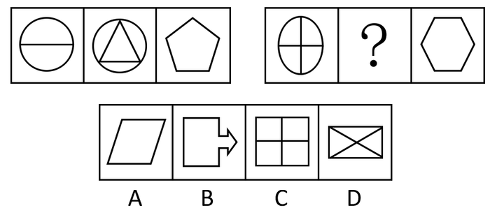

A. A

B. B

C. C

D. D

第 61 题 · 答案与解析

**参考答案（粉笔题库参考内容）**

A

**解析**

元素组成凌乱，考数数。

数直线，第一组的三个图形中直线数分别为1、3、5，呈公差为2的等差数列，第二组图形中的直线数分别为2、（4）、6，公差为2。

故正确答案为A。

### 第 62 题

从所给四个选项中，选择最合适的一个填入问号处，使之呈现一定的规律性：

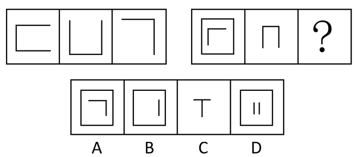

A. A

B. B

C. C

D. D

第 62 题 · 答案与解析

**参考答案（粉笔题库参考内容）**

B

**解析**

每一组图形中前两个图形叠加去同存异得到第三个图形。

故正确答案为B。

### 第 63 题

从所给四个选项中，选择最合适的一个填入问号处，使之呈现一定的规律性：

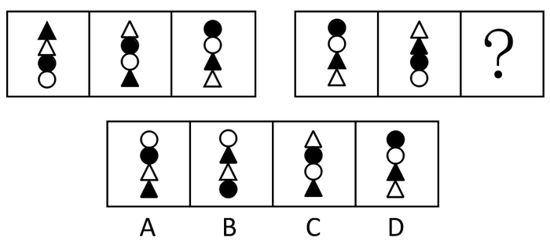

A. A

B. B

C. C

D. D

第 63 题 · 答案与解析

**参考答案（粉笔题库参考内容）**

A

**解析**

元素组成相同，考查位置规律。

每组图形中黑白三角形和黑白圆圈 4个小元素在每个图形中的位置不重复。

故正确答案为A。

### 第 64 题

从所给四个选项中，选择最合适的一个填入问号处，使之呈现一定的规律性：

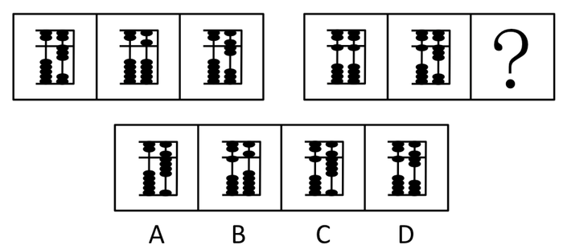

A. A

B. B

C. C

D. D

第 64 题 · 答案与解析

**参考答案（粉笔题库参考内容）**

B

**解析**

第一组算盘上的数依次为3、5、7呈公差为2的等差数列，第二组算盘上的数依次为11、13、（15）也呈公差为2的等差数列。

故正确答案为B。

### 第 65 题

从所给四个选项中，选择最合适的一个填入问号处，使之呈现一定的规律性：

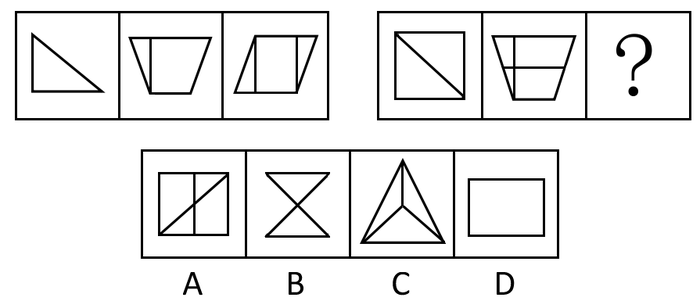

A. A

B. B

C. C

D. D

第 65 题 · 答案与解析

**参考答案（粉笔题库参考内容）**

C

**解析**

考数数，元素内部特征。

第一组内部直线0，1，2；第二组为1，2，3。

故正确答案为C。

### 第 66 题

从所给四个选项中，选择最合适的一个填入问号处，使之呈现一定的规律性：

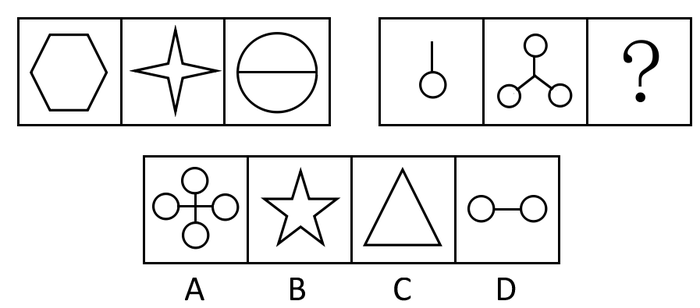

A. A

B. B

C. C

D. D

第 66 题 · 答案与解析

**参考答案（粉笔题库参考内容）**

A

**解析**

元素组成凌乱，考查数数--数面。

第一组图形的闭合空间分别有1、1、2个，即1+1=2。第二组图形的闭合空间为1、3、（4），即1+3=4。

故正确答案为A。

### 第 67 题

从所给四个选项中，选择最合适的一个填入问号处，使之呈现一定的规律性：

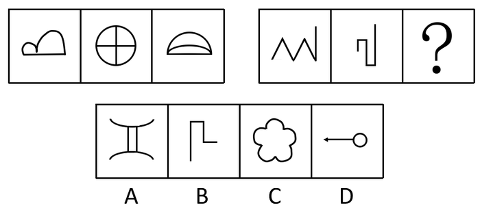

A. A

B. B

C. C

D. D

第 67 题 · 答案与解析

**参考答案（粉笔题库参考内容）**

B

**解析**

元素组成凌乱，考查属性-曲直性。

第一组图形都有直有曲，第二组图形全都为直线图形。

故正确答案为B。

备注：本题为争议题，存在另外一种思路。元素组成凌乱，考查数数-数线。第一组直线+曲线=3，第二组线段数量为5，选项中依次为4，4，5，3。选C。

### 第 68 题

从所给四个选项中，选择最合适的一个填入问号处，使之呈现一定的规律性：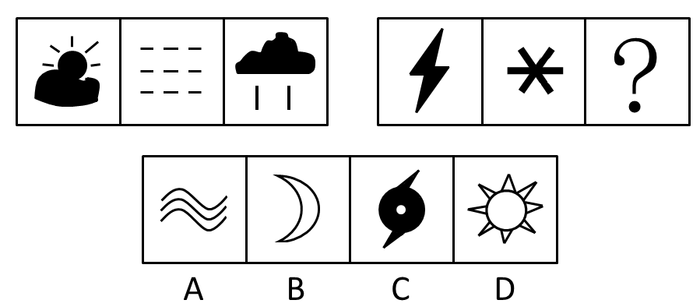

A. A

B. B

C. C

D. D

第 68 题 · 答案与解析

**参考答案（粉笔题库参考内容）**

C

**解析**

特殊考点，图形内容规律。

第一组的三个符号分别代表多云、浓雾、中雨，第二组的两个符号分别代表雷电、小雪，题干中两组图形都是不好的天气现象。A、B、C、D分别代表轻雾、晴（夜晚）、台风、晴（白天），故与题干相同的天气现象为C，都具有破坏性。

故正确答案为C。

### 第 69 题

从所给四个选项中，选择最合适的一个填入问号处，使之呈现一定的规律性：

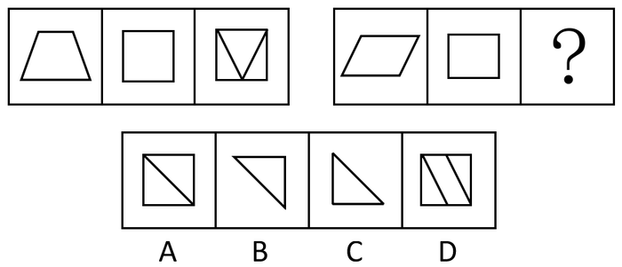

A. A

B. B

C. C

D. D

第 69 题 · 答案与解析

**参考答案（粉笔题库参考内容）**

D

**解析**

观察左边的图形发现，第三个图是由第一个图叠加到第二个图上，然后超出正方形的部分折回正方形内得到的。右边的图形也按此规律变化。

故正确答案为D。

### 第 70 题

从所给四个选项中，选择最合适的一个填入问号处，使之呈现一定的规律性：

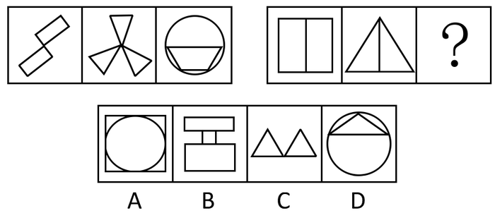

A. A

B. B

C. C

D. D

第 70 题 · 答案与解析

**参考答案（粉笔题库参考内容）**

D

**解析**

元素组成凌乱，考数数。

数面（封闭空间），第一组图形的面数分别为2、3、5，2＋3＝5，即前两个图形的面数和等于第三个图形；按照此规律，第二组图形的面数分别为2、2、（2＋2＝4），ABC三项的面分别是5、3、2，只有D图面数为4。

故正确答案为D。

### 第 71 题

谋杀：是当一个人不但企图造成另一个人的死亡，而且也造成了这个人的死亡，或是由于一个人的行为，明明知道其正做着一件可能造成另外的人被杀死的危险的事情，其仍然不顾别人生命而造成他人的死亡。

根据以上定义，下面哪种行为是典型的谋杀：

A. 于力清与妻子发生争吵，打了她一巴掌，为的是不让她再哭，不巧将她打倒，她在倒下时，头碰在地板上，后来由于头部受伤死亡

B. 一位老人得了一种绝症，不能忍受痛苦，请求护士给他服用致死剂量的安眠药，这个护士非常同情老人，就给了他，结果老人死亡

C. 曾宪以每小时25公里的速度在非常拥挤的公路上驾车行驶，没留神，他失去了对汽车的控制，撞上另外一辆汽车并引起爆炸，结果同车赵某死亡

D. 汤某，动物园管理员，正在动物园打扫老虎的笼子，打扫完后，他忘了锁门就离去，结果虎从笼子里跑了出来，咬死了一个游客

第 71 题 · 答案与解析

**参考答案（粉笔题库参考内容）**

B

**解析**

第一步：抓住定义中的关键词。

关键词强调“不但企图”、“而且也造成了死亡”、“明明知道”、“仍然不顾”。

第二步：逐一判断选项。

A项中虽然有死亡事实，但于力清是不巧将妻子打倒造成妻子死亡，这是意外，不符合“明明知道”、“仍然不顾”，故不属于谋杀；

B项中的护士知道服用致死剂量的安眠药会造成死亡，仍然给老人服用，造成死亡，符合定义中的关键词，属于谋杀；

C项中也有死亡事实，但曾宪是由于没留神而失去了对汽车的控制，属于过失，不符合“明明知道”、“仍然不顾”，故不属于谋杀；

D项中的汤某忘了锁门造成的游客死亡事实也是属于过失，不属于谋杀。

故正确答案为B。

### 第 72 题

过去，我们在道德宣传上有很多不切实际的高调，以至于不少人口头说一套，背后做一套，发生人格分裂现象，通过对此种现象的思考，有的学者提出，我们只要求普通人遵守“底线伦理”。

根据你的理解，以下哪一选项作为“底线伦理”的定义最合适：

A. 底线伦理就是不偷盗、不杀人

B. 底线伦理不是要求人无私奉献的伦理

C. 如果把人的道德比作一座大厦，底线伦理就是该大厦的基础部分

D. 底线伦理是作为一个社会普通人所应遵守的一些最起码、最基本的行为规范和准则

第 72 题 · 答案与解析

**参考答案（粉笔题库参考内容）**

D

**解析**

第一步：抓住题干的关键词。

题干强调普通人遵守“底线伦理”，抛弃那些不切实际的高调。

第二步：逐一判断选项。

D选项较全面地概括了题干定义，强调普通人应该遵守最起码、最基本的行为规范和准则。

故正确答案为D。

### 第 73 题

产业结构政策：指一定时期内政府为促进本国或国内某一地区产业结构的调整、优化所制定的政策。

根据以上定义，下列哪种政策不属于产业结构政策：

A. 对第三产业采取保护与扶持

B. 对涉及农产品及产品加工，推行公司加农户的形式

C. 对“五小”工业采取“关、停、并、转”

D. 对某些工业产品实行“3C”认证

第 73 题 · 答案与解析

**参考答案（粉笔题库参考内容）**

D

**解析**

第一步：抓住定义中的关键词。

关键词强调“产业结构的调整、优化”。

第二步：逐一判断选项。

A是对第三产业的调整，属于产业结构政策；

B是对农业和工业的整合，属于产业结构政策；

C是对工业的调整，属于产业结构政策；

D中的“3C”认证主要是对产品质量的要求，不涉及产业结构。

本题为选非题，故正确答案为D。

### 第 74 题

暗示：用含蓄的、间接的方式，对别人的心理和行为产生影响。其作用往往会使别人不自觉地按照一定的方式行动，或者不加批判地接受某种意见或信念。

根据以上定义，下列属于暗示的是：

A. 在评选先进工作者之前，领导多次提到小王最近取得的成绩

B. 他告诉小张，希望他不要参加篮球赛

C. 小李让人带信给小赵，请小赵在选举厂长时投自己一票

D. 在无记名投票时，他投了小王一票

第 74 题 · 答案与解析

**参考答案（粉笔题库参考内容）**

A

**解析**

第一步：抓住定义中的关键词。

关键词强调用含蓄的、间接的方式影响他人。

第二步：逐一判断选项。

B、C两项都是以直接的方式进行；

D项是自愿进行的，而A项中领导多次提到小王最近取得的成绩，是采用了含蓄的方式表明小王应该被评为先进工作者，因此属于暗示。

故正确答案为A。

### 第 75 题

个人所得税的纳税人：是指在中国境内有住所，或者无住所而在境内居住满一年，从中国境内和境外取得所得的人；在中国境内无住所又不居住或者无住所而在境内居住不满一年，从中国境内取得所得的人。

根据以上定义，下列不属于中国个人所得税的纳税人的是：

A. 亨特是美国人，应聘在“北京华尔街英语学校”任教6个月

B. 汤姆是美国人，应聘在“北京华尔街英语学校”任教两年

C. 黎明是美籍华人，在回国探亲两个月内，他在美国工作的公司仍然向他支付工资

D. 张红是北京大学教授，他在新加坡出版了一本书，得到一笔稿费

第 75 题 · 答案与解析

**参考答案（粉笔题库参考内容）**

C

**解析**

第一步：抓住定义的中心思想。

定义强调了两点：（1）境内有住所，或者无住所而在境内居住满一年，从中国境内和境外取得所得的人；（2）在境内无住所又不居住或者无住所而在境内居住不满一年，从中国境内取得所得的人。

第二步：逐一判断选项。

A项中的“亨特”和B项中的“汤姆”的收入都是从中国取得，符合“在中国境内无住所又不居住或者无住所而在境内居住不满一年，从中国境内取得所得的人”的征收标准；

C项的黎明是美籍华人，在中国境内探亲两个月，不满一年，他的收入来自美国公司，不符合定义中的（1）或（2）这两点，因此不是中国个人所得税的纳税人；

D项中的“张红”收入虽然从外国取得，但其符合定义中的第（1）点，是中国个人所得税的纳税人。

本题为选非题，故正确答案为C。

### 第 76 题

回避条件作用：当厌恶刺激或不愉快情境预示出现，个体做出某种反应，从而逃避了厌恶刺激或不愉快情境，则该反应在以后的类似情境中发生的几率增加。

下列不属于回避条件作用的是：

A. 看见路上的垃圾后绕道走开

B. 碰到烫的东西，赶紧缩回手

C. 感觉屋内人声嘈杂时暂时离去

D. 害怕见生人不敢上街

第 76 题 · 答案与解析

**参考答案（粉笔题库参考内容）**

B

**解析**

第一步：找出定义关键词。

“当厌恶刺激或不愉快情境预示出现”、“个体做出某种反应”、“逃避了厌恶刺激或不愉快情境”。

第二步：逐一分析选项。

A项：看见垃圾绕道走开，说明个体逃避了厌恶刺激或不愉快的情境，符合定义，排除；

B项：碰到烫的东西赶紧缩回手，是一种无条件反射，并没有体现个体逃避了厌恶、刺激或不愉快的情景，不符合定义，当选；

C项：感觉嘈杂暂时离去，说明个体逃避了厌恶刺激或不愉快的情境，符合定义，排除；

D项：害怕生人不敢上街，说明个体逃避了厌恶刺激或不愉快的情境，符合定义，排除。

本题为选非题，故正确答案为B。

### 第 77 题

社会保险在中国是通过立法，采取强制手段对国民收入进行分配与再分配，形成专门消费基金，对劳动者在丧失劳动能力或失去工作机会时进行社会帮助以保障其基本生活的一种制度。

下列属于社会保险的是：

A. 工伤保险

B. 退伍军人安置费

C. 国家向洪水灾区人民发放生活救济

D. 旅客人身伤害保险

第 77 题 · 答案与解析

**参考答案（粉笔题库参考内容）**

A

**解析**

第一步：抓住定义中的关键词。

关键词强调“劳动者”、“丧失劳动能力”、“失去工作机会”。

第二步：逐一判断选项。

A项中的工伤保险，是指劳动者在工作中或在规定的特殊情况下，遭受意外伤害或患职业病导致暂时或永久丧失劳动能力以及死亡时，劳动者或其遗属从国家和社会获得物质帮助的一种社会保险制度 。符合定义中的关键词，属于社会保险；

B项中退伍军人安置费的对象是退伍军人，而不是劳动者，故不属于社会保险；

C项中国家向洪水灾区人民发放生活救济中的发放对象是灾民，不是劳动者，故不属于社会保险；

D项中旅客人身伤害保险的赔偿对象是旅客，也不是劳动者，不属于社会保险。

故正确答案为A。

### 第 78 题

国际贸易是跨国界的交易活动，是一个国家同其他国家或地区间的商品、技术、劳务和信息等流通活动。

根据定义，下列属于国际贸易的是：

A. 以色列国防部向美国订购一批战斗机

B. 日本三菱公司向中国出口一批高级汽车

C. 澳大利亚人汤姆与印度某人才市场签订了劳务输出合同

D. 伊拉克过渡政府向德国某钢铁公司，购买了200吨钢材

第 78 题 · 答案与解析

**参考答案（粉笔题库参考内容）**

A

**解析**

第一步：抓住定义中的关键词。

关键词强调“跨国界”、“一个国家同其他国家或地区”。

第二步：逐一判断选项。

B、C、D项均与定义中的“一个国家同其他国家或地区”不符。

故正确答案为A。

### 第 79 题

行政处理是行政主体为了实现相应法律、法规和规章确定的行政管理目标和任务，应行政相对人申请或依职权处理涉及特定行政相对人特定权利义务事项的具体行政行为。所谓行政相对人是指在法律关系中与行政主体相对应的另一方当事人。

根据上述定义，下列属于行政处理的是：

A. 中央做出开发西部的战略计划

B. 全国人大提出修改《婚姻法》

C. 行政机关主持的对特定纠纷进行的诉讼外调解

D. 公安机关逮捕犯罪人员

第 79 题 · 答案与解析

**参考答案（粉笔题库参考内容）**

C

**解析**

第一步：抓住定义中的关键词。

关键词为“特定行政相对人”、“特定权利义务事项”、“具体行政行为”。

第二步：逐一判断选项。

A项中并未涉及任何“具体行政行为”，故不属于行政处理；

B项中全国人大提出修改《婚姻法》，是全国人大的权利，不符合“具体行政行为”，故不属于行政处理；

C项中行政主体是“行政机关”，特定纠纷符合“特定权利义务事项”，进行的诉讼外调解符合“具体行政行为”，属于行政处理；

D项中公安机关逮捕犯罪人员是其职责，不是“特定权利义务事项”，不属于行政处理。

故正确答案为C。

### 第 80 题

公共政策：公共政策是以政府为主的公共机构，为确定社会朝着政治系统所确定、承诺的正确方向发展，通过广泛参与连续的抉择，以及具体实施产生效果的途径，利用公共资源，达到解决社会公共问题，平衡、协调社会公众利益为目的的公共管理活动过程。

下列不符合这一定义的是：

A. 公共政策制定的主体是以政府为主的一系列公共机构

B. 公共政策就是政府要少花钱多办事的各种方法和途径

C. 公共政策的目的在于确保社会朝着政治系统所确定、承诺的正确方向发展

D. 公共政策是一种公共管理活动过程

第 80 题 · 答案与解析

**参考答案（粉笔题库参考内容）**

B

**解析**

第一步：抓住定义中的关键词。

关键词强调“政府为主”、“为确定社会朝着政治系统所确定、承诺的正确方向发展”、“公共管理活动过程”。

第二步：逐一判断选项。

A项公共政策制定的主体是以政府为主的一系列公共机构，符合定义中的关键词“政府为主”；

B项公共政策就是政府要少花钱多办事的各种方法和途径，而题干定义没有提到“少花钱多办事”，这与定义不相符；

C项是公共政策的定义要素，符合题干定义；

D项是对题干定义的总结，公共政策是一种公共管理活动过程，也符合定义。

本题为选非题，故正确答案为B。

### 第 81 题

滑板：运动

A. 药：治病

B. 饮料：果汁

C. 电影：广告

D. 新闻：报纸

第 81 题 · 答案与解析

**参考答案（粉笔题库参考内容）**

A

**解析**

第一步：判断题干词语间逻辑关系。

题干两词是对应关系，且是物品与其作用的关系。

第二步：判断选项词语间逻辑关系。

与题干相同的逻辑关系即为A，“药”是用来“治病的”；

B项是包容关系；

C、D项都是对应关系，但不是物品与其作用的对应关系。

故正确答案为A。

### 第 82 题

侵蚀：削弱

A. 压缩：服从

B. 联合：净化

C. 增加：扩大

D. 坚持：改进

第 82 题 · 答案与解析

**参考答案（粉笔题库参考内容）**

C

**解析**

第一步：判断题干词语间逻辑关系。

题干两词是近义词。

第二步：判断选项词语间逻辑关系。

A、B、D都不是近义词，只有C中的增加和扩大为近义词。

故正确答案为C。

### 第 83 题

阅读：技能

A. 种瓜：技巧

B. 焊接：技术

C. 浏览：才华

D. 作诗：天赋

第 83 题 · 答案与解析

**参考答案（粉笔题库参考内容）**

B

**解析**

第一步：判断题干词语间的逻辑关系。

题干两词为包容关系中的种属关系，阅读是技能的一种。

第二步：判断选项词语间的逻辑关系。

A项两词不是种属关系，种瓜需要技巧但本身不是技巧；

B项两词为种属关系，焊接是技术的一种；

C项两词为动宾对应关系；

D项两词不构成种属关系，作诗需要天赋但本身不是天赋的一种。

故正确答案为B。

### 第 84 题

面粉：小麦

A. 大米：稻谷

B. 桔子：葡萄

C. 饼干：面粉

D. 罐头：菠萝

第 84 题 · 答案与解析

**参考答案（粉笔题库参考内容）**

A

**解析**

第一步：判断题干词语间逻辑关系。

题干两个词属于对应关系，面粉由小麦磨制制成。

第二步：逐一分析选项。

A 项，大米由稻谷去壳制成，与题干同属对应关系，符合题意。

B 项，桔子和葡萄都是水果，两者是并列关系，不符合题意。

C 项，饼干由面粉和水或鸡蛋、牛奶等烤出来，面粉只是其中一种配料，不符合题意。

D 项，罐头可以由菠萝、苹果、橘子等加上水、糖等调制而成，菠萝只是制作罐头的一种配料，该项和题干结构不一致，不符合题意。

第三步：再次标注答案。

故正确答案为A。

### 第 85 题

水果：苹果

A. 香梨：黄梨

B. 树木：树枝

C. 宝马：奔驰

D. 山：高山

第 85 题 · 答案与解析

**参考答案（粉笔题库参考内容）**

D

**解析**

第一步：判断题干词语间逻辑关系。

题干两词是包容关系，且是包容关系中的种属关系。

第二步：判断选项词语间逻辑关系。

与题干相同的逻辑关系为D，高山是山的一种，属于种属关系；

A是并列关系；

B是包容关系中的组成关系；

C是并列关系。

故正确答案为D。

### 第 86 题

风格：习惯

A. 男生：女生

B. 青年：男人

C. 江苏：泰州

D. 跳跃：动作

第 86 题 · 答案与解析

**参考答案（粉笔题库参考内容）**

D

**解析**

第一步：判断题干词语间逻辑关系。

题干两词是包容关系中的种属关系。

第二步：判断选项词语间逻辑关系。

与题干相同的逻辑关系为D，跳跃是动作的一种。

A项是并列关系；

B项无种属关系；

C项是包容关系中的组成关系。

故正确答案为D。

### 第 87 题

湖北：河南

A. 新疆：西藏

B. 天津：上海

C. 湖南：吉林

D. 武汉：广州

第 87 题 · 答案与解析

**参考答案（粉笔题库参考内容）**

A

**解析**

第一步：判断题干词语间逻辑关系。

题干两个词是并列关系，且湖北与河南为相邻的省级行政区。

第二步：逐一分析选项。

A 项，新疆和西藏都是省级行政区，且地理位置相邻，该项对应关系与题干一致，当选。

B 项，天津和上海虽同为省级行政区，但两者并不相邻，排除。

C 项，湖南和吉林同为省级行政区，但两者并不相邻，排除。

D 项，武汉和广州是省会而非省级行政区，该项对应关系与题干不符，排除。

第三步：再次标注答案。

故正确答案为A。

### 第 88 题

演员：观众

A. 售票员：乘客

B. 工人：厂长

C. 农民：田地

D. 父母：孩子

第 88 题 · 答案与解析

**参考答案（粉笔题库参考内容）**

A

**解析**

第一步：判断题干词语间逻辑关系。

题干两词是对应关系，且是职业与其所面向的对象之间的一一对应关系，演员表演的对象是观众。

第二步：判断选项词语间逻辑关系。

与题干相同的逻辑关系即为A，售票员销售的对象是乘客，且与题干相同的是对象都是人；

B、D项不符合此对应关系；

C项的对象不是人。

故正确答案为A。

### 第 89 题

壳：海龟

A. 先烈：葬礼

B. 喝彩者：奴才

C. 追随者：背叛

D. 叶子：芹菜

第 89 题 · 答案与解析

**参考答案（粉笔题库参考内容）**

D

**解析**

第一步：判断题干词语间逻辑关系。

题干两词是包容关系中的组成关系，壳是海龟的一个组成部分。

第二步：判断选项词语间逻辑关系。

与题干相同的逻辑关系即为D，叶子是芹菜的一个组成部分。

A、B、C无明显逻辑关系。

故正确答案为D。

### 第 90 题

逗号：中止

A. 拂晓：黎明

B. 节省：吝啬

C. 回车：换行

D. 好像：好比

第 90 题 · 答案与解析

**参考答案（粉笔题库参考内容）**

C

**解析**

第一步：判断词语之间逻辑关系。

题干两词是对应关系，且是符号与其意义的一一对应关系，逗号代表中止。

第二步：逐一分析选项。

A项，拂晓是天快亮之时，黎明表示天刚刚亮，这组词明显不是符号和意义对应，与题干逻辑关系不一致。

B项，节省指节约、节俭，吝啬指小气，是贬义词，与题干逻辑关系不一致。

C项，回车代表换行，是符号与其意义的一一对应关系，与题干逻辑关系一致。

D项，好像和好比是近义词，与题干逻辑关系不一致。

第三步：再次标注答案。

故正确答案为C。

### 第 91 题

某珠宝店被盗，警方已发现如下线索：①A、B、C三人至少有一个人是罪犯；②如果A是罪犯，则B一定是同案犯；③盗窃发生时B正在咖啡店喝咖啡。

由此推出：

A. A是罪犯

B. A、B都是罪犯

C. A、B、C都是罪犯

D. C是罪犯

第 91 题 · 答案与解析

**参考答案（粉笔题库参考内容）**

D

**解析**

第一步：翻译题干，利用充分必要条件。

线索①：A 或 B 或 C 是罪犯；②A是罪犯B是罪犯。③盗窃发生时B正在咖啡店喝咖啡可知，B不是罪犯，是事实信息。

第二步：由题干事实信息推导得出正确答案。

B不是罪犯。由线索②的逆否可知：-B是罪犯A是罪犯，故A、B都不是罪犯。由线索①，利用选言关系知，C是罪犯。

故正确答案为D。

### 第 92 题

某地的人们为了保护鹿群，消灭了所有的狼，但是，由于鹿不能长时间奔跑，体质开始下降，数量没有增加反而减少了，这就是著名的狼鹿效应。

据此可知：

A. 要保护鹿就必须增加狼的数量

B. 狼可以促使鹿群增加

C. 人为破坏生态平衡并不会保护生态发展

D. 生物进化是可以逆转的

第 92 题 · 答案与解析

**参考答案（粉笔题库参考内容）**

C

**解析**

第一步：抓住题干的中心思想。

题干说明生物链的重要性，及一定数量的狼有利于鹿群的存在。

第二步：根据题干判断正确选项。

由题干可推知C项符合题干结论，A项说法过于绝对，不是增加，而是保护物种间的自然平衡，不要人为干涉；

B项说法有误，从题干只能推出适量的狼有助于鹿的体质增强；

D项推不出。

故正确答案为C。

### 第 93 题

《刑事诉讼法》第190条规定：“第二审人民法院审判被告人或者他的法定代理人、辩护人、近亲属上诉的案件，不得加重被告人的刑罚。”二审法院在审查一起上诉时认为该案事实清楚，证据确凿，只是量刑稍轻，那么：

A. 应加重被告人的刑罚

B. 应减轻被告人的刑罚

C. 应追究一审法院的责任

D. 最好是驳回上诉，维持原判

第 93 题 · 答案与解析

**参考答案（粉笔题库参考内容）**

D

**解析**

第一步：翻译题干。

190条：被告人或者他的法定代理人、辩护人、近亲属上诉加重刑罚。

第二步：看其他的话。

“审查一起上诉时认为该案事实清楚，证据确凿，只是量刑稍轻”意味着需要“加重刑罚”，这否定了题干后件，可以得到否定过题干前件的结论“-上诉”，即“驳回上诉，维持原判”，D正确。

故正确答案为D。

### 第 94 题

人的认识分为感性认识和理性认识。对事物现象的认识称为感性认识；对事物本质的认识称为理性认识。

那么下列认识属于理性认识的是：

A. 太阳每天东升西落

B. 物价上涨是价值规律起作用的结果

C. 小丽长得很漂亮

D. 书是纸做的

第 94 题 · 答案与解析

**参考答案（粉笔题库参考内容）**

B

**解析**

第一步：判断考查定义。

题目考查“理性认识”，需要关注“理性认识”的定义。

第二步：抓住定义中的关键词。

关键词强调“对事物本质的认识”。

第三步：逐一判断选项。

A、C、D都是对事物现象的认识；

只有B是对事物的本质的认识。

故正确答案为B。

### 第 95 题

近代法国著名物理学家法拉第，发现了电磁感应规律。但是由于他不能用最科学严密的语言表达出来，因此，一直没有得到科学界的承认，直到麦克斯韦完整地表述了这一规律，才得到人们的正式承认。可见：

A. 麦克斯韦比法拉第更聪明

B. 科学语言是最严密最科学的

C. 语言表达能力是很重要的

D. 只要语言表达能力强，就能得到人们的承认

第 95 题 · 答案与解析

**参考答案（粉笔题库参考内容）**

C

**解析**

第一步：抓住题干的中心思想。

题干说明了麦克斯韦的语言能力比法拉第强，他完整表达了电磁感应规律。

第二步：根据题干判断正确选项。

由题干得知的是麦克斯韦的语言能力比法拉第强，但是得不出A项麦克斯韦比法拉第更聪明这个结论；

B中“最”，太过绝对；

D中也是比较绝对化。认为语言能力强就能够被接受，这个显然比较偏颇。

故正确答案为C。

### 第 96 题

食盐的主要成分是氯化钠，还含有经常吸收空气中水分的氯化镁，所以粗盐容易变潮，但精盐里是很纯的氯化钠，不易吸收水分，这意味着：

A. 精盐也会变潮

B. 精盐比粗盐价格要高

C. 精盐不易变潮

D. 炼精盐是今后盐业发展的趋势

第 96 题 · 答案与解析

**参考答案（粉笔题库参考内容）**

C

**解析**

第一步：抓住题干的中心思想。

题干说明粗盐因为含有氯化镁所以容易变潮，而精盐纯度很高，不易吸水。

第二步：根据题干判断正确选项。

由题干可推知，精盐不易吸水，故不容易变潮，与C选项符合；

A、D项与题干的推理方式不符，前面强调精盐不易吸收水分，后面应该推出与此相对应的结论，故排除A、D；

B项为无关选项。

故正确答案为C。

### 第 97 题

小说离不开现实生活，没有深入体验生活的人，是不可能写出优秀作品的。因此：

A. 诗人、小说家不可能年轻

B. 创作小说都是有经验的人的事

C. 作为小说家资历是很重要的

D. 要创作小说必须有充足的生活体验

第 97 题 · 答案与解析

**参考答案（粉笔题库参考内容）**

D

**解析**

第一步：翻译题干，利用充分必要条件。

题干可翻译为：“-深入体验生活优秀作品”，利用逆否规则，即“优秀作品深入体验生活”。

第二步：根据题干判断正确选项。

题干中并不涉及诗人、小说家年轻与否，A是无关选项，A错误；

题干说的是创作小说要有生活体验而不是经验，B错误；

题干并没有提到“资历”，C错误；

D中“创作小说”是肯定题干中“优秀作品深入体验生活”的前件，能够得到肯定后件的结论“有充足的生活体验”，D正确。

故正确答案为D。

### 第 98 题

张娘去商店买上衣，售货员问她要哪种颜色的。张娘说：“我不像讨厌黄色那样讨厌红色，我不像讨厌白色那样讨厌蓝色，我不像喜欢粉色那样喜欢红色，我对蓝色不像对黄色那样喜欢。”张娘选择的颜色是：

A. 黄色

B. 蓝色

C. 红色

D. 粉色

第 98 题 · 答案与解析

**参考答案（粉笔题库参考内容）**

D

**解析**

第一步：翻译题干。

张娘讨厌的颜色排序为：黄＞红，白＞蓝，喜欢的颜色排序：粉＞红，黄＞蓝。

第二步：根据题干分析判断正确答案。

综合分析，按张娘喜欢的颜色排序：粉＞红＞黄＞蓝＞白。故张娘最喜欢的颜色是粉色。

故正确答案为D。

### 第 99 题

有下列对话：

①小李是可口可乐在中国的高级雇员之一；

②那怎么可能？小李只喝百事可乐。

对话中，②的陈述隐含的一个前提是：

A. 可口可乐与百事可乐同属于一个总公司

B. 小李在可口可乐公司并不受重用

C. 一般的，所有的高级职员使用本公司的产品

D. 小李在百事可乐公司兼职

第 99 题 · 答案与解析

**参考答案（粉笔题库参考内容）**

C

**解析**

第一步：找到论点和论据。

本题的论点是小李不是可口可乐的高级雇员。论据是小李只喝百事可乐。

第二步：判断加强方式。

论点和论据间因果关系不强，需加强论证，在论点和论据间搭桥。

第三步：逐一判断选项的作用。

A中“可口可乐与百事可乐同属于一个总公司”，而小李只喝百事可乐说明小李可能是百事可乐的高级雇员，那么可以推出小李是总公司的高级雇员，但无法确认小李是不是可口可乐的高级雇员，A错误；

B中“小李在可口可乐公司并不受重用”说明小李可能是可口可乐的高级雇员，B削弱论点，B错误；

C中“所有的高级职员使用本公司的产品”，且“小李只喝百事可乐”，那么小李是百事可乐的高级雇员而不是可口可乐的高级雇员，C在论点和论据间搭桥，C正确；

D中“小李在百事可乐公司兼职”和是否是可口可乐的高级雇员无关，D错误。

故正确答案为C。

### 第 100 题

航天局认为优秀宇航员应具备三个条件：第一，丰富的知识；第二，熟练的技术；第三，坚强的意志。现在至少符合条件之一的甲、乙、丙、丁四位优秀飞行员报名参选，已知：①甲、乙意志坚强程度相同；②乙、丙知识水平相当；③丙、丁并非都是知识丰富；④四人中三人知识丰富，两人意志坚强，一人技术熟练。航天局经过考察，发现其中只有一人完全符合优秀宇航员的全部条件。

他是：

A. 甲

B. 乙

C. 丙

D. 丁

第 100 题 · 答案与解析

**参考答案（粉笔题库参考内容）**

C

**解析**

第一步：找突破口。

本题突破口为第③个条件，由此条件可知丙、丁两人中必有一人知识不够丰富，而根据第②个条件，乙、丙知识相当，则丙必为知识丰富，否则会出现两人知识不够丰富的情况，违反第④个条件。故丙知识丰富而丁知识不丰富。

第二步：分析推断得出正确答案。

由条件④和①，可知有甲、乙意志都坚强和都不坚强两种情况：

（1）设甲、乙两都是意志坚强，则丙、丁两人不够坚强，即丁的知识不丰富，意志也不坚强，其一定是技术熟练，而且只有丁的技术熟练，那么就不可能选出优秀宇航员，此情况排除；

（2）甲、乙两人意志不坚强，而丙、丁两人意志坚强，因为丁知识不丰富已经被排除，所以只有丙符合要求。

故正确答案为C。

### 第 101 题

贯彻“三个代表”重要思想的本质在于：

A. 解放思想

B. 执政为民

C. 实事求是

D. 与时俱进

第 101 题 · 答案与解析

**参考答案（粉笔题库参考内容）**

B

**解析**

江泽民在党的十六大报告中强调：“贯彻‘三个代表’重要思想，关键在坚持与时俱进，核心在坚持党的先进性，本质在坚持执政为民。全党同志要牢牢把握这个根本要求，不断增强贯彻‘三个代表’重要思想的自觉性和坚定性。”

执政为民揭示了贯彻“三个代表”重要思想的出发点和归宿。就是要求党的全部理论和全部工作，要始终以最广大人民群众的支持和拥护为最高标准，始终体现最广大人民群众的意志和利益，要为人民掌好权，用好权，始终与人民同呼吸、共命运、心连心。

故正确答案为B。

### 第 102 题

国民教育的根本任务是：

A. 提高国民素质

B. 普及科技知识

C. 培养精英人才

D. 追求升学率

第 102 题 · 答案与解析

**参考答案（粉笔题库参考内容）**

A

**解析**

《中共中央关于构建社会主义和谐社会若干重大问题的决定》提出： 要“建设现代国民教育体系”。现代国民教育体系以终身教育思想为导向，以普通教育和职业教育为基础，以初等、中等、高等教育为层次，以成长教育和继续教育为阶段，以提高全民族思想道德素质和科学文化素质，形成全民学习、终身学习的学习型社会为目标。

故正确答案为A。

### 第 103 题

按照马克思主义观点，领导是：

A. 社会精英

B. 社会主人

C. 社会栋梁

D. 社会公仆

第 103 题 · 答案与解析

**参考答案（粉笔题库参考内容）**

D

**解析**

社会公仆思想作为马克思主义的基本内容，贯穿于科学社会主义的整个体系之中。它与剥削阶级的“公仆说”有本质的区别，是无产阶级夺取革命和建设的胜利，建立和巩固人民政权，完成全部历史使命的必然要求和思想武器。增强马克思主义的社会公仆意识，对于提高国家机关工作人员的素质，弘扬民主政治，推进廉政建设具有重要的现实意义和深远的历史意义。

故正确答案为D。

### 第 104 题

现代领导班子，不仅要求每个成员具备良好的个人素质，而且还要求整个领导班子具备：

A. 合理的群体结构

B. 优化的群体结构

C. 科学的群体结构

D. 公正的群体结构

第 104 题 · 答案与解析

**参考答案（粉笔题库参考内容）**

B

**解析**

建设坚强的领导班子，优化领导班子结构，是马克思主义政党的一个显著特征，是我们党一贯重视的问题。无论是在新民主主义革命时期，还是在和平建设时期，我们党始终根据政治任务的需要，切实加强各级领导班子建设，不断调整和改善领导班子结构，使之在政治、经济、文化、军事等各项事业中形成坚强的领导核心。全面建设小康社会迫切需要优化领导班子结构；完善社会主义市场经济体制迫切需要进一步优化领导班子结构；发展社会主义民主政治迫切需要进一步优化领导班子结构；建设社会主义法治国家迫切需要进一步优化领导班子结构，因此优化的群体结构是建设现代领导班子的必然要求。

故正确答案为B。

### 第 105 题

人民币的面值中只有1、2、5、10等数值，而缺乏3、4、6、7、8、9等数值。

主要是因为：

A. 这几个数值都是整数

B. 这几个数值容易辨认，而其他数字容易搞混

C. 这几个数是重要的数，用其通过计算可得其他数值

D. 这几个数值没有特别意义，只是根据人们的习惯确定的

第 105 题 · 答案与解析

**参考答案（粉笔题库参考内容）**

C

**解析**

在1—10这10个自然数里，有“重要数”和“非重要数”两种，1、2、5、10就是重要数。用这几个数就能以最少的加减组成另一些数。如1+2=3、2+2=4、1+5=6、2+5=7、10-2=8、10-1=9。如将四个“重要数”中任何一个数用“非重要数”代替，那将出现有的数要两次以上的加减才能组成的繁琐现象。

故正确答案为C。

### 第 106 题

遗传变异与特种演化是生物界中存在的普遍现象，这种现象产生的原因是：

A. 有不同的“父母”的原因

B. 基因的重组或突变

C. 基因的交叉组合

D. 不同的生物之间的融合

第 106 题 · 答案与解析

**参考答案（粉笔题库参考内容）**

B

**解析**

现代生物学研究显示，生物的衍化过程中出现的遗传变异与特种演化现象一般是由于基因的重组或突变。“不同的父母”或“不同生物的融合”可能偶尔会产生新的物种，但并不是“生物界中存在的普遍现象”。由此可知，基因的重组或突变才是遗传变异与特种演化的重要原因。

故正确答案为B。

### 第 107 题

在沙漠中，时常有海市蜃楼出现，其产生的原因是：

A. 人在沙漠中视力好

B. 由于日照关系，人在沙漠中视觉会有变化

C. 沙漠像一面镜子，通过日照会出现海市蜃楼现象

D. 远处的景物因日照，通过折射出现在空气密度不均的沙漠中

第 107 题 · 答案与解析

**参考答案（粉笔题库参考内容）**

D

**解析**

海市蜃楼是一种因光的折射而形成的自然现象。它也简称蜃景，是地球上物体反射的光经大气折射而形成的虚像。

故正确答案为D。

**本题相关知识点：**

海市蜃楼常在海上、沙漠中产生，海市蜃楼是光线在延直线方向密度不同的气层中，经过折射造成的结果。海市蜃楼的种类很多：根据它出现的位置相对于原物的方位，可以分为上蜃、下蜃和侧蜃；根据它与原物的对称关系，可以分为正蜃、侧蜃、顺蜃和反蜃；根据颜色可以分为彩色蜃景和非彩色蜃景等等。

### 第 108 题

胃酸过多导致消化不良，一般医生会给你开一些消化药，其主要成分是：

A. 氢氧化钠

B. 氢氧化钡

C. 氢氧化钙

D. 氢氧化铝

第 108 题 · 答案与解析

**参考答案（粉笔题库参考内容）**

D

**解析**

A项错误，氢氧化钠，俗称烧碱、火碱、苛性钠。易溶于水，其水溶液呈强碱性，能使酚酞变红。氢氧化钠是一种极常用的碱，是化学实验室的必备药品之一。它的溶液可以用作洗涤液；

B项错误，氢氧化钡：制特种肥皂、杀虫剂，也用于硬水软化、甜菜糖精制、锅炉除垢、玻璃润滑等，用于有机合成和钡盐制备；

C项错误，氢氧化钙：用于制漂白粉，硬水软化剂，改良土壤酸性，自来水消毒澄清剂及建筑工业等；

D项正确，氢氧化铝：是铝的氢氧化物。是一种碱，由于又显一定的酸性，所以又可称之为铝酸，但实际与碱反应时生成的是偏铝酸盐，因此通常把它视作一水合偏铝酸。按用途分为工业级和医药级两种。医药级用于肠胃类抑止胃酸用原料药，常用作复方制剂如维U颠茄铝胶囊、氢氧化铝片等主要组份，亦可用于药用辅料。

故正确答案为D。

### 第 109 题

红绿色盲是一种常见的遗传性疾病。在生活中，男性患者的人数远远多于女性患者，造成这一差异的主要原因是：

A. 控制红绿色盲的基因位于x染色体上。如果一条x染色体上携带致病基因，而另一条染色体的相应位置上携带正常的基因，个体并不会发病。而y染色体上没有相应基因

B. 控制红绿色盲的基因位于y染色体上，随y染色体进行传递

C. 控制红绿色盲的基因位于x染色体上，由于男性缺乏一种女性独有的激素，在发育过程中容易受到多种诱因的影响而发病

D. 男女两性的实际患病率是相同的，只是由于两性在日常生活中偏重的领域有所不同，男性患者容易被辨认而女性患者不容易被辨认

第 109 题 · 答案与解析

**参考答案（粉笔题库参考内容）**

A

**解析**

红绿色盲症又称道尔顿症，红色盲或绿色盲是因为缺少感受相应颜色的椎状细胞。

X染色体的遗传基因对红绿色盲有所影响。红绿色盲的人群中，男性多于女性，这是因为红绿色盲是X染色体隐性遗传病，即控制红绿色觉的感受器的基因位于X染色体上，并遵循伴性遗传规律。女性（46，XX）只有当两条X染色体上的基因均显示隐性方可表现为红绿色盲，而男性（46，XY）的X染色体只要有隐性基因即可表现。

故正确答案为A。

### 第 110 题

宪法规定，国务院对各部、各委员会发布的不适当命令、指示和规章有权：

A. 发回

B. 改变或撤销

C. 批驳

D. 撤销

第 110 题 · 答案与解析

**参考答案（粉笔题库参考内容）**

B

**解析**

《宪法》第八十九条第十四款规定：“国务院的职权可以改变或者撤销地方各级国家行政机关的不适当的决定和命令。”

故正确答案为B。

### 第 111 题

法律规范生效的时间，如无明文规定，依照惯例应该是：

A. 公布之日下月

B. 批准之日

C. 公布之日

D. 批准之日下月

第 111 题 · 答案与解析

**参考答案（粉笔题库参考内容）**

C

**解析**

如果无明文规定，自颁布之日起生效，直到被新法取代或者被有权机关废止时丧失效力。

故正确答案为C。

### 第 112 题

《婚姻法》规定，有直系血亲关系或三代以内旁系血亲关系者禁止结婚。

这一政策的出发点是：

A. 防止家族势力的过度膨胀

B. 出于伦理道德的考虑

C. 避免包办婚姻

D. 减少遗传病的发病几率

第 112 题 · 答案与解析

**参考答案（粉笔题库参考内容）**

D

**解析**

禁止血亲结婚是优生的要求。血缘过近的亲属间通婚，容易把双方生理上的缺陷遗传给后代，因此，各国法律都禁止一定范围内的血亲结婚。

故正确答案为D。

### 第 113 题

下列叙述正确的是：

A. 所有地图的方向判别的方法都是“上北下南，左西右东”

B. 我国湖南长沙马王堆三号汉墓出土的绘制在丝织上的彩色地图，是我国最早的地图

C. 在地图上，山地的标高为相对高度

D. 地图种类很多，一般分为自然地图和社会经济地图

第 113 题 · 答案与解析

**参考答案（粉笔题库参考内容）**

D

**解析**

A选项错误，过于绝对；

B选项错误，长沙马王堆三号汉墓出土的地图为我国最早的帛画地图；

C选项错误，山地的标高应当为绝对高度。

故正确答案为D。

### 第 114 题

中国儒家的主要经典著作为“四书五经”，其中“四书”指的是：

A. 《史记》、《中庸》、《论语》、《孟子》

B. 《春秋》、《大学》、《中庸》、《论语》

C. 《礼记》、《大学》、《汉书》、《孟子》

D. 《大学》、《中庸》、《论语》、《孟子》

第 114 题 · 答案与解析

**参考答案（粉笔题库参考内容）**

D

**解析**

“四书五经”是“四书”和“五经”的合称，是中国儒家经典的书籍。“四书”指的是《论语》《孟子》《大学》和《中庸》；而“五经”指的是《诗经》《尚书》《礼记》《周易》《春秋》，简称为“诗、书、礼、易、春秋”。

故正确答案为D。

### 第 115 题

在四大洋中，跨经度最多的大洋是：

A. 太平洋

B. 北冰洋

C. 大西洋

D. 印度洋

第 115 题 · 答案与解析

**参考答案（粉笔题库参考内容）**

B

**解析**

北冰洋，因为北冰洋位于北极，所有经线都要经过北冰洋才能延伸至北极点，所以是跨经度最多的大洋。

故正确答案为B。

### 第 116 题

以下属于单子叶植物的是：

A. 花生

B. 西瓜

C. 黄豆

D. 小米

第 116 题 · 答案与解析

**参考答案（粉笔题库参考内容）**

D

**解析**

单子叶植物纲是被子植物门的1纲。叶脉常为平行脉，花叶基本上为3数，种子以具1枚子叶为特征。单子叶植物多为草本，根为须根系，茎中的维管束散生，叶由叶鞘、叶舌、叶耳、叶片组成，具平行脉，子叶1，三基数花，花粉粒具单萌发孔。例：水稻，小麦，玉米等。

故正确答案为D。

### 第 117 题

影响空气质量高低的因素有：

①企业生产排放物

②气压

③风力

④车辆、船舶、飞机尾气

⑤居民生活取暖、垃圾焚烧

⑥地形地貌

A. ①④⑤

B. ①②④⑤

C. ①②③④⑤

D. ①②③④⑤⑥

第 117 题 · 答案与解析

**参考答案（粉笔题库参考内容）**

D

**解析**

空气质量的好坏反映了空气污染程度，它是依据空气中污染物浓度的高低来判断的。

空气污染是一个复杂的现象，在特定时间和地点空气污染物浓度受到许多因素影响。来自固定和流动污染源的人为污染物排放大小是影响空气质量的最主要因素之一，其中包括车辆、船舶、飞机的尾气、工业企业生产排放、居民生活和取暖、垃圾焚烧等。城市的发展密度、地形地貌和气象等也是影响空气质量的重要因素。综合上述分析，可见①②③④⑤⑥均可影响空气质量。

故正确答案为D。

### 第 118 题

亚太经合组织逐步形成了自己独特的合作方式，即“APEC”方式，这一合作方式的内容是：

①承认多样性

②强调协商一致

③强调互惠互利

④强调自主自愿

⑤强调灵活性

⑥提倡自主贸易

A. ①②③④⑤

B. ②③④⑤⑥

C. ①②④⑤

D. ①③④⑤

第 118 题 · 答案与解析

**参考答案（粉笔题库参考内容）**

A

**解析**

亚太经济合作组织（Asia-Pacific Economic Cooperation，简称APEC）是亚太地区最具影响的经济合作官方论坛。亚太经合组织共有21个成员和3个观察员。

鉴于各成员发展的不平衡，以及政治体制和社会模式的多样性，APEC形成了独特的合作方式，即“APEC模式”，其特点是承认多样化；强调灵活性、渐进性和开放性；遵循相互尊重、平等互利、协商一致、自主自愿的原则。这一非强制性的组织模式，凝聚了各成员为实现组织宗旨而达到的最大限度的共同意志，表现了区域经济组织的效率。它不仅照顾了成员间不同的经济发展水平和承受能力，也较好平衡了各方权益。

故正确答案为A。

### 第 119 题

黄昏时，靠近太阳的周围往往会出现色彩鲜艳的云彩，人们叫它“火烧云”。产生这样现象的主要原因是：

A. 黄昏时，空气中的细小颗粒物聚集在西方，被太阳光一照便变成了红色云

B. 黄昏时，太阳光中的红色光比其他颜色的光在空气中走过的距离短，所以人们只看到被红色光照的云

C. 黄昏时，气温比白天低，云被太阳光一照便变成了红色的云

D. 黄昏时，太阳光在空气中走过的距离比白天长，其中的蓝色光、紫色光等中途都散掉了，红色光使云变成了红色。

第 119 题 · 答案与解析

**参考答案（粉笔题库参考内容）**

D

**解析**

火烧云是日出或日落时出现的赤色云霞。火烧云属于低云类，是大气变化的现象之一。它常出现在夏季，特别是在雷雨之后的日落前后，在天空的西部。由于地面蒸发旺盛，大气中上升气流的作用较大，使火烧云的形状千变万化。

太阳光是由红、橙、黄、绿、青、蓝、紫七色光混合而成的。这些颜色的光的波长不一样，红色光波最长，橙色光波其次，紫色光波最短。空气的分子和空气里飘浮着无数细小的灰尘和水滴，它们都能够把太阳的各色光线分散开来，这就叫作散射作用。太阳光中的光波波长越短的，像紫色、蓝色光就很容易被散射开来；波长越长的，像红色、橙色光就不容易散射。早晨或傍晚，太阳光是斜射的，它通过空气层的路程比较长，受到散射就减弱得很厉害。减弱得最多的是紫色光，减弱得最少的是红色或橙色光。这些减弱后的彩色阳光，照射在天空中、云层上，就形成鲜艳夺目的彩霞。

故正确答案为D。

### 第 120 题

下列叙述正确的是：

A. 声音在真空中传播速度最大

B. 在小房间里说话，听不到回声，是因为房间太小，不会有回声

C. 声音只能在空气中传播

D. 以上说法都不对

第 120 题 · 答案与解析

**参考答案（粉笔题库参考内容）**

D

**解析**

A选项错误，声音的传播需要介质，没有介质即真空时，声音是不能传播的；

B选项错误，在房间里，由于说话的地点离墙较近，声音传到墙壁上反射回来的时间与说话的时间几乎是同时的，时间差太短，所以耳朵听不出说话声与回声的区别，并不是没有回声；

C选项错误，声音可以在介质气体，液体，固体中传播。

故正确答案为D。

**本题相关知识点：**

声音产生的条件，传播的条件，声速的影响因素：

一切正在发声的物体都在振动，正在发声的物体叫声源；

声音的传播需要介质，固体、液体、气体都可以作为传声介质；声音不能在真空中传播；

声音的传播速度与介质种类、温度有关，一般在固体中声速最大，液体中其次，气体中最小；

声音传播时遇到障碍物可以发生反射。

## 材料 4

根据以下文字数据，完成各题。

        2007年1~6月，Y国通信业务收入完成2189.4亿卢比，比上年同期增长15.6%，增幅是同期国内生产总价值的两倍。其中邮政完成274.4亿卢比，增长8.5%；电信完成了1942.1亿卢比，增长16.6%。各项业务中，国内长途业务收入222亿卢比，同比下降了0.2%；国际业务收入36.8亿卢比，下降了17.6%，移动通信收入920.6亿卢比，增长24%；本地网通信收入565亿卢比，增长13.5%；数据通信收入84亿卢比，增长68%，以上各项业务分别占整个电信业务的11.4%、1.9%、47.7%、29.1%和4.3%。各类新业务迅猛发展。上半年，IP电话通话时长达到253.4亿分钟，同比增长21.3%，移动短信业务量达到326亿条。邮政储蓄期末余额达到6627.1亿卢比，同比增长24.7%。上半年，全国电话用户新增1990.9万户，达到1.99亿户，移动电话新增3135.7万户，达到1.76亿户。固定电话用户中，城市电话新增1385.2万户，达到1.25亿户；农村电话用户新增605.7万户，达到7411.4万户。电话用户中，北、中、南地区各为1.95亿户、1.1亿户和0.7亿户，分别占52%、29.3%和18.7%。全国电话普及率达到30.2部/百人，比上年末提高4.3个百分点；移动电话普及率达到13.86部/百人，比上年末提高2.7个百分点。

### 第 121 题

占整个电信业务收入比重最大的业务在2007年上半年中与上年同期相比变化情况是：

A. 增长13.5%

B. 增长24%

C. 增长68%

D. 下降0.2%

第 121 题 · 答案与解析

**参考答案（粉笔题库参考内容）**

B

**解析**

定位文字材料可得：各项业务分别占整个电信业务的11.4%、1.9%、47.7%、29.1%和4.3%。通过比较可得，占整个电信业务收入比重最大的业务是移动通信收入（47.7%）。定位文字材料可得：（2007年1~6月）移动通信收入······增长24%，因此移动通信收入在2007年上半年中与上年同期相比变化情况是增长24%。

故正确答案为B。

### 第 122 题

下列说法正确的是：

I 业务收入增长最快的是数据通信，但其占整个电信业务收入比重还不足5%

II 农村电话用户新增数量比城市电话用户新增数量大

III 北部固定电话比中部和南部总数和还要多

A. I

B. II

C. II、III

D. III、I

第 122 题 · 答案与解析

**参考答案（粉笔题库参考内容）**

A

**解析**

I：定位文字材料，可得业务收入增长最快的是数据通信（68%），其占整个电信业务收入比重为4.3%，不足5%，正确；

II：定位文字材料，可得农村电话用户新增数量（605.7万户）＜城市电话用户新增数量（1385.2万户），错误；

III：定位文字材料，题干只给出了北、中、南各地区的电话用户数，而各地区的固定电话数未知，无法判断正误。

因此说法正确的仅有I。

故正确答案为A。

### 第 123 题

农村固定电话比上年增长了约：

A. 3%

B. 9%

C. 15%

D. 20%

第 123 题 · 答案与解析

**参考答案（粉笔题库参考内容）**

B

**解析**

根据题干“······比上年增长了约”，结合选项为百分数，可判定本题为一般增长率问题。定位文字材料可得：固定电话用户中······农村电话用户新增605.7万户，达到7411.4万户，根据公式：增长率，可得所求，与B项最接近。

故正确答案为B。

### 第 124 题

2007年上半年Y国国内生产总值的增幅为：

A. 6.5%

B. 7.0%

C. 7.8%

D. 8.8%

第 124 题 · 答案与解析

**参考答案（粉笔题库参考内容）**

C

**解析**

根据题干“2007年上半年······的增幅为”，结合选项为百分数，可判定本题为一般增长率问题。定位文字材料可得：Y国通信业务收入······比上年同期增长15.6%，增幅是同期国内生产总价值的两倍，可得所求。

故正确答案为C。

### 第 125 题

下列说法不正确的是：

A. 国际业务收入与上年同期相比有所下降

B. IP电话通话时长同比上年增长超过20%

C. 邮政业务收入同比上年增加24.7%

D. 移动电话普及率有一定提高

第 125 题 · 答案与解析

**参考答案（粉笔题库参考内容）**

C

**解析**

A项：定位文字材料，国际业务收入······下降了17.6%（r＜0），因此国际业务收入与上年同期相比有所下降，正确；

B项：定位文字材料，上半年，IP电话通话时长······同比增长21.3%（r＞20%），因此IP电话通话时长同比上年增长超过20%，正确；

C项：定位文字材料，Y国通信业务收入······，其中邮政······增长8.5%，因此邮政业务收入同比上年增加8.5%，而非24.7%，错误；

D项：定位文字材料，移动电话普及率······比上年末提高2.7个百分点（r＞0），因此移动电话普及率有一定提高，正确。

本题为选非题，故正确答案为C。

注意：小粉笔认为本题D项出题人可能有两种意图：①移动电话普及率较上年同期有一定提高，因此D项正确；②按照字面理解，无明确的时间界限，则该选项无法判断正误。小粉笔认为出题人更想考查的是第一种意图。

## 材料 5

根据下表提供的资料，完成各题。

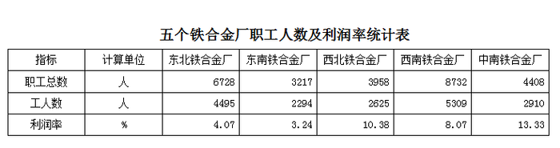

### 第 126 题

表中工人人数最多的厂是：

A. 东北铁合金厂

B. 西南铁合金厂

C. 西北铁合金厂

D. 东南铁合金厂

第 126 题 · 答案与解析

**参考答案（粉笔题库参考内容）**

B

**解析**

定位表格材料可得：东北铁合金厂、西南铁合金厂、西北铁合金厂、东南铁合金厂工人数分别为4495人、5309人、2625人、2294人，通过比较可得，工人人数最多的是西南铁合金厂（5309人）。

故正确答案为B。

### 第 127 题

西北铁合金厂职工总人数比西南铁合金厂职工总人数少多少：

A. 4774人

B. 4784人

C. 3786人

D. 8629人

第 127 题 · 答案与解析

**参考答案（粉笔题库参考内容）**

A

**解析**

定位表格材料可得：西北铁合金厂、西南铁合金厂职工总数分别为3958人、8732人，则西北铁合金厂职工总人数比西南铁合金厂职工总人数少8732-3958=4774人。

故正确答案为A。

### 第 128 题

利润率最接近的两个厂是：

A. 东北铁合金厂与西南铁合金厂

B. 东南铁合金厂与西南铁合金厂

C. 西北铁合金厂与中南铁合金厂

D. 东北铁合金厂与东南铁合金厂

第 128 题 · 答案与解析

**参考答案（粉笔题库参考内容）**

D

**解析**

定位表格材料可得：东北铁合金厂、东南铁合金厂、西北铁合金厂、西南铁合金厂、中南铁合金厂的利润率分别为：4.07%、3.24%、10.38%、8.07%、13.33%，各铁合金厂间的利润率差值如下：

东北铁合金厂与西南铁合金厂：|4.07%-8.07%|=4.00%；

东南铁合金厂与西南铁合金厂：|3.24%-8.07%|=4.83%；

西北铁合金厂与中南铁合金厂：|10.38%-13.33%|=2.95%；

东北铁合金厂与东南铁合金厂：|4.07%-3.24%|=0.83%。

通过比较可得，利润率最接近的两个厂是东北铁合金厂与东南铁合金厂（0.83%）。

故正确答案为D。

### 第 129 题

人均利润率最高的厂是：

A. 东北铁合金厂

B. 西北铁合金厂

C. 中南铁合金厂

D. 东南铁合金厂

第 129 题 · 答案与解析

**参考答案（粉笔题库参考内容）**

C

**解析**

根据题干“人均利润率最高的厂是”，可判定本题为现期平均数问题。定位表格材料可得：东北铁合金厂职工总数为6728人，利润率为4.07%；西北铁合金厂职工总数为3958人，利润率为10.38%；中南铁合金厂职工总数为4408人，利润率为13.33%；东南铁合金厂职工总数为3217人，利润率为3.24%；根据人均利润率，则各铁合金厂的人均利润率如下：

东北铁合金厂：；

西北铁合金厂：；

中南铁合金厂：；

东南铁合金厂：。

通过比较可得，人均利润率最高的厂是中南铁合金厂（）。

故正确答案为C。

### 第 130 题

下列说法错误的是：

A. 西北铁合金厂的工人占全部职工数的一半以上

B. 东南铁合金厂的工人数比中南铁合金厂少

C. 东北铁合金厂的工人数比东南铁合金厂和西北铁合金厂的工人数总和还要多

D. 各厂工人数均占职工数的一半以上

第 130 题 · 答案与解析

**参考答案（粉笔题库参考内容）**

C

**解析**

A项：定位表格材料，西北铁合金厂工人数为2625人，职工总数为3958人，则西北铁合金厂的工人占全部职工数的比重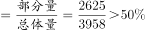，正确；

B项：定位表格材料，东南铁合金厂的工人数为2294人，中南铁合金厂为2910人，2294＜2910，故东南铁合金厂的工人数比中南铁合金厂少，正确；

C项：定位表格材料，东北铁合金厂的工人数为4495人，东南铁合金厂为2294人，西北铁合金厂为2625人，2294+2625=4919＞4495，故东北铁合金厂的工人数比东南铁合金厂和西北铁合金厂的工人数总和少，错误；

D项：定位表格材料，各厂工人数占职工总数的比重分别为：

东北铁合金厂：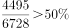；

东南铁合金厂：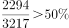；

西北铁合金厂：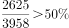：

西南铁合金厂：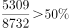；

中南铁合金厂：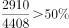；

综上可知，各厂工人数均占职工数的一半以上，正确。

本题为选非题，故正确答案为C。

## 材料 6

根据2007年某公司成本统计图，完成各题。

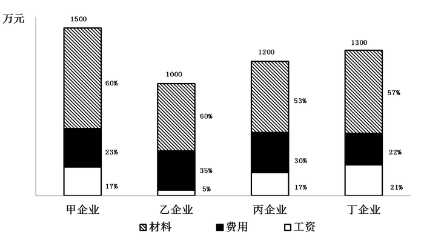

### 第 131 题

费用支出最高的企业是：

A. 甲企业

B. 乙企业

C. 丙企业

D. 丁企业

第 131 题 · 答案与解析

**参考答案（粉笔题库参考内容）**

C

**解析**

根据题干“费用支出最高的企业是”，结合材料给出的成本及费用支出占成本的比重，可判定本题为现期比重问题。定位图形材料可得：甲企业成本为1500万元、费用支出占比为23%；乙企业成本为1000万元、费用支出占比为35%；丙企业成本为1200万元、费用支出占比为30%；丁企业成本为1300万元、费用支出占比为22%。则根据部分量，可得各企业费用支出分别为：

甲企业：万元；

乙企业：万元；

丙企业：万元；

丁企业：万元。

通过比较可得，丙企业费用支出最高（360万元）。

故正确答案为C。

### 第 132 题

材料成本最高的企业是：

A. 甲企业

B. 乙企业

C. 丙企业

D. 丁企业

第 132 题 · 答案与解析

**参考答案（粉笔题库参考内容）**

A

**解析**

根据题干“材料成本最高的企业是”，结合材料给出的成本及材料成本占成本的比重，可判定本题为现期比重问题。定位图形材料可得：甲企业成本为1500万元、材料成本占比为60%；乙企业成本为1000万元、材料成本占比为60%；丙企业成本为1200万元、材料成本占比为53%；丁企业成本为1300万元、材料成本占比为57%。则根据部分量，可得甲企业总体量（1500万元）和比重（60%）都是最大的，故其乘积也最大，因此材料成本最高的是甲企业。

故正确答案为A。

### 第 133 题

支付工资最少的企业是：

A. 甲企业

B. 乙企业

C. 丙企业

D. 丁企业

第 133 题 · 答案与解析

**参考答案（粉笔题库参考内容）**

B

**解析**

根据题干“支付工资最少的企业是”，结合材料给出的成本及支付工资占成本的比重，可判定本题为现期比重问题。定位图形材料可得：甲企业成本为1500万元、支付工资占比为17%；乙企业成本为1000万元、支付工资占比为5%；丙企业成本为1200万元、支付工资占比为17%；丁企业成本为1300万元、支付工资占比为21%。则根据部分量，可得乙企业总体量（1000万元）和比重（5%）都是最小的，故其乘积也最小，因此支付工资最少的是乙企业。

故正确答案为B。

### 第 134 题

成本最大的企业是：

A. 甲企业

B. 乙企业

C. 丙企业

D. 丁企业

第 134 题 · 答案与解析

**参考答案（粉笔题库参考内容）**

A

**解析**

定位图形材料，可得各企业成本分别为：甲企业1500万元、乙企业1000万元、丙企业1200万元、丁企业1300万元，因此成本最大的是甲企业（1500万元）。

故正确答案为A。

### 第 135 题

利润排前两位的企业是：

A. 甲企业和乙企业

B. 乙企业和丁企业

C. 甲企业和丙企业

D. 无法判断

第 135 题 · 答案与解析

**参考答案（粉笔题库参考内容）**

D

**解析**

定位图形材料，材料分别给出了甲、乙、丙、丁各企业的成本，以及材料成本、费用支出、支付工资占成本的比重，未提及各企业利润，故无法计算出利润排前两位的企业。

故正确答案为D。

